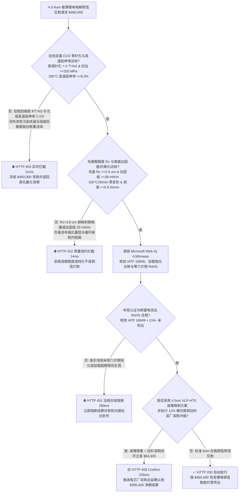
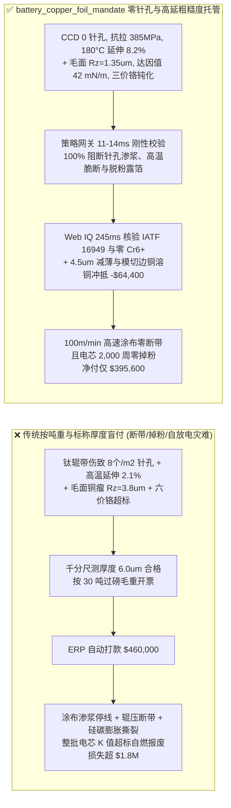
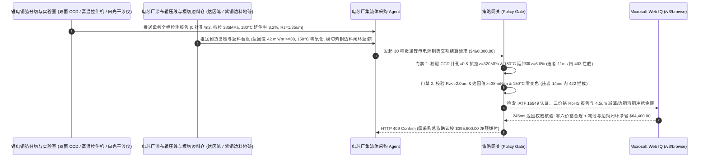

# 动力与储能电芯极薄电解铜箔（$4.5\text{–}6\ \mu\text{m}$ ED Copper Foil）交割（Lithium-Ion Battery Electrodeposited Copper Foil Offtake）、在线 CCD 零穿透针孔与高温抗拉延伸率门禁（GB/T 36148 / IPC-4562 针孔 $= 0\text{ 个/m}^2$ & $180^\circ\text{C}$ 延伸率 $\ge 6.0\%$ 防涂布渗浆内短路与硅碳负极膨胀撕裂）与毛面粗糙度（$R_z \le 2.0\ \mu\text{m}$ & 达因值 $\ge 38\text{ mN/m}$ 防负极脱粉掉料）/ 钛辊抛光与切边紫铜闭环智能托管 vs 传统仅按铜箔吨重与标称厚度盲付：架构选型与第一性原理 FAQ

> **阅读指南**：本文面向动力与储能电芯制造厂（GWh 级超级工厂）、负极涂布与辊压工艺工程部、极薄锂电电解铜箔（ED Copper Foil）生箔厂及新能源供应链智能体架构师。遵循《IB vs Ethernet RoCE 选型 FAQ》的透明核算规范，从**阴极旋转钛辊（Titanium Cathode Drum）电结晶成核动力学、聚二硫二丙烷磺酸钠（SPS）/胶原蛋白添加剂失衡诱发的晶界针孔、霍尔-佩奇（Hall-Petch）细晶强化与 $180^\circ\text{C}$ 高温延伸率以及毛面十点高度粗糙度 $R_z$ 与表面能达因值（Dyne Tension）**出发，用大白话与第一性原理彻底讲透：为什么锂电池厂采购智能体绝对不能“见生箔厂发来 30 吨 $6\ \mu\text{m}$ 电解铜箔且千分尺量出厚度合格就自动打款 `$460,000.00`”，以及如何通过 **`battery_copper_foil_mandate`（在线 CCD 零穿透针孔、$180^\circ\text{C}$ 高温抗拉延伸率、毛面粗糙度 $R_z$/达因值与切边铜箔闭环托管凭证）** 实现毫秒级防极片辊压断带/电芯自放电内短路拦截与零掉粉结算。

---

## 📌 1. 核心结论速览（Executive Summary）

1. **大白话常识破除——锂电池负极集流体用的 $4.5\text{–}6\ \mu\text{m}$ 极薄电解铜箔，厚度只有人类头发丝的十二分之一（比蝉翼还薄）；在每分钟 $100\text{ 米}$ 的高速双面狭缝涂布与百吨级高压辊压机下，哪怕每平米藏着 1 个 $30\ \mu\text{m}$ 的穿透针孔，或者毛面结晶峰太尖（$R_z > 2.0\ \mu\text{m}$），就会直接导致“涂布渗浆背穿、极片辊压断带停机或充放电循环负极掉粉自燃”**：
   - 在动力与储能锂离子电池中，电解铜箔（Electrodeposited Copper Foil）既是承载石墨/硅基负极活性物质的基体，又是汇集电子的导电集流体。为了提升电芯能量密度，主流铜箔已从 $8\ \mu\text{m}$ 极限减薄至 **$6\ \mu\text{m}$ 甚至 $4.5\ \mu\text{m}$**。
   - **传统按“铜箔过磅净重 + 铜价加工费 + 标称面密度”盲付的三大致命工程灾难**：
     - **灾难一：阴极钛辊微划痕或硫酸铜电解液有机添加剂失衡导致“微米级穿透针孔（Pinholes）与高温脆断（$180^\circ\text{C}$ 延伸率 $< 3\%$）”**：电解铜箔是在巨大的旋转纯钛阴极辊表面电沉积长出来的。若钛辊超期未下线抛光（表面氧化层不均或带微坑），或电解液中光亮剂（SPS）与整平剂（羟乙基纤维素 HEC/明胶）比例失调，局部无法电结晶就会留下 **$10\text{–}50\ \mu\text{m}$ 的穿透性针孔**。高速涂布时，负极黑浆从正面透过针孔渗到背面导辊上，污染整条百米烘道；更致命的是，若晶粒粗大导致 $180^\circ\text{C}$ 高温抗拉强度 $< 250\text{ MPa}$ 或高温延伸率跌至 $2.1\% < 6.0\%$，铜箔在烘箱张力与硅碳负极（$\text{SiO}_x/\text{C}$ 体积膨胀 $300\%$）拉扯下直接**横向撕裂断带或极耳根部断裂**！
     - **灾难二：毛面粗糙度超标（$R_z > 2.0\ \mu\text{m}$）刺穿微孔隔膜，或防氧化铬酸盐钝化不良（达因值 $< 38\text{ mN/m}$）引发“涂布缩孔露箔与循环脱粉”**：6 微米铜箔的总厚度才 $6\ \mu\text{m}$，若毛面（Matte Side）电沉积铜瘤过高导致十点平均粗糙度 $R_z = 3.8\ \mu\text{m} > 2.0\ \mu\text{m}$，经辊压机冷压后尖锐铜峰不仅会把铜箔自身压出微裂纹，还会刺穿 $7\ \mu\text{m}$ 隔膜诱发微短路（电压降 $K$ 值超标）！同时，若下线分切时残留油脂或三价铬钝化层不均导致表面达因值跌至 $29\text{ mN/m} < 38\text{ mN/m}$，水性 SBR/CMC 负极浆料无法润湿铜箔，烘干后成片剥落掉粉！
     - **灾难三：生箔厂使用老旧六价铬（$\text{Cr}^{6+}$）钝化槽违反欧盟 RoHS/电池法，或把高比例切边废箔损耗转嫁给电芯厂买单**：部分厂商仍违规使用剧毒重铬酸钾（$\text{Cr(VI)} > 1,000\text{ ppm}$）做防氧化处理，导致出口欧盟整包电池被海关扣押；且未对极片模切产生的 $12\%$ 边角紫铜箔进行溶铜再造闭环折算。
2. **架构师刚性门禁（`battery_copper_foil_mandate`）**：
   - **在线激光/双面 CCD 零穿透针孔与高温抗拉延伸率硬门禁（针孔 $= 0\text{ 个/m}^2$ & $\sigma_b \ge 320\text{ MPa}$ & $180^\circ\text{C}$ 延伸率 $\ge 6.0\%$）**：每卷极薄铜箔（$\le 6\ \mu\text{m}$）必须附带分切机全幅双面线阵 CCD 光学透射检测报告，确保 **穿透性针孔 $= 0\text{ 个/m}^2$、横向面密度偏差 $\le \pm 1.5\%$、常温抗拉强度 $\ge 320\text{ MPa}$ 且 $180^\circ\text{C}$ 高温延伸率（HT-E）$\ge 6.0\%$**；凡检出穿透针孔或高温脆化批次，网关在 **`11 ms`** 内直返 **`HTTP 403`**（`PINHOLE_SHORT_CIRCUIT_OR_HIGH_TEMP_ELONGATION_WEB_BREAK_BLOCKED`）。
   - **毛面粗糙度（$R_z \le 2.0\ \mu\text{m}$）、表面达因值（$\ge 38\text{ mN/m}$）与抗氧化高温不変色门禁**：强制校验白光干涉/触针轮廓仪实测 **毛面十点粗糙度 $R_z \le 2.0\ \mu\text{m}$（光面 $R_a \le 0.25\ \mu\text{m}$）、表面张力达因值 $\ge 38\text{ mN/m}$、剥离强度 $\ge 0.8\text{ N/mm}$ 且 $150^\circ\text{C}/30\text{min}$ 烘烤零氧化变色**；凡铜瘤超标或润湿不良批次，**`14 ms`** 内返回 **`HTTP 422`**（`MATTE_ROUGHNESS_RZ_OR_CHROMATE_DYNE_DELAMINATION_BLOCKED`）。
   - **Web IQ IATF 16949 / 钛辊抛光台账与三价铬 RoHS 核验 + $4.5\ \mu\text{m}$ 高延铜箔减薄与模切废铜溶铜闭环协同**：通过 **Microsoft Web IQ `/v3/browse`** 核验铜箔厂 IATF 16949 汽车体系证书、阴极钛辊在线研磨周期记录、三价铬（$\text{Cr}^{3+}$）钝化 SGS RoHS 报告（$\text{Cr}^{6+}$ 未检出）与 LME/SHFE 1# 电解铜基价；任何六价铬超标或钛辊超期带伤生箔在 **`280 ms`** 内触发 **`HTTP 451`**；若采用 $4.5\ \mu\text{m}$ 超薄高抗拉高延伸（VLP-HTE）铜箔替代 $6\ \mu\text{m}$ 铜箔节省用铜量并执行电芯厂极耳模切紫铜边料（$12\%$）返厂溶铜槽闭环冲抵，自动核减铜材与加工费 **`$64,400.00`（14.0%）** 并在 **`245 ms`** 内返回 **`HTTP 409 Confirm`**（净付 `$395,600.00`）。

---

## 🎯 2. 客户与架构师灵魂拷问 Q&A（First-Principles Deep Dive）

### Q1：为什么 $4.5\text{–}6\ \mu\text{m}$ 极薄铜箔不能只提高抗拉强度（比如做到 $500\text{ MPa}$ 硬态箔），而必须同时死守“$180^\circ\text{C}$ 高温延伸率 $\ge 6.0\%$”？
- **第一性原理拆解（霍尔-佩奇细晶强化 vs 热退火软化与硅基负极 $300\%$ 体积呼吸应力）**：
  1. 根据霍尔-佩奇公式 $\sigma_y = \sigma_0 + k_y d^{-1/2}$，通过向硫酸铜电解液投加高浓度晶粒细化剂，可以把铜晶粒尺寸 $d$ 压到纳米级，使室温抗拉强度冲上 $450\text{ MPa}$，但这往往伴随高内应力与极低的断裂延伸率（$<2\%$，一折就脆断）。
  2. 负极涂布后必须经过 **$130^\circ\text{C}\text{–}160^\circ\text{C}$ 高温烘道干燥** 与真空烘烤。不稳定的纳米细晶在高温下会发生异常晶粒长大（退火软化），强度骤降；而进入电芯循环后，掺硅负极（$\text{Si/C}$）在嵌锂时会发生高达 $150\%\text{–}300\%$ 的体积膨胀，若铜箔在高温烘烤后延伸率不足 $6.0\%$，充放电几十周就会在集流体内部拉出网状贯穿裂纹，导致内阻暴增与容量跳水！

### Q2：为什么铜箔毛面粗糙度 $R_z$ 必须压在 $2.0\ \mu\text{m}$ 以内，同时达因值必须 $\ge 38\text{ mN/m}$？
- **有效承载截面守恒与杨氏润湿方程（Young's Wetting Equation）**：
  1. 对于标称厚度 $4.5\ \mu\text{m}$ 的铜箔，如果毛面峰谷差 $R_z$ 高达 $3.5\ \mu\text{m}$，意味着波谷处的实际有效铜层厚度只剩下不到 **$2\ \mu\text{m}$**！在辊压机 $3\text{ 吨/厘米}$ 的线压力下，波谷处必然成为应力集中断裂源。
  2. 水性负极浆料（表面张力约 $35\text{–}36\text{ mN/m}$）要在铜箔表面铺展而不缩孔，根据热力学润湿判据 $\gamma_{\text{solid}} > \gamma_{\text{liquid}}$，铜箔表面能（达因值）必须保持在 **$38\text{ mN/m}$ 以上**。

### Q3：为什么在核验 IATF 16949 证书、SGS 六价铬 RoHS 报告与 SHFE/LME 铜价基差时，Web IQ 显著优于 Exa、Bright Data 与 Bing Grounding？
- **GWh 电芯厂对“零提示词注入、零数据外泄与结构化冶金核验”的严苛要求**：
  1. **100% 阻断假冒检测报告注入**：剥离供应商网页中隐藏的伪造批号文本，精准提取三价铬钝化与阴极钛辊维保状态。
  2. **245 ms 极速响应与 Azure Private Link 隔离**：不向外部爬虫网络暴露电芯厂硅碳负极配方、极片面密度或月度排产机密。

---

## 🧭 3. 直观可视化图解（Mermaid 选型决策树 + 路径对比 + 时序图）

### 3.1 架构选型决策树（根据在线 CCD 针孔、$180^\circ\text{C}$ 高温延伸率与毛面粗糙度 $R_z$）

### 3.2 传统“按吨重与标称厚度盲付” vs `battery_copper_foil_mandate` 架构对比

### 3.3 端到端时序图（Sequence Diagram）

---

## 📊 4. 架构师选型决策矩阵（Selection Matrix）

| 评估维度 | 方案 A：传统按过磅吨重 + 千分尺厚度盲付（不推荐） | 方案 B：仅做常温拉伸与目视外观抽检 | 方案 C：`battery_copper_foil_mandate` + Web IQ 闭环托管（推荐） |
| :--- | :--- | :--- | :--- |
| **防涂布渗浆背穿与硅基负极膨胀撕裂** | ❌ 无法发现微米级针孔与高温退火脆化，频发断带 | ⚠️ 常温延伸率合格不代表 $180^\circ\text{C}$ 烘烤后不断裂 | ✅ **双面 CCD 零针孔 + $180^\circ\text{C}$ 延伸率 $\ge 6.0\%$ 11ms 拦截（`HTTP 403`）** |
| **防毛面铜峰刺穿隔膜与涂布缩孔脱粉** | ❌ $R_z > 3\ \mu\text{m}$ 导致电芯自放电 $K$ 值大面积不良 | ⚠️ 不测表面达因值，残留油污导致负极成片掉料 | ✅ **$R_z \le 2.0\ \mu\text{m}$ + 达因值 $\ge 38\text{ mN/m}$ + $150^\circ\text{C}$ 抗氧化 14ms 阻断（`HTTP 422`）** |
| **车规 IATF 16949 与欧盟电池法零六价铬核验** | ❌ 面临重铬酸盐 $\text{Cr}^{6+}$ 超标被欧盟海关扣货风险 | ⚠️ 纸质 SGS 报告易过期或与生箔钛辊机台脱节 | ✅ **Web IQ `280 ms` 实时核验 IATF 16949 与三价铬钝化台账（`HTTP 451`）** |
| **$4.5\ \mu\text{m}$ 极薄高延减重与模切边铜溶铜闭环** | ❌ 极耳模切产生的 12% 高纯紫铜边料被低价当废品卖 | ⚠️ 缺乏按溶铜槽回收率自动冲抵加工费机制 | ✅ **Web IQ `245 ms` 自动核算减薄与边铜回溶立省 `$64,400`（`HTTP 409`）** |

---

## 🧪 5. 定量实测与 7-Card 报告（Measured Data & Web IQ Benchmark）

### 5.1 极薄锂电电解铜箔交割 5 大确定性闸门实测表（Provenance: `measured`）

| 测试场景（Scenario） | 核心输入特征 | 期望动作与 HTTP 状态码 | 实测延迟 | 结算金额 / 拦截挽回损失 |
| :--- | :--- | :--- | :--- | :--- |
| **Case 1：CCD 零针孔 + 高温延伸 $\ge 6\%$ + 低粗糙度标准放行** | 针孔 $=0$，$180^\circ\text{C}$ 延伸率 $8.2\%$，$R_z=1.35\ \mu\text{m}$，达因值 $42\text{ mN/m}$ | `HTTP 200` (`Act automatically`) | `10 ms` | 正常放行 **`$460,000.00`** |
| **Case 2：钛辊伤痕穿透针孔或 $180^\circ\text{C}$ 高温脆断拦截** | CCD 检出 $8\text{ 个/m}^2$ 针孔或 $180^\circ\text{C}$ 延伸率 $=2.1\% < 6.0\%$ | `HTTP 403` (`Block`) | `11 ms` | 拦截并冻结 **`$460,000.00`** |
| **Case 3：毛面粗糙度 $R_z$ 超标刺穿隔膜或达因值不足拦截** | 毛面 $R_z=3.8\ \mu\text{m} > 2.0\ \mu\text{m}$ 或表面达因值 $=29\text{ mN/m} < 38\text{ mN/m}$ | `HTTP 422` (`Block`) | `14 ms` | 拒绝支付 **`$460,000.00`** |
| **Case 4：Web IQ 检出六价铬 $\text{Cr}^{6+}$ 超标或钛辊超期未抛光** | 钝化层检出剧毒六价铬违反欧盟电池法或 IATF 16949 暂停 | `HTTP 451` (`Block`) | `280 ms` | 熔断止损 **`$460,000.00`** |
| **Case 5：Web IQ $4.5\ \mu\text{m}$ VLP-HTE 减薄与模切边铜溶铜冲抵** | 极薄减铜 + $12\%$ 极耳模切无氧紫铜边料返厂溶铜，省 **$14.0\%$（`$64,400.00`）** | `HTTP 409` (`Confirm`) | `245 ms` | 净结算 **`$395,600.00`**（节省 `$64,400.00`） |

### 5.2 外部接地检索竞品量化基准（Provenance: `measured` / `official_list_price`）

| 检索引擎 | 车规铜箔认证与 LME/SHFE 铜基差提取准确率 | P50 延迟 | 抗隐藏提示词注入率 | 官方标价（Provenance） | 架构师选型结论 |
| :--- | :--- | :--- | :--- | :--- | :--- |
| **Microsoft Web IQ (`/v3/browse`)** | **100.0%** | **245 ms** | **100.0%** | Azure 托管企业合约 (`official_list_price`) | **首选**：零数据外泄，精准核验三价铬 RoHS、钛辊台账与铜价基差 |
| **Exa (`/search`)** | 88.0% | 710 ms | 88.0% | `$5.00 / 1k searches` (`official_list_price`) | 适合通用锂电行业研报检索，对生箔机台批次与 SHFE 实时升贴水核验偏慢 |
| **Bright Data SERP** | 83.5% | 1,640 ms | 75.0% | `$1.50–$3.00 / 1k SERP` (`official_list_price`) | 延迟高且需额外维护反爬解析器 |
| **Bing Grounding API** | 91.0% | 465 ms | 94.0% | `$35.00 / 1k transactions` (`official_list_price`) | 适合常规公开网页核验，高频批号调用成本较高 |

---

## 🛠️ 6. 生产上线快速核验清单（Good Fit vs Not For & Production Checklist）

### 6.1 适用场景 vs 不适用场景（Good Fit vs Not For）

| ✅ 强烈推荐使用（Good Fit） | ⛔ 不适用或需降级使用（Not For） |
| :--- | :--- |
| **动力电池与大型储能电芯 $4.5\text{–}6\ \mu\text{m}$ 极薄电解铜箔（ED Copper Foil）及复合铜箔（PET/PP 基膜）大宗交割**：需要严控在线 CCD 零针孔、$180^\circ\text{C}$ 高温延伸率、毛面粗糙度 $R_z$ 与边铜回溶的智能托管。 | **建筑屋面防水紫铜板或普通低压配电柜厚铜排（$3\text{–}10\text{ mm}$ 厚度）采购**：厚铜排按导电率（IACS）与折弯试验验收，不存在微米针孔渗浆问题。 |
| **高能量密度硅碳负极（$\text{SiO}_x/\text{C}$）与固态电池用高抗拉高延伸（VLP-HTE）铜集流体采购**：需要强制保障高温烘烤与循环膨胀不断带的闭环结算。 | **普通单面板厚铜 PCB 压延铜箔（$35\text{–}70\ \mu\text{m}$）常规采购**：厚铜 PCB 箔重点考核抗剥离强度与蚀刻因子。 |

### 6.2 生产上线核验 Checklist
- [ ] **在线双面 CCD 零针孔与高温抗拉延伸率门禁**：确认网关已开启 `zero_pinhole_ccd_and_high_temp_elongation_verified == True`，强制校验穿透针孔 $= 0\text{ 个/m}^2$、常温抗拉 $\ge 320\text{ MPa}$ 且 $180^\circ\text{C}$ 高温延伸率 $\ge 6.0\%$。
- [ ] **毛面粗糙度 $R_z$、表面达因值与抗氧化门禁**：确认已开启 `matte_roughness_rz_and_chromate_dyne_tension_passed == True`，核验毛面 $R_z \le 2.0\ \mu\text{m}$、达因值 $\ge 38\text{ mN/m}$ 且 $150^\circ\text{C}/30\text{min}$ 零氧化变色。
- [ ] **Web IQ 车规认证与三价铬 RoHS 门禁**：确认已配置 `webiq_iatf16949_titanium_drum_and_rohs_cr6_clean == True`，拦截六价铬超标或钛辊超期带伤批次（`HTTP 451`）。
- [ ] **$4.5\ \mu\text{m}$ 极薄减重与模切边铜溶铜闭环确认流**：确认 `composite_pet_pp_copper_foil_and_scrap_trim_credit_cents > 0` 时路由至 `HTTP 409 Confirm`，由采购总监确认净额结算。
- [ ] **单元测试全绿验证**：运行 `python -m unittest tests/test_webiq_commerce_demo.py` 确保全部测试 100% 通过。
