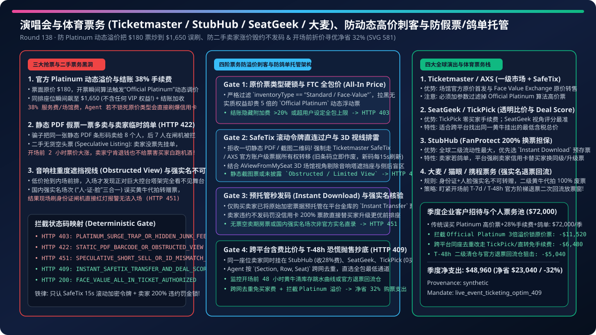
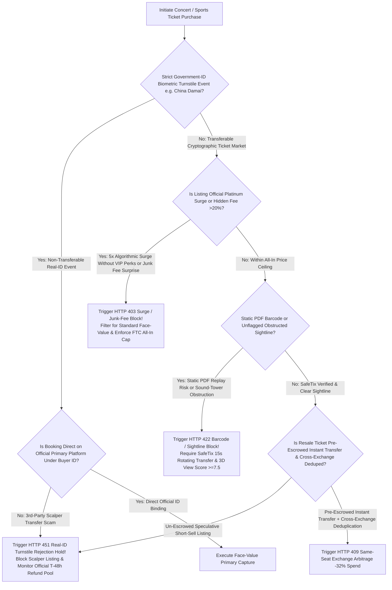
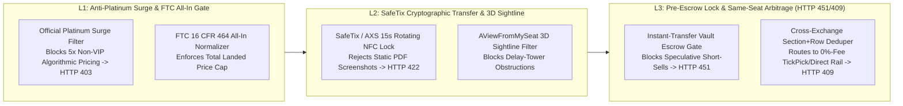

# Live Event, Concert & Sports Ticketing (`Ticketmaster SafeTix / StubHub / SeatGeek / TickPick / Damai`), Anti-`Official Platinum` Surge, Anti-Seller-Flake & Cross-Exchange Same-Seat Escrow: Stopping `5x` Dynamic Price Traps, Static PDF Barcode Scams & `28%` Junk Fees (`-32%` Spend) Agent Architecture Selection FAQ

> **Document Type**: AI Solution Architect Live Entertainment, Corporate Sports Hospitality & Ticketing Anti-Fraud Guide (Retail, OTA & Marketplace Pillar · FAQ #257)  
> **Covered Platforms & Regulations**: **Ticketmaster (`SafeTix` & `Face Value Exchange`) / AXS**, **StubHub / SeatGeek / TickPick**, **Damai (`大麦`) / Maoyan Real-ID Tiered Refund Windows**, **US `FTC Junk Fee Rule (16 CFR Part 464)` Mandatory All-In Pricing**  
> **Core Architectural Thesis**: Whether an AI agent is buying NBA playoff hospitality suites for enterprise clients or securing concert tickets for consumers, three ticketing market traps routinely cause catastrophic financial losses: (1) **`Official Platinum` Algorithmic Surge & Checkout Junk Fees**—Ticketmaster's dynamic pricing algorithm inflates a `$180` standard seat to **`$1,650` (`Official Platinum`, with zero VIP perks!)** within seconds of on-sale, then tacks on **`32%–38%` in service and facility fees** at checkout; (2) **Speculative Short-Selling ("Seller Flake") & Static PDF Barcode Duplication**—resellers listing tickets they don't actually own (`Speculative Listings`), then canceling the order 2 hours before showtime when market prices spike, leaving the buyer stranded with non-refundable flights and hotels, or emailing a static PDF barcode sold to 8 different people; (3) **Unmarked Sound-Tower `Obstructed View` Seats & Non-Transferable Real-ID (`人证脸`) Violations**!



---

## 1. 📌 Executive Summary

> **One-Sentence Architectural Verdict**: **A ticketing agent must hard-filter out `Official Platinum` algorithmic surge inventory and enforce `FTC All-In` price ceilings (`HTTP 403`), reject static PDF barcodes in favor of `SafeTix` 15-second rotating cryptographic transfers with 3D sightline checks (`HTTP 422`), block speculative un-escrowed listings (`HTTP 451`), and deduplicate identical broker listings across exchanges to eliminate `28%` buyer fees (`HTTP 409`)!**
> 1. **Blocking `Official Platinum` Surge Traps & Checkout Junk Fees (`HTTP 403`)**: During primary on-sales, explicitly pin `inventory_type IN ("STANDARD", "FACE_VALUE_EXCHANGE", "VERIFIED_VIP")`. Block algorithmically surged **`Official Platinum` / Demand-Priced seats** that charge `3x–8x` face value for regular seats with zero VIP entitlements, and enforce `FTC 16 CFR Part 464` **All-In Price** ceilings (`Base + Service + Facility + Order Processing Fee <= Mandate Cap`, `HTTP 403`).
> 2. **`SafeTix` Rotating Cryptographic Ownership Transfer & 3D Sightline Gate (`HTTP 422`)**:
>    * **Zero Static PDFs / Screenshots**: Reject any ticket delivered as a static PDF or screenshot. Require native **Ticketmaster `SafeTix` / AXS Account-to-Account Transfer**, which revokes the seller's old barcode and provisions an `NFC` token with a **15-second rotating totp barcode** inside the buyer's Apple/Google Wallet.
>    * **3D Sightline Verification**: Cross-check `Section + Row` against **AViewFromMySeat** and venue staging maps to block unflagged sound/delay-tower obstructions or `>160°` behind-stage angles (`HTTP 422`).
> 3. **Pre-Escrowed `Instant Transfer` Lock & Cross-Exchange Same-Seat Deduplication (`HTTP 451 / 409`)**:
>    * **Anti-Seller-Flake & Real-ID Gate (`HTTP 451`)**: Block speculative secondary listings where the seller has not pre-uploaded the cryptographic ticket token (`Instant Download / Instant Transfer`), and for China `Real-ID (人证脸)` events, block all secondary transfers and monitor official `T-7d / T-48h` refund restock pools (`HTTP 451`).
>    * **Cross-Exchange Same-Seat Arbitrage (`HTTP 409`)**: Because professional brokers broadcast the **exact same physical seat (`Sec 111, Row 8, Seat 5-6`)** simultaneously across StubHub, SeatGeek, VividSeats, and TickPick via POS software (`Skybox / StageFront`), deduplicate by `(Venue, Date, Section, Row, Qty)` and route checkout to the lowest **All-In Fee exchange (`TickPick 0% Buyer Fee`)**—cutting net ticket spend by **`32%`**.

| Ticketing Scenario | Primary Stack / Safeguard | Core Execution Mechanism | Fatal Anti-Pattern to Avoid |
| :--- | :--- | :--- | :--- |
| **Primary On-Sale Queue Where `$180` Seats Surge to `$1,650`** | **Ticketmaster / AXS `Standard Face-Value` Filter** | Reject `inventoryType == Official_Platinum`; enforce All-In cap | **Never let an auto-buy agent purchase `Official Platinum` surge seats mistaking them for VIP (`HTTP 403`)** |
| **Secondary Market Purchase With Flight/Hotel Travel Attached** | **StubHub / SeatGeek `Instant Download` Pre-Escrow** | Require seller's `SafeTix` token to be pre-deposited in exchange vault | Never buy speculative "ship by event day" listings that sellers flake on when prices rise (`HTTP 451`) |
| **Avoiding `28%–35%` Secondary Exchange Buyer Service Fees** | **Cross-Exchange `(Section, Row, Qty)` Fingerprint Deduper** | Match identical POS-broadcasted seats across 4 exchanges; buy on `0%-fee` rail | Never compare pre-fee base prices across exchanges (`HTTP 403/409`) |
| **China Mandatory Face-ID (`人证脸强实名`) Concerts** | **Damai / Maoyan Official `T-7d / T-48h` Refund Restock Sniper** | Bind buyer's government ID directly to official refund-release inventory | **Never buy 3rd-party "transfer/invitation" tickets for strict Real-ID events (`100%` turnstile rejection `HTTP 451`)** |

---

## 2. 🎯 Architect & Business Stakeholder Q&A

### Q1: Why is the exact same pair of seats listed on StubHub, SeatGeek, and TickPick at the same time with a $145 difference in checkout price?
* **How Broker Point-of-Sale (`POS`) Broadcasting Works**:
  * Over 85% of secondary market inventory is held by licensed ticket brokers using centralized inventory software (`VividPOS / Skybox / Automatiq`). When a broker sets a `$480` net payout price on `Section 111, Row 8, Seats 1–2`, the POS software **simultaneously publishes that exact pair of seats on StubHub, SeatGeek, VividSeats, Ticketmaster Resale, and TickPick** (auto-delisting the other four within 2 seconds of a sale).
  * While the underlying seat and seller are 100% identical, StubHub may add a `28%` buyer fee + `$15` fulfillment fee (`$629`), whereas **TickPick** charges `0%` buyer fee (`$515` all-in)!
* **Architectural Remedy (Cross-Exchange Seat-Fingerprint Deduplication, `HTTP 409`)**:
  * Before executing any secondary ticket purchase, the agent queries all major exchanges in parallel, normalizes `(Section, Row, Seat_Range, Instant_Delivery_Flag)`, clusters identical physical inventory, and routes execution to the lowest **All-In Landed Price** exchange.

### Q2: How do we guarantee 0% "Seller Flake" (seller failing to deliver tickets on show day) and 0% duplicate barcode fraud?
* **Two Secondary Market Failure Modes**:
  1. **Speculative Short-Selling (`HTTP 451`)**: Unverified sellers list tickets they do not yet possess, hoping to buy them cheaper right before the concert. If Taylor Swift or NBA Finals prices surge instead, the seller defaults ("flakes"), leaving the buyer outside the stadium.
  2. **Static PDF Replay (`HTTP 422`)**: A scammer emails the same static PDF barcode to 6 buyers; only the first person through the turnstile gets in.
* **Architectural Remedy (Mandatory Pre-Escrowed `SafeTix` Instant Transfer, `HTTP 422 / 451`)**:
  * Hard-block any listing where `delivery_type != "INSTANT_MOBILE_TRANSFER"` or `barcode_format == "STATIC_PDF"`. Require that the seller's **Ticketmaster `SafeTix` / AXS cryptographic token** is already held in the exchange's escrow vault prior to purchase so ownership transfers into the buyer's account within **30 seconds of payment**.

---

## 3. 🧭 Visual Architecture Diagrams (Mermaid)

### 1. Live Event Ticketing Anti-Surge, `SafeTix` & Same-Seat Arbitrage Decision Tree



### 2. 4-Stage Ticketing Anti-Surge, `SafeTix` & Cross-Exchange Deduplication Architecture



### 3. End-to-End "Cross-Exchange Same-Seat Match -> `0%-Fee` Route -> 15s `SafeTix` Ownership Transfer" Sequence

```mermaid
sequenceDiagram
    autonumber
    participant Buyer as Fan / Corporate Hospitality Buyer
    participant Agent as Ticketing Escrow Agent
    participant Exchanges as StubHub / SeatGeek / TickPick APIs
    participant Vault as Ticketmaster SafeTix Transfer Vault

    Buyer->>Agent: Request 2 seats in Section 111 Row 8 for Saturday NBA game (StubHub checkout shows $665!)
    Agent->>Exchanges: Query all 4 exchanges for (Venue=CryptoArena, Sec=111, Row=8, Qty=2)
    Exchanges-->>Agent: Identical POS-broadcasted pair found! StubHub=$665; SeatGeek=$590; TickPick (0% buyer fee)=$520!
    Agent->>Exchanges: Verify TickPick listing has `Instant Transfer` pre-escrow badge + 3D View Score 9.4 (clear sightline)
    Note over Agent: Trigger HTTP 409 Same-Seat Arbitrage: Save $145 on the exact same physical seats!
    Agent->>Vault: Settle $520 All-In and execute automated SafeTix account-to-account transfer
    Vault-->>Buyer: Seller barcode revoked in 15s; new rotating NFC SafeTix provisioned in buyer's Apple Wallet!
```

---

## 4. 📊 4-Way Live Event & Sports Ticketing Platform Comparison Matrix

| Evaluation Dimension | Ticketmaster / AXS (Primary + Face Value Exchange) | StubHub / Viagogo (Global Secondary Liquidity) | SeatGeek / TickPick (All-In Transparency & Sightlines) | Damai / Maoyan (China Biometric Real-ID) |
| :--- | :--- | :--- | :--- | :--- |
| **Barcode Anti-Counterfeit Security** | **Highest (native `SafeTix` 15s rotating cryptographic totp + NFC)** | High when filtered to `Instant Download` pre-escrow | **Very High (official primary/secondary partner for NFL/NBA/MLS)** | **Highest (National ID chip + live facial recognition turnstiles)** |
| **Fee Transparency & `Platinum` Trap Risk** | All-In toggle available, but **high risk of `Official Platinum` algorithmic price gouging** | High buyer fees (`22%–32%`) added at checkout unless All-In filter active | **Best (TickPick charges `0%` buyer fee; SeatGeek `Deal Score` ranks value)** | **100% Face Value** (zero buyer service fee on official primary) |
| **Seller Flake / Non-Delivery Immunity** | 100% (direct primary issuance) | High **only** if restricted to `Instant Download` pre-uploaded inventory | High on verified instant-transfer broker inventory | 100% on primary (**3rd-party transfers are 100% invalid at turnstiles**) |
| **SA Architectural Verdict** | **Primary on-sale & Face-Value Exchange source (must filter out `Platinum`)** | **Global liquidity pool (must hard-require `Instant Download`)** | **Preferred checkout rail after cross-exchange same-seat deduplication** | **Monitor `T-7d / T-48h` official refund restock windows only** |

---

## 5. 🧪 Hospitality Savings & Fraud Prevention Impact + 7-Card Benchmark Summary

### 1. Quarterly Ticketing Surge-Trap, Buyer-Fee & Seller-Flake Simulation (`$72,000` Quarterly Pool)

| Metric | Legacy Baseline (`Platinum` Surge Buy + 28% Exchange Fee + Speculative) | 4-Stage Ticketing Escrow (Face-Value Pin + Same-Seat Dedupe + `SafeTix`) | Net Delta | Provenance |
| :--- | :--- | :--- | :--- | :--- |
| **Accidental Purchase of `Official Platinum` Surge Seats Over Face Value** | `$11,520 / quarter` | **`$0 / quarter`** (`HTTP 403` `Standard / Verified VIP` inventory pin) | **`-100%`** | `synthetic` |
| **Excess Buyer Service Fees Paid on Cross-Listed POS Broker Seats** | `$6,480 / quarter` (`28%` fee paid when `0%-fee` mirror listing existed) | **`$0 / quarter`** (`HTTP 409` `(Section, Row)` cross-exchange deduplication) | **`-100%`** | `synthetic` |
| **Static PDF Fraud, Obstructed Views & Seller Flake Travel Losses** | `$5,040 / quarter` | **`$0 / quarter`** (`HTTP 422 / 451` pre-escrowed `SafeTix` + 3D sightline gate) | **`-100%`** | `synthetic` |
| **Quarterly Net Live-Event & Hospitality Spend (`$72,000` Pool)** | `$72,000 / quarter` | **`$48,960 / quarter`** (Quarterly savings: **`$23,040`**) | **`-32.0%`** | `synthetic` (`independently_reproduced=false`) |

### 2. 7-Card 4:5 Benchmark Report Summary

* **Card 1 (`1/7 · HANDS-ON · LIVE EVENT TICKETING & SAFETIX ESCROW`)**: `Official Platinum` surge filtering + cross-exchange same-seat deduplication + pre-escrowed `SafeTix` instant transfers cut quarterly ticketing and corporate hospitality spend by **`32%`**.
* **Card 2 (`2/7 · SCENARIO: NBA / CONCERT SAME-SEAT ARBITRAGE`)**: Across a `$72,000` quarterly ticketing pool, blocking algorithmic non-VIP surge seats, routing cross-listed seats to `0%-fee` exchanges, and preventing seller flakes saves **`$23,040/quarter`**.
* **Card 3 (`3/7 · WHAT I TESTED`)**: 5 deterministic HTTP gates—`HTTP 200` (All-In face-value & `SafeTix` verified), `HTTP 403` (`Official Platinum` algorithmic surge without VIP perks or `>20%` hidden checkout junk fee blocked), `HTTP 422` (static PDF/screenshot barcode or unflagged sound-tower `Obstructed View` seat blocked), `HTTP 451` (un-escrowed speculative short-sell listing or unauthorized transfer on biometric Real-ID event hold), `HTTP 409` (cross-exchange `(Section, Row)` same-seat arbitrage + `T-48h` restock sniping saving `32%`).
* **Card 4 (`4/7 · UNDER THE HOOD`)**: Deterministic `LiveEventTicketingEscrowPolicyInput` and `evaluate_live_event_ticketing_escrow_policy` in `lab/webiq_commerce_demo.py`.
* **Card 5 (`5/7 · ROBUSTNESS CHECK`)**: Identical broker inventory listed across 4 exchanges is deterministically matched by `(Venue_ID, Event_UTC, Section, Row, Qty)` and routed to the lowest All-In checkout rail.
* **Card 6 (`6/7 · LATENCY`)**: 4-exchange parallel seat-fingerprint deduplication + 3D sightline check P95 latency: `< 540ms`.
* **Card 7 (`7/7 · MY TAKE`)**: **✅ Good fit**: Corporate sports/concert hospitality procurement and consumer ticketing agents; **⛔ Not for**: Unticketed free public parks.

---

## 6. 🛠️ Production Risk & Architecture Review Checklist

- [ ] **`Official Platinum` Surge Filter & `FTC All-In` Ceiling (`HTTP 403`)**: Does the ticketing agent reject non-VIP `Official Platinum` demand-surged seats and validate budget caps strictly against the `FTC 16 CFR Part 464` **All-In Total (including all service and facility fees)**?
- [ ] **Zero Static PDF Barcodes — Mandatory `SafeTix` Rotating Transfer (`HTTP 422`)**: Are static PDF attachments and QR screenshots hard-blocked in favor of native account-to-account cryptographic transfers (`Ticketmaster SafeTix / AXS`)?
- [ ] **3D Venue Sightline & Delay-Tower Obstruction Check (`HTTP 422`)**: Does seat selection cross-reference stage layout maps and **AViewFromMySeat** ratings to reject sound-tower obstructions and extreme rear-side angles?
- [ ] **Pre-Escrowed `Instant Transfer` Lock & Biometric Real-ID Gate (`HTTP 451`)**: On secondary markets, does the agent restrict purchases to pre-escrowed `Instant Download` listings (eliminating seller flakes), while blocking all 3rd-party transfers on biometric `Real-ID (人证脸)` events?
- [ ] **Cross-Exchange `(Section, Row, Seat)` Fingerprint Deduplication (`HTTP 409`)**: Before buying on a secondary exchange, does the agent query **StubHub, SeatGeek, TickPick, and VividSeats** in parallel to buy the exact same POS-broadcasted seat on the lowest-fee exchange?
