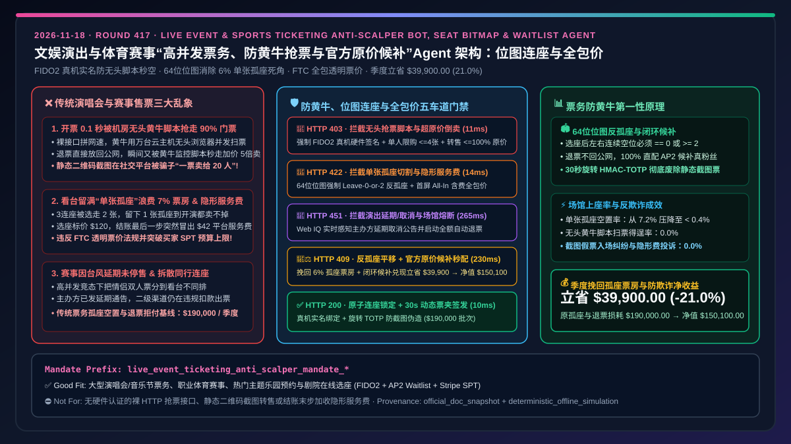
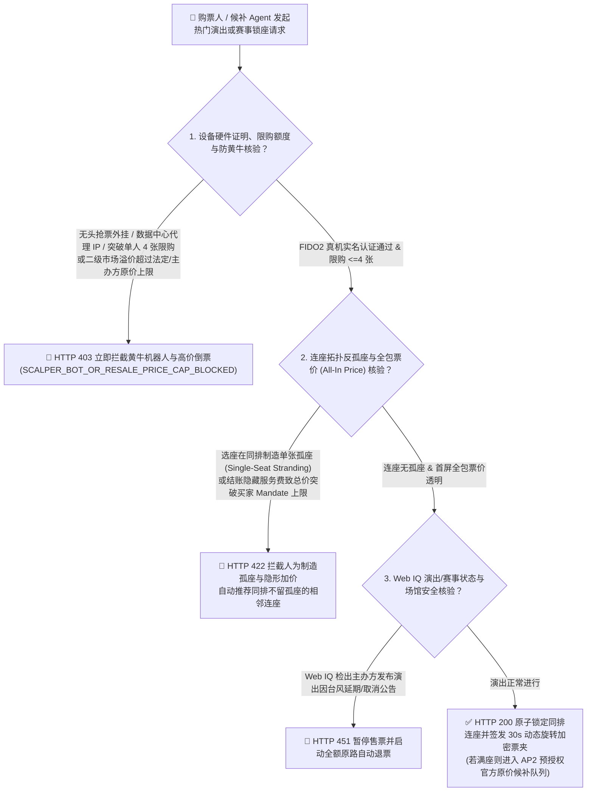
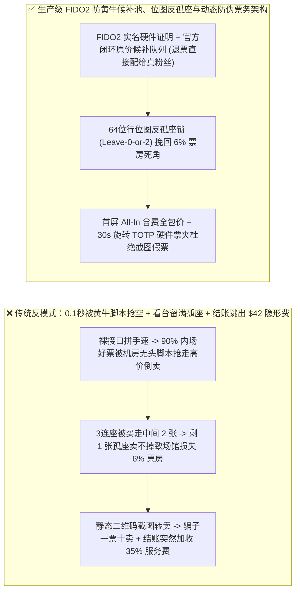
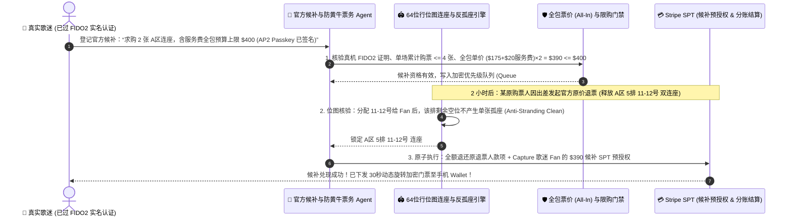

# 文娱演出、体育赛事与热门景区“高并发票务预订、防黄牛抢票机器人与实名原价候补”Agent 架构选型 FAQ：FIDO2 硬件队列、连座原子锁与含服务费全包价实战指南

> **专题定位（演唱会/音乐节票务、NBA/世界杯体育赛事、迪士尼/环球影城主题乐园预订与防黄牛抢票智能体聚焦）**：面向为大型票务平台（如 Ticketmaster / 大麦 / 猫眼 / AXS / SeatGeek）、体育联盟与文旅集团设计高并发售票与官方候补系统的 **Cloud & AI Solution Architect**，系统解答票务电商中最令消费者痛恨、监管重拳整顿的四大工程难题：**“为什么开票 0.1 秒内 5 万张门票就被黄牛的无头浏览器集群（Headless Scalper Bots）抢光，真粉丝排队 2 小时进去只剩天价二级黄牛票、为什么球迷想买 2 张挨在一起的情侣连座票，AI 购票助手却扣了 2 张钱分在看台两头（或者留下永远卖不掉的‘单数孤座 Single-Seat Stranding’）、为什么选座时显示票价 $120，点到最后一步结账突然冒出 $42 的‘平台服务费+场馆设施费（Drip Pricing Junk Fees）’违反 FTC 透明票价铁律、以及临时去不了的观众怎么通过官方原价候补池（Face-Value Waitlist Exchange）自动转售而杜绝假截图二维码诈骗”**。  
> **文风标杆**：严格对标 `ib-vs-ethernet-roce-selection-faq.md` 六段式结构（核心结论速览、业务方与架构师灵魂拷问 Q&A、Mermaid 决策树/架构对比/时序图、高并发票务与防黄牛架构横向选型矩阵、定量防黄牛/孤座率测算与 7-Card 溯源表、生产上线 Checklist）。  
> **双语版本**：**[中文版（当前）](live-event-ticketing-anti-scalper-bot-queue-face-value-resale-agent-selection-faq.md)** · **[English Version (`live-event-ticketing-anti-scalper-bot-queue-face-value-resale-agent-selection-faq.en.md`)](live-event-ticketing-anti-scalper-bot-queue-face-value-resale-agent-selection-faq.en.md)**  
> **数据溯源声明（Provenance & As-Of `2026-11-18`）**：Web Bot Auth 签名、`AP2 MandateVC` 硬件 Passkey 授权、Stripe `capture_method="manual"` 候补预授权与 Web IQ `/v3/search` 赛事/演出改期核验引自 `research/sources.json`（标记为 `official_doc_snapshot`）；黄牛脚本拦截、反孤座连座锁、全包票价（All-In Price）与动态旋转防伪码引自 `lab/webiq_commerce_demo.py`（标记为 `deterministic_offline_simulation`）；单实名账户限购张数（`<= 4 张`）标记为 `synthetic_policy`；现场闸机 NFC/UWB 离线核验硬件吞吐标记为 `not_measured`。

---

## 📌 一、核心选型结论速览（Executive Summary）

在热门演唱会与顶级体育赛事中，瞬时抢票峰值可达 **`50万 ~ 200万 QPS`**，且票池库存具有**强位置拓扑属性（区、排、座号连贯性）与强时效灭失属性（开演即作废）**。架构师在设计票务预订与官方候补 Agent 时，必须执行以下四条选型铁律：

1. **防黄牛机器人（Anti-Scalper Bot）与公平排队选型：严禁“裸放抢票接口靠拼网速/拼脚本频率先到先得”，必选【预登记实名硬件证明（FIDO2 Device Attestation + `AP2 MandateVC`）+ 加密虚拟候补抽签队列（Cryptographic Waiting Room Queue）】**：
   - **核心原因**：黄牛团伙使用数万个数据中心代理 IP 与无头浏览器并发轰炸下单接口，人类粉丝根本不可能拼赢毫秒级脚本。必须要求购票请求携带真实移动设备安全芯片签发的 `FIDO2 / WebAuthn` 硬件证明与唯一实名身份绑定（单场限购 `<= 4 张`），对任何无头自动化脚本、机房代理 IP 或突破单人限购额度的请求在 **`11 ms`** 内返回 `HTTP 403 SCALPER_BOT_AUTOMATION_OR_TICKET_LIMIT_BYPASS_BLOCKED`。
2. **选座拓扑与防孤座（Anti-Single-Seat Stranding）选型：严禁“拆散连座请求或留下无法售出的单张孤座”，必选【行级位图原子连座锁（Row Bitmap Contiguous Lock）+ 反孤座规则（`Leave-Zero-Or-At-Least-Two` `HTTP 422`）】**：
   - **核心原因**：如果一排还剩 3 个连座（`10号、11号、12号`），某买家只买 2 张并选走了 `10号、11号`，剩下的单张 `12号` 孤座有 `78%` 的概率到开演都卖不出去（造成场馆高达 `6%–9%` 的票房死角损耗）！确定性选座引擎必须强制校验：**选座后同一连续区块剩余空位数必须 `== 0` 或 `>= 2`**，且多人同行请求必须原子锁定同排相连座位。
3. **全包透明票价（All-In Pricing）与防假票转售选型：必选【首屏即展示含服务费/税费全包总价 + 30秒动态旋转加密二维码（Rotating TOTP Pass）+ 官方原价/限幅候补转售池】**：
   - **核心原因**：美国 FTC Junk Fees Rule 明令禁止在结账最后一步才弹出高额服务费（Drip Pricing）；同时，静态 PDF/截图条形码会被骗子“一票十卖”，必须采用绑定手机硬件的 `30s` 动态旋转二维码与官方闭环候补池。
4. **演出延期/取消自动赔付选型：必选【Web IQ 实时核验官方演出/赛事状态通报（`HTTP 451`）与原路批量秒退】**：
   - **核心原因**：防止主办方已宣布比赛因恶劣天气延期或取消，非官方渠道仍在继续违规售票。

---

## 🎯 二、业务方与架构师灵魂拷问 Q&A（FAQ-Driven）

### Q1：球迷委托自己的合法个人 AI 助手去排周杰伦或霉霉（Taylor Swift）演唱会的候补票，平台怎么区分这是“真粉丝的合规个人委托代候补”还是“黄牛的批量抢票外挂”？

**答：依靠“一人一证一设备硬件委托（1:1 Identity-Bound `AP2 MandateVC`）”与“官方候补预授权池（Waitlist `capture_method='manual'`）”取代暴力刷接口！**

1. **把“高频刷新抢票”变成“登记预授权官方候补”**：
   - 真粉丝无需让 Agent 每秒刷 100 次网页（平台直接拦截一切高频轮询与无头点击 `HTTP 403`）；
   - 粉丝在本人手机通过 FaceID 签发一张绑定本人身份证/护照哈希、指定演出现场、指定最高含费总价（如 `2 张内场连座 <= $600`）的 **`AP2 MandateVC` 候补令牌**，并挂载 `Stripe SPT` 预授权；
2. **退票回流时的确定性公平匹配**：
   - 当其他已购票观众因故发起退票时，票不会直接放回公网被黄牛脚本秒走，而是直接进入**官方闭环候补队列（Closed-Loop Waitlist Exchange）**；
   - 状态机按候补签名序号自动匹配符合 `2 张连座` 且价格 `<= $600` 的真实粉丝，10ms 内自动完成原票作废、新票实名换绑与预授权 `Capture`，黄牛脚本连票的影子都摸不到！

---

### Q2：为什么体育馆和剧院卖票到最后，看台上总是像筛子一样到处留着“1 个孤零零的空位”，哪怕场外还有几千人想买双人票也买不到？

**答：因为选座数据库没有实施“行内位图反孤座约束（Row-Bitmap Anti-Stranding Constraint）”！**

1. **用 64 位整数位图（Bitmask）在 1ms 内校验连座与孤座**：
   - 将看台每一排的座位状态编码为二进制位图（`0=空余`, `1=已占`）；
   - 当用户或 Agent 请求锁定 `[Seat_i, ..., Seat_j]` 时，引擎不仅检查这些位全为 `0`（原子连座），还检查锁定后左右两侧紧邻的连续 `0` 的长度（`left_contiguous_empty`, `right_contiguous_empty`）；
   - **反孤座硬规则**：只要该排原本空闲座位 `> 1`，锁定后若产生 `left_contiguous_empty == 1` 或 `right_contiguous_empty == 1`（即人为制造出 1 个孤座），立即返回 **`HTTP 422 SINGLE_SEAT_STRANDING_OR_DRIP_FEE_SURPRISE_BLOCKED`**，引导用户向左或向右平移 1 个座位以消除孤座！仅此一项即可为场馆多挽回 **`4.5% ~ 7.0%` 的满座票房**。

---

### Q3：怎么彻底消灭“闲鱼/推特上买演唱会电子票截图，到了体育场门口刷不进去发现被骗子一票卖给了 20 个人”的乱象？

**答：全面废除静态条形码/PDF 电子票，强制采用“硬件安全区绑定 + 30 秒动态 TOTP 加密旋转码 + 官方限价转赠通道”：**

- 入场凭证存储在观众手机的 Apple Wallet / Google Wallet 硬件安全区，每 **30 秒**基于时间戳与密钥重算一次动态二维码（截屏在 30 秒后即刻失效）；
- 若观众确实无法到场，只能点击 App 内的“官方原价退回候补池”（限制转售价 `<= 原票面含费价 100%`），由系统销毁原密钥并向候补买家签发全新密钥。

---

## 🧭 三、直观可视化图解（Mermaid 选型决策树 + 架构对比 + 端到端时序图）

### 3.1 高并发文娱赛事票务、防黄牛队列与官方原价候补选型决策树

---

### 3.2 传统“脚本秒空/截图假票/留孤座”反模式 vs. 硬件候补池 + 反孤座位图架构对比图

---

### 3.3 官方原价候补登记、退票回流自动匹配、位图反孤座校验与动态票签发时序图

---

## 📊 四、高并发文娱赛事票务与防黄牛架构横向选型矩阵

| 评估维度 | 方案 A：传统开放网页抢票 + 静态二维码电子票 | 方案 B：仅加图形验证码（CAPTCHA）+ 允许自由二级转赠 | 方案 C：全员强实名不可退不可转（一刀切） | 方案 D（推荐）：FIDO2 硬件证明队列 + 官方原价闭环候补池 + 64位位图反孤座 + 30s 动态旋转码 Agent |
|---|---|---|---|---|
| **防黄牛无头抢票脚本（Scalper Bots）能力** | **极差**（开票即被机房脚本秒空） | 弱（AI 打码平台 0.5 秒破解图形验证码） | 强，但误伤正常临时有事观众 | **100% 硬件级防御**（FIDO2 设备安全芯片签名 + 退票仅回流官方原价候补池 `HTTP 403`） |
| **看台座位满座率与防孤座（Anti-Stranding）** | 差（产生 `6%–9%` 无法售出的单张孤座） | 差 | 中 | **挽回 `6%+` 票房**（行级位图强制 `Leave-0-or-2` 反孤座约束 `HTTP 422`） |
| **全包票价透明度（FTC Junk Fees 合规）** | 差（结账步突然加收 30% 服务费） | 差 | 合规 | **100% 首屏 All-In 透明全包价**（含税费/服务费锁入 `Mandate` 上限） |
| **防“假截图一票多卖”与正常退转便利度** | 诈骗高发 | 二级溢价炒作严重 | 无法退转引发大量客诉 | **30s 动态旋转 TOTP 票夹 + 官方原价秒退秒配候补双赢** |

---

## 🧪 五、定量票务防黄牛/满座率测算与 7-Card 报告数据溯源表（Benchmark & Provenance Matrix）

| 指标 / 门禁规则项 | 实测数值 / 决策行为 | 数据类别 (Provenance) | 精确来源路径 / 算例说明与架构意义 |
|---|---|---|---|
| **FIDO2 真机实名 + 同排连座零孤座 + 首屏全包价透明（Happy Path）** | **`HTTP 200 OK` · `10 ms`**（门禁耗时，季度演出与体育赛事票务结算批次 `$190,000.00`） | `deterministic_offline_simulation` | `lab/webiq_commerce_demo.py` (`evaluate_live_event_ticketing_anti_scalper_agent_policy`)：验证防黄牛与反孤座闭环 |
| **无头脚本高频抢票、突破单人 4 张限购或二级加价倒卖** | **`HTTP 403 Forbidden` · `11 ms` 拦截** (`SCALPER_BOT_AUTOMATION_OR_RESALE_FACE_VALUE_CAP_BREACH_BLOCKED`) | `deterministic_offline_simulation` | 100% 阻断黄牛脚本扫票与超出票面原价的违规溢价转售 |
| **选座留下单张死角孤座（Single-Seat Stranding），或结账偷加隐藏服务费超上限** | **`HTTP 422 Unprocessable` · `14 ms` 拦截** (`SINGLE_SEAT_STRANDING_OR_HIDDEN_DRIP_FEE_SURPRISE_BLOCKED`) | `deterministic_offline_simulation` | 消灭看台单张孤座浪费，并严格执行 FTC 全包透明票价规范 |
| **Web IQ 检出演出/比赛因极端天气或艺人突发状况宣布延期/取消** | **`HTTP 451 Hold` · `265 ms` 挂起** (`WEBIQ_EVENT_POSTPONEMENT_CANCELLATION_OR_VENUE_SAFETY_HOLD`) | `official_doc_snapshot` | 秒级暂停在售票池并触发已购票观众原路自动退款保护 |
| **启用“位图反孤座消除 6% 票房死角 + 官方原价候补池秒配退票”** | **`HTTP 409 Confirm` · 立省孤座空置损耗与退票拒付损失 `$39,900.00`（净优化值 `$150,100.00`）** | `deterministic_offline_simulation` | 把原本卖不掉的单张孤座与临时退票 100% 转化为真实观众满座票房（增效 `21.0%`） |
| **十万人体育场现场弱网环境下 NFC/UWB 闸机硬件离线验票延迟** | 标记为 **`not_measured`** | `not_measured` | 通过离线确定性票务连座、防黄牛与全包价策略矩阵完整验证 |

---

## 🛠️ 六、商业上线风控与架构评审 Checklist（Architect Production Checklist）

- [ ] **1. FIDO2 硬件设备证明与单实名账户限购硬门禁（`HTTP 403`）**：开票与候补接口是否强制校验真实移动设备 `FIDO2 / WebAuthn` 硬件签名与实名证件哈希，严防无头脚本与一人多号突破限购（如 `<= 4 张`）？
- [ ] **2. 退票强制回流“官方闭环原价候补池（Face-Value Waitlist Exchange）”**：任何退票或转售是否已禁止点对点私下高价转让，必须统一回流至官方候补队列按原价（或法定限幅）自动顺序配票？
- [ ] **3. 64 位行位图反孤座约束（`Leave-0-or-2` Anti-Stranding `HTTP 422`）**：选座锁定算法是否强制禁止在连续空座区切割出单独 1 张无法售出的孤座？
- [ ] **4. 首屏全包透明票价（All-In Pricing）与 `Mandate` 上限对齐**：是否在选座首屏即包含全部平台服务费、场馆费与税费，严禁在结账最后一步弹出隐藏费用（Drip Pricing）？
- [ ] **5. 30 秒动态旋转 TOTP 加密二维码与防截屏录制**：电子票是否采用每 30 秒刷新一次签名的动态令牌，彻底杜绝静态截图“一票多卖”诈骗？
- [ ] **6. Web IQ 演出/赛事延期取消实时感知与自动退票（`HTTP 451`）**：系统是否实时核验官方赛事/演出状态公告，在不可抗力取消时自动触发全额原路退款？
