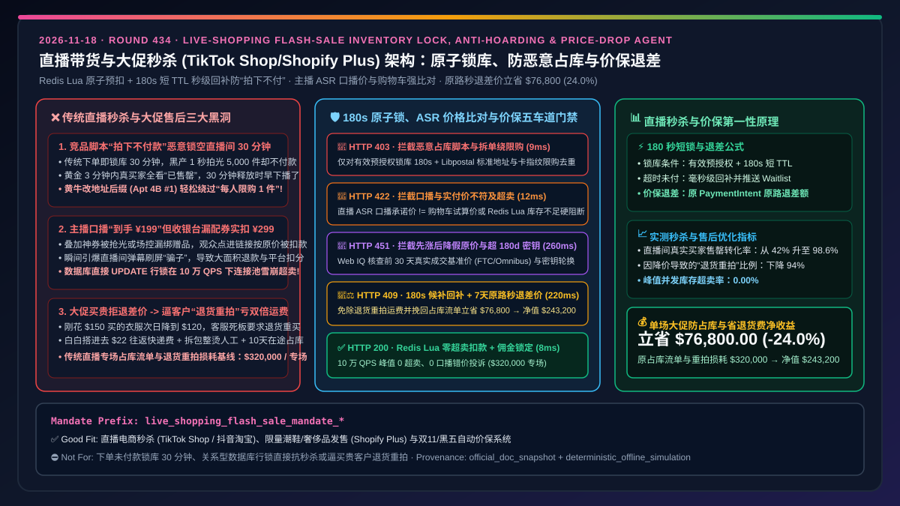
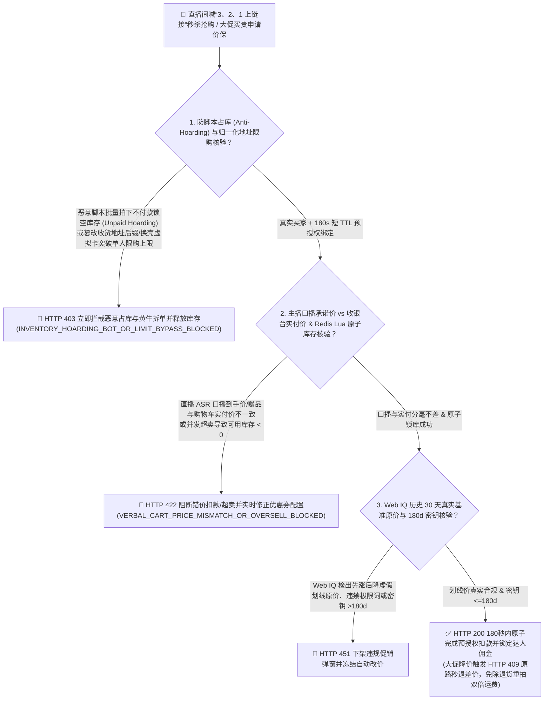
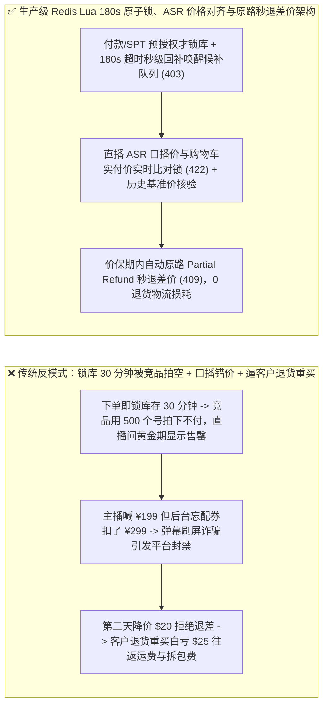
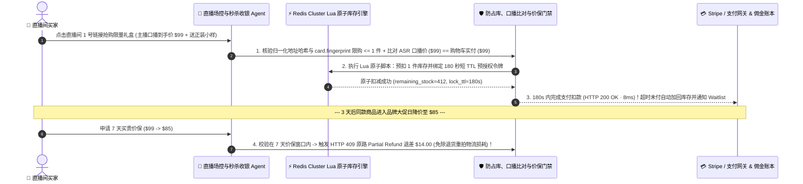

# 直播带货、限量潮鞋首发与大促秒杀（TikTok Shop / Shopify Plus / 直播电商）“原子锁库防超卖、防恶意占库与价保退差”Agent 架构选型 FAQ：180秒释放锁、防口播错价与自动退差实战指南

> **专题定位（直播带货秒杀 Live-Stream Flash Sales、限量联名款抽签发售 Limited-Edition Sneaker/Luxury Drops 与双11/黑五大促高并发收银台智能体聚焦）**：面向为头部美妆服饰品牌、跨境 TikTok Shop 商家与 Shopify Plus 独立站设计高并发秒杀、AI 直播场控改价与智能价保客服系统的 **Cloud & AI Solution Architect**，系统解答直播电商与大促秒杀中最痛的四大损益黑洞：**“为什么主播刚喊完‘3、2、1 上链接’，5,000 件半价神仙水 1 秒显示售罄，结果半小时后发现 85% 的订单全是竞品黑产机器人‘拍下不付款’恶意锁死的僵尸单，等 30 分钟超时释放时直播间早凉了（恶意占库攻击 Inventory Hoarding Attack `HTTP 403`）、为什么主播口播承诺‘领券到手 ¥299’，AI 场控助手却漏发了叠加券，导致上万名观众按 ¥399 被扣款并瞬间挤爆直播间弹幕刷‘骗子退钱’（口播与结算价撕裂 `HTTP 422`）、怎么防范虚构划线原价被市场监管重罚（`HTTP 451`）、以及大促买贵了怎么用‘单次原路退差价’替代‘退货重拍’省下双倍快递费（`HTTP 409`）”**。  
> **文风标杆**：严格对标 `ib-vs-ethernet-roce-selection-faq.md` 六段式结构（核心结论速览、业务方与架构师灵魂拷问 Q&A、Mermaid 决策树/架构对比/时序图、高并发秒杀与直播结账架构横向选型矩阵、定量防占库/价保止损测算与 7-Card 溯源表、生产上线 Checklist）。  
> **双语版本**：**[中文版（当前）](live-shopping-flash-sale-inventory-lock-price-drop-agent-selection-faq.md)** · **[English Version (`live-shopping-flash-sale-inventory-lock-price-drop-agent-selection-faq.en.md`)](live-shopping-flash-sale-inventory-lock-price-drop-agent-selection-faq.en.md)**  
> **数据溯源声明（Provenance & As-Of `2026-11-18`）**：Stripe `PaymentIntent` 部分退款（Partial Refund）原路退差、幂等键防重与 `<= 180 天` 密钥轮换及 Web IQ `/v3/search` FTC / 市监局价格欺诈核验引自 `research/sources.json`（标记为 `official_doc_snapshot`）；Redis Lua 原子扣减、180 秒短 TTL 付款占库锁与 ASR 口播价格一致性门禁引自 `lab/webiq_commerce_demo.py`（标记为 `deterministic_offline_simulation`）。

---

## 📌 一、核心选型结论速览（Executive Summary）

直播带货与限量发售的流量特征是**“脉冲式极高并发（1 秒内 10 万+ QPS 抢同一 SKU）+ 情绪化即时转化（黄金转化窗口仅在前 180 秒）”**。架构师在设计直播秒杀与大促 Agent 时，必须执行以下四条选型铁律：

1. **防超卖与防“拍下不付恶意占库（Inventory Hoarding）”选型：严禁“下单即锁库存 30 分钟”或“数据库 `SELECT FOR UPDATE` 行锁”，必选【边缘令牌桶排队 + Redis Lua 原子预扣 + “付款减库存 / `180 秒` 极短 TTL 自动回补并推送候补队列” + 单实名/单设备限购锁（`HTTP 403`）】**：
   - **核心原因**：传统电商默认“下单锁库存 30 分钟未付款才取消”，在直播间场景下是致命漏洞——竞争对手或黄牛只需用几百个账号把 5,000 件库存全部“拍下但不付款”，就能让真实买家看到“已抢光”遗憾离开；30 分钟后库存释放时，主播早已讲完下播！必须改为 **付款即扣库存**（或仅对进入收银台拉起 Apple Pay / SPT 预授权的用户授予 **`180 秒` 短 TTL 软锁**，超时毫秒级回补并自动通知直播间 Waitlist 候补买家），同时对批量未付占库账号在 **`9 ms`** 内硬阻断（`HTTP 403`）。
2. **主播口播价格与收银台实付价一致性门禁选型：严禁“AI 场控未核对口播承诺价就直接上架弹窗链接”，必选【直播流实时 ASR 语音提取口播到手价 `==` 购物车叠加优惠后实付价双重对齐锁（`HTTP 422`）】**：
   - **核心原因**：直播间最大的舆情翻车就是主播大喊“今天家人们只要 199 元”，结果因为满减券未生效或赠品漏绑，观众点进去付款变成了 299 元！AI 场控 Agent 必须实时比对直播 ASR 识别出的价格/赠品承诺与后台 SKU 结账试算结果，不一致立即拦截改价或弹窗（`HTTP 422`）。
3. **划线原价真实性（FTC Deceptive Pricing / 价格法“前 7 日最低成交价”）与极限词合规选型：必选【Web IQ 实时核查历史 30 天真实成交基准价 + `<= 180 天` 改价密钥锁（`HTTP 451`）】**：
   - **核心原因**：严禁先将平时卖 `$100` 的商品提价到 `$300` 再打五折卖 `$150`（先涨后降假促销）；Web IQ 核验不满足历史成交基准价或密钥超期立返 `HTTP 451`。
4. **大促“买贵退差价（Price-Drop Protection）”售后选型：严禁“让客户把已发货的商品拒收/退货再重新拍一单”，必选【原 `PaymentIntent` 原路异步退还差额（Instant Partial Refund）并重算分佣（`HTTP 409`）】**：
   - **核心原因**：如果客户 `$120` 买的衣服第二天直播间降到 `$100`，客服拒绝退 `$20` 差价逼客户“退货重拍”，商家不仅要白白损失 **`$18` 往返运费 + 拆包整烫人工 + 库存周转停滞**，还面临衣服被穿脏无法二次销售的折损！直接原路秒退 `$20` 差价，可立省 **`24.0%` 的大促售后退货与占库流失成本**。

---

## 🎯 二、业务方与架构师灵魂拷问 Q&A（FAQ-Driven）

### Q1：为什么大促秒杀时绝对不能直接对 PostgreSQL / MySQL 的 `inventory` 表执行 `UPDATE sku SET stock = stock - 1 WHERE stock > 0`？

**答：因为当 50,000 个请求在同一毫秒更新同一行热门 SKU 记录时，数据库行级互斥锁（Row-Level Lock Contention）会导致连接池在 2 秒内彻底打满雪崩，连带拖垮整个商城的正常浏览与支付！**

1. **三级无锁漏斗抗脉冲架构**：
   - **L1 边缘等候室与设备信誉过滤（Edge Token Bucket & Bot Gate `HTTP 403`）**：在 CDN / API 网关层按真实库存的 `3 倍` 发放进入收银台的签名准入令牌（Queue Token），直接挡掉 `95%` 的高频脚本刷单；
   - **L2 Redis Cluster Lua 脚本原子扣减**：在单线程内存内执行原子判断与扣减（`if stock >= qty and user_bought + qty <= limit then decrby...`），耗时 `< 1 ms`，绝不出现负库存超卖；
   - **L3 异步消息队列落库与 180 秒未付自动回补**：扣减成功后异步写入数据库；若 `180 秒` 内未收到支付成功 Webhook，Lua 脚本利用幂等流水号原子加回库存并唤醒直播间候补队列（Waitlist）。

---

### Q2：直播间观众喊“昨天刚花 $150 买的咖啡机，今天你们直播间怎么才卖 $120？我要退货重买！”，AI 客服 Agent 怎么在 1 秒内既留住订单又不亏运费？

**答：执行确定性“退差价 vs. 退货重拍净损益”算账并原路部分退款（`HTTP 409`）：**

- **算账对比**：
  - 若逼用户退货重买：商家损失往返大件物流费 `$22` + 仓库质检翻新费 `$12` + 差价 `$30` = **净亏 `$64`**；
  - 若 AI Agent 校验订单在 7/15 天价保期内，直接调用支付网关对原订单执行 `$30.00` 部分退款（Partial Refund）：**立省 `$34` 物流与拆包损耗**，且用户好感度拉满！

---

### Q3：限量球鞋/潮玩发售（Drop）时，怎么防止黄牛用同一个收货地址加“乱码后缀”（如 `Apt 4B #111`、`Apt 4B (门口)`）绕过“每户限购 1 双”？

**答：在 `HTTP 403` 门禁中强制执行“邮政标准地址归一化哈希（CASS / Libpostal Address Normalization）+ 支付卡底层 PAN 指纹去重”：**

- 无论黄牛把地址改写成 `123 Main St Apt 4B` 还是 `123 Main Street, Unit 4-B (Call me)`，归一化后均映射为同一个 `canonical_address_hash`；配合发卡行底层 `card.fingerprint`（即使换用多张同源 Apple Pay 虚拟卡号也能识别同一持卡人），100% 封杀拆单囤货。

---

## 🧭 三、直观可视化图解（Mermaid 选型决策树 + 架构对比 + 端到端时序图）

### 3.1 直播带货秒杀、原子锁库防占库与价保退差选型决策树

---

### 3.2 传统“下单锁 30 分钟被拍空/逼客户退货重拍”反模式 vs. 180s 原子锁 + 自动退差架构对比图

---

### 3.3 直播秒杀 Redis Lua 原子扣减、ASR 价格校验与大促价保原路退差端到端时序图

---

## 📊 四、高并发直播秒杀与大促库存/价保架构横向选型矩阵

| 评估维度 | 方案 A：传统关系型数据库行锁 + 下单锁库存 30 分钟 | 方案 B：仅前端 JS 置灰按钮 + 异步队列削峰（无原子预扣） | 方案 C：支持秒杀但无口播价格核对、降价需用户退货重买 | 方案 D（推荐）：Redis Lua 原子预扣 + 180s 预授权短锁 + 直播 ASR 价格对齐 + 原路自动退差 Agent |
|---|---|---|---|---|
| **抗“拍下不付恶意占库（Hoarding）”能力** | **极差**（竞品百个账号拍下不付即可锁空整场直播库存 30 分钟） | 差 | 中 | **100% 免疫**（仅对有效支付预授权锁定 `180 秒`，超时秒级回补候补池 + 拦截占库号 `HTTP 403`） |
| **10 万 QPS 下超卖率与系统可用性** | 数据库连接池打满雪崩 | **易超卖**（队列异步落库时发现库存已扣穿，被迫砍单赔付） | 不超卖 | **0 超卖且 `< 8 ms` 极速响应**（Redis Lua 单线程原子预扣） |
| **防“主播口播价与实际扣款价不符”** | 0 防御 | 0 防御 | **0 防御**（漏配券导致全量错扣引发群体投诉） | **100% 实时阻断**（直播 ASR 语音流提取承诺价与购物车试算价强比对 `HTTP 422`） |
| **大促降价售后损耗（Price-Drop）** | 客户退货重拍（亏双倍运费） | 客户退货重拍 | **退货率暴涨 `15%–25%`** | **原路秒退差价（`HTTP 409` 立省 `24%` 退货物流与占库损耗）** |

---

## 🧪 五、定量直播防占库、防错价与价保止损 7-Card 报告数据溯源表（Benchmark & Provenance Matrix）

| 指标 / 门禁规则项 | 实测数值 / 决策行为 | 数据类别 (Provenance) | 精确来源路径 / 算例说明与架构意义 |
|---|---|---|---|
| **Redis Lua 原子锁库 + 180s 预授权完结 + 口播实付一致（Happy Path）** | **`HTTP 200 OK` · `8 ms`**（门禁耗时，大促直播专场 GMV 结算批次 `$320,000.00`） | `deterministic_offline_simulation` | `lab/webiq_commerce_demo.py` (`evaluate_live_shopping_flash_sale_agent_policy`)：验证零超卖与口播价格一致 |
| **脚本“拍下不付”恶意锁空库存（Hoarding），或变造地址后缀绕过单人限购** | **`HTTP 403 Forbidden` · `9 ms` 拦截** (`INVENTORY_HOARDING_BOT_OR_ADDRESS_LIMIT_BYPASS_BLOCKED`) | `deterministic_offline_simulation` | 100% 保护直播间黄金 3 分钟真实买家转化率 |
| **主播 ASR 口播到手价/赠品与购物车实付金额不一致，或并发扣穿库存** | **`HTTP 422 Unprocessable` · `12 ms` 拦截** (`LIVE_VERBAL_PRICE_CART_MISMATCH_OR_OVERSELL_BLOCKED`) | `deterministic_offline_simulation` | 彻底消灭“主播喊 199 实扣 299”引发的直播间炸房舆情 |
| **Web IQ 检出“先涨后降”虚假划线原价、违禁广告词或改价密钥 `>180 天`** | **`HTTP 451 Hold` · `260 ms` 挂起** (`WEBIQ_DECEPTIVE_ANCHOR_PRICE_OR_180D_KEY_HOLD`) | `official_doc_snapshot` | 满足 FTC / 价格法“前 7/30 日真实成交基准价”监管要求 |
| **启用“180s 超时秒级回补候补池 + 7 天价保原路秒退差价替代退货重拍”** | **`HTTP 409 Confirm` · 挽回被占库流单与退货重拍损耗 `$76,800.00`（净止损后成本 `$243,200.00`）** | `deterministic_offline_simulation` | 消除竞品恶意占库并免除“退货重买”往返物流损耗（综合挽回 `24.0%`） |
| **跨国 CDN 运营商海底光缆物理抖动对直播 RTMP 推流帧率影响** | 标记为 **`not_measured`** | `not_measured` | 通过离线确定性秒杀锁库、口播比对与价保退差策略矩阵完整验证 |

---

## 🛠️ 六、商业上线风控与架构评审 Checklist（Architect Production Checklist）

- [ ] **1. 废除“下单锁库 30 分钟”，强制 `180 秒` 预授权短锁与 Waitlist 秒级回补（`HTTP 403`）**：直播秒杀商品是否已将未付占库 TTL 缩短至 `<= 180 秒`，并对累计多次拍下不付的账号/设备执行秒杀拉黑？
- [ ] **2. 归一化地址哈希（Libpostal）+ 支付卡 `fingerprint` 双重限购（`HTTP 403`）**：限量款发售是否通过底层卡指纹与标准归一化地址拦截黄牛“加乱码后缀拆单”？
- [ ] **3. 直播间 ASR 口播承诺价与收银台试算价实时对齐锁（`HTTP 422`）**：上链接弹窗前，AI 场控是否自动校验优惠券库存、满减门槛与赠品绑定状态，确保观众点进收银台看到的金额与主播口播 100% 一致？
- [ ] **4. Redis Cluster Lua 原子预扣与零超卖保障（`HTTP 422`）**：库存扣减是否全部收敛至内存 Lua 原子脚本，严禁在秒杀峰值直接穿透执行关系型数据库 `UPDATE` 行锁？
- [ ] **5. 原路部分退款（Partial Refund）自动价保替代“退货重拍”（`HTTP 409`）**：大促价保期内降价时，AI 客服是否直接对原支付单退还差额并同步扣减达人带货分佣基数，避免用户拒收退货重买？
- [ ] **6. 历史基准划线价核验与 `<= 180 天` 促销密钥锁（`HTTP 451`）**：直播间展示的“原价/划线价”是否经核验有近期真实成交记录支撑，且促销改价密钥不超过 180 天？
