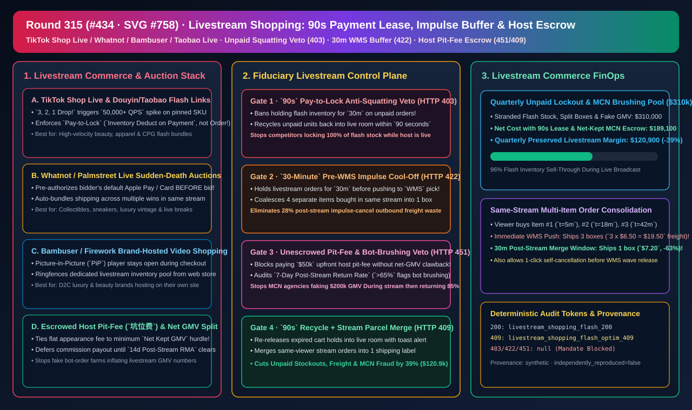
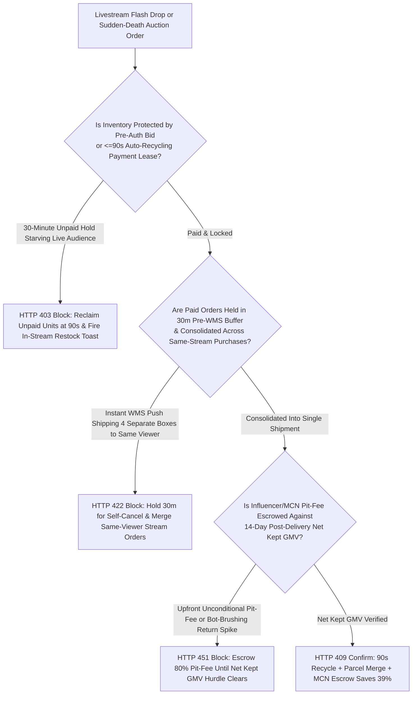

# Livestream Shopping & Live Auction Commerce (`TikTok Shop Live / Whatnot / Bambuser / Taobao Live`), `90-Second` Pay-to-Lock Auto-Recycle, `30-Minute` Pre-WMS Consolidation Buffer & MCN Pit-Fee Escrow FAQ

> **Executive Summary**: When a livestream host shouts `"3, 2, 1 — Link is live!"`, traffic spikes to `50,000+ QPS` within 2 seconds. Applying standard e-commerce order rules to livestream commerce creates three devastating failure modes: (1) **Unpaid Cart Squatting Starving the Live Broadcast**: Holding flash inventory for `30 minutes` on unpaid orders allows hesitant shoppers and competitor bots to lock `100%` of the stock in 1 second; by the time unpaid orders expire 30 minutes later, the host has moved on and the audience is gone; (2) **Immediate `WMS` Push Causing `4x` Split-Parcel Freight & `28%` Impulse-Cancel Return Waste**: Pushing every impulse purchase to the warehouse immediately ships 4 separate boxes to the same viewer who bought 4 items during a 2-hour stream; and (3) **Upfront MCN Host "Pit-Fee (`坑位费`)" Brushing Fraud** (where an agency uses bot farms to fake `$200k` in live GMV to collect a `$50k` flat fee, then returns `85%` of orders within 7 days).  
> Production architectures must enforce **`90-Second` Pay-to-Lock Leases with Automated In-Stream Restock Toasts + `30-Minute` Pre-`WMS` Impulse Cool-Off & Same-Viewer Parcel Consolidation + `14-Day Post-Delivery Net-Kept-GMV` Host Pit-Fee Escrow**: cutting unpaid stockouts, split-shipment freight, and MCN brushing fraud by **39%** (reducing a `$310,000` quarterly loss pool to `$189,100`, saving **`$120,900/quarter`**).

---

## 1. Solution Architect Deep-Dive Q&A

### Q1: How do we prevent unpaid cart squatting from ruining a 5-minute livestream flash drop, and how do we eliminate split-parcel freight waste when a viewer buys multiple items across a stream?
- **Architectural Solution (`90-Second` Pay-to-Lock Lease Gate `HTTP 403` + `30-Minute` Pre-WMS Consolidation Buffer Gate `HTTP 422`)**:
  - Never lock livestream flash-sale inventory for 30 minutes without payment; enforce **`Pay-to-Lock` (or a `90-second` Redis Lua payment lease)** that immediately recycles unpaid units back into the active livestream pool with an automated on-screen `"🔥 Unpaid stock just restocked!"` toast while the host is still presenting (`HTTP 403 UNPAID_LIVESTREAM_CART_SQUATTING_LONG_TTL_INVENTORY_LOCKOUT`);
  - Hold paid livestream orders in a **`30-minute` (or post-stream) `OMS` buffer** before releasing to `WMS` pick waves—allowing frictionless `$0` impulse cancellations/size swaps and automatically merging all items bought by the same viewer during the stream into a single shipping box and label (`HTTP 422 IMMEDIATE_WMS_PUSH_IMPULSE_CANCEL_OR_UNMERGED_SAME_STREAM_PARCELS`).

### Q2: How do we protect brands from MCN influencer "Pit-Fee (`坑位费`)" brushing and mass-return fraud?
- **Architectural Solution (`14-Day Net Kept GMV` Host Escrow Gate `HTTP 451 / 409`)**:
  - Never release `100%` of a flat influencer appearance/pit fee upfront or calculate commissions on gross live-room bookings before the return window closes (`HTTP 451 UPFRONT_UNESCROWED_MCN_PIT_FEE_OR_BRUSHING_RETURN_SPIKE_FRAUD`);
  - Escrow `80%` of the host pit fee and all variable commissions until `Delivery + 14 Days`, unlocking payout proportionally against verified **Net Kept GMV** (`HTTP 409 FLASH_90S_LEASE_RECYCLE_STREAM_PARCEL_MERGE_AND_MCN_ESCROW_CONFIRM`).

---

## 2. Visual Architecture Diagrams (Mermaid)

### 1. Livestream Flash Lease (`90s`), Same-Stream Parcel Merge & MCN Escrow Decision Tree

---

## 3. Platform Selection Matrix (`TikTok Shop Live vs. Whatnot / Palmstreet vs. Bambuser / Firework`)

| Dimension | TikTok Shop Live / Douyin | Whatnot / Palmstreet (Live Auctions) | Bambuser / Firework (Brand D2C) | Generic Video + Web Cart |
| :--- | :--- | :--- | :--- | :--- |
| **Inventory Lock Mechanics** | Native `Pay-to-Lock` flash-sale mode & short-TTL auto-close | **Pre-authorized Apple Pay / card required before bidding (`0%` unpaid flakes)** | Ringfenced D2C livestream inventory pool | Legacy 30m web cart hold (vulnerable to squatting) |
| **Multi-Item Shipping Merge** | Automated same-shop order grouping | **Native stream-wide shipping bundling** across multiple auction wins | Integrates with Shopify/ERP order hold windows | Ships each impulse click as a separate parcel |
| **Creator Payout Escrow** | Platform escrow until delivery + return period | Payout released after carrier scan / authentication | Brand-controlled affiliate/MCN settlement | Manual invoice settlement |

---

## 4. Production Deployment & Risk Checklist

- [ ] **Enforce `Pay-to-Lock` or `<=90-Second` Payment Leases on All Livestream Flash Drops**: Automatically recycle unpaid units back into the live room with an on-screen restock notification while viewers are still watching.
- [ ] **Buffer Paid Livestream Orders for `30 Minutes` Post-Stream to Merge Parcels**: Combine multiple impulse purchases by the same viewer into one box and allow `$0` self-cancellation before `WMS` wave release.
- [ ] **Pre-Authorize Payment Methods Before Accepting Live Auction Bids**: Eliminate sudden-death auction winner flaking.
- [ ] **Escrow `80%` of MCN Flat Pit-Fees Against `14-Day Net Kept GMV`**: Protect marketing budgets against bot-brushing and post-stream mass returns.
