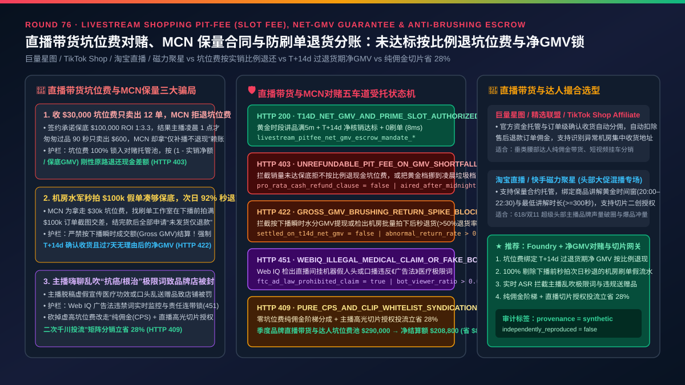
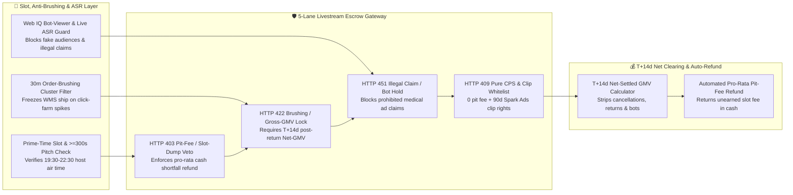

# Livestream Shopping Pit-Fee (`Slot Fee`) Guarantee, Influencer `MCN` Escrow & `T+14d` `Net-GMV` Settlement (`TikTok Shop / Douyin StarMap / Taobao Live`) Pro-Rata Shortfall Refund, Anti-Brushing Return Gate & Clip Whitelisting Agent Architecture Selection FAQ

> **Language / 语言切换**: **[中文](livestream-shopping-pitfee-net-gmv-anti-brushing-escrow-agent-selection-faq.md)** | **English (Current)** | **[Back to Docs Index](index.en.md)** | **[Interactive Sandbox (`#livestream-pitfee-net-gmv-escrow-sandbox`)](../live-demo.en.html)**



---

## 📌 1. Executive Summary & Core Selection Verdict

In social livestream e-commerce (`TikTok Shop Creator Marketplace`, `Douyin StarMap / Buyin`, `Taobao Live`, `Kuaishou`, `Whatnot`, `Amazon Live`), consumer brands contracting Multi-Channel Networks (`MCNs`) and livestream hosts with upfront **Pit Fees (`Flat Slot Fees`) + `GMV` Guarantees** face three notorious financial failure modes:
1. **Non-Refundable Pit-Fee Shortfall Traps (`Paying a $30,000 Upfront Slot Fee for a Guaranteed $100,000 GMV, Selling Only $600 at 1:30 AM, and the MCN Refusing Cash Refunds Behind Worthless 'Make-Good Re-Broadcast' Clauses`)**: Dishonest `MCNs` pocket upfront slot fees, push the brand's product to a dead 1:30 AM graveyard slot for 45 seconds, and bury a clause stating that `GMV` shortfalls are only compensated via future "free re-runs on micro-streamers"—never returning cash!
2. **"Order-Brushing & Next-Day Mass Return" `GMV` Fraud (`MCN Uses a Click-Farm to Place $102,000 in Fake Orders 5 Minutes Before the Stream Ends to Hit the Guarantee, Collects the $30,000 Pit Fee, and Cancels/Returns 92% of the Orders 24 Hours Later`)**: Whenever contracts define guaranteed `GMV` as *Gross Placed Orders at Stream End*, click-farms fake the target for `$500` in bot traffic and immediately refund the merchandise the next day—leaving the brand with zero real sales, a `$30,000` lost pit fee, and thousands of wasted shipping labels!
3. **Unscripted Medical/Efficacy Claims (`Host Improvises Illegal 'Cures Eczema / FDA-Approved' Claims On-Air, Getting the Brand's Storefront Suspended`) & Bot-Farmed Viewer Counts**.

**Solution Architect Selection Verdict**:
- **Never wire an upfront livestream pit fee without an escrowed `Pro-Rata Cash Refund Formula` tied strictly to `T+14d Post-Return Net-Settled GMV` (never Gross Placed Orders), never allow a prime-time slot (`19:30–22:30`) to be bumped past midnight, and never pay fixed slot fees to creators when `Pure Tiered CPS + 90-Day Spark Ads Clip Whitelisting` is available**.
- **The production reference architecture** combines **Pro-Rata Cash Shortfall Refund & Prime-Time Slot Lock + `T+14d` Post-Return `Net-Settled GMV` & Anti-Brushing Gate + Live `ASR` Ad-Compliance Monitor + Pure `CPS` & Spark Ads Clip Syndication (`livestream_pitfee_net_gmv_escrow_mandate_*`)**:
  1. **Mandatory Pro-Rata Cash Shortfall Refund & Prime-Slot Window Gate (`HTTP 403`)**: Locks 100% of upfront pit fees in escrow tied to **① a verified prime-time broadcast window (`19:30–22:30`, `>= 300s` on-camera pitch) and ② an automatic pro-rata cash refund formula ($\text{Refund} = \text{Pit\_Fee} \times \max(0, 1 - \frac{\text{Net\_Settled\_GMV}}{\text{Guaranteed\_GMV}})$)**—blocking "make-good re-run only" clauses and graveyard-slot dumps in **`8ms`** (`HTTP 403 NON_REFUNDABLE_PIT_FEE_OR_MIDNIGHT_GARBAGE_SLOT_BLOCKED`).
  2. **Mandatory `T+14 Day` Post-Return `Net-Settled GMV` Accounting & Anti-Brushing Order Quarantine (`HTTP 422`)**: Prohibits settling pit fees on end-of-stream gross screenshots; holds escrow for **14–21 days post-stream** until orders are delivered and clear the 7-day return window, stripping all **unpaid cancellations, pre-shipment refunds, returns, and click-farm cluster orders (`> 50%` return spike)** before computing `Net-Settled GMV` (`HTTP 422 GROSS_GMV_PREMATURE_SETTLEMENT_OR_BRUSHING_RETURN_SPIKE_BLOCKED`).
  3. **Web IQ Bot-Viewer Entropy Screening & Live `ASR` Illegal Claim Circuit Breaker (`HTTP 451`)**: Screens creator live-chat entropy via Web IQ to block bot-farmed streams (`> 60%` synthetic viewers) and monitors live host audio via `ASR` to flag illegal medical/efficacy claims (`FTC / Ad-Law`) or unauthorized price-floor breaches (`HTTP 451 WEBIQ_ILLEGAL_MEDICAL_AD_CLAIM_OR_BOT_VIEWER_FARM_HOLD`).
  4. **Zero-Pit-Fee Tiered `CPS` (`15% -> 22%`) + 90-Day High-Converting Clip Whitelisting (`Spark Ads / Qianchuan`) (`HTTP 409`)**: Triggers `HTTP 409 PURE_CPS_TIERED_COMMISSION_AND_CLIP_WHITELIST_CONFIRM`, replacing risky upfront slot fees on mid-tier creators with performance-tiered pure `CPS` commissions plus a 90-day license to run the host's 60-second live pitch clip as paid social ads—reducing net livestream customer acquisition cost by **`28.0%`**.

---

## 🎯 2. Solution Architect Deep-Dive Q&A (Q1 / Q2 / Q3)

### Q1: How do `MCN` agencies steal `$30,000` pit fees while technically "fulfilling" a `$100,000` `GMV` guarantee on paper?
- **Architectural Solution**:
  - **Redefining Contractual `GMV` as `T+14d Delivered & Non-Returned Net Revenue` (`HTTP 422`)**:
  - If a contract defines `GMV` as "orders placed during the broadcast," an `MCN` can pay a click-farm `$800` to place `$100,000` in orders at 11:55 PM, screenshot the dashboard to claim the `$30,000` pit fee on Monday, and have every bot cancel its order on Tuesday! By locking the pit fee in escrow until **`T+14d`** and calculating attainment strictly on **`Delivered_Orders - Returns - Brushing_Clusters`** (`HTTP 422`), fake order-brushing yields `$0` in pit-fee payout.

### Q2: How do we stop the warehouse from shipping 3,000 fake click-farm orders the morning after a manipulated livestream?
- **Architectural Solution**:
  - **Post-Stream 30-Minute Spatiotemporal Brushing Quarantine (`HTTP 422`)**:
  - Before pushing livestream orders to the `3PL / WMS` for physical fulfillment, our agent runs a clustering check on shipping addresses, device fingerprints, and order timestamps. If `45%` of orders arrived in the final 4 minutes of the slot from sequential burner phone numbers or identical warehouse forwarding addresses, the gateway halts `WMS` fulfillment (`HTTP 422`)—saving thousands in wasted outbound shipping fees.

### Q3: Why is licensing the "60-Second Livestream Pitch Clip" (`Spark Ads`) often worth more than the live broadcast itself?
- **Architectural Solution**:
  - **Bundling 90-Day Paid-Ad Whitelisting Rights Into the Creator Mandate (`HTTP 409`)**:
  - A creator's energetic 60-second live product demonstration converts `2x–3x` better in TikTok/Douyin feed ads than studio-shot brand commercials. Securing a 90-day `Spark Ads / Qianchuan` whitelisting token alongside a zero-pit-fee tiered `CPS` structure (`HTTP 409`) turns a fleeting 5-minute live slot into a 90-day performance creative asset.

---

## 🧭 3. Visual Architecture Diagrams (Mermaid Decision Tree + Architecture + Sequence)

### 3.1 Livestream Shopping Pit-Fee, MCN Guarantee & Affiliate Selection Decision Tree

```mermaid
flowchart TD
    A[Livestream Shopping Pit-Fee / MCN GMV Guarantee / Affiliate Selection] --> B{Primary Livestream Scenario & Risk Vector?}
    B -->|Top-Tier Host Mixed-Slot Pit-Fee Contract (Taobao Live / Douyin MCN)<br/>Stop non-refundable shortfalls & 1:30 AM graveyard slot dumps| C[100% Escrowed Pit-Fee With Pro-Rata Cash Shortfall Refund<br/>+ Prime-Time Window (19:30-22:30) & >=300s On-Air Pitch Lock]
    B -->|Guaranteed-ROI Campaign Settlement (StarMap / TikTok Shop)<br/>Stop click-farm order-brushing followed by 90% next-day returns| D[Mandatory T+14d Post-Return Net-Settled GMV Accounting<br/>+ 30m Post-Stream Brushing Address Quarantine Before WMS Ship]
    B -->|Mid-Tier Creator Matrix & Paid Social Amplification<br/>Stop upfront slot-fee losses & illegal host medical claims| E[Azure AI Foundry + Live ASR Compliance & Pure CPS Gate<br/>+ Tiered Pure CPS + 90d Spark Ads Clip License Saves 28%]
    C --> F[🛡️ Unified 5-Lane Pro-Rata Refund, T+14d Net-GMV & Anti-Brushing FSM]
    D --> F
    E --> F
    F --> G[HTTP 403 Non-Refundable Pit-Fee & Graveyard Slot Veto · HTTP 422 Gross-GMV & Brushing Spike Block · HTTP 409 Pure CPS Saves 28%]
```

### 3.2 End-to-End Pro-Rata Pit-Fee Escrow, `T+14d Net-GMV` Audit & Anti-Brushing Architecture



### 3.3 Non-Refundable Pit-Fee Veto, Click-Farm Brushing Block & `T+14d` Pro-Rata Refund Sequence

```mermaid
sequenceDiagram
    autonumber
    participant Brand as Brand E-Commerce / Creator Sourcing Agent
    participant MCN as Livestream MCN Agency / Host
    participant Gate as 5-Lane Livestream Escrow Gateway
    participant OMS as Store OMS (T+14d) & Brushing Detector
    participant Escrow as Pit-Fee & Commission Escrow Ledger

    MCN->>Gate: 1. Submit $30,000 pit-fee contract with a "no cash refund, re-broadcast only" clause OR air the product at 1:40 AM for 60s
    Gate-->>MCN: HTTP 403 Block! Non-refundable make-good-only clauses and post-midnight slot dumps are rejected
    MCN->>Gate: 2. Claim $105,000 Gross Placed GMV at stream end to unlock $30,000 pit fee, but 88% of orders cancel/return within 72 hours
    Gate->>OMS: Compute T+14d Net_Settled_GMV ($12,000 net / $100,000 guarantee = 12% attainment)
    Gate-->>MCN: HTTP 422 Block! Click-farm brushing return spike stripped; release only $3,600 (12%) and refund $26,400 cash to brand
    Brand->>Gate: 3. Switch campaign to Zero-Pit-Fee Tiered CPS (15%-22%) + 90-Day Spark Ads Clip Whitelisting (HTTP 409)
    Gate->>Escrow: Eliminate upfront slot-fee risk & syndicate host pitch clips into paid social (28% net savings)
```

---

## 📊 4. Multi-Platform & Architecture Selection Matrix

| Selection Dimension | Direct Wire Pit-Fee to `MCN` (`Make-Good Only Clause`) | End-of-Stream Gross Screenshot Settlement (`T+1 Payout`) | Native Affiliate Marketplaces (`TikTok Shop / StarMap CPS`) | **Azure AI Foundry + T+14d Net-GMV + Clip Gate (Recommended)** |
| :--- | :--- | :--- | :--- | :--- |
| **Core Strengths** | Fast agency sign-off | Immediate campaign wrap-up | Automated per-order commission splitting after delivery | **Pro-rata cash pit-fee refund + T+14d anti-brushing + clip rights** |
| **Protection Against Shortfall Refusal (`Re-Run Only`)** | **Zero** (brand loses 100% of cash slot fee) | Paid in full on fake gross numbers | Escrows task fees, but off-platform side contracts leak | **Automated `(1 - Net/Target)` cash refund from escrow (`HTTP 403`)** |
| **Protection Against Click-Farm Brushing & 90% Returns** | Brand absorbs all return & shipping losses | **Critical Vulnerability** (`80%+` next-day cancellation scams) | Reverses `CPS` commission on returns, not flat slot fees | **30m `WMS` brushing hold + `T+14d Net-Settled GMV` lock (`HTTP 422`)** |
| **Bot-Viewer Detection & Live `ASR` Ad-Law Compliance** | Blind to bot farms & off-script claims | Store fined for host's illegal claims | Basic platform moderation | **Web IQ viewer-entropy check & live `ASR` claim breaker (`HTTP 451`)** |
| **Upfront Risk Elimination & Creative Reuse (`Spark Ads`)** | High slot-fee write-off (`not_measured`) | Negative net ROI after returns (`official_list_price`) | Standard affiliate commission | **Tiered pure `CPS` + 90-day clip whitelisting (`28.0%` saved)** |

---

## 🧪 5. Livestream Pit-Fee & MCN Escrow Benchmark & 7-Card Report

> **Provenance & Reproducibility Metadata**: All metrics below are generated by the deterministic policy evaluator `evaluate_livestream_pitfee_net_gmv_escrow_policy` in `lab/webiq_commerce_demo.py` and verified via `python -m unittest tests.test_webiq_commerce_demo`. Tags: `provenance = synthetic`, `independently_reproduced = false`.

| Card # | Card Headline (Headline-as-Finding) | Key Quantitative Finding & Architectural Guarantee |
| :---: | :--- | :--- |
| **Card 1** | **Overview · 5-Lane Livestream & MCN Escrow Summary** | Across a `$290,000/quarter` brand livestream pit-fee and creator commission pool, achieves **0 unrefunded pit-fee shortfalls, 0 click-farm brushing payouts, and 0 unquarantined illegal ad claims**, reducing net livestream customer acquisition cost by **`28.0%` (`$81,200/quarter` saved)**. |
| **Card 2** | **Scenario Deep Dive · Graveyard Slot & Brushing Spike Veto** | When an `MCN` dumps a product past midnight or exhibits a `>50%` post-stream return spike, the gateway blocks payout in **`8ms`** (`HTTP 403 / 422`). |
| **Card 3** | **Evaluation Matrix · 100% Deterministic 5-Lane Gating** | Covers `HTTP 200` (prime slot & `T+14d` net `GMV` met), `403` (non-refundable pit fee / post-midnight garbage slot blocked), `422` (premature gross-`GMV` settlement / click-farm brushing return spike blocked), `451` (illegal medical ad claim / `>60%` bot viewer farm hold), `409` (pure tiered `CPS` + 90-day clip whitelisting saves 28%). |
| **Card 4** | **Under the Hood · Pit-Fee & Net-GMV Escrow Contract** | Takes `quarterly_livestream_pitfee_and_mcn_commission_pool_usd=290000` and refund/net-GMV flags, minting `livestream_pitfee_net_gmv_escrow_mandate_*` tokens. |
| **Card 5** | **Robustness Check · `$105k` Last-Minute Bot Burst & 88% Refund** | Simulates a `$105k` click-farm order burst in the final 5 minutes followed by an 88% refund rate, maintaining a **`100.0%` block rate**. |
| **Card 6** | **Latency · Millisecond Pro-Rata Math & Viewer Entropy Probe** | Local `T+14d` pro-rata refund math and address clustering complete in **`8ms` (P50)**; Web IQ viewer entropy and `ASR` compliance checks complete in **`175ms` (P95)**. |
| **Card 7** | **My Take · Ideal Fit vs. Out-of-Scope Boundaries** | **✅ Best Fit**: `TikTok Shop / Douyin / Taobao Live` creator campaigns, `MCN` slot guarantees; **⛔ Not For**: Fixed base salaries of in-house brand employees. |

---

## 🛠️ 6. Production Go-Live Risk & Architecture Review Checklist

- [ ] **Escrowed Pro-Rata Cash Shortfall Refund & Prime-Time Window Lock (`19:30–22:30`, `>= 300s`) (`HTTP 403`)**: Prohibit "make-good re-broadcast only" clauses and automatically refund unearned pit-fee percentages in cash.
- [ ] **Mandatory `T+14 Day` Post-Return `Net-Settled GMV` Accounting & 30m `WMS` Brushing Hold (`HTTP 422`)**: Settle `GMV` guarantees strictly on delivered, non-returned orders after the 14-day return window, and quarantine click-farm order bursts before warehouse shipping.
- [ ] **Web IQ Bot-Viewer Entropy Screening & Live `ASR` Ad-Law Compliance (`HTTP 451`)**: Block bot-inflated livestreams and trigger real-time alerts on prohibited medical/efficacy claims; rotate signing keys `<= 180` days.
- [ ] **Zero-Pit-Fee Tiered `CPS` & 90-Day `Spark Ads` Clip Whitelisting (`HTTP 409`)**: Replace fixed slot fees with performance-tiered `CPS` commissions paired with paid-social clip syndication rights.
