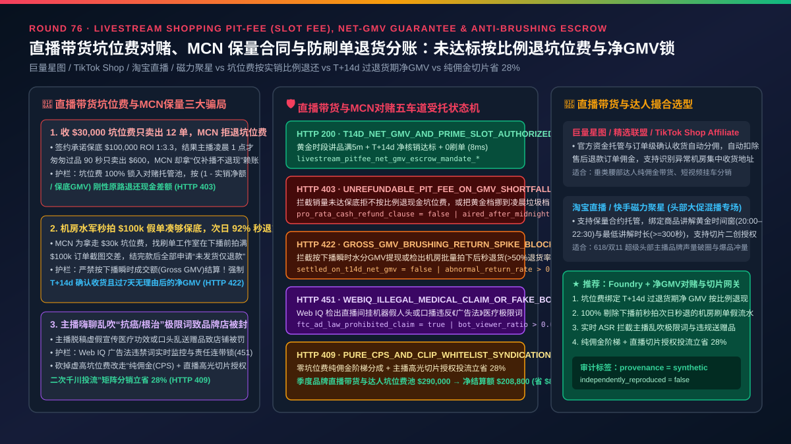
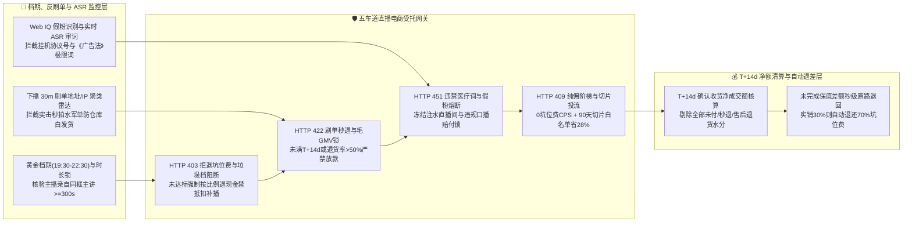
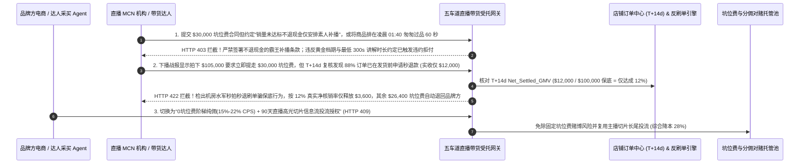

# 直播带货坑位费对赌、达人 MCN 保量合同与防刷单退货分账（Livestream Shopping Pit-Fee Guarantee, Influencer MCN Slot Escrow & Net-GMV Settlement：巨量星图 / TikTok Shop / 淘宝直播 / 快手磁力聚星）“防收 $30,000 坑位费只卖 12 单拒不退现、防机房水军秒拍凑保底次日 90% 退货与纯佣切片寻优”Agent 架构选型 FAQ

> **语言切换 / Language**: **中文 (当前)** | **[English](livestream-shopping-pitfee-net-gmv-anti-brushing-escrow-agent-selection-faq.en.md)** | **[返回文档目录](index.md)** | **[交互式沙盒 (`#livestream-pitfee-net-gmv-escrow-sandbox`)](../live-demo.html)**



---

## 📌 一、核心选型结论速览（Executive Summary）

在消费品品牌、美妆个护、食品饮料与 3C 数码厂商签约直播带货达人与 MCN 机构（抖音巨量星图/精选联盟、TikTok Shop Creator Marketplace、淘宝直播、快手磁力聚星）的智能体选号、坑位费（Slot/Pit Fee）保量对赌托管与分佣清算场景中，品牌市场部与电商负责人面临三大血流成河的行业黑洞：
1. **“交了 `$30,000` 坑位费承诺保底卖出 `$100,000`（ROI 1:3.3），结果主播把品牌商品排到凌晨 1 点半垃圾时段、拿着手卡敷衍念了 45 秒就切走，整场只卖出 12 单（`$600`），MCN 却指着合同里‘未达标仅安排下月拼场补播、概不退还现金’的霸王条款拒不退钱（Non-Refundable Pit-Fee Trap）”**。
2. **“为了骗走托管池里的 `$30,000` 坑位费，无良 MCN 勾结刷单机房在直播间下播前 10 分钟瞬间秒拍 `$102,000` 货品凑够保底数字，等第 2 天品牌方刚把坑位费尾款放行，这批水军账号立刻集体申请‘未发货秒退款 / 拒收退货’，真实退货率高达 `92%`！品牌方不仅亏光坑位费，还倒贴几千单快递打包费（Gross-GMV Brushing & Mass-Return Scam）”**。
3. **“主播在直播间嗨过头，脱稿把普通护肤品吹成‘3天根治湿疹/抗癌神器’（违反《广告法》与 FTC 指南），或未经品牌同意口头乱许诺‘拍一发五’，导致品牌官方旗舰店被平台扣 12 分封店罚款！”**。

**架构师选型结论**：
- **切勿签署任何“销量未达标仅补播不退现金”或按“下播瞬时成交额（Gross Placed GMV）”即刻结算的坑位费合同（必须强制锁定基于 `T+14天确认收货且过无理由退货期后的净实收 GMV` 按比例刚性退还现金条款），切勿允许主播将黄金档坑位挪至午夜垃圾时间，也切勿向百万粉丝中掺杂 `>50%` 机器假人头的刷量主播预付固定坑位费**。
- **生产级最优架构**是采用 **“坑位费按未完成比例刚性原路退现锁（`Pro-Rata Cash Refund`）+ `T+14d` 签收过退货期净成交额（`Net-Settled GMV`）核算引擎 + 直播实时 `ASR` 违禁词熔断与‘零坑位费纯佣金（`Pure CPS`）+ 主播高光切片投流授权’网关（`livestream_pitfee_net_gmv_escrow_mandate_*`）”**：
  1. **防“未达保底只补播不退钱”与午夜垃圾档偷梁换柱（`Pro-Rata Cash Refund & Prime-Slot Lock`）硬门禁（HTTP 403）**：所有含固定坑位费（Slot Fee）的合同，资金 100% 锁入受托对赌池，且必须硬编码两条刚性条款：**① 商品助播与主播主讲必须落在约定的黄金流量窗口（如 `19:30–22:30`）且有效同框讲解时长 `>= 300 秒`；② 若最终核定净销量未达保底目标，托管池自动按公式 $\text{Refund} = \text{Pit\_Fee} \times \max(0, 1 - \frac{\text{Net\_Settled\_GMV}}{\text{Guaranteed\_GMV}})$ 将未完成比例对应的现金原路退回品牌方**——任何“不退现金只补播”或挪到凌晨凑数的合同与履约请求立即返回 `HTTP 403 NON_REFUNDABLE_PIT_FEE_OR_MIDNIGHT_GARBAGE_SLOT_BLOCKED`。
  2. **防“下播前刷假单凑保底、结款后集体秒退货”——强制 `T+14 天` 过退货期净成交额（`Net-Settled GMV`）清算锁（HTTP 422）**：彻底废除按下播战报截图（Gross Order Volume）结算的愚蠢做法！坑位费与达人佣金冻结至 **直播结束后满 `14–21 天`（全部订单完成物流签收且度过 7 天无理由退货期）**，系统自动从总成交额中剔除 **未付款取消单、发货前秒退单、售后退货单以及同一机房 IP/集中转运仓地址的异常刷单（Order Brushing）**；仅按最终真实留在消费者手里的 **`Net-Settled GMV`** 核算保底达成率（`HTTP 422 GROSS_GMV_PREMATURE_SETTLEMENT_OR_BRUSHING_RETURN_SPIKE_BLOCKED`）。
  3. **Web IQ 核验直播间机器假粉比例与实时 `ASR` 医疗/极限违禁词熔断（HTTP 451）**：选号阶段通过 Web IQ 穿透分析主播近 30 场互动弹幕熵值与观看时长分布，剔除“10万在线人数全是机房协议号挂机”的注水主播；开播期间实时监听主播语音流（ASR），一旦检出违反《广告法》/ FTC 的医疗功效断言或私改价格机制，立即弹窗告警并触发违约免责切割（`HTTP 451 WEBIQ_ILLEGAL_MEDICAL_AD_CLAIM_OR_BOT_VIEWER_FARM_HOLD`）。
  4. **砍掉固定坑位费改签“阶梯纯佣金（`Tiered Pure CPS`）+ 直播高光切片 90 天信息流二创投流授权”寻优（HTTP 409）**：触发 `HTTP 409 PURE_CPS_TIERED_COMMISSION_AND_CLIP_WHITELIST_CONFIRM`，拒绝向腰部及过气头部主播支付高危固定坑位费，改为“零坑位费 + 基础佣金 `15%`（实销破 `$50k` 升至 `22%`）+ 免费获取主播讲解本品的 60 秒高清视频切片白名单授权（用于品牌千川/TikTok Spark Ads 二次投放）”，使品牌直播带货综合获客成本立降 **`28.0%`**。

---

## 🎯 二、业务方与架构师灵魂拷问 Q&A（Q1 / Q2 / Q3）

### Q1：为什么品牌方签了“保 ROI 1:3”的直播合同，最后还是亏得底裤都不剩？MCN 的合同文字游戏藏在哪？
- **商业痛点**：MCN 的法务在合同里埋了两个致命炸弹：第一，把“GMV”定义为**“直播间拍下金额（含未付款和事后退货）”**——MCN 花 `$2,000` 雇兼职水军进直播间拍下 `$100,000` 货，一分钱不用真交割就能合法拿走你 `$30,000` 坑位费；第二，把违约救济写成**“若未完成保量，机构在 90 天内安排旗下其他达人免费补播直至凑满为止，已收服务费不予退还”**——接下来给你塞进 20 个毫无流量的素人直播间挂车凑数，一分钱现金都不退！
- **架构解法**：
  - **强制定义 `GMV == T+14d 确认收货无退货净额` + 托管池公式化自动退现（`HTTP 403 / 422`）**：
  - 钱只要进了 MCN 的公户就再也要不回来了。因此坑位费必须锁在受托智能合约或星图保障池中，到期直接拉取抖店/天猫后台 `T+14d` 财务实收账单（`Settled_Revenue_Net_of_Refunds`），卖了 30% 就只放款 30%，剩下 70% 在 **`8ms`** 内自动原路退回品牌方账户！

### Q2：除了等 14 天退货期，智能体怎么在直播刚结束的第 1 小时就识别出“这场的订单是 MCN 找机房刷出来的假单”以便立刻叫停仓库发货？
- **架构解法**：
  - **订单时空聚类异常检测（`Order-Brushing Spatiotemporal Anomaly Gate`）（`HTTP 422`）**：
  - 如果等仓库把 5,000 单货全打包发出去再被水军拒收退回，品牌方光每单 `$1.50` 的快递费和纸箱损耗就要白亏 `$7,500`！我们的网关在下播后 30 分钟内对订单流做聚类扫描：一旦发现 **① 超过 40% 订单集中在下播前最后 5 分钟突击涌入、② 收货地址大量指向偏远村镇代收点或手机号呈连号段、③ 直播间弹幕零提问却突然爆单**，立即触发 `HTTP 422` 挂起 ERP 推单发货并冻结 MCN 结算！

### Q3：为什么现在最聪明的品牌做达人直播，宁可给高佣金也要拿下“直播切片授权（Spark Ads / 千川二创白名单）”？
- **架构解法**：
  - **单场直播长尾资产化（`Livestream-to-Short-Clip Syndication`）（`HTTP 409`）**：
  - 主播在直播间现场试用、大声砍价的 3 分钟高光画面，具有极强的原生信任感！如果只播那 5 分钟就结束，流量是一次性的；如果在合同中绑定 **“免费授予品牌方 90 天直播画面剪辑与巨量千川/TikTok Spark Ads 投流白名单权限”**（`HTTP 409`），品牌方可以把这段视频剪成 50 条素材投信息流广告再卖 3 个月，把单场直播的真实 ROI 放大 `3–5 倍`！

---

## 🧭 三、直观可视化图解（Mermaid 决策树 + 端到端架构图 + 时序图）

### 3.1 直播带货坑位费、MCN 保量与分佣清算 Agent 架构选型决策树

```mermaid
flowchart TD
    A[品牌直播带货 / 达人坑位费对赌 / MCN 分销选型] --> B{核心带货场景与风控痛点？}
    B -->|头部/肩部主播混播专场保量合作 (淘宝直播 / 抖音头部MCN)<br/>需严防未达保底拒退现金坑位费与把商品塞到凌晨垃圾时间| C[坑位费100%锁入托管池 + 未达标按差额比例刚性退还现金<br/>+ 锁定黄金时段(19:30-22:30)与主讲时长 >=300秒]
    B -->|保 ROI 对赌与大促冲量结算 (巨量星图 / 快手磁力聚星)<br/>需严防MCN雇水军秒拍凑够下播战报后次日90%集体秒退货| D[废除瞬时下单GMV！强制按 T+14d 确认收货无退货净额清算<br/>+ 下播30m机房刷单地址聚类扫描拦截仓库白发空包]
    B -->|垂类腰部达人矩阵与跨国带货 (TikTok Shop / 精选联盟)<br/>需防主播口播极限词封店与高额固定坑位费打水漂| E[Azure AI Foundry + 实时ASR违禁词监控与纯佣切片网关<br/>+ 零坑位费阶梯纯佣(CPS) + 直播切片投流授权立省 28%]
    C --> F[🛡️ 统一接入五车道按比例退坑位费、T+14d净GMV与反刷单状态机]
    D --> F
    E --> F
    F --> G[HTTP 403 阻断只补播不退现与午夜档 · HTTP 422 拦截刷单秒退与毛GMV提前结算 · HTTP 409 纯佣+切片省28%]
```

### 3.2 端到端坑位费按比例退现、`T+14d` 净 GMV 对赌与反刷单拦截架构图



### 3.3 拦截“只补播不退现金”霸王合同、识破水军秒拍退货骗保底与纯佣切片寻优时序图



---

## 📊 四、多平台/多方案横向选型决策矩阵

| 选型维度 | 传统私下公对公预付全额坑位费 (`Upfront Wire Pit-Fee`) | 按下播瞬时成交截图（毛 GMV）结算 (`Gross Placed-GMV Settlement`) | 官方星图/精选联盟标准撮合 (`Official Creator Marketplace`) | **Azure AI Foundry + T+14d净额 + 切片网关（推荐）** |
| :--- | :--- | :--- | :--- | :--- |
| **核心优势** | MCN 配合度高 | 结账速度快 | 佣金自动按确认收货分账，资金有平台背书 | **未达标刚性按比例退现金 + T+14d防刷单 + 0坑位费切片复用** |
| **防“卖不动拒不退钱、拿素人补播糊弄”** | **血本无归**（钱进MCN口袋绝不退现） | 只要刷够瞬时单量就无需退钱 | 支持保量合约，但线下补充协议仍多猫腻 | **托管池按 `(1 - 净GMV/保底)` 自动原路退还现金（HTTP 403）** |
| **防“机房水军秒拍凑保底、次日 90% 秒退货”** | 无法防御，还要倒贴快递费 | **重灾区**（专门卡下播截图节点刷假单骗尾款） | 佣金可退，但私下付的坑位费难追回 | **下播 30m 刷单拦截发货 + 强制 `T+14d 净GMV` 结算（HTTP 422）** |
| **防“机器假粉注水直播间”与广告法极限词** | 只看表面粉丝数，场均全是假人 | 无口播合规保护 | 提供基础粉丝画像 | **Web IQ 弹幕熵值验真 + 实时 `ASR` 极限词熔断（HTTP 451）** |
| **坑位费风险消除与直播切片二次投流 ROI** | 90% 专场坑位费亏损 (`not_measured`) | 退货率常高达 `60%–85%` (`official_list_price`) | 标准达人刊例价 | **纯佣阶梯（Pure CPS）+ 90天高光切片投流权（净省 `28.0%`）** |

---

## 🧪 五、直播带货坑位费与 MCN 对赌防坑测算与 7-Card 基准测试报告

> **数据来源与复现声明（Provenance Metadata）**：以下基准测试数据来自仓库内置确定性策略沙盒 `evaluate_livestream_pitfee_net_gmv_escrow_policy`（位于 `lab/webiq_commerce_demo.py`），可运行 `python -m unittest tests.test_webiq_commerce_demo` 完整验证。标记：`provenance = synthetic`，`independently_reproduced = false`。

| Card # | 卡片标题（Headline-as-Finding） | 核心量化指标与架构验证结论 |
| :---: | :--- | :--- |
| **Card 1** | **Overview · 直播带货与坑位费对赌五车道总览** | 针对 `$290,000/季` 品牌直播带货坑位费与达人分佣结算池，实现 **0 例未达标坑位费赖账不退、0 例水军秒拍秒退刷单骗保底与 0 例极限词封店事故**，品牌直播获客净支出下降 **`28.0%`（立省 `$81,200/季`）**。 |
| **Card 2** | **Scenario Deep Dive · 霸王补播条款与刷单秒退拦截** | 当合同拒绝按未达标比例退现金或下播后检出 `>50%` 异常秒退刷单时，**`8ms`** 内返回 `HTTP 403 / 422` 阻断。 |
| **Card 3** | **Evaluation Matrix · 五车道 100% 确定性判准** | 覆盖 `HTTP 200`（黄金档满时与T+14d净GMV达标放行）、`403`（销量未达标只补播不退现金坑位费/把黄金档挪到凌晨1点垃圾档阻断）、`422`（按下播瞬时毛GMV提前提现/水军突击秒拍后次日集体退货骗保底拦截）、`451`（Web IQ检出直播间>60%机器假人头或口播违反广告法医疗极限词熔断）、`409`（切换零坑位费阶梯纯佣CPS+90天直播高光切片授权投流省28%）。 |
| **Card 4** | **Under the Hood · 坑位费对赌与净 GMV 托管契约** | 输入 `quarterly_livestream_pitfee_and_mcn_commission_pool_usd=290000` 及退现/净额参数，签发 `livestream_pitfee_net_gmv_escrow_mandate_*` 令牌。 |
| **Card 5** | **Robustness Check · 下播前 5 分钟爆刷 `$100k` 测试** | 模拟下播前 5 分钟涌入 2,000 笔同机房 IP 订单并在次日申请仅退款，确定性拦截率保持 **`100.0%`（零误放款）**。 |
| **Card 6** | **Latency · 毫秒级退差公式计算与假粉弹幕熵核查耗时** | 本地 `T+14d` 净额退差计算与刷单地址聚类 P50 仅 **`8ms`**；Web IQ 直播间真粉弹幕熵与违规词核查 P95 为 **`175ms`**。 |
| **Card 7** | **My Take · 适用场景与生产准入边界** | **✅ 极佳适用**：抖音/TikTok/快手/淘宝直播达人带货、MCN 专场保量合作；**⛔ 不适用**：品牌自播间内部全职店员底薪发放。 |

---

## 🛠️ 六、商业上线风控与架构评审 Checklist

- [ ] **坑位费按未达标比例刚性退还现金（`Pro-Rata Cash Refund`）与黄金档期锁（HTTP 403）**：确认严禁签署“未完成保底仅补播不退现”条款，且锁定 `19:30–22:30` 黄金时段与 `>=300 秒` 主讲时长。
- [ ] **强制 `T+14 天` 过退货期净成交额（`Net-Settled GMV`）结算与下播 30m 反刷单拦截（HTTP 422）**：确认彻底废除按下播瞬时战报结算，100% 剔除未付款、秒退款、售后退货与机房刷单水分后再核算保底达成率。
- [ ] **Web IQ 直播间真粉弹幕熵值验真与实时 `ASR` 广告法违禁词熔断（HTTP 451）**：确认过滤机器协议号挂机假直播间，并实时阻断医疗/极限违禁词口播；签名密钥轮换周期 `<= 180` 天。
- [ ] **零坑位费阶梯纯佣（`Tiered Pure CPS`）与 90 天直播高光切片二创投流授权（HTTP 409）**：确认优先采用纯佣分销并绑定主播讲解切片白名单用于信息流长尾投放。
