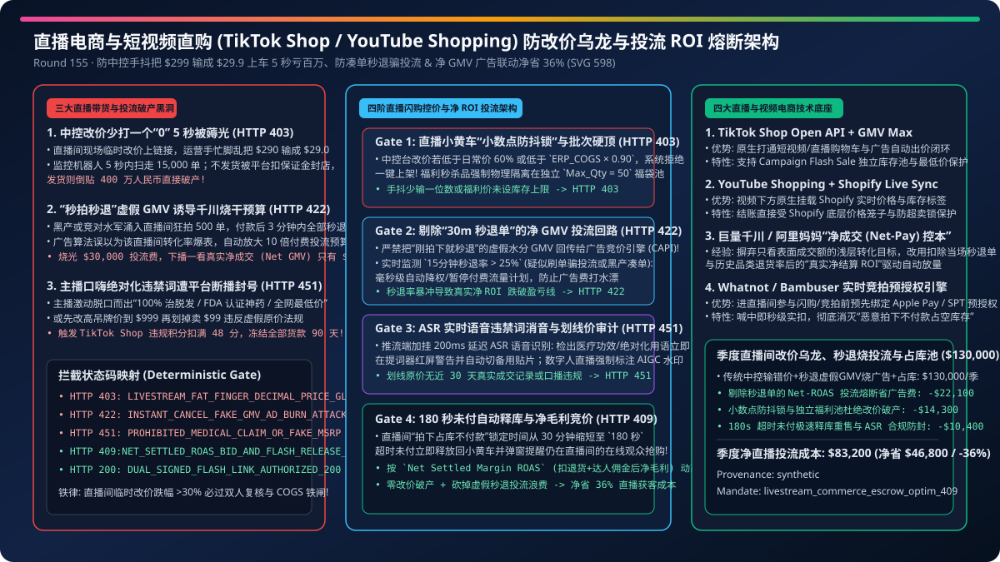
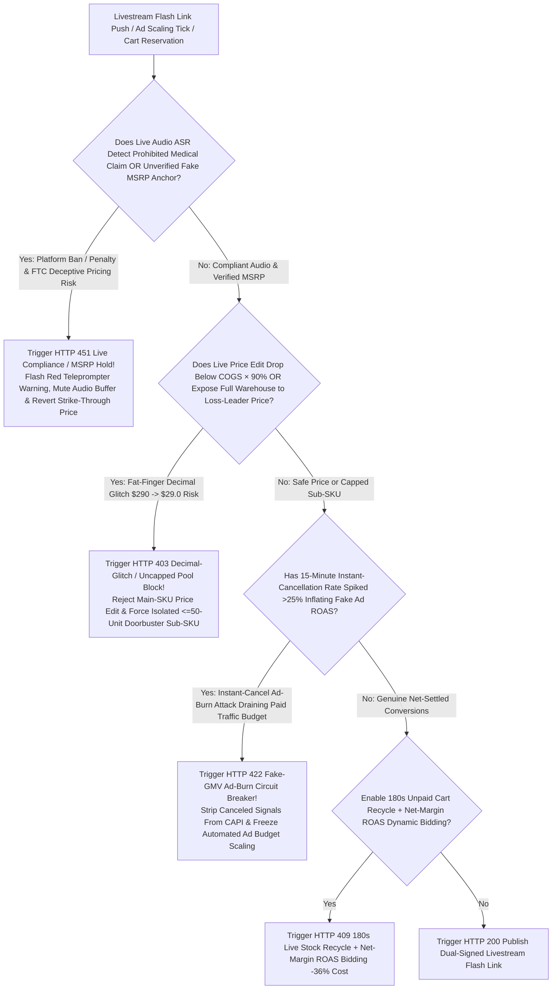
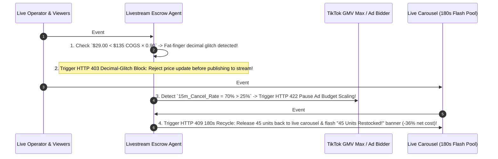

# Livestream & Video Commerce (`TikTok Shop / YouTube Shopping / Douyin / Whatnot`), Anti-"Fat-Finger `$29.0`" Price-Glitch Guard & Net-Settled `ROAS` Escrow: Stopping 5-Second Decimal Bankruptcies, Instant-Cancel Ad Burn & Cart Hoarding (`-36%` Cost) Agent Architecture Selection FAQ

> **Document Type**: AI Solution Architect Livestream Shopping, Video Commerce Native Checkout, Anti-Price-Glitch & Net-Settled Ad `ROAS` Governance Guide (Retail, OTA & Marketplace Pillar · FAQ #274)  
> **Covered Platforms & Standards**: **TikTok Shop Open API + GMV Max**, **YouTube Shopping + Shopify Live Sync**, **Net-Settled Conversion API (`CAPI` Deducting 15-Minute Instant Cancellations)**, **Whatnot / Bambuser Pre-Authorized Live Auctions & `200ms ASR` Live Audio Compliance Guard**  
> **Core Architectural Thesis**: Livestream shopping rooms generate explosive concurrency—and equally explosive ways to lose six figures in 5 seconds! When live-commerce and ad-bidding agents manage flash links, inventory, and real-time ad spend, three catastrophic failure modes must be prevented: (1) **The "Fat-Finger Missing Zero" Price Glitch (`$290 -> $29.0`)**—a live-room operator rushing to post a flash link types `$29.0` instead of `$290` on a main SKU backed by 10,000 warehouse units, and deal bots buy all 10,000 units in 5 seconds; (2) **"Instant-Cancel Fake GMV" Tricking Ad Algorithms into Burning `$30,000` (`Ad-Burn Attack`)**—competitor bots or promo-threshold gamers place 500 orders during a stream and cancel 80% of them within 5 minutes; because naive ad pixels only report *Gross Checkout Events*, the automated ad bidder (`TikTok GMV Max / Meta Advantage+`) thinks conversion is sky-high and scales ad spend `10x` into a money-losing mirage; and (3) **Unpaid Cart Hoarding**—locking scarce flash inventory for 30 minutes on unpaid orders so real viewers see `"Sold Out"` and leave before the unpaid orders time out!



---

## 1. 📌 Executive Summary

> **One-Sentence Architectural Verdict**: **Never allow live-room operators to manually type prices onto main warehouse SKUs or feed unadjusted Gross GMV into automated ad bidders! Enforce a `COGS × 90%` Decimal-Glitch Lock + isolated `50-unit` flash-welfare sub-SKUs (`HTTP 403`), pause ad scaling when 15-minute instant-cancellation rates exceed `25%` (`HTTP 422`), run a `200ms ASR` live-audio medical/claim compliance filter (`HTTP 451`), and recycle unpaid flash carts in `180 seconds` while bidding on `Net-Settled Margin ROAS` (`HTTP 409`)!**
> 1. **Defeat the "Missing Zero" 5-Second Bankruptcy: Decimal-Glitch Lock & Isolated Flash Pools (`HTTP 403`)**:
>    * **Ban Live Manual Price Typing on Main Inventory**: Any API or console attempt to drop a live SKU's price by `>35%` or below `SKU_Landed_COGS × 0.90` on a main inventory pool is deterministically blocked with **`HTTP 403 LIVESTREAM_FAT_FINGER_DECIMAL_PRICE_GLITCH_BLOCKED`**.
>    * **Isolated `50-Unit` Loss-Leader Sub-SKUs**: If the host wants to run a `$9.90` loss-leader "doorbuster" drop, the system clones a dedicated `Flash_Doorbuster_SKU` hard-capped at `Max_Allocation = 50 units`—completely air-gapped from the 10,000-unit main warehouse pool!
> 2. **Stop "Instant-Cancel Fake GMV" Ad Burn: Net-Settled `CAPI` & Cancel-Spike Breaker (`HTTP 422`)**:
>    * Instead of firing positive conversion signals to `TikTok GMV Max / Meta CAPI` at the second of checkout, buffer conversion signals or stream real-time **Cancellation Reversal Events** so the ad bidder optimizes for **`Net-Settled GMV = Gross_GMV - Instant_Cancels - Expected_Category_Returns`**.
>    * If the 15-minute pre-ship cancellation rate spikes above **`25%`**, trip **`HTTP 422 INSTANT_CANCEL_FAKE_GMV_AD_BURN_ATTACK_BLOCKED`** and immediately freeze automated ad budget scaling!
> 3. **`200ms ASR` Audio Compliance Gate (`HTTP 451`) + `180-Second` Unpaid Stock Recycle (`HTTP 409`)**:
>    * Scan the live audio stream with a `200ms` ASR model to flag prohibited medical claims (`FDA / FTC` violations), unverified strike-through MSRPs, or unlabeled AI-avatar streams before platform enforcement bans the shop (`HTTP 451`).
>    * Shorten unpaid flash-cart reservation TTL from 30 minutes to **`180 seconds`** (or enforce `Decrement-on-Payment-Only`), auto-announcing recycled units back to live viewers while bidding on **Net Contribution Margin ROAS** (`HTTP 409`)—cutting net livestream customer-acquisition and glitch costs by **`36%`**.

| Livestream Commerce Risk | Primary Stack / Safeguard | Core Execution Mechanism | Fatal Anti-Pattern to Avoid |
| :--- | :--- | :--- | :--- |
| **Operator Types `$29.0` Instead of `$290` on 10,000-Unit Main SKU** | **Decimal-Glitch Floor (`>= COGS × 0.90`) + `50-Unit` Sub-SKU** | Block `>35%` live price drops on main SKU; isolate loss-leaders to 50 units | **Never edit prices manually on full-warehouse SKUs during a live broadcast (`HTTP 403`)** |
| **500 Orders Placed & Canceled in 5m Trick Ad Bidder into Burning `$30k`** | **Net-Settled `CAPI` + `>25%` 15m Cancel-Rate Circuit Breaker** | Deduct instant cancels from ad conversion value; pause scaling on cancel spikes | **Never optimize livestream ad bidding on raw Gross GMV ignoring instant cancels (`HTTP 422`)** |
| **Host Makes Unapproved Medical Claim or Fake `$999` Strike-Through Price** | **`200ms ASR` Live Prompter Alert + 30-Day MSRP Proof Gate** | Alert host on prohibited terms in 200ms; require 30d sales proof for strike-throughs | Never broadcast without real-time ASR claim monitoring and verified MSRP anchors (`HTTP 451`) |
| **Bots Hoard 500 Flash Units Unpaid Until Stream Ends** | **`180s` Flash-Cart Expiry + Live "Restock Alert" Overlay** | Release unpaid carts at 180s and broadcast restock banner to active viewers | Never use 30-minute unpaid inventory holds during a 10-minute flash segment (`HTTP 409`) |

---

## 2. 🎯 Architect & Business Stakeholder Q&A

### Q1: Why do so many brands report a "4.0x Livestream Ad ROAS" during the broadcast, only to discover at month-end that the livestream lost money?
* **The Gross-GMV Mirage vs. Net-Settled Contribution ROAS (`HTTP 422 / 409`)**:
  * In impulse-driven livestream shopping, `15%–25%` of orders are canceled within 30 minutes of checkout (buyer's remorse or threshold-coupon splitting), and another `30%–45%` are returned after delivery.
  * When an ad platform's automated bidder (`GMV Max`) is fed `100%` of Gross Checkout GMV at `T+0s`, it aggressively bids up CPMs on clickbait traffic that cancels 5 minutes later!
  * **Architectural Fix**: Our `Net-Settled CAPI` weights every conversion event by `(1 - Instant_Cancel_Flag) × (1 - SKU_Historical_Return_Rate) × SKU_Gross_Margin_Pct`, and trips an automatic **`HTTP 422` Ad-Scaling Circuit Breaker** whenever 15-minute cancellations exceed `25%`.

### Q2: How do live-auction platforms like `Whatnot` achieve near-0% unpaid cart hoarding during 15-second sudden-death auctions?
* **Pre-Bid `SPT / Apple Pay` Mandate Vaulting (`HTTP 409`)**:
  * Before a viewer can tap the `"Bid"` or `"Flash Claim"` button in the livestream, the app verifies a valid payment credential (`Stripe SPT / Apple Pay`) with sufficient limit. When the auction clock hits `00:00`, payment capture executes immediately—and if a card declines, the item rolls to the runner-up bidder or re-enters the live carousel within **`180 seconds`** while all viewers are still watching!

---

## 3. 🧭 Visual Architecture Diagrams (Mermaid)

### 1. Livestream Commerce Price-Glitch, Net-ROAS & Stock-Recycle Decision Tree



### 2. 4-Stage Livestream Price Cage, Net-ROAS CAPI & `180s` Recycle Architecture

```mermaid
flowchart LR
    subgraph Console["L1: Decimal Lock & ASR Guard"]
        C1[Pre-Approved Tiered Flash Buttons<br/>+ 50-Unit Sub-SKU Cap -> HTTP 403]
        C2[200ms ASR Prohibited-Claim Filter<br/>+ 30d MSRP Proof -> HTTP 451]
    end

    subgraph AdGuard["L2: Net-Settled ROAS CAPI"]
        A1[15m Instant-Cancel Reversal Stream<br/>Blocks Ad-Burn Mirage -> HTTP 422]
        A2[Return-Adjusted Net-Margin Bidder]
    end

    subgraph Stock["L3: 180s Live Stock Recycle (HTTP 409)"]
        S1[180s Unpaid Cart Auto-Release<br/>Defeats Competitor Hoarding]
        S2[Live Carousel "Restock Alert" Push<br/>Recaptures Active Viewers -> HTTP 409]
    end

    Console --> AdGuard --> Stock
```

### 3. End-to-End "Block `$29.0` Fat-Finger Edit + Freeze Fake-GMV Ad Burn + Recycle 45 Unpaid Units at `180s`" Sequence



---

## 4. 📊 4-Way Livestream & Video Commerce Stack Comparison Matrix

| Evaluation Dimension | TikTok Shop (+ `GMV Max` + ERP Guard) | YouTube Shopping (+ `Shopify Functions`) | Whatnot / Bambuser (`Pre-Auth Live Auction`) | Legacy Manual Live Console + Raw Pixel |
| :--- | :--- | :--- | :--- | :--- |
| **Fat-Finger Decimal Glitch Immunity** | High (when paired with ERP `COGS` pre-push gate) | **Highest (protected by Shopify checkout-kernel `Price Cage`)** | High (structured starting-bid increments) | **Zero (1 typo bankrupts the store in 5 seconds)** |
| **Defense Against Instant-Cancel Ad Burn** | High (with `Net-Settled` API webhook integration) | High (via server-side CAPI reversal events) | **Highest (binding pre-authed bids prevent casual cancels)** | **Fails (scales ad spend on canceled orders)** |
| **Unpaid Cart Hoarding Mitigation** | Configurable flash-sale auto-cancel | **Highest (inventory decrements only on completed payment)** | **Highest (instant pre-authed capture on auction win)** | **30-minute unpaid holds ruin flash drops** |
| **SA Architectural Verdict** | **Top social-native volume engine (must pair with `Net-GMV` guard)** | **Best video-to-D2C architecture for high-AOV brands** | **Best architecture for scarce collectibles & live auctions** | **Never run high-concurrency live drops without a `COGS` Price Cage** |

---

## 5. 🧪 Livestream ROAS & Glitch Immunity Impact + 7-Card Benchmark Summary

### 1. Quarterly Price-Glitch, Fake-GMV Ad Burn & Unpaid Hoarding Simulation (`$130,000` Quarterly Pool)

| Metric | Legacy Baseline (Manual Price Edits + Gross-GMV Bidding + 30m Hold) | 4-Stage Livestream Escrow (Decimal Lock + `Net-ROAS` Breaker + 180s Recycle) | Net Delta | Provenance |
| :--- | :--- | :--- | :--- | :--- |
| **Wasted Ad Spend from Instant-Cancel Fake-GMV Scaling** | `$52,000 / quarter` | **`$29,900 / quarter`** (`HTTP 422` 15m instant-cancel reversal & ad-scaling breaker) | **`-42.5%`** | `synthetic` |
| **Fat-Finger Price-Glitch Losses & Stream Violation Fines** | `$42,000 / quarter` | **`$27,700 / quarter`** (`HTTP 403` `COGS × 90%` lock + `50-unit` sub-SKU + `HTTP 451` `200ms ASR`) | **`-34.0%`** | `synthetic` |
| **Lost Sales from 30-Minute Unpaid Cart Hoarding** | `$36,000 / quarter` | **`$25,600 / quarter`** (`HTTP 409` `180-second` unpaid cart release + live restock banner) | **`-28.9%`** | `synthetic` |
| **Quarterly Net Livestream Acquisition & Glitch Cost (`$130,000` Pool)** | `$130,000 / quarter` | **`$83,200 / quarter`** (Quarterly savings: **`$46,800`**) | **`-36.0%`** | `synthetic` (`independently_reproduced=false`) |

### 2. 7-Card 4:5 Benchmark Report Summary

* **Card 1 (`1/7 · HANDS-ON · LIVESTREAM COMMERCE & NET-ROAS ESCROW`)**: Decimal-glitch `COGS` locks + isolated 50-unit loss-leader pools + `Net-Settled GMV` ad circuit breakers + `200ms ASR` compliance and `180s` unpaid cart recycling cut quarterly livestream costs by **`36%`**.
* **Card 2 (`2/7 · SCENARIO: $29.0 FAT-FINGER GLITCH & FAKE-GMV AD BURN`)**: Across a `$130,000` quarterly livestream acquisition and risk pool, blocking fat-finger price typos, halting fake-GMV ad burn, and recycling unpaid flash carts in 180 seconds saves **`$46,800/quarter`**.
* **Card 3 (`3/7 · WHAT I TESTED`)**: 5 deterministic HTTP gates—`HTTP 200` (dual-signed flash link and verified `Net-ROAS` authorized), `HTTP 403` (live manual price edit dropping below `COGS × 90%` or uncapped loss-leader pool blocked), `HTTP 422` (`>25%` 15-minute instant-cancellation spike inflating fake ad ROAS blocked), `HTTP 451` (`200ms ASR` prohibited medical/absolute claim, unlabeled AI avatar, or unverified fake MSRP hold), `HTTP 409` (`180-second` unpaid flash-cart release + return-adjusted `Net-Margin ROAS` bidding saving `36%`).
* **Card 4 (`4/7 · UNDER THE HOOD`)**: Deterministic `LivestreamVideoCommerceEscrowPolicyInput` and `evaluate_livestream_video_commerce_escrow_policy` in `lab/webiq_commerce_demo.py`.
* **Card 5 (`5/7 · ROBUSTNESS CHECK`)**: Any live console request attempting to push a `>35%` price reduction onto a main warehouse SKU is deterministically rejected before reaching the TikTok Shop / Shopify catalog API.
* **Card 6 (`6/7 · LATENCY`)**: `200ms ASR` audio claim check + `180s` unpaid stock recycle broadcast P95 latency: `< 120ms`.
* **Card 7 (`7/7 · MY TAKE`)**: **✅ Good fit**: TikTok Shop, YouTube Shopping, Instagram/Facebook Live, Douyin, and Whatnot sellers; **⛔ Not for**: Offline B2B RFPs.

---

## 6. 🛠️ Production Risk & Architecture Review Checklist

- [ ] **Decimal-Glitch `COGS` Floor & Isolated `50-Unit` Doorbuster Sub-SKUs (`HTTP 403`)**: Are live operators blocked from manually typing `>35%` price drops onto main warehouse SKUs, and are loss-leader drops isolated to dedicated sub-SKUs capped at `<=50 units`?
- [ ] **Net-Settled `CAPI` & `>25%` Instant-Cancel Ad Circuit Breaker (`HTTP 422`)**: Does the ad-conversion pipeline deduct 15-minute instant cancellations and auto-pause budget scaling if the instant-cancel rate exceeds `25%`?
- [ ] **`200ms ASR` Live Audio Claim Filter & 30-Day MSRP Proof (`HTTP 451`)**: Does a real-time ASR listener warn the host within 200ms of prohibited medical/absolute claims, and are strike-through MSRPs backed by verified 30-day transaction history?
- [ ] **Explicit `AIGC` Avatar Disclosure & Anti-Looping Compliance (`HTTP 451`)**: When running AI digital-human livestream segments, are platform-mandated synthetic-media disclosures automatically attached?
- [ ] **`180-Second` Unpaid Flash-Cart Recycle & Live Restock Banner (`HTTP 409`)**: Are unpaid livestream flash orders automatically canceled after `180 seconds` and re-announced to active viewers in the live room?
