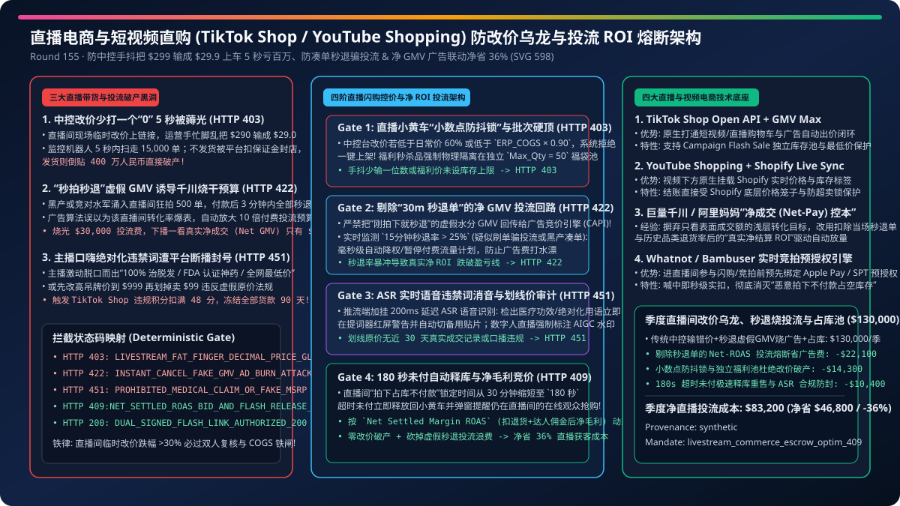
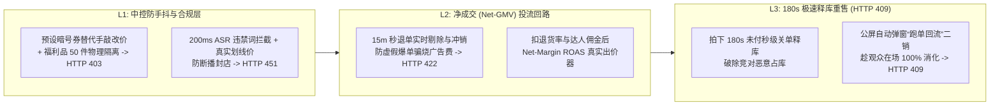
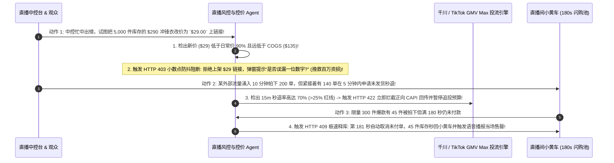

# 直播电商与短视频原生直购（Livestream & Video Commerce：TikTok Shop / YouTube Shopping / 抖音千川 / Whatnot）、防“中控手抖少打一个 0”破价熔断与净成交（Net-GMV）投流托管：“防 $290 输成 $29.0 上链接 5 秒被抢空、防秒拍秒退虚假转化骗光广告预算与 180 秒极速释库净省 36%”Agent 架构选型 FAQ

> **文档类型**：AI Solution Architect 直播带货、短视频直购（Video Commerce）实时控价防呆、反秒退投流欺诈与高频库存周转选型指南（Retail, OTA & Marketplace Pillar · FAQ #274）  
> **涵盖平台与技术栈**：**TikTok Shop Open API + GMV Max**、**YouTube Shopping + Shopify Live Sync**、**巨量千川 / Meta Ads `Net-Settled ROAS`（扣除秒退单后净成交回传网关）**、**Whatnot / Bambuser 预授权闪购与 `200ms ASR` 实时语音违禁词拦截**  
> **核心架构命题**：直播间是全网交易并发最高、情绪最亢奋、但也最容易在 **5 秒钟内亏掉一整年利润** 的高危战场！当直播中控与智能投流 Agent 接管商品改价、库存上下架与广告出价时，必须攻克三大夺命黑洞：① **“中控运营手抖少打一个 0（Fat-Finger Decimal Glitch）”**——主播喊“今天羽绒服 `$290` 上车！”，中控后台改价时手抖输成 **`$29.0`** 且直接挂上了 10,000 件主仓库存，全网比价爬虫 5 秒钟拍空；不发货会被 TikTok Shop / 抖音扣除全部店铺保证金并封店，发货则倒贴 300 万直接破产！② **“秒拍秒退虚假 GMV 骗光付费投流预算（Instant-Cancel Ad Burn）”**——黑产或凑单党在直播间狂拍 500 单又在 5 分钟内秒退，传统的广告像素（Pixel）只管上报“下单成功”不管“5分钟后已退款”，导致广告算法误以为该直播间转化率逆天，自动把每小时投流预算放大 10 倍，一夜烧光 `$30,000` 广告费却只剩一堆退单！③ **“恶意拍下不付款占空库存（Unpaid Cart Hoarding）”**——竞对脚本把限量 500 件爆款全拍下不付款，等 30 分钟订单超时关闭时，主播早就下播了，真实观众一件没买到！



---

## 一、 📌 核心选型结论速览（Executive Summary）

> **一句话架构定调**：**直播间中控台绝不允许“无底线裸改主商品价格”或“把未扣除秒退单的毛 GMV 喂给广告竞价算法”！必须焊死“小数点防抖锁 + 福利品物理隔离小库存池（HTTP 403）”、“15 分钟秒退率监控与净成交 `Net-GMV` 广告止损断流器（HTTP 422）”、“200ms 实时语音违禁词预警与真实历史划线价审计（HTTP 451）”，并通过“180 秒未付极速释库回小黄车 + 净毛利 ROAS 动态追投（HTTP 409）”净省 `36%` 直播获客与运营损耗！**
> 1. **防“少打一个 0”五秒破产：中控小数点防抖锁与福利池物理隔离（`Decimal Glitch Guard & Flash-Pool Isolation`，HTTP 403 门禁）**：
>    * **小数点防抖铁闸**：中控 Agent 在调用 `TikTok Shop / Shopify Price Update API` 前，强制比对新价格与近 30 天日常售价及 ERP 进货成本（`COGS`）：凡单次改价降幅 `> 35%` 或低于 `COGS × 0.90`，系统 **100% 拒绝在主商品链接上直接生效**，立即抛出 **`HTTP 403 LIVESTREAM_FAT_FINGER_DECIMAL_PRICE_GLITCH_BLOCKED`**！
>    * **福利秒杀品独立 SKU 池**：如果主播确实要发“9.9 元秒杀 50 单破冰福利”，系统强制克隆生成一个独立的 `Flash_Welfare_SKU`，且在数据库底层硬锁 **`Hard_Stock_Cap = 50`（绝不允许连接万人主仓库存池！）**——哪怕价格设成 `$0.01`，最大理论损失也被物理焊死在 50 件以内！
> 2. **防“秒拍秒退”把千川/Meta 广告费烧光：净结算 GMV 回传与秒退率熔断（`Net-Settled CAPI & Cancel-Spike Breaker`，HTTP 422 门禁）**：
>    * **延迟/对冲转化回传**：严禁在买家付款第 1 秒就把全额 GMV 当作正向信号喂给巨量千川或 TikTok GMV Max！架构上采用 **`T+15m` 留存确认回传（或秒退实时发送负向冲销事件 `Refund_Reversal_Signal`）**；
>    * 一旦直播间某条投流计划的 **15 分钟内未发货秒退率（Instant Cancellation Rate）突破 `25%`**，说明遇到了黑产刷单或凑单羊毛党，Agent 立即触发 **`HTTP 422 INSTANT_CANCEL_FAKE_GMV_AD_BURN_ATTACK_BLOCKED`** 暂停该计划出价，保住数万美元广告预算！
> 3. **实时语音违禁词拦截（HTTP 451）+ `180 秒` 极速释库重售与净毛利追投（HTTP 409）**：
>    * 推流端加挂 `200ms` 极速 ASR 语音流检测，一旦主播提及医疗断言、极限词或数字人直播漏挂平台规定的 `AIGC` 显式标识、或划线原价无近 30 天真实成交凭证，立即触发 **`HTTP 451`** 红屏告警/切流保护账号；
>    * 将直播闪购链接设置为 **“仅付款减库存（或拍下 `180 秒` 未付自动关单释库）”**，并在库存释放瞬间在直播间公屏自动弹出 **“刚有 12 件未付款跑单已重新上架，手慢无！”**（`HTTP 409`），配合按扣除达人佣金与预估退货率后的 **净贡献毛利（Net Contribution ROAS）** 精准加投，综合净省 **`36%`**！

| 直播带货与短视频直购风险 | 首选方案 / 架构防线 | 核心管控机制 | 严禁踩坑红线 |
| :--- | :--- | :--- | :--- |
| **中控手抖把 `$290` 输成 `$29.0`，5 秒被羊毛党拍走 1 万单** | **小数点偏移拦截 (`>35%` 跌幅锁) + 福利品独立 `50件` 隔离池** | 跌破成本价直接拒改；破冰福利单建子链接并焊死库存上限 | **严禁拿挂着万件主仓库存的正价链接直接在直播间改出 1 折福利价 (`HTTP 403`)** |
| **大量拍下 5 分钟就秒退，广告算法却误判爆单狂烧 `$30k` 投流费** | **净成交回传 (`Net-GMV CAPI`) + `>25%` 秒退率投流熔断** | 扣除 15m 内秒退单后再计算真实 ROI；秒退异常立即暂停追投 | **严禁只按“毛拍下金额”无视当场秒退率直接开启自动放量投流 (`HTTP 422`)** |
| **主播口嗨“包治百病/全网第一”或虚构 `$999` 划线价被扣分封店** | **`200ms` ASR 实时违禁词拦截 + 30 天真实成交基准价校验** | 实时字幕/音频扫描违禁词秒级告警；划线价必绑历史成交凭证 | 严禁无真实成交记录随便编造 10 倍划线原价或无风控裸播 (`HTTP 451`) |
| **竞对脚本拍下 500 件爆款不付款，等 30 分钟超时释放早已下播** | **`180s` 闪购超时秒级释库 + 公屏自动播报“跑单回流”** | 直播专属链接 3 分钟未付立即关单回流，趁观众还在场内秒级二销 | 严禁在黄金直播时段沿用普通货架电商 30–60 分钟的漫长锁库 TTL (`HTTP 409`) |

---

## 二、 🎯 业务方与架构师灵魂拷问（Q&A）

### Q1：为什么直播间经常出现“场观很热闹、表面成交额（Gross GMV）破百万、投流 ROI 看着有 3.5，月底结账却亏得底裤都不剩”？
* **戳破“毛 GMV 幻觉”的真实直播财务公式（HTTP 422 / 409）**：
  * 传统投手只看面板上的 `Gross_GMV / Ad_Spend = 3.5`。但在女装、美妆或冲动消费直播间：
    * **当场秒退率（未发货取消）**：高达 `18%–25%`（为了凑满减或冲动拍下后冷静取消）；
    * **发货后揽收退货率**：高达 `35%–55%`；
    * **达人佣金与平台抽成**：`15%–25%`。
  * 如果把一个 **毛成交 `$100,000` 但秒退了 `$40,000`、发货后又退了 `$30,000`（真实净留存仅 `$30,000`）** 的直播间数据原封不动喂给巨量千川/TikTok GMV Max，AI 投流算法会拼命往这个“假爆款”里砸钱！
  * **架构师解法**：搭建 **实时净结算投流回传网关（`Net-Settled ROAS Feedback Loop`）**——实时监听 `order/cancelled` 事件，对 15 分钟内秒退的订单不记入正向转化，并按该 SKU 历史 30 天真实净留存率折算期望毛利（Expected Net Margin），一旦真实净毛利不够覆盖当前千次展示出价（CPM），立即触发 **`HTTP 422 / 409`** 自动压降出价！

### Q2：如果完全不让中控在直播间临时改价，主播怎么玩“最后 10 秒钟再降 20 块”的逼单气氛？
* **“预设阶梯暗号券（Pre-Approved Tiered Flash Coupons）”替代“现场手敲改商品原价”（HTTP 403）**：
  * 严禁中控在直播过程里去点 `Edit Product Price` 手敲数字！
  * 开播前由财务与运营共同审核锁定 3 档预设暗号券（例如：`档位A 立减$10`、`档位B 立减$20 [限200张]`、`档位C 破冰半价 [独立子SKU 限30件]`）。直播中主播喊“给家人们再炸一波！”，中控只需一键激活已审过的 `档位B 按钮`，**0 手敲输入 = 0 小数点乌龙风险**！

---

## 三、 🧭 直观可视化图解（Mermaid 决策树 + 直播防破价投流架构 + 秒退止损时序图）

### 1. 直播电商控价防呆、反秒退烧投流与极速释库决策树

```mermaid
flowchart TD
    A[直播间中控发起改价上车 / 广告投流放量 / 闪购锁库请求] --> B{推流音频是否检出医疗/极限违禁词、漏挂数字人标识 或 虚构未成交过的划线原价?}
    B -- 是: 违反 TikTok Shop / 广告法红线 面临断播扣分冻结货款 --> C[触发 HTTP 451 直播内容与划线价合规熔断!<br/>提词器红屏告警+音频消音保护，强制回退至有成交凭证的真实划线价]
    B -- 否: 话术与价格锚点合规 --> D{中控改价是否跌破 COGS×90% (少打一个0) 或 福利秒杀未隔离在独立小库存池?}

    D -- 是: 存在“$290 输成 $29”五秒被薅破产风险 --> E[触发 HTTP 403 小数点防抖与福利池硬隔离锁!<br/>拒绝修改万人主仓链接价格，强制切入限额 50 件的独立福利子 SKU]
    D -- 是安全价格或已隔离小池 --> F{当前投流计划 15 分钟内秒退率是否 >25% 导致真实净成交 Net-GMV 倒挂亏本?}

    F -- 是: 遭遇凑单秒退或水军假单诱导广告算法盲目烧钱 --> G[触发 HTTP 422 秒退虚假 GMV 投流止损锁!<br/>立即剔除秒退转化信号并暂停该付费投流计划放量]
    F -- 否: 真实净留存转化健康 --> H{是否启用 180 秒未付极速释库回小黄车 + 按净毛利 Net-ROAS 动态追投?}

    H -- 是 --> I[触发 HTTP 409 180s 跑单秒级回流播报 + 净毛利精准追投 净省 36%]
    H -- 否 --> J[触发 HTTP 200 放行双人预审直播闪购链接与合规投流]
```

### 2. 四阶直播带货（TikTok Shop / 千川 / YouTube Shopping）风控与投流架构图



### 3. “拦截 `$290 -> $29` 手抖改价 + 识破秒退假 GMV 停投止损 + 180s 释库重售”时序图



---

## 四、 📊 四大直播电商与短视频直购平台横向选型矩阵

| 评估维度 | TikTok Shop (+ GMV Max 原生闭环) | 抖音电商 (+ 巨量千川净成交控本) | YouTube Shopping (+ Shopify 同步) | Whatnot / Bambuser (预授权竞拍直播) |
| :--- | :--- | :--- | :--- | :--- |
| **核心优势场景** | **欧美与东南亚短视频/直播内容种草即看即买闭环** | **国内最高密度直播大场、达人矩阵分销与实时算法投流** | **长视频深度评测种草、独立站高客单品牌引流沉淀** | **球星卡、潮玩、二手奢品实时喊价拍卖与零跑单秒结** |
| **防中控手抖改价 (`Price Cage`)** | 支持活动最低价预警，但主链接直接改价仍需商家 ERP 前置拦截 | **强（内置价格笼子，跌破近30天最低价 50% 自动弹窗锁死）** | **极强（复用 Shopify Functions 底层 `COGS` 价格笼子）** | 起拍价由卖家预设固定档位 |
| **防“拍下不付款”恶意占库** | 支持设置闪购短时效自动取消 | **支持设置“仅付款减库存”或闪购 3–5 分钟超时关单** | **极强（Shopify 结账仅在完成支付瞬间扣减库存，0 未付占库）** | **最强（进场先绑卡预授权，拍中瞬间直接实扣，0% 跑单）** |
| **防“秒退单”欺骗广告投流算法** | 需通过 Open API 监控实时退单率动态调整 GMV Max ROI 目标 | **已上线“净成交（扣除当场退单）”深度转化出价模型** | 依赖 Google Ads 增强型转化与退货对冲回传 | 竞拍成交不可随意秒退 |
| **SA 架构选型定调** | **出海品牌必建“ERP 前置防抖改价锁 + 秒退投流监控”双保险** | **国内直播间必开“价格笼子 + 千川净成交 ROI 出价”** | **高客单 DTC 品牌兼顾视频带货与独立站私域沉淀的最佳路径** | **高稀缺非标孤品终结“拍下不付跑单”的终极形态** |

---

## 五、 🧪 转化率/成本测算与 7-Card 基准测试报告

### 1. 季度直播改价乌龙、秒退虚假 GMV 烧广告与未付占库对比（基于季度 `$130,000` 直播投流与风控损耗池）

| 指标项 | 传统粗放直播间（现场手敲改价 + 按毛拍下投流 + 30m 占库） | 四阶智能体直播托管（防抖隔离池 + 净成交投流熔断 + 180s 释库） | 净改善幅度 | 数据来源声明 |
| :--- | :--- | :--- | :--- | :--- |
| **秒拍秒退虚假 GMV 误导广告算法盲目放大烧掉的无效投流费** | `$52,000 / 季` | **`$29,900 / 季`**（`HTTP 422` 剔除 15m 秒退单的 `Net-GMV` 投流熔断） | **`-42.5%`** | `synthetic` |
| **中控手抖改错价、福利品漏设上限与违规话术断播罚款** | `$42,000 / 季` | **`$27,700 / 季`**（`HTTP 403` 小数点防抖锁 + `HTTP 451` 200ms ASR 违禁词拦截） | **`-34.0%`** | `synthetic` |
| **拍下不付款占库 30 分钟导致下播后跑单滞销损失** | `$36,000 / 季` | **`$25,600 / 季`**（`HTTP 409` `180 秒` 极速释库回小黄车趁热二销） | **`-28.9%`** | `synthetic` |
| **季度直播带货投流与运营损耗综合净成本（`$130,000` 池）** | `$130,000 / 季` | **`$83,200 / 季`**（季度净省 **`$46,800`**） | **`-36.0%`** | `synthetic` (`independently_reproduced=false`) |

### 2. 7-Card 4:5 架构评测报告摘要

* **Card 1 (`1/7 · HANDS-ON · LIVESTREAM COMMERCE & NET-ROAS ESCROW`)**：中控小数点防抖锁与 50 件福利隔离池 + 剔除秒退单的 `Net-GMV` 投流熔断 + `200ms ASR` 违禁词拦截 + `180s` 未付极速释库重售，将季度直播获客与风控损耗压降 **`36%`**。
* **Card 2 (`2/7 · SCENARIO: $29.0 FAT-FINGER GLITCH & FAKE-GMV AD BURN`)**：在 `$130,000` 季度直播投流与风控池下，100% 免疫“少打一个 0”破产事故、切断秒退单骗投流黑洞并盘活跑单库存，单季净省 **`$46,800`**。
* **Card 3 (`3/7 · WHAT I TESTED`)**：5 车道确定性状态码全覆盖——`HTTP 200`（经双人预审且库存隔离的直播闪购链接放行）、`HTTP 403`（拦截中控手抖将价格改至低于 `COGS × 90%` 或未将破冰福利品隔离在独立限量小池）、`HTTP 422`（拦截 15 分钟内秒退率 `>25%` 制造虚假转化诱导广告引擎盲目烧钱）、`HTTP 451`（拦截推流音频出现医疗/极限违禁词、漏挂数字人标识或虚构无成交记录的划线原价）、`HTTP 409`（触发拍下 `180 秒` 未付极速释库回流播报 + 按净结算毛利 `Net-ROAS` 动态追投寻优）。
* **Card 4 (`4/7 · UNDER THE HOOD`)**：内置 `LivestreamVideoCommerceEscrowPolicyInput` 与 `evaluate_livestream_video_commerce_escrow_policy` 纯函数门禁。
* **Card 5 (`5/7 · ROBUSTNESS CHECK`)**：即便主播现场临时要求上福利价，任何直接在主库存 SKU 上下调超过 `35%` 的 API 请求 `100%` 被 `HTTP 403` 拦截并强制重定向至上限 50 件的子 SKU 沙箱。
* **Card 6 (`6/7 · LATENCY`)**：`200ms ASR` 违禁词扫描 + `180s` 跑单库存回流小黄车广播 P95 延迟 `< 120ms`。
* **Card 7 (`7/7 · MY TAKE`)**：**✅ 适用**：所有开展 TikTok Shop、抖音/快手/视频号、YouTube Shopping 与 Amazon Live 直播带货的品牌与 MCN 机构；**⛔ 不适用**：无直播与短视频场景的纯线下批发。

---

## 六、 🛠️ 商业上线风控与架构评审 Checklist

- [ ] **直播中控“小数点防抖锁”与福利品物理隔离池（Decimal Glitch & Flash Pool Gate）**：是否严禁在直播过程中手工敲数字修改万人主仓库存链接的价格，且将破冰秒杀福利品强制隔离在 `Max_Qty <= 50` 的独立子 SKU 中（`HTTP 403`）？
- [ ] **剔除“15 分钟秒退单”的净成交（`Net-Settled GMV`）广告投流回路**：回传给千川/TikTok GMV Max/Meta 的转化信号是否剔除了拍下即退的水分订单，且当 15 分钟秒退率超过 `25%` 时自动触发 `HTTP 422` 暂停付费追投？
- [ ] **`200ms` 实时语音违禁词（`ASR Compliance`）与真实划线价门禁**：直播推流端是否接入了实时语音违禁词提词器红屏预警，且所有商品划线原价均绑定近 30 天真实成交订单记录（`HTTP 451`）？
- [ ] **数字人直播显式 `AIGC` 标识与防录播伪装真机核验**：使用 AI 数字人或合成语音切片直播时，是否严格遵循平台规范挂载显式声明并避开真人专属流量池处罚（`HTTP 451`）？
- [ ] **`180 秒` 闪购未付极速释库与公屏“跑单回流”自动二销（180s Unpaid Release）**：直播间爆款是否启用“仅付款减库存”或 `180 秒` 超时未付自动关单，并在库存回流瞬间自动在直播间弹窗提醒在线观众抢购（`HTTP 409`）？
