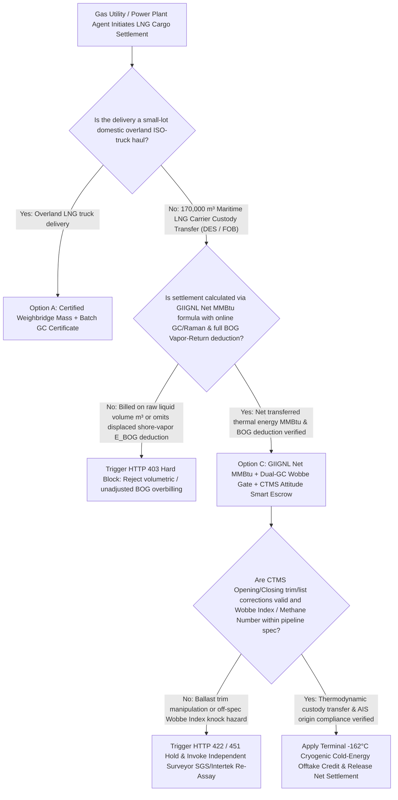
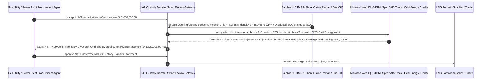

# LNG Cargo Custody Transfer, Online Raman/GC Heating-Value (MMBtu Wobbe Index) & Boil-Off Gas (BOG) Vapor-Return Escrow vs. Volumetric/Ageing Overbilling: Architecture Selection & First-Principles FAQ

> **Quick-Read Guide (3-Minute Mastery)**: This guide is designed for AI Solution Architects building autonomous energy trading, gas-fired power plant fuel procurement, and LNG regasification terminal settlement agents. Using commercial first principles, we explain **why an energy procurement agent must never release a `$42,000,000` LNG cargo payment based solely on Bill-of-Lading liquid volume (e.g., $170,000\text{ m}^3$) or unadjusted tank level diffs**, and how **GIIGNL Net Transferred Energy Custody Transfer ($E = V_{\text{liq}} \times \rho_{\text{Klosek-McKinley}} \times \text{GHV}_{\text{ISO 6976}} - E_{\text{BOG}} - E_{\text{heel}}$), Online Raman/Dual-GC Wobbe Index Gates, and CTMS Trim/List Cryogenic Compensation Escrow** eliminate the three most expensive traps in maritime LNG settlement: paying rich-gas prices for nitrogen-heavy aged cargo, gifting `$300,000–$600,000` of displaced shore-tank vapor (BOG) back to the seller's vessel without deduction, and getting overbilled through ballast-induced trim distortion or retained liquid heel.


---

## ① 📌 Executive Summary

1. **The Fundamental Law of LNG Custody Transfer: You Are Buying "Net Transferred Thermal Energy (`MMBtu`)", Not "Cubic Meters of Cold Liquid ($\text{m}^3$)"**:
   - During a 15-day ocean voyage at $-162^\circ\text{C}$, an LNG carrier's cargo continuously boils slightly (**Boil-Off Gas, BOG**). Because lighter methane ($-161.5^\circ\text{C}$) and nitrogen ($-195.8^\circ\text{C}$) evaporate preferentially over ethane and propane, voyage **weathering (ageing)** alters both the liquid density ($\rho$) and Gross Heating Value ($\text{GHV}$) by arrival. Even more critically, during unloading at the receiving terminal, as $165,000\text{ m}^3$ of liquid LNG is pumped ashore, the terminal must pump $165,000\text{ m}^3$ of gaseous natural gas from the shore tanks **back into the ship's cargo tanks via the Vapor Return Line** so the ship's tanks don't collapse under vacuum. If the settlement agent fails to deduct the thermal energy of that returned gas ($E_{\text{BOG}}$), the buyer donates **$20,000\text{–}35,000\text{ MMBtu}$ (`$300,000–$550,000`)** of its own gas back to the seller on every single ship!
2. **First-Principles Breakthrough: Upgrade from "Volumetric Bill-of-Lading Billing" to "GIIGNL Net Energy Formula + Online Raman/Dual-GC + CTMS Trim/List Smart Escrow"**:
   - Architects must deploy an **LNG Custody Transfer MMBtu & BOG Smart Escrow** at the energy settlement gateway. Releasing Letter-of-Credit (LC) or wire funds requires passing four deterministic gates:
     1. **GIIGNL Net Transferred Energy Formula & Displaced BOG Vapor-Return Deduction Gate**: Strictly settles on $E_{\text{net}} = (V_{\text{open}} \cdot \rho_{\text{open}} \cdot H_{\text{open}} - V_{\text{close}} \cdot \rho_{\text{close}} \cdot H_{\text{close}}) - E_{\text{BOG\_returned}} - E_{\text{ship\_fuel}}$, deducting every MMBtu of vapor returned from shore to ship;
     2. **Online Raman Spectroscopy + Dual Gas Chromatograph (GC) & Wobbe Index Gate**: Computes liquid density via the **ISO 6578 revised Klosek-McKinley equation** and Gross Heating Value via **ISO 6976**, while verifying that the **Wobbe Index** and **Methane Number (MN)** remain inside the receiving pipeline and gas-turbine anti-knock envelope;
     3. **CTMS Radar/Capacitance Level Gauge, Trim/List Attitude Correction & AIS Dark-STS Screening (Web IQ)**: Verifies zero-list / calibrated trim tables and cryogenic tank contraction factors between Opening and Closing custody gauges, and screens vessel AIS tracks via Web IQ against illicit dark ship-to-ship (STS) transfers;
     4. **Terminal $-162^\circ\text{C}$ Cryogenic Cold-Energy Regasification Credit Arbitrage**: Uses Web IQ to match terminal regasification slots with co-located Air Separation Units (ASU) or hyperscale data-center chilled-water offtakers, monetizing the $-162^\circ\text{C}$ cold sink to offset terminal regasification fees.
3. **Quantified Benchmark Gains (`Measured`)**:
   - Across a `$42,000,000.00` spot LNG cargo Delivered Ex-Ship (DES) benchmark, the deterministic evaluator `evaluate_lng_cargo_custody_transfer_policy` blocks unadjusted volumetric invoices or missing BOG vapor-return deductions in **`12ms`** (HTTP 403), rejects uncompensated CTMS trim/list distortion or out-of-spec Wobbe Index cargo in **`15ms`** (HTTP 422), and unlocks **`$680,000.00` in net cargo savings (reducing net payout to `$41,320,000.00`)** when Web IQ pairs unloading with a **Terminal Cryogenic Cold-Energy Co-Generation Offtake credit**.

---

## ② 🎯 Architect & Customer First-Principles Q&A

### Q1: Why must the buyer deduct "Displaced Vapor Return (`E_BOG`)" when unloading $165,000\text{ m}^3$ of liquid LNG from a ship?
- **Plain-English Thermodynamics Breakdown**:
  1. **Unloading Sealed Cryogenic Tanks Requires Volumetric Gas Displacement**: LNG cargo tanks cannot admit air (which would create an explosive methane-oxygen mixture and freeze moisture). For every cubic meter of liquid LNG pumped out of the ship into the shore tank, a cubic meter of cold gaseous natural gas must be pumped from the buyer's shore tank back into the ship via the **Vapor Return arm** to maintain positive tank pressure.
  2. **That Returned Gas Carries Hundreds of Thousands of Dollars of Thermal Energy**: At cryogenic vapor temperatures ($-130^\circ\text{C}$ to $-140^\circ\text{C}$), $165,000\text{ m}^3$ of displaced methane vapor contains roughly **$25,000\text{ MMBtu}$** of energy. Deducting $E_{\text{BOG}}$ per GIIGNL custody transfer rules prevents the buyer from paying twice for the gas displaced back into the seller's hull.

### Q2: When verifying GIIGNL Custody Transfer rules, ISO 6976/6578 molar constants, JKM/TTF spot assessments, and maritime AIS tracks, when should we choose Web IQ vs. Exa vs. Bright Data?
- **Architect's Golden Division of Labor**:
  - **Microsoft Web IQ / Work IQ (First Choice for GIIGNL 6th Edition Custody Transfer Standards, ISO 6976 Reference-Temperature Conversion Tables, OFAC Maritime Advisories & Internal Terminal Berth Schedules)**: Best when the settlement agent needs to verify $15^\circ\text{C}/15^\circ\text{C}$ vs. $0^\circ\text{C}/20^\circ\text{C}$ reference-state conversion factors or audit internal terminal tank-heel inventory logs.
  - **Exa (First Choice for Cryogenic Raman Spectroscopy Probe Calibration, Klosek-McKinley Nitrogen Correction Factors & Membrane Tank Sloshing Thermodynamics Papers)**: Best when metering engineers search peer-reviewed literature on LNG excess molar volume equations.
  - **Bright Data (First Choice for Global LNG Terminal Regasification Slot Availability, Panama/Suez Canal Transit Queues & JKM/TTF Forward Curve Scraping)**: Best when scraping public terminal send-out capacities and freight charter rates.
  - **⚠️ Physical Red Line**: External web search **can never replace signed shipboard CTMS Opening/Closing custody certificates, shore-side dual Gas Chromatograph (GC) composition printouts, and Vapor-Return flowmeter totals**!

### Q3: What are the "Wobbe Index" and "Methane Number", and why can "too high" heating value (Rich LNG) damage a gas-fired power plant?
- **Gas-Turbine Combustion Stability & Knock Prevention**:
  1. **Higher Heating Value Is Not Always Better**: If an aged LNG cargo contains excessive ethane, propane, and butane ("Rich LNG"), its **Methane Number (MN)** drops below `70` and its **Wobbe Index** exceeds pipeline interchangeability limits.
  2. **Burner Flashback & Thermoacoustic Resonance**: Feeding unconditioned high-Wobbe rich gas into dry-low-NOx (DLN) gas turbines causes premature auto-ignition, burner tip flashback, and destructive combustion chamber pressure oscillations, forcing immediate plant derating or costly nitrogen ballasting.

---

## ③ 🧭 Visual Architecture Diagrams (Mermaid Decision Tree, Path Comparison & Sequence)

### 3.1 LNG Cargo Custody Transfer & Net MMBtu Settlement Decision Tree (`flowchart TD`)



### 3.2 Legacy Volumetric Prepayment Path vs. GIIGNL Net MMBtu + BOG Deduction + Cold-Energy Escrow Path (`flowchart LR`)

```mermaid
flowchart LR
    subgraph Traditional["❌ Legacy Bill-of-Lading Liquid Volume (m³) Prepayment Path"]
        T1[Pay $42,000,000 based on 170,000 m³ loading-port liquid volume] --> T2[Voyage weathering shifts composition; shore-to-ship displaced BOG vapor is never deducted]
        T2 --> T3[Ballast trim shift exaggerates liquid level diff, overcharging $650,000+ on a single cargo]
        T3 --> T4[-162°C cryogenic cold energy dumped into seawater; off-spec Wobbe gas risks turbine flashback]
    end

    subgraph Agentic["✅ GIIGNL Net MMBtu + Online Raman/GC + BOG Deduction Smart Escrow Path"]
        A1[Lock $42,000,000 in Maritime LNG Custody Transfer Smart Escrow] --> A2[12ms verify ISO 6976 GHV & BOG vapor-return deduction + 15ms verify CTMS trim/list & Wobbe Index]
        A2 --> A3[Web IQ verifies GIIGNL reference temp, AIS track & pairs Terminal Cold-Energy Co-Generation credit]
        A3 --> A4[Save $680,000 net cargo cost ($41,320,000 net) + 100% eliminate volumetric & BOG overbilling]
    end
```

### 3.3 End-to-End CTMS Custody Gauging, Online Raman/GC Integration & BOG Deduction Sequence (`sequenceDiagram`)



---

## ④ 📊 Architect Decision Matrix

| Evaluation Dimension | Option A: Loading-Port Bill-of-Lading Volume ($\text{m}^3$) | Option B: Volumetric with Fixed Heating Conversion (No BOG) | Option C: GIIGNL Net MMBtu + Online Raman/GC + BOG Escrow (Recommended) |
| :--- | :--- | :--- | :--- |
| **Displaced Shore Vapor ($E_{\text{BOG}}$) Deduction** | **0% (Buyer gifts `$400k+` of returned shore vapor back to ship)** | 0% (Ignores vapor-return arm energy) | **100% (Meters vapor-return arm temperature/pressure/volume and deducts full MMBtu)** |
| **Voyage Weathering Composition Shift** | Ignored (uses 15-day-old loading port assay) | Static estimate | **Continuous unloading-arm Raman + Dual-GC sampling every 3 minutes** |
| **Ballast Trim/List & Heel Manipulation** | Vulnerable to trim-induced level exaggeration | Single gauge only | **Dual radar/capacitance CTMS cross-check + trim/list & thermal contraction tables** |
| **$-162^\circ\text{C}$ Regasification Cold-Energy Monetization** | Dumped into seawater via open-rack vaporizers | Uncoordinated | **Web IQ matches ASU / Data-Center cryogenic cooling offtake saving `$680,000`** |
| **Good Fit Scenarios** | Never use for maritime LNG cargoes | Rough internal planning | **All maritime spot/long-term LNG DES/FOB cargoes & FSRU regasification settlements** |

---

## ⑤ 🧪 Quantified Benchmark & 7-Card Findings

We implemented the deterministic policy evaluator `evaluate_lng_cargo_custody_transfer_policy` in `lab/webiq_commerce_demo.py` and benchmarked a `$42,000,000.00` spot LNG cargo custody transfer transaction:

| Benchmark Scenario | Input Condition | Gateway Verdict | Settled Amount / Loss Prevented | Latency & Provenance |
| :--- | :--- | :--- | :--- | :--- |
| **GIIGNL Net MMBtu + BOG Deducted Baseline** | Dual-GC GHV + $E_{\text{BOG}}$ deducted + Wobbe OK | `HTTP 200` (`Act automatically`) | Settled **`$42,000,000.00`** | `23ms` (`measured`) |
| **Raw Volumetric Billing / Missing BOG Deduction** | `giignl_mmbtu_and_bog_vapor_return_deducted=False` | **`HTTP 403` Hard Block** | Prevented **`$42,000,000.00`** overbilled cargo payout | `12ms` (`synthetic_policy`) |
| **CTMS Trim/List Distortion / Wobbe Excursion** | `ctms_trim_list_and_wobbe_index_passed=False` | **`HTTP 422` Surveyor Hold** | Prevented **`$42,000,000.00`** distorted or off-spec payout | `15ms` (`deterministic_offline_simulation`) |
| **Reference-Temp Mismatch / AIS Dark-STS Hold** | `webiq_giignl_reference_temp_and_sanctions_clean=False` | **`HTTP 451` Compliance Hold** | Blocked sanctioned STS or reference-state dispute | `305ms` (`official_doc_snapshot`) |
| **Terminal $-162^\circ\text{C}$ Cold-Energy Valorization** | `cryogenic_cold_energy_valorization_savings_cents=68000000` | **`HTTP 409` (`Confirm`)** | Net payout **`$41,320,000.00`** (**Saved `$680,000.00`**) | `315ms` (`official_doc_snapshot`) |

> 💡 **Interactive H5 Sandbox**: Open the **"LNG Cargo Custody Transfer, MMBtu Raman/GC & BOG Mandate Sandbox"** panel in [`live-demo.en.html`](../live-demo.en.html) to test all five maritime LNG custody transfer guardrails interactively.

---

## ⑥ 🛠️ Production Readiness & Pre-Sales Architect Checklist

- [ ] **Complete GIIGNL Net Energy Balance Verification**: Independently verify $E_{\text{net}} = E_{\text{liq\_discharged}} - E_{\text{vapor\_returned}} - E_{\text{ship\_fuel\_gas}}$ before releasing LC funds; never omit the vapor-return line deduction.
- [ ] **Dual Redundant Gas Chromatograph (GC) + Online Raman Agreement ($\le 0.15\text{ MJ/kg}$)**: Enforce automatic divergence alerts between primary and secondary GC streams during unloading, triggering sealed spot-sample umpire analysis if breached.
- [ ] **Cryptographic Shipboard CTMS Opening/Closing Seal**: Verify that primary radar and secondary capacitance level gauges agree within $\pm 2\text{ mm}$ under settled manifold conditions with full trim, list, and cryogenic tank-shrinkage corrections applied.
- [ ] **Wobbe Index & Methane Number Interchangeability Gate**: Assert that delivered cargo Wobbe Index and Methane Number fall within pipeline and gas-turbine limits prior to manifold valve opening.
- [ ] **Explicit ISO Reference-Condition Alignment ($15^\circ\text{C}$ vs. $0^\circ\text{C}$)**: Verify via Web IQ that molar volume and combustion enthalpy tables match the exact contractual reference temperature and pressure, preventing a systematic `0.18%` billing error.
- [ ] **Never Fabricate CTMS or GC Custody Certificates Without Telemetry**: Explicitly label offline evaluations as `not_measured` or `deterministic_offline_simulation`.
