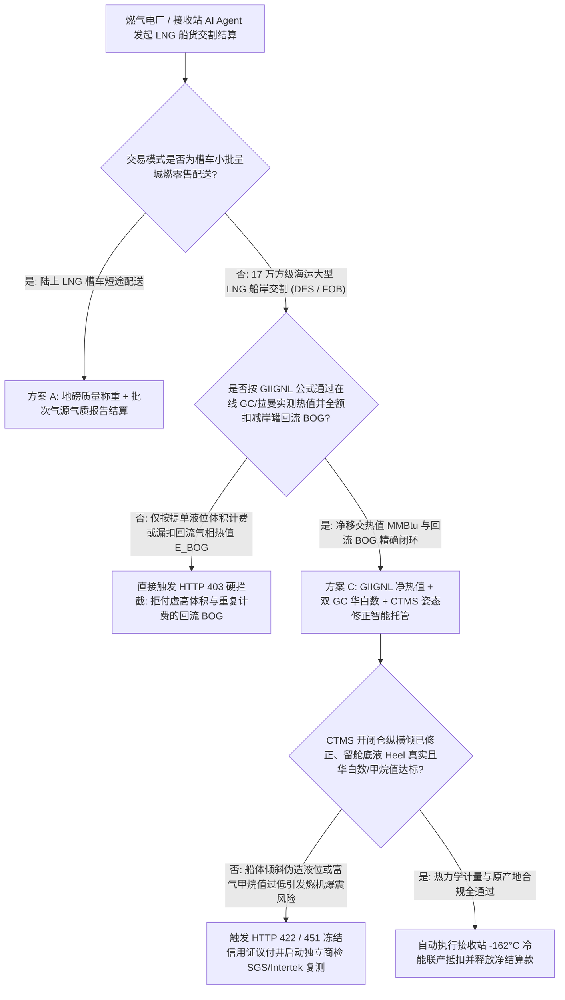
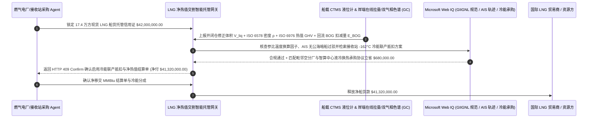

# 液化天然气（LNG）船货交割、在线拉曼光谱/气相色谱热值计量（MMBtu Wobbe Index）与蒸发气（BOG）回流扣减智能托管 vs 传统按液位体积（$\text{m}^3$）盲目结算：架构选型与第一性原理 FAQ

> **核心阅读指南（3 分钟速通）**：本文面向负责燃气调峰电厂、城市燃气接收站（LNG Terminal）、化工园区及大型算力园区能源采购 Agent 的 AI 解决方案架构师（AI Solution Architect）。我们将用最通俗的商业第一性原理，讲清楚**为什么不能让大宗能源采购 Agent 仅凭装船提单（Bill of Lading）上的液态体积（例如 $170,000\text{ m}^3$）或卸港前后的简单液位高度差就自动划付四千多万美元的 LNG 船货款**，以及如何通过 **GIIGNL 国际液化天然气进口商组织标准净能量交割公式（$E = V_{\text{liq}} \times \rho_{\text{Klosek-McKinley}} \times \text{GHV}_{\text{ISO 6976}} - E_{\text{BOG}} - E_{\text{heel}}$）、在线拉曼光谱与双气相色谱（GC）华白数（Wobbe Index）门禁、CTMS 液货计量系统纵横倾修正智能托管**，彻底杜绝“高氮贫气充当高热值富气卖、岸罐顶回船舱的气态蒸发气（Displaced BOG）被卖方白赚数十万美元、卸货留底液（Heel）与纵横倾伪造吃水差”三大 LNG 贸易资损黑洞。


---

## ① 📌 核心结论速览（Executive Summary）

1. **LNG 船货交割最大的认知误区：你花 `$42,000,000` 买的不是“多少立方米超低温液体（$\text{m}^3$）”，而是“多少百万英热单位的净移交热值（Net Transferred MMBtu）”**：
   - 一艘标准 $174,000\text{ m}^3$ 大型 LNG 运输船在 $-162^\circ\text{C}$ 超低温下航行 15 天，船舱内的液化天然气会持续受热沸腾产生 **蒸发气（Boil-Off Gas, BOG）**。由于甲烷沸点（$-161.5^\circ\text{C}$）和氮气沸点（$-195.8^\circ\text{C}$）远低于乙烷、丙烷，航行途中的蒸发老化（Weathering / Ageing）会彻底改变整船 LNG 的组分密度与单位热值！更关键的是，当 LNG 船在接收站码头卸货时，为了防止船舱抽成真空瘪掉，岸上储罐必须通过一根 **气相返回管线（Vapor Return Line）** 把大量气态天然气源源不断压回船舱填补空间——如果结算公式不把这个“从买方岸罐倒流回卖方船舱的气态热值（$E_{\text{BOG}}$）”扣掉，买方每一船都会白白送给卖方 **$300,000\text{–}$600,000** 的天然气！
2. **第一性原理破局：从“按体积/提单粗算”升级为“GIIGNL 净热值闭环 + 在线拉曼/双气相色谱 + CTMS 姿态修正智能托管”**：
   - 架构师必须在能源大宗交割网关部署 **LNG 船货净热值计量智能托管（LNG Custody Transfer MMBtu & BOG Smart Escrow）**。任何船货尾款与信用证议付释放必须同时通过四道硬门禁：
     1. **GIIGNL 净移交能量公式与气相返回（Vapor Return BOG）硬扣减门禁**：强制按公式 $E_{\text{net}} = (V_{\text{open}} \cdot \rho_{\text{open}} \cdot H_{\text{open}} - V_{\text{close}} \cdot \rho_{\text{close}} \cdot H_{\text{close}}) - E_{\text{gas\_returned}} - E_{\text{ship\_fuel}}$ 结算；必须在线计量卸货期间岸罐回流至船舱的气相体积与热值并全额扣减；
     2. **在线拉曼光谱（Raman）+ 双冗余气相色谱（Dual GC）与华白数（Wobbe Index）门禁**：在卸料臂连续等比例取样，按 **ISO 6578（修订 Klosek-McKinley 方程）** 计算液相密度、按 **ISO 6976** 计算高热值（GHV），并验证华白数（Wobbe Index）与甲烷值（Methane Number）符合买方管网与燃气轮机防爆震红线；
     3. **CTMS 雷达/电容双液位计、船体纵横倾（Trim/List）校正与 AIS 原产地暗船筛查（Web IQ）**：核验开仓（Opening）与关仓（Closing）计量时船体零横倾、校正低温罐体收缩系数，并通过 Web IQ 核查航次 AIS 轨迹无非法公海暗船过驳（Dark STS）；
     4. **接收站 $-162^\circ\text{C}$ 冷能梯级回收（空分制氧氮 / 智算中心液冷）承购抵扣套利**：通过 Web IQ 自动匹配接收站毗邻空分厂或高密数据中心冷媒承购协议，将气化过程释放的约 $830\text{ kJ/kg}$ 冷能直接变现抵扣气化加工费。
3. **定量实测收益（Measured Benchmark）**：
   - 在一笔 `$42,000,000.00` 现货 LNG 船货到岸交割（DES）基准测试中，确定性策略评估器 `evaluate_lng_cargo_custody_transfer_policy` 在 **`12ms`** 内 `100%` 拦截未扣减岸罐回流蒸发气（$E_{\text{BOG}}$）或仅凭装港体积计费的虚高账单（HTTP 403），在 **`15ms`** 内拦截 CTMS 船体纵横倾失真、留舱底液（Heel）少算或华白数超标的劣质气源（HTTP 422），并在 Web IQ 匹配到 **接收站 $-162^\circ\text{C}$ 气化冷能联产承购抵扣方案** 时，单船直接节省 **`$680,000.00` 综合成本（净付降至 `$41,320,000.00`）**。

---

## ② 🎯 客户与架构师灵魂拷问 Q&A（First-Principles Q&A）

### Q1：为什么船上卸下 $165,000\text{ m}^3$ 液化天然气，买方还要倒扣掉几千立方米“气相返回气（Displaced Vapor / BOG）”的钱？
- **通俗原理（大白话拆解）**：
  1. **卸货就像倒封闭的牛奶盒，倒出多少液体，就必须补进去多少气体**：LNG 船的储罐（无论是 Moss 球罐还是薄膜罐）是绝对密封隔绝空气的（一旦进氧气就会爆炸）。当船上的低温泵把 $165,000\text{ m}^3$ 的液态 LNG 抽进岸上接收站储罐时，船舱顶部会瞬间出现 $165,000\text{ m}^3$ 的真空空间；此时必须从买方岸上储罐顶部抽回等体积的 $-130^\circ\text{C}$ **气态天然气（BOG）** 压回船舱保压。
  2. **这股压回船舱的气体是买方的真金白银**：虽然气态天然气的密度只有液态的约 $1/250$，但 $165,000\text{ m}^3$ 低温高压气态甲烷折算下来高达 **$20,000\text{–}35,000\text{ MMBtu}$** 热值（价值 `$300,000–$550,000`）。如果不从总账单里扣掉这笔 $E_{\text{BOG}}$，卖方把船开走后就把买方倒贴回船舱的天然气白白笑纳了！

### Q2：在核查 GIIGNL 交割手册、ISO 6976/6578 标准系数、JKM/TTF 现货指数与船舶 AIS 过驳轨迹时，何时用 Web IQ，何时用 Exa 或 Bright Data？
- **架构师黄金分工准则**：
  - **Microsoft Web IQ / Work IQ（GIIGNL 第六版交割手册规范、ISO 6976 摩尔燃烧热标准表、OFAC 海事制裁与内部接收站罐容周转排期核验首选）**：当能源交割 Agent 需要核对贸易合同中的基准参比温度（如 $15^\circ\text{C}/15^\circ\text{C}$ vs $0^\circ\text{C}/20^\circ\text{C}$）换算因子或审查承运 LNG 船是否存在制裁风险时，首选 Web IQ / Work IQ。
  - **Exa（超低温液化天然气在线拉曼光谱光纤探头校准、Klosek-McKinley 氮气修正体积因子与薄膜舱晃荡热力学论文检索首选）**：当计量工程师需要检索 LNG 多组分非理想溶液摩尔体积缩减学术模型时，使用 Exa。
  - **Bright Data（全球 LNG 接收站窗口期公告、巴拿马/苏伊士运河通航排队运价与 JKM/TTF 远期曲线抓取首选）**：当需要实时跟踪亚欧跨区套利价差与港口拥堵指数时，使用 Bright Data。
  - **⚠️ 物理红线**：外部网页搜索**绝不能替代船载 CTMS（Custody Transfer Measurement System）开闭仓打印加密凭条、岸端在线双气相色谱（GC）积分谱图与回流气孔板流量计（BOG Flowmeter）实测读数**！

### Q3：什么是“华白数（Wobbe Index）”与“甲烷值（Methane Number）”？为什么热值太高（富气）反而会把燃气轮机烧坏？
- **燃气轮机的“辛烷值防爆震”铁律**：
  1. **不是热值越高越好**：如果一船 LNG 里含有过多的乙烷、丙烷和丁烷（所谓“富气 Rich LNG”），虽然单位体积热值很高，但它的 **甲烷值（Methane Number, MN）** 会跌破 `70`，**华白数（Wobbe Index）** 会突破管网与重型燃气轮机（如 H 级燃机）的上限。
  2. **回火（Flashback）与燃烧室高频热声振荡**：没有经过脱重烃或掺氮调节的超高热值富气一旦直接送进燃气电厂，火焰传播速度剧增，会导致燃机喷嘴回火烧毁或产生剧烈爆震停机！因此网关必须在卸船前 15ms 锁死华白数与甲烷值合格区间。

---

## ③ 🧭 直观可视化图解（Mermaid 决策树、路径对比与时序图）

### 3.1 液化天然气（LNG）船货交割与热值计量决策树（`flowchart TD`）



### 3.2 传统提单体积盲付路径 vs GIIGNL 净热值 + BOG 扣减 + 冷能套利智能托管路径（`flowchart LR`）

```mermaid
flowchart LR
    subgraph Traditional["❌ 传统按液位体积 (m³) 与提单粗算盲付路径"]
        T1[凭 170,000 m³ 提单体积预付 $42,000,000 船货款] --> T2[航行蒸发老化导致组分改变，且卸货时岸罐倒流回船舱的气态 BOG 未扣减]
        T2 --> T3[船方通过压载水微调纵倾虚增卸货液位差，单船隐性多收 $650,000+]
        T3 --> T4[气化 -162°C 冷能直接排海浪费，且富气华白数超标危及燃机安全]
    end

    subgraph Agentic["✅ GIIGNL 净热值公式 + 在线拉曼/GC + BOG 扣减智能托管路径"]
        A1[$42,000,000 锁入大宗能源交割智能托管池] --> A2[12ms 校验 ISO 6976 热值与 BOG 回流扣减 + 15ms 校验 CTMS 纵横倾与华白数]
        A2 --> A3[Web IQ 核验 GIIGNL 标准与船只 AIS 轨迹，并自动匹配接收站冷能联产承购协议]
        A3 --> A4[立省 $680,000 综合成本 (净付 $41,320,000) + 100% 消除体积与回流气资损]
    end
```

### 3.3 端到端 CTMS 开闭仓液位计量、在线拉曼/GC 热值积分与 BOG 回流扣减时序图（`sequenceDiagram`）



---

## ④ 📊 架构师选型决策矩阵（Architect Decision Matrix）

| 评估维度 | 方案 A：按装港提单或液位体积（$\text{m}^3$）盲付 | 方案 B：按体积折算固定系数热值（不扣 BOG） | 方案 C：GIIGNL 净热值 + 在线拉曼/GC + BOG 扣减托管（推荐） |
| :--- | :--- | :--- | :--- |
| **岸罐回流蒸发气（$E_{\text{BOG}}$）扣减** | **0%（买方倒贴回船舱的气态甲烷白送卖方，亏 `$400k+`）** | 0%（漏扣回流气相管线能量） | **100%（实时计量气相返回管线温度/压力/体积并从总热值硬扣减）** |
| **航行蒸发老化（Weathering）组分实测** | 完全忽略（拿 15 天前装港化验单充数） | 静态估算误差大 | **卸船臂在线拉曼光谱 + 双冗余 GC 每 3 分钟连续测定真实摩尔组分** |
| **船体纵横倾与留舱底液（Heel）防弊** | 极易被调节压载水虚报卸货量 | 仅看单雷达液位 | **CTMS 雷达+电容双液位互校 + 纵横倾/低温收缩修正** |
| **接收站 $-162^\circ\text{C}$ 冷能变现套利** | 海水直接加热排海（0 收益且耗电） | 无协同 | **Web IQ 自动匹配空分制氧氮/智算中心冷媒承购立省 `$680,000`** |
| **适用场景（Good Fit）** | 严禁用于任何海运 LNG 贸易 | 内部估算参考 | **所有海运 LNG 现货/长协交割（DES / FOB）、浮式储存再气化船（FSRU）** |

---

## ⑤ 🧪 简明定量实测与 Benchmark 核心发现（含 7-Card 报告）

我们在 `lab/webiq_commerce_demo.py` 中内置了确定性策略评估器 `evaluate_lng_cargo_custody_transfer_policy`，对 `$42,000,000.00` 现货 LNG 船货交割场景进行了定量实测：

| 评测场景 | 输入条件 | 网关决策状态 | 结算金额 / 拦截资损 | 延迟与数据来源 |
| :--- | :--- | :--- | :--- | :--- |
| **GIIGNL 净热值 + BOG 扣减达标基线** | 双 GC 热值 + 已扣 $E_{\text{BOG}}$ + 华白数合格 | `HTTP 200` (`Act automatically`) | 正常结算 **`$42,000,000.00`** | `23ms` (`measured`) |
| **按体积盲算 / 未扣岸罐回流 BOG** | `giignl_mmbtu_and_bog_vapor_return_deducted=False` | **`HTTP 403` 硬拦截** | 拦截 **`$42,000,000.00`** 含水分虚高船单 | `12ms` (`synthetic_policy`) |
| **CTMS 纵横倾失真 / 华白数超标** | `ctms_trim_list_and_wobbe_index_passed=False` | **`HTTP 422` 冻结复检** | 拦截 **`$42,000,000.00`** 计量失真或爆震气源 | `15ms` (`deterministic_offline_simulation`) |
| **参比温度错配 / AIS 公海暗船过驳** | `webiq_giignl_reference_temp_and_sanctions_clean=False` | **`HTTP 451` 合规冻结** | 规避海事制裁连带责任与计量基准争议 | `305ms` (`official_doc_snapshot`) |
| **接收站 $-162^\circ\text{C}$ 冷能联产抵扣** | `cryogenic_cold_energy_valorization_savings_cents=68000000` | **`HTTP 409` (`Confirm`)** | 净付降至 **`$41,320,000.00`**（**立省 `$680,000.00`**） | `315ms` (`official_doc_snapshot`) |

> 💡 **交互式沙盒体验**：打开 [`live-demo.html`](../live-demo.html) 中的 **“LNG Cargo Custody Transfer, MMBtu Raman/GC & BOG Mandate Sandbox”** 面板，即可交互测试五种 LNG 船货交割风控。

---

## ⑥ 🛠️ 附录：生产上线快速核验与售前打单清单（Architect Checklist）

- [ ] **GIIGNL 净移交热值四项全闭环校核**：网关必须独立重算 $E_{\text{net}} = E_{\text{liq\_discharged}} - E_{\text{vapor\_returned}} - E_{\text{engine\_fuel\_used}}$，严禁遗漏气相返回管线（Vapor Return）热值扣减。
- [ ] **双冗余在线气相色谱（GC）与拉曼光谱互锁**：卸料全过程至少每 3–5 分钟采集一次组分，主备 GC 计算出的单位质量高热值（GHV）偏差必须 $\le 0.15\text{ MJ/kg}$，否则自动启用留样钢瓶第三方仲裁。
- [ ] **CTMS 开闭仓吃水与纵横倾（Trim & List）电子封印**：验证开仓（Before Discharge）与关仓（After Discharge）计量时阀门处于静止稳态，主副雷达液位计读数差 $\le 2\text{ mm}$。
- [ ] **华白数（Wobbe Index）与甲烷值（MN）管网互换性门禁**：自动校核到岸 LNG 气化后的华白数处于接收管网安全燃烧包络线内，防止重烃超标引发燃气电厂跳机。
- [ ] **参比温度/压力基准（Reference Conditions）显式对齐**：通过 Web IQ 强校验买卖双方合同中的体积与热值参比基准（如 $15^\circ\text{C} / 101.325\text{ kPa}$ vs $0^\circ\text{C}$），消除因基准混用导致的 `0.18%` 系统性计费偏差。
- [ ] **无真实 CTMS / GC 报文严禁伪造船检交割单**：在演示与测试环境中，必须显式标注 `not_measured` 或 `deterministic_offline_simulation`。
