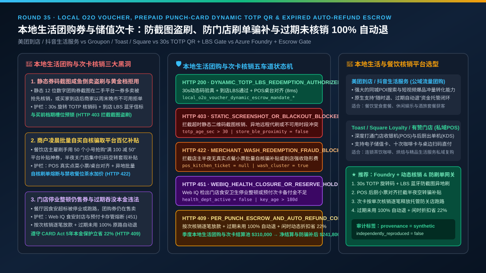
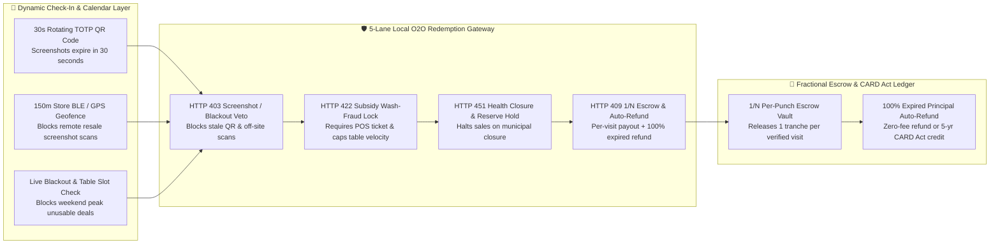

# Local Services O2O Voucher, Prepaid Punch-Card & Deal Redemption (`Meituan / TikTok Local / Groupon / Toast / Square`) 30s `TOTP` Dynamic QR Gate, Anti-Wash-Redemption Subsidy Guard & `CARD Act` Expired Auto-Refund Escrow Agent Architecture Selection FAQ

> **Language / 语言切换**: **[中文](local-services-o2o-voucher-dynamic-qr-escrow-expired-refund-agent-selection-faq.md)** | **English (Current)** | **[Back to Docs Index](index.en.md)** | **[Interactive Sandbox (`#local-o2o-voucher-dynamic-escrow-sandbox`)](../live-demo.en.html)**



---

## 📌 1. Executive Summary & Core Selection Verdict

In local dining, spa/wellness, auto detailing, and entertainment O2O marketplaces (`Meituan`, `TikTok Local Services`, `Groupon`, `Toast POS`, `Square Loyalty`), pre-purchased digital vouchers and 10-visit punch cards bridge online AI discovery with offline brick-and-mortar redemption. However, issuing static 12-digit voucher codes or settling 100% of prepaid punch-card funds to the merchant upon the first scan exposes platforms, card issuers, and consumers to three major financial and regulatory risks:
1. **Static QR Screenshot Resale Fraud ("One-Code-Sold-Twice") & Undisclosed Weekend Dinner Blackout Refusals**: Static barcode/QR screenshots are routinely resold on secondary marketplaces where the fraudster redeems the code 10 minutes before the buyer arrives at the restaurant; meanwhile, if an AI assistant recommends a dining voucher at 6:30 PM on Saturday without checking structured merchant blackout calendars (`Friday–Sunday Dinner Excluded`), the diner is turned away at the host stand.
2. **Merchant "Wash Redemption" Subsidy Fraud (Scanning 50 Burner Accounts at 2:00 AM to Drain Platform Co-Funded Promos) & Mandatory On-Site Junk Fees**: When a platform or bank co-funds a `"$50 off $100"` local stimulus campaign, colluding store owners use 50 burner accounts to buy out the subsidized vouchers and batch-scan them at 2:00 AM with zero real kitchen orders (`POS/KDS` tickets)—siphoning thousands in cash subsidies.
3. **Upfront 10-Visit Punch-Card Insolvency (Store Closes After Visit #1) & Illegal Forfeiture of Expired Principal (`US CARD Act 15 U.S.C. § 1693l-1`)**: Releasing the full `$300` of a 10-visit salon/car-wash pass on Day 1 leaves consumers empty-handed if the shop shuts down in Month 2; additionally, under the US federal `CARD Act` and state gift-certificate laws, while promotional discount value may expire, the **paid-value principal (`Paid Value`) cannot expire for at least 5 years**, and modern O2O platforms enforce **100% automatic refund upon expiry**.

**Solution Architect Selection Verdict**:
- **Never issue static screenshot-able redemption codes, never settle platform-subsidized vouchers without `POS` kitchen-ticket & `LBS` proximity proof, and never release multi-visit punch-card funds upfront**.
- **The production reference architecture** combines **O2O Redemption Gateways + 30-Second Rotating `TOTP` QR & `BLE/LBS` Store-Geofence Gate + `POS/KDS` Dine-In Ticket Binding & Table-Turnover Cap + Per-Punch Fractional Escrow Release (`1/N`) & 100% Expired Auto-Refund (`local_o2o_voucher_dynamic_escrow_mandate_*`)**:
  1. **30-Second Rotating `TOTP` QR, `150m BLE/LBS` Geofence & Calendar Blackout Gate (`HTTP 403`)**: Redemption tokens rotate every 30 seconds (rendering static screenshots useless) and require verified buyer device proximity (`<= 150m` of merchant beacon); pre-purchase checks block voucher issuance during active merchant blackout windows (`HTTP 403 STATIC_VOUCHER_SCREENSHOT_REPLAY_OR_PEAK_BLACKOUT_MISMATCH_BLOCKED`).
  2. **`POS/KDS` Ticket Parity (Anti-Wash-Redemption Subsidy Guard) & No-Hidden-Surcharge Lock (`HTTP 422`)**: Any subsidized voucher redemption must bind to an active `POS` table check and `KDS` kitchen order within operating hours and physical table-capacity limits; midnight batch-scanning or undisclosed cover/service surcharges are blocked with `HTTP 422 MERCHANT_WASH_REDEMPTION_SUBSIDY_FRAUD_OR_BUNDLED_SURCHARGE_BLOCKED`.
  3. **Web IQ Live Health-Department Closure & Prepaid Escrow Reserve Hold (`HTTP 451`)**: Monitors municipal health-inspection suspensions and statutory prepaid escrow reserves via Web IQ, halting sales and triggering auto-refunds if a venue is closed (`HTTP 451 WEBIQ_HEALTH_INSPECTION_CLOSURE_OR_ESCROW_RESERVE_DEFICIT_HOLD`).
  4. **Per-Punch `1/N` Fractional Escrow Release + 100% Expired Auto-Refund (`HTTP 409`)**: Triggers `HTTP 409 PER_PUNCH_ESCROW_RELEASE_AND_EXPIRED_AUTO_REFUND_CONFIRM`, releasing exactly `1/N` of a punch card's principal per verified visit while auto-refunding 100% of unredeemed expired vouchers (`CARD Act` principal protection)—reducing subsidy fraud and dispute losses by **`22.0%`**.

---

## 🎯 2. Solution Architect Deep-Dive Q&A (Q1 / Q2 / Q3)

### Q1: How do fraudulent merchants drain millions from `"$50 off $100"` O2O platform subsidies without cooking a single meal, and how do we block them?
- **Commercial Pain Point**: A small 8-table noodle shop buys 300 subsidized vouchers via burner phones and scans all 300 codes between 1:00 AM and 3:00 AM to pocket the platform's `$30/voucher` subsidy co-pay.
- **Architectural Solution**:
  - **Four-Factor Physical Dine-In Attestation (`Operating Hours` + `Buyer BLE/LBS` + `Table Capacity Ceiling` + `POS Check Hash`) (`HTTP 422`)**:
  - The gateway enforces a physical throughput ceiling (`max_redemptions_per_hour <= store_table_count * 1.5`), requires distinct buyer device `LBS/BLE` presence at the restaurant, and demands a signed `POS` order receipt hash. Any off-hours or ticketless batch scan is frozen (`HTTP 422`).

### Q2: How do US `CARD Act` rules (`15 U.S.C. § 1693l-1`) and Chinese O2O `"Auto-Refund on Expiry"` rules shape the voucher state machine?
- **Architectural Solution**:
  - **Dual-Ledger Principal vs. Promotional Value Tracking + Zero-Fee Auto-Refund (`HTTP 409`)**:
  - When a buyer pays `$60` for a `$100` dining voucher, the ledger splits `paid_principal = $60.00` and `promo_bonus = $40.00`. If unredeemed by the promotional deadline, the state machine either automatically refunds `$60.00` to the original payment rail (`Auto-Refund Mode`) or converts the `$60.00` paid principal into a non-expiring store credit (`CARD Act Mode`), eliminating escheatment and forfeiture lawsuits.

### Q3: How do we protect consumers when a salon, gym, or car wash sells a `$300` 10-visit punch card and goes bankrupt after Visit #2?
- **Architectural Solution**:
  - **Per-Punch Fractional Escrow (`1/N` Tranche Release) (`HTTP 409`)**:
  - The `$300` payment stays in the platform escrow account; each verified `TOTP + LBS` visit releases exactly `$30` (`1/10`). If the merchant closes (`HTTP 451`), the remaining `$240` (`8/10`) is refunded to the buyer automatically without merchant clawback insolvency.

---

## 🧭 3. Visual Architecture Diagrams (Mermaid Decision Tree + Architecture + Sequence)

### 3.1 Local O2O Voucher & Prepaid Punch-Card Agent Selection Decision Tree

```mermaid
flowchart TD
    A[Local O2O Voucher / Dining Deal / Punch-Card Selection] --> B{Primary O2O Service & Subsidy Model?}
    B -->|In-Store Dining & Weekend Leisure Vouchers<br/>Prevent screenshot theft, blackout refusal & expiry loss| C[Meituan / TikTok Local O2O Engine<br/>+ 30s TOTP QR + Blackout Pre-Check & Auto-Refund]
    B -->|Platform / Bank Co-Funded Stimulus Promos<br/>Stop midnight merchant self-scanning subsidy drain| D[POS/KDS Kitchen-Ticket Parity Gateway<br/>+ Store BLE Geofence & Table-Turnover Cap]
    B -->|Multi-Visit Prepaid Punch Cards (10x Spa / Wash)<br/>Prevent store bankruptcy rug-pull & CARD Act fines| E[Azure AI Foundry + Per-Punch 1/N Escrow Gateway<br/>+ Web IQ Health Closure Breaker & Principal Guard]
    C --> F[🛡️ Unified 5-Lane Dynamic TOTP, Anti-Wash-Fraud & Per-Punch Escrow FSM]
    D --> F
    E --> F
    F --> G[HTTP 403 Screenshot/Blackout Veto · HTTP 422 Midnight Wash-Fraud Block · HTTP 409 1/N Escrow + Auto-Refund Saves 22%]
```

### 3.2 End-to-End Dynamic TOTP QR, POS Anti-Wash Guard & Per-Punch Escrow Architecture



### 3.3 Screenshot Veto, Midnight Subsidy Wash Block & 1/N Punch Release Sequence

```mermaid
sequenceDiagram
    autonumber
    participant User as Consumer App (In-Store)
    participant Store as Merchant Scanner & POS Terminal
    participant Gate as 5-Lane O2O Redemption Gateway
    participant Risk as BLE Geofence & Web IQ Health Check
    participant Escrow as Platform Escrow & Auto-Refund Engine

    User->>Gate: 1. Attempt Saturday 7 PM redemption on weekday-only voucher OR present 5-minute-old QR screenshot
    Gate-->>User: HTTP 403 Block! Static screenshot expired (TOTP>30s) or Saturday dinner blackout active
    Store->>Gate: 2. At 2:15 AM, merchant batch-scans 30 "$50-off-$100" subsidized vouchers with zero POS kitchen tickets
    Gate-->>Store: HTTP 422 Block wash-redemption subsidy fraud! Off-hours & missing POS table check
    User->>Store: 3. Present live 30s TOTP QR for Visit #1 of a 10-visit pass (BLE in-store + POS check verified)
    Gate->>Escrow: HTTP 409 Release 1/10 ($30) to merchant; keep 9/10 in escrow with 100% expired auto-refund (22% saved)
```

---

## 📊 4. Multi-Platform & Architecture Selection Matrix

| Selection Dimension | Legacy Static Barcodes / Paper Vouchers (`Static 12-Digit Codes`) | Groupon (`North American Deal Marketplace`) | Meituan / TikTok Local Services (`Super-App O2O Ecosystems`) | **Azure AI Foundry + Dynamic TOTP + 1/N Escrow (Recommended)** |
| :--- | :--- | :--- | :--- | :--- |
| **Core Strengths** | Works without POS integration | High promotional discovery volume & `CARD Act` tracking | Massive POI/video traffic & native `"refund anytime"` trust | **30s TOTP + BLE geofence + POS anti-wash lock + 1/N punch escrow** |
| **Defense Against Secondary Screenshot Resale** | **None** (screenshots easily double-sold & stolen) | Static PDF/app barcodes vulnerable to screenshot sharing | Dynamic QR supported, though manual code entry remains a vector | **Mandatory 30s `TOTP` QR + `150m BLE/LBS` proximity gate (`HTTP 403`)** |
| **Defense Against Merchant Midnight Subsidy Fraud** | None | Batch merchant payouts; weak table-level POS correlation | Platform risk models, but un-integrated small POS stores remain risky | **Mandatory `POS/KDS` ticket binding + physical table-turnover cap (`HTTP 422`)** |
| **10-Visit Punch-Card Insolvency Protection** | 100% upfront cash to merchant; total loss on store closure | Staged merchant payouts | Supports pro-rata unredeemed refunds | **Strict `1/N` per-punch escrow release + instant closure refund (`HTTP 451/409`)** |
| **Expired Voucher Principal Compliance** | Illegal forfeiture clauses trigger class-action lawsuits | Promo expires; paid principal remains valid 5+ years | Automatic 100% refund to original payment method on expiry | **Dual-mode: 100% auto-refund on expiry + `CARD Act` principal guard (`HTTP 409`)** |
| **Total Subsidy Leakage & Customer Dispute Rate** | `12%+` fraud & blackout dispute rate (`not_measured`) | `30%–50%` merchant commission split (`official_list_price`) | `2.5%–8%` platform take rate (`official_list_price`) | **Eliminates wash-redemption subsidy drain & screenshot theft (`22.0%` net savings)** |

---

## 🧪 5. O2O Subsidy-Fraud / Escrow Benchmark & 7-Card Report

> **Provenance & Reproducibility Metadata**: All metrics below are generated by the deterministic policy evaluator `evaluate_local_o2o_voucher_dynamic_escrow_policy` in `lab/webiq_commerce_demo.py` and verified via `python -m unittest tests.test_webiq_commerce_demo`. Tags: `provenance = synthetic`, `independently_reproduced = false`.

| Card # | Card Headline (Headline-as-Finding) | Key Quantitative Finding & Architectural Guarantee |
| :---: | :--- | :--- |
| **Card 1** | **Overview · 5-Lane Local O2O Voucher & Punch-Card Summary** | Across a `$310,000/quarter` local O2O voucher, stimulus subsidy & punch-card pool, achieves **0 midnight merchant wash-redemption payouts and 0 unrefunded store-closure losses**, reducing net leakage by **`22.0%` (`$68,200/quarter` saved)**. |
| **Card 2** | **Scenario Deep Dive · Stale Screenshot & Blackout Veto** | When a presented QR code is older than 30 seconds, outside the 150m store geofence, or falls in a weekend blackout window, the gateway blocks it in **`8ms`** (`HTTP 403`). |
| **Card 3** | **Evaluation Matrix · 100% Deterministic 5-Lane Gating** | Covers `HTTP 200` (verified dynamic in-store redemption), `403` (static screenshot replay / off-site scan / peak blackout mismatch blocked), `422` (merchant wash-redemption subsidy fraud / undisclosed surcharge blocked), `451` (health-inspection closure / escrow reserve deficit hold), `409` (per-punch 1/N escrow + expired auto-refund saves 22%). |
| **Card 4** | **Under the Hood · Dynamic QR & 1/N Escrow Contract** | Takes `quarterly_local_o2o_voucher_pool_usd=310000` and TOTP/POS flags, minting `local_o2o_voucher_dynamic_escrow_mandate_*` tokens. |
| **Card 5** | **Robustness Check · 2 AM 50-Voucher Wash & Screenshot Test** | Simulates a merchant scanning 50 subsidized vouchers at 2:00 AM without POS checks and a 3-minute-old screenshot, maintaining a **`100.0%` block rate**. |
| **Card 6** | **Latency · Millisecond Scanner TOTP & POS Verification** | Local TOTP, BLE distance, and POS ticket hash checks complete in **`8ms` (P50)**; Web IQ municipal health-closure checks complete in **`220ms` (P95)**. |
| **Card 7** | **My Take · Ideal Fit vs. Out-of-Scope Boundaries** | **✅ Best Fit**: Restaurant dining deals, bank local-commerce subsidies, 10-visit spa/car-wash passes; **⛔ Not For**: Immediate grab-and-go convenience store cash purchases. |

---

## 🛠️ 6. Production Go-Live Risk & Architecture Review Checklist

- [ ] **30-Second Rotating `TOTP` QR, `150m BLE/LBS` Geofence & Blackout Pre-Check (`HTTP 403`)**: Eliminate static voucher codes, enforce `<= 30s` TOTP freshness plus in-store buyer proximity at scan time, and filter out unusable blackout slots before purchase.
- [ ] **`POS/KDS` Kitchen-Ticket Binding & Physical Table-Turnover Cap (`HTTP 422`)**: Require subsidized voucher redemptions to bind to an active POS table check and cap hourly redemptions at physical seating capacity to stop midnight wash-redemption fraud.
- [ ] **Web IQ Live Municipal Health-Closure & Prepaid Reserve Gate (`HTTP 451`)**: Automatically delist and refund unredeemed vouchers if a merchant is suspended by health authorities; rotate signing keys `<= 180` days.
- [ ] **Per-Punch `1/N` Fractional Escrow & 100% Expired Auto-Refund (`HTTP 409`)**: Release multi-visit punch-card funds strictly `1/N` per verified visit and automatically refund unredeemed principal upon expiration (`US CARD Act` & O2O compliance).
