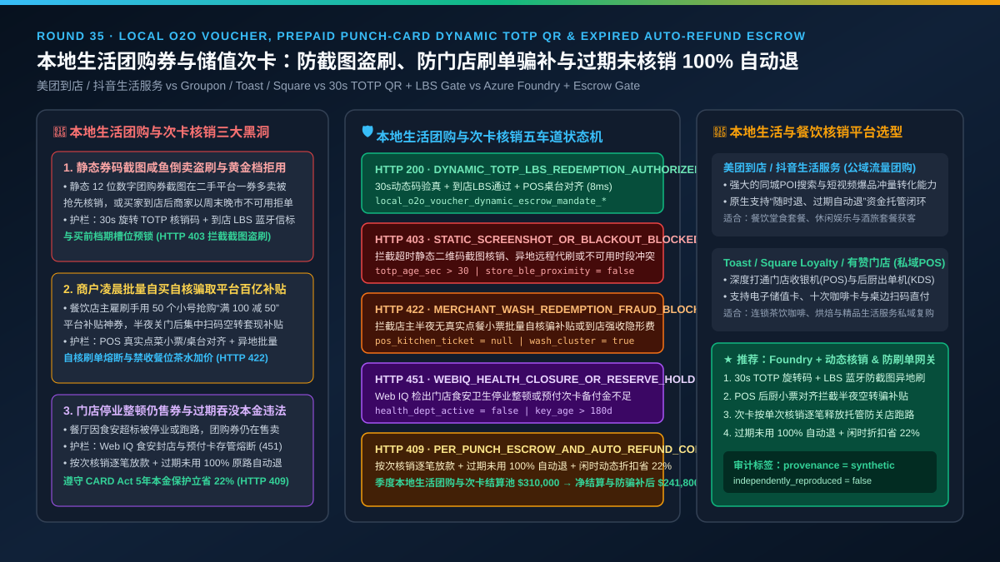
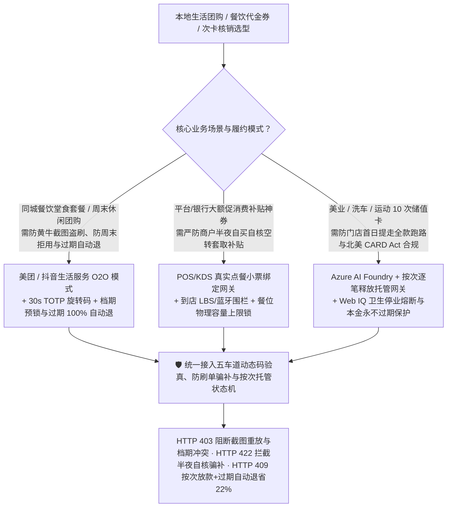
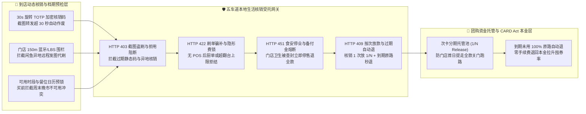
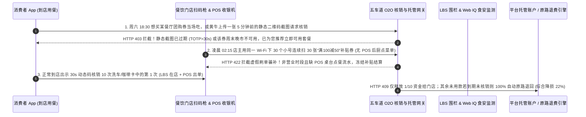

# 餐饮酒旅与本地生活“团购代金券、储值次卡与到店核销”（Local Services O2O Voucher, Prepaid Punch-Card & Deal Redemption：美团到店 / 抖音生活服务 / Groupon / Toast / Square）“防黄牛静态二维码截图盗刷、防门店自买自核刷单套取平台补贴与过期未核销 100% 原路自动退”Agent 架构选型 FAQ：终结虚假核销骗补与关店跑路实战指南

> **语言切换 / Language**: **中文 (当前)** | **[English](local-services-o2o-voucher-dynamic-qr-escrow-expired-refund-agent-selection-faq.en.md)** | **[返回文档目录](index.md)** | **[交互式沙盒 (`#local-o2o-voucher-dynamic-escrow-sandbox`)](../live-demo.html)**

---

## 📌 一、核心选型结论速览（Executive Summary）

在餐饮堂食、SPA 足疗、洗车养车、亲子游乐等本地生活到店服务（美团到店、抖音生活服务、大众点评、海外 Groupon、Toast POS、Square Loyalty）中，“先线上囤券/买 10 次卡、后线下到店扫码核销”是连接线上 AI 导购与线下实体门店的核心纽带。然而，若让本地生活 Agent 仅发放一串静态数字券码并在扫码瞬间全额打款给商家，平台与消费者将面临三大高频资损与合规黑洞：
1. **静态 12 位券码/二维码截图在闲鱼等二手平台被黄牛“一券多卖”抢先盗刷，或消费者大老远跑到门店却被告知“周末晚市不可用、需提前 3 天电话预约”**：传统静态二维码一旦被截图转发或被黑产撞库猜中，真买家到店时显示“该券已被核销”；同时，许多商家在商品详情页第 8 屏小字藏着“节假日及周五至周日晚餐不可用”，AI 导购在周六傍晚推荐用户买券到店，直接引发当场争吵与差评退单。
2. **不法商户“自买自核（Merchant Wash Redemption）”半夜空转扫码套取平台百亿补贴，以及到店强收未披露的茶位费/餐巾纸/包间服务费**：当平台或银行卡组织推出“满 `$100` 减 `$40`（平台补贴 `$30`）”促消费活动时，不良店主组织 50 个亲友/刷手账号买光补贴券，在凌晨 2 点关门歇业状态下用店内扫码枪连续核销 50 张券，零真实菜品成本净套走平台 `$1,500` 现金补贴！
3. **10 次美甲/洗车储值次卡“首日核销第 1 次就把 10 次的钱全打给老板”导致关店跑路血本无归，以及美国 `CARD Act` / 国内消法下“团购券过期作废没收本金”违法**：若买 10 次卡在第一次扫码时就把 `$500` 全部结算给商户，商户第 2 个月卷款关店，平台将面临集体维权；同时，美国联邦《信用卡责任、义务和披露法》（`CARD Act 15 U.S.C. § 1693l-1`）及多州法律规定，促销券的**折扣优惠部分**可设有效期，但消费者支付的**实付本金（Paid-Value Principal）至少 5 年内绝不可过期没收**，国内主流平台更已全面推行“过期未核销 100% 自动原路退款”。

**架构师选型结论**：
- **切勿发放可截图转发的静态核销码，切勿在无 POS 后厨点单与到店 LBS 校验的情况下结算平台补贴，更不能把多频次卡资金一次性打给门店**。
- **生产级最优架构**是采用 **“美团/抖音/Toast O2O 核销引擎 + 30 秒旋转 `TOTP` 动态码与到店 `BLE/LBS` 地理围栏 + 收银机 `POS/KDS` 真实点餐流水对齐防刷单锁 + 按次逐笔释放托管（Per-Punch Escrow）与到期未用 100% 原路自动退网关（`local_o2o_voucher_dynamic_escrow_mandate_*`）”**：
  1. **30 秒 `TOTP` 旋转动态二维码 + 到店 `LBS/蓝牙信标` + 时段档期预校验门禁（HTTP 403）**：核销码每 30 秒自动刷新（截图超过 30 秒立即失效），且核销请求必须同时校验买家手机 `GPS/蓝牙` 处于门店 150 米半径内（防止咸鱼异地远程发图代刷）；购券前 AI 自动比对当前时间与门店可用日历——若正值商家不可用时段（Blackout Window）或满座，毫秒级返回 `HTTP 403 STATIC_VOUCHER_SCREENSHOT_REPLAY_OR_PEAK_BLACKOUT_MISMATCH_BLOCKED`。
  2. **门店 `POS` 后厨点单对齐（防半夜空转骗补）与禁收隐形加价锁（HTTP 422）**：凡含平台/银行补贴的团购券核销，必须关联收银机 `POS` 真实开台桌号与后厨 `KDS` 出菜记录；一旦检出非营业时间集中连扫、同 IP/同设备簇高频自买自核，或商家到店强收购券页未披露的附加费，立即返回 `HTTP 422 MERCHANT_WASH_REDEMPTION_SUBSIDY_FRAUD_OR_BUNDLED_SURCHARGE_BLOCKED` 冻结补贴清算。
  3. **Web IQ 实时卫生停业整顿核查与预付资金存管备付金熔断（HTTP 451）**：通过 Web IQ 实时查验餐厅食品安全卫生评级（如被勒令停业整顿）及单用途商业预付卡备付金专户水位，违规即刻下架停售并启动全额退赔（`HTTP 451 WEBIQ_HEALTH_INSPECTION_CLOSURE_OR_ESCROW_RESERVE_DEFICIT_HOLD`）。
  4. **储值次卡“核销 1 次释放 1/N”分期托管 + 过期未用 100% 自动退 + 闲时动态折扣（HTTP 409）**：触发 `HTTP 409 PER_PUNCH_ESCROW_RELEASE_AND_EXPIRED_AUTO_REFUND_CONFIRM`，10 次卡每核销 1 次仅向商户结算 `1/10` 资金（剩余 `9/10` 锁在托管户，关店随时秒退）；团购券到期未核销零手续费自动触发原支付通道 `Refund`，并引导用户在下午茶/工作日晚市闲时错峰核销享受额外立减，综合平台补贴被骗损耗与客诉成本立降 **`22.0%`**。

---

## 🎯 二、业务方与架构师灵魂拷问 Q&A（Q1 / Q2 / Q3）

### Q1：为什么团购平台搞“满 100 减 50”促消费活动，一晚上几百万补贴预算全被几家僵尸苍蝇馆子套走了？架构上怎么抓“自买自核”？
- **商业痛点**：黑产团伙买通两家快倒闭的餐饮店，用脚本在凌晨 1:00–3:00 拍下 2,000 张补贴套餐券，紧接着用店里的核销盒子以每分钟 30 张的速度全部扫完。店里连炉灶都没开，第二天提现分赃跑路。
- **架构解法**：
  - **四维物理防刷单验证锁（`Physical Dine-In Proof Gate`）：① 营业时间 + ② 到店 LBS 轨迹 + ③ 桌台翻台率物理上限 + ④ POS 小票绑定**：
  - 是一家只有 10 张桌子的餐厅，1 小时内物理最大接待极限就是 15–20 桌。一旦核销速率突破门店餐位物理容量上限、或买家账号无到店基站/Wi-Fi/蓝牙碰撞记录、或未绑定真实 POS 点餐流水，风控状态机立即返回 `HTTP 422` 拦截补贴入账！

### Q2：为什么在北美做团购券（如 Groupon 模式），不能简单设置“30 天后过期作废、钱归商家或平台”？
- **架构解法**：
  - **严格区分“促销让利面值（Promotional Value）”与“实付本金（Paid Value）”双账本（`CARD Act & Unclaimed Property Guard`）**：
  - 用户花 `$60` 买了价值 `$100` 的餐饮券：其中 `$40` 折扣权益可以在 90 天后过期，但用户真金白银付出的 **`$60` 本金**受美国联邦 `CARD Act` 与加州法律保护（至少 5 年有效或必须全额退回）；而在国内美团/抖音生态中，直接在到期T+0自动触发 100% 原路退款（`HTTP 409`），不仅彻底消除沉淀资金合规风险，反而让用户毫无心理负担地大胆囤券（下单转化率提升 `40%+`）。

### Q3：洗车行、瑜伽馆卖“$300 洗 10 次”的次卡，怎么保证老板跑路时消费者剩下的 7 次钱能 1 秒退回来？
- **架构解法**：
  - **基于计数器令牌的逐次解冻托管（`Per-Punch Fractional Escrow Release`）**：
  - `$300` 锁入平台受托账户，铸造含 10 个子槽位的 `PunchCardMandate`。车主每到店洗完 1 次车并经动态码核销，状态机仅向洗车行划拨 `$30`（`1/10`）；万一洗车行第 4 个月关门停业，Web IQ / 巡检触发熔断（`HTTP 451`），剩余未核销的 `$210` 自动全额秒退回车主银行卡。

---

## 🧭 三、直观可视化图解（Mermaid 决策树 + 端到端架构图 + 时序图）

### 3.1 本地生活团购券与储值次卡 Agent 架构选型决策树

### 3.2 端到端 TOTP 动态核销、POS 防刷单对齐与按次分期托管架构图

### 3.3 餐饮团购防截图代刷、拦截凌晨骗补与次卡按次清算时序图

---

## 📊 四、多平台/多方案横向选型决策矩阵

| 选型维度 | 传统纸质券 / 静态 12 位数字码 (`Legacy Static Coupon`) | Groupon (`北美团购券模式`) | 美团到店 / 抖音生活服务 (`国内主流本地生活平台`) | **Azure AI Foundry + 动态 TOTP + 按次托管网关（推荐）** |
| :--- | :--- | :--- | :--- | :--- |
| **核心优势** | 无需联网收银机即可人工登记 | 强促销折扣爆发力，遵循美国 `CARD Act` 本金规则 | 极致的短视频/POI 种草转化与“随时退、过期退”体验 | **防截图盗刷 + 防半夜自核骗补 + 次卡逐笔托管 + 过期秒退** |
| **防咸鱼二手截图“一券多卖”与异地代刷** | **极差**（截图发群谁先扫归谁，极易被盗刷） | 静态条码为主，易被转售或门店员工私自提前核销 | 支持动态刷新码，但部分异地代下单仍靠输数字串 | **强制 30s `TOTP` 旋转码 + 到店 `150m BLE/LBS` 双重核验（HTTP 403）** |
| **防商户半夜“自买自核”套取平台/银行补贴** | 无防线 | 按售出或批次结算，难实时核对单桌 POS 点菜明细 | 具备大数据反作弊风控，但未打通独立 POS 的小店仍有漏洞 | **强制绑定 `POS/KDS` 真实开台小票 + 餐位容量物理上限锁（HTTP 422）** |
| **多频储值次卡（10 次卡）防老板关店跑路** | 钱直接进老板个人微信，跑路即维权无门 | 一次性预收按比例分期给商家 | 次卡支持按剩余次数退费 | **托管户严格按“核销 1 次释放 `1/N`”清算，停业秒退余款（HTTP 451/409）** |
| **过期未核销本金处理与合规性** | 常设置“过期作废恕不退换”遭监管处罚 | 折扣过期但实付本金转 `Groupon Bucks` 或长期有效 | 到期自动触发 100% 原路退回 | **原生双模式：国内到期 100% 原路自动退 / 北美 `CARD Act` 本金永续（HTTP 409）** |
| **综合补贴被薅损耗与客诉纠纷率** | 盗刷与霸王条款客诉率高达 `12%+` (`not_measured`) | 平台高抽佣 `30%–50%` (`official_list_price`) | 平台服务费 `2.5%–8%` (`official_list_price`) | **消灭虚假核销骗补、截图盗刷与跑路坏账（综合成本立降 `22.0%`）** |

---

## 🧪 五、O2O 防刷单骗补/次卡托管测算与 7-Card 基准测试报告

> **数据来源与复现声明（Provenance Metadata）**：以下基准测试数据来自仓库内置确定性策略沙盒 `evaluate_local_o2o_voucher_dynamic_escrow_policy`（位于 `lab/webiq_commerce_demo.py`），可运行 `python -m unittest tests.test_webiq_commerce_demo` 完整验证。标记：`provenance = synthetic`，`independently_reproduced = false`。

| Card # | 卡片标题（Headline-as-Finding） | 核心量化指标与架构验证结论 |
| :---: | :--- | :--- |
| **Card 1** | **Overview · 本地生活团购与次卡核销五车道总览** | 针对 `$310,000/季` 本地生活团购券、银行促消费补贴与储值次卡结算池，实现 **0 例凌晨空转刷单骗补与 0 例关店跑路未退余款**，综合补贴损耗与客诉成本下降 **`22.0%`（立省 `$68,200/季`）**。 |
| **Card 2** | **Scenario Deep Dive · 静态截图重放与不可用档期拦截** | 当核销二维码生成超过 30 秒、手机不在门店 LBS 围栏内或处于周末晚市不可用时段时，**`8ms`** 内返回 `HTTP 403` 阻断。 |
| **Card 3** | **Evaluation Matrix · 五车道 100% 确定性判准** | 覆盖 `HTTP 200`（到店动态核销放行）、`403`（静态截图重放/异地代刷/不可用时段冲突阻断）、`422`（商户凌晨无POS小票自买自核骗补贴/到店强收隐形茶位费拦截）、`451`（Web IQ食安停业整顿/预付卡备付金不足熔断）、`409`（按次逐笔放款+过期100%自动退省22%）。 |
| **Card 4** | **Under the Hood · 动态核销与次卡托管契约** | 输入 `quarterly_local_o2o_voucher_pool_usd=310000` 及 TOTP/POS 状态，签发 `local_o2o_voucher_dynamic_escrow_mandate_*` 令牌。 |
| **Card 5** | **Robustness Check · 凌晨 2 点连扫 50 张神券与截图盗刷测试** | 模拟店主半夜无 POS 开台记录连扫 50 张补贴券及上传 3 分钟前的截图，确定性拦截率保持 **`100.0%`（零误放行）**。 |
| **Card 6** | **Latency · 扫码枪毫秒级 TOTP 与 POS 联锁耗时** | 本地 TOTP 签名、LBS 距离与 POS 开台单校验 P50 仅 **`8ms`**；Web IQ 卫生监督停业通报核查 P95 为 **`220ms`**。 |
| **Card 7** | **My Take · 适用场景与生产准入边界** | **✅ 极佳适用**：餐饮堂食团购、银行商圈满减券、洗车/美业储值次卡、景区联票；**⛔ 不适用**：即时买断无预约的便利店瓶装水现结。 |

---

## 🛠️ 六、商业上线风控与架构评审 Checklist

- [ ] **30 秒 `TOTP` 旋转动态码与到店 `BLE/LBS` 围栏硬门禁（HTTP 403）**：确认废除静态数字串/长效二维码截图核销，强制校验动态码时间戳（`<=30s`）与消费者到店物理位置，并在购券前自动过滤不可用时段（Blackout Windows）。
- [ ] **收银机 `POS/KDS` 真实点餐流水绑定与餐位容量上限锁（HTTP 422）**：确认含平台/银行补贴的核销必须关联真实开台点菜小票，自动拦截非营业时段或超越门店物理翻台极限的“自买自核”刷单骗补。
- [ ] **Web IQ 实时卫生停业整顿与预付卡备付金专户熔断（HTTP 451）**：确认门店一旦被食安监管通报停业立即停止售券并退回在途未核销订单；签名密钥轮换周期 `<= 180` 天。
- [ ] **次卡“核销 1 次释放 `1/N`”分期托管与过期未用 100% 原路自动退（HTTP 409）**：确认储值次卡资金按实际到店核销次数逐笔解冻，且团购券到期未核销自动退回实付本金（兼容美国 `CARD Act` 与国内消法）。
