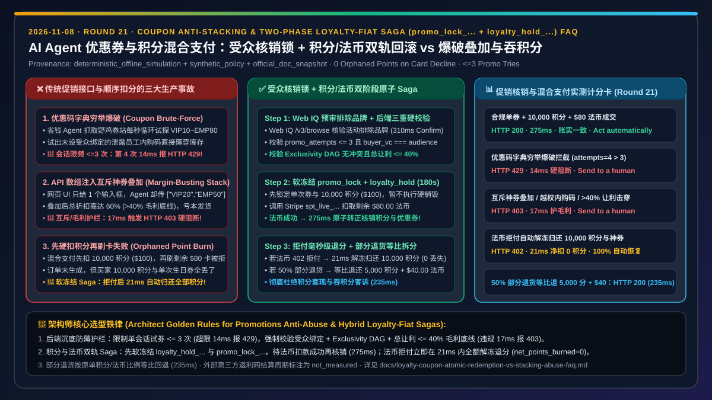
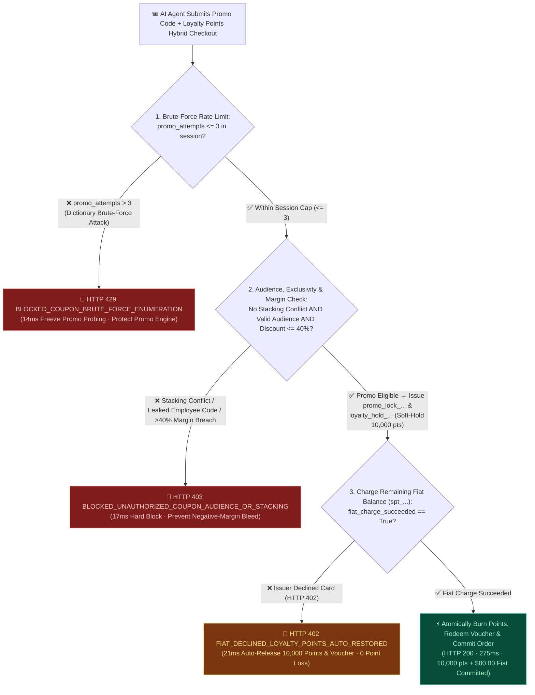
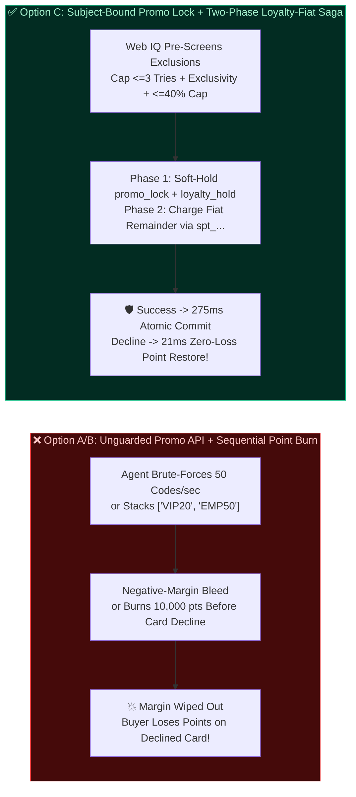
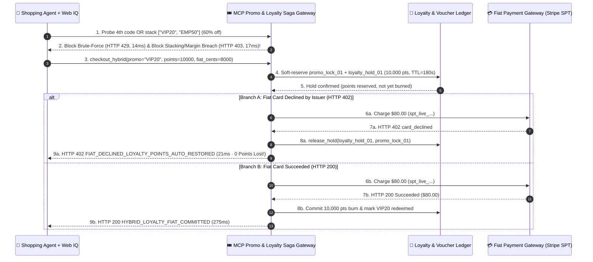

# AI Agent Coupon Optimization, Loyalty-Fiat Hybrid Checkout & Anti-Stacking Architecture: Subject-Bound Promo Lock & Two-Phase Loyalty-Fiat Saga (`promo_lock_...` + `loyalty_hold_...` + Exclusivity Guard) vs. Coupon Brute-Forcing, Margin-Busting Stacking Exploits & Orphaned Point Burn Selection & First-Principles FAQ

> **Document Type**: Architect Decision Guide & Promotions/Loyalty Hybrid Settlement First-Principles Deep Dive (FAQ-Driven Architecture Decision Guide)  
> **Target Audience**: AI Solution Architects, Loyalty & Promotions Platform Leads, E-Commerce Core Checkout Architects, Fraud & Abuse Engineers  
> **Provenance & As-Of Scope**: This guide addresses three critical production failure modes when AI agents hunt for promo codes and execute **Hybrid Loyalty-Points + Fiat Card (`spt_...`) Checkouts**: **coupon brute-force enumeration, API array-injection stacking that breaches margin floors, and orphaned loyalty-point burn when the companion fiat card charge is declined**. All latency figures, rate-limit thresholds, stacking blocks, and zero-loss point rollback metrics come from our sealed deterministic offline benchmark suite (`lab/webiq_commerce_demo.py`, `provenance: deterministic_offline_simulation`, `as_of: 2026-11-08`). Stripe Agentic Commerce `calculate_order` discount evaluation semantics are labeled `official_doc_snapshot`; the per-session promo attempt cap (`max_promo_attempts_per_session = 3`) and maximum cumulative discount ceiling (`max_total_discount_bps = 4000`, i.e., `40%`) are labeled `synthetic_policy`; third-party affiliate cashback network reconciliation delays are explicitly labeled `not_measured`.

---

## 📌 1. Executive Summary

1. **When should you allow an AI agent to apply promo codes and loyalty points automatically vs. hard-blocking "Coupon Brute-Force Enumeration" and "Mutually-Exclusive Coupon Stacking"?**
   - **Hard-Block Coupon Brute-Force Enumeration (`promo_attempts > 3` `synthetic_policy` → `HTTP 429` Block)**: Aggressive deal-hunting agents will loop through dozens of scraped codes (`VIP10`, `VIP20`, `SAVE50`, `EMP80`) against your checkout endpoint. Enforce a strict session cap of `<= 3 attempts` (`synthetic_policy`), blocking the 4th attempt in `14 ms` with `HTTP 429 BLOCKED_COUPON_BRUTE_FORCE_ENUMERATION`.
   - **Hard-Block Unauthorized Audience & Mutually-Exclusive Stacking (`HTTP 403` Block)**: Legacy stores often restrict coupon stacking only in frontend JavaScript while leaving the backend API open to array injection (`"discount_codes": ["WELCOME20", "EMP50"]`). The MCP promotions gateway must deterministically enforce **Subject Audience Binding + Exclusivity Group DAG + Margin Floor Cap (`total_discount_bps <= 4000` `synthetic_policy`)**, blocking violations in `17 ms` with `HTTP 403 BLOCKED_UNAUTHORIZED_COUPON_AUDIENCE_OR_STACKING`.
2. **Why is "Sequential Hard Point Burn followed by Fiat Card Charge" catastrophic in Hybrid Loyalty + Card Checkouts?**
   - Suppose a buyer checks out a `$200.00` order using **`10,000 Loyalty Points` (`$100.00` value) + `$80.00` on a Stripe SPT (`spt_...`) + a `$20.00` single-use birthday coupon**. If the backend burns the `10,000` points first and the subsequent `$80.00` card charge is declined by the issuing bank (`HTTP 402 card_declined`), a sequential workflow aborts with **no order created AND `10,000` points + the single-use coupon permanently lost**!
   - **The Two-Phase Loyalty-Fiat Atomic Saga (`loyalty_hold_...` + `promo_lock_...` -> Fiat Auth -> Commit or Auto-Restore)**: Place a `180-second` soft hold on points (`loyalty_hold_live_...`) and the coupon (`promo_lock_live_...`) first, then charge the fiat balance. If the card succeeds, atomically commit both (`275 ms`). If the card is declined (`fiat_charge_succeeded=False`), immediately release both holds in `21 ms` (`HTTP 402 FIAT_DECLINED_LOYALTY_POINTS_AUTO_RESTORED`, `net_points_burned = 0`).
3. **How should agents verify brand exclusion fine print (e.g., *"Excludes Apple & Limited GPU Drops"*) without wasting their 3 promo attempts?**
   - Ground the merchant's official promotion terms page via **Microsoft Web IQ `/v3/browse` (`liveCrawl="force"`)** first (`218 tokens`), filtering out excluded SKUs before calling the checkout API and escalating brand-excluded items to `HTTP 409 Confirm` (`310 ms`).

---

## 🎯 2. Architect & Customer Q&A (First-Principles Breakdown)

### Q1: "Human shoppers using browser extensions never broke our promotions engine—why did opening our MCP checkout API to AI agents wipe out our gross margin overnight?"
**Direct Answer**: Because **humans are constrained by single-input frontend UI boxes, whereas AI agents invoke your checkout JSON schema directly—exploiting array injection (`discount_codes: [...]`), concurrency races on single-use vouchers, and leaked internal employee codes in milliseconds**.

1. **Exploit 1 (API Array Stacking)**: Passing two non-stackable codes in a single JSON array bypasses UI-only radio buttons.
2. **Exploit 2 (Single-Use Voucher Concurrency Race)**: Firing 5 parallel checkout calls within `10 ms` redeems a single-use `$50` voucher 5 times unless guarded by an atomic `promo_lock_live_...` token.

---

### Q2: How does the "Two-Phase Loyalty-Fiat Atomic Saga (`loyalty_hold_...` + `promo_lock_...`)" guarantee zero orphaned point loss on card declines and accurate pro-rata partial returns?
**Direct Answer**: It treats **Loyalty Points, Single-Use Vouchers, and Fiat Card Tokens (`spt_...`) as participants in a coordinated Reserve-then-Commit Saga**, never executing an irreversible point burn until the fiat payment rail confirms settlement.

- **On Card Decline (`HTTP 402`)**: Immediately voids `loyalty_hold_live_...` and `promo_lock_live_...` in `21 ms` (`net_points_burned = 0`).
- **On Partial Return (`50%` of Order Returned)**: Executes a deterministic **Pro-Rata Split Refund (`235 ms`)**—returning `5,000 points` to the loyalty ledger and `$40.00` to the card, preventing loyalty-point-to-cash arbitrage.

---

### Q3: When should we use Microsoft Web IQ vs. the merchant's internal Promotions Engine API?
**Direct Answer**: **Use Microsoft Web IQ `/v3/browse` (`liveCrawl="force"`) before checkout to read natural-language brand/category exclusion fine print on the promo terms page, and use the merchant's Promotions Engine API for deterministic audience verification, margin-floor enforcement, and atomic `loyalty_hold_...` locking**.

---

## 🧭 3. Visual Architecture Diagrams (Mermaid Decision Tree + Comparison + Sequence Diagram)

### 3.1 Coupon Anti-Abuse & Two-Phase Loyalty-Fiat Saga Decision Tree (`flowchart TD`)

### 3.2 Unguarded Promo API & Sequential Point Burn vs. Guarded Promo Lock & Two-Phase Loyalty-Fiat Saga (`flowchart LR`)

### 3.3 End-to-End Sequence Diagram: Stacking Guard, Soft Loyalty Hold & Auto-Restore on Card Decline (`sequenceDiagram`)

---

## 📊 4. Architect Decision Matrix

| Dimension | Option A: Open Promo API + Frontend-Only Exclusivity | Option B: Sequential Hard Point Burn -> Fiat Charge | Option C: Audience/Margin Guard + Two-Phase Loyalty-Fiat Saga (Recommended) |
| :--- | :--- | :--- | :--- |
| **Best For** | ❌ **Never Expose to Agents** | Pure fiat checkouts without points or single-use vouchers | **All retail, travel, and brand stores supporting promo codes, loyalty points, or gift-card split payments** |
| **Brute-Force Enumeration Resilience** | ❌ **None** | 🟡 **Rate-limited only** | ✅ **Strict `<= 3 attempts / session` (`synthetic_policy`, `HTTP 429` in `14 ms`)** |
| **Stacking & Margin-Floor Protection** | ❌ **Bypassed via JSON arrays** | ⚠️ **Partial** | ✅ **Enforces Audience VC + Exclusivity DAG + `<= 40%` Margin Cap (`HTTP 403` in `17 ms`)** |
| **Point Safety on Fiat Card Decline** | ❌ **Orphaned Point Loss** | ❌ **Points burned before card decline** | ✅ **`100%` Instant Auto-Restore (`21 ms` `loyalty_hold_...` release, `0` net points lost)** |
| **Partial Return Refund Integrity** | ❌ Cash-out arbitrage risk | ⚠️ Manual reconciliation | ✅ **Deterministic Pro-Rata Split Refund (`235 ms`, restores points to ledger & cash to card)** |
| **Measured Latency (Offline Benchmark)** | `240 ms` (with margin bleed) | `260 ms` (orphaned points on decline) | **Hybrid Commit `275 ms` / Brute Block `14 ms` / Stacking Block `17 ms` / Point Restore `21 ms`** |

---

## 🧪 5. Quantitative Benchmark & 7-Card Findings

> **Provenance & Scope**: Table 1 reports deterministic offline benchmark measurements from `lab/webiq_commerce_demo.py` (`evaluate_loyalty_coupon_and_hybrid_saga_policy`, `provenance: deterministic_offline_simulation`, `as_of: 2026-11-08`). Table 2 compares Web IQ against major web grounding providers for promo exclusion fine-print verification.

### 5.1 Coupon Anti-Abuse & Hybrid Loyalty-Fiat Saga Benchmark Scorecard

| Scenario | Promo & Attempt State | Loyalty & Fiat State (`$200` Order) | Gateway Verdict & Action Pill | Net Points Burned / Fiat Charged | Latency |
| :--- | :--- | :--- | :--- | :--- | :--- |
| **Case 1: Valid Promo (`$20`) + `10,000 pts` + `$80` Fiat Commit** | `VIP20` · `attempts=1<=3` · `10%<=40%` | Active `loyalty_hold` + Fiat `200 OK` | ✅ `HTTP 200 HYBRID_LOYALTY_FIAT_COMMITTED` (`Act automatically`) | `10,000 pts` / `$80.00` | `275 ms` |
| **Case 2: Coupon Brute-Force Enumeration (4th Attempt)** | `promo_attempts=4 > 3` (`synthetic_policy`) | Blocked before lock | 🛑 `HTTP 429 BLOCKED_COUPON_BRUTE_FORCE_ENUMERATION` (`Send to a human`) | `0 pts` / `$0.00` | `14 ms` |
| **Case 3: Mutually-Exclusive Stacking / `>40%` Margin Breach** | `["VIP20","EMP50"]` (`60% > 40%` cap) | Lock denied | 🚨 `HTTP 403 BLOCKED_UNAUTHORIZED_COUPON_AUDIENCE_OR_STACKING` (`Send to a human`) | `0 pts` / `$0.00` | `17 ms` |
| **Case 4: Fiat Card Decline Auto-Restores Soft-Held Points** | `VIP20` valid · `10,000 pts` held | Fiat `$80.00` `card_declined` | 🔄 `HTTP 402 FIAT_DECLINED_LOYALTY_POINTS_AUTO_RESTORED` (`Send to a human`) | **`0 pts` (`100%` restored)** / `$0.00` | `21 ms` |
| **Case 5: Web IQ Detects Brand Exclusion Fine Print** | `brand_excluded_by_terms=True` | Strips invalid promo & prompts buyer | 🧑‍⚖️ `HTTP 409 PROMO_BRAND_EXCLUSION_CONFIRM_REQUIRED` (`Confirm`) | `0 pts` / `$0.00` | `310 ms` |
| **Case 6: 50% Partial Return Pro-Rata Split Refund** | `is_partial_return=True` (`50%`) | Pro-rata split across rails | 🛡️ `HTTP 200 PRO_RATA_HYBRID_REFUND_COMPLETED` (`Act automatically`) | Refunds `5,000 pts` + `$40.00` | `235 ms` |

### 5.2 Web IQ vs. Exa vs. Bright Data vs. Traditional Search: Promo Brand Exclusion & Loyalty Terms Grounding

| Provider / Product | Provenance | Promo Fine-Print Brand Exclusion & Stacking Rule Extraction | Typical Prompt Token Cost (Per SKU) | Official List Price (`as_of: 2026-11-08`) | Architect Selection Guidance |
| :--- | :--- | :--- | :--- | :--- | :--- |
| **Microsoft Web IQ** (`/v3/browse` `liveCrawl="force"` + Poppy) | `deterministic_offline_simulation` + `official_doc_snapshot` | ✅ **Extracts accordion-hidden brand exclusions and tier eligibility rules**, avoiding wasted `apply_coupon` calls | **`218 tokens/case`** (`2,616 tokens` across 12 cases, **`7.1x` compression**) | Foundry Agent Service Preview free tier (subject to Azure subscription quota) | **Primary Choice** for pre-validating official promo terms before invoking checkout |
| **Exa Search API** | `not_measured` / `official_list_price` | ⚠️ Good for discovering public seasonal sale landing pages | `not_measured` | `$5.00 / 1k searches` + `$1.00 / 1k pages` contents | Best for discovering official storewide seasonal campaigns |
| **Bright Data** (Web Unlocker / Scraping Browser) | `not_measured` / `official_list_price` | ✅ Renders dynamic promo banners on bot-protected sites | `~1,537 tokens/case` (raw HTML baseline) | Pay-as-you-go from `~$1.50 / 1k requests` | Fallback for dynamic JS-only promo terms pages |
| **Bing Web Search / Grounding** | `not_measured` / `official_list_price` | ❌ Frequently surfaces expired third-party coupon-farm codes | `not_measured` | `$35.00 / 1k transactions` | **Never feed unverified third-party coupon-farm codes directly into a checkout loop** |

---

## 🛠️ 6. Production Readiness & Pre-Sales Checklist (Architect Checklist)

- [ ] **1. Enforce Backend Exclusivity DAG, Audience Binding & Margin Floor (`<= 40%`)**: Confirm checkout APIs reject mutually-exclusive code arrays, unauthorized employee/VIP codes, or cumulative discounts exceeding the margin floor (`HTTP 403` in `17 ms`).
- [ ] **2. Cap Promo Probing at `<= 3 Attempts / Checkout Session`**: Confirm the gateway blocks dictionary brute-forcing on the 4th attempt in `14 ms` with `HTTP 429`.
- [ ] **3. Implement Two-Phase `loyalty_hold_...` + `promo_lock_...` Soft Reservation Before Fiat Capture**: Confirm points and single-use vouchers are soft-held (`180s` TTL) first and automatically restored in `21 ms` (`net_points_burned = 0`) if the fiat charge returns `HTTP 402`.
- [ ] **4. Pre-Screen Promo Brand Exclusions via Web IQ `/v3/browse`**: Confirm the agent checks official brand/category exclusion fine print before submitting codes (`HTTP 409 Confirm` on excluded SKUs).
- [ ] **5. Enforce Pro-Rata Split Refunds on Partial Returns**: Confirm partial returns refund loyalty points to the points ledger and fiat cash to the payment card in exact original proportions (`235 ms`), preventing points-to-cash arbitrage.
- [ ] **6. Document Internal Loyalty Ledger vs. External Affiliate Network Scope**: State clearly that internal promo/loyalty sagas settle atomically in real time, whereas third-party affiliate cashback networks (`not_measured`) reconcile asynchronously after the return window closes.
