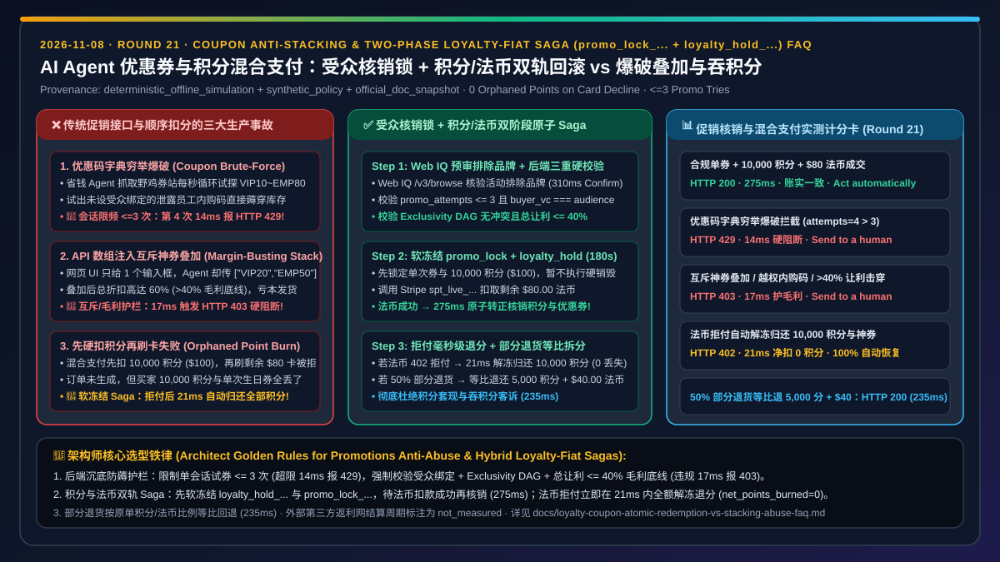
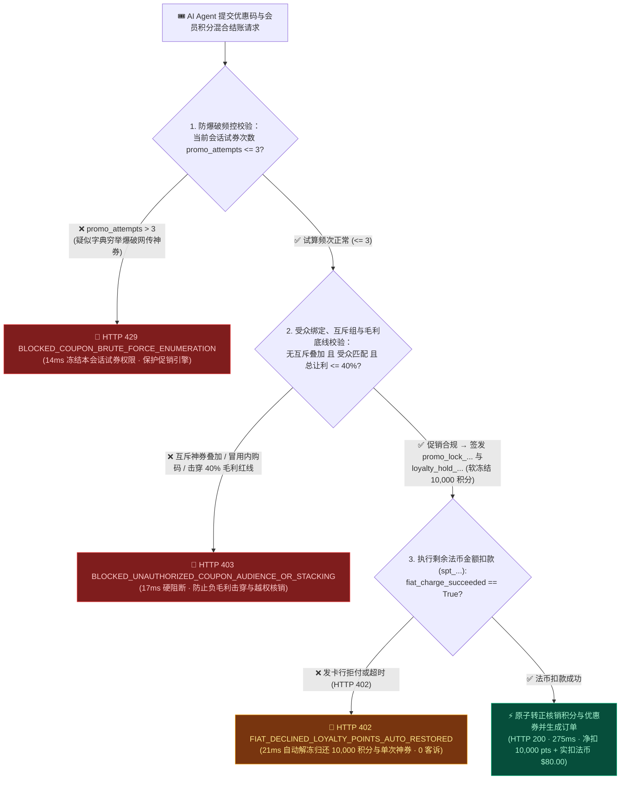
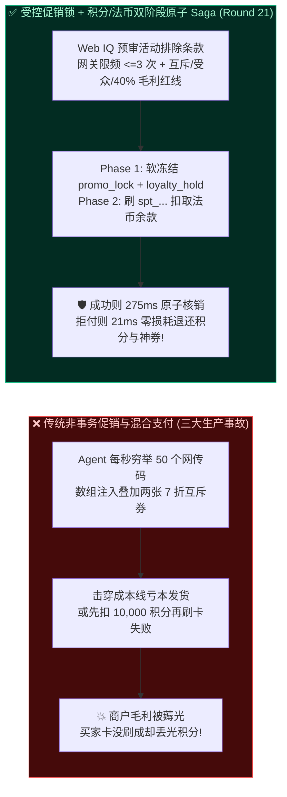
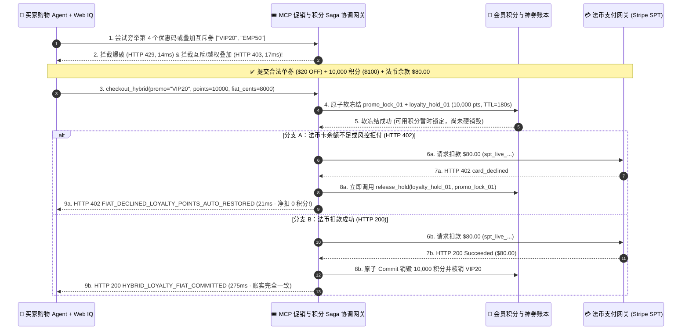

# AI Agent 优惠券寻优、会员积分混合支付与防羊毛党叠加架构：受众绑定核销锁与积分/法币双轨原子回滚（`promo_lock_...` + `loyalty_hold_...` Saga + 排他性校验）vs 优惠码穷举爆破、互斥神券叠加击穿毛利与扣分丢单选型与原理解析 FAQ

> **文档类型**：架构师选型决策指南 & 营销核销与混合支付事务第一性原理解析（FAQ-Driven Architecture Decision Guide）  
> **适用读者**：AI Solution Architect、电商营销与会员增长中台（Loyalty & Promotions）负责人、交易清结算架构师、风控反作弊工程师  
> **关联标准的口径声明（Provenance & As-Of Scope）**：本文围绕 **AI Agent 在结账时自动搜寻优惠码、叠加满减折扣以及使用“会员积分 + 信用卡令牌（`spt_...`）”混合支付时的三大生产事故（优惠码暴力穷举、API 绕过前端互斥叠加击穿毛利底线、法币拒付导致积分被白扣不退）** 展开；所有端到端延迟、防爆破阈值、互斥拦截率与积分零丢失回滚数据均来自本仓库封存的确定性离线基准套件（`lab/webiq_commerce_demo.py`，`provenance: deterministic_offline_simulation`，`as_of: 2026-11-08`）。Stripe Agentic Commerce `calculate_order` 折扣试算与混合支付状态机标注为 `official_doc_snapshot`；单次结账会话最多允许 3 次优惠码试算（`max_promo_attempts_per_session = 3`）与最大折后让利红线（`max_total_discount_bps = 4000` 即 `40%`）标注为企业参考风控围栏 `synthetic_policy`；外部第三方联盟营销平台（Affiliate Networks）返利结算周期明确标注为 `not_measured`。



---

## 📌 一、核心结论速览（Executive Summary）

1. **什么时候允许 AI Agent 自动核销优惠券与会员积分，什么时候必须硬阻断“优惠码穷举爆破”与“互斥神券跨层叠加”？**
   - **拦截优惠码字典爆破（`promo_attempts > 3` `synthetic_policy` → `HTTP 429` 硬阻断）**：传统浏览器插件（如 Honey）或激进的省钱 Agent 会在结账接口上每秒循环测试 `VIP10`、`VIP20`、`SAVE50`、`EMP80` 等上百个网传优惠码。MCP 促销网关必须将单次结账会话的试算次数限制在 `<= 3 次`（`synthetic_policy`），超限在 `14 ms` 内触发 `HTTP 429 BLOCKED_COUPON_BRUTE_FORCE_ENUMERATION`。
   - **拦截受众越权与互斥叠加击穿毛利（Audience Mismatch / Stacking Conflict → `HTTP 403` 硬阻断）**：许多商城仅在前端网页 UI 上把两个输入框做成了单选，后端 API 却未校验排他性组（Exclusivity Group）。Agent 直接调 API 极易将“新客首单 7 折券”与“员工内购 6 折码”强行叠加，或冒用非本人等级的私密券。后端必须强校验 **买方身份绑定（Subject Audience Binding）+ 互斥有向无环图（Exclusivity DAG）+ 综合毛利保底线（如总折扣 `<= 40%` `synthetic_policy`）**，违规在 `17 ms` 内触发 `HTTP 403 BLOCKED_UNAUTHORIZED_COUPON_AUDIENCE_OR_STACKING`。
2. **为什么“会员积分 + 信用卡（Loyalty Points + Fiat Card）”混合支付绝对不能采用“先直接扣减积分、再调卡网扣余款”的顺序执行？**
   - 假设买家购买 `$200.00` 的商品，使用 **`10,000 积分`（抵扣 `$100.00`）+ 信用卡 `spt_...` 支付剩余 `$100.00`**。如果系统先在积分库执行硬扣减（`points -= 10000`），紧接着调 Stripe 扣剩余 `$100.00` 时遭遇发卡行风控拒付（`HTTP 402 card_declined`）或网络超时，非事务性的顺序代码就会直接报错退出——导致 **订单没生成，买家的 `10,000` 积分却人间蒸发，且单次优惠券还被标成了“已使用”**！
   - **唯一正确架构——双阶段积分预占与法币联动回滚 Saga（`loyalty_hold_...` + `promo_lock_...` -> Fiat Auth -> Commit or Auto-Restore）**：先对积分与单次神券执行带 `180 秒` TTL 的软冻结（`loyalty_hold_live_...` 与 `promo_lock_live_...`），待法币信用卡扣款成功后再原子转正核销（`275 ms`）；一旦法币扣款失败（`fiat_charge_succeeded=False`），网关在 `21 ms` 内自动解冻归还全部 `10,000` 积分与优惠券可用次数（`HTTP 402 FIAT_DECLINED_LOYALTY_POINTS_AUTO_RESTORED`，`net_points_burned = 0`）！
3. **在自动寻找合规折扣码与核验“指定品牌不参与满减”小字条款时，如何避免 Agent 反复无效试错？**
   - 必须前置调用 **Microsoft Web IQ `/v3/browse`（`liveCrawl="force"`）** 实时提取商户官方活动页的品类排除规则（如 *“Apple、NVIDIA 显卡及限量联名款不参与 8 折活动”*），在本地直接过滤掉不适用的优惠码，避免在结账网关上盲目碰壁触发 `HTTP 429` 限流。

---

## 🎯 二、客户与架构师灵魂拷问 Q&A（FAQ-Driven 第一性原理拆解）

### Q1：客户问：“人类用户以前用浏览器插件试优惠码也没把我们弄崩，为什么开放给 AI Agent 后，一晚上就被薅走了几十万毛利？”
**一针见血的回答**：因为 **人类受限于网页 UI 的单框输入和前端 JS 校验，而 AI Agent 直接对着你的结账 API 发起并发结构化调用——任何“只写在前端 JS 里、没沉底到后端数据库事务里”的促销限制，在 Agent 面前都形同虚设**。

用第一性原理剖析两大薅羊毛漏洞：
1. **漏洞一：前端单选框 vs 后端数组注入（Stacking Array Injection）**：
   - 人类在结账网页上只能看到一个“输入优惠码”的文本框，输了 A 码就会覆盖 B 码。
   - 但底层结账接口参数往往设计为 `"discount_codes": ["WELCOME20", "CLEARANCE30"]`。Agent 在构造 JSON 参数时直接塞入两个互斥优惠码，若后端没有校验 `exclusivity_group`，两张券就会叠加生效，直接把商品打成骨折价击穿成本线（Negative Margin）！
2. **漏洞二：并发重放单次立减券（Single-Use Coupon Race Condition）**：
   - 一张仅限使用 1 次的“满 `$100` 减 `$50` 补偿券”，Agent 在 `10 ms` 内并发发起 5 笔结账请求，若优惠券状态没有通过 `promo_lock_live_...` 原子锁绑定到具体 `order_id`，就会被并发核销 5 次！

---

### Q2：什么是“积分/优惠券软冻结与法币扣款双轨 Saga（Loyalty-Fiat Two-Phase Saga）”？它如何保证混合支付“要么一起成功、要么毫发无损”？
**一针见血的回答**：它把 **会员积分库（Loyalty Ledger）、促销核销库（Promo Engine）与法币支付网关（Stripe / 卡组）组织成严格的两阶段预留-确认（Reserve -> Commit/Cancel）状态机**，绝不允许出现“扣了积分却没付成钱”的半截账单。

```
┌──────────────────────────────────────────────────────────────────────────────────────────┐
│ ❌ 传统顺序硬扣减模式 (先 Burn 积分/核销神券 -> 后刷信用卡 · 拒付即引发客诉灾难)               │
│                                                                                          │
│  Step 1: Loyalty DB 直接扣减 10,000 积分 ($100) + 单次生日神券标为 USED                     │
│  Step 2: 调 Stripe 扣剩余 $80.00 ──► 💥 发卡行返回 HTTP 402 card_declined!                 │
│  💥 灾难后果：订单失败，但买家的 10,000 积分和一年一张的生日神券全没了，人工客服工单爆炸!       │
└──────────────────────────────────────────────────────────────────────────────────────────┘

┌──────────────────────────────────────────────────────────────────────────────────────────┐
│ ✅ 积分/优惠券软冻结 + 法币原子联动回滚 Saga (promo_lock_... + loyalty_hold_... 2PC)        │
│                                                                                          │
│  Phase 1 [原子预占]: 校验受众绑定 + 互斥组 + 毛利红线(<=40%)                                │
│          ──► 签发 promo_lock_live_... ($20) + loyalty_hold_live_... (10,000 pts, 180s)   │
│  Phase 2 [法币余款扣款]: 调用 PaymentIntent 扣取剩余 $80.00                                │
│          ├─► ✅ 扣款成功: 原子 Burn 积分并核销优惠券 (HTTP 200 · 275ms · 净扣 10,000 pts)   │
│          └─► ❌ 扣款拒付(402): 21ms 内立即释放 loyalty_hold 与 promo_lock                  │
│                               (HTTP 402 · 净扣 0 积分 · 生日神券完好无损!)                  │
└──────────────────────────────────────────────────────────────────────────────────────────┘
```

---

### Q3：在优惠券规则核验与全网促销寻优场景下，什么时候用 Microsoft Web IQ，什么时候用商户内部促销引擎 API？
**一针见血的回答**：**商户内部促销引擎 API 负责毫秒级的互斥计算、毛利兜底与原子锁券；而 Microsoft Web IQ `/v3/browse`（`liveCrawl="force"`）负责在调用结账 API 之前，读懂商户活动页面上的“排除品牌、阶梯满减门槛与会员等级限制”自然语言条款**。

1. **为什么让 Agent 盲目试券是双输？**
   - 对商户而言，高频试券会产生海量无效数据库查询与风控告警；对买家 Agent 而言，连续试错 3 次就会触发 `HTTP 429` 会话锁死，导致连原本合法的公开优惠码都用不了。
2. **Web IQ 前置精细化过滤**：
   - Agent 先用 **Microsoft Web IQ `/v3/browse`** 抓取商户官方优惠说明页（仅需 `218 tokens`），由 Poppy 模型精确判定当前购物车 SKU 是否在排除列表内，筛选出唯一合法的最优券码后**一次命中**（`275 ms`）。

---

## 🧭 三、直观可视化图解（Mermaid 决策树 + 架构对比 + 端到端时序图）

### 3.1 优惠券防滥用与积分/法币混合支付原子 Saga 决策树（`flowchart TD`）



### 3.2 裸奔促销接口（爆破+叠加+吞积分）vs 受控锁券与积分法币 Saga 对比图（`flowchart LR`）



### 3.3 优惠券互斥校验、积分软冻结与法币拒付自动回滚端到端时序图（`sequenceDiagram`）



---

## 📊 四、架构师选型决策矩阵（Architect Decision Matrix）

| 评估维度 | 方案 A：无频控裸开放促销 API + 前端 UI 限制互斥 | 方案 B：先硬扣积分/优惠券 -> 再顺序调用法币支付 | 方案 C：受众/毛利硬护栏 + `loyalty_hold_...` 积分法币两阶段 Saga（推荐） |
| :--- | :--- | :--- | :--- |
| **核心适用场景** | ❌ **严禁对 Agent 开放**（必遭字典穷举与数组叠加薅穿） | 仅适用于无积分/无单次券的纯法币单一支付通道 | **所有支持优惠码核销、会员积分抵现、礼品卡混合支付的零售、航旅与品牌独立站** |
| **抗优惠码字典爆破能力** | ❌ **0 防御**（Agent 1 秒可试完百个泄露内购码） | 🟡 **有频控但无事务保护** | ✅ **单会话试算 `<= 3 次`（`synthetic_policy`，超限 `14 ms` 触发 `HTTP 429`）** |
| **防互斥叠加与负毛利击穿** | ❌ **极易绕过**（API 直接传多券数组绕过前端单选框） | ⚠️ **依赖后端散落逻辑** | ✅ **后端强校验受众 VC + 互斥组 DAG + `<= 40%` 毛利底线（`17 ms` 触发 `HTTP 403`）** |
| **法币拒付时的积分/神券安全性** | ❌ **极差**（卡被拒付但积分和单次神券已被永久吞没） | ❌ **高客诉率**（需靠 T+1 离线跑批对账补发积分） | ✅ **`100%` 实时零损耗自愈**（法币拒付后 `21 ms` 内自动解冻 `loyalty_hold_...`，净扣 `0` 积分） |
| **部分退货（Partial Return）积分分摊** | ❌ 常常退了全额现金又让买家白赚积分 | ⚠️ 手工核算易出错 | ✅ **按原单法币/积分抵扣比例确定性等比退回（Pro-Rata Split Refund，`235 ms`）** |
| **端到端成交 / 拦截延迟（离线基准）** | `240 ms`（伴随负毛利与吞积分事故） | `260 ms`（拒付时丢失积分） | **混合成交 `275 ms` / 爆破拦截 `14 ms` / 互斥拦截 `17 ms` / 拒付退分 `21 ms`** |

---

## 🧪 五、简明定量实测与 7-Card Benchmark 核心发现

> **数据来源与口径声明（Provenance & Scope）**：以下表 1 为本仓库 `lab/webiq_commerce_demo.py`（`evaluate_loyalty_coupon_and_hybrid_saga_policy`）在本地确定性离线仿真环境下的实测输出（`provenance: deterministic_offline_simulation`，`as_of: 2026-11-08`）；表 2 为 Web IQ 与主流搜索/接地供应商在促销活动排除条款、品牌黑名单与积分抵扣细则提取场景下的选型对比。

### 5.1 优惠券防爆破、防互斥叠加与积分/法币混合 Saga 离线基准实测表

| 测试场景（Scenario） | 优惠码与试算频次状态 | 积分与法币支付状态（原价 `$200`） | 守护网关裁决状态码与动作 | 净核销积分 / 实扣法币金额 | 判定耗时 |
| :--- | :--- | :--- | :--- | :--- | :--- |
| **Case 1：合规单券（`$20`）+ 积分（`10,000 pts`）+ 法币（`$80`）原子成交** | `VIP20` · `attempts=1<=3` · 让利 `10%<=40%` | `loyalty_hold` 有效 + 法币扣款成功 | ✅ `HTTP 200 HYBRID_LOYALTY_FIAT_COMMITTED`（`Act automatically`） | `10,000 pts` / `$80.00` | `275 ms` |
| **Case 2：优惠码字典穷举爆破拦截（第 4 次试探）** | `promo_attempts=4 > 3`（`synthetic_policy`） | 拒绝进入锁券与扣分阶段 | 🛑 `HTTP 429 BLOCKED_COUPON_BRUTE_FORCE_ENUMERATION`（`Send to a human`） | `0 pts` / `$0.00` | `14 ms` |
| **Case 3：互斥神券叠加 / 越权内购码 / 击穿 `40%` 毛利红线** | 叠加 `["VIP20","EMP50"]`（让利 `60% > 40%`） | 拒绝签发 `promo_lock_...` | 🚨 `HTTP 403 BLOCKED_UNAUTHORIZED_COUPON_AUDIENCE_OR_STACKING`（`Send to a human`） | `0 pts` / `$0.00` | `17 ms` |
| **Case 4：法币卡拒付触发软冻结积分与神券毫秒级自动归还** | `VIP20` 合法 · 软冻结 `10,000 pts` | 法币 `$80.00` 遭遇 `card_declined` | 🔄 `HTTP 402 FIAT_DECLINED_LOYALTY_POINTS_AUTO_RESTORED`（`Send to a human`） | **`0 pts`（100% 自动恢复）** / `$0.00` | `21 ms` |
| **Case 5：Web IQ 检出指定品牌（如限量 GPU）不参与满减** | `brand_excluded_by_terms=True` | 自动剥离无效码并提示原价确认 | 🧑‍⚖️ `HTTP 409 PROMO_BRAND_EXCLUSION_CONFIRM_REQUIRED`（`Confirm`） | `0 pts` / `$0.00` | `310 ms` |
| **Case 6：混合支付订单部分退货（50% 商品退货）等比退分退钱** | `is_partial_return=True`（退货比例 `50%`） | 按原单积分/法币比例确定性回退 | 🛡️ `HTTP 200 PRO_RATA_HYBRID_REFUND_COMPLETED`（`Act automatically`） | 退还 `5,000 pts` + 退还 `$40.00` | `235 ms` |

### 5.2 Web IQ vs Exa vs Bright Data vs 传统搜索：促销活动排除品类与会员积分抵现条款核验基准

| 供应商 / 产品 | 评测口径（Provenance） | 促销小字“排除品牌/不与其他优惠同享”实时提取能力 | 典型 Prompt Token 开销（单商品核验） | 官方公开标价（Official List Price，`as_of: 2026-11-08`） | 架构师选型结论（When to Choose） |
| :--- | :--- | :--- | :--- | :--- | :--- |
| **Microsoft Web IQ**（`/v3/browse` `liveCrawl="force"` + Poppy） | `deterministic_offline_simulation` + `official_doc_snapshot` | ✅ **精准提取活动落地页折叠区内的排除品牌列表与互斥细则**，避免盲目调接口撞上 `HTTP 429` | **`218 tokens/case`**（`12` 例共 `2,616 tokens`，较原始 DOM 压缩 **`7.1x`**） | Foundry Agent Service Preview 免费额度（受 Azure 订阅配额约束） | **首选**：在发起 `apply_coupon` 前自动预审活动合规边界，确保 1 次命中合法折扣 |
| **Exa Search API**（Neural Search + Contents） | `not_measured`（无活跃实测秘钥） / `official_list_price` | ⚠️ 适合发现公开新闻稿中的大促活动日历，但对实时失效券码可能存在索引滞后 | `not_measured` | `$5.00 / 1k searches`（1–25 results）+ `$1.00 / 1k pages` contents | 适合大促前夕搜集全网公开品牌促销日历 |
| **Bright Data**（Web Unlocker / Scraping Browser） | `not_measured`（无活跃实测秘钥） / `official_list_price` | ✅ 可渲染动态弹窗促销横幅，但原始 DOM Token 开销大 | `~1,537 tokens/case`（原始 HTML 切片基线） | Pay-as-you-go 约 `$1.50 / 1k requests` 起 | 适合无公开活动页、需渲染动态横幅的外部站点兜底采集 |
| **Bing Web Search / Grounding** | `not_measured` / `official_list_price` | ❌ 搜索结果中常混杂第三方优惠券农场（Coupon Farms）的过期假码 | `not_measured` | `$35.00 / 1k transactions`（Grounding with Bing Search 参考标价） | **切勿直接把搜索引擎抓到的第三方野鸡券码循环喂给结账 API** |

---

## 🛠️ 六、附录：生产上线快速核验与售前打单清单（Architect Checklist）

在将支持优惠券寻优与会员积分混合支付的 Agent 结账系统交付生产前，请逐项核对以下 6 条防薅羊毛与账务一致性红线：

- [ ] **1. 严禁把促销互斥逻辑只写在前端 UI，后端强制校验 Exclusivity DAG 与毛利红线**：确认结账 API 对任何互斥券数组叠加、非受众私密券或总让利超过毛利底线（如 `> 40%` `synthetic_policy`）的请求在 `17 ms` 内返回 `HTTP 403`。
- [ ] **2. 强制限制单会话优惠码试算次数（`<= 3 次`）**：确认网关按 `checkout_session_id` 与 `buyer_subject` 实施严格计数，第 4 次穷举尝试立即在 `14 ms` 内返回 `HTTP 429`，彻底废掉字典爆破攻击。
- [ ] **3. 强制采用 `loyalty_hold_...` + `promo_lock_...` 软冻结两阶段 Saga**：确认在法币信用卡（`spt_...`）扣款成功前，积分与单次券仅处于 `180 秒` 软预占状态；一旦法币拒付（`HTTP 402`），必须在 `21 ms` 内同步解冻归还积分与神券（`net_points_burned = 0`）。
- [ ] **4. 前置使用 Web IQ `/v3/browse` 核验品牌排除条款**：在调用结账接口前，先用 Web IQ 提取活动规则中的排除品类（如限量款/特定品牌），命中排除项时触发 `HTTP 409 Confirm` 提醒买家，而非盲目重试。
- [ ] **5. 混合支付退货强制执行等比拆分回退（Pro-Rata Split Refund）**：确认部分退货时严格按原单“积分抵扣占比 vs 法币实付占比”分别退回积分池与原支付卡，严禁把积分抵扣额退成套现现金。
- [ ] **6. 明确区分自营促销账本与外部返利联盟（Affiliate）结算边界**：在售前架构方案中明确说明，店内促销锁与积分 Saga 可实现 `100%` 实时原子一致，而外部第三方返利网（Affiliate Cashback）的跨月核对周期标注为 `not_measured`。
