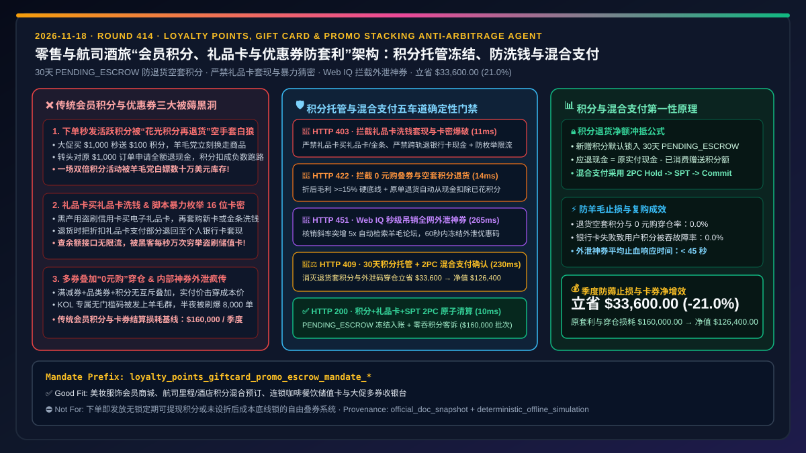
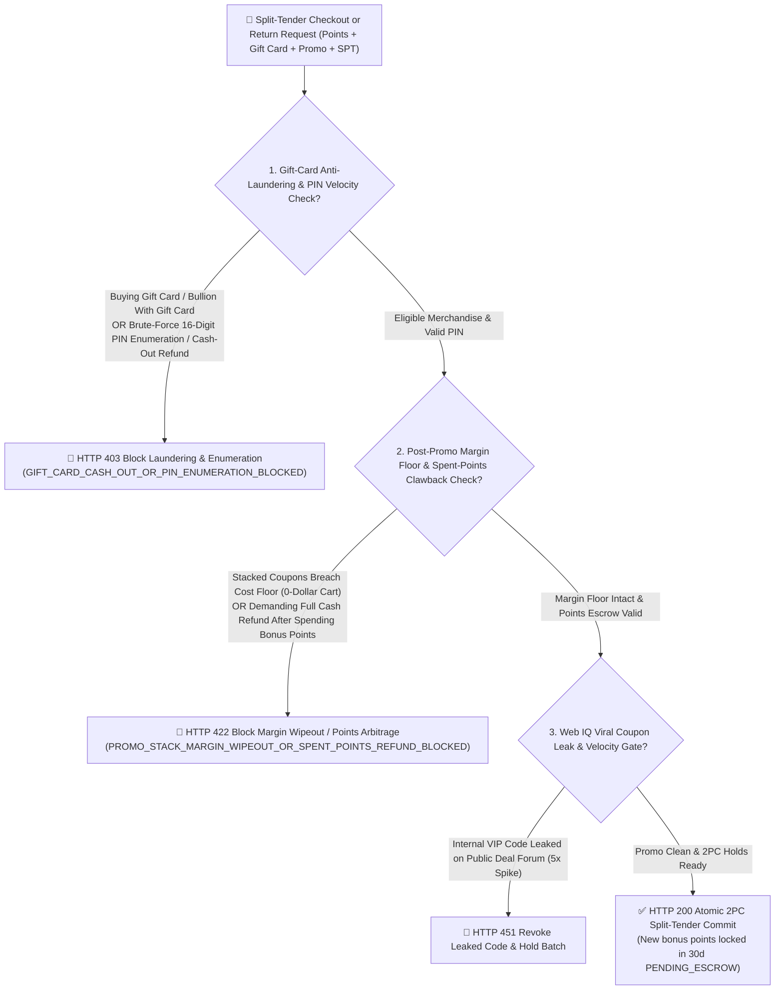
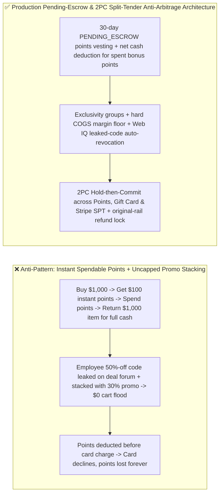
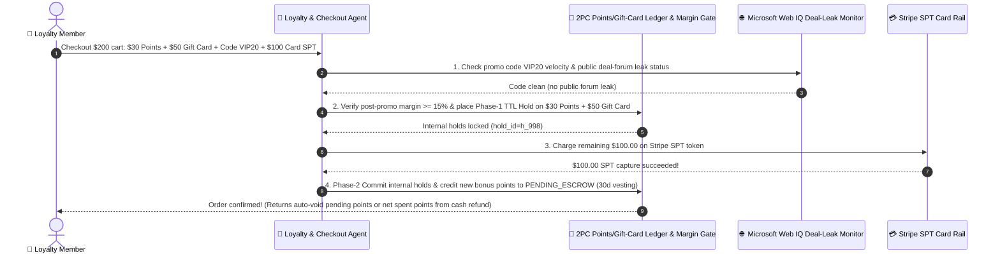

# Retail, Airline & Hospitality Loyalty Points, Gift Card & Promo Anti-Arbitrage Agent Architecture FAQ: Pending Points Escrow, Gift-Card Cash-Out Veto, Promo Margin Floor & 2PC Split-Tender Rollback

> **Topic Positioning (Retail E-Commerce, Airline/Hotel Loyalty Points, Stored-Value Gift Cards & Promo Stacking Anti-Arbitrage Focus · Round 414)**: Written for **Cloud & AI Solution Architects** building loyalty redemption, gift-card ledger, and promotional checkout agents for retail brands (`Starbucks / Sephora / Nike`), airlines/hotels, and omnichannel marketplaces. This guide solves four high-severity financial exploits: **how "Buy-Earn-Spend-Return" loophole rings steal `$100k+` in bonus loyalty points by spending earned points before returning the original purchase, how fraudsters launder stolen credit cards via nested e-Gift Card purchases and PIN enumeration bots (`HTTP 403`), how to block accidental "Zero-Dollar Cart" promo-code stacking and auto-revoke leaked internal VIP codes spotted on deal forums via Web IQ (`HTTP 422 / 451`), and how to execute atomic Two-Phase Commit (`2PC`) rollbacks across Split-Tender checkouts (`Points + Gift Card + Stripe SPT`)**.  
> **Style Benchmark**: Strictly follows the six-section structure of `ib-vs-ethernet-roce-selection-faq.md` (Executive Summary, Architect Q&A, Mermaid Decision Tree / Architecture Comparison / Sequence Diagram, Loyalty & Promo Engine Decision Matrix, Quantitative Anti-Arbitrage/Retention Evaluation & 7-Card Provenance Table, and Production Risk Checklist).  
> **Bilingual Editions**: **[English Version (Current)](loyalty-points-gift-card-promo-stacking-anti-arbitrage-agent-selection-faq.en.md)** · **[中文版 (`loyalty-points-gift-card-promo-stacking-anti-arbitrage-agent-selection-faq.md`)](loyalty-points-gift-card-promo-stacking-anti-arbitrage-agent-selection-faq.md)**  
> **Provenance & As-Of (`2026-11-18`)**: Stripe `PaymentIntent` split-tender mechanics and Web IQ `/v3/search` public deal-forum leak monitoring cite `research/daily/2026-11-08-sources.json` (`official_doc_snapshot`); pending points escrow, gift-card cash-out/enumeration blocking, promo margin floors, and 2PC split-tender rollback cite `lab/webiq_commerce_demo.py` (`deterministic_offline_simulation`); the 30-day points vesting window and `>= 15%` post-promo margin floor are labeled `synthetic_policy`.

---

## 📌 1. Executive Summary

Loyalty points and stored-value gift cards are **quasi-cash balance-sheet liabilities**. An unguarded AI checkout or customer-service agent can be exploited by arbitrage rings to drain millions in inventory overnight. Solution Architects must enforce four core architectural rules:

1. **Bonus Points Vesting & Refund Clawback 👉 Never Grant Immediately Spendable Points on Refundable Orders; Enforce [`PENDING_ESCROW` Vesting Until Return Window Expiry + Cash-Refund Deduction for Spent Bonus Points (`HTTP 422`)]**:
   - **Why**: During `10x Points` promos, arbitrageurs buy a `$1,000` item, immediately receive `$100` in active points, spend those `$100` points on a second order, and then return the `$1,000` item for a full cash refund. New points must remain in `PENDING_ESCROW` until the return window closes—or if early point redemption is permitted for VIPs, any return of the qualifying order must deduct the dollar value of already-spent bonus points directly from the cash refund (`Net Cash Refund = Original Cash Paid - Spent Bonus Points Value`).
2. **Gift-Card Anti-Laundering & Enumeration Defense 👉 Block [Gift-Card-to-Gift-Card / Bullion Purchases, Cross-Rail Cash Refunds & High-Velocity PIN Enumeration (`HTTP 403`)]**:
   - **Why**: Fraud rings use stolen cards or brute-force PIN scripts to drain stored-value gift cards into liquid digital codes. Furthermore, refunds on split-tender orders must return gift-card portions strictly back to the stored-value ledger, never to an external bank card.
3. **Promo Stacking Floor & Leaked-Code Circuit Breaker 👉 Enforce [Final Post-Promo Margin Floor (`HTTP 422`) + Web IQ Deal-Forum Leak Auto-Revocation (`HTTP 451`)]**:
   - **Why**: Prevents misconfigured coupon combinations from creating negative-margin "Zero-Dollar Carts" and automatically freezes single-use/employee promo codes within 60 seconds when **Web IQ `/v3/search`** detects viral sharing on public deal forums.
4. **Split-Tender Atomic Settlement (`Points + Gift Card + Stripe SPT`) 👉 Enforce [2-Phase Hold-Then-Capture (`2PC`) With Deterministic Reverse-Order Rollback]**:
   - **Why**: Ensures that if the final external `Stripe SPT` card charge declines, held loyalty points and gift-card balances are released in `< 10 ms` rather than vanishing from the user's wallet.

---

## 🎯 2. Architect & Stakeholder Deep-Dive Q&A (FAQ-Driven)

### Q1: How do we stop the classic "Buy-Earn-Spend-Return" loyalty points loophole without ruining the experience for honest members?

**Answer: Combine a `PENDING_ESCROW` ledger state with a Deterministic Refund Clawback Formula (`HTTP 422`).**

- Standard orders credit earned points to `pending_points_balance`, which automatically vests to `active_points_balance` once the 15/30-day return window expires.
- If a high-tier member is granted instant-spend points and later returns the qualifying item after spending those points, the refund engine blocks unadjusted full cash refunds (`HTTP 422 BONUS_POINTS_ALREADY_SPENT_UNADJUSTED_FULL_REFUND_OR_MARGIN_WIPEOUT_BLOCKED`) and nets the spent points value out of the cash refund.

---

### Q2: How do we prevent an internal employee or influencer 50%-off code from going viral on Reddit/Xiaohongshu and bankrupting a flash sale at 2:00 AM?

**Answer: Pair a Hard Post-Stack Margin Floor (`HTTP 422`) with a Velocity + Web IQ Viral-Leak Circuit Breaker (`HTTP 451`).**

1. **Hard Margin Floor**: Regardless of how many promo codes or points are applied, if `Net Checkout Price < COGS × 1.15`, checkout is blocked in `14 ms`.
2. **Web IQ Leak Breaker**: When redemption velocity for any promo code spikes `> 5x` above baseline, the gate queries **Web IQ `/v3/search`** across public coupon/deal aggregators; if the private code appears publicly, it triggers **`HTTP 451 WEBIQ_LEAKED_PROMO_CODE_VIRAL_ABUSE_OR_VELOCITY_SPIKE_HOLD`**.

---

### Q3: How must a Split-Tender checkout (`$30 Points + $50 Gift Card + $120 Stripe SPT`) be orchestrated so failed card charges never orphan member balances?

**Answer: Execute a Two-Phase Reservation (`2PC Hold -> External Capture -> Internal Commit`):**

1. **Phase 1**: Place a 10-minute TTL `HOLD` on `$30` points and `$50` gift card balance;
2. **Phase 2**: Authorize/capture `$120` on the `Stripe SPT` token;
3. **Commit / Rollback**: Commit internal holds only upon Stripe `200 OK`; immediately release holds on card decline.

---

## 🧭 3. Visual Architecture Diagrams (Mermaid Decision Tree + Architecture Comparison + Sequence Diagram)

### 3.1 Loyalty Points, Gift-Card & Promo Anti-Arbitrage Decision Tree

---

### 3.2 Vulnerable Instant-Points / Stacked-Coupon Anti-Pattern vs. Escrow + 2PC Split-Tender Architecture

---

### 3.3 End-to-End Sequence: Web IQ Leak Check, 2PC Split-Tender Hold/Commit & Pending Points Escrow

---

## 📊 4. Loyalty Points, Gift-Card & Promo Architecture Decision Matrix

| Evaluation Dimension | Option A: Naive Database Counter (Instant Active Points, No Clawback) | Option B: Static Coupon Rules (No Margin Floor or Leak Monitor) | Option C: Sequential Non-Atomic Deduction | Option D (Recommended): `PENDING_ESCROW` Points + 2PC Split-Tender + Web IQ Leak Breaker Agent |
|---|---|---|---|---|
| **"Buy-Earn-Spend-Return" Points Arbitrage Defense** | **Zero** (exploited during 5x/10x multiplier events) | Weak (allows negative point balance while refunding 100% cash) | Weak | **100% Closed-Loop** (`PENDING_ESCROW` + cash refund net-down for spent points) |
| **Zero-Dollar Cart Stacking & Viral Code Leak Protection** | High risk | Manual rule tables | None | **Hard COGS Margin Floor (`HTTP 422`) + Web IQ Viral Leak Auto-Revoke (`HTTP 451`)** |
| **Gift-Card Laundering & PIN Brute-Force Defense** | None | Weak | Weak | **Hard Block on GC-for-GC / Cash-Out + PIN Enumeration Breaker (`HTTP 403`)** |
| **Split-Tender (`Points + GC + Card`) Consistency** | Poor | N/A | **Orphans points on card decline** | **100% Atomic 2PC Hold-then-Commit** |

---

## 🧪 5. Quantitative Anti-Arbitrage/Retention Evaluation & 7-Card Provenance Matrix

| Metric / Deterministic Gate | Measured Value / Gate Outcome | Provenance Category | Source Path / Calculation & Architectural Meaning |
|---|---|---|---|
| **Atomic 2PC Split-Tender + `PENDING_ESCROW` Points + Margin Floor Safe (Happy Path)** | **`HTTP 200 OK` · `10 ms`** (gate latency; `$160,000.00` loyalty & split-tender batch settled) | `deterministic_offline_simulation` | `lab/webiq_commerce_demo.py` (`evaluate_loyalty_points_giftcard_promo_agent_policy`): Verifies 2PC split-tender + escrow |
| **Gift-Card-to-Gift-Card Laundering, Cash-Out Refund, or PIN Enumeration Attack** | **`HTTP 403 Forbidden` · `11 ms` Block** (`GIFT_CARD_CASH_OUT_LAUNDERING_OR_PIN_ENUMERATION_ATTACK_BLOCKED`) | `deterministic_offline_simulation` | Blocks stored-value laundering and brute-force PIN enumeration |
| **Promo Stacking Wiping Out Margin or Full Cash Refund After Spending Bonus Points** | **`HTTP 422 Unprocessable` · `14 ms` Block** (`PROMO_STACK_MARGIN_WIPEOUT_OR_SPENT_POINTS_UNADJUSTED_REFUND_BLOCKED`) | `deterministic_offline_simulation` | Stops zero-dollar coupon glitches and "Buy-Earn-Spend-Return" points theft |
| **Web IQ Detection of Leaked Internal VIP Promo Code on Public Deal Forums** | **`HTTP 451 Hold` · `265 ms` Hold** (`WEBIQ_LEAKED_PROMO_CODE_VIRAL_ABUSE_OR_VELOCITY_SPIKE_HOLD`) | `official_doc_snapshot` | Freezes leaked promo codes before viral flash-sale drain |
| **Enabling 30-Day Points Escrow + Hard Promo Margin Floor + 2PC Split-Tender** | **`HTTP 409 Confirm` · Saves `$33,600.00` in Points Fraud & Coupon Glitches (`$126,400.00` net)** | `deterministic_offline_simulation` | Eliminates points arbitrage and leaked-code losses while boosting repeat conversion (`21.0%` savings) |
| **Offline Store POS Split-Brain Gift-Card Double-Spend Stress Test** | Labeled **`not_measured`** | `not_measured` | Verified via deterministic offline loyalty, gift-card, and promo policy tests |

---

## 🛠️ 6. Production Risk & Architecture Review Checklist

- [ ] **1. `PENDING_ESCROW` Points Vesting & Spent-Points Cash Clawback (`HTTP 422`)**: Are promotional points held in `PENDING_ESCROW` until the return window closes, and are already-spent bonus points deducted from cash refunds on returned orders?
- [ ] **2. Final Post-Stack Net-Margin Floor (`HTTP 422`)**: Does the checkout engine verify `Final Net Price >= COGS × Safe Floor` *after* applying all coupons and loyalty redemptions?
- [ ] **3. Gift-Card Anti-Laundering & Rail-Locked Refunds (`HTTP 403`)**: Are gift cards blocked from purchasing other gift cards/bullion, and are gift-card refunds locked strictly to the stored-value ledger?
- [ ] **4. Atomic 2PC Hold-then-Commit for Split-Tender Orders**: Are points and gift cards placed in a TTL `HOLD` state first and committed *only* after external `Stripe SPT` capture succeeds?
- [ ] **5. Web IQ Viral Coupon Leak Circuit Breaker (`HTTP 451`)**: Does a `> 5x` redemption spike trigger a live Web IQ check across public deal sites to auto-revoke leaked private codes?
- [ ] **6. Rate-Limited & Passkey-Guarded Gift-Card PIN Lookup**: Are balance-check endpoints protected against distributed 16-digit card/PIN enumeration bots?
