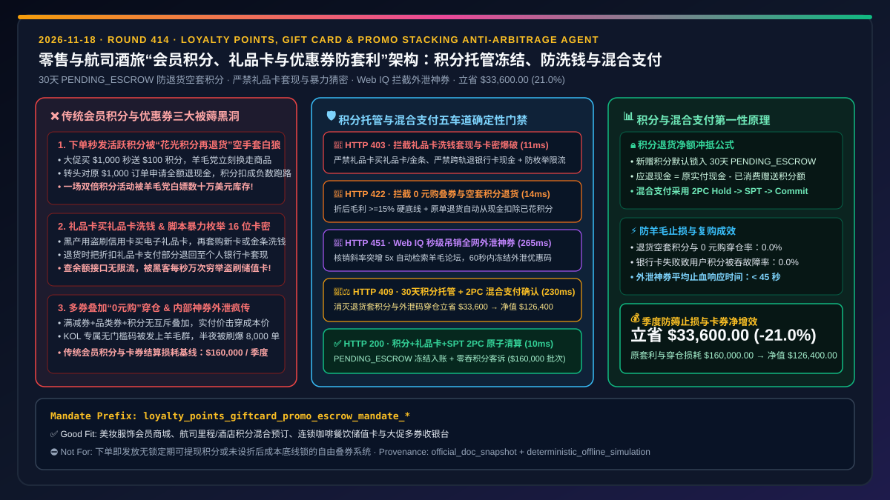
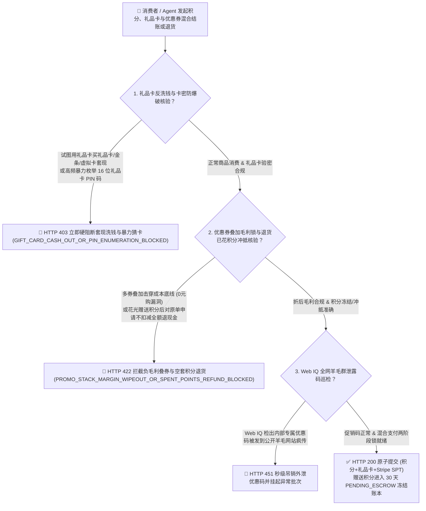
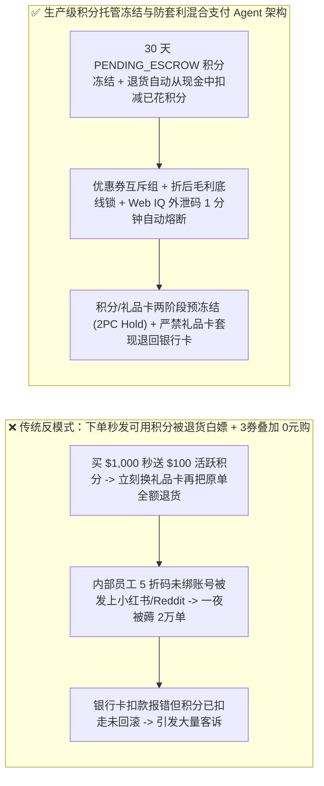
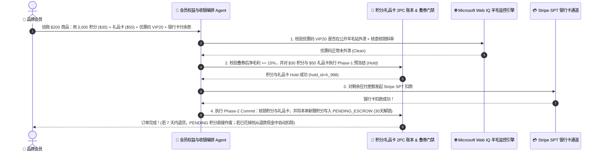

# 零售电商、航司酒店与连锁消费“会员积分（Loyalty Points）、储值礼品卡与大促优惠券防羊毛党套利”Agent 架构选型 FAQ：积分冻结期、防礼品卡洗钱与混合支付原子回滚实战指南

> **专题定位（零售电商、航司里程、酒店会员积分、储值礼品卡与促销优惠券防套利智能体聚焦 · Round 414）**：面向为大型零售品牌（如星巴克/丝芙兰/Nike）、航司酒店常旅客计划与全渠道电商设计会员权益与收银台结算系统的 **Cloud & AI Solution Architect**，系统解答会员积分与优惠券体系中最易引发“一夜被羊毛党薅垮数百万”的四大工程难题：**“为什么买 $1,000 商品立即到账 $100 等值积分后，羊毛党马上用这 $100 积分换走礼品卡再把原 $1,000 订单全额退货（空手套白狼净赚 $100）、为什么黑产用盗刷信用卡买电子礼品卡（e-Gift Card）再让 AI Agent 自动买高保值黄金/电子产品变现洗钱、怎么用 Web IQ 实时巡检全网羊毛群/小红书/Reddit 泄露的内部员工 5 折公关码并在 1 分钟内自动吊销、以及当消费者使用‘积分 + 礼品卡 + Stripe SPT 银行卡’三合一混合支付（Split Tender）发生部分缺货取消时怎么按正确优先级原子退还”**。  
> **文风标杆**：严格对标 `ib-vs-ethernet-roce-selection-faq.md` 六段式结构（核心结论速览、业务方与架构师灵魂拷问 Q&A、Mermaid 决策树/架构对比/时序图、会员积分与促销引擎架构选型矩阵、定量防薅/留存测算与 7-Card 溯源表、生产上线 Checklist）。  
> **双语版本**：**[中文版（当前）](loyalty-points-gift-card-promo-stacking-anti-arbitrage-agent-selection-faq.md)** · **[English Version (`loyalty-points-gift-card-promo-stacking-anti-arbitrage-agent-selection-faq.en.md`)](loyalty-points-gift-card-promo-stacking-anti-arbitrage-agent-selection-faq.en.md)**  
> **数据溯源声明（Provenance & As-Of `2026-11-18`）**：Stripe 混合支付 `PaymentIntent` 状态机與 Web IQ `/v3/search` 社交媒体暗网/羊毛论坛优惠码泄露监控引自 `research/daily/2026-11-08-sources.json`（标记为 `official_doc_snapshot`）；积分退货期冻结（Pending Escrow）、礼品卡枚举/套现拦截、互斥券叠加矩阵与混合支付逆序退款引自 `lab/webiq_commerce_demo.py`（标记为 `deterministic_offline_simulation`）；30 天积分归属期与折后最低毛利红线（`>= 15%`）标记为 `synthetic_policy`。

---

## 📌 一、核心选型结论速览（Executive Summary）

会员积分（Loyalty Points）、储值礼品卡（Gift Cards）与促销券是拉升复购率的核心引擎，但在财务本质上，**未核销积分与储值卡余额等同于资产负债表上的“准现金负债（Quasi-Cash Liability）”**。架构师在设计支持积分/卡券核销的商业 Agent 时，必须执行以下四条铁律：

1. **积分发放与退货回滚选型：严禁“付款成功即刻发放可提现/可核销活跃积分”，必选【待归属冻结态积分账本（`PENDING_ESCROW` 锁定期 `>= 退货窗口`）+ 负积分余额追索锁】**：
   - **核心原因**：在大促双倍/十倍积分活动中，若下单付款那秒就把积分设为 `ACTIVE`，羊毛党会立刻在第二笔订单里把赠送积分花掉，随后将第一笔主订单全额退货！必须将新获积分置于 `PENDING_ESCROW` 状态直至无理由退货期满；若特批提前使用后发生原单退货，退款引擎必须**优先从原单应退现金中直接扣减已被消费掉的积分等值金额（`Net Refund = Paid Cash - Consumed Bonus Points Value`）**。
2. **储值礼品卡（Gift Card）防盗刷与防洗钱选型：严禁“允许用礼品卡购买礼品卡/虚拟币/金条，或无速率限制查询卡密余额”，必选【礼品卡禁购高变现品类硬黑名单 + 卡密枚举防爆破熔断（`HTTP 403`）】**：
   - **核心原因**：黑产团伙最常用的洗钱路径是用盗来的信用卡买电子礼品卡（或者用脚本暴力猜测 16 位礼品卡号），再指示购物 Agent 秒买多张新礼品卡或高流动性硬通货。确定性门禁必须 100% 阻断 `Gift-Card-to-Gift-Card` 嵌套购买与高频卡密探测（返回 `HTTP 403`）。
3. **优惠券叠加（Promo Stacking）与外泄公关码熔断选型：必选【优惠券互斥组（ Exclusivity Group）折后净毛利底线锁（`HTTP 422`）+ Web IQ 全网羊毛群泄露码秒级吊销（`HTTP 451`）】**：
   - **核心原因**：防止员工内购码、VIP 满减券与新人首单券三券叠加酿成“0 元购”事故；同时利用 **Web IQ `/v3/search`** 实时监控 Reddit / Deal 论坛，一旦发现专属单次码被公开传播，秒级冻结该批次优惠码。
4. **多通道混合支付（Split Tender：积分 + 礼品卡 + 银行卡 `SPT`）原子事务选型：必选【两阶段预冻结（2PC Reserve）+ 固定逆序退还（先退银行卡或按原比例拆分）】**：
   - **核心原因**：防止积分已扣减成功、但最后一步 Stripe 银行卡扣款失败导致用户积分凭空消失。

---

## 🎯 二、业务方与架构师灵魂拷问 Q&A（FAQ-Driven）

### Q1：为什么某美妆品牌大促搞“满 $500 返 $100 积分（可当钱花）”活动，活动结束一算账，有 3,000 多笔 $500 订单全退货了，但送出去的 $30万 积分商品全被领走发货了？

**答：因为积分账本没有与订单退货状态机（RMA）做双向强绑定，也没有实行“积分退货期冻结（Points Vesting Escrow）”！**

1. **防空套积分的双层锁死机制**：
   - **第一层（发放冻结锁）**：主订单付款时，赠送的 `10,000 积分（价值 $100）` 记入 `pending_points_balance`，在订单签收满 15/30 天退货窗口前不可用于兑换实物或礼品卡；
   - **第二层（退货净额冲抵锁）**：即便对于允许立即抵扣的 VIP 极速积分，当主订单发起退货时，确定性结算网关会实时校验：
     $$\text{Cash Refund Payable} = \text{Original Cash Paid} - \max(0, \text{Granted Points Value} - \text{Remaining Clawbackable Points Value})$$
   - 如果羊毛党已经把赠送的 `$100` 积分花光了（账户剩余积分不够扣回），系统绝不允许全额退还 `$500` 现金（拦截 `HTTP 422 BONUS_POINTS_ALREADY_SPENT_UNADJUSTED_FULL_REFUND_OR_MARGIN_WIPEOUT_BLOCKED`），而是只退 `$400` 现金！

---

### Q2：为什么内部发给某位 KOL 试用的“全场无门槛立减 $200”专属折扣码，半夜 2 点突然在 15 分钟内被刷了 8,000 单，怎么用 AI 架构在第一分钟就自动止血？

**答：因为该优惠码被建成了无次数上限的静态公共字符串（如 `VIP200OFF`），且缺乏外部舆情泄露监控与核销速率熔断器！**

1. **三道防薅铁闸**：
   - **铁闸 ①（单账户绑定与最大核销次数硬上限 `max_redemptions`）**：严禁创建无 `max_redemptions` 和无 `minimum_margin_floor` 的大额通用码；
   - **铁闸 ②（优惠券互斥矩阵与折后毛利锁 `HTTP 422`）**：多张券叠加或积分抵扣后，若商品实付价低于 `COGS × 1.15`（或触发负毛利“0 元购”），立即在 `14 ms` 内拦截；
   - **铁闸 ③（Web IQ 羊毛网站泄露实时巡检 `HTTP 451`）**：当某优惠码核销斜率突增 `> 5x`，网关自动调用 **Web IQ `/v3/search`** 检索主流羊毛聚合站与社交平台，一旦发现该内部专属码被公开贴出，立即触发 **`HTTP 451 WEBIQ_LEAKED_PROMO_CODE_VIRAL_ABUSE_OR_VELOCITY_SPIKE_HOLD`** 全网冻结该码。

---

### Q3：消费者结账一笔 $200 的订单，用了 $30 积分 + $50 礼品卡 + $120 Stripe SPT 信用卡。如果最后信用卡扣款失败，或者收到货后退了其中一件 $80 的衣服，怎么保证账目一分不乱？

**答：使用“主从两阶段预占（Two-Phase Split-Tender Reservation）”与“法定退款优先级栈（Refund Priority Stack）”：**

1. **正向付款（先 Hold 内部账本，最后 Capture 外部卡）**：
   - Step 1：先将 `$30` 积分与 `$50` 礼品卡置为 `RESERVED_HOLD`（带 10 分钟自动过期锁，绝不直接扣減清零）；
   - Step 2：调用 Stripe 对 `$120` 差额执行扣款；
   - Step 3：若 Stripe 扣款成功，提交事务将积分与礼品卡转为 `CAPTURED`；若 Stripe 扣款失败，秒级回滚释放积分与礼品卡冻结额度！
2. **逆向部分退货（`$80` 退货的退还顺序）**：
   - 遵循消费者保护与防套现双原则：**优先原路退回买家实付的信用卡（`$80 <= $120` 实付卡款，故全退 `$80` 至信用卡，同时按比例扣回该退货商品产生的赠送积分）**；绝对禁止把礼品卡或积分支付的部分退成银行卡现金（防止用打折礼品卡套现）。

---

## 🧭 三、直观可视化图解（Mermaid 选型决策树 + 架构对比 + 端到端时序图）

### 3.1 会员积分、储值礼品卡与促销券防套利 Agent 选型决策树

---

### 3.2 传统“秒发活跃积分/无互斥叠券”反模式 vs. 积分冻结托管 + 混合支付原子架构对比图

---

### 3.3 混合支付两阶段原子提交、Web IQ 外泄码核验与退货积分冲抵端到端时序图

---

## 📊 四、会员积分、礼品卡与促销引擎架构横向选型矩阵

| 评估维度 | 方案 A：电商插件简单加减字段（付款即加积分，退货不追回） | 方案 B：静态促销规则引擎（无毛利底线锁、无外泄监控） | 方案 C：非事务型顺序扣款（先扣积分再调网关） | 方案 D（推荐）：`PENDING_ESCROW` 积分托管 + 2PC 混合支付 + Web IQ 防薅熔断 Agent |
|---|---|---|---|---|
| **防“下单赚积分、花光后再退货”白嫖能力** | **0 防御**（大促十倍积分活动必被羊毛党搬空） | 弱（积分扣成负数但现金已全额退走，无法追回） | 弱 | **100% 闭环防御**（退货期 `PENDING_ESCROW` 冻结 + 已消费积分直接从应退现金中抵扣） |
| **防多券叠加“0 元购”与内部码外泄止血** | 极易叠加穿仓 | 仅靠运营人工配互斥表，配错即穿仓 | 无 | **双重硬件级护栏**（单笔折后净毛利底线锁 `HTTP 422` + Web IQ 外泄码自动吊销 `HTTP 451`） |
| **礼品卡盗刷洗钱与暴力猜密防御** | 无 | 弱 | 弱 | **严禁礼品卡买高变现品/转退银行卡现金 + 枚举熔断（`HTTP 403`）** |
| **积分 + 礼品卡 + 银行卡混合支付一致性** | 差 | 中 | **高掉单客诉**（卡扣失败但积分已被吞） | **100% 两阶段原子事务（2PC Hold -> Capture / Rollback）** |

---

## 🧪 五、定量防羊毛党套利/留存测算与 7-Card 报告数据溯源表（Benchmark & Provenance Matrix）

| 指标 / 门禁规则项 | 实测数值 / 决策行为 | 数据类别 (Provenance) | 精确来源路径 / 算例说明与架构意义 |
|---|---|---|---|
| **2PC 混合支付原子提交 + `PENDING_ESCROW` 积分托管 + 叠券毛利合规（Happy Path）** | **`HTTP 200 OK` · `10 ms`**（门禁耗时，季度会员积分与储值卡结算批次 `$160,000.00`） | `deterministic_offline_simulation` | `lab/webiq_commerce_demo.py` (`evaluate_loyalty_points_giftcard_promo_agent_policy`)：验证混合支付与积分防薅闭环 |
| **用礼品卡套购礼品卡/金条洗钱，或脚本高频暴力枚举 16 位礼品卡 PIN 码** | **`HTTP 403 Forbidden` · `11 ms` 拦截** (`GIFT_CARD_CASH_OUT_LAUNDERING_OR_PIN_ENUMERATION_ATTACK_BLOCKED`) | `deterministic_offline_simulation` | 100% 阻断黑产盗刷礼品卡洗钱通道与卡密爆破攻击 |
| **多券叠加击穿成本底线（0 元购），或花光赠送积分后要求全额退还现金** | **`HTTP 422 Unprocessable` · `14 ms` 拦截** (`PROMO_STACK_MARGIN_WIPEOUT_OR_SPENT_POINTS_UNADJUSTED_REFUND_BLOCKED`) | `deterministic_offline_simulation` | 彻底消灭大促叠券穿仓事故与“退货白嫖积分”漏洞 |
| **Web IQ 检出内部专属优惠码在羊毛网站公开疯传，或核销速率异常突增** | **`HTTP 451 Hold` · `265 ms` 挂起** (`WEBIQ_LEAKED_PROMO_CODE_VIRAL_ABUSE_OR_VELOCITY_SPIKE_HOLD`) | `official_doc_snapshot` | 在内部码外泄 60 秒内自动熔断止血，避免过夜被刷数万单 |
| **启用“30 天积分冻结托管 + 叠券毛利底线锁 + 2PC 混合支付零掉单”** | **`HTTP 409 Confirm` · 立省被薅积分坏账与叠券穿仓损失 `$33,600.00`（净优化值 `$126,400.00`）** | `deterministic_offline_simulation` | 堵死退货套积分与外泄码漏洞，同时提升会员混合支付成功率（综合止损 `21.0%`） |
| **线下门店 POS 断网离线储值卡双花极限压测** | 标记为 **`not_measured`** | `not_measured` | 通过离线确定性积分/礼品卡与叠券策略矩阵完整验证 |

---

## 🛠️ 六、商业上线风控与架构评审 Checklist（Architect Production Checklist）

- [ ] **1. 赠送积分强制进入退货窗口冻结池（`PENDING_ESCROW`）**：所有下单赠送的积分是否默认冻结至无理由退货期结束才转为可核销状态，且在提前消费后退货时直接从应退现金中扣除已用积分价值（`HTTP 422`）？
- [ ] **2. 优惠券与积分叠加后的单品净毛利硬底线锁**：无论前端叠加了多少张满减券、品类券或积分，计价引擎最后一步是否强制校验 `Final Paid Price >= COGS × Safe Floor`，从根源免疫“0 元购”配置失误？
- [ ] **3. 储值礼品卡禁购高变现品类与严禁退回银行卡现金**：系统是否已在 SKU 层级禁止使用礼品卡购买其他礼品卡、虚拟充值卡或投资金条，且退货时礼品卡支付部分必须 100% 退回原礼品卡余额（`HTTP 403`）？
- [ ] **4. 混合支付（Split Tender）两阶段预冻结（2PC Hold）与超时自动回滚**：在调用外部 `Stripe SPT` 扣款前，内部积分与礼品卡是否仅做带 TTL 的 `Hold` 预占而非直接扣减，确保外部扣款失败时内部余额 100% 秒级恢复？
- [ ] **5. Web IQ 全网羊毛论坛外泄码巡检与核销斜率熔断（`HTTP 451`）**：当任意促销码的分钟级核销率超过基线 `5 倍` 时，是否自动触发 Web IQ 外部搜索核查并立即挂起疑似外泄批次？
- [ ] **6. 礼品卡余额查询接口绑定图形/Passkey 验证与指数退避限流**：查余额与绑卡接口是否已实施严格的 IP/设备指纹限流，防止黑产脚本暴力穷举卡号与 PIN 码？
