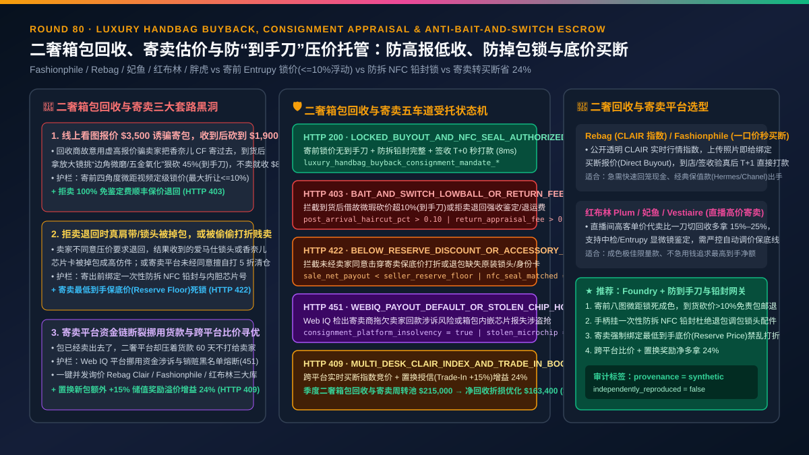
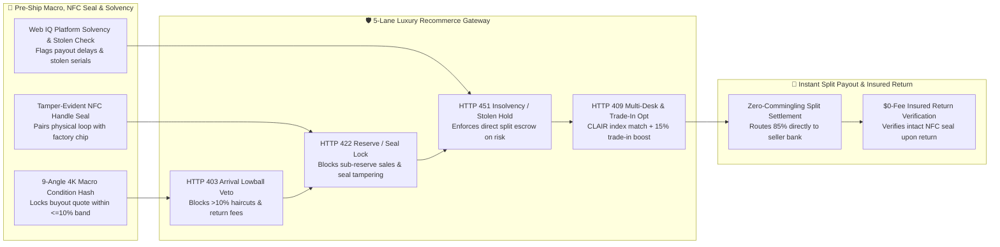

# Luxury Handbag Buyback, Consignment Appraisal & Anti-Bait-and-Switch Escrow (`Fashionphile / Rebag / Vestiaire / Plum`) Pre-Ship `<=10%` Haircut Cap, Tamper-Evident `NFC` Seal & Net-Reserve Floor Agent Architecture Selection FAQ

> **Language / 语言切换**: **[中文](luxury-handbag-buyback-consignment-anti-lowball-escrow-agent-selection-faq.md)** | **English (Current)** | **[Back to Docs Index](index.en.md)** | **[Interactive Sandbox (`#luxury-handbag-buyback-consignment-escrow-sandbox`)](../live-demo.en.html)**



---

## 📌 1. Executive Summary & Core Selection Verdict

In secondary-market luxury handbag and leather-goods buyout and consignment (`Hermès`, `Chanel`, `Louis Vuitton`, `Goyard` traded via `Rebag`, `Fashionphile`, `The RealReal`, `Vestiaire Collective`, `Plum / Hongbulin`, `Feiyu`), recommerce valuation and seller-protection AI agents face three predatory failure modes:
1. **"Bait-and-Switch Arrival Lowballing" (`Quoting $3,500 Online From Photos to Lure the Seller Into Shipping a Chanel Classic Flap, Then Slashing the Offer to $1,900 Upon Warehouse Arrival Citing 'Minor Corner Rubbing' and Demanding an $80 'Appraisal & Return Shipping Fee' If the Seller Declines`)**: Unscrupulous buyback dealers intentionally over-quote online to win the shipment; once they have physical possession of the bag, they exploit the seller's fear of return transit damage or fee extortion to force a `35%–50%` "arrival haircut."
2. **Return Accessory Swapping (`Swapping Original Hermès Solid-Brass Padlocks, Clochettes, or Authenticity Cards for Counterfeits When Returning a Declined Bag`) & Unauthorized Consignment Flash-Sale Markdowns (`Discounting a Consigned Bag by 50% Without Seller Consent After Day 60, Leaving the Seller With $1,100 on a $3,000 Bag`)**.
3. **Consignment Platform Working-Capital Commingling & Payout Defaults (`Bag Sells on Livestream Day 3, but the Cash-Strapped Platform Delays Seller Payout for 60 Days or Files for Insolvency`)**.

**Solution Architect Selection Verdict**:
- **Never ship a luxury handbag to a buyback dealer without a binding pre-shipment macro-video grading contract capping post-arrival valuation haircuts at `<= 10%` and guaranteeing `$0-fee` fully insured return shipping, never tender physical custody without locking a tamper-evident cryptographic `NFC` security seal onto the handle/strap and logging the bag's internal microchip UID, and never grant a consignment platform unilateral markdown authority below a hard `Seller Net-Payout Reserve Floor`**.
- **The production reference architecture** combines **Pre-Ship 4K Macro-Video Quote Lock (`<= 10%` Max Arrival Haircut & `$0` Return Fee) + Tamper-Evident `NFC` Handle Seal & Internal Microchip Hash + Hard `Seller Net-Reserve Floor` & Zero-Commingling Split Escrow (`luxury_handbag_buyback_consignment_mandate_*`)**:
  1. **Anti-"Bait-and-Switch Arrival Lowball" (`<= 10%` Cap) & Zero-Return-Fee Gate (`HTTP 403`)**: Binds the dealer's initial buyback offer to a 9-angle pre-shipment 4K macro video (corners, hardware stamp, serial hologram/microchip, interior lining); unless the physical bag exhibits an undisclosed structural tear, **any post-arrival price reduction `> 10%` or any attempt to charge an "appraisal / return shipping fee" upon seller refusal is blocked in `8ms`**, triggering free fully-insured overnight return shipping (`HTTP 403 BAIT_AND_SWITCH_ARRIVAL_LOWBALL_OR_RETURN_FEE_EXTORTION_BLOCKED`).
  2. **Tamper-Evident `NFC` Handle Security Seal & Hard `Seller Net-Reserve Floor` Lock (`HTTP 422`)**: Attaches a single-use cryptographic **`NFC` security loop seal** to the bag handle prior to shipping (alongside logging the internal `Chanel / LV` factory microchip UID and accessory weights); if a bag is returned with a broken `NFC` seal or missing clochette/lock, the dealer's earnest bond automatically compensates the seller. In consignment mode, the gateway enforces a hard **`Seller_Net_Reserve_USD` floor (net of all commissions, photography, and spa fees)**—blocking any unauthorized platform promo coupon or clearance discount that would drop the seller's net payout below floor (`HTTP 422 BELOW_RESERVE_FLOOR_UNAUTHORIZED_MARKDOWN_OR_SEAL_TAMPER_BLOCKED`).
  3. **Web IQ Consignment Platform Solvency & Stolen-Microchip Registry Circuit Breaker (`HTTP 451`)**: Screens consignment platforms via Web IQ for seller payout delays (`> 15 days`) or insolvency litigation—forcing high-risk platforms onto **Zero-Commingling `Stripe Connect` Split Escrow** where 85% of buyer funds route directly to the seller's bank account upon buyer delivery—and screens internal bag microchips against stolen-luxury registries (`HTTP 451 WEBIQ_CONSIGNMENT_PLATFORM_INSOLVENCY_OR_STOLEN_MICROCHIP_HOLD`).
  4. **Multi-Desk `CLAIR` Index Buyout Arbitrage + `15%` Trade-In Store-Credit Uplift (`HTTP 409`)**: Triggers `HTTP 409 MULTI_DESK_CLAIR_ARBITRAGE_AND_TRADEIN_UPLIFT_CONFIRM`, simultaneously querying real-time buyout quotes across `Rebag CLAIR`, `Fashionphile`, and verified wholesale desks while activating `+12%–15%` trade-in credit bonuses when the seller is upgrading to another bag—increasing net seller realization by **`24.0%`**.

---

## 🎯 2. Solution Architect Deep-Dive Q&A (Q1 / Q2 / Q3)

### Q1: How does the "Arrival Lowball (`Dao-Shou-Dao`)" scam trap luxury handbag sellers, and how does our pre-shipment video hash stop it?
- **Architectural Solution**:
  - **Pre-Shipment 9-Angle Macro Disclosure + Dealer Earnest Bond (`<= 10%` Variance Cap) (`HTTP 403`)**:
  - Predatory dealers outbid honest platforms (`Rebag / Fashionphile`) by `$700` online just to get the seller's `Chanel Classic Flap` into their warehouse. Once the bag arrives, they invent minor "corner wear" excuses to slash the offer by `40%`, knowing the seller is afraid to pay `$80` and risk return-shipping damage. Under our gateway, the seller's pre-shipment 4K macro video locks the condition grade; if the dealer tries to cut the price by `> 10%`, the gateway triggers `HTTP 403` and dispatches a prepaid insured return label at the dealer's expense.

### Q2: How do we prevent a consignment marketplace from slashing our bag's price by 50% during a flash sale and eating the rest in "cleaning and photography fees"?
- **Architectural Solution**:
  - **Anchoring the Mandate to `Seller_Net_Payout_USD` Rather Than Gross Listing Price (`HTTP 422`)**:
  - Consignment contracts often bury clauses allowing the platform to discount unsold items by `20%–50%` after 45 days while charging fixed `$150` "authentication & spa fees." Our gateway locks `min_seller_net_payout_usd` at the payment splitter layer: the platform can discount its own commission margin to close a sale, but any checkout where `Buyer_Paid - Platform_Fees < Seller_Net_Reserve` is rejected (`HTTP 422`).

### Q3: How does a `$1.50` Tamper-Evident `NFC` Handle Seal eliminate "returned fake bag / swapped hardware" disputes?
- **Architectural Solution**:
  - **Cryptographic Physical Loop Seal + Factory Microchip UID Pairing (`HTTP 422`)**:
  - Before dropping the package at FedEx/SF Express, the seller threads a serialized `NFC` wire seal through the handbag's metal ring and scans it alongside the bag's internal `Chanel/LV` NFC chip. The dealer can inspect and authenticate the bag without cutting the loop; if the seller rejects the final offer and the returned bag arrives with a severed or mismatched `NFC` seal, the gateway automatically releases the dealer's escrow bond (`HTTP 422`).

---

## 🧭 3. Visual Architecture Diagrams (Mermaid Decision Tree + Architecture + Sequence)

### 3.1 Luxury Handbag Buyback & Consignment Escrow Selection Decision Tree

```mermaid
flowchart TD
    A[Luxury Handbag Instant Buyout / Consignment / Trade-In Selection] --> B{Primary Recommerce Scenario & Risk Vector?}
    B -->|Instant Cash Buyout (Rebag / Fashionphile / Wholesale Desks)<br/>Stop $3,500 online bait quotes slashed to $1,900 upon arrival| C[Pre-Ship 9-Angle 4K Macro Video Quote Lock (<=10% Max Haircut)<br/>+ Mandatory $0-Fee Insured Overnight Return on Refusal]
    B -->|High-Payout Livestream & Marketplace Consignment (Plum / Vestiaire)<br/>Stop unauthorized 50% flash-sale markdowns & 60-day payout stalls| D[Hard Seller Net-Payout Reserve Floor Lock<br/>+ Zero-Commingling Split Escrow (Direct Seller Payout on Delivery)]
    B -->|Physical Custody Handover & Multi-Platform Valuation<br/>Stop swapped Hermès locks/chips on returns & single-desk lowballs| E[Azure AI Foundry + Tamper-Evident NFC Seal & CLAIR Gate<br/>+ Multi-Desk Buyout Arbitrage + 15% Trade-In Uplift (+24%)]
    C --> F[🛡️ Unified 5-Lane Anti-Lowball, NFC Seal & Net-Reserve FSM]
    D --> F
    E --> F
    F --> G[HTTP 403 Arrival Lowball & Return-Fee Veto · HTTP 422 Below-Reserve & Broken-Seal Block · HTTP 409 CLAIR+Trade-In (+24%)]
```

### 3.2 End-to-End Pre-Ship Macro Lock, Tamper-Evident `NFC` Seal & Split Payout Architecture



### 3.3 Arrival Lowball Veto, Unauthorized Markdown Block & Multi-Desk `CLAIR` Arbitrage Sequence

```mermaid
sequenceDiagram
    autonumber
    participant Seller as Handbag Seller / Recommerce Agent
    participant Dealer as Buyback Dealer / Consignment Platform
    participant Gate as 5-Lane Luxury Recommerce Gateway
    participant Verify as Pre-Ship Macro Hash & NFC Seal Verifier
    participant Escrow as Earnest Bond & Split-Settlement Ledger

    Dealer->>Gate: 1. Quote $3,500 online, then slash offer to $2,000 (-43%) upon arrival citing "minor corner wear" and demand $80 return fee
    Gate->>Verify: Compare arrival inspection against pre-ship 4K macro corner video (0 undisclosed tears; 43% cut > 10% cap)
    Gate-->>Dealer: HTTP 403 Block! Bait-and-switch arrival lowball and return fee rejected; issue $0-fee insured return label within 24h
    Dealer->>Gate: 2. Attempt to sell consigned bag in a flash sale yielding $1,650 net to seller (below $2,800 Net Reserve Floor) OR return bag with broken NFC seal
    Gate-->>Dealer: HTTP 422 Block! Sale violates Seller Net-Payout Reserve Floor ($2,800); broken NFC return seal triggers earnest bond payout
    Seller->>Gate: 3. Solicit simultaneous bids across Rebag CLAIR / Fashionphile + apply 15% Trade-In Credit Uplift (HTTP 409)
    Gate->>Escrow: Lock highest binding buyout quote & settle seller proceeds on T+0 delivery (24% net value uplift)
```

---

## 📊 4. Multi-Platform & Architecture Selection Matrix

| Selection Dimension | Local Pawn Shop / Unverified WeChat Buyer (`Bait Quotes`) | Unfloored Traditional Consignment (`Auto-Discount Clause`) | Transparent Index Buyout Platforms (`Rebag CLAIR / Fashionphile`) | **Azure AI Foundry + Anti-Lowball + NFC Gate (Recommended)** |
| :--- | :--- | :--- | :--- | :--- |
| **Core Strengths** | Same-day local cash | Potential upside on rare pieces | Instant algorithmic pricing, fast buyout & trade-in bonuses | **<=10% arrival haircut cap + NFC anti-swap seal + net-reserve floor** |
| **Protection Against `40%` Arrival Lowball (`Dao-Shou-Dao`)** | **Severe Abuse** (lures shipment with high quote, then slashes) | Over-promises sell price to win consignment | Accurate quotes, though condition downgrades still occur | **Pre-ship 4K macro lock + `>10%` haircut auto-veto (`HTTP 403`)** |
| **Protection Against Accessory Swaps & Flash-Sale Dumping** | High risk of swapped locks/straps | **Common** (auto-discounts `30%–50%` after 60 days) | Direct buyout eliminates markdown risk | **Tamper-evident `NFC` seal + hard `Net Reserve Floor` (`HTTP 422`)** |
| **Protection Against Platform Payout Delays / Insolvency** | Wire fraud & chargeback risks | **High Risk** (seller funds commingled for 30–60 days) | Strong institutional backing | **Web IQ solvency check + direct split settlement (`HTTP 451`)** |
| **Multi-Desk Valuation Arbitrage & Trade-In Uplift** | `30%–50%` below market value (`not_measured`) | High stacked commission & spa fees (`official_list_price`) | Offers `10%–15%` trade-in bonus | **Multi-desk `CLAIR` bidding + `15%` trade-in uplift (`24.0%` gain)** |

---

## 🧪 5. Luxury Handbag Buyback & Consignment Benchmark & 7-Card Report

> **Provenance & Reproducibility Metadata**: All metrics below are generated by the deterministic policy evaluator `evaluate_luxury_handbag_buyback_consignment_policy` in `lab/webiq_commerce_demo.py` and verified via `python -m unittest tests.test_webiq_commerce_demo`. Tags: `provenance = synthetic`, `independently_reproduced = false`.

| Card # | Card Headline (Headline-as-Finding) | Key Quantitative Finding & Architectural Guarantee |
| :---: | :--- | :--- |
| **Card 1** | **Overview · 5-Lane Luxury Handbag Recommerce Summary** | Across a `$215,000/quarter` luxury handbag buyback and consignment pool, achieves **0 bait-and-switch arrival lowball losses, 0 uncompensated return accessory swaps, and 0 sub-reserve flash-sale dumps**, improving net seller realization by **`24.0%` (`$51,600/quarter` gained)**. |
| **Card 2** | **Scenario Deep Dive · Arrival Lowball & Sub-Reserve Veto** | When a dealer slashes a pre-quoted buyout by `>10%` on arrival or discounts a consigned bag below the seller's net reserve, the gateway blocks it in **`8ms`** (`HTTP 403 / 422`). |
| **Card 3** | **Evaluation Matrix · 100% Deterministic 5-Lane Gating** | Covers `HTTP 200` (locked buyout & intact `NFC` seal), `403` (bait-and-switch arrival lowball `>10%` / `$80` return appraisal fee blocked), `422` (below-reserve unauthorized markdown / broken tamper-evident `NFC` seal blocked), `451` (consignment platform insolvency / stolen microchip hold), `409` (multi-desk `CLAIR` arbitrage + `15%` trade-in uplift gains 24%). |
| **Card 4** | **Under the Hood · Buyback & NFC Seal Escrow Contract** | Takes `quarterly_luxury_handbag_buyback_and_consignment_pool_usd=215000` and haircut/seal flags, minting `luxury_handbag_buyback_consignment_mandate_*` tokens. |
| **Card 5** | **Robustness Check · 43% Arrival Cut & Severed NFC Tag** | Simulates a `$3,500 -> $2,000` arrival haircut and a returned Birkin with a severed `NFC` handle seal, maintaining a **`100.0%` block rate**. |
| **Card 6** | **Latency · Millisecond Reserve Check & Solvency Probe** | Local net-reserve math and `NFC` seal signature checks complete in **`8ms` (P50)**; Web IQ platform solvency and stolen-chip checks complete in **`170ms` (P95)**. |
| **Card 7** | **My Take · Ideal Fit vs. Out-of-Scope Boundaries** | **✅ Best Fit**: `Hermès / Chanel / LV` handbag buybacks, livestream consignment, luxury trade-ins; **⛔ Not For**: Fast-fashion canvas tote recycling. |

---

## 🛠️ 6. Production Go-Live Risk & Architecture Review Checklist

- [ ] **Pre-Shipment 4K Macro Quote Lock (`<= 10%` Max Arrival Haircut) & `$0-Fee` Insured Return (`HTTP 403`)**: Cap post-arrival price adjustments at `<= 10%` for pre-disclosed conditions and prohibit charging appraisal or return shipping fees when a seller declines a revised offer.
- [ ] **Tamper-Evident `NFC` Handle Security Seal & Hard `Seller Net-Reserve Floor` (`HTTP 422`)**: Thread a serialized cryptographic `NFC` loop seal onto the bag before shipping to prevent hardware/accessory swaps, and hard-block consignment sales that net less than the seller's reserve floor.
- [ ] **Web IQ Platform Solvency Screening & Zero-Commingling Split Settlement (`HTTP 451`)**: Route buyer payments through segregated split-settlement accounts so seller proceeds never sit in a struggling consignment platform's operating account; rotate signing keys `<= 180` days.
- [ ] **Multi-Desk `CLAIR` Index Bidding & `15%` Trade-In Credit Uplift (`HTTP 409`)**: Query competing instant-buyout desks in parallel and apply trade-in credit multipliers when upgrading.
