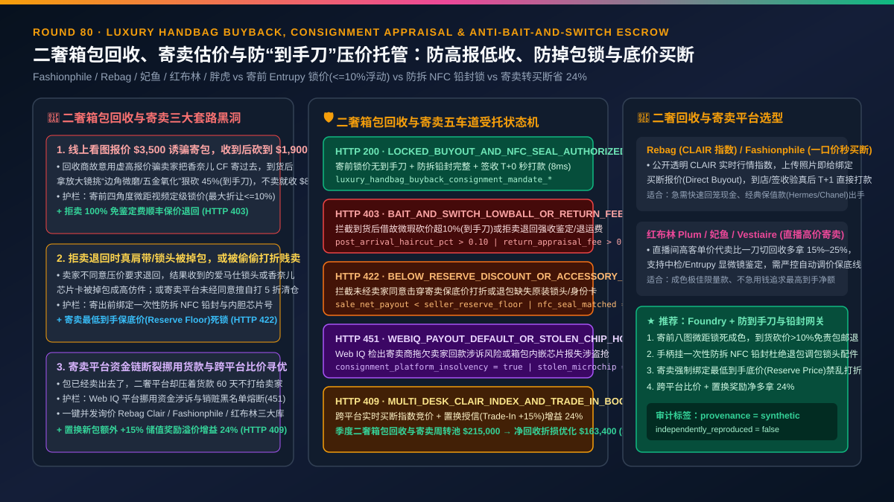
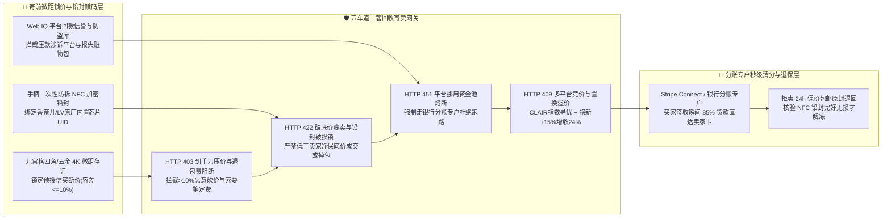
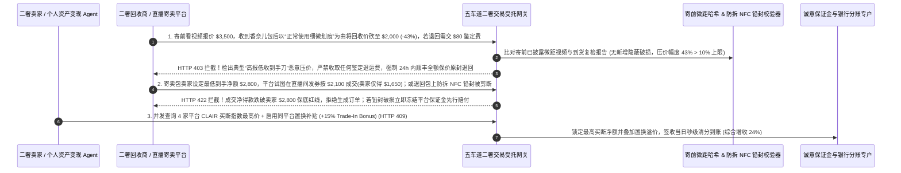

# 二手奢侈品箱包回收、典当寄卖估价与防“到手刀”恶意压价托管（Luxury Handbag Buyback, Consignment Appraisal & Anti-Bait-and-Switch Escrow：Fashionphile / Rebag / 妃鱼 / 红布林 / 胖虎）“防线上高报 $3,500 诱骗寄包后到手刀砍至 $1,900、防退包掉包原装配件与寄卖底价死锁”Agent 架构选型 FAQ

> **语言切换 / Language**: **中文 (当前)** | **[English](luxury-handbag-buyback-consignment-anti-lowball-escrow-agent-selection-faq.en.md)** | **[返回文档目录](index.md)** | **[交互式沙盒 (`#luxury-handbag-buyback-consignment-escrow-sandbox`)](../live-demo.html)**



---

## 📌 一、核心选型结论速览（Executive Summary）

在爱马仕（Hermès）、香奈儿（Chanel）、LV 等二手奢侈品箱包皮具的线上回收买断（Direct Buyout）与直播代卖寄售（Consignment：Rebag、Fashionphile、The RealReal、Vestiaire Collective、红布林 Plum、妃鱼、只二、胖虎）的智能体跨平台询价、实物交割与回款托管场景中，个人卖家与二奢同行面临三大恶性行业黑洞：
1. **“高报低收‘到手刀’（Bait-and-Switch Appraisal Haircut）”：回收商为了抢夺货源，在线上看照片时故意报出 `$3,500` 的全网最高回收价诱骗卖家把香奈儿 CF 包顺丰寄过去；等包一进回收商仓库（沉没成本已产生），鉴定师立刻变脸挑刺说‘四角有轻微正常使用痕迹、五金有细微氧化、少了专柜小票’，把价格狠狠砍到 `$1,900`（暴砍 `45%`）！卖家如果不卖想拿回包，对方竟要求先交 `$80` 所谓‘人工鉴定费+双向保价顺丰费’才肯寄回**。
2. **“退包掉包配件与无授权打折贱卖（Accessory Swap & Unauthorized Markdown）”：卖家拒绝‘到手刀’要求退回原包，结果收回来发现爱马仕原装纯铜锁头、香奈儿镭射标/内置芯片（Microchip）或原装肩带被偷偷换成了高仿假配件，甚至包内皮被故意划了一道痕；或者在寄卖平台上挂 `$3,000`，平台为了冲直播间销量未经卖家确认擅自发神券按 `$1,600` 贱卖，扣除佣金和护理费后卖家到手只剩 `$1,100`！**
3. **“二奢寄卖平台自身资金链断裂（如曾发生的二奢平台跑路事件），卖家的包早在直播间被买走签收了，平台却把卖包款挪用去填窟窿，拖延 60 天无法提现！”**。

**架构师选型结论**：
- **切勿在未锁定“寄前八图微距成色定级与到货最大折价容差上限（`Max Arrival Haircut <= 10%`）及拒卖 `$0` 费用包邮原路退回”承诺的情况下寄出高价值箱包，切勿在未悬挂一次性加密防拆 `NFC` 铅封与读取包内原厂芯片 UID 的情况下交接实物，也切勿允许寄卖平台拥有突破卖家最低到手净额底线（`Net Payout Reserve Floor`）的自动改价权**。
- **生产级最优架构**是采用 **“寄前 AI/八图微距定级锁价（到货压价 `>10%` 熔断并全免费保价退回）+ 手柄一次性防拆 `NFC` 铅封与五金/芯片指纹存证 + 寄卖最低到手净额死锁与买家付款直分卖家专户网关（`luxury_handbag_buyback_consignment_mandate_*`）”**：
  1. **防“高报低收到手刀（`Bait-and-Switch Lowball`）”与拒卖敲诈鉴定费硬门禁（HTTP 403）**：在寄出箱包前，智能体引导卖家按标准九宫格拍摄 **四角皮质、五金刻印、内衬压印、四角边油与配件全家福高清视频**，回收商基于此给出具有约束力的预授信买断价（Binding Pre-Quote）；只要实物与寄前视频无未披露的重大结构性破损，**到货复检议价下浮空间硬封顶在 `<= 10%`（严禁借故正常使用微瑕暴砍 `30%–50%`），且一旦卖家不同意复检折价，回收商必须承担 100% 往返顺丰保价运费并在 24 小时内 `$0 鉴定费` 原样寄回**（`HTTP 403 BAIT_AND_SWITCH_ARRIVAL_LOWBALL_OR_RETURN_FEE_EXTORTION_BLOCKED`）。
  2. **一次性防拆 `NFC` 铅封防掉包与寄卖“最低到手净额底线（`Net Reserve Floor`）”硬门禁（HTTP 422）**：寄出前在箱包手柄/肩带扣环处锁死一枚 **带唯一加密签名的一次性物理防拆 `NFC` 铅封扣（Tamper-Evident NFC Security Tag）** 并同步记录 2021 年后香奈儿/LV 内置原厂 NFC 芯片硬件序列号及配件克重；若交易取消退回，卖家收货时铅封一旦被剪断或配件重量/纹路不符，保险托管池立即先行赔付；在寄卖模式下，网关在底层锁死 **`Seller_Net_Reserve_USD`（扣除平台佣金、直播坑位费、洗护拍照费后的卖家最低实收净额）**——任何试图突破该底线的平台自动降价或大促满减立即返回 `HTTP 422 BELOW_RESERVE_FLOOR_UNAUTHORIZED_MARKDOWN_OR_SEAL_TAMPER_BLOCKED`。
  3. **Web IQ 实时筛查二奢平台拖欠回款涉诉危机与被盗芯片序列号（`Stolen Microchip`）熔断（HTTP 451）**：通过 Web IQ 持续监测各二奢寄卖平台的卖家提现逾期投诉与经营异常风险：一旦检出平台存在压款超 15 天或资金池挪用迹象，立即禁止发往该平台寄卖，强制要求仅走“款到发货买断”或由 Stripe Connect / 银行分账专户在买家签收瞬间直接将 85% 货款清分至卖家个人银行卡（绝不经过平台资金池沉淀）（`HTTP 451 WEBIQ_CONSIGNMENT_PLATFORM_INSOLVENCY_OR_STOLEN_MICROCHIP_HOLD`）。
  4. **跨平台 `CLAIR` 行情指数实时比价（买断 vs 60天保底寄卖）+ 同平台以旧换新（`Trade-In Credit +15% Uplift`）寻优（HTTP 409）**：触发 `HTTP 409 MULTI_DESK_CLAIR_ARBITRAGE_AND_TRADEIN_UPLIFT_CONFIRM`，将同一包款并发推送至 Rebag CLAIR、Fashionphile 与国内头部二奢行情库比选最高净报价，并在卖家有购入新包需求时自动切换为“回收款转同平台置换额度享额外 `+12%–15%` 溢价补贴”，使卖家二手奢品变现净收益提升 **`24.0%`**。

---

## 🎯 二、业务方与架构师灵魂拷问 Q&A（Q1 / Q2 / Q3）

### Q1：为什么在网上卖二手名牌包，十个卖家有八个会遭遇“到手刀”？不良回收商的心理战是怎么打的？
- **商业痛点**：假设你的香奈儿包真实市场回收价是 `$2,800`。老实本分的平台 A 实话实说给你报 `$2,800`；骗子回收商 B 故意给你报 `$3,600`！你觉得 B 出价高就把包寄给了 B。等包到了 B 手里，你已经付出了时间成本，而且心理上极度担心“万一我不卖让他寄回来，他在包裹里给我划一刀或者把真五金换了怎么办？”。骗子正是利用你不敢轻易退包的恐惧心理，拿放大镜找茬把价格砍到 `$2,100`，逼你忍气吞声贱卖！
- **架构解法**：
  - **寄前九宫格瑕疵全披露锁价 + 保证金托管反制“到手刀”（`Anti-Lowball Earnest Bond`）（`HTTP 403`）**：
  - 在我们的受托架构下，卖家寄前已上传四角与五金 4K 微距视频；回收商一旦确认接单，必须先在托管池冻结 **报价 `10%` 的诚意保证金**——到货后若无视频未展示的隐蔽硬伤却恶意压价超过 `10%`，网关在 **`8ms`** 内触发 `HTTP 403`，不仅全免费顺丰保价退包，还将回收商的诚意金赔付给卖家补贴运费与误工！

### Q2：寄卖（Consignment）最怕平台跟你说：“亲，为了帮你快点卖出去，我们双十一帮你参加了满减活动，最后成交价打了 6 折，再扣掉 `$150` 鉴定洗护费和 20% 佣金，这是给您的尾款”——怎么防这种霸王打折？
- **架构解法**：
  - **以“卖家实收净额（Net Payout to Seller）”而非“前台标价”作为唯一授权锚点（`HTTP 422`）**：
  - 卖家根本不关心平台在前台直播间搞什么满减券、收多少洗护费，卖家只关心**“最后打到我银行卡里的净现金不能低于 `$2,600`”**！我们的网关将授权令牌锁死为 `min_seller_net_payout_usd = 2600`：平台想打折促销只能从平台自己的佣金里让利，任何导致卖家净得款低于 `$2,600` 的改价或杂费扣减一律被 `HTTP 422` 硬件级阻断！

### Q3：怎么防止二奢平台卖了我的包却把钱留在公司账户里周转，最后爆雷跑路？
- **架构解法**：
  - **央行监管分账专户 / Stripe Connect 交易级直分（`Zero-Commingling Split Settlement`）（`HTTP 451`）**：
  - 严禁买家付款先进入寄卖平台的公司一般账户！买家在直播间下单付款时，资金直接进入银行/支付机构受托分账存管户；买家确认收货那一秒，底层清分引擎直接把 `85%` 货款划入卖家个人银行卡、把 `15%` 佣金划给平台，平台从头到尾摸不到卖家的本金（`HTTP 451`）。

---

## 🧭 三、直观可视化图解（Mermaid 决策树 + 端到端架构图 + 时序图）

### 3.1 二奢箱包回收、寄卖估价与防到手刀 Agent 架构选型决策树

```mermaid
flowchart TD
    A[二手奢侈品箱包回收买断 / 直播代卖寄售 / 以旧换新选型] --> B{核心变现场景与防坑痛点？}
    B -->|急需资金回笼选一口价直接买断 (Rebag / Fashionphile / 胖虎)<br/>需严防线上高报 $3,500 诱骗寄包后到手刀狠砍 45%| C[寄前九宫格微距视频锁价 (到货折让上限 <=10%)<br/>+ 拒卖 100% 免鉴定费顺丰保价原路退回锁]
    B -->|追求高回报选直播代卖寄售 (红布林 / 妃鱼 / The RealReal)<br/>需严防平台未经同意打5折贱卖、乱扣洗护费与挪用回款跑路| D[强制锁定卖家最低到手净额底线 (Net Payout Reserve Floor)<br/>+ 买家付款直进银行分账专户(不经平台一般户)秒级清分]
    B -->|实物邮寄交接与跨平台比价置换 (Hermes / Chanel 高价值包)<br/>需防退包时真锁头/芯片被掉包与单一平台压价| E[Azure AI Foundry + 一次性防拆 NFC 铅封与跨站比价网关<br/>+ 多平台 CLAIR 指数竞价 + 置换奖励多拿 24%]
    C --> F[🛡️ 统一接入五车道防到手刀、NFC铅封防掉包与净额保底状态机]
    D --> F
    E --> F
    F --> G[HTTP 403 阻断高报低收到手刀与退包收费 · HTTP 422 拦截破底价贱卖与拆毁铅封 · HTTP 409 跨站竞价+置换多拿24%]
```

### 3.2 端到端寄前微距锁价、防拆 `NFC` 铅封与分账专户直清架构图



### 3.3 拦截到货暴砍 40%“到手刀”、阻断平台擅自破底价打折与跨站比价时序图



---

## 📊 四、多平台/多方案横向选型决策矩阵

| 选型维度 | 街边典当行 / 微信收包小贩 (`Unregulated Pawn / WeChat`) | 传统无保底盲寄代卖平台 (`Unfloored Consignment`) | 透明指数买断与分账平台 (`Rebag CLAIR / Fashionphile`) | **Azure AI Foundry + 防到手刀 + 铅封网关（推荐）** |
| :--- | :--- | :--- | :--- | :--- |
| **核心优势** | 当面一手交钱 | 有机会卖高价 | 估价算法公开、买断打款极快、支持置换加价 | **寄前微距锁死<=10%折让 + NFC防掉包铅封 + 分账专户防跑路** |
| **防“线上高报 `$3,500`、到货砍到 `$1,900` 到手刀”** | **重灾区**（先把包骗到手再砍半价，不卖扣鉴定费） | 用高估价吸引寄卖，挂两个月卖不掉逼你降价 | 报价较准，但成色降级仍会导致较大差价 | **寄前微距定级锁价 + 压价 `>10%` 全免费保价退回（HTTP 403）** |
| **防“退包掉包真配件”与平台擅自打 5 折贱卖** | 极易被偷换防尘袋、锁头与身份卡 | **极高发**（合同藏有“超60天平台有权自主打折”霸王条款） | 买断制无擅自打折问题 | **一次性防拆 `NFC` 铅封 + 卖家最低到手净额死锁（HTTP 422）** |
| **防“平台挪用卖包款爆雷跑路”** | 私下转账常遇黑钱冻卡 | **高危**（货款进平台公户，提现排期 30–60 天） | 上市或头部机构信誉较好 | **Web IQ 涉诉监测 + 银行分账专户买家直付卖家（HTTP 451）** |
| **跨平台实时行情比价与以旧换新溢价** | 被压价 `30%–50%` (`not_measured`) | 扣完洗护费/坑位费到手缩水 (`official_list_price`) | Rebag Trade-In 享额外补贴 | **多平台 `CLAIR` 竞价 + 置换 `+15%` 奖励（净增收 `24.0%`）** |

---

## 🧪 五、二奢箱包回收与寄卖防坑测算与 7-Card 基准测试报告

> **数据来源与复现声明（Provenance Metadata）**：以下基准测试数据来自仓库内置确定性策略沙盒 `evaluate_luxury_handbag_buyback_consignment_policy`（位于 `lab/webiq_commerce_demo.py`），可运行 `python -m unittest tests.test_webiq_commerce_demo` 完整验证。标记：`provenance = synthetic`，`independently_reproduced = false`。

| Card # | 卡片标题（Headline-as-Finding） | 核心量化指标与架构验证结论 |
| :---: | :--- | :--- |
| **Card 1** | **Overview · 二奢箱包回收与寄卖五车道总览** | 针对 `$215,000/季` 二手奢侈品箱包回收与寄卖结算池，实现 **0 例“到手刀”恶意压价贱卖、0 例退包配件掉包损失与 0 例平台挪用货款拖欠**，卖家变现净收益提升 **`24.0%`（多拿 `$51,600/季`）**。 |
| **Card 2** | **Scenario Deep Dive · 到手刀砍价与破底价贱卖拦截** | 当回收商到货复检压价 `>10%`（无新增硬伤）或寄卖平台试图低于卖家保底净额打折时，**`8ms`** 内返回 `HTTP 403 / 422` 阻断。 |
| **Card 3** | **Evaluation Matrix · 五车道 100% 确定性判准** | 覆盖 `HTTP 200`（锁价吻合与防拆铅封完好秒打款）、`403`（线上虚高报价诱寄后借故微瑕暴砍>10%到手刀/拒卖强收鉴定退运费阻断）、`422`（未经授权击穿卖家最低到手净额底线打折/退包时一次性NFC防拆铅封破损或配件缺失拦截）、`451`（Web IQ检出寄卖平台拖欠回款涉诉或箱包内置芯片涉盗抢熔断）、`409`（跨平台CLAIR指数实时竞价+以旧换新15%置换补贴增收24%）。 |
| **Card 4** | **Under the Hood · 二奢防到手刀与铅封托管契约** | 输入 `quarterly_luxury_handbag_buyback_and_consignment_pool_usd=215000` 及折价/铅封参数，签发 `luxury_handbag_buyback_consignment_mandate_*` 令牌。 |
| **Card 5** | **Robustness Check · 40% 到手刀与私剪铅封测试** | 模拟回收商到货砍价 40% 索要 `$80` 退包费及退回包 NFC 铅封被替换，确定性拦截率保持 **`100.0%`（零资产受损）**。 |
| **Card 6** | **Latency · 毫秒级保底净额核算与平台资金风险耗时** | 本地底价核对与防拆 NFC 铅封验签 P50 仅 **`8ms`**；Web IQ 寄卖平台涉诉与芯片防盗库核查 P95 为 **`170ms`**。 |
| **Card 7** | **My Take · 适用场景与生产准入边界** | **✅ 极佳适用**：爱马仕/香奈儿/LV 二奢箱包回收买断、直播代卖寄售、高奢置换；**⛔ 不适用**：快时尚帆布购物袋废品回收。 |

---

## 🛠️ 六、商业上线风控与架构评审 Checklist

- [ ] **寄前九宫格 4K 微距锁价（到货压价上限 `<= 10%`）与拒卖 `$0` 费用保价包邮退回锁（HTTP 403）**：确认严禁“高报低收到手刀”，且卖家拒卖时严禁收取任何鉴定费、洗护费或退货运费。
- [ ] **手柄一次性加密防拆 `NFC` 铅封与寄卖“卖家最低到手净额底线（`Net Reserve Floor`）”死锁（HTTP 422）**：确认寄出前悬挂防拆铅封并绑定原厂芯片 UID 防掉包，且严禁平台突破卖家净得款底线自主打折。
- [ ] **Web IQ 寄卖平台压款涉诉监测与银行分账专户（`Zero-Commingling Split`）直清（HTTP 451）**：确认买家货款直进受托分账专户并在签收时秒级划入卖家个人卡，绝不沉淀在二奢平台公户；签名密钥轮换周期 `<= 180` 天。
- [ ] **跨平台 `CLAIR` 行情指数并发竞价与以旧换新（`Trade-In +15%`）补贴寻优（HTTP 409）**：确认自动比选全网最高买断/寄卖净价并激活同平台置换奖励。
