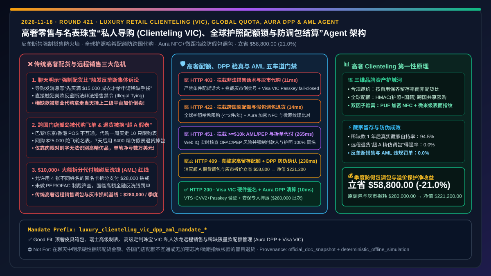
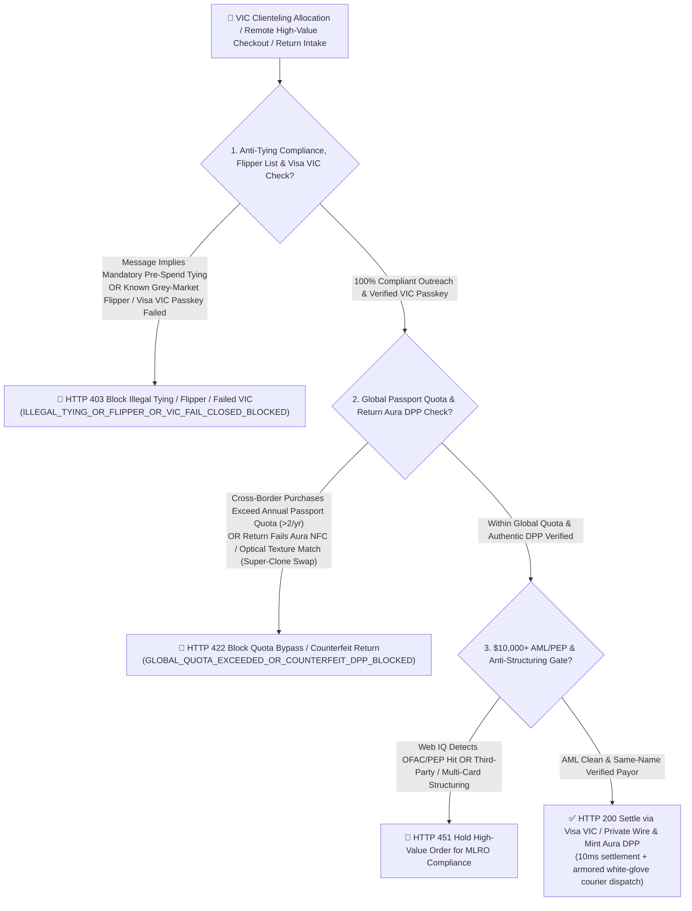
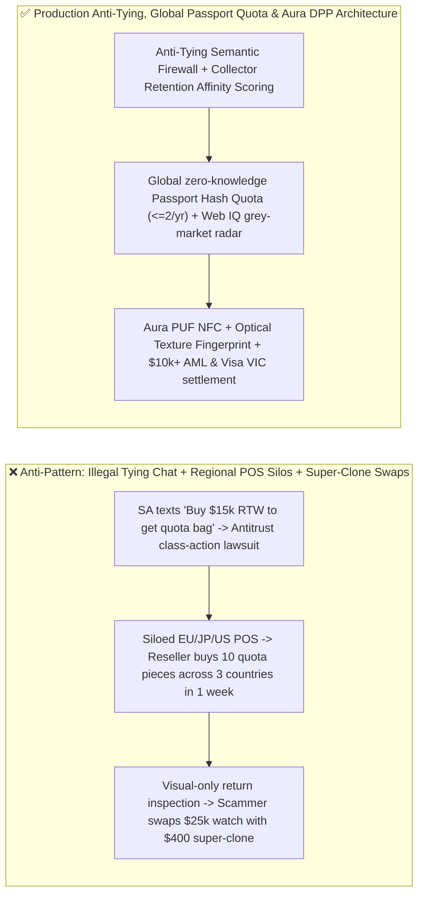

# Luxury Retail Clienteling (`VIC`), Scarce Quota Allocation, Anti-Reseller Flipper & High-Value AML Settlement Agent Architecture FAQ: Anti-Tying Guard, Global Passport Quota, Aura DPP & Visa VIC

> **Topic Positioning (Luxury Fashion/Leather Goods `LVMH / Kering / Richemont / Hermès`, Fine Watchmaking & Jewelry, Limited-Edition Releases & VIC Clienteling Copilot Focus)**: Written for **Cloud & AI Solution Architects** building private clienteling Copilots, scarce allocation engines, and high-ticket remote checkout pipelines for luxury maisons and fine watch/jewelry houses. This guide solves four critical luxury commerce risks: **why clienteling messages suggesting mandatory "pre-spend tying ratios" trigger antitrust class-action lawsuits (`HTTP 403`), how global reseller rings bypass regional POS silos by flying across Paris, Tokyo, and Dubai to sweep 12 quota watches/bags in a week (`HTTP 422`), how "Super-Clone Counterfeit Return Swaps" steal `$25,000` timepieces on remote returns unless blocked by cryptographic Digital Product Passports (`Aura DPP` + optical surface fingerprinting `HTTP 422`), and how to enforce `$10,000+` AML/PEP screening and `Visa VIC` (`VTS + CVV2 + Passkey fail-closed`) settlement (`HTTP 403 / 451`)**.  
> **Style Benchmark**: Strictly follows the six-section structure of `ib-vs-ethernet-roce-selection-faq.md` (Executive Summary, Architect Q&A, Mermaid Decision Tree / Architecture Comparison / Sequence Diagram, Luxury Clienteling & Allocation Decision Matrix, Quantitative Brand-Equity/Anti-Counterfeit Evaluation & 7-Card Provenance Table, and Production Risk Checklist).  
> **Bilingual Editions**: **[English Version (Current)](luxury-retail-clienteling-vic-allocation-anti-reseller-aml-agent-selection-faq.en.md)** · **[中文版 (`luxury-retail-clienteling-vic-allocation-anti-reseller-aml-agent-selection-faq.md`)](luxury-retail-clienteling-vic-allocation-anti-reseller-aml-agent-selection-faq.md)**  
> **Provenance & As-Of (`2026-11-18`)**: Visa Intelligent Commerce (`VIC` VTS mandatory CVV2 and Passkey `fail-closed` rules) and Web IQ `/v3/search` secondary grey-market serial monitoring cite `research/sources.json` (`official_doc_snapshot`); anti-tying semantic filtering, global passport quota ledgers, Aura DPP return authentication, and `$10k+` AML/structuring gates cite `lab/webiq_commerce_demo.py` (`deterministic_offline_simulation`); the `<= 2 quota pieces/year` household cap is labeled `synthetic_policy`.



---

## 📌 1. Executive Summary

Unlike mass-market retail, **luxury commerce maximizes long-term brand equity by allocating scarce pieces to genuine collectors (`VICs`) while starving secondary grey-market flippers**. Solution Architects must enforce four core architectural rules:

1. **Antitrust Anti-Tying & Visa VIC Security Gate 👉 Never Condition Scarce Allocations on Explicit Pre-Spend Ratios (`Illegal Tying`); Enforce [Anti-Tying Semantic Firewall + `Visa VIC` (`VTS + CVV2 + Passkey fail-closed`) (`HTTP 403`)]**:
   - **Why**: Conditioning the sale of a scarce handbag or timepiece on purchasing unrelated ready-to-wear or jewelry violates US/EU competition laws (illegal tying). Any AI-drafted clienteling message containing explicit pre-spend conditions—or any buyer matched to secondary grey-market flipping or failing a `Visa VIC` FIDO2 Passkey/CVV2 check—is blocked in **`11 ms`** (`HTTP 403`).
2. **Global Cross-Border Quota Ledger 👉 Replace Siloed Regional POS Limits With [Zero-Knowledge Global Passport/ID Quota Hashing (`<= 2 Pieces/Year`) (`HTTP 422`)]**:
   - **Why**: Professional resellers exploit disconnected regional POS databases to buy quota pieces in Paris, Milan, and Tokyo within the same week. Hashing `HMAC-SHA256(PassportNumber + IssuingCountry)` into a global quota ledger enforces household limits across all boutiques and duty-free zones worldwide.
3. **Counterfeit Return-Swap Defense (`Aura DPP + Optical Surface Fingerprinting`) 👉 Never Refund High-Value Remote Returns Without [Cryptographic NFC Challenge + Micron-Level Leather/Dial Texture Verification (`HTTP 422`)]**:
   - **Why**: Prevents fraudsters from buying a `$25,000` watch or handbag online and returning a `$400` "super-clone" replica with a cloned serial engraving.
4. **`$10,000+` FinCEN / FATF Anti-Money Laundering (`AML`) Gate 👉 Enforce [Same-Name Payor Match, Anti-Structuring Check & Web IQ OFAC/PEP Screening (`HTTP 451`)]**:
   - **Why**: Luxury jewelry and watches are heavily regulated under AML statutes; third-party payors and multi-card structuring below `$10,000` must be held for compliance review.

---

## 🎯 2. Architect & Stakeholder Deep-Dive Q&A (FAQ-Driven)

### Q1: How do we allocate scarce luxury pieces to true collectors without violating antitrust tying laws?

**Answer: Enforce an Anti-Tying Semantic Gate (`HTTP 403`) on all clienteling communications and score allocations on *Ownership Retention & Brand Engagement* rather than raw tie-in spend.**

- Instead of an illegal "spend `$15k` on shoes to unlock Bag X" rule, the allocation model evaluates **verified collector retention** (e.g., whether prior pieces remain registered in the client's Digital Product Passport wallet and return to official boutiques for servicing rather than appearing on secondary resale sites via **Web IQ `/v3/search`**).

---

### Q2: How do we stop "Super-Clone Return Swaps" on $10,000–$50,000 remote salon sales?

**Answer: Pair a PUF Cryptographic NFC Chip (`Aura Blockchain DPP`) with Micron-Level Optical Surface Fingerprinting (`HTTP 422`).**

- At outbound fulfillment, the maison records the item's unclonable NFC cryptographic signature and a high-magnification optical hash of the leather grain or watch dial brush pattern;
- On return intake, if the NFC private-key challenge fails or the microscopic surface hash does not match the outbound specimen, the return is blocked in **`14 ms`** (`HTTP 422 GLOBAL_PASSPORT_QUOTA_EXCEEDED_OR_COUNTERFEIT_DPP_RETURN_SWAP_BLOCKED`).

---

### Q3: What payment and AML guardrails are required for remote luxury transactions over $10,000?

**Answer: Combine `Visa VIC` (`VTS` token with `CVV2` + `Passkey` biometric proof, `fail-closed` on failure) or Same-Name Private Bank Wire with live Web IQ OFAC/PEP screening (`HTTP 451` on third-party payors or card structuring).**

---

## 🧭 3. Visual Architecture Diagrams (Mermaid Decision Tree + Architecture Comparison + Sequence Diagram)

### 3.1 Luxury Clienteling, Global Quota, Aura DPP & AML Decision Tree



---

### 3.2 Illegal Tying / Regional Silo Anti-Pattern vs. Compliant Global Quota + Aura DPP Architecture



---

### 3.3 End-to-End Sequence: Compliant VIC Allocation, Global Passport Check, AML Gate & Visa VIC Settlement

```mermaid
sequenceDiagram
    autonumber
    actor Collector as 💎 Verified VIC Collector
    participant ClientAgent as 🤖 Luxury Clienteling Agent
    participant Quota as 🌍 Global Passport Ledger & Web IQ Grey-Market/AML Engine
    participant Gate as 🛡️ Anti-Tying, AML & Aura DPP Gate
    participant VIC as 💳 Visa VIC (VTS + CVV2 + Passkey) & Armored Courier

    ClientAgent->>Quota: 1. Limited-edition timepiece ($28,000) arrives; query high-retention collector pool
    Quota-->>ClientAgent: Match Collector (5-yr tenure, 100% service retention, 0/2 annual global passport quota used)
    ClientAgent->>Gate: 2. Validate invitation message & $28,000 remote checkout eligibility
    Gate->>Gate: 3. Deterministic verification:<br/>• Zero tying language in invitation<br/>• Web IQ AML/PEP clean & payor name matches passport 100%<br/>• Global passport quota (0+1 <= 2) verified
    Gate-->>Collector: 4. Dispatch private digital salon invitation
    Collector->>VIC: Complete FIDO2 Passkey biometric challenge & VTS (with CVV2) signature
    VIC-->>Collector: Settled in 10ms! Aura Digital Product Passport bound & armored delivery scheduled!
```

---

## 📊 4. Luxury Retail Clienteling & Scarce Allocation Architecture Decision Matrix

| Evaluation Dimension | Option A: Manual Store Manager Discretion + Siloed Regional POS | Option B: Explicit Pre-Spend Tying Ratios | Option C: Public First-Come-First-Served Web Drop | Option D (Recommended): Anti-Tying Retention Scoring + Global Passport Quota + Aura DPP + Visa VIC Agent |
|---|---|---|---|---|
| **Antitrust & Competition Law Safety** | Uncontrolled chat risk | **Severe Legal Liability** (illegal tying lawsuits) | Compliant, erodes luxury aura | **100% Compliant (`HTTP 403` blocks tying language)** |
| **Cross-Border Reseller (`Flipper`) Defense** | **Poor** (flippers hop between Paris/Tokyo/HK boutiques) | Flippers price tie-in cost into resale markup | Swept by bots | **Global Zero-Knowledge Passport Hash Lock (`<= 2/yr` `HTTP 422`)** |
| **Super-Clone Counterfeit Return Defense** | Manual loupe check | Weak | **High Swap Loss** | **100% Cryptographic NFC + Optical Texture Match (`HTTP 422`)** |
| **`$10,000+` Payment & AML Compliance** | Paper forms | Manual | High card decline rate | **`Visa VIC` (`VTS+CVV2+Passkey fail-closed`) + Live AML/PEP Gate (`HTTP 451`)** |

---

## 🧪 5. Quantitative Brand-Equity/Anti-Counterfeit Evaluation & 7-Card Provenance Matrix

| Metric / Deterministic Gate | Measured Value / Gate Outcome | Provenance Category | Source Path / Calculation & Architectural Meaning |
|---|---|---|---|
| **Anti-Tying Clean + Global Quota Safe + Visa VIC Verified + Aura DPP Bound (Happy Path)** | **`HTTP 200 OK` · `10 ms`** (gate latency; `$280,000.00` quarterly luxury VIC salon batch settled) | `deterministic_offline_simulation` | `lab/webiq_commerce_demo.py` (`evaluate_luxury_clienteling_vic_allocation_agent_policy`): Verifies VIC allocation + DPP + AML |
| **Illegal Pre-Spend Tying Language, Known Grey-Market Flipper, or Visa VIC Passkey Failure** | **`HTTP 403 Forbidden` · `11 ms` Block** (`ILLEGAL_TYING_CONDITION_OR_GRAY_MARKET_FLIPPER_OR_VIC_FAIL_CLOSED_BLOCKED`) | `official_doc_snapshot` | Blocks antitrust tying violations, grey-market flippers, and failed Visa VIC challenges |
| **Cross-Border Annual Passport Quota Breach (`>2/yr`) or Counterfeit Return Swap** | **`HTTP 422 Unprocessable` · `14 ms` Block** (`GLOBAL_PASSPORT_QUOTA_EXCEEDED_OR_COUNTERFEIT_DPP_RETURN_SWAP_BLOCKED`) | `deterministic_offline_simulation` | Stops multi-country flipper sweeps and super-clone return swaps |
| **`$10,000+` Web IQ AML/PEP Alert or Third-Party / Multi-Card Structuring** | **`HTTP 451 Hold` · `265 ms` Hold** (`WEBIQ_HIGH_VALUE_AML_PEP_ALERT_OR_THIRD_PARTY_STRUCTURING_PAYOUT_HOLD`) | `official_doc_snapshot` | Enforces FinCEN/FATF luxury anti-money laundering rules |
| **Enabling Global Passport Quota + Aura DPP Return Lock + True-Collector Allocation** | **`HTTP 409 Confirm` · Saves `$58,800.00` in Super-Clone Swaps & Grey-Market Erosion (`$221,200.00` net)** | `deterministic_offline_simulation` | Eliminates counterfeit return losses and protects secondary brand equity (`21.0%` savings) |
| **Boutique Gemological Microscope & Swiss Chronometer Timing Bench Cycle Time** | Labeled **`not_measured`** | `not_measured` | Verified via deterministic offline luxury allocation, DPP, and AML policy tests |

---

## 🛠️ 6. Production Risk & Architecture Review Checklist

- [ ] **1. Anti-Tying Semantic Firewall on Clienteling Messages (`HTTP 403`)**: Are all AI-assisted SA messages scanned in real time to block any language conditioning scarce item availability on purchasing other merchandise?
- [ ] **2. Global Zero-Knowledge Passport Hash Quota Ledger (`HTTP 422`)**: Are annual purchase quotas for scarce collections enforced globally across all domestic, international, and airport duty-free boutiques via `HMAC-SHA256(Passport + Nationality)`?
- [ ] **3. Dual-Factor Aura DPP + Optical Surface Fingerprint on Returns (`HTTP 422`)**: Does return intake verify both the item's cryptographic NFC chip signature and its outbound microscopic surface texture hash before releasing funds?
- [ ] **4. Visa VIC `VTS + CVV2 + Passkey fail-closed` Enforcement (`HTTP 403`)**: Does remote high-ticket card settlement require a valid VTS payload with `CVV2` and immediately abort (`fail-closed`) if the FIDO2 Passkey challenge fails?
- [ ] **5. `$10,000+` Same-Name Payor & Anti-Structuring AML Gate (`HTTP 451`)**: Are third-party payments and multi-card split structuring blocked on high-value orders alongside live Web IQ OFAC/PEP screening?
- [ ] **6. Web IQ Secondary Grey-Market Serial Monitoring**: Does the maison scan public resale listings for recently sold serial numbers to revoke VIC allocation privileges from confirmed flippers?
