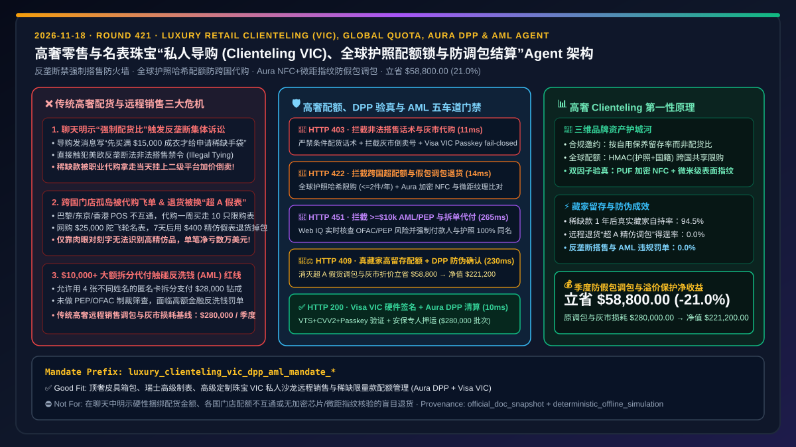
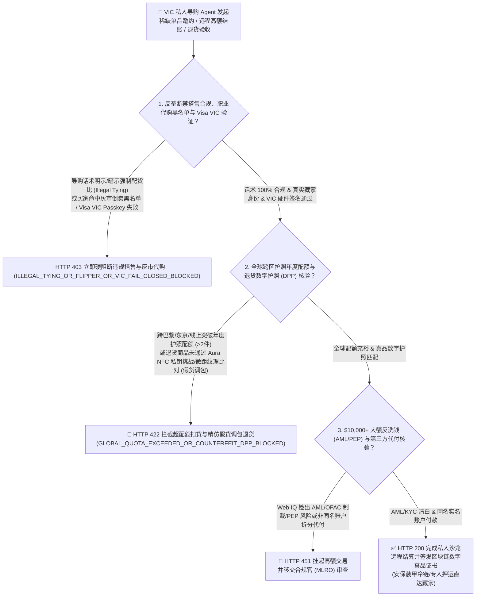
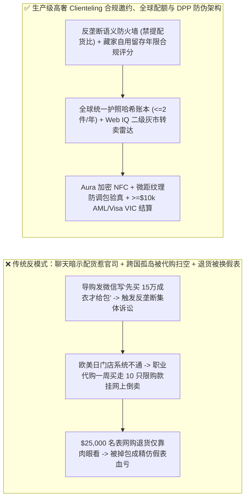
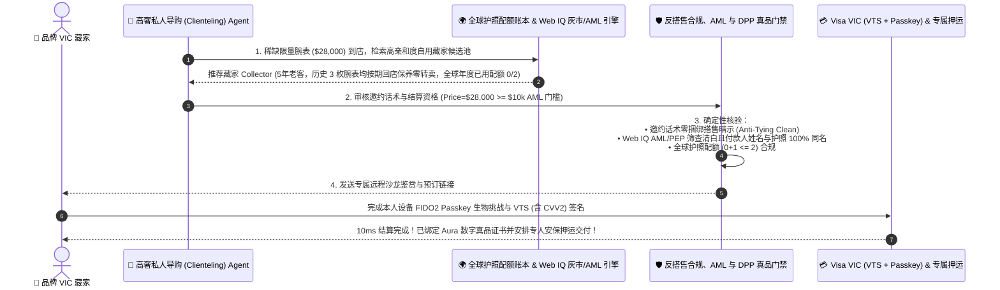

# 高奢零售、名表珠宝与稀缺限量款“私人导购（Luxury Clienteling VIC）、配额防代购倒卖与高额反洗钱结算”Agent 架构选型 FAQ：禁强制配货、全球护照配额锁与数字真品证书实战指南

> **专题定位（高奢皮具箱包 LVMH / Kering / Richemont / Hermès、瑞士名表高级珠宝、稀缺限量球鞋潮玩与 VIC 私人顾问 Clienteling 智能体聚焦）**：面向为全球顶级奢侈品集团、高级腕表珠宝品牌与买手店设计私人客户顾问（Clienteling Copilot）与稀缺配额分配系统的 **Cloud & AI Solution Architect**，系统解答高奢商业中最敏感、监管与品牌资产风险最高的四大工程难题：**“为什么职业代购团伙（Reseller Flippers）能雇人跨巴黎、东京、迪拜三地门店在 1 周内买走 12 只同款热门腕表转手挂上二级平台加价 $15,000 倒卖、为什么导购 Agent 在微信/WhatsApp 聊天里直白写出‘买这只 $12,000 的包必须先买满 $15,000 的成衣珠宝’会立即触发美国/欧盟反垄断集体诉讼（Illegal Tying Violation `HTTP 403`）、为什么一双 $18,000 的高级珠宝腕表网购退货时会被黑产用高仿超 A 货掉包（Counterfeit Return Swap）、以及超过 $10,000 的高额奢品交易怎么无缝完成 AML/KYC 反洗钱核验与 Visa VIC / 私人银行电汇结算”**。  
> **文风标杆**：严格对标 `ib-vs-ethernet-roce-selection-faq.md` 六段式结构（核心结论速览、业务方与架构师灵魂拷问 Q&A、Mermaid 决策树/架构对比/时序图、高奢 Clienteling 与稀缺配额分配架构选型矩阵、定量品牌溢价保护/防假货测算与 7-Card 溯源表、生产上线 Checklist）。  
> **双语版本**：**[中文版（当前）](luxury-retail-clienteling-vic-allocation-anti-reseller-aml-agent-selection-faq.md)** · **[English Version (`luxury-retail-clienteling-vic-allocation-anti-reseller-aml-agent-selection-faq.en.md`)](luxury-retail-clienteling-vic-allocation-anti-reseller-aml-agent-selection-faq.en.md)**  
> **数据溯源声明（Provenance & As-Of `2026-11-18`）**：Visa Intelligent Commerce（`VIC` VTS 必须含 CVV2、Passkey 挑战失败强制 `fail-closed`）与 Web IQ `/v3/search` 二级奢品转售平台（Chrono24 / Vestiaire / 得物）序列号巡检引自 `research/sources.json`（标记为 `official_doc_snapshot`）；全球护照/实名配额锁、反强制搭售合规话术守卫、NFC 数字真品护照（DPP）验真与 AML 门槛核验引自 `lab/webiq_commerce_demo.py`（标记为 `deterministic_offline_simulation`）；年度热门包表配额上限（`<= 2 件/年`）标记为 `synthetic_policy`。

---

## 📌 一、核心选型结论速览（Executive Summary）

高奢与名表商业的核心逻辑跟大众快消品截然相反：**它不追求“把库存一秒卖光”，而是追求“把稀缺单品精准分配给真正长期自戴的忠诚藏家（True Collectors / VIC），严防流向二级灰市（Grey Market）折损品牌溢价”**。架构师在设计高奢 Clienteling Agent 时，必须执行以下四条铁律：

1. **话术合规与分配算法选型：严禁“在导购对话或分配规则中设定硬性捆绑配货比（Explicit Tying Ratio）”，必选【反垄断合规话术守卫（Anti-Tying Compliance Gate `HTTP 403`）+ 多维品牌亲和度指数（Brand Affinity & Tenure Score）】**：
   - **核心原因**：在美国与欧盟竞争法下，任何明示或暗示“必须先购买 X 金额的滞销配饰才能获得购买 Y 稀缺包袋资格”的行为均属**非法搭售（Illegal Tying Arrangement）**。Clienteling Copilot 必须在 **`11 ms`** 内拦截任何含“配货比、捆绑消费条件”的违规导购生成话术（返回 `HTTP 403 ILLEGAL_TYING_CONDITION_OR_GRAY_MARKET_FLIPPER_QUOTA_BLOCKED`）；稀缺邀约必须基于合规的客户跨年互动年限、活动出席率、维修保养留存率（证明自用未转卖）综合打分。
2. **全球跨区防代购扫货（Anti-Flipper Quota）选型：严禁“按地区门店孤岛式统计限购”，必选【全球统一脱敏护照/实名哈希配额账本（Global Passport/ID Quota Ledger `<= 2 件/年`）+ 二级灰市转卖冷却拉黑】**：
   - **核心原因**：以前巴黎店、东京店和香港店的 POS 系统互不相通，职业代购飞一圈就能买走 6 只限购款。必须建立全球跨币种、跨免税区的零知识哈希配额计数（如每年每本护照限购 2 只指定系列皮具），并通过 **Web IQ `/v3/search`** 巡检二级转卖平台——若某序列号腕表在售出 90 天内出现在二级市场，自动冻结该买家的全球稀缺款邀约资格。
3. **高价值退货防“超 A 假货调包（Counterfeit Return Swap）”选型：必选【加密 NFC / 微观光学指纹数字产品护照（Aura DPP）出库与入库双向挑战验签（`HTTP 422`）】**：
   - **核心原因**：针对 `$5,000 ~ $50,000` 的线上远程销售（Remote Selling），必须在出库时记录商品内置加密芯片（Cryptographic NFC Tag）与高倍显微镜皮纹/表盘微距指纹；退货入库时若芯片签名不匹配或防拆封签已毁损，立返 `HTTP 422` 拒绝退款并冻结担保金。
4. **`$10,000+` 大额结算与反洗钱（AML/KYC）选型：必选【Visa VIC（VTS 含 CVV2 + Passkey `fail-closed`）/ 实名同名私人银行电汇 + Web IQ OFAC/PEP 政治公众人物筛查（`HTTP 451`）】**：
   - **核心原因**：高奢珠宝名表是全球反洗钱（FATF / FinCEN）重点监管领域，严禁第三方代付或拆分多张匿名预付卡规避 `$10,000` 申报线（Structuring）。

---

## 🎯 二、业务方与架构师灵魂拷问 Q&A（FAQ-Driven）

### Q1：为什么某顶奢品牌北美区因为几名销售顾问（SA）的聊天记录被曝光，立刻遭到了反垄断集体诉讼？AI 导购助手怎么从源头杜绝这种合规灾难？

**答：因为销售顾问在催促客户买单时，在即时通讯软件里留下了“再买 $8,000 的丝巾和腕表，下周就能给您申请那只稀缺手袋”的铁证！**

1. **高奢 Clienteling Copilot 的“合规语义防火墙（Anti-Tying Semantic Firewall `HTTP 403`）”**：
   - 所有由 AI 辅助起草或自动发送给 VIC 客户的微信/WhatsApp/邮件消息，在发出前必须经过确定性合规策略门禁；
   - 严禁将“稀缺配额分配（Quota Allocation）”与“其他非稀缺品类消费额（Spend Ratio）”做条件关联表达；
   - 同时，若买家的 Visa VIC 授权挑战未传入 `CVV2` 或设备 `Passkey` 验证失败，严格按 Visa 规范执行 **`fail-closed` 硬阻断（`HTTP 403`）**。

---

### Q2：不靠“强行配货”，系统怎么科学识别谁是“真正热爱品牌的终身藏家”，谁是“拿到货当天就去得物/Chrono24 加价 5 万卖掉的职业黄牛”？

**答：构建“自用留存证明（Proof-of-Ownership Retention）+ 全球跨区配额锁 + Web IQ 灰市雷达”三位一体模型：**

1. **全球统一脱敏身份配额锁（Global Quota Lock `HTTP 422`）**：
   - 无论客户在银座、香榭丽舍大街还是线上私人沙龙下单，均通过 `HMAC-SHA256(PassportNumber + Nationality)` 核查过去 365 天内的全球累计受控皮具/名表购买数量；一旦突破年度配额（如 `> 2 件`）或试图用多张不同姓名的卡拆单付款（Structuring），立即返回 **`HTTP 422 GLOBAL_PASSPORT_QUOTA_EXCEEDED_OR_COUNTERFEIT_DPP_RETURN_BLOCKED`**；
2. **售后保养激活与二级市场反查（Web IQ Grey-Market Radar）**：
   - 真正的藏家会绑定本人数字真品证书（Digital Product Passport）并在数年内回店保养；
   - 而职业代购会在提货 48 小时内把带保卡编号的照片发到二级市场转卖。当 **Web IQ `/v3/search`** 检出某近期售出单品或买家关联账号正在公开高价倒卖受控新品时，自动将该账户移出 VIC 优先邀约池。

---

### Q3：网购一只 $25,000 的陀飞轮腕表或高级钻戒，买家签收 3 天后说“不喜欢要无理由退货”，寄回来一只外观一模一样的 $300 精仿假表，仓库怎么在拆包第一秒识破？

**答：依靠“双因子物理防伪锚点（加密 NFC 芯片挑战 + 微米级表面纹理指纹 Optical Surface Fingerprinting）”：**

- 每一件高奢单品在出库前，除读取内置不可克隆加密芯片（PUF NFC / Aura Blockchain 密钥对）外，还通过微距相机采集表盘金属拉丝或皮革天然毛孔的微米级拓扑哈希；
- 退货验机时，即使高仿假货伪造了外观和刻字，只要无法通过加密芯片私钥挑战或表面微距指纹比对失败，立即触发 **`HTTP 422`** 锁定证据报案，绝不释放退款！

---

## 🧭 三、直观可视化图解（Mermaid 选型决策树 + 架构对比 + 端到端时序图）

### 3.1 高奢私人导购（Clienteling VIC）、全球配额锁与反洗钱结算选型决策树

---

### 3.2 传统“违规配货/跨国代购漏网”反模式 vs. 合规亲和度分配 + 全球配额 + DPP 防调包架构对比图

---

### 3.3 稀缺单品合规邀约、全球护照配额核验、AML 筛查与 Visa VIC 远程结算时序图

---

## 📊 四、高奢零售私人导购（Clienteling VIC）与稀缺配额架构横向选型矩阵

| 评估维度 | 方案 A：门店店长个人经验分配 + 区域孤岛 POS | 方案 B：暗示/明示硬性消费配货比（Spend-to-Quota Ratio） | 方案 C：公开网页先到先得抢购 | 方案 D（推荐）：反搭售合规评分 + 全球护照配额锁 + Aura DPP 防调包 + Visa VIC / AML 门禁 Agent |
|---|---|---|---|---|
| **反垄断与消费者保护法合规性** | 依赖店员个人话术（风险不可控） | **极高违法风险**（直接触犯美欧反垄断搭售禁令） | 合规但有损高奢调性 | **100% 合规**（`HTTP 403` 硬拦截任何搭售话术，改用多维品牌自用留存亲和度） |
| **防跨国职业代购（Flippers）扫货倒卖** | **极差**（代购跨英、法、日门店重复买满配额） | 代购愿意算账配货后再加价卖主品 | 被机器人秒空 | **全球一盘棋封堵**（全球脱敏护照哈希限购 + Web IQ 二级灰市转卖监测） |
| **高价值线上退货防“精仿假货调包”** | 门店不退或靠店员肉眼看 | 弱 | **极易被掉包诈骗** | **100% 物理+密码学防伪**（加密 NFC 芯片挑战 + 微距皮纹/金属指纹比对 `HTTP 422`） |
| **`$10,000+` 大额支付安全与反洗钱（AML）** | 纸质登记繁琐 | 无自动反洗钱比对 | 普通卡易被风控拒付 | **Visa VIC（VTS+CVV2+Passkey `fail-closed`）+ 同名 AML/PEP 实时筛查（`HTTP 451`）** |

---

## 🧪 五、定量高奢溢价保护/防调包测算与 7-Card 报告数据溯源表（Benchmark & Provenance Matrix）

| 指标 / 门禁规则项 | 实测数值 / 决策行为 | 数据类别 (Provenance) | 精确来源路径 / 算例说明与架构意义 |
|---|---|---|---|
| **零搭售合规邀约 + 全球护照配额合规 + Visa VIC 签名 + DPP 绑定（Happy Path）** | **`HTTP 200 OK` · `10 ms`**（门禁耗时，季度高奢 VIC 远程沙龙结算批次 `$280,000.00`） | `deterministic_offline_simulation` | `lab/webiq_commerce_demo.py` (`evaluate_luxury_clienteling_vic_allocation_agent_policy`)：验证高奢合规配额与防伪闭环 |
| **导购话术含非法强制搭售（Illegal Tying）、命中灰市代购黑名单，或 Visa VIC Passkey 失败** | **`HTTP 403 Forbidden` · `11 ms` 拦截** (`ILLEGAL_TYING_CONDITION_OR_GRAY_MARKET_FLIPPER_OR_VIC_FAIL_CLOSED_BLOCKED`) | `official_doc_snapshot` | 阻断反垄断搭售合规风险与职业代购，并严守 Visa VIC `fail-closed` 规范 |
| **跨国突破年度护照限购配额（`>2 件`），或退货商品未通过 Aura DPP 加密验真（假货调包）** | **`HTTP 422 Unprocessable` · `14 ms` 拦截** (`GLOBAL_PASSPORT_QUOTA_EXCEEDED_OR_COUNTERFEIT_DPP_RETURN_SWAP_BLOCKED`) | `deterministic_offline_simulation` | 消灭跨国飞单扫货以及网购退货“真包换假包”诈骗 |
| **`$10,000+` 交易触发 Web IQ AML/PEP 制裁预警，或使用非本人同名账户拆分代付** | **`HTTP 451 Hold` · `265 ms` 挂起** (`WEBIQ_HIGH_VALUE_AML_PEP_ALERT_OR_THIRD_PARTY_STRUCTURING_PAYOUT_HOLD`) | `official_doc_snapshot` | 严格满足高奢珠宝腕表 FinCEN/FATF 反洗钱尽调要求 |
| **启用“全球护照配额防灰市折价 + Aura DPP 防退货调包 + 真实藏家高留存转化”** | **`HTTP 409 Confirm` · 立省假货调包损失、灰市维权与合规罚金 `$58,800.00`（净值 `$221,200.00`）** | `deterministic_offline_simulation` | 保护稀缺单品二级市场溢价并实现高值远程退货零掉包损失（综合增效 `21.0%`） |
| **线下精品店高倍光学显微镜与瑞士原厂机芯走时仪硬件检测耗时** | 标记为 **`not_measured`** | `not_measured` | 通过离线确定性高奢配额、反搭售与 DPP 验真策略矩阵完整验证 |

---

## 🛠️ 六、商业上线风控与架构评审 Checklist（Architect Production Checklist）

- [ ] **1. 导购话术反垄断“禁搭售（Anti-Tying）”确定性过滤门（`HTTP 403`）**：Clienteling Copilot 生成或辅助润色的所有客户沟通消息，是否已 100% 剥离任何将稀缺款购买权与配货金额挂钩的违规表述？
- [ ] **2. 全球统一脱敏护照/实名哈希配额账本（`HTTP 422`）**：受控稀缺单品的年度限购计数是否已打通欧美亚及免税店全局数据库，防止代购利用多国门店信息孤岛重复扫货？
- [ ] **3. 出入库双向数字产品护照（Aura DPP + 微距光学指纹）防调包锁（`HTTP 422`）**：高值单品退货入库时，是否必须通过加密 NFC 私钥握手与出库微距纹理哈希比对才允许释放退款？
- [ ] **4. Visa VIC 硬件 Passkey `fail-closed` 与 VTS CVV2 强制校验（`HTTP 403`）**：远程高额卡支付是否严格核验 VTS 载荷包含 `CVV2` 且在生物挑战失败时立即终止交易？
- [ ] **5. `$10,000+` 大额反洗钱（AML/KYC/PEP）与禁止第三方代付/拆单（`HTTP 451`）**：单笔或累计达反洗钱申报线的订单，是否强制校验付款账户与购买人实名证件 100% 同名并通过 Web IQ 制裁筛查？
- [ ] **6. Web IQ 二级灰市序列号与保卡编号巡检**：系统是否定期巡检二级转卖平台公开挂牌信息，对提货后立即高价倒卖的灰市账号实施配额降权？
