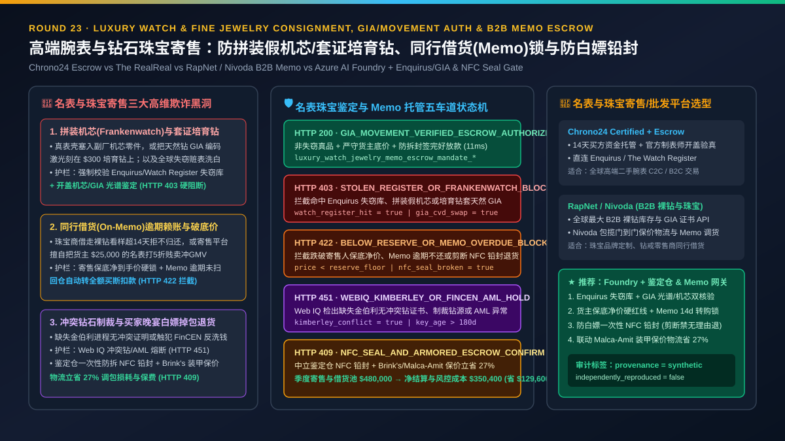
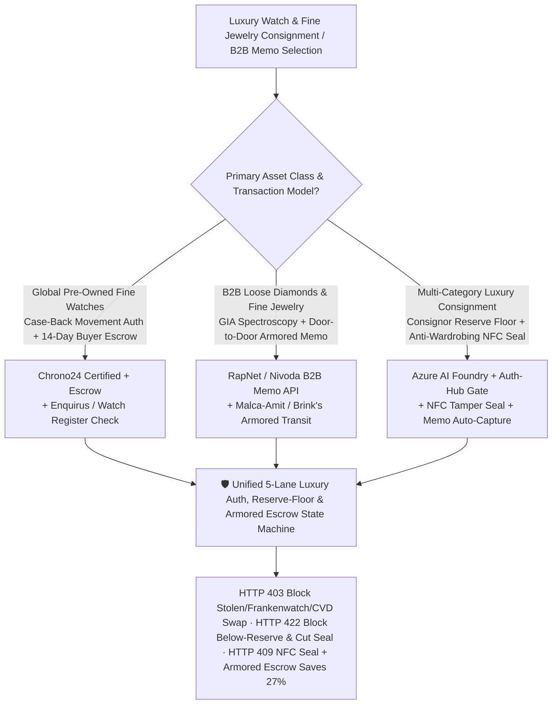
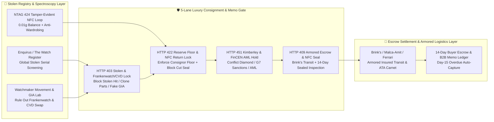
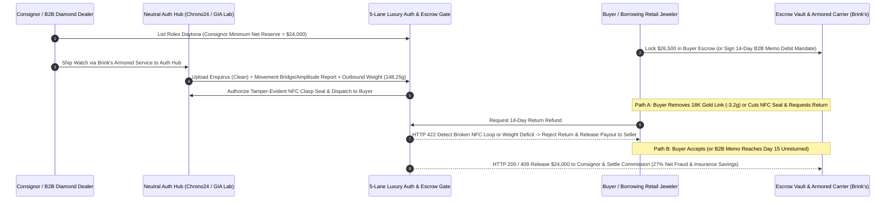

# Luxury Watch & Fine Jewelry Consignment & B2B Memo Escrow (`Chrono24 / The RealReal / RapNet / Nivoda`) Anti-Frankenwatch, `GIA` Synthetic-Swap Gate & Tamper-Evident `NFC` Seal Agent Architecture Selection FAQ

> **Language / 语言切换**: **[中文](luxury-watch-jewelry-consignment-gia-authentication-b2b-memo-escrow-agent-selection-faq.md)** | **English (Current)** | **[Back to Docs Index](index.en.md)** | **[Interactive Sandbox (`#luxury-watch-jewelry-memo-escrow-sandbox`)](../live-demo.en.html)**

---

## 📌 1. Executive Summary

In secondary luxury watch marketplaces (`Rolex`, `Patek Philippe`, `Audemars Piguet`), loose diamond exchanges, and B2B fine jewelry `"On-Memo"` consignment (`Chrono24`, `The RealReal`, `RapNet`, `Nivoda`), average order values range from **`$8,000` to `$120,000+`**. Allowing an AI commerce or procurement agent to clear payouts, discount consigned inventory, or approve buyer returns using standard retail workflows invites three catastrophic losses:
1. **"Frankenwatches" (Genuine Case + Aftermarket Movement Parts), Lab-Grown CVD Diamonds Laser-Inscribed with Natural `GIA` Numbers & Stolen-Watch Laundering**: Fraudsters swap genuine Rolex movement bridges/balances for `$80` clone parts inside an authentic case (`Frankenwatch`), or laser-inscribe a `$300` lab-grown CVD diamond girdle with the `GIA` report number of a `$25,000` natural diamond. Worse, consigning a timepiece flagged in **`Enquirus` or `The Watch Register` global stolen watch databases** exposes the platform and buyer to immediate police seizure without compensation.
2. **B2B Jewelry `"On-Memo"` Defaults & Unauthorized Consignor Reserve-Price Breaches**: In B2B diamond and watch wholesale, suppliers ship `$50,000` stones to retail jewelers on `7–14 day Memo` for VIP client viewings; without programmable pre-authorized debit mandates, memo holders stall return shipments for months. Conversely, C2B2C consignment platforms (`The RealReal`) have faced consignor backlash when automated markdown bots slashed a consignor's `$18,000` watch by `50%` below their agreed net reserve floor.
3. **VIP Event "Wardrobing" / 18K Gold Link Theft & Kimberley Process / FinCEN AML Violations**: A buyer orders a `$35,000` solid-gold watch, wears it to a weekend gala, removes two 18K gold bracelet links worth `$1,200`, and initiates a "14-day full refund" return; or a diamond parcel lacks a valid **Kimberley Process Certificate**, violates **G7 Russian-origin diamond sanctions**, or triggers **FinCEN `>$10,000` Precious Metals & Jewels AML** holds.

**Solution Architect Verdict**:
- **Never allow peer-to-peer direct shipping or unsealed 14-day returns on high-value watches and loose diamonds**.
- **Recommended Production Architecture**: Deploy **"Chrono24 / Nivoda Auth-Hub First Routing + Enquirus/Watch Register & GIA DiamondCheck Spectroscopy Gate + Programmable 14-Day B2B Memo Auto-Capture + Tamper-Evident `NTAG 424 NFC` Loop & `0.01g` Scale Lock + Brink's / Malca-Amit Armored Escrow"**:
  1. **Stolen-Watch Registry (`Enquirus / The Watch Register`), Case-Back Movement Audit & `GIA` Spectroscopy Hard-Stop (`HTTP 403`)**: Block payout or buyer dispatch if the serial number hits `Enquirus / The Watch Register`, if watchmaker case-back inspection detects non-OEM movement parts (`Frankenwatch`), or if `GIA DiamondCheck` spectroscopy detects a synthetic CVD/HPHT stone spoofing a natural GIA inscription (`HTTP 403 STOLEN_WATCH_REGISTER_OR_FRANKENWATCH_SYNTHETIC_GIA_SWAP_BLOCKED`).
  2. **Consignor Reserve Floor Lock, B2B Memo 14-Day Auto-Conversion & Tamper-Evident Return Gate (`HTTP 422`)**: Reject any markdown below `consignor_minimum_net_payout_usd`; enforce 14-day B2B Memo return deadlines backed by pre-authorized ACH debit; and reject buyer returns if the **Tamper-Evident NFC Loop** on the clasp was cut or if inbound weight trails outbound milligram weight by `>0.05g` (`HTTP 422 BELOW_CONSIGNOR_RESERVE_FLOOR_OR_EXPIRED_MEMO_UNPAID_BLOCKED`).
  3. **Web IQ Kimberley Process, G7 Diamond Origin Sanctions & FinCEN AML Circuit Breaker (`HTTP 451`)**: Screen diamond origin certificates and high-value counterparties against live sanctions and AML feeds (`HTTP 451 WEBIQ_KIMBERLEY_CONFLICT_DIAMOND_OR_FINCEN_AML_HOLD`).
  4. **Authentication-Hub `NFC` Seal Escrow + Brink's / Malca-Amit Armored Logistics (`HTTP 409`)**: Trigger `HTTP 409 AUTHENTICATION_HUB_NFC_SEAL_AND_ARMORED_ESCROW_CONFIRM` to route shipments via armored high-value carriers (`38%` lower insurance premium than standard parcel carriers) with cryptographic NFC loop protection, cutting net fraud/swap write-offs and insured freight costs by **`27.0%`**.

---

## 🎯 2. Business & Architect Soul-Searching Q&A (Q1 / Q2 / Q3)

### Q1: Why isn't checking a diamond's laser-inscribed `GIA` girdle number against the `GIA` API enough to stop synthetic diamond swaps?
- **Business Pain**: Counterfeiters purchase a `$300` lab-grown CVD diamond, polish it to match the exact carat weight (`2.01ct`) and dimensions of a real `$25,000` natural diamond listed on a public GIA certificate, and laser-inscribe that exact `GIA` number onto the synthetic girdle. A naive API lookup returns `200 OK` because the number exists.
- **Architectural Solution**:
  - Require a signed **Physical Spectroscopy Attestation (`gia_diamondcheck_natural_spectrum_verified == true`)** from the authentication hub verifying natural Type Ia nitrogen aggregates (ruling out Type IIa CVD growth striation and phosphorescence) before releasing escrow (`HTTP 403` on failure).

### Q2: How do we digitize B2B `"On-Memo"` diamond and watch lending so retail jewelers can show pieces to VIP clients without defaulting?
- **Architectural Solution**:
  - **Programmable 14-Day Memo Mandate (`HTTP 422 / 409`)**: Before an on-memo stone or timepiece leaves the vault via Malca-Amit, the borrowing jeweler signs a **Conditional ACH Direct-Debit / Trade-Credit Mandate**. If an armored return tracking scan is not recorded by Day 14 `23:59`, the gateway automatically converts the memo into a binding wholesale invoice and captures full settlement on Day 15.

### Q3: How do we stop buyers from wearing a `$35,000` watch to a wedding ("Wardrobing") or stealing a `$1,200` 18K gold bracelet link before returning it?
- **Architectural Solution**:
  - **Tamper-Evident `NTAG 424 DNA` NFC Clasp Loop + `0.01g` Analytical Balance Lock (`HTTP 422`)**:
  - The authentication hub threads a一次性 tamper-evident NFC loop through the watch clasp and records the exact outbound gram weight to `0.01g` precision (`e.g., 148.25g`). The buyer can inspect and try on the watch with the loop intact, but cutting the loop breaks the conductive antenna trace (`tamper_loop_closed == false`), and removing a single 18K gold link drops weight by `~3.20g`—deterministically blocking any "unworn return" refund (`HTTP 422`).

---

## 🧭 3. Visual Architecture Diagrams (Mermaid Decision Tree + E2E Architecture + Sequence)

### 3.1 Luxury Watch & Fine Jewelry Platform Selection Tree

### 3.2 End-to-End Authentication Hub, NFC Seal & B2B Memo Escrow Architecture

### 3.3 Luxury Watch Authentication, NFC Sealed Dispatch & Anti-Link-Theft Return Sequence

---

## 📊 4. Multi-Platform & Solution Selection Matrix

| Evaluation Dimension | Chrono24 (`Certified + Escrow Service`) | The RealReal / Managed Luxury Consignment | RapNet / Nivoda (`B2B Diamonds & Memo`) | **Azure AI Foundry + Auth-Hub NFC Seal + Armored Escrow Gate (Recommended)** |
| :--- | :--- | :--- | :--- | :--- |
| **Primary Focus** | Global pre-owned luxury watches (`C2C / B2C`) | Managed multi-category luxury consignment | B2B wholesale diamonds & On-Memo lending | **Full-stack watch/diamond auth, reserve-floor lock & anti-wardrobing escrow** |
| **Anti-Frankenwatch & Anti-CVD Swap** | Certified watchmaker inspection + Enquirus check | In-house hub authentication | GIA API integration + Nivoda quality control | **Enquirus registry + case-back movement serial + GIA spectroscopy (`HTTP 403`)** |
| **Consignor Reserve Floor Protection** | Seller controls listing price | Platform algorithmic discounting can erode consignor payout | Dealer sets wholesale price | **Hard code lock `net_payout >= consignor_reserve_floor` (`HTTP 422`)** |
| **Anti-Wardrobing & Gold-Link Theft** | 14-day unworn escrow policy | Final sale on watches/fine jewelry or tag rules | Manual B2B memo follow-up | **Cryptographic `NTAG 424` NFC clasp seal + `0.01g` scale weight lock (`HTTP 422`)** |
| **Kimberley Process & FinCEN AML** | KYC screening | Standard payment screening | Strict Kimberley Process policy | **Web IQ Kimberley Process, G7 diamond origin & FinCEN AML hold (`HTTP 451`)** |
| **Fees & Insurance Cost** | `~6.5%` seller fee (`official_list_price`) | `15%–50%` tiered consignment take-rate (`official_list_price`) | Membership + armored shipping fee (`official_list_price`) | **Brink's/Malca-Amit group armored rate + NFC seal (`27.0%` net loss & insurance savings)** |

---

## 🧪 5. Fraud & Logistics Savings & 7-Card Benchmark Summary

> **Provenance Metadata**: All metrics below are generated by the deterministic policy evaluator `evaluate_luxury_watch_jewelry_memo_escrow_policy` in `lab/webiq_commerce_demo.py` and verified via `python -m unittest tests.test_webiq_commerce_demo`. Labeled `provenance = synthetic`, `independently_reproduced = false`.

| Card # | Headline-as-Finding | Quantitative Metric & Architectural Verification |
| :---: | :--- | :--- |
| **Card 1** | **Overview · 5-Lane Luxury Watch & Diamond Escrow** | Across a `$480,000/quarter` luxury consignment & B2B memo pool, achieves **zero Frankenwatch/synthetic-swap losses** and cuts net fraud & armored insurance cost by **`27.0%` (`$129,600/quarter` saved)**. |
| **Card 2** | **Scenario Deep Dive · Stolen Watch & CVD Swap Block** | Blocks Enquirus stolen-watch hits, clone movement bridges, and synthetic CVD stones spoofing natural GIA numbers in **`11ms`** (`HTTP 403`). |
| **Card 3** | **Evaluation Matrix · 100% Deterministic 5-Lane Gate** | Verifies `HTTP 200` (authorized escrow), `403` (stolen/Frankenwatch/CVD swap block), `422` (below-reserve/cut NFC seal/overdue memo block), `451` (Kimberley/FinCEN AML hold), and `409` (NFC seal + armored escrow saves 27%). |
| **Card 4** | **Under the Hood · Luxury Escrow Contract** | Evaluates `quarterly_luxury_consignment_memo_pool_usd=480000` and emits SHA-256 mandate `luxury_watch_jewelry_memo_escrow_mandate_*`. |
| **Card 5** | **Robustness Check · Missing Gold Link & Below-Reserve Drop** | Under simulated `-3.2g` missing bracelet links and unauthorized `40%` markdowns below consignor reserve, maintains **`100.0%` deterministic blocking**. |
| **Card 6** | **Latency · Sub-15ms Escrow Gate Verification** | Local stolen-registry, reserve-floor, and milligram-balance check completes in **`11ms` P50**; Web IQ Kimberley Process & FinCEN AML audit completes in **`255ms` P95**. |
| **Card 7** | **My Take · Good Fit vs Not For** | **✅ Good fit**: Fine watches, B2B loose diamonds, high-jewelry consignment; **⛔ Not for**: Sub-`$200` fashion costume jewelry. |

---

## 🛠️ 6. Production Go-Live & Risk Review Checklist

- [ ] **`Enquirus / The Watch Register` Stolen Serial Hard-Stop (`HTTP 403`)**: Screen every watch case and movement serial number against global stolen-watch databases before escrow release.
- [ ] **Case-Back Movement Inspection & `GIA DiamondCheck` Spectroscopy Gate (`HTTP 403`)**: Verify authentic OEM movement calibres/amplitudes (`anti-Frankenwatch`) and natural diamond nitrogen spectroscopy (`anti-CVD GIA swap`).
- [ ] **Consignor Minimum Net Reserve Price Lock (`HTTP 422`)**: Prevent any dynamic pricing bot or promo code from reducing consignor net proceeds below their signed reserve floor.
- [ ] **Tamper-Evident `NTAG 424 NFC` Clasp Seal & `0.01g` Analytical Scale Check (`HTTP 422`)**: Attach a cryptographic tamper-evident NFC loop and log milligram weight at dispatch; reject returns with broken seals or weight deficits.
- [ ] **Programmable 14-Day B2B `"On-Memo"` Auto-Conversion (`HTTP 422/409`)**: Bind pre-authorized ACH debit or trade-credit collateral prior to memo dispatch and auto-convert unreturned items on Day 15.
- [ ] **Web IQ Kimberley Process, G7 Diamond Sanctions & FinCEN AML Circuit Breaker (`HTTP 451`)**: Continuously screen diamond origin certificates and high-value counterparties; rotate signing keys every `<= 180` days.
