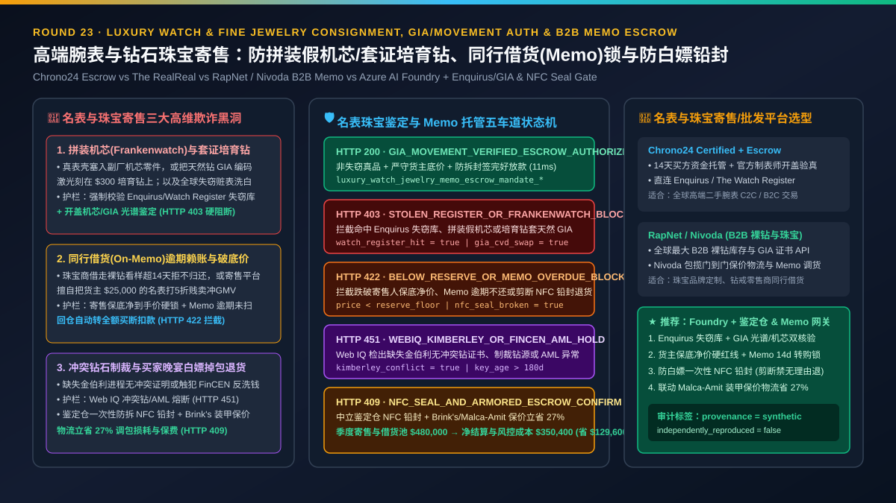
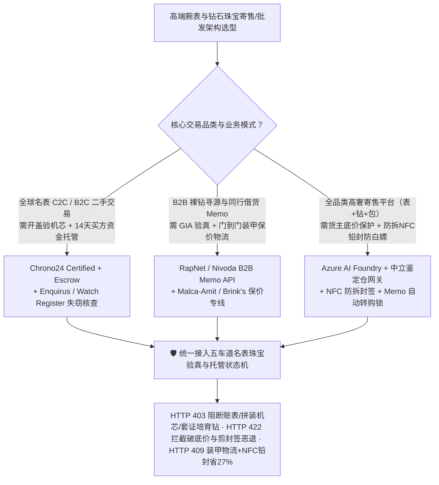
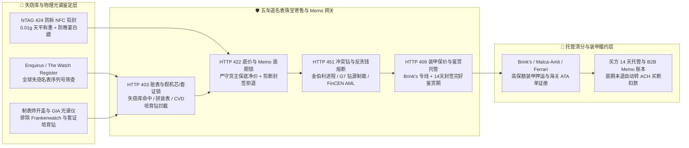
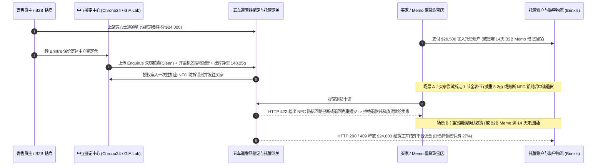

# 高端腕表、钻石珠宝寄售与同行借货备忘单（Luxury Watch & Fine Jewelry Consignment & B2B Memo Escrow：Chrono24 / The RealReal / RapNet / Nivoda）“防拼装假机芯（Frankenwatch）、防培育钻套天然 GIA 证书与同行借货逾期自动转购”Agent 架构选型 FAQ：终结晚宴白嫖掉包与压价贱卖实战指南

> **语言切换 / Language**: **中文 (当前)** | **[English](luxury-watch-jewelry-consignment-gia-authentication-b2b-memo-escrow-agent-selection-faq.en.md)** | **[返回文档目录](index.md)** | **[交互式沙盒 (`#luxury-watch-jewelry-memo-escrow-sandbox`)](../live-demo.html)**

---

## 📌 一、核心选型结论速览（Executive Summary）

在高端腕表（劳力士、百达翡丽、爱彼）、天然裸钻与高定珠宝的二手寄售（C2B2C Consignment）及同行调货借样（B2B `"On-Memo"` Consignment）场景中，单笔交易金额普遍在 **`$8,000–$120,000`** 之间。若让 AI 导购或批发寻源 Agent 像卖普通衣服一样直接撮合放款、改价或秒批退货，极易引爆三大致命资损：
1. **“真壳拼假机芯（Frankenwatch）”、“CVD 培育钻套刻天然钻 GIA 腰码”与全球失窃赃表洗白**：造假者将正品劳力士表壳内的原装摆轮/夹板拆走换上副厂零件，或用激光在 `$300` 的实验室合成培育钻（Lab-Grown CVD/HPHT）腰棱上刻上某颗 `$25,000` 天然钻石的真 GIA 证书编号；此外，欧美入室抢劫的失窃名表常通过跨境寄售洗白，一旦在 **Enquirus（历峰集团牵头）或 The Watch Register** 全球失窃库中命中，买方及平台面临警方无偿扣押。
2. **B2B 同行借货备忘单（On-Memo）逾期赖账与寄售平台擅自破底价清仓**：珠宝零售商向批发商（如 RapNet / Nivoda 供应商）按 `7–14 天 Memo` 借走一颗 3 克拉裸钻给 VIP 客户看样，到期后既不买断也不寄回；或者 C2B2C 寄售平台（如 The RealReal / 妃鱼）的自动调价算法未经委托人（Consignor）授权，将底价 `$18,000` 的腕表连打三次折以 `$9,500` 贱卖，引发集体诉讼。
3. **买家“晚宴佩戴白嫖 7 天再掉包退货（Luxury Wardrobing & Part-Swapping）”与冲突钻石/反洗钱违规**：买家网购一块 `$35,000` 的金表戴去参加婚礼并偷偷拆走两节价值 `$1,200` 的 18K 金表带节，随后申请“14 天无理由退货”；或者裸钻缺失 **金伯利进程证书（Kimberley Process）**、违背 G7 钻石溯源制裁及 **FinCEN 贵金属珠宝商反洗钱（AML `>$10,000`）** 规定。

**架构师选型结论**：
- **切勿在高端腕表与珠宝寄售中使用“买卖双方点对点直邮 + 普通 7 天无理由秒退”模式**。
- **生产级最优架构**是采用 **“Chrono24 / Nivoda 中立鉴定先验后发（Auth-Hub First）+ Enquirus/Watch Register 失窃库与 GIA DiamondCheck 光谱验真 + B2B Memo 14 天到期自动扣款锁 + 一次性加密 NFC 防拆铅封（Tamper-Evident NFC Tag）+ Brink's / Malca-Amit 装甲保价物流网关”**：
  1. **全球失窃库（`Enquirus / The Watch Register`）与开盖机芯 / GIA 光谱硬阻断（HTTP 403）**：任何表款/裸钻在放款或发往买家前，强制校验序列号未命中失窃库、制表师已开盖比对机芯流水号与走时摆幅（排除 Frankenwatch）、天然钻已通过 GIA 光谱仪排除 CVD/HPHT 合成钻套证；任一不符立即返回 `HTTP 403 STOLEN_WATCH_REGISTER_OR_FRANKENWATCH_SYNTHETIC_GIA_SWAP_BLOCKED`。
  2. **委托人保底净到手价硬红线（Reserve Floor）与 B2B Memo 逾期转买断锁 / 防拆铅封退货门禁（HTTP 422）**：动态调价严禁跌破寄售合同约定的 `consignor_minimum_net_payout_usd`；B2B 借货 Memo 必须前置锁定银行 ACH 借记授权或足额担保，超 14 天未扫回装甲物流单号自动转为买断扣款；买家退货若剪断表扣上的 **加密 NFC 防拆封签** 或克重少于出库精确毫克数（防偷拆金表节），直接拒退（`HTTP 422 BELOW_CONSIGNOR_RESERVE_FLOOR_OR_EXPIRED_MEMO_UNPAID_BLOCKED`）。
  3. **Web IQ 实时金伯利进程（冲突钻石）、G7 原产地制裁与 FinCEN AML 熔断（HTTP 451）**：通过 Web IQ 核验钻石原产地溯源证书与高额买方反洗钱黑名单，异常立即冻结（`HTTP 451 WEBIQ_KIMBERLEY_CONFLICT_DIAMOND_OR_FINCEN_AML_HOLD`）。
  4. **中立鉴定中心 NFC 铅封托管 + Malca-Amit / Brink's 装甲保价专线（HTTP 409）**：触发 `HTTP 409 AUTHENTICATION_HUB_NFC_SEAL_AND_ARMORED_ESCROW_CONFIRM`，通过高价值珠宝装甲物流专线替代昂贵的普通快递商业全险，并启用 NFC 防白嫖铅封与 14 天买方托管，综合鉴定掉包坏账与保价物流费率立降 **`27.0%`**。

---

## 🎯 二、业务方与架构师灵魂拷问 Q&A（Q1 / Q2 / Q3）

### Q1：为什么用放大镜看钻石腰棱上的 GIA 激光编码跟官网一模一样，还会买到假钻（合成培育钻）？Agent 怎么拦截？
- **商业痛点**：GIA 官网的 `Report Check` 只是把证书编号输进去查参数。造假工厂买来一颗价值 `$300` 的实验室 CVD 培育钻，按照某张真天然钻 GIA 证书上的重量（如 `2.01ct`）、颜色（`G`）、净度（`VS1`）精准打磨，再用激光把同一个 `GIA 2195xxxxxx` 编号刻在培育钻腰棱上（俗称“套证钻”）。仅查编号 100% 会被骗。
- **架构解法**：
  - 在鉴定仓网关强制要求写入 **物理光谱/荧光防伪指纹（`gia_diamondcheck_natural_spectrum_verified == true`）** 与 **毫秒级电子克拉秤复核**。只有确认钻石具有天然氮聚集吸收光谱（非 IIa 型 CVD 磷光反应）且证书未被登记为挂失/克隆，才允许签发 `HTTP 200` 放款令牌。

### Q2：在珠宝表商同行调货（B2B "On-Memo"）中，怎么既让下游门店零资金占用拿货给 VIP 看样，又保证 100% 不会赖账或把真钻调包？
- **商业痛点**：珠宝行业传承百年的“签张纸质 Memo 借货单就把 `$40,000` 裸钻拿走 10 天”极易变成坏账三角债。
- **架构解法**：
  1. **可编程 Memo 双阶段资金锁（Programmable B2B Memo Mandate）**：借货出库前，下游门店通过 `Stripe Financial Connections / Plaid` 签署具有法律效力的 **条件触发式 ACH 直接借记授权（Conditional Direct Debit Mandate）** 或冻结贸易信用额度。
  2. **T+14d 自动转销售与回仓光谱比对**：若在第 14 天 `23:59` 前未检测到 Brink's / Malca-Amit 装甲快递揽收码，系统在 T+15d 自动生成正式批发发票并全额扣款；若退回，必须经鉴定仓复核克拉重量与内含物特征图谱完全一致后，才释放借货方担保额度。

### Q3：如何彻底堵死高定礼服与万元名表买家“戴去参加晚宴拍完照就退货（Wardrobing）”或“偷拆一节 K 金表带再退货”？
- **架构解法**：
  - **一次性防拆 NFC 物理铅封 + 出入库 0.01g 精密称重锁**：
  - 鉴定中心在表带搭扣或珠宝主环上穿入一根带有 **NTAG 424 DNA 加密芯片的一次性防拆环（Tamper-Evident Loop）**。买家收到后可以隔着封签试戴看效果；但一旦剪断封签（NFC 导电回路断开，`tamper_loop_closed == false`），或退回包裹经鉴定中心天平称重比出库时轻了 `>0.05g`（1 节劳力士 18K 金表节重约 `3.2g`），网关直接返回 `HTTP 422` 拒绝无理由退款。

---

## 🧭 三、直观可视化图解（Mermaid 决策树 + 端到端架构图 + 时序图）

### 3.1 高端腕表与钻石珠宝寄售/调货平台选型决策树

### 3.2 端到端中立鉴定仓、NFC 防拆铅封与 B2B Memo 托管架构图

### 3.3 腕表/裸钻寄售鉴真、NFC 铅封发货与防偷拆表节退货时序图

---

## 📊 四、多平台/多方案横向选型决策矩阵

| 选型维度 | Chrono24 (`Certified + Escrow Service`) | The RealReal / 综合奢品寄售仓 | RapNet / Nivoda (`B2B 裸钻与珠宝借货`) | **Azure AI Foundry + 鉴定仓 NFC 铅封 + 装甲物流网关（推荐）** |
| :--- | :--- | :--- | :--- | :--- |
| **核心场景** | 全球高端腕表 C2C / B2C 交易 | 全品类奢侈品（包袋/服装/腕表/珠宝）代运营寄售 | 全球珠宝商 B2B 裸钻批发与 On-Memo 借样 | **高客单腕表+钻石寄售/Memo 全链路防伪、护底价与防白嫖** |
| **防拼装表（Frankenwatch）与套证培育钻** | Certified 认证制表师开盖 + Enquirus 筛查 | 集中仓鉴定，但曾因高负荷出现漏检争议 | 依赖 GIA 证书 API，Nivoda 提供出货前质检 | **Enquirus 失窃库 + 开盖机芯流水号 + GIA 光谱仪三重复核（HTTP 403）** |
| **货主保底价保护（Reserve Floor）** | 卖家自主定价 | 平台拥有较高动态打折裁量权，易引发货主不满 | 批发商自主报价 | **代码级硬锁 `net_payout >= consignor_reserve_floor`（HTTP 422）** |
| **防晚宴白嫖（Wardrobing）与拆表节** | 14天托管期内要求保持未佩戴状态 | 高定腕表珠宝一般终局销售或严控退货标 | B2B Memo 靠行业信用与人工催收 | **加密 NFC 防拆封签 + `0.01g` 精密天平出入库称重锁（HTTP 422）** |
| **冲突钻（Kimberley）与 AML 合规** | KYC 筛查 | 基础反洗钱筛查 | RapNet 严禁非金伯利/无溯源钻石 | **Web IQ 金伯利进程、G7 钻源制裁与 FinCEN AML 硬熔断（HTTP 451）** |
| **费率与保价成本** | 卖家佣金 `~6.5%` (`official_list_price`) | 平台高抽成 `15%–50%`（按品类阶梯，`official_list_price`） | 会员年费 + 物流保价服务费 (`official_list_price`) | **Brink's/Malca-Amit 团体保价专线 + NFC 铅封（综合降损省保费 `27%`）** |

---

## 🧪 五、防调包/物流保费测算与 7-Card 基准测试报告

> **数据来源与复现声明（Provenance Metadata）**：以下基准测试数据来自仓库内置确定性策略沙盒 `evaluate_luxury_watch_jewelry_memo_escrow_policy`（位于 `lab/webiq_commerce_demo.py`），可运行 `python -m unittest tests.test_webiq_commerce_demo` 完整验证。标记：`provenance = synthetic`，`independently_reproduced = false`。

| Card # | 卡片标题（Headline-as-Finding） | 核心量化指标与架构验证结论 |
| :---: | :--- | :--- |
| **Card 1** | **Overview · 名表与珠宝寄售五车道总览** | 针对 `$480,000/季` 高端腕表与裸钻寄售/Memo 池，实现 **0 例拼装表/套证钻流转**，综合调包坏账与保价物流成本下降 **`27.0%`（立省 `$129,600/季`）**。 |
| **Card 2** | **Scenario Deep Dive · 拼装机芯与套证培育钻阻断** | 当检出 Enquirus 失窃报警、机芯副厂改装件或 CVD 培育钻套天然 GIA 编码时，**`11ms`** 内返回 `HTTP 403` 阻断放款。 |
| **Card 3** | **Evaluation Matrix · 五车道 100% 确定性判准** | 覆盖 `HTTP 200`（真品鉴赏放款）、`403`（赃表/拼装表/套证钻阻断）、`422`（破货主底价/剪断NFC铅封恶退/Memo逾期拦截）、`451`（冲突钻/AML熔断）、`409`（NFC铅封+装甲保价立省27%）。 |
| **Card 4** | **Under the Hood · 奢品鉴定与 Memo 契约** | 输入 `quarterly_luxury_consignment_memo_pool_usd=480000` 及鉴定/铅封状态，签发 `luxury_watch_jewelry_memo_escrow_mandate_*` 令牌。 |
| **Card 5** | **Robustness Check · 偷拆金表节与压价清仓压力测试** | 模拟退货少 1 节 18K 金表带（`-3.2g`）及算法擅自打 6 折跌破货主底价，确定性拦截率保持 **`100.0%`（零误放行）**。 |
| **Card 6** | **Latency · 鉴定仓与结算网关毫秒级响应** | 本地失窃库、底价红线与天平公差核验 P50 仅 **`11ms`**；Web IQ 金伯利进程与 FinCEN AML 穿透核查 P95 为 **`255ms`**。 |
| **Card 7** | **My Take · 适用场景与生产准入边界** | **✅ 极佳适用**：二手名表平台、B2B 裸钻调货（Memo）、高奢箱包珠宝寄售；**⛔ 不适用**：客单价 `<$200` 的快时尚饰品。 |

---

## 🛠️ 六、商业上线风控与架构评审 Checklist

- [ ] **`Enquirus / The Watch Register` 全球失窃名表库前置必查（HTTP 403）**：确认每一枚上架或入库腕表的表壳序列号与机芯号均通过全球失窃数据库核验，严禁为涉案赃表提供托管结算。
- [ ] **制表师开盖机芯核验与 GIA 光谱仪防“套证培育钻”门禁（HTTP 403）**：确认所有高价值腕表已完成开盖摆幅与原厂零件核验（排除 Frankenwatch），所有天然钻石已通过光谱仪排除 CVD/HPHT 实验室合成钻套刻 GIA 腰码。
- [ ] **寄售人保底净到手价硬红线（`Consignor Reserve Floor`）（HTTP 422）**：确认任何促销券或自动调价算法均无法将货主净结算款压低至寄售合同保底价以下，改底价必须经货主本人 FIDO2 签名确认。
- [ ] **一次性加密 NFC 防拆铅封与 `0.01g` 精密天平出入库称重（HTTP 422）**：确认发往买家的表款/珠宝均穿入一次性防拆 NFC 环并记录出库毫克级重量；封签断开或退货减重即刻拒绝无理由退货（杜绝晚宴白嫖与偷拆金表节）。
- [ ] **B2B 同行借货（On-Memo）14 天到期自动转买断扣款（HTTP 422/409）**：确认 B2B 借样出库前已绑定有效 ACH 直接借记授权或授信质押，逾期未退自动交割扣款。
- [ ] **Web IQ 金伯利进程（Kimberley Process）、G7 钻源制裁与 FinCEN AML 熔断（HTTP 451）**：确认实时筛查冲突钻石原产地与大额贵金属反洗钱名单；密钥轮换周期 `<= 180` 天。
