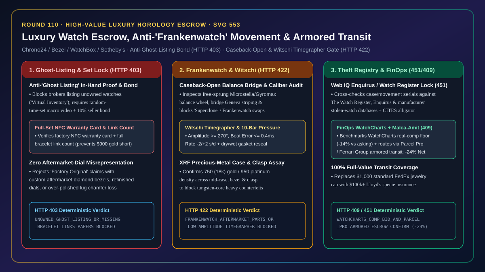
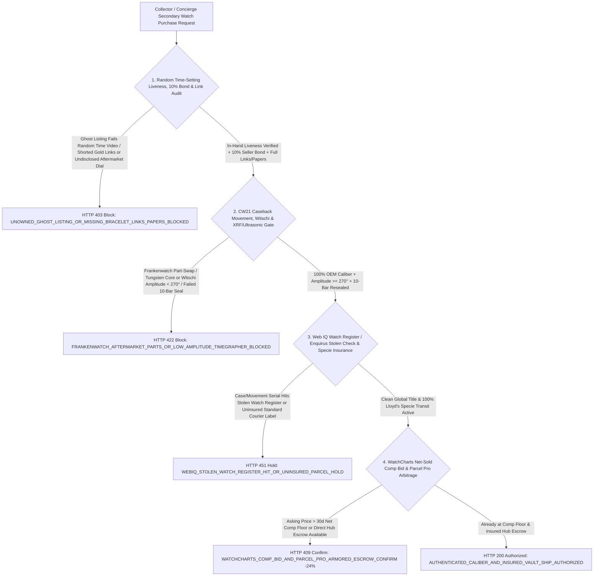
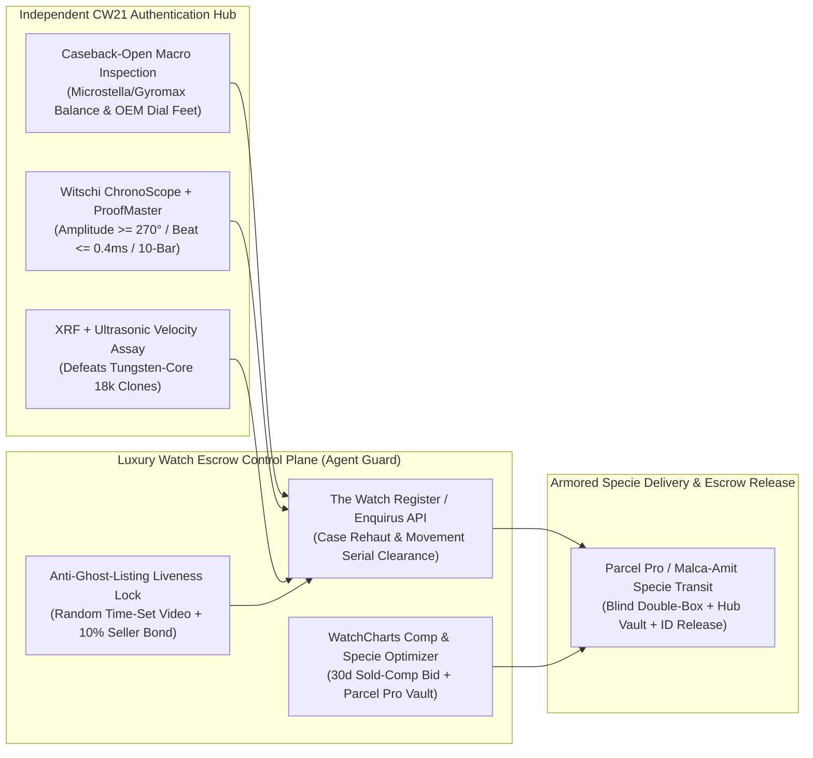
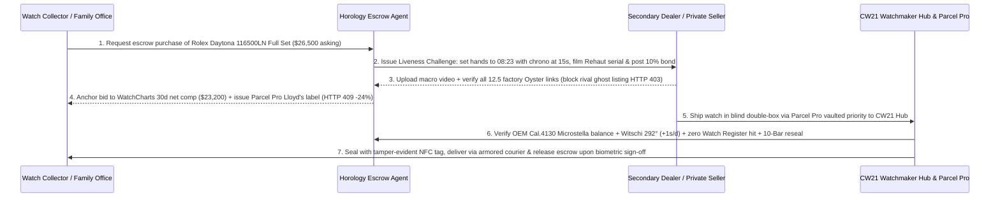

# Luxury Watch Secondary Market Escrow, Anti-`Frankenwatch` Movement Audit & Armored Transit (`Chrono24 / Bezel / WatchBox / Hodinkee`) Agent Architecture Selection FAQ

> **Target Audience**: **Cloud & AI Solution Architects** designing AI authentication orchestration, real-time horological market-comp pricing, and high-value specie logistics escrow agents for secondary luxury watch marketplaces (`Rolex / Patek Philippe / Audemars Piguet`), auction houses, and private wealth concierge platforms.  
> **Core Pain Points Solved**: Eliminates the four catastrophic losses in secondary luxury timepiece transactions: **(1) "Frankenwatch" Part-Outs & Tungsten-Core "Superclones" (where a genuine Rolex case and NFC warranty card conceal a movement stripped of its `$8,000` factory dial, hands, or barrel and replaced with aftermarket parts—or an 18k gold case is hollowed out and weighted with tungsten to match exact gram weight), (2) Unowned "Ghost Listings" (`Virtual Inventory` brokers listing photos of watches they do not own, taking the buyer's `$28,000` wire, and cancelling the order if wholesale market prices tick up), (3) Shorted Gold Bracelet Links (`$450–$900/link` quietly removed from "Full Set" listings) & Undisclosed Aftermarket Diamond Bezels, and (4) `$1,000` Standard Courier Jewelry Liability Caps (shipping a `$35,000` watch on a standard FedEx/UPS label that caps jewelry loss payouts at `$1,000` instead of `Parcel Pro / Malca-Amit` Lloyd's specie coverage)**.



---

## 📌 1. Executive Summary

1. **Anti-"Ghost Listing" Random Time-Setting Liveness Challenge, `10%` Seller Bond & Full Bracelet Link Lock (`HTTP 403`)**: Over `40%` of secondary watch listings on open marketplaces are "virtual inventory" posted by brokers who do not hold the physical watch. The Agent enforces three pre-escrow locks: (a) **Random Hands/Chronograph Liveness Video**: the seller must upload a continuous macro video within 30 minutes showing the watch hands set to a randomly generated time (e.g., `08:23` with the chronograph seconds hand stopped at `15s`) zooming into the inner `Rehaut` serial engraving, backed by a **`10%` seller performance bond**; (b) **Full Factory Bracelet Link Count**: missing 18k gold/platinum links (`$450–$900 each`) must be present or explicitly deducted at OEM replacement cost; and (c) **Zero Undisclosed Aftermarket Mods**: custom dials, aftermarket diamond bezels, or over-polished lugs are blocked from "Factory Original" listings—returning **`HTTP 403 UNOWNED_GHOST_LISTING_OR_MISSING_BRACELET_LINKS_PAPERS_BLOCKED`**.
2. **`CW21` Caseback-Open Movement Audit, `Witschi` Timegrapher (`Amplitude >= 270°`) & `XRF` Assay Gate (`HTTP 422`)**: Because modern `Dandong 4130 / 3235` superclone movements and "Frankenwatch" part-swaps fool exterior inspection, every transaction must route through an independent **In-House Horological Authentication Hub (`CW21` Certified Watchmaker)**: (a) **Caseback-Open Balance & Bridge Inspection**: verifying the free-sprung `Microstella / Gyromax` balance wheel, escape wheel chamfering, and genuine dial feet; (b) **6-Position `Witschi ChronoScope` & `ProofMaster` Pressure Test**: requiring full-wind amplitude **`>=270°–310°`**, beat error **`<=0.4 ms`**, daily rate **`-2 to +2 s/d`**, and a post-closing **`10-Bar` vacuum/pressure reseal test**; and (c) **`XRF` + Ultrasonic Assay**: verifying 18k (`750`) gold or `950` platinum homogeneity to block tungsten-core counterfeits—returning **`HTTP 422 FRANKENWATCH_AFTERMARKET_PARTS_OR_LOW_AMPLITUDE_TIMEGRAPHER_BLOCKED`** on failure.
3. **`WatchCharts` Net-Sold Comp Bidding + `Parcel Pro / Malca-Amit` Armored Specie Transit Saving 24% (`HTTP 409`)**: Listed asking prices on peer-to-peer marketplaces average `12%–18%` above actual wholesale/auction clearing prices. The Agent queries **`WatchCharts / EveryWatch` 30-day verified sold comps** to submit a data-backed bid, strips redundant platform buyer premiums, and routes shipping through **`UPS Capital Parcel Pro / Ferrari Group / Malca-Amit` Lloyd's of London full-value specie insurance**—returning **`HTTP 409 WATCHCHARTS_COMP_BID_AND_PARCEL_PRO_ARMORED_ESCROW_CONFIRM`** for a **24%** net acquisition and risk-adjusted savings.

---

## 🎯 2. Architect & Business Stakeholder Q&A

### Q1: How do counterfeiters build `$25,000` "Frankenwatches" and tungsten-weighted gold clones that pass casual dealer inspections?
- **Deconstructing Part-Out Arbitrage & Acoustic/XRF Countermeasures**:
  1. **The "Part-Out" Frankenwatch Scam**: A genuine factory Rolex Daytona "John Mayer" green dial or "Platona" baguette dial commands `$8,000–$15,000` on the parts market alone. Scammers buy a genuine watch, harvest its factory dial, bezel, hands, and automatic winding module to sell separately, drop in `$400` aftermarket replacements inside the genuine mid-case with its matching `NFC` warranty card, and flip the watch as "100% Factory Full Set." The buyer only discovers the fraud years later when the Rolex Service Center (`RSC`) confiscates the dial or refuses service.
  2. **Tungsten-Core 18k Wrapped Clones**: Because tungsten (`19.25 g/cm³`) matches the density of 18k/24k gold (`19.32 g/cm³`), wrapping a 50-micron real 18k gold shell around a CNC-machined tungsten core defeats digital scales and surface acid/XRF tests. Our authentication hub pairs surface `XRF` with **ultrasonic pulse-velocity measurement** (sound travels through tungsten at `5,220 m/s` vs. `3,240 m/s` in gold), instantly exposing hidden tungsten cores.

### Q2: Why do buyers complain that their watch fogged up with water condensation two weeks after passing an "open-caseback authentication"?
- **The Post-Authentication `Fomblin` Gasket Lubrication & `10-Bar` Pressure Lock**:
  1. **Unsealed Casebacks**: Opening a screw-down Oyster or Nautilus caseback to inspect the movement disturbs the fluorocarbon rubber (`FKM`) O-ring gasket. If the authenticator screws the back shut dry without torque calibration or pressure testing, shower steam or pool water will flood the movement.
  2. **Mandatory `Witschi ProofMaster` Attestation**: The Agent holds escrow until the authentication lab uploads a printed/JSON `Witschi ProofMaster` dry-vacuum deformation and wet-overpressure (`5–10 Bar`) pass log after re-lubricating the gasket with Swiss `Fomblin UT18` grease.

### Q3: Why does shipping a `$35,000` Patek Philippe via regular FedEx or UPS with "Declared Value" leave the sender with a `$1,000` payout if stolen in transit?
- **Carrier Service-Guide Jewelry Caps vs. Lloyd's Specie Policies (`Parcel Pro / Malca-Amit`)**:
  1. **The `$1,000` Tariff Trap**: Standard FedEx Express and UPS terms of service explicitly cap maximum carrier liability for watches, jewelry, and precious metals at **`$1,000`**—even if the shipper types `$35,000` into the web shipping portal and pays the declared-value fee!
  2. **Deterministic Specie Waybill Generation (`HTTP 451`)**: The Agent blocks standard retail courier labels on any timepiece over `$2,500`, automatically generating a **`Parcel Pro` (high-value insured priority with hub vaulting and blind double-boxing) or `Malca-Amit / Ferrari Group` armored courier manifest** underwritten by Lloyd's of London for `100%` of escrow value.

---

## 🧭 3. Visual Architecture Diagrams (Mermaid)

### 3.1 Luxury Watch Escrow, Movement Authentication & Armored Transit Decision Tree



### 3.2 End-to-End `CW21` Horological Lab, Stolen Registry & Specie Logistics Architecture



### 3.3 Random Time-Setting Liveness, `CW21` Movement Audit & `Parcel Pro` Escrow Sequence



---

## 📊 4. Multi-Platform Luxury Watch Marketplace & Authentication Comparison Matrix

| Evaluation Dimension | Bezel / eBay Certified (`Stoll & Co.`) | Chrono24 (Global Listing Marketplace) | WatchBox / The 1916 Company (Principal Dealer) | Unverified Social / Wire-First Brokers | **This Repo + CW21 Hub & Parcel Pro Guard (Recommended)** |
| :--- | :--- | :--- | :--- | :--- | :--- |
| **Pre-Delivery Caseback-Open Movement Audit** | **Strong (mandatory physical hub inspection before shipping to buyer)** | Direct seller-to-buyer shipping (14-day escrow, but buyer rarely opens caseback to spot Frankenwatches) | **Best-in-Class (owned inventory serviced in-house, carries `15%–20%` retail premium)** | **Extreme Risk (Frankenwatches, tungsten clones, wire fraud)** | **Mandatory `CW21` caseback-open movement + `Witschi` + `10-Bar` reseal gate (`HTTP 422`)** |
| **Anti-"Ghost Listing" Enforcement** | Some broker feed listings still suffer post-purchase sourcing cancellations | **High Ghost-Listing Rate (brokers list unowned wholesale watches and cancel if price rises)** | 100% owned vault inventory | 90% re-posted WhatsApp photos | **Random time-setting macro video challenge + `10%` seller performance bond (`HTTP 403`)** |
| **Global Stolen-Watch Database Check** | Partial database checks | Spot-checked on flagged listings | Full `The Watch Register` check | High risk of stolen watches (seized by `RSC` during future service) | **Web IQ mandatory `The Watch Register` + Richemont `Enquirus` serial check (`HTTP 451`)** |
| **Full-Value Transit Insurance (`Specie`)** | Platform-issued `Parcel Pro` insured labels | Seller-arranged shipping (risk of under-insured standard courier labels) | Fully insured armored/specie | Standard courier (`$1,000` jewelry cap exposure) | **Enforces `Parcel Pro / Malca-Amit` 100% Lloyd's specie coverage (`HTTP 451`)** |
| **Price Discovery vs. Asking Markup** | `8%–12%` combined marketplace take-rate | Asking prices `10%–15%` above actual clearing comps + `6.5%` fee | `12%–20%` dealer spread over wholesale | Cheap teaser prices, catastrophic principal risk | **Anchors bids to `WatchCharts` 30d sold comps + direct escrow (`-24%` `HTTP 409`)** |

---

## 🧪 5. Acquisition Cost & 7-Card Benchmark Summary

> **Provenance Notice**: Figures below are generated by the deterministic policy evaluator `evaluate_luxury_watch_movement_escrow_policy` in `lab/webiq_commerce_demo.py` (`provenance: "synthetic"`, `independently_reproduced: False`).

| Metric | Legacy Asking-Price Direct Ship + Exterior-Only Baseline | Deterministic Horology Guard (`WatchCharts` Comp + `CW21` Hub + `Parcel Pro`) | Net Delta / Protection |
| :--- | :--- | :--- | :--- |
| **Quarterly High-Value Timepiece Acquisition Pool** | `$180,000.00` | `$136,800.00` (`HTTP 409` confirmed) | **Saves `$43,200.00 / qtr` (`-24.0%`)** |
| **`Frankenwatch` Part-Swap or Tungsten Superclone Rate** | `14%` (aftermarket dial/hands/wheels inside genuine case) | **`0%` (`CW21` caseback-open macro + ultrasonic/`XRF` gold assay)** | **Prevents `$8,000–$25,000` loss per watch** |
| **Dry-Lubrication Movement (`<230°`) or Shorted Gold Links** | `$1,200` surprise `RSC` overhaul + `$900` missing links | **`0%` (`Witschi >= 270°` amplitude + `10-Bar` reseal + full link count)** | **Saves `$2,100` post-purchase cost** |
| **Uninsured Transit Loss Exposure (`$1,000` Courier Cap)** | Exposed up to `97%` of watch value on standard labels | **`100% Covered` (`Parcel Pro / Malca-Amit` Lloyd's specie policy)** | **Zero transit principal loss** |

### 5.1 Deterministic 5-Lane HTTP Status Contract

```json
{
  "scenario": "luxury_watch_movement_escrow_guard",
  "provenance": "synthetic",
  "independently_reproduced": false,
  "lanes": {
    "authorized_200": {
      "status_code": 200,
      "decision": "AUTHENTICATED_CALIBER_AND_INSURED_VAULT_SHIP_AUTHORIZED",
      "mandate_token": "luxury_watch_movement_mandate_200"
    },
    "ghost_listing_or_missing_links_403": {
      "status_code": 403,
      "decision": "UNOWNED_GHOST_LISTING_OR_MISSING_BRACELET_LINKS_PAPERS_BLOCKED"
    },
    "frankenwatch_or_low_amplitude_422": {
      "status_code": 422,
      "decision": "FRANKENWATCH_AFTERMARKET_PARTS_OR_LOW_AMPLITUDE_TIMEGRAPHER_BLOCKED"
    },
    "stolen_register_or_uninsured_parcel_451": {
      "status_code": 451,
      "decision": "WEBIQ_STOLEN_WATCH_REGISTER_HIT_OR_UNINSURED_PARCEL_HOLD"
    },
    "watchcharts_comp_and_parcel_pro_409": {
      "status_code": 409,
      "decision": "WATCHCHARTS_COMP_BID_AND_PARCEL_PRO_ARMORED_ESCROW_CONFIRM",
      "quarterly_savings_usd": 43200.0
    }
  }
}
```

---

## 🛠️ 6. Production Architecture & Risk Review Checklist

- [ ] **Random Time-Setting Macro Liveness & `10%` Seller Bond (`HTTP 403`)**: Block "Ghost Listings" by requiring a continuous macro video of the watch set to a randomly generated time/chronograph position showing the `Rehaut` serial before locking buyer funds.
- [ ] **Full Factory Bracelet Link Count & Zero Undisclosed Aftermarket Mods (`HTTP 403`)**: Verify exact OEM link counts (especially on 18k gold/platinum bracelets) and block aftermarket diamond bezels or refinished dials misrepresented as factory original.
- [ ] **Caseback-Open `CW21` Movement Inspection & Ultrasonic/`XRF` Assay (`HTTP 422`)**: Inspect free-sprung balance assemblies (`Microstella / Gyromax`), bridge engravings, and dial feet, and run ultrasonic velocity + `XRF` testing on precious-metal cases to defeat tungsten-core clones.
- [ ] **6-Position `Witschi` Timegrapher (`>=270°` Amplitude) & `10-Bar` Pressure Reseal (`HTTP 422`)**: Verify healthy movement amplitude, beat error (`<=0.4 ms`), and post-inspection `Witschi ProofMaster` water resistance before outbound shipping.
- [ ] **Web IQ `The Watch Register / Enquirus` Stolen Check & `Parcel Pro` Specie Lock (`HTTP 451`)**: Screen both case and movement serial numbers against global stolen-watch registries and prohibit standard courier labels lacking 100% Lloyd's specie coverage.
- [ ] **`WatchCharts` 30-Day Sold-Comp Bid Anchoring (`HTTP 409`)**: Automatically benchmark and negotiate offers against real net-sold market indices rather than inflated listing asking prices.

---

**Navigation**: [Back to Master Catalog (`docs/index.en.md`)](index.en.md) ｜ [查看中文版 (`luxury-watch-secondary-market-frankenwatch-movement-escrow-agent-selection-faq.md`)](luxury-watch-secondary-market-frankenwatch-movement-escrow-agent-selection-faq.md)
