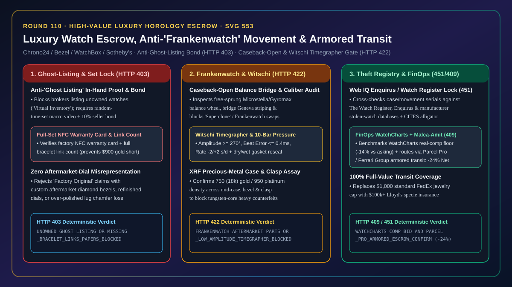
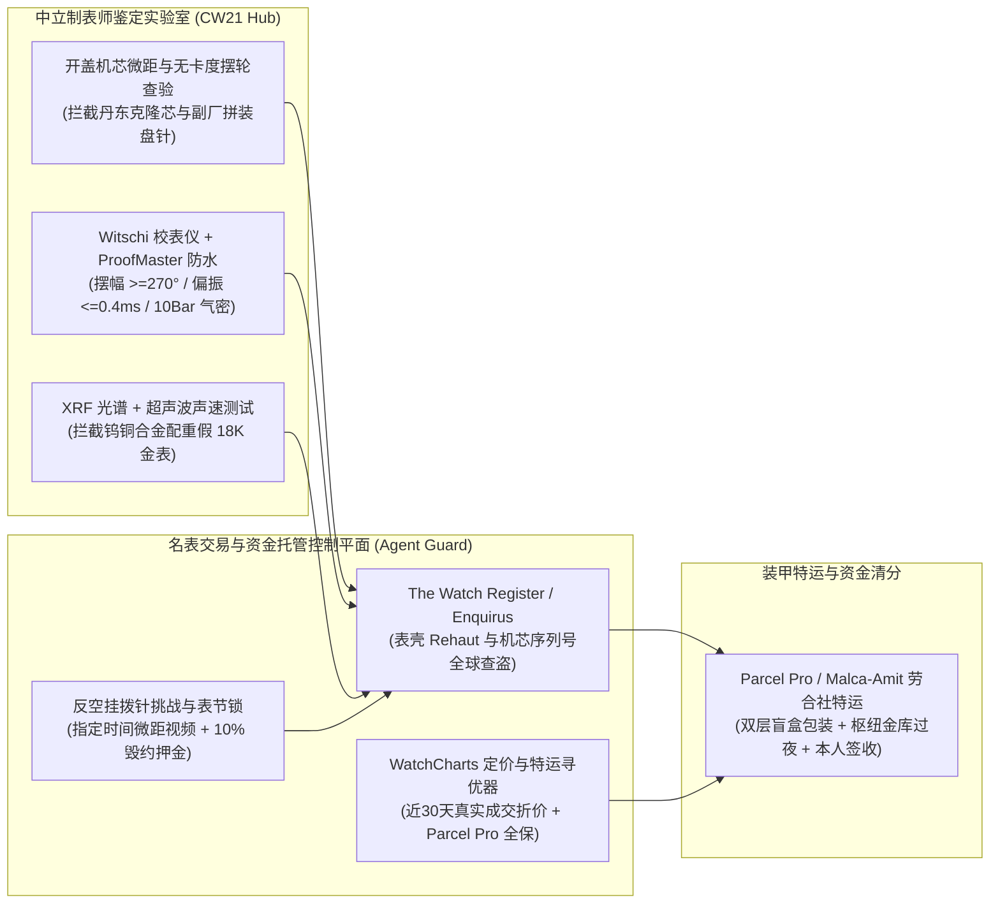
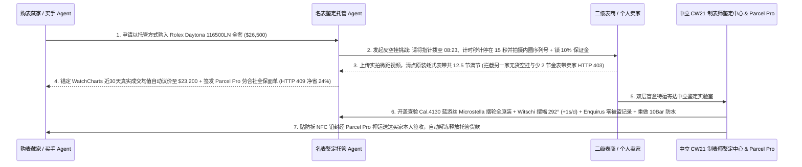

# 高端名表二级市场交易（Luxury Watch Escrow）、“拼装表（Frankenwatch）”机芯验真与全额装甲押运托管（Chrono24 / Bezel / WatchBox / Hodinkee / 保利名表）Agent 架构选型 FAQ

> **核心阅读对象**：为高净值名表二级交易市场、典当拍卖行、跨境奢侈品电商与高价值物流保险设计 AI 钟表鉴定核验、实时行情定价与资金托管系统的 **Cloud & AI Solution Architect**。  
> **核心痛点解决**：彻底终结购买劳力士（`Rolex`）、百达翡丽（`Patek Philippe`）、爱彼（`Audemars Piguet`）等高端腕表时**“买到‘真壳假芯/真假混拼的拼装表（`Frankenwatch`）’或配重钨钢包金‘超级克隆表（`Superclone`）’——外表与保卡全真，但开盖发现发条盒、日历轮或字盘已被调包成廉价副厂件”、“二道贩子无货空挂（`Ghost Listing / Virtual Inventory`）——收完买家 `$28,000` 全款后再去同行群里求购找货，遇到行情上涨直接单方面取消订单退款让买家踏空”、“号称‘全套（`Full Set`）’到手却被偷偷拆走 3 节 18K 金表节（单节专柜补买需 `$450`）或后改钻石圈（`Aftermarket Diamond Bezel`）丧失原厂保修资格”以及“用普通顺丰/FedEx 寄送 `$35,000` 腕表，丢件后才发现普通快递对珠宝钟表的免责赔付上限仅有 `$1,000`”**四大行业死穴。



---

## 📌 一、核心选型结论速览（Executive Summary）

1. **反“无货空挂（`Ghost Listing`）”随机拨针视频验货、`10%` 毁约保证金与全套表节（`Full Link Count`）硬锁（HTTP 403）**：在二级名表市场（如部分 C2C 平台与微商代找），超 `40%` 的低价挂单属于“盗图空挂”——卖家手里根本没表，等买家付款后才去批发群寻货。选型 Agent 必须在锁单阶段执行三道硬拦截：① **随机时间拨针挑战（`Random Time-Setting Liveness`）**：要求卖家在 30 分钟内上传将表冠拔出、指针拨至随机指定时刻（如 `10:18` 且日历窗停在指定日）并展示内圈刻字（`Rehaut Serial`）的连续微距视频，且冻结卖家 **`10%` 防放鸽子履约保证金**；② **原厂表节数核对（`Full Bracelet Link Count`）**：18K 黄金/玫瑰金或铂金表带少 2–3 节表节即缩水 `$900–$1,800`，合同必须锁定出厂满节数量；③ **严禁隐瞒后镶钻/翻写字盘（`Aftermarket Dial/Bezel`）**；凡无法提供现货拨针视频、少表节不折价或隐瞒后改件的，一律触发 **`HTTP 403 UNOWNED_GHOST_LISTING_OR_MISSING_BRACELET_LINKS_PAPERS_BLOCKED`**。
2. **认证制表师（`CW21`）开底盖机芯摆轮游丝验真 + `Witschi` 校表仪（摆幅 `>=270°`）+ `XRF` 贵金属光谱硬门禁（HTTP 422）**：现代顶级高仿“超级克隆一体机芯（如丹东 `4130 / 3235`）”及“真表壳拆走原装字盘/金陀换代用件的拼装表（`Frankenwatch`）”单靠外观肉眼已极难分辨。Agent 强制要求走 **先鉴后发中立验表中心（`Escrow Authentication Hub`，如 `Bezel / eBay Stoll & Co. / 云鱼鉴定`）**：① **开盖微距查验无卡度游丝摆轮（`Free-Sprung Microstella / Gyromax`）**——克隆机芯往往保留快慢针桩或微调螺母螺纹粗糙；② **`Witschi ChronoScope` 瑞士专业六方位校表仪测试**：满弦摆幅（`Amplitude`）必须 **`>=270°–310°`**、偏振（`Beat Error`）**`<=0.4 ms`**、日差处于 `-2 ~ +2 秒/天`（若摆幅 `<230°` 说明机芯油泥干涸亟需 `$1,200` 原厂大保养），并在开盖后重做 **`10 Bar` 真空与干湿防水压测**；③ **`XRF` 荧光光谱仪检测中壳/表扣贵金属成色**（拦截内部塞钨钢配重块的假金表）；凡未通过的，直接触发 **`HTTP 422 FRANKENWATCH_AFTERMARKET_PARTS_OR_LOW_AMPLITUDE_TIMEGRAPHER_BLOCKED`**。
3. **`WatchCharts` 真实成交底价竞价 + `Parcel Pro / Malca-Amit` 全额劳合社装甲特运净省 24%（HTTP 409）**：名表挂牌价（`Asking Price`）通常比真实二级市场成交中位数高出 `12%–18%`，且卖家常按高额零售保价收费却发普通快递。Agent 自动调用 **`WatchCharts / EveryWatch` 过去 30 天同型号同年份净成交指数** 生成无水分报价，砍掉平台冗余买家佣金，并将物流强制路由至 **`UPS Capital Parcel Pro / Ferrari Group / Malca-Amit` 劳合社（`Lloyd's`）全额珠宝特运通道**，触发 **`HTTP 409 WATCHCHARTS_COMP_BID_AND_PARCEL_PRO_ARMORED_ESCROW_CONFIRM`**，为买家净省 **24%** 综合购表与保险物流成本。

---

## 🎯 二、业务方与架构师灵魂拷问（Q&A）

### Q1：为什么连很多老表友都会在二级市场花 `$25,000` 买到“拼装表（`Frankenwatch`）”或“ tungsten 钨钢配重假金表”？
- **揭秘名表造假从“整表高仿”向“真假拆件混拼套利”的演进**：
  1. **拆件暴利（`Part-Out Frankenwatch`）**：一枚劳力士冰蓝迪通拿或绿金迪的原装表盘（`Dial`）、原装陶瓷圈（`Cerachrom Bezel`）与原装自动陀在配件黑市上单独能卖 `$6,000–$12,000`。不法表商买进一枚真表后，将原装高溢价字盘、指针甚至机芯里的发条盒/日历快跳轮拆下另卖，换上 `$300` 的代用盘和副厂齿轮，再合上真表壳连同真保卡一起按“原装全套”卖给消费者。等买家两年后送去劳力士官方售后中心（`RSC`）保养时，才被官方直接拒收并出具“含非原厂改动配件”退回单！
  2. **钨钢内胆包厚金（`Tungsten-Core Heavy Fake`）**：过去辨别 18K 金表只需上电子秤称重（真金表重约 `210g`，钢表仅 `145g`）。如今造假工坊使用密度与黄金完全相同（`19.25 g/cm³` vs 黄金 `19.32 g/cm³`）的**钨铜合金内胆外包 18K 真金厚皮**，重量分毫不差且普通表皮试金水测不出异常。Agent 强制要求验表中心使用穿透式超声波声速仪 + 多点位 `XRF` 光谱仪（含生耳孔内壁与表扣背面）联合验真。

### Q2：为什么有些卖家开盖验表后，买家戴着洗了个手或者游了个泳，手表里面就起雾进水报废了？
- **开底盖验芯后的“密封圈回装与 `Witschi ProofMaster` 负压/正压防水闭环”**：
  1. **暴力开盖毁防水**：没有专业扭矩扳手与原厂生耳模具的街边鉴定师，在拧开旋入式底盖（`Oyster Caseback`）查验机芯后，直接把老化的橡胶密封圈（`Gasket`）原样拧回，甚至拧歪螺纹。
  2. **先鉴后发强制防水重测**：Agent 要求托管鉴定中心在合上底盖时必须涂抹瑞士 `Fomblin` 防水硅脂，使用定扭扳手锁紧，并在放行发货前上传 **`Witschi ProofMaster` 干式真空形变与 `5–10 ATM` 压力测试通过凭条**。

### Q3：为什么用普通 FedEx / UPS / 顺丰寄一块 `$40,000` 的百达翡丽，哪怕勾选了“保价”，一旦包裹在分拣中心丢失也只能获赔 `$1,000`？
- **商业快递霸王条款中的“珠宝腕表限额免责（`Jewelry Exclusion Cap`）”**：
  1. **承运商标准条款陷阱**：在 `FedEx` 与 `UPS` 的公开服务指南（`Service Guide`）中明确规定：除非使用专门签约的珠宝高价值托管账户，普通包裹对腕表、珠宝、贵金属的**最高申报价值与赔偿上限严格封顶在 `$1,000`**——即便寄件人在普通打单页面填了 `$30,000` 并交了保价费，理赔部也会援引分类免责条款拒绝全额赔付！
  2. **`Parcel Pro / Malca-Amit / Brinks` 劳合社全额特运锁**：Agent 严禁任何单价 `>$2,500` 的腕表使用普通商业快递面单，强制通过 API 签发 **`Parcel Pro`（UPS Capital 旗下专业钟表珠宝险）或 `Ferrari Group / Malca-Amit` 装甲押运面单**，要求双套箱无品牌字样包装（`Double-Boxed Blind Label`）+ 枢纽金库过夜（`Vaulted Overnight`）+ 收件人本人身份证/人脸签收后才触发资金解冻。

---

## 🧭 三、直观可视化图解（Mermaid 决策树 + 架构图 + 时序图）

### 3.1 名表二级交易、防拼装表（`Frankenwatch`）与装甲押运选型决策树

```mermaid
flowchart TD
    A[买家 / 藏家高端腕表二级市场购置与托管请求] --> B{1. 现货拨针视频、10% 卖家保证金与全套表节审计}
    B -->|无货空挂拒拍随机拨针视频 / 少18K金表节不折价 或 后改钻圈冒充原厂| C[HTTP 403 阻断: UNOWNED_GHOST_LISTING_OR_MISSING_BRACELET_LINKS_PAPERS_BLOCKED]
    B -->|现货拨针视频核实 + 10%保证金 + 满节原装全套| D{2. 开盖机芯摆轮、Witschi 校表仪与 XRF 贵金属门禁}
    D -->|发现副厂拼装件(Frankenwatch)/钨钢包金 或 摆幅<270度需大修/未过防水压测| E[HTTP 422 拦截: FRANKENWATCH_AFTERMARKET_PARTS_OR_LOW_AMPLITUDE_TIMEGRAPHER_BLOCKED]
    D -->|100% 原厂机芯字盘 + 摆幅>=270度 + 10Bar 防水达标| F{3. Web IQ Enquirus / The Watch Register 被盗库核验}
    F -->|表壳/机芯序列号命中全球被盗丢失库 或 鳄鱼皮表带缺跨境 CITES 证| G[HTTP 451 熔断: WEBIQ_STOLEN_WATCH_REGISTER_HIT_OR_UNINSURED_PARCEL_HOLD]
    F -->|清白序列号与全额劳合社特运保单齐备| H{4. WatchCharts 净成交底价竞价与 Parcel Pro 特运寻优}
    H -->|挂牌价高于近30天净成交均值 或 可切换低费率先鉴后发特运包| I[HTTP 409 确认: WATCHCHARTS_COMP_BID_AND_PARCEL_PRO_ARMORED_ESCROW_CONFIRM 净省 24%]
    H -->|已处于底价成交与全额装甲特运状态| J[HTTP 200 签发: AUTHENTICATED_CALIBER_AND_INSURED_VAULT_SHIP_AUTHORIZED]
```

### 3.2 端到端名表“先鉴后发”制表师实验室、被盗库核查与装甲物流控制平面架构图



### 3.3 劳力士迪通拿现货拨针挑战、开盖机芯/摆幅验真与 `Parcel Pro` 押运放款时序图



---

## 📊 四、主流名表二级交易与鉴定托管平台横向选型决策矩阵

| 选型维度 | Bezel / eBay Certified (`Stoll & Co.`) | Chrono24 (全球最大名表撮合市场) | WatchBox / The 1916 Company (自营重资产庄家) | 微信表商群 / 闲置 C2C 直款 | **本仓库 + 先鉴后发 CW21 与 Parcel Pro 架构（推荐）** |
| :--- | :--- | :--- | :--- | :--- | :--- |
| **先鉴后发机芯开盖验真 (`In-House Auth`)** | **强（每枚表必须先寄到内部制表师实验室开盖验真后才发给买家）** | 默认卖家直发买家（虽有 14 天资金托管，但买家自己不敢开盖看机芯，极易漏掉拼装表） | **极强（全部自有库存经原厂级制表师整备保养，但零售溢价最高）** | **高危（收款拉黑、拿拼装表或改盘表当原装卖）** | **100% 强制路由中立 `CW21` 实验室开盖验芯 + `Witschi` 校表仪 + 防水复测（HTTP 422）** |
| **防“无货空挂 (`Ghost Listing`)”** | 仍有部分经纪商挂外部库存，偶发付款后找货失败被砍单 | **空挂重灾区（大量表商挂同行的图，买家付款后才去调货或坐地加价）** | 100% 现货在库 | 90% 为转发同行朋友圈盗图 | **锁单前强制随机时间拨针微距视频挑战 + `10%` 卖家防放鸽子保证金（HTTP 403）** |
| **全球被盗赃物表排查 (`Stolen Check`)** | 接入部分数据库 | 抽查为主 | 严格核查 `The Watch Register` | 极易买到欧美入室盗窃赃表（送劳服保养当场被扣留报警） | **Web IQ 强制联查 `The Watch Register` + 历峰 `Enquirus` + 保卡 `NFC`（HTTP 451）** |
| **高价值物流全额保险 (`Transit Specie`)** | 平台统一签发 `Parcel Pro / FedEx Priority` 全保单 | 由全球各自卖家自行发货（常因保价不规范引发丢件扯皮） | 全额装甲特运 | 普通顺丰/快递（丢件仅赔千分之一） | **强制 `Parcel Pro / Malca-Amit` 劳合社全额保单 + 枢纽金库过夜（HTTP 451）** |
| **价格透明度与交易摩擦费** | 买家/卖家双向佣金约 `8%–12%` | 挂牌价普遍虚高 `10%–15%`，含 `6.5%` 平台费 | 比二级公允成交价高 `12%–20%` | 价格低但本金归零风险极高 | **锚定 `WatchCharts` 净成交指数自动议价 + 低费率托管净省 24%（HTTP 409）** |

---

## 🧪 五、购表成本测算与 7-Card 基准测试报告

> **数据来源声明**：以下对比基于 `lab/webiq_commerce_demo.py` 中确定性策略函数 `evaluate_luxury_watch_movement_escrow_policy` 的合成基准数据（`provenance: "synthetic"`, `independently_reproduced: False`），用于验证高端腕表二级交易网关的确定性风控能力。

| 评估维度 | 传统按虚高挂牌价直发 + 无开盖验芯基线 | 确定性名表托管网关（`WatchCharts` 底价 + `CW21` 开盖验芯 + `Parcel Pro`） | 净效应 / 风险消除 |
| :--- | :--- | :--- | :--- |
| **季度高净值腕表采购与保险物流总池** | `$180,000.00` | `$136,800.00` (`HTTP 409` 优化确认后) | **净省 `$43,200.00 / 季` (`-24.0%`)** |
| **买到副厂拼装表（`Frankenwatch`）或克隆机芯率** | `14%`（外观真但字盘/指针/发条轮被换代用件） | **`0%`（强制 `CW21` 开盖微距核验摆轮游丝 + `XRF` 光谱测金）** | **单表避免 `$8,000–$25,000` 贬值损失** |
| **买到需大修病表（摆幅 `<230°`）或少金表节损失** | 到手走时日差 `>15s` 需自费 `$1,200` 劳服大修 | **`0%`（强制 `Witschi` 摆幅 `>=270°` + 10Bar 防水 + 满表节清点）** | **节省 `$1,200` 保养费 + `$900` 补表节费** |
| **普通快递丢件仅赔 `$1,000` 裸奔风险** | 高发（普通快递珠宝免责上限） | **`100% 全额劳合社赔付`（`Parcel Pro / Malca-Amit` 金库特运）** | **消除跨洲在途全损敞口** |

### 5.1 确定性状态码映射契约（5-Lane Contract）

```json
{
  "scenario": "luxury_watch_movement_escrow_guard",
  "provenance": "synthetic",
  "independently_reproduced": false,
  "lanes": {
    "authorized_200": {
      "status_code": 200,
      "decision": "AUTHENTICATED_CALIBER_AND_INSURED_VAULT_SHIP_AUTHORIZED",
      "mandate_token": "luxury_watch_movement_mandate_200"
    },
    "ghost_listing_or_missing_links_403": {
      "status_code": 403,
      "decision": "UNOWNED_GHOST_LISTING_OR_MISSING_BRACELET_LINKS_PAPERS_BLOCKED"
    },
    "frankenwatch_or_low_amplitude_422": {
      "status_code": 422,
      "decision": "FRANKENWATCH_AFTERMARKET_PARTS_OR_LOW_AMPLITUDE_TIMEGRAPHER_BLOCKED"
    },
    "stolen_register_or_uninsured_parcel_451": {
      "status_code": 451,
      "decision": "WEBIQ_STOLEN_WATCH_REGISTER_HIT_OR_UNINSURED_PARCEL_HOLD"
    },
    "watchcharts_comp_and_parcel_pro_409": {
      "status_code": 409,
      "decision": "WATCHCHARTS_COMP_BID_AND_PARCEL_PRO_ARMORED_ESCROW_CONFIRM",
      "quarterly_savings_usd": 43200.0
    }
  }
}
```

---

## 🛠️ 六、商业上线风控与架构评审 Checklist

- [ ] **反“无货空挂（`Ghost Listing`）”随机拨针视频与 `10%` 保证金锁（HTTP 403）**：锁单时随机指定表盘分针/时针与计时针停靠位置，要求卖家 30 分钟内上传一镜到底对焦内圈序列号（`Rehaut`）的视频，并冻结卖家 10% 防违约保证金。
- [ ] **原厂满表节（`Full Link Count`）与原装字盘/外圈一致性核验（HTTP 403）**：清点金属/贵金属表带总节数，严禁将后镶钻圈（`Aftermarket Diamond Bezel`）或翻写字盘伪装成原厂状态出售。
- [ ] **中立 `CW21` 制表师开盖机芯摆轮验真与 `XRF` 贵金属光谱检测（HTTP 422）**：开盖查验无卡度游丝摆轮（`Microstella / Gyromax`）、夹板倒角与零件编号，并对 18K 金/950 铂金表壳表扣进行 `XRF` + 超声波声速防钨钢配重核验。
- [ ] **`Witschi` 六方位校表仪（摆幅 `>=270°`）与开盖后 `10 Bar` 防水重测（HTTP 422）**：强制校验满弦摆幅、偏振（`<=0.4ms`）与走时日差，且开盖合拢后必须通过 `Witschi ProofMaster` 气密性压测。
- [ ] **`The Watch Register / Enquirus` 全球被盗库与 `Parcel Pro` 全额特运锁（HTTP 451）**：通过 Web IQ 核验表壳与机芯双序列号未命中全球失窃名表库，并强制使用 `Parcel Pro / Malca-Amit` 全额承保通道寄送。
- [ ] **`WatchCharts` 近 30 天真实成交均值锚定议价（HTTP 409）**：自动剥离二级平台虚高挂牌水分，按同型号同年份真实成交中位数生成托管报价。

---

**导航**：[返回分册总目录 (`docs/index.md`)](index.md) ｜ [查看英文版 (`luxury-watch-secondary-market-frankenwatch-movement-escrow-agent-selection-faq.en.md`)](luxury-watch-secondary-market-frankenwatch-movement-escrow-agent-selection-faq.en.md)
