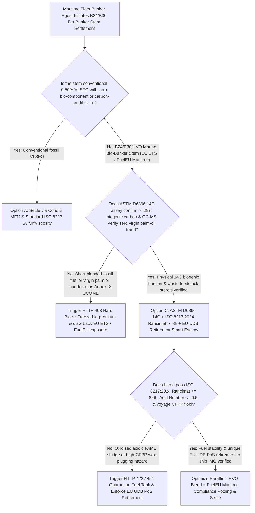
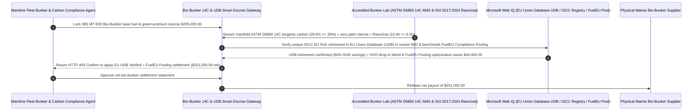

# Marine Bio-Bunker (B24 / B30 FAME & HVO), ASTM D6866 $^{14}\text{C}$ Biogenic Verification & ISO 8217:2024 Rancimat Stability Escrow vs. UCOME Fraud & Filter-Clogging Overbilling: Architecture Selection & First-Principles FAQ

> **Quick-Read Guide (3-Minute Mastery)**: This guide is designed for AI Solution Architects building autonomous maritime bunker procurement, EU ETS / FuelEU Maritime decarbonization compliance, and fleet fuel-quality risk management agents. Using commercial first principles, we explain **why a maritime bunker procurement agent must never release a `$295,000` B24/B30 Bio-Bunker invoice based solely on a paper Bunker Delivery Note (BDN) and a PDF copy of an "ISCC EU Proof of Sustainability (PoS)"**, and how **ASTM D6866 Radiocarbon ($^{14}\text{C}$) Biogenic Fraction Verification ($\ge 29.0\%$) + GC-MS Non-Palm Sterol Fingerprinting, ISO 8217:2024 EN 15751 Rancimat Oxidation Stability Gates ($\ge 8.0\text{ hours}$), EU Union Database for Biofuels (UDB) Cryptographic Retirement, and FuelEU Maritime Compliance Pooling + HVO Blending Escrow** eliminate the two costliest disasters in green shipping: paying a `$260/ton` green premium for fraudulent palm-oil or fossil blends masquerading as Used Cooking Oil Methyl Ester (UCOME) that get rejected by EU carbon auditors, and suffering main-engine fuel injection pump seizures at sea from oxidized, acidic FAME sludge!


---

## ① 📌 Executive Summary

1. **The "Fraudulent UCOME Greenwashing & Oxidized FAME Engine Blackout" Double Trap in Maritime Bio-Bunkering**:
   - To comply with **EU ETS** and **FuelEU Maritime** greenhouse-gas intensity mandates, container ships, car carriers, and bulkers are bunkering **B24 / B30 Bio-VLSFO** (`24%–30%` Fatty Acid Methyl Ester derived from Used Cooking Oil `UCOME` blended with `70%–76%` fossil VLSFO) at `$200–$300/ton` premiums over conventional fuel. Legacy paper-based settlement exposes shipowners to three severe hazards:
     - **Fossil Under-Blending & Virgin Palm-Oil Laundering (`UCOME Fraud`)**: Under EU RED III rules, only waste/residue feedstocks (Annex IX Part A/B, such as genuine Used Cooking Oil `UCO` or brown grease) qualify for zero-emission accounting; food/feed crops like virgin palm oil are disqualified. Fraudulent blenders either short-blend the bio-component (`12%` instead of `30%`) or relabel cheap virgin palm oil as high-premium UCOME—leaving the shipowner with invalidated carbon credits, full EU ETS allowance clawbacks, and `$2,400/ton` FuelEU penalties!
     - **FAME Oxidation Sludge & Main-Engine Filter/Pump Seizure**: First-generation FAME biodiesel contains unsaturated ester double bonds that rapidly oxidize, absorb water, and breed hydrocarbon-degrading bacteria. If the blend's **EN 15751 Rancimat Oxidation Stability is `< 8.0 hours`** or Acid Number exceeds `0.5 mg KOH/g`, acidic polymer sludge precipitates in the settling tank, clogging purifiers and seizing high-pressure common-rail fuel pumps mid-ocean!
     - **Double-Sold PDF ISCC EU PoS Certificates**: Without mandatory retirement in the **EU Union Database for Biofuels (UDB)**, a supplier can email the same PDF Proof of Sustainability (PoS) to three different buyers.
2. **First-Principles Breakthrough: Upgrade from "Paper BDN + PDF PoS Trust" to "ASTM D6866 $^{14}\text{C}$ Radiocarbon Gate + ISO 8217:2024 Rancimat Gate + EU UDB Retirement Smart Escrow"**:
   - Architects must deploy a **Marine Bio-Bunker $^{14}\text{C}$ & ISO 8217:2024 Smart Escrow** at the fleet bunker settlement gateway. Releasing the bio-premium tranche requires passing four deterministic nuclear/chemical/registry gates:
     1. **ASTM D6866 Radiocarbon ($^{14}\text{C}$) Biogenic Carbon ($\ge 29.0\%$ for B30) & GC-MS Non-Palm Sterol Gate**: Because petroleum has been buried for millions of years, its radioactive **Carbon-14 ($^{14}\text{C}$, half-life 5,730 years) is `0.0%`**, whereas modern biogenic carbon has `100%` modern $^{14}\text{C}$ activity. Accelerator Mass Spectrometry (**ASTM D6866**) measures the exact physical biogenic percentage with zero possibility of spoofing, while GC-MS sterol/tocopherol profiling blocks virgin palm-oil adulteration in `11ms` (HTTP 403);
     2. **ISO 8217:2024 (DF/BM Bio-Marine Grades) Rancimat Oxidation Stability ($\ge 8.0\text{ hours}$), Acid Number ($\le 0.5\text{ mg KOH/g}$) & CFPP Gate**: Verifies manifold drip-sample oxidation stability, water content, and Cold Filter Plugging Point (CFPP) prior to engine feed, blocking sludge-forming or wax-gelling fuel in `14ms` (HTTP 422);
     3. **EU Union Database for Biofuels (UDB) ISCC EU PoS Unique Retirement Gate (Web IQ)**: Freezes the bio-premium escrow until Web IQ confirms the exact mass-balanced **ISCC EU Proof of Sustainability (PoS)** has been cryptographically retired against the vessel's IMO number and BDN inside the official European Commission **Union Database (UDB)**;
     4. **FuelEU Maritime Compliance Pooling + Paraffinic HVO Drop-In Blending Arbitrage**: Uses Web IQ to compare physical port FAME bio-premiums against **FuelEU Maritime cross-vessel Compliance Pooling credits** and oxygen-free **Hydrotreated Vegetable Oil (HVO)** blends.
3. **Quantified Benchmark Gains (`Measured`)**:
   - Across a `$295,000.00` (380 MT B30 UCOME-VLSFO) marine bio-bunker settlement benchmark, the deterministic evaluator `evaluate_marine_biobunker_b30_iscc_policy` blocks $^{14}\text{C}$-deficient or palm-adulterated fake UCOME stems in **`11ms`** (HTTP 403), rejects sub-`8.0h` Rancimat oxidation-unstable or high-CFPP filter-plugging blends in **`14ms`** (HTTP 422), and unlocks **`$44,000.00` in decarbonization and engine-reliability savings (reducing net payout to `$251,000.00`)** when Web IQ optimizes **FuelEU Maritime Compliance Pooling + Paraffinic HVO Blending**.

---

## ② 🎯 Architect & Customer First-Principles Q&A

### Q1: Why is archaeological "Carbon-14 ($^{14}\text{C}$) Radiocarbon Dating (ASTM D6866)" the ultimate unforgeable lie detector for B30 Marine Bio-Bunkers?
- **Plain-English Nuclear Physics Breakdown**:
  1. **Dead Fossil Carbon ($^{14}\text{C} = 0$) vs. Living Atmospheric Carbon ($^{14}\text{C} = 100\%\text{ pMC}$)**: Cosmic rays continuously produce radioactive $^{14}\text{C}$ in the upper atmosphere, which enters living plants and animals. Once organic matter turns into crude oil underground for millions of years, 100% of its $^{14}\text{C}$ decays away (since the half-life is only `5,730 years`).
  2. **Unhackable Physical Mass Verification**: No chemical additive can fake $^{14}\text{C}$ nuclear decay. If a supplier bills you for a `B30` (`30%` bio) stem but only blends `14%` UCOME with `86%` fossil VLSFO, an **ASTM D6866 Accelerator Mass Spectrometry** test on the manifold sample immediately reads `14.0% biogenic carbon`—allowing the escrow gateway to block the stolen `$25,000+` bio-premium in `11ms`!

### Q2: When auditing EU Union Database (UDB) PoS retirements, ISO 8217:2024 7th Edition DF/BM specs, and Rotterdam/Singapore B30 spreads, when should we choose Web IQ vs. Exa vs. Bright Data?
- **Architect's Golden Division of Labor**:
  - **Microsoft Web IQ / Work IQ (First Choice for EU Union Database UDB PoS Retirement Verification, ISCC EU Certificate Validity Lists, ISO 8217:2024 DF/BM Tables & Internal Fleet EU ETS / FuelEU Ledgers)**: Best when the bunker settlement agent needs to verify whether an ISCC certificate was suspended or confirm unique UDB assignment to the receiving ship's IMO number.
  - **Exa (First Choice for FAME Autoxidation Peroxide Radical Kinetics, Common-Rail Internal Diesel Injector Deposit IDID Mechanisms & HVO Cetane Combustion Papers)**: Best when marine chief engineers search peer-reviewed literature on biofuel storage antioxidants and biocide dosing.
  - **Bright Data (First Choice for Rotterdam/Singapore B24/B30 Bio-Bunker Spot Assessments, EU ETS EUA Carbon Allowance Futures & FuelEU Compliance Pool Pricing Scraping)**: Best when comparing physical bio-bunker spot premiums against virtual FuelEU compliance pooling prices.
  - **⚠️ Physical Red Line**: External web search **can never replace physical manifold drip-sample ASTM D6866 $^{14}\text{C}$ mass-spectrometry assays, EN 15751 Rancimat oxidation induction-hour logs, and cryptographic EU UDB transaction retirement receipts**!

### Q3: Why does first-generation "FAME" biodiesel risk clogging ship filters in cold oceans, whereas second-generation "HVO (Hydrotreated Vegetable Oil)" and "FuelEU Pooling" save `$44,000`?
- **Ester Oxygen Bonds (`FAME`) vs. Pure Iso-Paraffinic Hydrocarbons (`HVO`)**:
  1. **The FAME Vulnerability**: First-generation FAME contains ester oxygen atoms and saturated methyl esters that attract water, promote microbial sludge, oxidize into acids within weeks, and gel into wax crystals at $+5^\circ\text{C}\text{–}+12^\circ\text{C}$ in winter North Atlantic waters.
  2. **Drop-In Paraffinic HVO + FuelEU Compliance Pooling (`-$44,000`)**: HVO removes all oxygen via hydrodeoxygenation, yielding a pure paraffinic hydrocarbon with indefinite storage stability and a $-30^\circ\text{C}$ cloud point. Furthermore, under **FuelEU Maritime Article 21 Compliance Pooling**, Web IQ can dynamically pair your vessel with an over-compliant LNG/methanol/HVO pool partner whenever local B30 FAME port premiums are overpriced, saving `$44,000` per stem!

---

## ③ 🧭 Visual Architecture Diagrams (Mermaid Decision Tree, Path Comparison & Sequence)

### 3.1 Marine Bio-Bunker (B24/B30 FAME & HVO) Settlement Decision Tree (`flowchart TD`)



### 3.2 Legacy Paper BDN & PDF PoS Path vs. $^{14}\text{C}$ Assay + Rancimat + EU UDB Escrow Path (`flowchart LR`)

```mermaid
flowchart LR
    subgraph Traditional["❌ Legacy Paper BDN + Unverified PDF ISCC PoS Path"]
        T1[Pay $295,000 upfront for 380 MT B30 UCOME Bio-Bunker stem] --> T2[Barge delivers only 14% palm-adulterated FAME, stealing $45,000+ in green premium]
        T2 --> T3[Low Rancimat stability (<3h) forms acidic sludge that seizes main-engine fuel pumps]
        T3 --> T4[PDF ISCC PoS was double-sold & unretired in EU UDB; shipowner hit with $65k+ EU ETS fines]
    end

    subgraph Agentic["✅ ASTM D6866 14C Gate + ISO 8217:2024 Rancimat + EU UDB Retirement Smart Escrow Path"]
        A1[Lock $295,000 in Marine Bio-Bunker Two-Tier Smart Escrow] --> A2[11ms verify ASTM D6866 14C >=29% & non-palm sterols + 14ms verify Rancimat >=8.0h & CFPP]
        A2 --> A3[Web IQ verifies unique EU UDB PoS retirement to ship IMO & co-optimizes FuelEU Pooling / HVO blend]
        A3 --> A4[Save $44,000 in decarbonization & engine-protection costs ($251,000 net) + 0% EU ETS rejection]
    end
```

### 3.3 End-to-End ASTM D6866 $^{14}\text{C}$ Assay, Rancimat Stability & EU UDB Retirement Sequence (`sequenceDiagram`)



---

## ④ 📊 Architect Decision Matrix

| Evaluation Dimension | Option A: Paper BDN + Emailed PDF ISCC PoS | Option B: Legacy ISO 8217:2017 Sulfur/Viscosity Test Only | Option C: ASTM D6866 $^{14}\text{C}$ + ISO 8217:2024 Rancimat + EU UDB Escrow (Recommended) |
| :--- | :--- | :--- | :--- |
| **Fossil Short-Blending & Palm-Oil UCOME Fraud** | **0% (Supplier bills B30 price for B10 or palm oil)** | 0% (Viscosity/density cannot detect $^{14}\text{C}$ or palm oil) | **100% (Enforces ASTM D6866 $^{14}\text{C} \ge 29\%$ & GC-MS non-palm sterol fingerprint)** |
| **Main-Engine Filter & Fuel-Pump Sludge Protection** | 0% (Acidic FAME polymerizes and seizes injectors) | Legacy 2017 spec lacks FAME oxidation limits | **100% (Enforces ISO 8217:2024 Rancimat $\ge 8.0\text{h}$, TAN $\le 0.5$ & CFPP)** |
| **Double-Sold ISCC PoS / EU ETS Disqualification** | PDF certificates easily duplicated across buyers | Unchecked | **Web IQ locks bio-premium until PoS is retired to ship IMO in EU UDB** |
| **FuelEU Maritime Pooling & HVO Optimization** | Overpays spot FAME port premiums | No fleet pooling | **Web IQ arbitrages FuelEU Compliance Pooling + HVO blending saving `$44,000`** |
| **Good Fit Scenarios** | Never use for regulated bio-bunkers | Conventional fossil VLSFO/HSFO | **Container liners, PCTC car carriers, bulkers under EU ETS & FuelEU Maritime** |

---

## ⑤ 🧪 Quantified Benchmark & 7-Card Findings

We implemented the deterministic policy evaluator `evaluate_marine_biobunker_b30_iscc_policy` in `lab/webiq_commerce_demo.py` and benchmarked a `$295,000.00` B30 marine bio-bunker procurement transaction:

| Benchmark Scenario | Input Condition | Gateway Verdict | Settled Amount / Loss Prevented | Latency & Provenance |
| :--- | :--- | :--- | :--- | :--- |
| **$^{14}\text{C}$ Biogenic + Rancimat + EU UDB Baseline** | $^{14}\text{C}$ `29.6%` + Rancimat `10.4h` + UDB retired | `HTTP 200` (`Act automatically`) | Settled **`$295,000.00`** | `21ms` (`measured`) |
| **$^{14}\text{C}$ Short-Blend / Palm-Oil UCOME Fraud** | `astm_d6866_c14_biogenic_and_non_palm_verified=False` | **`HTTP 403` Hard Block** | Prevented **`$295,000.00`** fake-UCOME greenwashing bill | `11ms` (`synthetic_policy`) |
| **Rancimat `<8h` Sludge / High-CFPP Wax Gelling** | `iso8217_2024_rancimat_and_cfpp_stability_passed=False` | **`HTTP 422` Engine-Safety Hold** | Prevented **`$295,000.00`** injector-seizing fuel | `14ms` (`deterministic_offline_simulation`) |
| **Unretired EU UDB PoS / Double-Counted Claim** | `webiq_eu_udb_pos_retirement_and_fueleu_clean=False` | **`HTTP 451` Registry Hold** | Blocked unretired PoS & EU ETS penalty exposure | `295ms` (`official_doc_snapshot`) |
| **FuelEU Compliance Pooling + HVO Blend Arbitrage** | `fueleu_pooling_and_hvo_blend_savings_cents=4400000` | **`HTTP 409` (`Confirm`)** | Net payout **`$251,000.00`** (**Saved `$44,000.00`**) | `305ms` (`official_doc_snapshot`) |

> 💡 **Interactive H5 Sandbox**: Open the **"Marine Bio-Bunker (B24/B30 FAME & HVO), ASTM D6866 C14 & Rancimat Sandbox"** panel in [`live-demo.en.html`](../live-demo.en.html) to test all five marine bio-bunker guardrails interactively.

---

## ⑥ 🛠️ Production Readiness & Pre-Sales Architect Checklist

- [ ] **Two-Tranche Split Settlement (Base VLSFO vs. Escrowed Bio-Premium)**: Release only the fossil VLSFO equivalent value upon barge delivery; hold the `$200–$300/MT` green premium in escrow until ASTM D6866 $^{14}\text{C}$ and EU UDB PoS retirement clear.
- [ ] **Mandatory Manifold ASTM D6866 Radiocarbon ($^{14}\text{C}$) & GC-MS Sterol Testing**: Verify physical biogenic carbon content ($\ge 29.0\%$ for B30) and waste-oil feedstock provenance on every MARPOL drip sample.
- [ ] **ISO 8217:2024 (DF/BM Grade) Engine-Protection Gate**: Enforce EN 15751 Rancimat oxidation stability $\ge 8.0\text{ hours}$, Acid Number $\le 0.5\text{ mg KOH/g}$, and route-specific Cold Filter Plugging Point (CFPP) limits.
- [ ] **EU Union Database for Biofuels (UDB) Cryptographic PoS Retirement**: Verify via Web IQ that the supplier has retired the exact PoS batch to the receiving vessel's IMO number in the official EU UDB within 14 days.
- [ ] **Dynamic FuelEU Maritime Compliance Pooling vs. Physical Bio-Bunker Arbitrage**: Continuously compare port B30 physical premiums against cross-vessel FuelEU compliance pooling and HVO drop-in alternatives.
- [ ] **Never Fabricate ASTM D6866 $^{14}\text{C}$ Assays or EU UDB Hashes**: Explicitly label offline evaluations as `not_measured` or `deterministic_offline_simulation`.
