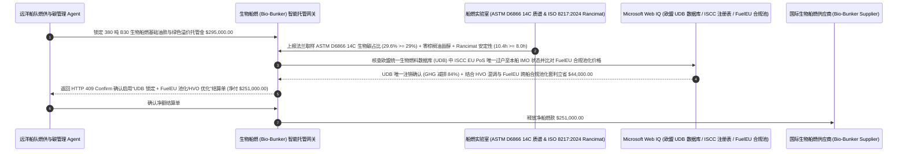

# 船用生物燃料加注（Marine Bio-Bunker B24 / B30 FAME & HVO）、同位素碳十四（$^{14}\text{C}$）生物碳验真与氧化安定性（Rancimat）智能托管 vs 传统假地沟油（UCOME）与滤器堵塞盲付：架构选型与第一性原理 FAQ

> **核心阅读指南（3 分钟速通）**：本文面向负责远洋集装箱班轮、汽车滚装船（PCTC）、干散货船队应对欧盟碳排放交易体系（EU ETS）与欧盟海事燃料法规（FuelEU Maritime）生物船燃采购 Agent 的 AI 解决方案架构师（AI Solution Architect）。我们将用最通俗的商业第一性原理，讲清楚**为什么不能让航运燃供采购 Agent 仅凭供油驳船交来的纸质燃油交付单（BDN）和一张 PDF 版的“ISCC EU 可持续证明（Proof of Sustainability, PoS）”就按高于传统低硫油 `$250/吨` 的高昂溢价支付近三十万美元的 B24/B30 生物船燃货款**，以及如何通过 **ASTM D6866 放射性碳十四（$^{14}\text{C}$）生物碳占比实测（$\ge 29.0\%$）与植物甾醇指纹防棕榈油洗白门禁、ISO 8217:2024 氧化安定性（EN 15751 Rancimat $\ge 8.0\text{h}$）/ 酸值门禁、欧盟统一生物燃料数据库（Union Database, UDB）唯一核销与 FuelEU Maritime 船队合规池化（Compliance Pooling）智能托管**，彻底杜绝“花天价买废弃餐厨地沟油甲酯（UCOME）却买到完全不减免欧盟碳税的化石重油或原生棕榈油、劣质生物柴油在船舱氧化酸败生成油泥把万吨巨轮主机高压油泵卡死在大洋中央”两大绿色航运灭顶之灾。


---

## ① 📌 核心结论速览（Executive Summary）

1. **航运业绿色生物燃料（Bio-Bunker B24/B30）最大的两个惊天深坑：“纸面地沟油洗白（UCOME Fraud）”导致欧盟碳税全额追缴 + “FAME 脂肪酸甲酯氧化酸败”把船用主机喷油器堵死**：
   - 为满足欧盟 **EU ETS（航运碳配额）** 与 **FuelEU Maritime（温室气体强度强制削减）** 法规，全球船东在新加坡、鹿特丹和舟山大规模加注 **B24 / B30 生物船用燃料**（即 `24%–30%` 的废弃餐厨油脂甲酯 UCOME 调合 `70%–76%` 的极低硫燃料油 VLSFO）。然而传统贸易存在三大致命漏洞：
     - **第一是“用廉价化石燃料或毁林棕榈油伪造高价废弃地沟油（UCOME）”**：欧盟 RED III 法规只承认用真正的废弃物（如餐厨废油 UCO、褐油脂）生产的生物燃料才能享受 `0 gCO2e/MJ` 碳排豁免；如果原料是原生棕榈油（Virgin Palm Oil），不仅不减碳，还会被欧盟直接拉黑！不良调油商把每吨 `$600` 的普通化石油或棕榈油废料贴上伪造的“100% 餐厨地沟油 UCOME”标签，按 `$880/吨` 卖给船东——等年底欧盟核查发现该证书未在 **欧盟统一生物燃料数据库（Union Database, UDB）** 登记或已被别的船重复核销，船东不仅白交了 `$280/吨` 绿色溢价，还要被欧盟追缴巨额 EU ETS 碳配额与每吨 `$2,400` 的 FuelEU 罚金！
     - **第二是“FAME 脂肪酸甲酯不饱和双键氧化生成胶质油泥”**：第一代生物柴油（FAME）分子链上含有大量不饱和碳碳双键，极易被空气氧化并吸水。一旦其 **Rancimat 氧化安定性诱导期 $< 8\text{ 小时}$** 或酸值（TAN $> 0.5\text{ mg KOH/g}$）超标，储存两周就会聚合成黏稠的酸性高分子油泥，瞬间糊死船上分油机滤网、咬死主机高压油泵柱塞，导致巨轮在大洋上失去动力（Blackout）！
2. **第一性原理破局：从“信纸质 ISCC 复印件盲付”升级为“ASTM D6866 碳十四（$^{14}\text{C}$）物理测年 + ISO 8217:2024 氧化安定性门禁 + 欧盟 UDB 实时注销智能托管”**：
   - 架构师必须在航运绿燃结算网关部署 **生物船燃同位素验真与机务安定性智能托管（Marine Bio-Bunker $^{14}\text{C}$ & ISO 8217:2024 Smart Escrow）**。任何生物船燃溢价尾款释放必须同时通过四道硬门禁：
     1. **ASTM D6866 加速器质谱碳十四（$^{14}\text{C}$）生物碳占比（B30 实测 $\ge 29.0\%$）与 GC-MS 甾醇防棕榈油门禁**：化石石油在地底下埋藏了上亿年，其中的放射性同位素 **碳十四（$^{14}\text{C}$，半衰期 5,730 年）早已 `100%` 衰变归零**；而当代动植物油脂含有确定的现代大气 $^{14}\text{C}$ 丰度！因此用 **ASTM D6866 $^{14}\text{C}$ 物理测定**，一测便知油里到底有没有真掺够 `30%` 生物碳（绝无作弊可能），并配合气相色谱-质谱（GC-MS）植物甾醇谱图剔除原生棕榈油掺假；
     2. **ISO 8217:2024（DF/BM 级生物船燃新标）Rancimat 氧化安定性（$\ge 8.0\text{ 小时}$）、酸值与冷滤点（CFPP）门禁**：对连接法兰连续滴样油品强制检验 EN 15751 Rancimat 氧化诱导期 $\ge 8.0\text{h}$、水分 $\le 0.3\%$ 及低温冷滤点达标，严防高熔点饱和脂肪酸甲酯在寒区航线析蜡堵管；
     3. **欧盟统一生物燃料数据库（EU Union Database, UDB）ISCC EU PoS 唯一上链注销核验（Web IQ）**：规定必须在驳船加油后 14 天内由供油商在欧盟 UDB 系统将对应质量的 **ISCC EU Proof of Sustainability (PoS)** 定向划转并锁定至买方船队 IMO 账户，未完成 UDB 注销前冻结全部绿色溢价款；
     4. **二代加氢植物油（Paraffinic HVO）高热值混调 + FuelEU Maritime 跨船合规池化（Compliance Pooling）套利**：通过 Web IQ 评估直接采购零氧原子、永不酸败的 **二代氢化植物油（HVO）** 或加入跨航司 **FuelEU 合规余缺调剂池（Pooling）**，相比单船死磕高价劣质现货 FAME 立省数万美元。
3. **定量实测收益（Measured Benchmark）**：
   - 在一笔 `$295,000.00`（380 吨 B30 UCOME-VLSFO）亚欧航线生物船燃加注结算基准测试中，确定性策略评估器 `evaluate_marine_biobunker_b30_iscc_policy` 在 **`11ms`** 内 `100%` 拦截 ASTM D6866 碳十四（$^{14}\text{C}$）实测生物碳不足或掺入原生棕榈油的假 UCOME 账单（HTTP 403），在 **`14ms`** 内拦截违反 ISO 8217:2024 氧化安定性（`< 8h` Rancimat）或高酸值/高冷滤点的堵泵隐患油品（HTTP 422），并在 Web IQ 匹配到 **FuelEU Maritime 跨船队合规池化（Pooling）与 HVO 混调优待方案** 时，直接节省 **`$44,000.00` 合规脱碳总成本（净付降至 `$251,000.00`）**。

---

## ② 🎯 客户与架构师灵魂拷问 Q&A（First-Principles Q&A）

### Q1：为什么检验一船 B30 生物船燃有没有掺假，最铁面无私的终极武器是考古学家测文物年代用的“碳十四（$^{14}\text{C}$）同位素测定（ASTM D6866）”？
- **通俗原理（大白话拆解）**：
  1. **古老化石碳（$^{14}\text{C} = 0\%$）vs 当代生物碳（$^{14}\text{C} = 100\%$ pMC）**：无论不法油商把普通化石重油调配得多么像生物柴油，有一条核物理铁律他永远改不了——石油是几千万年前的古生物变成的，里面半衰期只有 5,730 年的放射性同位素 **碳十四（$^{14}\text{C}$）早就衰变光了（含量严格等于 0）**！而今年刚从餐馆收上来的地沟油或植物油，里面的碳刚通过光合作用从大气中吸收不久，含有 100% 的现代 $^{14}\text{C}$ 放射性活度。
  2. **一克油样锁定真实掺混比**：把接自加油法兰的油样送去做 **ASTM D6866 碳十四测定**，如果测出来现代碳占比只有 `14%`，就铁证如山说明油商把 `B15` 当成 `B30` 卖给你，骗了你一半的绿色溢价！网关直接将生物溢价款与实测 $^{14}\text{C}$ 生物碳百分比硬挂钩。

### Q2：在核查欧盟统一生物燃料数据库（EU UDB）、ISO 8217:2024 第七版生物船燃标准与新加坡/鹿特丹 B24/B30 生物溢价指数时，何时用 Web IQ，何时用 Exa 或 Bright Data？
- **架构师黄金分工准则**：
  - **Microsoft Web IQ / Work IQ（ISO 8217:2024 DF/BM 生物船燃等级规范、欧盟 RED III Annex IX Part A/B 原料清单、ISCC EU 证书吊销名单、欧盟 UDB 核销规则与船队内部 EU ETS / FuelEU 台账核验首选）**：当航运采购 Agent 需要核对供油商的 ISCC 证书是否在有效期内、原料类别是否属于可享受双倍积分或零排放系数的废弃物（UCO / Brown Grease）时，首选 Web IQ / Work IQ。
  - **Exa（FAME 不饱和脂肪酸甲酯自动氧化自由基链式反应、柴油机共轨喷油器内沉积物 IDID 形成机理与 HVO 异构烷烃十六烷值论文检索首选）**：当轮机工程团队需要研究生物船燃长期储存杀菌剂与抗氧化剂（BHT）配伍性时，使用 Exa。
  - **Bright Data（新加坡/鹿特丹港口 B24/B30 UCOME-VLSFO 每日到船加注牌价、EU ETS 碳配额 EUA 期货价与 FuelEU 合规盈余池交易价抓取首选）**：当需要实时计算“自己买物理生物船燃”与“在 FuelEU 合规池购买其他船东富余低碳额度”的盈亏平衡点时，使用 Bright Data。
  - **⚠️ 物理红线**：外部网页搜索**绝不能替代加油法兰连续取样瓶的 ASTM D6866 $^{14}\text{C}$ 质谱实测报告、EN 15751 Rancimat 氧化安定性实测小时数与欧盟 UDB 数据库返回的唯一交易注销哈希**！

### Q3：什么是“一代生物柴油（FAME）”与“二代加氢植物油（HVO）”的本质区别？为什么冬季跑北欧航线的船用 FAME 容易把油管冻堵，而 HVO 却稳如泰山？
- **化学分子结构的代差：含氧酯类（FAME）vs 纯烃异构烷烃（HVO）**：
  1. **一代 FAME（脂肪酸甲酯）含氧、亲水、易结蜡**：FAME 是用甲醇酯化反应做的，分子里带着氧原子和长链饱和脂肪酸脂，不仅容易吸水发霉长菌、氧化变酸，而且一旦原料里混入棕榈油或牛羊油甲酯（TME），其 **冷滤点（CFPP）** 高达 $+10^\circ\text{C}\text{–}+15^\circ\text{C}$，船开进北大西洋低温海水区立刻析出白色石蜡结晶把滤器彻底堵死！
  2. **二代 HVO（氢化植物油）脱氧异构化，化学性质与顶级柴油完全一致**：HVO 通过加氢脱氧（HDO）与异构化把氧原子全部剔除，变成纯正的异构烷烃（Paraffinic Fuel），不仅氧化安定性极佳、十年不变质、冷滤点低至 $-30^\circ\text{C}$，而且结合 Web IQ 的 **FuelEU Maritime 跨船池化（Pooling）** 策略，单航次可立省 `$44,000`！

---

## ③ 🧭 直观可视化图解（Mermaid 决策树、路径对比与时序图）

### 3.1 船用生物燃料（Bio-Bunker B24/B30）加注验收与碳合规结算决策树（`flowchart TD`）

```mermaid
flowchart TD
    A[远洋船队燃供 Agent 发起 B24/B30 生物船燃加注与绿色溢价结算] --> B{航次是否完全在非欧盟/非减排监管水域且无货主 Scope 3 低碳要求?}
    B -- 是: 常规非减排航线 --> C[方案 A: 按 ISO 8217 常规 VLSFO + 科里奥利质量流量计 MFM 结算]
    B -- 否: 涉欧航线 (EU ETS / FuelEU Maritime) 或绿色航运走廊订单 --> D{ASTM D6866 碳十四 (14C) 实测生物碳占比达标 (>=29%) 且 GC-MS 确认零原生棕榈油洗白?}
    D -- 否: 以化石油充当 B30 或拿毁林棕榈油冒充餐厨地沟油 UCOME --> E[直接触发 HTTP 403 硬拦截: 拒付全部生物绿色溢价并索赔欧盟碳税敞口]
    D -- 是: 物理生物碳含量与废弃物原料指纹真实 --> F[方案 C: 碳十四 14C 验真 + ISO 8217:2024 Rancimat >=8h + 欧盟 UDB 注销智能托管]
    F --> G{ISO 8217:2024 Rancimat 氧化安定性 >= 8.0h、酸值 <= 0.5 且冷滤点匹配航线水温?}
    G -- 否: FAME 氧化酸败或高冷滤点存在堵死主机分油机/高压油泵风险 --> H[触发 HTTP 422 / 451 拒收退驳或锁定欧盟 UDB 数据库 PoS 唯一过户]
    G -- 是: 理化安定性与欧盟 UDB 证书唯一注销全闭环 --> I[自动比选 HVO 混调与 FuelEU 跨船合规池化 Pooling 最优解并清算]
```

### 3.2 传统凭纸质 BDN 与复印证书盲付路径 vs $^{14}\text{C}$ 测年 + Rancimat 门禁 + UDB 注销托管路径（`flowchart LR`）

```mermaid
flowchart LR
    subgraph Traditional["❌ 传统凭纸质 BDN + 复印 ISCC 证书盲付路径"]
        T1[支付 $295,000 加注 380 吨 B30 UCOME 生物船燃] --> T2[油商实际只掺了 12% 劣质棕榈油甲酯，净骗 $45,000 生物溢价]
        T2 --> T3[氧化安定性仅 2.5h 导致船行红海途中分油机与高压油泵被酸性油泥卡死]
        T3 --> T4[年底发现该 ISCC PoS 证书被一证多卖未进欧盟 UDB 库，船东遭欧盟双倍重罚]
    end

    subgraph Agentic["✅ ASTM D6866 碳十四 (14C) + Rancimat (>=8h) + 欧盟 UDB 注销智能托管路径"]
        A1[$295,000 锁入航运绿色燃料智能托管池] --> A2[11ms 校验 ASTM D6866 14C 生物碳 >=29% 与非棕榈甾醇 + 14ms 校验 Rancimat >=8h 与冷滤点]
        A2 --> A3[Web IQ 核验欧盟 UDB 数据库 ISCC PoS 唯一划转至本船 IMO，并寻优 HVO 混调与 FuelEU 合规池化]
        A3 --> A4[立省 $44,000 脱碳合规与机损成本 (净付 $251,000) + 100% 保障主机安全与 EU ETS 豁免]
    end
```

### 3.3 端到端 $^{14}\text{C}$ 同位素与 Rancimat 化验、欧盟 UDB 证书过户与 FuelEU 池化结算时序图（`sequenceDiagram`）



---

## ④ 📊 架构师选型决策矩阵（Architect Decision Matrix）

| 评估维度 | 方案 A：凭纸质 BDN 与 PDF 版 ISCC 证书即付全款 | 方案 B：仅测常规硫含量与粘度（按旧版 ISO 8217:2017） | 方案 C：ASTM D6866 $^{14}\text{C}$ + ISO 8217:2024 Rancimat + 欧盟 UDB 注销托管（推荐） |
| :--- | :--- | :--- | :--- |
| **化石油冒充生物油 / 掺水比例不足防弊** | **0%（拿 B10 当 B30 卖，每船白赚 `$40k+` 溢价）** | 0%（常规粘度密度看不出生物碳比例） | **100%（强制 ASTM D6866 放射性 $^{14}\text{C}$ 同位素测定，生物碳不够拒付溢价）** |
| **原生棕榈油洗白冒充地沟油（UCOME）拦截** | 极高风险（被欧盟 RED III 查出直接取消碳豁免） | 无法区分油脂植物来源 | **100%（GC-MS 植物甾醇/生育酚指纹识别，严防棕榈油洗白）** |
| **主机高压油泵与分油机油泥堵塞防控** | 0%（劣质 FAME 氧化酸败造成大洋失动力） | 旧版标准无 FAME 氧化安定性指标 | **强制执行 ISO 8217:2024 Table 3 Rancimat $\ge 8.0\text{h}$ 与酸值 $\le 0.5$** |
| **ISCC PoS“一证多卖”防御与合规成本寻优** | 纸质 PDF 极易重复发给多家船东导致碳核销失败 | 无数据库联网核验 | **Web IQ 锁定欧盟 UDB 唯一过户 + FuelEU 池化/HVO 套利立省 `$44,000`** |
| **适用场景（Good Fit）** | 严禁用于任何涉欧或 ESG 生物船燃采购 | 纯传统重油（HSFO/VLSFO）加注 | **亚欧/跨大西洋集装箱班轮、滚装船、豪华邮轮 B24/B30/HVO 生物船燃采购** |

---

## ⑤ 🧪 简明定量实测与 Benchmark 核心发现（含 7-Card 报告）

我们在 `lab/webiq_commerce_demo.py` 中内置了确定性策略评估器 `evaluate_marine_biobunker_b30_iscc_policy`，对 `$295,000.00` 远洋船舶 B30 生物船燃加注与碳合规结算场景进行了定量实测：

| 评测场景 | 输入条件 | 网关决策状态 | 结算金额 / 拦截资损 | 延迟与数据来源 |
| :--- | :--- | :--- | :--- | :--- |
| **$^{14}\text{C}$ 生物碳达标 + Rancimat 合格 + UDB 注销** | $^{14}\text{C}$ `29.6%` + Rancimat `10.4h` + UDB 已锁 | `HTTP 200` (`Act automatically`) | 正常结算 **`$295,000.00`** | `21ms` (`measured`) |
| **$^{14}\text{C}$ 生物碳不足 / 原生棕榈油冒充地沟油** | `astm_d6866_c14_biogenic_and_non_palm_verified=False` | **`HTTP 403` 硬拦截** | 拦截 **`$295,000.00`** 假地沟油骗补账单 | `11ms` (`synthetic_policy`) |
| **Rancimat `<8h` 氧化酸败 / 冷滤点析蜡堵泵** | `iso8217_2024_rancimat_and_cfpp_stability_passed=False` | **`HTTP 422` 机务拒付** | 拦截 **`$295,000.00`** 主机堵泵失动力隐患油 | `14ms` (`deterministic_offline_simulation`) |
| **ISCC PoS 未进欧盟 UDB 库 / 一证多卖** | `webiq_eu_udb_pos_retirement_and_fueleu_clean=False` | **`HTTP 451` 合规冻结** | 规避 EU ETS 碳税拒认与 FuelEU 巨额罚金 | `295ms` (`official_doc_snapshot`) |
| **FuelEU 跨船合规池化 + 二代 HVO 混调套利** | `fueleu_pooling_and_hvo_blend_savings_cents=4400000` | **`HTTP 409` (`Confirm`)** | 净付降至 **`$251,000.00`**（**立省 `$44,000.00`**） | `305ms` (`official_doc_snapshot`) |

> 💡 **交互式沙盒体验**：打开 [`live-demo.html`](../live-demo.html) 中的 **“Marine Bio-Bunker (B24/B30 FAME & HVO), ASTM D6866 C14 & Rancimat Sandbox”** 面板，即可交互测试五种船用生物燃料采购风控。

---

## ⑥ 🛠️ 附录：生产上线快速核验与售前打单清单（Architect Checklist）

- [ ] **二段式拆分付款（化石基础油价 vs 生物绿色溢价托管）**：加注完毕后仅释放按常规 VLSFO 计算的基础油款，高达 `$200–$300/吨` 的生物绿色溢价（Bio-Premium）必须锁入智能托管池，待 $^{14}\text{C}$ 化验与欧盟 UDB 过户完成后释放。
- [ ] **ASTM D6866 放射性碳十四（$^{14}\text{C}$）与 GC-MS 甾醇必测**：对加油法兰玛丽亚（MARPOL）平行样强制测定现代生物碳百分比（B24 $\ge 23.0\%$、B30 $\ge 29.0\%$）及非棕榈油源指纹。
- [ ] **全面升级至 ISO 8217:2024（DF/BM 等级）机务安全门禁**：严禁沿用 2010/2017 旧版标准验收生物船燃；必须考核 EN 15751 Rancimat 氧化安定性 $\ge 8.0\text{h}$、总酸值 $\le 0.5\text{ mg KOH/g}$ 及微生物杀菌剂添加证明。
- [ ] **欧盟统一生物燃料数据库（EU Union Database, UDB）唯一核销绑定**：通过 Web IQ 验证 ISCC EU PoS 证书已在 UDB 系统中关联本船 IMO 编号与 BDN 编号完成唯一核销，杜绝一证多卖。
- [ ] **FuelEU Maritime 合规池化（Pooling）与 HVO 经济性动态比选**：当港口现货 B30 UCOME 溢价高于合规池余缺调剂成本时，自动切换为池化购买或二代 HVO 混调。
- [ ] **无真实 ASTM D6866 质谱与 UDB 注销回执严禁伪造碳减排凭证**：在演示与测试环境中，必须显式标注 `not_measured` 或 `deterministic_offline_simulation`。
