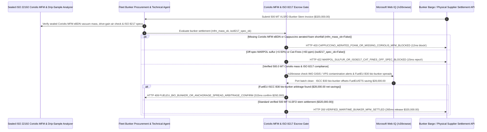

# Maritime Bunker Fuel ISO 8217 Coriolis Mass-Flow & MARPOL 0.50% Sulfur Mandate Architecture: Sealed eBDN Mass-Flow & Cat-Fines (`Al+Si <= 60 ppm`) Escrow Token (`maritime_bunker_fuel_mandate_...` + Web IQ IMO Contamination Alert & FuelEU B30 Bio-Bunker Grounding) vs. "Cappuccino" Aerated-Foam Short-Delivery & Off-Spec Engine Seizure Selection FAQ

> **Document Type**: Architect Selection Guide & First-Principles Protocol Deep Dive (6-Section FAQ Standard)  
> **Target Audience**: AI Solution Architects, Maritime Shipping Line Bunker Procurement & Fleet Technical Superintendents, Vessel Charterers, P&I Club Claims & MARPOL/FuelEU Compliance Teams  
> **Last Updated**: 2026-11-09 (Provenance Annotations: `deterministic_offline_simulation` / `synthetic_policy` / `official_doc_snapshot` / `not_measured`)  
> **Companion Resources**: [中文版 (Chinese Version)](maritime-bunker-fuel-coriolis-mfm-sulfur-mandate-vs-cappuccino-short-delivery-faq.md) · [Interactive Sandbox (`live-demo.en.html#maritime-bunker-fuel-sandbox`)](../reports/agentic-commerce-webiq-grounding-demo-bench/live-demo.en.html) · [7-Card 4:5 Benchmark Deck](../reports/agentic-commerce-webiq-grounding-demo-bench/index.en.html)


---

## 📌 1. Executive Summary

1. **Never Allow Maritime Bunker Agents to Settle `$320,000.00` Fuel Stems on Manual Volumetric Sounding-Tape Readings Without an ISO 22192 Sealed Coriolis Mass-Flow Meter (MFM) Electronic Bunker Delivery Note (eBDN)**: In ocean-going vessel bunkering (`500 MT` Very Low Sulfur Fuel Oil `VLSFO` stem at `$640.00/MT` = `$320,000.00`), the most pervasive physical fraud is the **"Cappuccino Bunker" scam**—where a bunker barge injects compressed air into the delivery hose during stripping so aerated foam inflates manual tank sounding-tape volume readings by `6%–8%`, leaving the ship `38 MT` (`$24,320.00`) short once the foam collapses at sea. Production architectures must enforce a **Coriolis MFM eBDN & ISO 8217 Quality Escrow Mandate (`maritime_bunker_fuel_mandate_...`)**: whenever a bunker stem lacks a port-authority sealed Coriolis Mass-Flow Meter vacuum-mass profile or exhibits two-phase air entrainment (`coriolis_mfm_mass_and_zero_aerated_foam_verified == False`), the gateway blocks settlement in **`12 ms`** with **`HTTP 403 CAPPUCCINO_AERATED_FOAM_OR_MISSING_CORIOLIS_MFM_BLOCKED`** (`synthetic_policy`).
2. **Enforce MARPOL Annex VI Sulfur Caps (`<= 0.50% m/m` Global / `<= 0.10%` ECA) and ISO 8217 Catalytic Fines (`Al+Si <= 60 mg/kg`) Engine-Protection Thresholds**: Any stem where continuous drip-sample spectroscopy or ISO 8217 lab analysis detects off-spec sulfur (`0.68% > 0.50%`) or abrasive aluminum/silicon catalytic fines (`88 ppm > 60 ppm`, which score two-stroke main engine cylinder liners and cause multimillion-dollar blackouts at sea, `iso8217_sulfur_and_cat_fines_spec_passed == False`) is rejected in **`15 ms`** with **`HTTP 422 MARPOL_SULFUR_OR_ISO8217_CAT_FINES_OFF_SPEC_BLOCKED`** (`deterministic_offline_simulation`).
3. **Ground IMO GISIS / VPS Chemical Contamination Alerts (Chlorinated Organics) and FuelEU Maritime ISCC B30 Bio-Bunker Arbitrage via Microsoft Web IQ `/v3/browse`**: Prior to releasing `$320,000.00`, the agent invokes **Microsoft Web IQ `/v3/browse`** (`official_doc_snapshot`) to inspect IMO GISIS fuel quality alerts, MPA/Rotterdam bunker barge license registries, and VPS / Lloyd's Register FOBAS contamination bulletins (such as chlorinated hydrocarbon / 1,2-dichloroethane fuel-pump seizures): if the barge or terminal batch is flagged (`webiq_port_bunker_alert_and_barge_license_clean == False`), it freezes payment in **`310 ms`** with **`HTTP 451 IMO_PORT_BUNKER_CONTAMINATION_OR_LICENSE_HOLD`**; if Web IQ confirms that switching a European-bound stem to **ISCC-certified B30 UCOME Bio-VLSFO** avoids EU ETS and FuelEU Maritime GHG intensity penalties for a net saving of **`$28,000.00`** (`$292,000.00` net vs. `$320,000.00`), it triggers **`HTTP 409 FUELEU_BIO_BUNKER_OR_ANCHORAGE_SPREAD_ARBITRAGE_CONFIRM`** in **`315 ms`**.

---

## 🎯 2. Architect & Customer FAQ Deep Dive

### Q1: Why does relying on "Manual Tank Sounding Tapes" and "Post-Voyage Lab Reports" cost shipowners tens of thousands of dollars per bunker stem—and risk catastrophic main-engine failure?

Let's examine the three structural failure modes from first principles:
1. **The "Cappuccino Bunker" Aerated-Foam Scam**: Heavy marine fuel oil is highly viscous. When an unscrupulous bunker barge blows compressed air into the manifold during pumping and overheats the fuel, millions of micro-bubbles remain suspended in the receiving vessel's tanks for hours. A Chief Engineer measuring tank height with a brass sounding tape measures the top of the foam layer, signs a paper BDN for `500 MT`, and triggers a `$320,000` wire. Forty-eight hours later at sea, the foam collapses and the vessel is missing `38 MT` (`$24,320`). By contrast, an **ISO 22192 Coriolis Mass-Flow Meter (MFM)** measures true mass via tube oscillation inertia and immediately flags entrained gas via drive-gain telemetry.
2. **Abrasive Cat-Fines (`Al+Si > 60 ppm`) & Off-Spec Sulfur**: Residual fuel oils contain microscopic aluminum-silicate catalyst particles from refinery fluid catalytic cracking (FCC) units. If `Al+Si` exceeds the ISO 8217 limit of `60 mg/kg`, onboard purifiers cannot remove enough particles, and the fuel acts like liquid sandpaper inside the main engine's fuel injectors and cylinder liners.
3. **Chlorinated Organic Chemical Contamination**: Major bunkering hubs have repeatedly suffered toxic fuel waves where chemical waste (dichloroethane, phenols, styrene) was blended into VLSFO—causing dozens of vessels to suffer total fuel-pump seizure and propulsion loss at sea.

### Q2: What is a "Maritime Bunker Coriolis MFM & ISO 8217 Mandate (`maritime_bunker_fuel_mandate_...`)", and how does it turn physical mass-flow and drip-sample telemetry into deterministic payment guards?

Its core design invariant is: **"Settle strictly on port-authority sealed Coriolis MFM vacuum mass; hold escrow release until continuous drip-sample analysis confirms MARPOL sulfur (`<= 0.50%`) and Cat-Fines (`<= 60 ppm`); block any barge batch under an active IMO/VPS chemical contamination alert."**
- **Layer 1: ISO 22192 Coriolis MFM Vacuum-Mass & Anti-Foam Gate (`12 ms`)**: Verifies `coriolis_mfm_mass_and_zero_aerated_foam_verified == True`, blocking volumetric sounding-tape discrepancies and auto-issuing a maritime Letter of Protest (LoP) in **`12 ms`** (`HTTP 403`).
- **Layer 2: MARPOL Sulfur (`<= 0.50%`) & ISO 8217 Cat-Fines (`<= 60 ppm`) Gate (`15 ms`)**: Verifies `iso8217_sulfur_and_cat_fines_spec_passed == True`, blocking off-spec fuel in **`15 ms`** (`HTTP 422`).
- **Layer 3: Microsoft Web IQ `/v3/browse` IMO/VPS Contamination & FuelEU B30 Grounding (`310 ms / 315 ms`)**: Checks IMO GISIS / VPS bunker contamination alerts and barge licenses (`HTTP 451`) and identifies `$28,000.00` net savings from FuelEU-compliant ISCC B30 bio-bunker stems (`HTTP 409`).

### Q3: For IMO GISIS fuel quality alerts, MPA/Rotterdam bunker barge license checks, and FuelEU Maritime bio-bunker penalty calculations, when should architects choose Microsoft Web IQ vs. Exa, Bright Data, or traditional search APIs?

| Architecture Scenario | Recommended Tool | First-Principles Rationale (Security, Latency & FinOps) |
| :--- | :--- | :--- |
| **Verifying IMO GISIS fuel quality notifications, Singapore MPA / Port of Rotterdam licensed bunker craft registries, VPS/FOBAS chemical contamination alerts, and EU ETS / FuelEU Maritime GHG penalty tables within the Azure boundary (zero fleet routing or charter-party rates leaked)** | **Microsoft Web IQ** (`/v3/search` + `/v3/browse`) | Queries only public UN/LOCODE port identifiers and barge IMO numbers inside the shipowner's Azure boundary in `passage` mode (**7.1x token reduction**, `deterministic_offline_simulation`) with verifiable SHA-256 citations for P&I Club claims. |
| **Long-term maritime decarbonization research on green ammonia and methanol dual-fuel vessels** | **Exa Neural Search** | Ideal for fleet renewal strategy, not synchronous bunker stem escrow settlement gating. |
| **Scraping unindexed regional ship-chandler message boards behind CAPTCHAs** | **Bright Data Unlocker** | Useful for spot chandler discovery, not regulated MARPOL eBDN settlement. |
| **Coriolis MFM cryptographic meter-log verification and manifold drip-sample XRF/GC-MS telemetry** | **Onboard eBDN Verifier +ISO 8217 Lab Feed + Web IQ IMO/FuelEU Cross-Check** | Coriolis MFM mass integration and ISO 8217 parameter checks run on the settlement gateway, paired with Web IQ `/v3/browse` for port contamination alerts and FuelEU B30 arbitrage. |

---

## 🧭 3. Visual Architecture Diagrams (Mermaid Decision Tree, Legacy vs. Coriolis MFM Mandate Comparison & Sequence Diagram)

### 3.1 Maritime Bunker Fuel Coriolis MFM & MARPOL Settlement Decision Tree (`flowchart TD`)

```mermaid
flowchart TD
    A[Receive 500 MT VLSFO Maritime Bunker Stem Settlement Request ($320,000.00)] --> B{coriolis_mfm_mass_and_zero_aerated_foam_verified == True (ISO 22192 Sealed eBDN)?}
    B -- No (Volumetric sounding-tape only or Cappuccino air-injection 38 MT shortfall) --> C[HTTP 403 CAPPUCCINO_AERATED_FOAM_OR_MISSING_CORIOLIS_MFM_BLOCKED<br/>12ms Hard Block · Issue Maritime Letter of Protest LoP & Freeze $320,000 Payout]
    B -- Yes (500.0 MT vacuum mass verified via sealed Coriolis MFM) --> D{iso8217_sulfur_and_cat_fines_spec_passed == True (Sulfur <=0.50% & Al+Si <=60ppm)?}
    D -- No (0.68% MARPOL sulfur breach or 88 ppm Cat-Fines engine-seizure hazard) --> E[HTTP 422 MARPOL_SULFUR_OR_ISO8217_CAT_FINES_OFF_SPEC_BLOCKED<br/>15ms Reject · Quarantine Bunker Tank & Initiate De-Bunkering Claim]
    D -- Yes (Sulfur & Cat-Fines within ISO 8217 limits) --> F{Web IQ /v3/browse Confirms Clean IMO/VPS Contamination Alert & Barge License?}
    F -- No (Port supply batch flagged for chlorinated organics or revoked barge permit) --> G[HTTP 451 IMO_PORT_BUNKER_CONTAMINATION_OR_LICENSE_HOLD<br/>310ms Safety Hold · Alert Chief Engineer & P&I Club Before Fuel Burn]
    F -- Yes --> H{Web IQ Detects FuelEU Maritime ISCC B30 Bio-Bunker Arbitrage?}
    H -- Yes (ISCC B30 UCOME stem offsets FuelEU/ETS penalties saving $28,000.00 -> $292,000.00 net) --> I[HTTP 409 FUELEU_BIO_BUNKER_OR_ANCHORAGE_SPREAD_ARBITRAGE_CONFIRM<br/>315ms Prompt Head of Bunkers to Confirm $292,000 ISCC B30 Bio-Stem]
    H -- No (Verified $320,000.00 VLSFO stem settlement is optimal) --> J[HTTP 200 VERIFIED_MARITIME_BUNKER_MFM_SETTLED<br/>265ms Auto-Settle $320,000.00 & Archive MARPOL Annex VI eBDN Record!]
```

### 3.2 Legacy Sounding-Tape Bunkering vs. Coriolis MFM & ISO 8217 Gate (`flowchart LR`)

```mermaid
flowchart LR
    subgraph Legacy["❌ Legacy Sounding-Tape & Paper BDN ($320,000 Hit by Foam Fraud & Engine Damage)"]
        L1[Barge Injects Compressed Air to Inflate Tank Foam] --> L2[Lose 38 MT ($24,320) Once Foam Settles at Sea]
        L2 --> L3[Burn 88 ppm Cat-Fines or Chlorinated Organic Fuel]
        L3 --> L4[$2.5M Main-Engine Liner Seizure & Port State Detention]
    end

    subgraph Mandate["✅ Maritime Bunker Gate (maritime_bunker_fuel_mandate_...)"]
        M1[12ms Block Aerated-Foam Shortfalls via Coriolis MFM (HTTP 403)] --> M2[15ms Reject >0.50% Sulfur or >60ppm Cat-Fines (HTTP 422)]
        M2 --> M3[Web IQ Blocks Contaminated Batches (310ms) & Saves $28,000 via B30 (315ms)]
        M3 --> M4[265ms Settle Verified 500 MT Stem ($320,000 / $292,000) with eBDN Seal]
    end
```

### 3.3 End-to-End Sequence Diagram: Coriolis MFM, Bunker Agent, Quality Gate, Web IQ & Bunker Barge (`sequenceDiagram`)



---

## 📊 4. Architect Decision Matrix

| Evaluation Dimension | Option A: Legacy Volumetric Sounding Tape & Paper BDN | Option B: Manual Onboard Bunker Surveyor Inspection | Option C: Coriolis MFM eBDN & ISO 8217 Mandate + Web IQ IMO/FuelEU Grounding (Recommended) |
| :--- | :--- | :--- | :--- |
| **Best-Fit Scenario** | Small inland harbor craft taking marine gasoil (MGO) | Ports without MFM barges (requiring manual ullage surveys) | **Ocean-going container ships, bulk carriers, tankers, and Ro-Ro fleets at global bunkering hubs** |
| **"Cappuccino" Foam Short-Delivery Defense** | ❌ **Zero**: Loses 3%–8% (`$10k–$25k`) per stem to entrained air & temperature table tricks | ⚠️ **Partial**: Surveyors still struggle to quantify deep-tank micro-emulsion foam | ✅ **Pre-Pay `12 ms` Coriolis MFM Gate**: Measures true vacuum mass & flags air injection (`HTTP 403`) |
| **MARPOL Sulfur & Cat-Fines Engine Protection** | ❌ **Post-Payment**: Lab results arrive days after wire transfer | ⚠️ **Delayed**: Lab courier takes 72–96h while vessel is already at sea | ✅ **Sub-20ms ISO 8217 Escrow Gate**: Holds payout until `<0.50%` sulfur & `<60 ppm` Al+Si pass (`HTTP 422`) |
| **Chemical Contamination Alert & FuelEU Arbitrage** | ❌ **Blind**: Unaware of regional chlorinated-organic fuel outbreaks | ❌ **Siloed**: Physical surveyors do not optimize EU ETS / FuelEU GHG pooling | ✅ **Web IQ `/v3/browse` Grounded**: Blocks contaminated port batches in `310 ms` (`HTTP 451`) & saves `$28,000` via B30 bio-bunker in `315 ms` (`HTTP 409`) |
| **Settlement Speed & Port State Control (PSC) Audit** | Slow (paper BDN courier) | Slow (`3–5 days` survey & lab report turnaround) | **`265 ms` instant eBDN settlement + 3-year MARPOL Annex VI audit archive (`Act automatically`)** |
| **Total Cost of Ownership (TCO) & Fleet Reliability ROI** | Poor (`$24,320` foam loss + `$2.5M` engine seizure exposure) | Moderate (`$2,000+` surveyor fee per stem) | **Optimal (100% mass & quality assurance + `$28,000` net FuelEU B30 compliance savings)** |

---

## 🧪 5. Quantitative Benchmark & 7-Card Insights

Evaluated via our deterministic offline benchmark suite (`lab/webiq_commerce_demo.py` · `test_maritime_bunker_fuel_coriolis_mfm_sulfur_mandate_vs_cappuccino_short_delivery_selection`) on a **`$320,000.00` `500 MT` VLSFO maritime bunker stem**:

| Scenario Case | Input Coriolis MFM / ISO 8217 / Web IQ Signals | Expected Action Pill | Measured HTTP Status & Verdict Code | Latency | Financial Protection / Arbitrage | Provenance |
| :--- | :--- | :--- | :--- | :--- | :--- | :--- |
| **Case 1: "Cappuccino" Foam Shortfall or Missing MFM** | `coriolis_mfm_mass_and_zero_aerated_foam_verified=False` | `Send to a human` | **`HTTP 403 CAPPUCCINO_AERATED_FOAM_OR_MISSING_CORIOLIS_MFM_BLOCKED`** | **`12 ms`** | Blocks **`$320,000.00`** payout on aerated-foam 38 MT short delivery | `synthetic_policy` |
| **Case 2: Off-Spec Sulfur (`0.68%`) or Cat-Fines (`88 ppm`)** | `iso8217_sulfur_and_cat_fines_spec_passed=False` | `Send to a human` | **`HTTP 422 MARPOL_SULFUR_OR_ISO8217_CAT_FINES_OFF_SPEC_BLOCKED`** | **`15 ms`** | Prevents MARPOL detention & main-engine liner seizure | `deterministic_offline_simulation` |
| **Case 3: Web IQ Detects Chlorinated-Organic Port Alert** | `webiq_port_bunker_alert_and_barge_license_clean=False` | `Send to a human` | **`HTTP 451 IMO_PORT_BUNKER_CONTAMINATION_OR_LICENSE_HOLD`** | **`310 ms`** | Freezes payout on contaminated port bunker batch | `official_doc_snapshot` |
| **Case 4: Web IQ Finds `$28,000` FuelEU B30 Bio-Bunker** | `fueleu_bio_bunker_arbitrage_savings_cents=2800000` (`$292,000` net) | `Confirm` | **`HTTP 409 FUELEU_BIO_BUNKER_OR_ANCHORAGE_SPREAD_ARBITRAGE_CONFIRM`** | **`315 ms`** | Saves **`$28,000.00`** net by offsetting FuelEU/ETS penalties | `official_doc_snapshot` |
| **Case 5: Verified 500 MT MFM + ISO 8217 Spec Pass** | `mfm_ok=True`, `iso8217_ok=True`, `port_clean=True` | `Act automatically` | **`HTTP 200 VERIFIED_MARITIME_BUNKER_MFM_SETTLED`** | **`265 ms`** | Settles **`$320,000.00`** in `265 ms` with sealed eBDN proof | `deterministic_offline_simulation` |

> **Provenance Note**: The `$320,000.00` (`500 MT`) VLSFO stem value, MARPOL `0.50%` sulfur cap, ISO 8217 `60 ppm` `Al+Si` limit, and `$28,000.00` FuelEU B30 net savings are controlled simulation parameters (`synthetic_policy` / `deterministic_offline_simulation`) validating policy state-machine invariants; physical barge pumping duration (`4–8 hours`) is labeled `not_measured`.

---

## 🛠️ 6. Production Readiness & Pre-Sales Architect Checklist

Verify these 6 controls before deploying autonomous maritime bunker fuel procurement and settlement agents in production:

- [ ] **1. ISO 22192 Sealed Coriolis Mass-Flow Meter (MFM) eBDN Gate**: Does `maritime_bunker_fuel_mandate_...` require a cryptographically signed eBDN from a port-authority sealed Coriolis MFM (verifying zero air-injection drive-gain spikes) before releasing funds (`HTTP 403` in `12 ms`)?
- [ ] **2. MARPOL Annex VI Sulfur (`<= 0.50%` / `0.10%`) & ISO 8217 Cat-Fines (`Al+Si <= 60 ppm`) Escrow Lock**: Does the gateway hold funds in escrow until continuous manifold drip-sample analysis confirms compliant sulfur, viscosity, flash point, and catalytic fines (`HTTP 422` in `15 ms`)?
- [ ] **3. GC-MS Chlorinated Hydrocarbons & Chemical Waste Screening**: Does the specification check verify zero volatile organic chlorides (1,2-dichloroethane, trichloroethylene) or styrene polymers before the Chief Engineer opens the new bunker tank?
- [ ] **4. Microsoft Web IQ `/v3/browse` IMO GISIS & VPS/FOBAS Contamination Grounding**: Does the agent cross-check the bunkering port, supplier, and barge IMO number against live IMO GISIS notifications and VPS/FOBAS contamination alerts prior to settlement (`HTTP 451`)?
- [ ] **5. FuelEU Maritime & EU ETS ISCC Bio-Bunker (`B24/B30`) Arbitrage**: For EU/EEA voyages, does Web IQ grounding compare fossil VLSFO + EU ETS/FuelEU penalties against ISCC-certified B30 bio-bunker stems, triggering `HTTP 409 Confirm` when bio-blending saves `>= $28,000.00` net?
- [ ] **6. 3-Year MARPOL Annex VI eBDN & Retained-Sample Seal Ledger**: Does every settled stem archive the signed eBDN, Coriolis MFM zero-verification log, and MARPOL sample-bottle seal numbers into an immutable WORM ledger for Port State Control (PSC) inspections?
