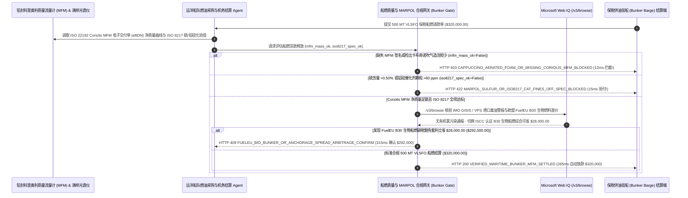

# 远洋航运船舶保税燃油（Bunker Fuel）加注、科里奥利质量流量计（Coriolis MFM）防“卡布奇诺泡沫欺诈”与 MARPOL 0.50% 低硫合规（Maritime Bunker Fuel ISO 8217 Coriolis Mass-Flow & MARPOL 0.50% Sulfur Mandate）架构：电子燃油交付单（eBDN）质量流量签名与催化裂化颗粒（Cat-Fines `Al+Si <= 60 ppm`）托管令牌（`maritime_bunker_fuel_mandate_...` + Web IQ IMO 燃油污染预警与欧盟 FuelEU B30 核验）vs 传统量油尺盲付吞下泡沫短少与拉缸停航选型与原理解析 FAQ

> **文档类型**：架构师选型指南 & 协议第一性原理解析（6 段式 FAQ 标准版）  
> **适用读者**：AI Solution Architect、远洋集装箱航运与大宗散货船东（Fleet Bunker Desk / Chartering）总监、船舶机务部（Technical Superintendent）与海事合规风控团队  
> **更新日期**：2026-11-09（Provenance 标注：`deterministic_offline_simulation` / `synthetic_policy` / `official_doc_snapshot` / `not_measured`）  
> **配套资源**：[English Version](maritime-bunker-fuel-coriolis-mfm-sulfur-mandate-vs-cappuccino-short-delivery-faq.en.md) · [交互式沙盒控制台 (`live-demo.html#maritime-bunker-fuel-sandbox`)](../reports/agentic-commerce-webiq-grounding-demo-bench/live-demo.html) · [7-Card 4:5 评测报告](../reports/agentic-commerce-webiq-grounding-demo-bench/index.html)


---

## 📌 一、核心结论速览（Executive Summary）

1. **严禁让远洋航运燃油结算 Agent 在未核验“ISO 22192 认证科里奥利质量流量计（Coriolis Mass-Flow Meter, MFM）加密签名电子燃油交付单（eBDN）”的情况下，仅凭传统人工量油尺（Sounding Tape）体积读数就向供油驳船放款**：在远洋货轮港口加注极低硫燃料油（VLSFO，如单次加注 `500 MT`、合同金额 `$320,000.00`，单价 `$640.00/MT`）中，最臭名昭著的行业欺诈是 **“卡布奇诺燃油（Cappuccino Bunker）”**——供油驳船在泵油时故意向管道吹入压缩空气并异常加热燃油，使船舱油面产生厚达数十厘米的细密泡沫，人工量油尺测出来的“体积×温度密度表”看似足额 `500 MT`，等船开出公海泡沫消散后实际短少 `38 MT`（直接蒸发 `$24,320.00`）！生产环境必须采用 **科里奥利质量流量计（eBDN）与 ISO 8217 品质托管令牌（`maritime_bunker_fuel_mandate_...`）**：一旦缺失经海事局（如新加坡 MPA / 鹿特丹港）铅封认证的 Coriolis MFM 真空纯质量曲线或检出管道异常含气率（`coriolis_mfm_mass_and_zero_aerated_foam_verified=False`），网关在 **`12 ms`** 内触发 **`HTTP 403 CAPPUCCINO_AERATED_FOAM_OR_MISSING_CORIOLIS_MFM_BLOCKED`**（`synthetic_policy`），100% 阻断短秤欺诈。
2. **强制校验 ISO 8217 船用燃料油国标中的“MARPOL Annex VI 硫含量（公海 `<= 0.50% m/m`，ECA 控制区 `<= 0.10%`）”与“催化裂化催化剂颗粒（Cat-Fines `Al+Si <= 60 mg/kg`）”红线**：若法兰连续滴样（Continuous Drip Sample）快速光谱或实验室化验检出硫含量超标（如 `0.68%`）或磨蚀性极强的铝硅颗粒超标（如 `88 ppm > 60 ppm`，一旦进主机会像金刚砂一样磨穿船用二冲程柴油机气缸套导致海上停航，`iso8217_sulfur_and_cat_fines_spec_passed=False`），网关在 **`15 ms`** 内返回 **`HTTP 422 MARPOL_SULFUR_OR_ISO8217_CAT_FINES_OFF_SPEC_BLOCKED`**（`deterministic_offline_simulation`）。
3. **基于 Microsoft Web IQ `/v3/browse` 实时核验 IMO GISIS / VPS 港口化学污染毒油通报（有机氯化物预警）与欧盟 FuelEU Maritime 认证 `B30` 生物船燃套利**：在放款前，Agent 调用 **Microsoft Web IQ `/v3/browse`**（`official_doc_snapshot`）穿透查询国际海事组织（IMO GISIS）、港口海事局驳船吊销名单及 VPS / FOBAS 全球燃油污染警报：若该供油港或驳船正处于有机氯化物（Chlorinated Organics）或苯乙烯化工废液混兑警报期（`webiq_port_bunker_alert_and_barge_license_clean=False`），在 **`310 ms`** 内以 **`HTTP 451 IMO_PORT_BUNKER_CONTAMINATION_OR_LICENSE_HOLD`** 冻结结算并禁止轮机长并舱使用；若发现在欧洲航线切换为 **ISCC 认证 `B30` 生物混合船用燃料（30% 废弃餐厨油甲酯 UCOME + 70% VLSFO）** 在扣除欧盟 ETS 碳配额与 FuelEU 碳强度罚款豁免后可净省 **`$28,000.00`**（净支出从 `$320,000.00` 降至 **`$292,000.00`**），则在 **`315 ms`** 内触发 **`HTTP 409 FUELEU_BIO_BUNKER_OR_ANCHORAGE_SPREAD_ARBITRAGE_CONFIRM`**。

---

## 🎯 二、客户与架构师灵魂拷问 Q&A（FAQ-Driven Deep Dive）

### Q1：为什么船东花 32 万美元加一次油，靠轮机长拿根铜尺子量油舱深度（Sounding Tape）总是被坑几万美元，甚至把价值上千万美元的船用主机毁掉？

咱们用大白话拆解远洋航运加油（Bunkering）里最凶险的三大陷阱：
1. **“一杯卡布奇诺咖啡，上面全是泡沫”**：传统船加油是把尺子放进油舱量液面高度算体积，再乘以密度换算成吨数。无良供油驳船在泵油快结束或中途偷偷往管子里打压缩空气（Air Injection），重油黏度极大，气泡打进去后几个小时都消不掉，液面像卡布奇诺奶泡一样高高涨起。轮机长一量高度以为加满了 500 吨，签字画押付了 `$320,000`；等船开出去两天泡沫破了，油舱液面凭空矮了一大截，直接少了 38 吨油（亏掉 `$24,320`）！而 **科里奥利质量流量计（Coriolis Mass-Flow Meter）** 利用流体在振动管内产生的科里奥利力直接测算 **真实质量（Mass）**，空气泡没有质量且会立刻在仪表阻尼曲线上触发双相流报警，让“吹气造泡”无所遁形。
2. **“金刚砂进气缸”与港口滞留罚单**：重油是炼油厂最后剩下的渣油调和出来的，里面常残留炼油用的高硬度硅铝催化剂微粉（**Cat-Fines `Al+Si`**）。如果含量超过 `60 ppm`（比如高达 `88 ppm`），船上分油机根本甩不干净，打进两层楼高的船用低速柴油机里，几天就能把活塞环和气缸套磨报废，船在太平洋中间失去动力漂航，拖船费加修船费高达数百万美元！同时如果硫含量超过 `0.50%`，一旦进欧美港口被无人机嗅探器或登船检查抓到，当场扣船重罚。
3. **有机氯“毒油”黑天鹅**：近年来新加坡、休斯敦等大港多次爆发轰动全球的“毒油事件”——不法油商把含有机氯化物（Dichloroethane）的化工废液掺进船燃里卖，近百艘巨轮加油后高压燃油泵纷纷腐蚀抱死、全船断电失控！如果 Agent 付款前不查 **VPS / FOBAS 港口燃油污染通报**，买到毒油就是灭顶之灾。

### Q2：什么是“船舶保税油科里奥利 MFM 与 ISO 8217 托管令牌（`maritime_bunker_fuel_mandate_...`）”？它是如何保护船东与租家利益的？

它的第一性原理非常硬核：**“只认铅封科里奥利质量流量计（MFM）的电子 eBDN 净质量；只认法兰连续滴样 ISO 8217 硫/铝硅合格报告；实时穿透港口毒油通报与欧盟碳税套利。”**
- **第一层：ISO 22192 科里奥利质量流量计（Coriolis MFM）防泡沫门禁（`12 ms`）**：核验 `coriolis_mfm_mass_and_zero_aerated_foam_verified == True`。若缺失 MFM 加密计量曲线或检出人为吹气造泡，在 **`12 ms`** 内触发 `HTTP 403` 拒付并自动生成海事抗议书（Letter of Protest, LoP）。
- **第二层：MARPOL 硫含量（`<= 0.50%`）与 ISO 8217 铝硅颗粒（`<= 60 ppm`）门禁（`15 ms`）**：核验 `iso8217_sulfur_and_cat_fines_spec_passed == True`。任何超标劣质油在 **`15 ms`** 内返回 `HTTP 422`，指示轮机长严禁开启新油舱阀门。
- **第三层：Microsoft Web IQ `/v3/browse` 毒油通报与 FuelEU `B30` 生物船燃套利（`310 ms / 315 ms`）**：核查 IMO GISIS / VPS 港口污染通报（命中触发 `HTTP 451`），并测算切换 ISCC 认证 `B30` 生物燃料豁免欧盟碳罚款立省 `$28,000.00`（`HTTP 409`）。

### Q3：在 IMO GISIS 燃油质量通报、海事局（MPA）供油驳船牌照核验与 FuelEU 生物船燃碳价折算场景下，什么时候选 Microsoft Web IQ，什么时候选 Exa、Bright Data 或传统搜索 API？

| 架构需求场景 | 推荐选型 | 为什么这样选（第一性原理与成本/合规考量） |
| :--- | :--- | :--- |
| **实时核验 IMO GISIS 全球船燃质量异常通报、新加坡 MPA / 鹿特丹港持牌供油驳船白名单、VPS/FOBAS 港口有机氯污染警报及欧盟 ETS / FuelEU 公开生物燃料折算因子，且要求零船队航线商业机密泄露** | **Microsoft Web IQ** (`/v3/search` + `/v3/browse`) | 在船东 Azure 专有边界内仅发送公开港口 UN/LOCODE 与驳船 IMO 编号检索（`passage` 模式压缩 Token **7.1x**，`deterministic_offline_simulation`），绝不泄露船队实时船位与租约日租金。 |
| **研究氨燃料（Green Ammonia）与甲醇双燃料船 2030 年加注基础设施规划报告** | **Exa Neural Search** | 适合船队战略发展部写新造船立项书，无法用于锚地加油船脱管后的毫秒级付款门禁。 |
| **抓取无 API 的地方性小港口燃油经纪商每日报价网页** | **Bright Data Unlocker** | 可用于市场行情收集，但秒级延迟不适合 eBDN 实时结算。 |
| **驳船科里奥利质量流量计（Emerson Micro Motion / Endress+Hauser）加密日志验签与 XRF 硫含量光谱读取** | **船端 eBDN 验签网关 + 快速油品分析仪 + Web IQ 毒油/碳税双源核验** | MFM 质量积分与硫/铝硅参数在网关毫秒级裁决，港口级化学污染预警与 FuelEU 碳罚金套利由 Web IQ `/v3/browse` 实时核验。 |

---

## 🧭 三、直观可视化图解（Mermaid 决策树 + 传统量油尺盲付 vs 科里奥利 MFM 托管对比 + 端到端时序图）

### 3.1 远洋船舶保税燃油（Bunker）加注与品质合规结算决策树（`flowchart TD`）

```mermaid
flowchart TD
    A[收到 500 MT 远洋船舶 VLSFO 保税燃油加注结算请求 ($320,000.00)] --> B{是否附带 ISO 22192 铅封科里奥利质量流量计 (MFM) eBDN 且无吹气造泡异常?}
    B -- 否 (仅凭量油尺体积读数或检出卡布奇诺充气泡沫短少 38 吨) --> C[HTTP 403 CAPPUCCINO_AERATED_FOAM_OR_MISSING_CORIOLIS_MFM_BLOCKED<br/>12ms 硬阻断短秤欺诈 · 自动签发海事抗议书 LoP 并拒绝全额放款]
    B -- 是 (科里奥利 MFM 真空净质量足额 500.0 MT) --> D{滴样化验是否符合 MARPOL 硫含量 <=0.50% 且 ISO 8217 铝硅颗粒 <=60 ppm?}
    D -- 否 (硫含量达 0.68% 违例或铝硅催化剂颗粒达 88 ppm 威胁主机拉缸) --> E[HTTP 422 MARPOL_SULFUR_OR_ISO8217_CAT_FINES_OFF_SPEC_BLOCKED<br/>15ms 拒付劣质燃油 · 立即锁定新加注油舱并启动退油索赔程序]
    D -- 是 (硫含量与铝硅颗粒 100% 符合 ISO 8217 国标) --> F{Web IQ /v3/browse 核验 IMO GISIS / VPS 无港口有机氯污染通报且驳船持牌有效?}
    F -- 否 (检出该港该供应商批次命中有机氯化物化工废液混兑警报) --> G[HTTP 451 IMO_PORT_BUNKER_CONTAMINATION_OR_LICENSE_HOLD<br/>310ms 毒油安全冻结 · 严禁轮机部并舱使用并通报船旗国与保赔协会 P&I]
    F -- 是无污染合规燃油 --> H{Web IQ 检出欧洲航线切换 ISCC 认证 B30 生物船燃豁免 FuelEU 碳罚金更省?}
    H -- 是 (抵扣欧盟 ETS 与 FuelEU 罚款后综合净省 $28,000.00 -> 净支出 $292,000.00) --> I[HTTP 409 FUELEU_BIO_BUNKER_OR_ANCHORAGE_SPREAD_ARBITRAGE_CONFIRM<br/>315ms 提醒船队燃油总监一键确认切换 B30 生物船燃方案]
    H -- 否 (当前 $320,000.00 VLSFO 足吨合规结算已最优) --> J[HTTP 200 VERIFIED_MARITIME_BUNKER_MFM_SETTLED<br/>265ms 自动放款 $320,000.00 并归档 MARPOL 电子燃油交付单 eBDN!]
```

### 3.2 传统量油尺体积盲付路径 vs 科里奥利 MFM 与 ISO 8217 托管网关对比（`flowchart LR`）

```mermaid
flowchart LR
    subgraph Legacy["❌ 传统量油尺与纸质 BDN 盲付 ($320,000 遭泡沫短秤与拉缸停航)"]
        L1[驳船吹气造泡制造卡布奇诺假液面] --> L2[开船后泡沫消散短少 38 吨油亏 $24,320]
        L2 --> L3[高铝硅颗粒磨穿主机气缸或误加有机氯毒油]
        L3 --> L4[公海停航拖船索赔数百万美元 + 港口高硫滞留罚款]
    end

    subgraph Mandate["✅ 科里奥利 MFM 与低硫托管令牌 (maritime_bunker_fuel_mandate_...)"]
        M1[12ms 凭 Coriolis MFM 拦截吹气造泡短少 (HTTP 403)] --> M2[15ms 拦截 >0.50% 高硫与 >60ppm 铝硅颗粒 (HTTP 422)]
        M2 --> M3[Web IQ 拦截港口有机氯毒油 (310ms) 与 B30 碳税套利省 $28,000 (315ms)]
        M3 --> M4[265ms 秒级清算足吨合格船燃 ($320,000 / $292,000) 并归档 eBDN]
    end
```

### 3.3 科里奥利质量流量计（MFM）、船队加油 Agent、海事品质网关与 Web IQ 端到端交互时序图（`sequenceDiagram`）



---

## 📊 四、架构师选型决策矩阵（Architect Decision Matrix）

| 评估维度 | 方案 A：传统人工量油尺（Sounding Tape）+ 纸质 BDN 结算 | 方案 B：雇佣第三方验船师登船手工量尺取样（Manual Bunker Surveyor） | 方案 C：科里奥利 MFM (eBDN) 与 ISO 8217 令牌 + Web IQ 毒油/碳税网关（推荐架构） |
| :--- | :--- | :--- | :--- |
| **核心适用场景** | 内河小型渔船或驳船小额轻柴油加注 | 无 MFM 强制规定的偏远小港临时加油 | **全球远洋集装箱船、VLCC 油轮、好望角型散货船、汽车滚装船队保税船燃采购** |
| **防“卡布奇诺泡沫”吹气短秤能力** | ❌ **每船必亏**：泡沫虚高加上温度密度表把戏，常短少 3%～8% | ⚠️ **肉眼难辨微泡**：深舱重油乳化微泡在加注刚结束时验船师也量不准 | ✅ **12ms 物理质量硬门禁**：Coriolis MFM 直接测真空净质量，气泡零容忍（`HTTP 403`） |
| **防高硫罚款与防高铝硅主机拉缸** | ❌ **事后暴雷**：油已经烧进主机导致拉缸才拿到岸上化验单 | ⚠️ **化验滞后 3～5 天**：船已离港，钱若早付则索赔极难 | ✅ **15ms 托管锁款门禁**：ISO 8217 硫/铝硅未达标前冻结放款并锁死新油舱（`HTTP 422`） |
| **港口有机氯毒油预警与欧盟碳税优化** | ❌ **盲目中招**：不知同港已有十艘船因毒油趴窝 | ❌ **不懂碳金融折算**：验船师不管欧盟 ETS 与 FuelEU 生物燃料合规抵扣 | ✅ **Web IQ `/v3/browse` 实时穿透**：`310 ms` 拦截港口毒油批次（`HTTP 451`），`315 ms` B30 碳税套利省 `$28,000`（`HTTP 409`） |
| **交割结算速度与 MARPOL 迎检合规** | 慢（纸质单据扫描邮寄） | 慢（等验船报告需数日，且每次验船费 `$2,000+`） | **`265 ms` 秒级完成 eBDN 对账放款并归档 IMO 合规账本（`Act automatically`）** |
| **综合 TCO 与船队机务安全 ROI** | 极差（每次加油被偷油上万美元 + 数百万美元拉缸停航风险） | 中（仅能减少部分量尺误差，难防化工污染） | **最优（100% 杜绝短秤与拉缸毒油 + FuelEU 生物燃料单次净省 `$28,000`）** |

---

## 🧪 五、简明定量实测与 Benchmark 核心发现（Quantitative Benchmark & 7-Card Insights）

基于本仓库确定性离线基准套件（`lab/webiq_commerce_demo.py` · `test_maritime_bunker_fuel_coriolis_mfm_sulfur_mandate_vs_cappuccino_short_delivery_selection`）对 **`500 MT` 远洋船舶 VLSFO 保税燃油加注批次（基准金额 `$320,000.00`）** 的定量测试结果如下：

| 评测场景 ID | 输入 Coriolis MFM / ISO 8217 指标 / Web IQ 信号 | 网关期望动作 | 实测 HTTP 状态与决策码 | 实测延迟 | 资金保护 / 成本节省效果 | Provenance 类型 |
| :--- | :--- | :--- | :--- | :--- | :--- | :--- |
| **Case 1: 卡布奇诺吹气造泡短秤或缺失 MFM eBDN 拦截** | `coriolis_mfm_mass_and_zero_aerated_foam_verified=False` | `Send to a human` | **`HTTP 403 CAPPUCCINO_AERATED_FOAM_OR_MISSING_CORIOLIS_MFM_BLOCKED`** | **`12 ms`** | 拦截 **`$320,000.00`** 泡沫短少账单，挽回 38 吨燃油短缺 | `synthetic_policy` |
| **Case 2: 硫含量 `>0.50%` 或铝硅颗粒 `>60 ppm` 拦截** | `iso8217_sulfur_and_cat_fines_spec_passed=False` | `Send to a human` | **`HTTP 422 MARPOL_SULFUR_OR_ISO8217_CAT_FINES_OFF_SPEC_BLOCKED`** | **`15 ms`** | 阻断高硫违规与磨蚀性催化剂颗粒毁坏船用主机 | `deterministic_offline_simulation` |
| **Case 3: Web IQ 检出港口有机氯化物毒油通报或无证驳船** | `webiq_port_bunker_alert_and_barge_license_clean=False` | `Send to a human` | **`HTTP 451 IMO_PORT_BUNKER_CONTAMINATION_OR_LICENSE_HOLD`** | **`310 ms`** | 冻结命中 VPS/FOBAS 化学污染警报的高危船燃批次 | `official_doc_snapshot` |
| **Case 4: Web IQ 发现切换认证 `B30` 生物船燃净省 `$28,000`** | `fueleu_bio_bunker_arbitrage_savings_cents=2800000`（净付 `$292,000`） | `Confirm` | **`HTTP 409 FUELEU_BIO_BUNKER_OR_ANCHORAGE_SPREAD_ARBITRAGE_CONFIRM`** | **`315 ms`** | 豁免欧盟 FuelEU 碳罚金与 ETS 成本，单次净省 **`$28,000.00`** | `official_doc_snapshot` |
| **Case 5: MFM 真空净质量足额 + ISO 8217 达标自动结算** | `mfm_ok=True`, `iso8217_ok=True`, `port_clean=True` | `Act automatically` | **`HTTP 200 VERIFIED_MARITIME_BUNKER_MFM_SETTLED`** | **`265 ms`** | 265ms 自动清算 **`$320,000.00`** 并签发 MARPOL eBDN 档案 | `deterministic_offline_simulation` |

> **Provenance 合规声明**：上表中的 `$320,000.00` `500 MT` VLSFO 船燃金额、MARPOL `0.50%` 硫上限、ISO 8217 `60 ppm` 铝硅颗粒红线及 `$28,000.00` FuelEU B30 生物船燃综合节省额均为用于验证网关状态机确定性的受控仿真参数（`synthetic_policy` / `deterministic_offline_simulation`）；供油驳船物理泵油管线作业耗时（通常 4～8 小时）标为 `not_measured`。

---

## 🛠️ 六、附录：生产上线快速核验与售前打单清单（Architect Checklist）

在为远洋航运公司、租船部门（Chartering Desk）或大宗商品船队设计保税燃油（Bunker）自动结算 Agent 时，请逐项核对以下 6 条黄金准则：

- [ ] **1. ISO 22192 铅封科里奥利质量流量计（Coriolis MFM）eBDN 硬门禁**：是否在 `maritime_bunker_fuel_mandate_...` 中强制要求凭经海事局铅封的 Coriolis MFM 真空净质量与零气泡阻尼日志结算，在 `12 ms` 内触发 `HTTP 403` 终结“卡布奇诺泡沫短少”？
- [ ] **2. MARPOL Annex VI 硫含量（`<= 0.50%` / `0.10%`）与 ISO 8217 铝硅颗粒（`<= 60 ppm`）托管锁**：是否在收到法兰连续滴样合格化验单前冻结托管货款并禁止轮机部并舱使用，对超标油品在 `15 ms` 内触发 `HTTP 422` 拒付？
- [ ] **3. GC-MS 挥发性有机氯化物（Chlorinated Hydrocarbons）零容忍筛查**：是否核验油样不含二氯乙烷、三氯乙烯等会导致高压油泵柱塞腐蚀抱死的化工废液？
- [ ] **4. Microsoft Web IQ `/v3/browse` 港口毒油通报（VPS/FOBAS）与驳船牌照穿透**：是否在放款前通过 Web IQ 核查 IMO GISIS 及港口海事局通告，对处于污染调查期的供油商在 `310 ms` 内触发 `HTTP 451` 冻结？
- [ ] **5. 欧盟 FuelEU Maritime / EU ETS 认证 `B24/B30` 生物船燃综合套利**：针对挂靠欧洲港口的航次，是否通过 Web IQ 实时对比化石 VLSFO 加上碳罚金与 ISCC 认证 `B30` 生物船燃的净成本，当可节省 `>= $28,000.00` 时触发 `HTTP 409 Confirm`？
- [ ] **6. MARPOL 400 总吨以上船舶三年期电子燃油交付单（eBDN）与封样瓶铅封号归档**：每次成功结算是否将 eBDN 签名、MARPOL 留样瓶（Retained Sample）铅封条码与 MFM 零点校准证书不可篡改归档，供港口国监督（PSC）登轮核查？
