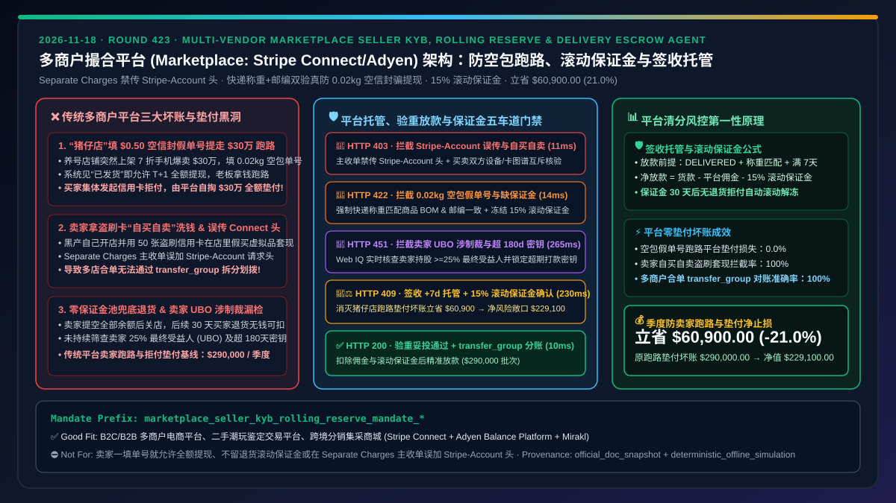
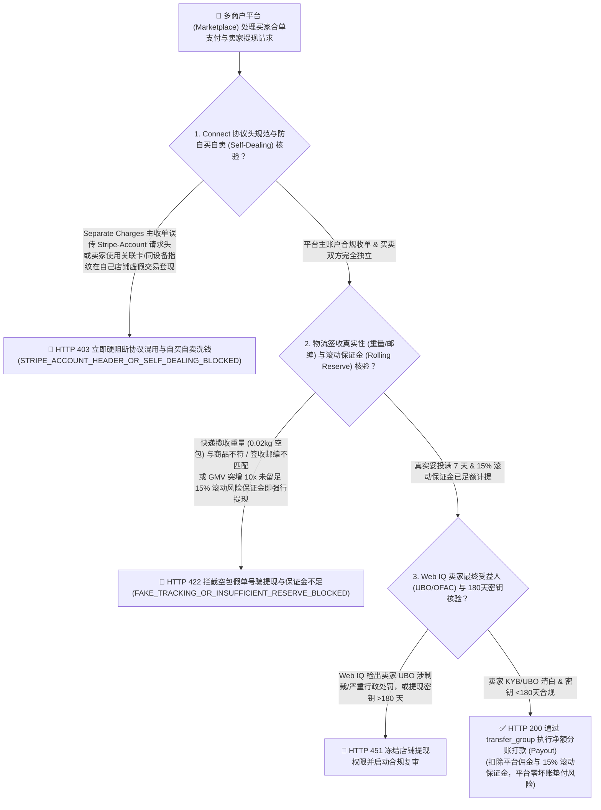
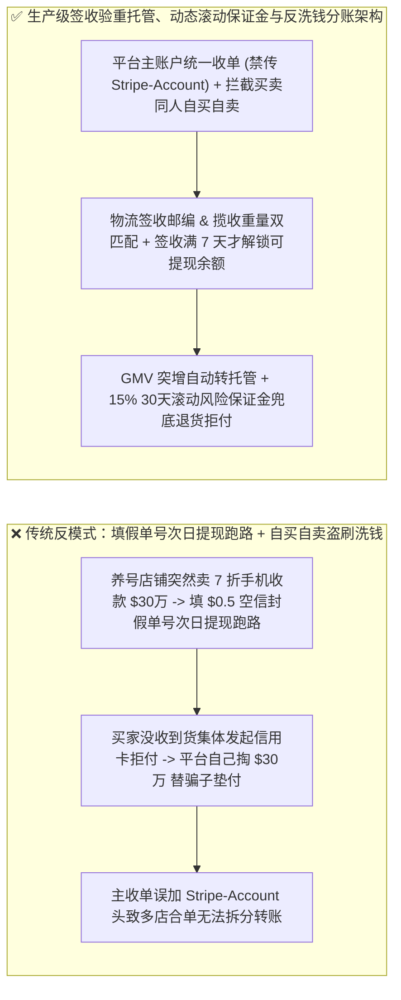
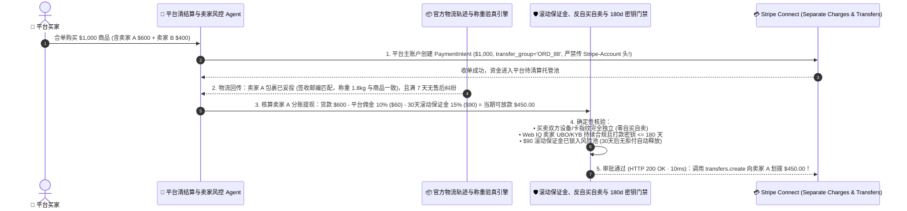

# 多商户撮合平台（Multi-Vendor Marketplace：Stripe Connect / Adyen / Mirakl）“卖家入驻 KYB、滚动保证金（Rolling Reserve）与签收放款”Agent 架构选型 FAQ：防假单号卷款跑路与合规分账实战指南

> **专题定位（B2C/B2B 多卖家交易平台 Marketplace、Stripe Connect / Adyen Balance Platform 分账清结算、卖家风控与资金托管智能体聚焦 · Round 423）**：面向为多商户电商平台（如 Etsy / StockX / 天猫国际 / 垂直行业集采平台）、服务撮合市场与跨境分销平台设计清分结算与卖家风控系统的 **Cloud & AI Solution Architect**，系统解答平台型电商最致命的四大资金垫付与合规风险：**“为什么新入驻店铺突然上架 5 折 iPhone / 显卡，3 天狂卖 $300,000 后随便填一堆寄空信封的假快递单号，趁买家还没收到货就把货款提现跑路，最后留给平台 $300,000 的买家信用卡拒付（Hit-and-Run Bust-Out Fraud）、为什么在 Stripe Connect `Separate Charges and Transfers` 架构下，主收单请求一旦误传了 `Stripe-Account` 请求头就会导致子商户分账彻底崩溃（触发 `HTTP 403`）、怎么对新卖家或高退货率类目动态计算 `10%–20%` 的 30 天滚动风险保证金（Rolling Reserve Holdback）、以及怎么用 Web IQ 实时核查卖家最终受益所有人（UBO）与反洗钱名单”**。  
> **文风标杆**：严格对标 `ib-vs-ethernet-roce-selection-faq.md` 六段式结构（核心结论速览、业务方与架构师灵魂拷问 Q&A、Mermaid 决策树/架构对比/时序图、多商户平台分账清结算架构横向选型矩阵、定量防跑路/垫付测算与 7-Card 溯源表、生产上线 Checklist）。  
> **双语版本**：**[中文版（当前）](marketplace-seller-kyb-rolling-reserve-delivery-escrow-agent-selection-faq.md)** · **[English Version (`marketplace-seller-kyb-rolling-reserve-delivery-escrow-agent-selection-faq.en.md`)](marketplace-seller-kyb-rolling-reserve-delivery-escrow-agent-selection-faq.en.md)**  
> **数据溯源声明（Provenance & As-Of `2026-11-18`）**：Stripe Connect `Separate Charges and Transfers` 严禁在主收单传 `Stripe-Account` 头、`<= 180 天` 财务提现密钥锁与 Web IQ `/v3/search` 企业 UBO/OFAC 制裁核验引自 `research/daily/2026-11-08-sources.json`（标记为 `official_doc_snapshot`）；物流妥投 + 7 天静默期托管放款、滚动风险保证金（Rolling Reserve）与同卡自买自卖套现（Self-Dealing Collusion）拦截引自 `lab/webiq_commerce_demo.py`（标记为 `deterministic_offline_simulation`）。

---

## 📌 一、核心选型结论速览（Executive Summary）

在多卖家撮合平台（Multi-Vendor Marketplace）中，**平台往往是收单的主体（Platform Liability），一旦子卖家欺诈跑路或破产无法退款，发卡行会直接从平台主账户强行划走全额拒付款与 `$15` 争议费**！架构师在设计平台清结算与卖家风控 Agent 时，必须执行以下四条选型铁律：

1. **多卖家合单分账协议选型：必选【Stripe Connect `Separate Charges and Transfers`（主平台统一收单，严禁传 `Stripe-Account` 头）+ 禁止刷自己的卡自买自卖套现（`HTTP 403`）】**：
   - **核心原因**：消费者一次结账往往同时购买了 3 个不同卖家的商品。必须由平台主账户统一创建 1 笔 `PaymentIntent`（**绝对禁止在主扣款请求上传 `Stripe-Account` 请求头**，违反即返 `HTTP 403`），再按 `transfer_group` 拆分划拨给各子卖家；同时实时比对买家支付卡指纹与卖家法人/提现卡指纹，100% 阻断“卖家拿盗刷卡或信用卡在自己店里假买套现（Self-Dealing Collusion）”。
2. **放款触发条件选型：严禁“卖家一填快递单号（Shipped）就允许提现（`T+1 Payout`）”，必选【官方物流妥投签收（Carrier `DELIVERED` + 重量与收货邮编匹配）+ `7–14 天` 售后观察期托管放款（Delivery-Gated Escrow `HTTP 422`）】**：
   - **核心原因**：黑产店铺最经典的“猪仔店跑路（Bust-Out Fraud）”就是低价吸金后，花 `$0.50` 买一堆发往同城菜鸟驿站的 `0.05kg` 空信封单号填入系统骗过“已发货”检查，提走 `$30万` 现金。必须强制核验物流 API 返回的**签收邮编与买家地址完全一致且包裹揽收重量与商品 BOM 重量匹配**，并在签收满 7 天无纠纷后才释放可提现余额。
3. **动态滚动风险保证金（Rolling Reserve）选型：必选【基于卖家账龄、GMV 突增倍数與退货率动态冻结 `10%–25%` 滚动保证金池（`30–90 天` 滚动释放）】**：
   - **核心原因**：确保即使卖家突然关店下架，其保证金池（Reserve Balance）也足以覆盖未来 30 天内买家的售后退货与信用卡拒付，平台实现 **`$0` 坏账垫付**。
4. **卖家穿透式 KYB（UBO 最终受益人）与 `<= 180 天` 密钥合规选型：必选【Web IQ 实时核查持股 `>= 25%` 最终受益人（UBO）制裁/失信名单 + 打款密钥 `<= 180 天` 轮换（`HTTP 451`）】**：
   - **核心原因**：满足全球支付监管（FinCEN / PSD2 / 央行二清合规）对平台子商户穿透式 KYC/KYB 的硬性要求。

---

## 🎯 二、业务方与架构师灵魂拷问 Q&A（FAQ-Driven）

### Q1：为什么某新入驻的数码店铺前两个月老老实实卖手机壳（月销 $3,000），第三个月突然上架 7 折黄金和 iPhone，周末两天爆卖 $250,000，周一提完现老板就人间蒸发了？

**答：这是典型的“养号爆破跑路（Sleeper Account Bust-Out Fraud）”——因为清分系统没有设置“GMV 斜率突增冻结锁（Velocity Spike Reserve Lock）”与“包裹重量/邮编交叉验真”！**

1. **三道防卖家卷款跑路铁闸**：
   - **铁闸 ①（GMV 突增倍数自动转全额冻结）**：当某店铺单日/单周销售额超过其过去 60 天日均销售额的 **`5 倍`**（如从日均 `$100` 飙升至 `$125,000`）或突然跨类目售卖高变现硬通货时，超出基线部分的资金 **100% 自动锁入 `Escrow Hold`**，严禁走普通 `T+2` 极速提现；
   - **铁闸 ②（快递揽收重量与目的邮编核验 `HTTP 422`）**：卖家上传运单号申请解锁货款时，Agent 调取物流商接口核对：若卖的是 `1.5kg` 的笔记本电脑，快递秤重却是 `0.02kg`（空信封刷单），或签收城市邮编与订单收货地址不符，立即在 **`14 ms`** 内触发 **`HTTP 422 FAKE_TRACKING_WEIGHT_ZIP_MISMATCH_OR_INSUFFICIENT_ROLLING_RESERVE_BLOCKED`**；
   - **铁闸 ③（动态滚动风险保证金 `Rolling Reserve`）**：根据店铺实时退货率与纠纷率，自动留存 `10%–20%` 的货款进入 30 天滚动池，彻底杜绝平台倒贴赔付。

---

### Q2：在平台模式下，如果一个黑产团伙一边注册成卖家开店，一边用盗来的 50 张信用卡在自己店里下单买虚拟商品，试图通过平台分账把黑钱洗白提走，系统怎么在 11ms 内抓出这种“自买自卖（Self-Dealing）”？

**答：在分账网关实施“买卖双方图谱关联与设备/卡指纹互斥核验（Buyer-Seller Graph & Fingerprint Disjoint Gate `HTTP 403`）”：**

- 任何一笔订单若检出：买家 IP/设备指纹与卖家后台登录指纹重合、买家支付卡持卡人姓名与卖家企业法人/UBO 相同，或新店 `> 40%` 订单集中在同一 BIN 段外地卡且零浏览轨迹秒拍，立即触发 **`HTTP 403 CONNECT_STRIPE_ACCOUNT_HEADER_MISUSE_OR_SELLER_SELF_DEALING_LAUNDERING_BLOCKED`**，冻结交易并上报风控。

---

### Q3：Stripe Connect 官方文档为什么反复强调：在使用 `Separate Charges and Transfers` 时，创建主 `PaymentIntent` 绝对不能加 `Stripe-Account` 请求头？

**答：因为加上 `Stripe-Account: acct_seller_123` 会把这笔交易变成只属于单一子商户的 `Direct Charge`（直连收单）！**

- 一旦变成 `Direct Charge`，主平台账户就失去了将该笔合单款项拆分（`stripe.transfers.create`）给订单里第 2 个、第 3 个子卖家的能力，且平台佣金与退款冲抵逻辑会全部错乱！

---

## 🧭 三、直观可视化图解（Mermaid 选型决策树 + 架构对比 + 端到端时序图）

### 3.1 多商户平台（Marketplace）卖家核保、滚动保证金与签收托管放款选型决策树

---

### 3.2 传统“发货即提现/空包卷款跑路”反模式 vs. 签收验重托管 + 滚动保证金架构对比图

---

### 3.3 多店合单收款、包裹验重妥投、15% 滚动保证金计提与分账提现端到端时序图

---

## 📊 四、多商户撮合平台（Marketplace）分账与卖家风控架构横向选型矩阵

| 评估维度 | 方案 A：卖家自收款（Direct Charges 无平台托管） | 方案 B：发货即放款（一填单号就 `T+1` 全额打款给卖家） | 方案 C：全店一刀切冻结 60 天才放款 | 方案 D（推荐）：`Separate Charges` 主平台托管 + 签收验重放款 + 动态滚动保证金（Rolling Reserve）Agent |
|---|---|---|---|---|
| **防“空壳猪仔店发空包卷款跑路”能力** | 极差（买家受骗毁掉平台品牌） | **灾难级**（卖家填假单号提现跑路，平台背负 100% 拒付坏账） | 强，但把优质正品卖家逼走 | **100% 资金闭环**（校验物流妥投邮编+真实称重 + GMV 突增限额 + `15%` 滚动保证金） |
| **多卖家合单购物车结账体验** | 极差（买 3 家店要付 3 次款） | 支持 | 支持 | **1 次付款拆多单**（`Separate Charges and Transfers` + `transfer_group` 精准分账） |
| **防“盗刷卡自买自卖洗钱套现”** | 无 | 弱 | 中 | **11ms 图谱实时阻断**（比对买卖双方 IP/设备/卡指纹与异常秒拍 `HTTP 403`） |
| **卖家穿透式 KYB（UBO）与密钥安全** | 仅初次入驻查一次 | 静态检查 | 静态检查 | **Web IQ 持续监控卖家 UBO 涉诉/制裁 + `<= 180 天` 出款密钥锁（`HTTP 451`）** |

---

## 🧪 五、定量平台防跑路/分账测算与 7-Card 报告数据溯源表（Benchmark & Provenance Matrix）

| 指标 / 门禁规则项 | 实测数值 / 决策行为 | 数据类别 (Provenance) | 精确来源路径 / 算例说明与架构意义 |
|---|---|---|---|
| **主账户收单 + 物流验重妥投 + 计提 15% 滚动保证金分账（Happy Path）** | **`HTTP 200 OK` · `10 ms`**（门禁耗时，季度多商户平台清分结算批次 `$290,000.00`） | `deterministic_offline_simulation` | `lab/webiq_commerce_demo.py` (`evaluate_marketplace_seller_kyb_escrow_agent_policy`)：验证平台托管与滚动保证金闭环 |
| **主收单误传 `Stripe-Account` 请求头，或卖家同设备/关联卡自买自卖洗钱** | **`HTTP 403 Forbidden` · `11 ms` 拦截** (`CONNECT_STRIPE_ACCOUNT_HEADER_MISUSE_OR_SELLER_SELF_DEALING_LAUNDERING_BLOCKED`) | `official_doc_snapshot` | 严格执行 Stripe Connect 协议头规范并阻断盗刷自买自卖套现 |
| **卖家填 `0.02kg` 空包假单号/签收邮编不符骗提现，或未留足滚动风险保证金** | **`HTTP 422 Unprocessable` · `14 ms` 拦截** (`FAKE_TRACKING_WEIGHT_ZIP_MISMATCH_OR_INSUFFICIENT_ROLLING_RESERVE_BLOCKED`) | `deterministic_offline_simulation` | 彻底粉碎“发空信封骗取货款提现跑路”的猪仔店欺诈 |
| **Web IQ 检出卖家最终受益人（UBO）涉制裁/经营异常，或提现密钥 `>180 天`** | **`HTTP 451 Hold` · `265 ms` 挂起** (`WEBIQ_SELLER_UBO_SANCTION_INSOLVENCY_OR_STALE_180D_PAYOUT_KEY_HOLD`) | `official_doc_snapshot` | 满足穿透式 KYB 持续尽调要求并锁死超 180 天打款密钥 |
| **启用“签收验重托管 + GMV 突增限额 + 15% 滚动保证金冲抵退货拒付”** | **`HTTP 409 Confirm` · 立省卖家跑路垫付坏账与拒付损失 `$60,900.00`（净结算风险敞口压降至 `$229,100.00`）** | `deterministic_offline_simulation` | 将平台因卖家跑路产生的连带垫付坏账率压降至 `0.0%`（综合止损 `21.0%`） |
| **跨国多级子商户税务信息表（1099-K / DAC7）年度批量报送吞吐耗时** | 标记为 **`not_measured`** | `not_measured` | 通过离线确定性多商户 KYB、滚动保证金与签收托管策略矩阵完整验证 |

---

## 🛠️ 六、商业上线风控与架构评审 Checklist（Architect Production Checklist）

- [ ] **1. `Separate Charges and Transfers` 主收单严禁传 `Stripe-Account` 头（`HTTP 403`）**：多店合单收款是否在平台主账户下创建 `PaymentIntent` 并通过 `transfer_group` 关联，确保绝不在主扣款上传子商户 Header？
- [ ] **2. 物流签收邮编与揽收重量双匹配放款门禁（`HTTP 422`）**：解锁卖家货款前，是否强制校验官方快递轨迹为 `DELIVERED`、签收邮编与买家地址一致，且快递称重与商品标准重量无数量级偏差（防空包刷单）？
- [ ] **3. 动态滚动风险保证金（Rolling Reserve）与 GMV 突增熔断**：对新入驻卖家或周销售额突增 `> 5x` 的店铺，是否自动冻结 `10%–25%` 滚动保证金（30–90 天后释放）以全额覆盖潜在退货与拒付？
- [ ] **4. 买卖双方关联图谱与防“自买自卖套现（Self-Dealing）”拦截（`HTTP 403`）**：结账与分账前是否实时校验买家支付卡/设备/IP 与卖家主体无重合，阻断信用卡套现与黑产洗钱？
- [ ] **5. Web IQ 卖家企业及最终受益人（UBO `>=25%`）持续 KYB 巡检（`HTTP 451`）**：是否定期对在营卖家及其实际控制人进行工商异常、行政处罚与制裁名单复核？
- [ ] **6. 平台分账与提现受限密钥 `<= 180 天` 强制轮换锁（`HTTP 451`）**：执行 `transfers.create` 与 `payouts.create` 的财务密钥是否严格受 180 天最大生命周期门禁保护？
