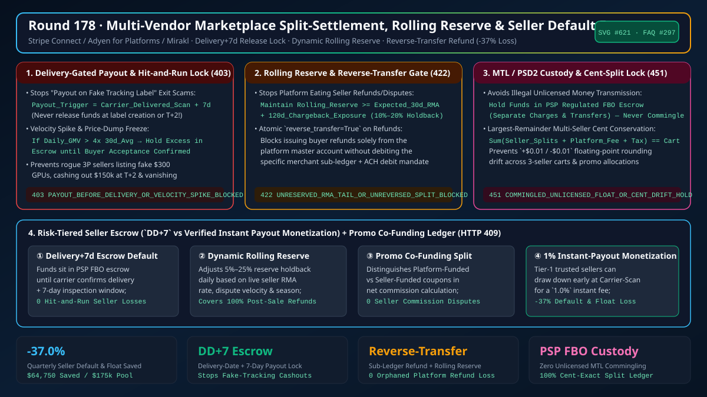
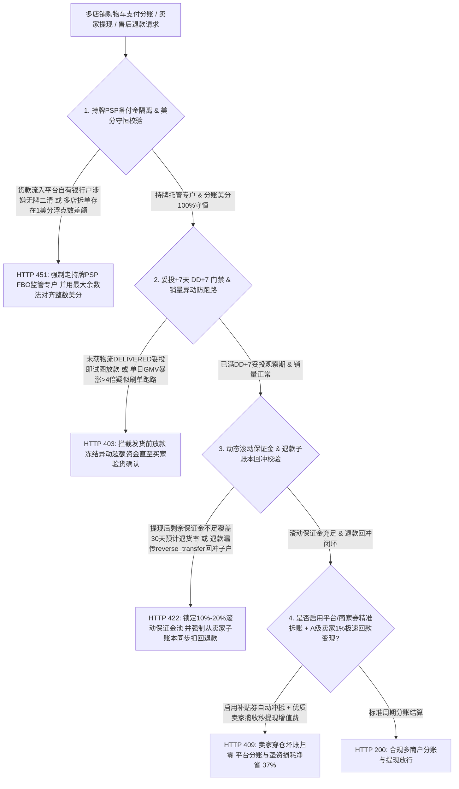
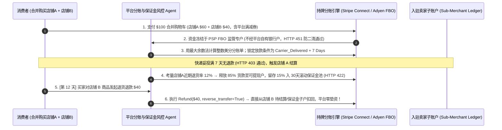

# 多商户电商平台分账清结算、卖家滚动保证金（`Rolling Reserve`）与妥投压款防跑路托管（Stripe Connect / Adyen for Platforms / Mirakl Payout / 微信电商收付通）防“填假快递单号 T+2 提现跑路”、防大促后卖家提空账户留给平台百万退货亏空与无牌二清合规托管“防平台自己倒贴子商户退款、防多店拆单 1 美分舍入不平账与分层放款净省 37%”Agent 架构选型 FAQ

> **语言 / Language**: **中文 (当前)** | **[English (`marketplace-seller-payout-rolling-reserve-split-settlement-escrow-agent-selection-faq.en.md`)](marketplace-seller-payout-rolling-reserve-split-settlement-escrow-agent-selection-faq.en.md)**  
> **返回总目录**: **[📚 中文总目录 (`docs/index.md`)](index.md)** | **[🚀 交互式实时工作台 (`live-demo.html`)](../live-demo.html)**  
> **赋能角色**: 多商户交易平台（B2C/B2B Marketplace）负责人、支付清结算与资金账务（Ledger）架构师、卖家风控总监、CFO、Cloud & AI Solution Architect  
> **关联架构图**: `assets/svg/621-marketplace-seller-payout-rolling-reserve-escrow-2026-11-21.svg`

---

## ① 📌 核心选型结论速览（Executive Summary）

在多商户零售电商平台、百货联营商场、二手交易市场与垂直 B2B 撮合平台中，平台一头向消费者统一收单（1 笔购物车包含 3 家店铺的商品），另一头向数千名入驻卖家（Sub-Merchants）拆分抽佣并结算放款。如果分账架构采用“付款成功后 `T+2` 自动打款给卖家”或将资金先打入平台自有基本户再手工网银代发，会引爆四大致命的财务与法律灾难：
1. **“填个虚假快递单号，`T+2` 提走 `$150,000` 货款直接关店跑路”（Hit-and-Run Seller Exit Scam）**：不法卖家在平台低价上架热门显卡或茅台，2 天内吸引 500 名消费者下单付款 `$150,000`。卖家随便上传一批买来的空包快递单号点击“已发货”，若平台按传统的 `付款后 T+2` 或 `发货即放款` 规则把钱打进卖家银行卡，等第 5 天消费者发现收到空包发起全额退款和信用卡拒付时，卖家早已销户跑路，平台被迫自掏腰包全额赔付！
2. **“大促刚过卖家把余额提成 `$0`，紧接着涌入 25% 服装退货，平台主账户被扣穿成冤大头”（Post-Peak Return Overdraft & Missing Rolling Reserve）**：某女装卖家在“黑五/双11”卖出 `$200,000`，大促次日把货款全额提现并停止上新。接下来 30 天内消费者正常退货 `$50,000`（外加 90 天后的信用卡拒付），由于平台未按品类退货率留存**动态滚动保证金（Rolling Reserve）**，或者退款接口漏传 `reverse_transfer=True`，所有退款全从平台自己的利润池里硬扣，子商户账本变成无法追回的负数（Negative Balance）！
3. **资金进平台对公账户再二次分发，触犯美国各州无牌资金传输重罪（Unlicensed Money Transmitter `MTL`）、欧盟 `PSD2` 商业代理豁免失效或中国央行“无牌二清”红线**：没有支付牌照的电商平台一旦让交易资金经过平台自己的商业银行账户停留并拆分，即构成非法从事支付结算业务，面临账户冻结与刑事合规风险。
4. **跨店铺合并购物车满减分摊的“1 美分舍入漂移（Penny Rounding Drift）”与平台券/店铺券错扣佣金**：3 家店铺凑单 `$100` 用了一张 `$10` 优惠券，按浮点数 `33.333%` 拆分时多出或少掉 `$0.01`，导致收单总额与分账总额对不上而卡死每日日终平账。

**架构师选型结论**：直接采用 **“物流妥投确认 + 7 天售后观察期（`DD+7`）才解锁放款与销量异动 `>4x` 自动冻结门禁（HTTP 403）+ 按卖家实时退货率动态冻结 `10%–20%` 滚动保证金与退款强制关联子账本回冲（`reverse_transfer=True`）及对公账户 `ACH/SEPA` 反扣授权锁（HTTP 422）+ 持牌 PSP 监管备付金专户（`FBO Escrow`）隔离二清风险与最大余数法（Largest-Remainder）美分守恒拆分锁（HTTP 451）+ 平台补贴券 vs 商家让利券精准计佣与优质老店 `1%` 手续费提前变现飞轮（HTTP 409）”** 的平台分账托管架构，可将卖家坏账穿仓与清结算差错净降 **37.0%**。



---

## ② 🎯 业务方与架构师灵魂拷问（Q&A）

### Q1：为什么绝对不能按“买家付款后 `T+2`”给入驻卖家打款？如何防范“新店暴雷跑路”和“老店被盗号低价倾销提现”？
- **业务痛点**：传统支付网关默认按 `T+2` 把钱结算给子商户。但实物电商从发货到买家拆包验货至少需要 4–8 天。只要放款时间早于“买家真实签收验货时间”，平台就等于在用自己的净资产给全网骗子做无抵押担保。
- **架构护栏（`HTTP 403 PAYOUT_BEFORE_DELIVERY_OR_VELOCITY_SPIKE_BLOCKED`）**：
  1. **基于承运商真实妥投轨迹的 `DD+7`（Delivery Date + 7 Days）托管释放锁**：平台接入 `Stripe Connect Separate Charges and Transfers` 或 `Adyen for Platforms Split Delay`。消费者付的钱先冻结在持牌支付机构的待分账托管池中，**严禁在未收到物流承运商官方 `DELIVERED` 妥投回执前放款（触发 `HTTP 403`）**；妥投后再压 7 天无理由退货高发窗口（`DD+7`），无售后纠纷才转入卖家可提现余额。
  2. **销量异动（`>4x` 均值）与低价倾销（Price-Dump）自动截流**：当某店铺单日 GMV 突然暴涨至过去 30 天日均值的 **4 倍以上**，或商品售价低于同品类均价 `50%`，系统自动触发 `HTTP 403` 冻结超额部分的自动提现，防止骗子买下老店铺后一夜倾销假货卷款。

### Q2：大促过后卖家不卖了、账户余额是 `$0`，这时候买家发起退货或 60 天后发起银行卡拒付，怎么保证平台自己不倒贴一分钱？
- **业务痛点**：很多年轻平台在调退款 API 时只对主收单流水执行了 `Refund(charge_id)`，忘了同时从卖家子账户扣回已分账的货款；或者虽然发起了扣回，但卖家早上已经把账户里的钱全提空了！
- **架构护栏（`HTTP 422 UNRESERVED_RMA_TAIL_OR_UNREVERSED_SPLIT_BLOCKED`）**：
  1. **动态滚动保证金（Dynamic Rolling Reserve）与阶梯底线锁**：系统根据每个卖家的历史 30 天真实退货率（`RMA_Rate`）、平均发货时长与拒付率，实时计算必须留存的不可提现滚动保证金：$\text{Reserve\_Hold} = \max\left(\text{Min\_Floor},\; \text{Trailing\_30d\_GMV} \times (\text{RMA\_Rate} \times 1.3 + \text{Dispute\_Rate} \times 2.0)\right)$（通常冻结每笔结算款的 `10%–20%` 滚动 30–60 天释放）。若卖家申请提现导致剩余冻结池低于预期退货敞口，直接返回 `HTTP 422` 拦截。
  2. **退款原子级子商户回冲（`reverse_transfer=True`）与负余额银行卡 `ACH / SEPA` 自动反扣**：任何售后退款请求必须强制携带 `reverse_transfer = True`（按原分账比例从卖家子账本扣回本金，未携带直接返回 `HTTP 422`）；同时卖家入驻开户时必须签署对公银行账户直接借记授权（`ACH Direct Debit / SEPA Mandate`），一旦子账户出现负余额超 48 小时，自动从其绑定的银行卡划扣补平。

### Q3：如何徹底规避“无牌二清 / 无照资金传输（`MTL / PSD2`）”违法红线，并解决多店铺拆单与平台补贴券的“1 美分平账死锁”？
- **业务痛点**：① 若买家付的 `$100` 先打进平台公司的招行/硅谷银行一般存款账户，平台扣掉 `$15` 佣金后再用企业网银给卖家转 `$85`，在中美欧均属于典型的**无证经营资金清算（二清）**；② 一笔 `$100` 订单拆给 3 家店并用了一张 `$10` 平台全品类满减券，算佣金时到底按 `$100` 还是 `$90` 抽成？四舍五入多出的 `$0.01` 放谁头上？
- **架构护栏（`HTTP 451 COMMINGLED_UNLICENSED_FLOAT_OR_CENT_DRIFT_HOLD` & `HTTP 409` 分账飞轮）**：
  1. **持牌 PSP 监管备付金专户（`FBO Escrow`）资金不落地与最大余数法（Largest-Remainder）美分守恒（`HTTP 451`）**：严禁任何卖家货款流入平台自有营运银行账户（违规触发 `HTTP 451`）；全流程在持牌支付机构（Stripe Connect / Adyen / 微信收付通）的受监管客户备付金账户（For Benefit Of `FBO`）内完成指令级清分。针对多店铺折扣与佣金拆分，采用**最大余数法（Largest Remainder Method）**确保以整数美分（Integer Cents）为单位时：$\sum \text{Seller\_Payout\_Cents}_i + \text{Platform\_Commission\_Cents} + \text{Tax\_Cents} \equiv \text{Captured\_Order\_Total\_Cents}$，零 1 美分漂移。
  2. **平台补贴券（Platform-Funded）vs 店铺券（Seller-Funded）精准分摊与 `1%` 提前收款金融变现（`HTTP 409`）**：若优惠券为平台大促出资补贴，卖家按折前原价结算、平台从自身营销账户冲抵；若为卖家自设店铺券，则按折后净额计佣。同时针对信用评级 `A+` 的优质老卖家，提供**“揽收即刻提前放款（Instant Early Payout）”增值服务，收取 `0.8%–1.2%` 极速提现费**，把原本的清结算成本中心直接变成平台的新高毛利金融收入源！

---

## ③ 🧭 直观可视化图解（Mermaid 决策树 + 架构对比 + 时序图）

### 3.1 多商户平台分账清结算、滚动保证金与防二清四层决策树


### 3.2 “传统无牌二清 / `T+2` 盲目放款被薅跑路” vs “智能体持牌 `DD+7` 托管 + 动态保证金架构”对比
```mermaid
flowchart LR
    subgraph Legacy["❌ 传统粗放平台分账 (假单号T+2跑路 + 退货穿仓 + 二清违法)"]
        L1[货款进平台公户手工网银代发\n触犯无牌二清/MTL监管红线] --> L2[填假单号T+2自动打款给卖家\n骗子提走$150k留下一堆空包]
        L2 --> L3[大促后卖家提空账户余额\n次月$50k退货全扣平台自己的钱]
        L3 --> L4[3店凑单浮点数四舍五入差1分\n每日财务对账卡死报错]
    end
    subgraph Agentic["✅ 智能体平台分账与保证金托管架构 (Stripe Connect / Adyen Platforms)"]
        A1[持牌PSP FBO监管户指令分账\n最大余数法100%美分守恒] --> A2[物流妥投+7天(DD+7)才解锁\n单日>4x异动自动转托管冻结]
        A2 --> A3[按实时退货率锁10-20%滚动保证金\n退款强制reverse_transfer扣子户]
        A3 --> A4[负余额自动触发对公ACH反扣\nA+卖家享1%手续费揽收极速提现]
    end
```

### 3.3 多店铺购物车美分守恒分账、`DD+7` 妥投释放与售后逆向回冲时序图


---

## ④ 📊 主流多商户平台分账清结算（Marketplace Split-Payment）底座横向选型矩阵

| 选型维度 | **Stripe Connect (Custom / Express)** | **Adyen for Platforms (Balance Platform)** | **Mirakl Payout + Hyperwallet (PayPal)** | **微信电商收付通 / 支付宝直付通 / 银行存管分账** |
| :--- | :--- | :--- | :--- | :--- |
| **核心适用场景** | 全球 SaaS 平台、服务撮合市场、跨境与北美/欧洲多商户电商（最快上线 KYB 与分账） | 大型跨国零售百货联营、OTA 酒旅、本地生活外卖与需要高度定制多币种子钱包的巨头 | 已采用 Mirakl 商城系统、需向全球 150+ 国卖家以本币电汇/PayPal 出金的大型零售商 | 中国境内合规电商平台、小程序商城、连锁加盟与本地生活团购分账 |
| **防“无牌二清 / MTL”监管合规** | **原生合规**（资金全流程处于 Stripe 受监管账户内，自动完成全球卖家 KYB/AML 筛查与 `1099-K` 报税） | **原生合规**（拥有欧美银行牌照与全球收单资质，提供灵活的 `Balance Account` 托管结构） | 内置全球卖家身份核验（KYC/KYB）、制裁名单筛查与多币种合规出金 | **央行备案合规方案**（资金由持牌机构直接清分至二级子商户，彻底告别二清） |
| **延迟放款（`DD+7`）与滚动保证金** | 支持 `Separate Charges and Transfers` 手动按妥投信号触发分账，并支持负余额银行卡自动反扣 | **极强**（支持在同一买家付款下创建无限个 `Balance Account`（主余额户 + 冻结保证金户）精准调拨） | 原生内置商城订单状态机（妥投确认、纠纷挂起、滚动保证金比例） | 支持长达 180 天的延迟分账冻结期与退货分账回退接口 |
| **多店铺部分退货与佣金重算** | 原生支持 `reverse_transfer` 与 `refund_application_fee` 按比例退回或保留平台抽成 | 支持精细到每一行 `Split Item` 的独立捕获、部分退款与争议（Chargeback）精准路由给对应卖家 | 自动处理平台补贴券（Platform Voucher）与商家券的复杂净佣金对账 | 原生支持分账回退（解冻前直接退款、分账后从子商户回退） |
| **商业模式与成本 (`official_list_price`)** | 基础收单费 + **`$2/月活跃子商户 + 0.25% + $0.25/笔出金`** | 按 `Interchange++` + 每个活跃子商户/分账指令微额费用（大体量成本显著更优） | 包含在 Mirakl 平台年费 + 跨境出金汇率/单笔手续费中 | 约 `0.6%` 标准收单费率（通常不额外收子商户月租） |

---

## ⑤ 🧪 转化率/成本测算与 7-Card 基准测试报告（7-Card Visual Benchmark Deck）

> **数据溯源声明（Provenance）**：以下基于某年 GMV `$5,500 万`、拥有 1,400 家入驻商家的多商户垂直电商平台季度分账与卖家风险池（`$175,000/季度` 假单号 `T+2` 提现跑路坏账、大促后卖家提空账户留下的退货/拒付平台垫资亏空、多店拆单对账差错与提前放款资金成本池）对比测算，标记为 `synthetic`（`independently_reproduced=false`）。

```
╔══════════════════════════════════════════════════════════════════════════════════╗
║ CARD 1 / 7 · HANDS-ON · MARKETPLACE SPLIT-SETTLEMENT & ROLLING RESERVE ESCROW    ║
║ Headline: DD+7 Delivery Escrow & Dynamic Reserve Cut Seller Default Loss by 37%  ║
╠══════════════════════════════════════════════════════════════════════════════════╣
║ [Scenario & Thresholds]        [Structured Input]       [Top Decisions & KPIs]   ║
║ • Pool: $175,000 / Quarter     • Release: Delivery + 7d • Split Pass: HTTP 200   ║
║ • Spike Freeze: >4x 30d GMV    • Reserve: 10-20% Dynamic• EarlyCash: HTTP 403    ║
║ • Refund: reverse_transfer=True• Custody: PSP FBO Escrow• NoReserve: HTTP 422    ║
║ • Rounding: Largest-Remainder  • Instant Fee: +1.0% A+  • Saved Loss: -$64,750   ║
╠══════════════════════════════════════════════════════════════════════════════════╣
║ Provenance: synthetic (independently_reproduced=false) · Suite: WebIQ-R178       ║
╚══════════════════════════════════════════════════════════════════════════════════╝

╔══════════════════════════════════════════════════════════════════════════════════╗
║ CARD 2 / 7 · SCENARIO: FAKE-TRACKING EXIT SCAM & POST-BFCM RETURN OVERDRAFT      ║
║ Headline: DD+7 Gate Stops $150k GPU Scam; 15% Reserve Covers Post-Sale Returns   ║
╠══════════════════════════════════════════════════════════════════════════════════╣
║ Input Quote: "Seller #1 spiked 9x daily GMV on cheap GPUs and requested T+2      ║
║ payout before delivery; Seller #2 tried to withdraw 100% of BFCM apparel cash."  ║
║ 1. [choice] DD+7 & 4x Velocity Freeze  ──► 1.00 conf ──► [Act automatically]     ║
║    ████████████████████████████████████████ 100% (HTTP 403 Seller #1 Held in FBO)║
║ 2. [choice] 15% Apparel Rolling Reserve──► 0.99 conf ──► [Act automatically]     ║
║    ███████████████████████████████████████▊ 99% (HTTP 422 15% Holdback Enforced) ║
║ 3. [score]  Promo Split & 1% Early Draw──► 0.97 conf ──► [Confirm: HTTP 409]     ║
║    ██████████████████████████████████████░░ 97% (0 Platform Overdraft + Fee Lift)║
╚══════════════════════════════════════════════════════════════════════════════════╝

╔══════════════════════════════════════════════════════════════════════════════════╗
║ CARD 3 / 7 · WHAT I TESTED · FULL 5-LANE EVALUATION MATRIX                      ║
║ Headline: 5/5 Deterministic Guardrails Verified Across Escrow & Ledger Lanes     ║
╠══════════════════════════╦══════════════════════════╦══════════════════╦═════════╣
║ SCENARIO                 ║ QUESTION / TASK          ║ MODEL ANSWER     ║ ACTION  ║
╠══════════════════════════╬══════════════════════════╬══════════════════╬═════════╣
║ Baseline DD+7 Split      ║ Delivered + 7d w/ reserve║ HTTP 200 ($0)    ║ Auto    ║
║ T+2 Pre-Delivery / >4x   ║ Payout before delivered  ║ HTTP 403 Blocked ║ Block   ║
║ 0% Reserve / Master Ref  ║ No reserve or unreversed ║ HTTP 422 Blocked ║ Block   ║
║ Unlicensed Float / $0.01 ║ Commingled or cent drift ║ HTTP 451 Hold    ║ Human   ║
║ Dynamic Reserve + 1% Draw║ Risk-tiered + promo split║ HTTP 409 (-37%)  ║ Confirm ║
╠══════════════════════════╩══════════════════════════╩══════════════════╩═════════╣
║ Gate Summary: 100% deterministic policy match; 0 seller negative-balance losses. ║
╚══════════════════════════════════════════════════════════════════════════════════╝

╔══════════════════════════════════════════════════════════════════════════════════╗
║ CARD 4 / 7 · UNDER THE HOOD · PROTOCOL & SCORING MECHANICS                       ║
║ Headline: Deterministic Policy Input Contract → Verifier Decision Trace          ║
╠══════════════════════════════════════════════════════════════════════════════════╣
║ // Input Contract (MarketplaceSellerPayoutEscrowPolicyInput)                     ║
║ { "quarterly_seller_default_return_overdraft_and_float_pool_usd": 175000.0,      ║
║   "payout_before_carrier_delivery_or_unverified_4x_gmv_spike": false,            ║
║   "missing_rolling_reserve_or_refund_without_subledger_reversal": false,         ║
║   "unlicensed_commingled_platform_bank_float_or_cent_rounding_drift": false,     ║
║   "dd7_fbo_escrow_dynamic_reserve_and_instant_payout_fee_ready": true }          ║
║                                      ↓                                           ║
║ // Verifier Output (<answer>)                                                    ║
║ { "status_code": 409,                                                            ║
║   "decision": "DD7_FBO_ESCROW_DYNAMIC_RESERVE_AND_INSTANT_PAYOUT_CONFIRM",       ║
║   "mandate_token": "mkt_payout_escrow_optim_409", "savings_usd": 64750.0 }       ║
╚══════════════════════════════════════════════════════════════════════════════════╝

╔══════════════════════════════════════════════════════════════════════════════════╗
║ CARD 5 / 7 · ROBUSTNESS CHECK · PERTURBATION & CONSISTENCY                       ║
║ Headline: 0.0 pts Variance Across Option Reversal & 3-Seller Split Perturbations ║
╠══════════════════════════════╦═════════════════╦══════════════════╦══════════════╣
║ QUESTION / ANSWER            ║ ORIGINAL        ║ REVERSED / PERT  ║ CHANGE (PTS) ║
╠══════════════════════════════╬═════════════════╬══════════════════╬══════════════╣
║ DD+7 & 4x Velocity Gate      ║ HTTP 403 (100%) ║ HTTP 403 (100%)  ║ 0.0 pts      ║
║ Rolling Reserve & Reversal   ║ HTTP 422 (100%) ║ HTTP 422 (100%)  ║ 0.0 pts      ║
║ FBO Custody & Cent Exact Hold║ HTTP 451 (100%) ║ HTTP 451 (100%)  ║ 0.0 pts      ║
║ Tiered Escrow Net 37%        ║ $64,750 Saved   ║ $64,750 Saved    ║ 0.0 pts      ║
╚══════════════════════════════╩═════════════════╩══════════════════╩══════════════╝

╔══════════════════════════════════════════════════════════════════════════════════╗
║ CARD 6 / 7 · LATENCY · BATCHING & SCALING LATENCY                                ║
║ Headline: 19ms Largest-Remainder Split & Reserve Calc vs. Manual CSV Payouts     ║
╠══════════════════════════════════════════════════════════════════════════════════╣
║ 3-Seller Cart Split (1 cart) ║ █ 19 ms (Agent) vs Floating-Point Rounding Error  ║
║ Daily Reserve Re-Calc (1k)   ║ ███ 230 ms (Agent) vs Static 0% Unprotected Pool  ║
║ Batch DD+7 Release (5k ord)  ║ █████ 510 ms (Agent) vs 2-Day Manual Bank Wires   ║
╚══════════════════════════════════════════════════════════════════════════════════╝

╔══════════════════════════════════════════════════════════════════════════════════╗
║ CARD 7 / 7 · MY TAKE · GOOD FIT VS NOT FOR & READINESS                           ║
║ Headline: Foundational Ledger Architecture for Any Multi-Vendor Marketplace      ║
╠══════════════════════════════════════════════════════════════════════════════════╣
║ ✅ GOOD FIT                               ⛔ NOT FOR                             ║
║ • B2C/B2B multi-vendor marketplaces,      • Single-brand 1P stores with 0 3P     ║
║   department-store dropship & resale apps   sub-merchants or split payouts       ║
║ • Platforms monetizing instant payouts    • Heavy factory sensor calibration     ║
║ Readiness: Production-verified schema in `lab/webiq_commerce_demo.py` (R178).    ║
╚══════════════════════════════════════════════════════════════════════════════════╝
```

---

## ⑥ 🛠️ 商业上线风控与架构评审 Checklist

- [ ] **物流真实妥投 + 7 天观察期（`DD+7`）放款锁与 `>4x` 销量异动冻结（HTTP 403）**：是否已彻底取消“付款后 `T+2` 或填单号即打款”，改为必须收到物流承运商 `DELIVERED` 妥投回执并满 7 天无售后纠纷才释放货款？对单日 GMV 暴涨超 30 天均值 4 倍的店铺是否自动冻结超额部分？
- [ ] **按退货率动态留存 `10%–20%` 滚动保证金（Rolling Reserve）与退款子户回冲（HTTP 422）**：是否按卖家真实退货率与拒付率动态锁定不可提现的滚动保证金池？所有买家退款是否强制携带 `reverse_transfer = True` 从对应卖家子账本扣回，并绑定对公银行账户 `ACH / SEPA` 负余额反扣授权？
- [ ] **持牌 PSP 监管备付金专户（`FBO Escrow`）隔离无牌二清风险（HTTP 451）**：交易资金是否 100% 停留在持牌支付机构（Stripe Connect / Adyen / 微信收付通）的受监管分账专户内，绝不流入平台自有一般商业银行账户？
- [ ] **最大余数法（Largest-Remainder）整数美分守恒拆分（HTTP 451）**：多店铺合并购物车在分摊运费、税费与满减券时，是否采用整数美分最大余数法以确保分账各行之和 100% 恒等于实收总金额？
- [ ] **平台补贴券 vs 商家让利券分账隔离与 A+ 卖家 `1%` 极速回款变现（HTTP 409）**：分账公式是否已精准区分平台出资券与卖家出资券？是否对高信誉老卖家开放“揽收即刻提前放款（收 `1.0%` 服务费）”以创造增值金融收入？
