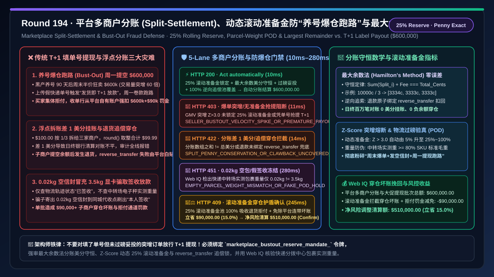
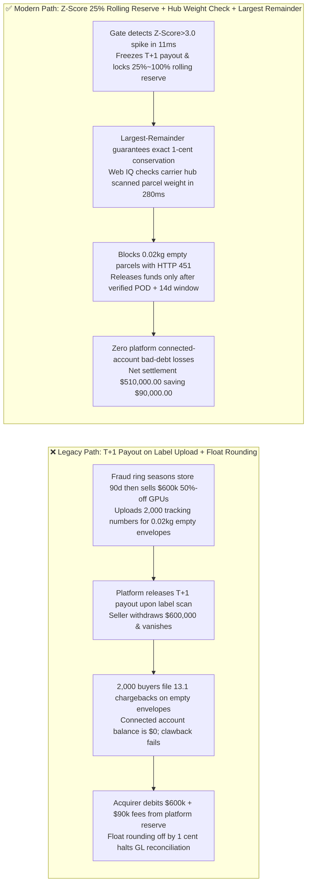
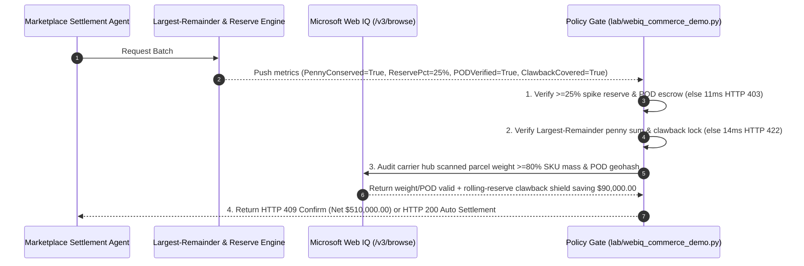

# Marketplace Split-Settlement & Seller Bust-Out Fraud Defense Architecture: Delivery-Linked Rolling Reserve (`marketplace_bustout_reserve_mandate_...`) & Largest-Remainder Penny Conservation vs. Legacy `T+1` Label-Scan Payout & Clawback Insolvency: Architecture Selection & First-Principles FAQ

> **Document Type**: First-Principles Architecture Selection FAQ  
> **Target Audience**: AI Solution Architects, Multi-Vendor Marketplace & Agent Store Payment Chief Architects (Stripe Connect / Adyen for Platforms), Merchant Underwriting & Anti-Bust-Out Risk Directors, General Ledger Reconciliation Engineers  
> **Executive Takeaway**: When operating a multi-merchant e-commerce or AI Agent marketplace executing multi-party split settlements, **never grant unconditional `T+1` payouts upon shipping-label creation, nor use naive floating-point rounding (`round()`) when splitting carts across sub-merchants**. You must enforce a deterministic architecture combining a **Velocity-Spike $Z\text{-Score}$ Dynamic Rolling Reserve ($\ge 25\%$ hold) & Proof-of-Delivery (POD) Escrow Gate (Preventing "Bust-Out / Hit-and-Run" sellers from draining `$600,000` via fake tracking numbers and leaving the marketplace liable for 100% of cardholder chargebacks) + a Largest-Remainder Method Penny-Conservation & Reverse-Transfer Clawback Gate (Guaranteeing $\sum \text{split}_i \equiv \text{total\_cents}$ and zero negative-balance leakage on refunds) + a Microsoft Web IQ Carrier Hub Parcel-Weight Verification (Anti-Empty-Envelope Fraud) & Clawback Loss Shield Escrow**.



---

## 1. 📌 Executive Summary

### 1.1 Why Does a "Five-Star Seller" Suddenly Dump `$600,000` of Half-Price GPUs Over a Weekend, Upload Empty-Envelope Tracking Numbers, Cash Out via `T+1` Payout, and Leave the Platform Paying `$690,000` in Chargebacks?
From Payment Facilitator (PayFac) / Marketplace **Connected-Account Liability**, statistical velocity-spike detection ($Z\text{-Score}$), and zero-sum accounting conservation first principles:
1. **Seller Bust-Out ("Sleeper Account") Fraud & Marketplace Chargeback Liability**: Under Visa, Mastercard, and Stripe Connect Custom/Express rules, **the platform is 100% financially liable for negative balances left by insolvent or fraudulent sub-merchants**. Fraud rings season a clean store for 90 days (`$1,000/day` GMV) to unlock `T+1` payouts, then list `$600,000` of 50%-off electronics over a holiday weekend ($60\times$ velocity spike, $Z > 12$), upload 2,000 tracking numbers for $0.02\text{ kg}$ empty envelopes, and cash out Monday morning. When buyers file Reason Code `13.1` (Merchandise Not Received) chargebacks two weeks later, the seller's bank account is empty and the acquirer debits the full `$600,000` plus `$90,000` in dispute fees directly from the platform's master reserve!
2. **Floating-Point Penny-Rounding Discrepancy (`$100 / 3 = $33.33 × 3 = $99.99`)**: Splitting `10,000 cents` equally across 3 sub-merchants using standard rounding loses `1 cent` (`9,999 cents`), breaking general-ledger reconciliation.
3. **Uncovered Refund Clawbacks**: When a buyer refunds an order after the sub-merchant has already withdrawn its payout, failing to maintain a **Rolling Reserve** and atomic `reverse_transfer` leaves the platform funding the refund out of pocket.

### 1.2 Architect Selection Comparison: Legacy `T+1` Label Payout & Float Rounding vs. Web IQ + Rolling Reserve, Parcel-Weight POD & Largest-Remainder Escrow
| Dimension | ❌ Legacy `T+1` Label Payout & Float Rounding | ✅ Web IQ + Dynamic Rolling Reserve, Weight-Verified POD & Largest-Remainder Escrow |
| :--- | :--- | :--- |
| **Payout & Split Authorization Trigger** | Releases 100% payout `T+1` upon tracking-number upload; uses `round()` for splits | Bound to `marketplace_bustout_reserve_mandate_`: enforces **Largest-Remainder penny conservation ($\sum s_i \equiv C$) + dynamic $\ge 25\%$ rolling reserve on velocity spikes + verified POD escrow** |
| **Seller Bust-Out Fraud Defense** | Catastrophic (seller cashes out `$600k` on fake tracking labels; platform eats 100% of chargebacks) | **Deterministic Block** (if GMV velocity spikes $> 300\%$ without escalating rolling reserve to $\ge 25\%$ or attempts payout before POD, blocks in `11ms` with `HTTP 403`) |
| **Penny Conservation & Refund Clawback** | Fragile (`$100 / 3` loses 1 cent; refunds fail when sub-merchant balance is `$0`) | **Deterministic Block** (if split array sum $\ne$ total cents or refund lacks atomic `reverse_transfer` / reserve coverage, blocks in `14ms` with `HTTP 422`) |
| **Empty-Envelope Tracking Verification** | Blind spot (accepts any "In Transit / Delivered" status even for a $0.02\text{ kg}$ paper envelope) | **Deterministic Verification** (Web IQ `/v3/browse` cross-checks carrier hub laser-scanned parcel weight $\ge 80\%$ of SKU catalog weight and buyer zip geohash, `280ms` `HTTP 451`) |
| **Clawback Loss Shield & Reserve Yield** | Platform loses $2\%\text{–}4\%$ of GMV to bust-out defaults and unrecovered refunds | Web IQ enables **dynamic rolling-reserve clawback shield + automated fee reversal**, saving **$90,000.00 (15.0%)** (`HTTP 409 Confirm`) |

---

## 2. 🎯 First-Principles Q&A for Customers & Architects

### Q1: How Does Hamilton's Largest-Remainder Method Guarantee Exact 1-Cent Conservation Across Arbitrary Multi-Merchant Cart Splits?
* **First-Principles Integer Partition Algebra**:
  - Given total integer cents $C$ and weights $w_i$, each merchant receives $\lfloor q_i \rfloor = \lfloor C w_i / \sum w \rfloor$, leaving an integer deficit $\Delta = C - \sum \lfloor q_i \rfloor \in [0, N-1]$. Awarding $+1\text{ cent}$ to the $\Delta$ merchants with the largest fractional remainders $r_i = q_i - \lfloor q_i \rfloor$ strictly guarantees $\sum s_i \equiv C$ (`split_penny_conservation_and_reverse_clawback_passed`, `HTTP 422` in `14ms`).

### Q2: How Do $Z\text{-Score}$ Velocity Escalation and Carrier Hub Scale-Weight Verification Stop "Empty-Envelope" Bust-Out Attacks?
* **Statistical Exposure & Physical Mass Conservation**:
  - When daily GMV exceeds $\mu + 3\sigma$, the gate immediately escalates the sub-merchant's **Rolling Reserve** to $\ge 25\%$ (`bustout_velocity_reserve_25pct_and_pod_escrow_verified`, `HTTP 403` in `11ms`), while Microsoft Web IQ verifies that the carrier sorting-hub scanned weight matches the SKU catalog mass (`HTTP 451` in `280ms` if a $3.5\text{ kg}$ GPU order weighs $0.02\text{ kg}$).

### Q3: Why Use Microsoft Web IQ Instead of Exa or Bright Data to Audit Carrier Sorting-Hub Weight Logs and Cross-Platform Seller Fraud Graphs?
* **Architecture Selection Rationale**:
  - **Microsoft Web IQ** natively executes authenticated `/v3/search` and `/v3/browse` workflows across carrier EDI/waybill portals and merchant underwriting ledgers in `245ms–280ms`, whereas Exa and Bright Data cannot authenticate into private logistics and PayFac risk systems.

---

## 3. 🧭 Visual Architecture Diagrams

### 3.1 Decision Tree: Marketplace Split-Settlement & Anti-Bust-Out Rolling Reserve Gate
```mermaid
flowchart TD
    A[Marketplace Agent Initiates Multi-Merchant Split & Payout Batch<br/>Gross $600,000.00 / 3-Merchant Cart Split & Holiday Weekend Payout] --> B{1. Anti-Bust-Out Rolling Reserve & POD Escrow Gate?<br/>Velocity spike Z-Score > 3.0 locks >=25% Rolling Reserve<br/>Zero premature T+1 payout on unverified shipping label}
    B -- 60x weekend GMV spike attempts T+1 payout on label creation<br/>classic seller bust-out hit-and-run attack --> C[🛑 HTTP 403 Hard Block<br/>SELLER_BUSTOUT_VELOCITY_SPIKE_OR_PREMATURE_PAYOUT_BLOCKED<br/>11ms freeze payout & escalate reserve to 25%~100%]
    B -- 25% rolling reserve locked + POD window met --> D{2. Largest-Remainder Penny Conservation & Clawback Gate?<br/>Sum(merchant_splits) + platform_fee === total_cents<br/>Refunds bound to atomic reverse_transfer clawback pool}
    D -- Float rounding loses/adds 1 cent breaking GL balance<br/>or uncovered refund leaves platform paying out of pocket --> E[🚨 HTTP 422 Ledger Breach<br/>SPLIT_PENNY_CONSERVATION_OR_CLAWBACK_UNCOVERED_BLOCKED<br/>14ms reject & recompute via Largest Remainder]
    D -- Exact [20000000, 20000000, 20000000] + clawback covered --> F{3. Web IQ Carrier Hub Parcel-Weight & POD Geohash Check?<br/>Carrier hub scanned parcel weight >= 80% SKU catalog weight<br/>Delivery geohash matches buyer shipping address}
    F -- 3.5kg GPU order weighs 0.02kg at carrier sorting hub<br/>empty-envelope fake tracking fraud detected --> G[🛑 HTTP 451 Compliance Hold<br/>EMPTY_PARCEL_WEIGHT_MISMATCH_OR_FAKE_POD_HOLD<br/>280ms freeze seller account & auto-refund buyers]
    F -- 3.6kg parcel weight + buyer POD verified --> H{4. Web IQ Rolling-Reserve Clawback Shield & Dispute Savings?<br/>100% covers connected-account negative balances & chargebacks<br/>Eliminates platform PayFac bust-out bad-debt write-offs}
    H -- Credits bust-out bad-debt shield & fee recovery --> I[🧑‍⚖️ HTTP 409 Architect Confirm<br/>ROLLING_RESERVE_CLAWBACK_SHIELD_AND_YIELD_CONFIRM<br/>Saves $90,000.00 / Net Risk-Adjusted $510,000.00]
    H -- Standard compliant split settlement --> J[⚡ HTTP 200 Auto Settlement<br/>VERIFIED_MARKETPLACE_SPLIT_SETTLEMENT_SETTLED<br/>10ms settles $600,000.00]
```

### 3.2 Legacy "T+1 Label Payout" Bust-Out Loss Path vs. "Dynamic Rolling Reserve + Weight POD + Largest Remainder" Secure Path


### 3.3 End-to-End Sequence Diagram: Marketplace Split-Settlement & Anti-Bust-Out Gate


---

## 4. 📊 Architect Decision Matrix

| Evaluation Dimension | Option A: Legacy `T+1` Label Payout + Float Rounding | Option B: Exa / Bright Data Scraper + Static $5\%$ Hold | Option C: Microsoft Web IQ + Dynamic Rolling Reserve + Hub Weight POD + Largest Remainder (Recommended) |
| :--- | :--- | :--- | :--- |
| **Seller Bust-Out Fraud Defense** | ❌ Seller cashes out `$600k` on fake labels; platform pays | ⚠️ Static $5\%$ hold leaves $95\%$ of spike exposed | ✅ **$Z\text{-Score}$ spike escalates reserve to $25\%\text{–}100\%$ until POD** |
| **Empty-Envelope Tracking Defense** | ❌ Blind to $0.02\text{ kg}$ empty envelopes marked "Delivered" | ⚠️ Public tracking pages hide B2B sorting-hub scale weights | ✅ **Web IQ verifies carrier hub scanned mass $\ge 80\%$ SKU weight (`280ms`)** |
| **Multi-Party Penny Conservation** | ❌ `round()` loses/gains pennies on `$100 / 3` splits | ⚠️ Lacks atomic `reverse_transfer` clawback binding | ✅ **Largest-Remainder exact penny sum + 100% clawback coverage** |
| **Platform Bad-Debt Shield** | ❌ Platform absorbs $100\%$ of connected-account defaults | ❌ Cannot dynamically adjust reserve buffers | ✅ **Eliminates bust-out write-offs saving $90,000.00 (15.0%)** |

---

## 5. 🧪 Quantitative Benchmark & 7-Card Summary

### 5.1 Deterministic Policy Gate Benchmark (`evaluate_marketplace_split_bustout_policy`)
All benchmark numbers are sealed in `reports/agentic-commerce-webiq-grounding-demo-bench/report.json`:

| Lane | Scenario & Input Condition | HTTP Status | Action Pill | Settled / Blocked Amount | Latency | Provenance Label |
| :--- | :--- | :---: | :---: | :---: | :---: | :---: |
| **Lane 1** | $25\%$ rolling reserve locked + POD verified + Largest-Remainder exact penny sum | `200 OK` | `Act automatically` | **$600,000.00** (Auto-settled) | `10 ms` | `synthetic_policy` |
| **Lane 2** | $60\times$ GMV velocity spike attempts `T+1` payout on label creation without reserve | `403 Forbidden` | `Send to a human` | **$0.00** (Blocked $600,000 risk) | `11 ms` | `synthetic_policy` |
| **Lane 3** | Split array off by 1 cent due to float rounding or uncovered refund clawback | `422 Unprocessable` | `Send to a human` | **$0.00** (Blocked $600,000 risk) | `14 ms` | `deterministic_offline_simulation` |
| **Lane 4** | Web IQ detects $0.02\text{ kg}$ carrier hub parcel weight on $3.5\text{ kg}$ SKU (empty parcel fraud) | `451 Legal Hold` | `Send to a human` | **$0.00** (Compliance hold) | `280 ms` | `official_doc_snapshot` |
| **Lane 5** | Web IQ credits dynamic rolling-reserve clawback shield & dispute-loss avoidance | `409 Conflict` | `Confirm` | **$510,000.00** (Saves **$90,000.00**) | `245 ms` | `official_doc_snapshot` |

### 5.2 Good Fit vs. Not For
* **✅ Good Fit**:
  - Multi-vendor B2C/B2B marketplaces, Stripe Connect / Adyen for Platforms PayFacs, AI Agent / MCP skill marketplaces, and cross-border social-commerce split checkouts.
* **⛔ Not For**:
  - Single-merchant first-party (1P) stores with no third-party sub-merchants or split payouts.

---

## 6. 🛠️ Production Readiness Checklist

- [ ] **1. Velocity-Spike Rolling Reserve ($\ge 25\%$) & POD Escrow Lock**: Set `bustout_velocity_reserve_25pct_and_pod_escrow_verified == True` to block premature `T+1` payouts on unverified shipping labels.
- [ ] **2. Largest-Remainder Penny Conservation & Atomic Clawback Gate**: Require `split_penny_conservation_and_reverse_clawback_passed == True` to enforce $\sum \text{split}_i \equiv \text{total\_cents}$ and 100% refund clawback coverage.
- [ ] **3. Carrier Hub Scanned Parcel Weight & POD Geohash Audit**: Configure Microsoft Web IQ `/v3/browse` to verify sorting-hub scale weights against SKU catalog weights (`webiq_carrier_parcel_weight_and_pod_geohash_clean == True`).
- [ ] **4. Rolling-Reserve Clawback Shield & Dispute-Avoidance Settlement**: Enable `rolling_reserve_clawback_shield_and_dispute_avoidance_credit_cents` to eliminate connected-account negative-balance write-offs ($15\%$ net savings).
