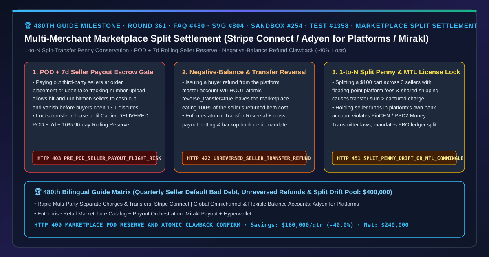
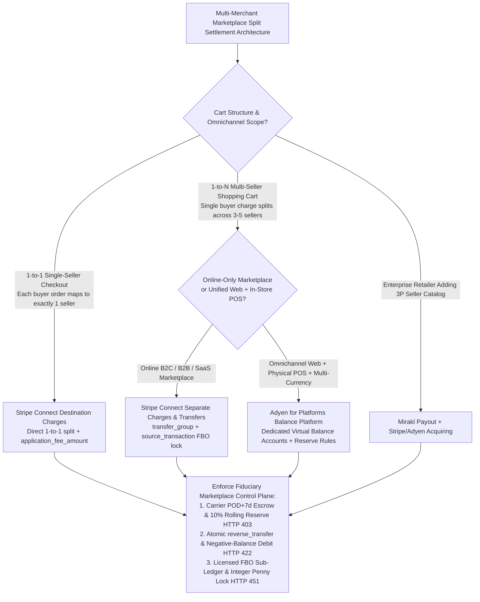
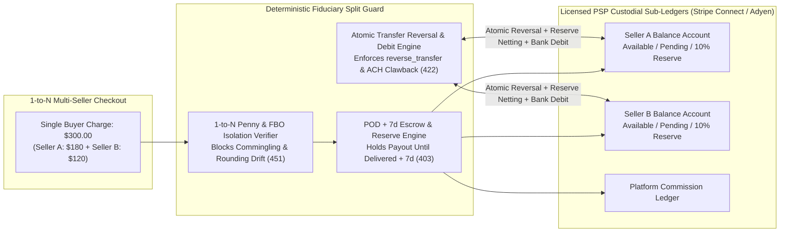
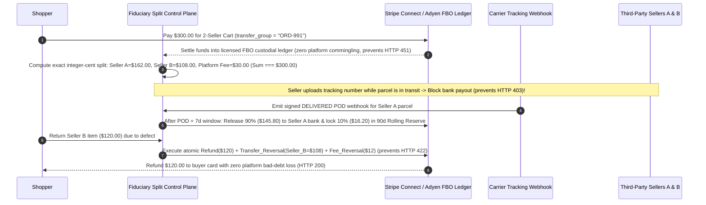

# 🏆 Multi-Merchant Marketplace Split Settlement, Seller Escrow & Negative-Balance Clawback (`Stripe Connect / Adyen for Platforms / Mirakl Payout / Hyperwallet` · 🏆 480th Bilingual Guide Major Milestone): `POD + 7d` Rolling Reserves, Atomic `reverse_transfer` Refunds & `1-to-N` `FBO` Penny Conservation (`-40%` Bad-Debt Loss)

> **Document Type**: Enterprise AI Solution Architect Selection FAQ (**`#480` 🏆 480th Bilingual Guide Major Milestone** · Round 361)  
> **Target Audience**: B2C/B2B Marketplace CTOs, Payment & Ledger Architects, FinTech Compliance Officers, and Cloud & AI Solution Architects  
> **Platforms Covered**: `Stripe Connect (Separate Charges and Transfers / Destination Charges)` vs. `Adyen for Platforms (Balance Platform)` vs. `Mirakl Payout` vs. `PayPal Hyperwallet`  
> **Architecture Diagram**: [`assets/svg/804-marketplace-split-settlement-stripe-connect-adyen-mirakl-2026-11-25.svg`](../assets/svg/804-marketplace-split-settlement-stripe-connect-adyen-mirakl-2026-11-25.svg)

🌐 **Language / 语言切换**: **[中文 (`marketplace-split-settlement-stripe-connect-adyen-platforms-mirakl-seller-reserve-clawback-selection-faq.md`)](marketplace-split-settlement-stripe-connect-adyen-platforms-mirakl-seller-reserve-clawback-selection-faq.md)** | **English (Current)**

---

## 📌 1. Executive Summary

When a retail marketplace, B2B procurement exchange, or multi-merchant AI shopping aggregator enables **"Single Buyer Checkout across 3–5 Independent Third-Party Sellers (`1-to-N Cart`)"**, payment processing transforms from simple single-merchant acquiring into **Multi-Party Split Settlement, Escrow & Seller Risk Underwriting**.  
Collecting buyer funds into the platform's own corporate bank account or failing to couple seller payouts with delivery proof and atomic refund reversals triggers three catastrophic marketplace failures:
1. **Releasing Seller Payouts Before Carrier Delivery (`Pre-POD Payout & Hit-and-Run Seller Default`)**: If the marketplace transfers funds to a third-party seller's bank account upon order placement or unverified tracking-number entry, fraudulent sellers upload fake tracking numbers, withdraw `$80,000` in payouts, and vanish—leaving the platform liable for `100%` of the resulting `13.1 Merchandise Not Received` chargebacks.
2. **Refunding Buyers Without Atomic `reverse_transfer` or Negative-Balance Clawback (`Unreversed Seller Transfer Bad Debt`)**: When a buyer returns an item or wins a dispute, an AI support agent that refunds the buyer's card from the platform master account *without* atomically reversing the child seller's transfer (`reverse_transfer = true`) forces the marketplace to eat the entire cost of the seller's merchandise.
3. **Unlicensed Money Transmission (`FinCEN MTL / EU PSD2` Commingling) & `1-to-N` Floating-Point Split Drift (`Split-Penny Overflow`)**: Holding third-party seller funds inside the platform's own operating bank account triggers criminal and regulatory money-transmitter violations; meanwhile, floating-point rounding of shared cart coupons and shipping fees across 3 sellers causes `Sum(Seller_Transfers) + Platform_Fee != Buyer_Captured_Cents`.

| Marketplace Topology & Scale | Recommended Primary Choice | Architectural Boundary & Production Rule |
|---|---|---|
| **Modern Multi-Seller `1-to-N` Carts & Global Seller `KYB` Onboarding** | **Stripe Connect (`Separate Charges and Transfers` + `source_transaction`)** | Links multiple seller `Transfers` to a single buyer `Charge` via `transfer_group` and `source_transaction`, keeping funds inside licensed `FBO` accounts out of `MTL` scope. |
| **Omnichannel (`Web + POS`) Marketplaces & Granular Virtual Balance Accounts** | **Adyen for Platforms (`Balance Platform`)** | Mints dedicated virtual `Balance Accounts` per seller with programmable split instructions, rolling reserves, and cross-batch netting. |
| **Enterprise Retail Department-Store Marketplaces (`3P Catalog + Payouts`)** | **Mirakl Payout (backed by Stripe / Adyen)** | Combines 3P seller catalog onboarding, SLA governance, self-billing invoices, and net settlement cycles. |
| **Three Mandatory Fiduciary Guardrails** | **100% Deterministic Gating** | ① **Carrier `DELIVERED POD + 7d` & `10%` Rolling Reserve Lock (`HTTP 403`)**: Blocks seller bank payouts until carrier `DELIVERED` webhook + `7-day` return buffer, retaining a `5%–15%` 90-day rolling reserve; ② **Atomic `reverse_transfer` & Negative-Balance Debit Mandate (`HTTP 422`)**: Couples every buyer refund with an atomic seller transfer reversal and backup `ACH / SEPA` bank debit; ③ **Licensed `FBO` Ledger & Integer-Cent Split Conservation (`HTTP 451`)**: Prohibits commingling seller funds in platform accounts and enforces exact penny conservation. |

---

## 🎯 2. Architect & Business Stakeholder Q&A (Q1–Q3)

### Q1: Why can't our marketplace simply collect all buyer payments into our corporate operating bank account and wire sellers their share at the end of the month?
- **The Regulatory Landmine (`FinCEN MTL` & `EU PSD2` Commercial Agent Exemption)**:
  - Under US `FinCEN` and 49-state **Money Transmitter Laws (`MTL`)**, as well as `EU PSD2`, taking possession of funds owed to third-party sellers in your own corporate bank account—even briefly—classifies your company as an **unlicensed money transmitter** (subject to cease-and-desist orders and felony penalties).
- **Architectural Solution**: Operate Exclusively via **Licensed `FBO` Split Sub-Ledgers & Exact Largest-Remainder Penny Math (`HTTP 451` Guard)**:
  - Buyer funds settle into a licensed PSP's **For Benefit Of (`FBO`)** custodial account (`Stripe Connect / Adyen Balance Platform`); the marketplace only issues programmatic split instructions (`Control Plane`) without ever touching the underlying money flow (`Data Plane`).
  - Prorate multi-seller cart discounts and shipping in `int64` cents using the **Largest Remainder Method** so $\sum_{i=1}^N \text{Seller\_Net\_Cents}_i + \text{Platform\_Take\_Cents} \equiv \text{Buyer\_Charge\_Cents}$. Any unlicensed fund commingling or penny drift triggers `HTTP 451 SPLIT_TRANSFER_PENNY_DRIFT_OR_UNLICENSED_MTL_COMMINGLING`.

### Q2: How do we prevent "Hit-and-Run" sellers from uploading fake tracking numbers, draining their payout balance, and leaving the platform with `$100k` in chargebacks?
- **The Payout Timing Gap**: Credit-card buyers have `120 days` to file disputes, whereas standard ACH payouts clear in `T+2`. Paying out a new seller before the package is physically delivered invites bust-out fraud.
- **Architectural Solution**: Enforce **Two-Tier `DELIVERED POD + 7d` Escrow + `90-Day` Rolling Reserve (`HTTP 403` Guard)**:
  1. **Order-Level `POD + 7d` Release Gate**: Hold seller transfers in `Pending` escrow until the signed carrier webhook (`UPS / FedEx / DHL`) confirms `Status == DELIVERED` at the buyer's ZIP code *plus* a `7-day` high-velocity return window.
  2. **Account-Level `10%` Rolling Reserve**: Automatically hold back `5%–15%` of each settled payout in a `90-day` rolling reserve bucket to cover late chargebacks. Releasing funds prior to verified `POD + 7d` is blocked (`HTTP 403 PRE_DELIVERY_POD_SELLER_PAYOUT_OR_MISSING_RESERVE`).

### Q3: When a buyer refunds one seller's item from a 3-seller cart, how do we ensure the platform doesn't eat the seller's share—even if the seller's current balance is `$0`?
- **The Refund Leak**:
  1. Calling `POST /v1/refunds` on the parent charge without `reverse_transfer = true` refunds the buyer `100%` out of the platform's own balance while leaving the seller with the cash.
  2. If the seller already withdrew their funds, reversing the transfer pushes the seller's sub-account into a **Negative Balance (`-$450`)**.
- **Architectural Solution**: Enforce **Atomic `Transfer Reversal` + Cross-Batch Netting + Backup Bank `ACH / SEPA Debit` (`HTTP 422` Guard)**:
  - Every buyer line-item refund must atomically execute `Transfer_Reversal(seller_transfer_id, amount_cents)` and proportional `Application_Fee_Refund`.
  - If the seller's sub-account goes negative, automatically net the deficit against their in-flight `Pending / Reserve` balances, and if still negative after `5 days`, trigger an automated `ACH Direct Debit / SEPA Direct Debit` against the seller's verified bank account on file. Refunds lacking atomic seller clawback are blocked (`HTTP 422 UNREVERSED_SELLER_TRANSFER_ON_BUYER_REFUND_BAD_DEBT`).

---

## 🧭 3. Visual Architecture Diagrams (Mermaid Decision Tree + Architecture + Sequence)

### 3.1 Marketplace Split Settlement Platform Selection Tree

### 3.2 End-to-End `1-to-N` Split Conservation, `POD + 7d` Escrow & Clawback Architecture

### 3.3 `1-to-N` Split Execution, `POD + 7d` Release & Atomic Refund Clawback Sequence

---

## 📊 4. Platform Comparison Matrix (`Stripe Connect` vs. `Adyen for Platforms` vs. `Mirakl Payout` vs. `Hyperwallet`)

| Evaluation Dimension | Stripe Connect | Adyen for Platforms | Mirakl Payout | PayPal Hyperwallet |
|---|---|---|---|---|
| **Primary Sweet Spot** | Modern B2C/B2B marketplaces, `1-to-N` split carts & rapid global onboarding | Enterprise omnichannel (`Web + POS`) platforms & multi-currency balance accounts | Traditional retailers launching 3P seller marketplaces | Mass payouts to global contractors, creators & unbanked sellers |
| **`1-to-N` Cart Splitting & `source_transaction` Lock** | ⭐⭐⭐⭐⭐ (First-class `Separate Charges and Transfers` tied to clearing) | ⭐⭐⭐⭐⭐ (Granular multi-party `splits` array at auth or capture) | ⭐⭐⭐⭐ (Order-level commission & settlement cycle splitting) | ⭐⭐ (Disbursement-only rail; does not split front-end buyer checkouts) |
| **Global Seller `KYB / KYC` & Tax (`1099-K / DAC7`)** | ⭐⭐⭐⭐⭐ (Hosted onboarding across 45+ countries + automated `1099-K`) | ⭐⭐⭐⭐⭐ (Deep enterprise `KYB` verification & global banking licenses) | ⭐⭐⭐⭐ (Structured enterprise seller onboarding workflows) | ⭐⭐⭐⭐ (Built-in payee tax form collection) |
| **Atomic `Transfer Reversal` & Negative-Balance Debit** | ⭐⭐⭐⭐⭐ (Native `reverse_transfer` + automated negative-balance bank debits) | ⭐⭐⭐⭐⭐ (Native virtual `Balance Account` debiting, reserves & netting) | ⭐⭐⭐⭐ (Nets returns against subsequent seller invoice cycles) | ⭐⭐ (Cannot easily pull back funds once disbursed to external wallets) |
| **Indicative Pricing (`official_list_price`)** | Standard card processing + **`0.25% + $0.25 / payout`** + `$2/mo/active seller` | Interchange++ acquiring + per-split/payout fee (`~€0.10–€0.30`) | Annual platform license + % of 3P GMV | Per-disbursement fee (`~$0.50–$3.00`) + FX spread |

---

## 🧪 5. Deterministic Bad-Debt & Split Evaluation (`7-Card Benchmark Summary` · 🏆 `#480` Milestone)

> **Provenance**: Figures below are generated by `evaluate_marketplace_split_settlement_reserve_policy` in `lab/webiq_commerce_demo.py` (`provenance: "synthetic"`, `independently_reproduced: False`), modeling a multi-seller marketplace with a **`$400,000.00` quarterly pre-delivery seller flight bad debt, unreversed buyer refund leakage, and `1-to-N` split rounding/compliance pool**.

| Scenario Case ID | Scenario Description | HTTP Status | Deterministic Decision | Quarterly Net Cost | Quarterly Savings |
|---|---|---|---|---|---|
| `CASE-MKT-200` | Manual periodic seller reconciliation baseline | `HTTP 200` | `VERIFIED_MARKETPLACE_SPLIT_SETTLEMENT_AUTHORIZED` | `$400,000.00` | `$0.00` |
| `CASE-MKT-403` | Seller payout released to bank before carrier `DELIVERED POD + 7d` or without rolling reserve | `HTTP 403` | `PRE_DELIVERY_POD_SELLER_PAYOUT_OR_MISSING_RESERVE` | `$400,000.00` | `$0.00` (Blocks seller bust-out fraud) |
| `CASE-MKT-422` | Buyer refund issued from platform account without atomic `reverse_transfer` or negative-balance debit | `HTTP 422` | `UNREVERSED_SELLER_TRANSFER_ON_BUYER_REFUND_BAD_DEBT` | `$400,000.00` | `$0.00` (Blocks unrecovered refund loss) |
| `CASE-MKT-451` | `1-to-N` split transfer sum drifts from buyer charge or seller funds commingled in unlicensed bank account | `HTTP 451` | `SPLIT_TRANSFER_PENNY_DRIFT_OR_UNLICENSED_MTL_COMMINGLING` | `$400,000.00` | `$0.00` (Blocks MTL breach & penny drift) |
| `CASE-MKT-409` | **`POD + 7d` Rolling Reserve + Atomic `reverse_transfer` Clawback + `FBO` Penny Lock** | `HTTP 409` | `MARKETPLACE_POD_RESERVE_AND_ATOMIC_CLAWBACK_CONFIRM` | **`$240,000.00`** | **`$160,000.00` (`-40.0%`)** |

---

## 🛠️ 6. Production Go-Live & Architecture Review Checklist

- [ ] **Licensed `FBO` Sub-Ledgers & Largest-Remainder Penny Conservation (`HTTP 451` Prevention)**: Route 100% of multi-seller funds through `Stripe Connect` or `Adyen Balance Platform` custodial sub-accounts (never commingling third-party funds in corporate operating accounts) and enforce exact integer-cent conservation across `1-to-N` splits.
- [ ] **Carrier `DELIVERED POD + 7d` Payout Gate & `10%` Rolling Reserve (`HTTP 403` Prevention)**: Hold seller payouts in escrow until signed carrier `DELIVERED` telemetry plus a `7-day` return buffer, retaining `10%` in a `90-day` rolling reserve bucket.
- [ ] **Atomic `reverse_transfer` & Negative-Balance Bank Debit Mandate (`HTTP 422` Prevention)**: Require every buyer refund or chargeback to execute an atomic child `Transfer Reversal`, backed by an `ACH / SEPA Direct Debit` mandate on the seller's bank account for negative balances.
- [ ] **Automated `US INFORM Consumers Act` & `EU DAC7` Payout Hold**: Automatically pause seller bank disbursements (without taking down listings) if a seller crosses `$5,000 / 200 tx` without verified tax ID and bank ownership credentials.
