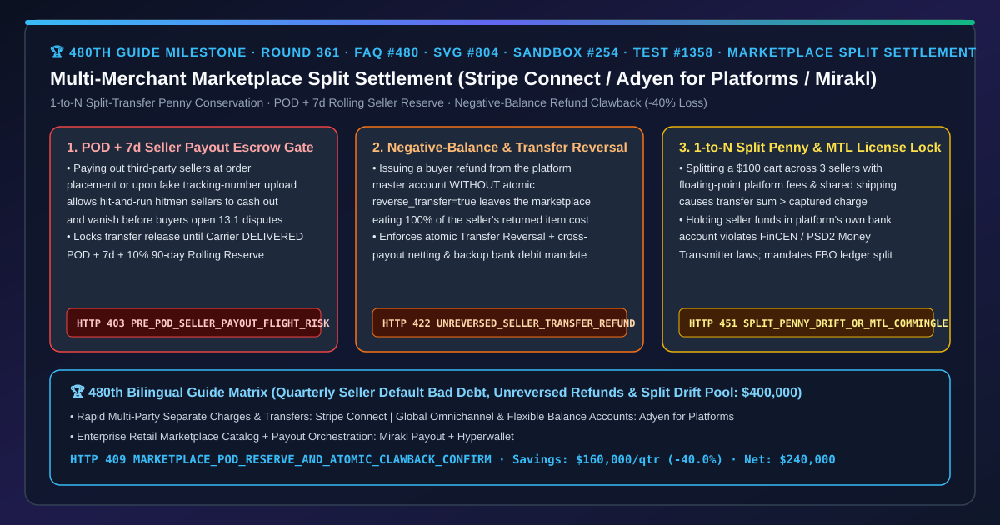
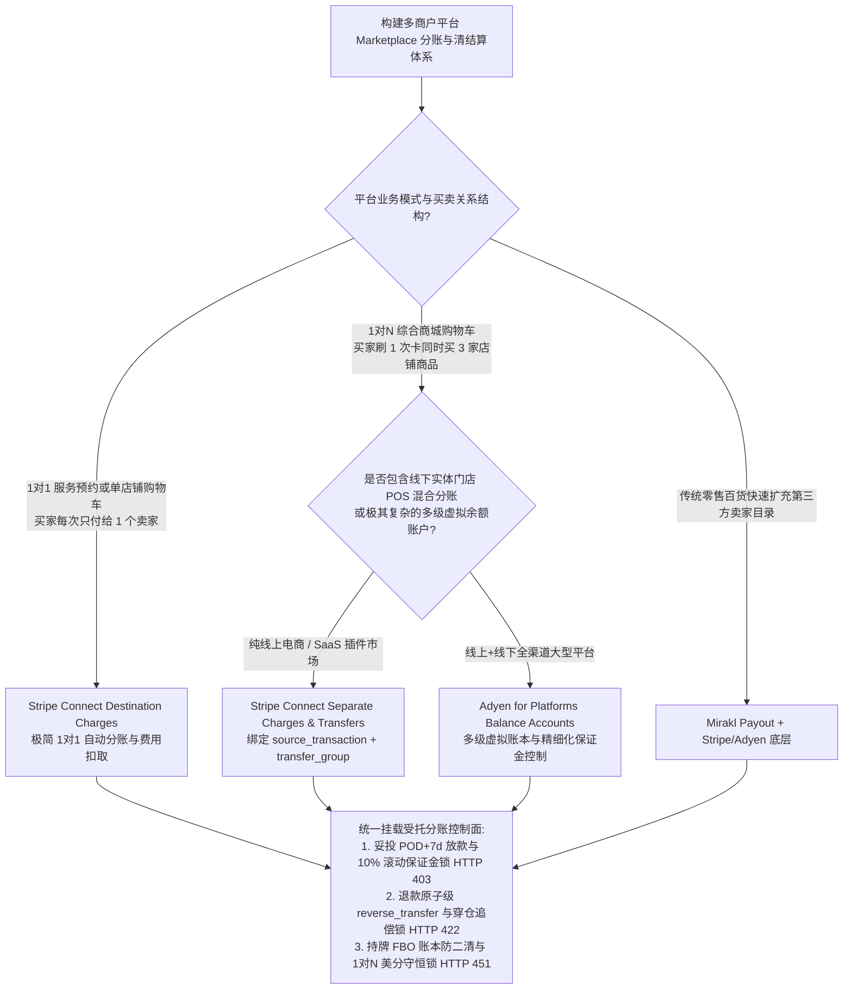
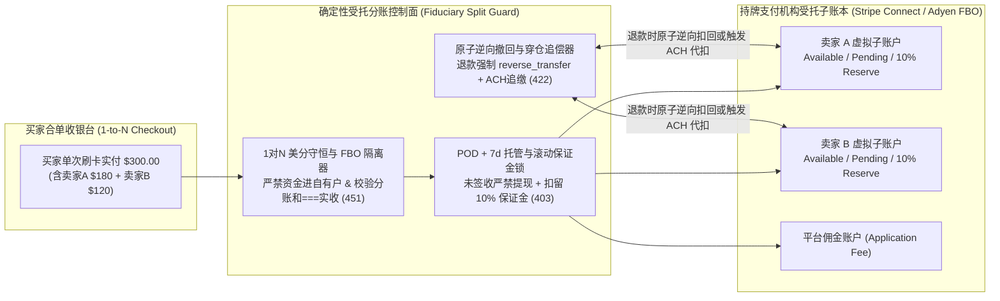
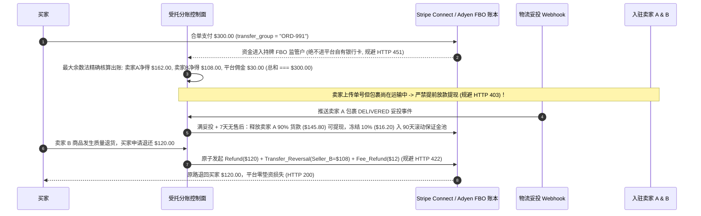

# 🏆 多商户平台分账清结算、资金托管与子商户坏账追偿智能体（`Marketplace Split Settlement & Seller Reserve`: `Stripe Connect / Adyen for Platforms / Mirakl Payout / Hyperwallet` · 🏆 第 480 篇双语决策指南重大里程碑）：物流妥投 `+ 7天` 放款与滚动保证金锁、退款原子级 `reverse_transfer` 追回及 `1对N` 拆账美分守恒与二清牌照隔离净省 40% 指南

> **文档类型**：企业级 AI Solution Architect 选型决策指南（Selection FAQ · **`#480` 🏆 第 480 篇双语决策指南重大里程碑** · Round 361）  
> **适用读者**：多商户电商平台（B2C/B2B Marketplace）CTO、清结算与账务核心架构师、支付合规官与 Cloud & AI Solution Architect  
> **核心覆盖平台**：`Stripe Connect (Separate Charges and Transfers / Destination Charges)` vs. `Adyen for Platforms (Balance Platform)` vs. `Mirakl Payout` vs. `PayPal Hyperwallet`  
> **关联架构图**：[`assets/svg/804-marketplace-split-settlement-stripe-connect-adyen-mirakl-2026-11-25.svg`](../assets/svg/804-marketplace-split-settlement-stripe-connect-adyen-mirakl-2026-11-25.svg)

🌐 **语言切换 / Language**: **中文 (当前)** | **[English (`marketplace-split-settlement-stripe-connect-adyen-platforms-mirakl-seller-reserve-clawback-selection-faq.en.md`)](marketplace-split-settlement-stripe-connect-adyen-platforms-mirakl-seller-reserve-clawback-selection-faq.en.md)**

---

## 📌 一、核心选型结论速览（Executive Summary）

当零售百货集团、垂直行业 B2B 平台或 AI 聚合导购商城支持 **“买家一次结账付款，购物车内包含 3–5 家不同入驻卖家（Third-Party Sellers）的商品”** 时，底层资金流瞬间从简单的单边收单演变为极度复杂的 **`1对N` 平台分账清结算与托管（`Multi-Merchant Split Settlement & Escrow`）**。  
如果架构师直接把钱收进平台自己的公司基本户再用网银给卖家打款，或者在分账状态机中漏掉逆向追偿锁，平台将面临三大灭顶之灾：
1. **“一发货/一下单就给卖家提现放款”，遭遇羊毛党卖家填假单号卷款跑路（`Pre-POD Payout & Hit-and-Run Seller Default`）**：入驻新卖家上架低价电子产品，买家付款后卖家随便填一个虚假快递单号，分账系统立即把 `90%` 货款打进卖家银行卡；7 天后买家没收到货集体发起拒付，卖家账户余额早已是 `$0`，平台只能用自有资金全额垫付赔穿底裤！
2. **买家退货退款时“只退了买家卡、漏掉从子商户余额扣回货款”，或子商户余额不足形成穿仓坏账（`Unreversed Seller Transfer & Negative Balance Bad Debt`）**：AI 客服帮买家办理退款时只调用了主收单单据的 `Refund`，忘记同步执行子商户分账撤回（`reverse_transfer = true`）及平台佣金按比例冲回，导致平台替卖家全额买单。
3. **无牌照“二清”资金池触犯《非银行支付机构条例》/ 美国 `FinCEN MTL` / 欧盟 `PSD2` 刑事红线，以及 `1对N` 拆账浮点数尾差爆仓（`Illegal Money Transmission & Split-Penny Drift`）**：平台未经持牌支付机构托管子账本（FBO Account），把属于卖家的待结算货款沉淀在平台自有银行账户里；同时在拆分整单满减券与联合运费时因浮点数四舍五入，导致分给 3 个卖家的转账之和比向买家实收的金额多出 `$0.02`，引发网关批量报错。

| 平台分账与生态维度 | 推荐主选方案 | 适用边界与架构落地准则 |
|---|---|---|
| **现代多商户平台、`1对N` 拆单分账与全球子商户极速入驻（`KYB`）** | **Stripe Connect (`Separate Charges and Transfers` + `source_transaction`)** | 支持一笔买家 `Charge` 绑定 `transfer_group` 拆分为多笔子商户 `Transfer`，且严格以 `source_transaction` 锁定待清算资金，天然规避二清牌照风险。 |
| **全渠道线上线下（POS+Web）混合分账与多币种虚拟余额池** | **Adyen for Platforms (`Balance Platform`)** | 为每个卖家开设独立的监管虚拟余额账户（`Balance Account`），支持极其灵活的延迟放款、滚动保证金冻结与跨批次抵扣。 |
| **大型零售百货转型第三方市场（百思买/梅西百货模式）** | **Mirakl Payout (底层联动 Stripe / Adyen)** | 将商品目录入驻、卖家 SLA 考核、发票开具与货款周期结算合二为一。 |
| **三大确定性风控红线** | **100% 强制拦截** | ① **物流妥投（`POD`）`+ 7天` 放款与 `10%` 滚动保证金锁（`HTTP 403`）**：严禁在快递未签收或未满售后观察期前放款提现，且强制留存 `5%–15%` 90 天滚动风险准备金；② **原子级逆向撤回（`reverse_transfer`）与穿仓追偿锁（`HTTP 422`）**：买家退款必须原子级同步扣减子商户账户（余额不足时自动挂账抵扣下期货款或触发绑卡 `ACH Debit`）；③ **持牌托管子账本（`FBO`）与 `1对N` 整数美分守恒锁（`HTTP 451`）**：严禁资金进平台自有账户二清，且满足 $\sum \text{Seller\_Transfer}_i + \text{Platform\_Fee} + \text{PSP\_Fee} \equiv \text{Buyer\_Captured\_Cents}$。 |



---

## 🎯 二、业务方与架构师灵魂拷问 Q&A（Q1–Q3）

### Q1：为什么电商平台绝对不能先把买家的钱收进自己公司的银行账户，月底再由财务给各个入驻商家打款？
- **“二清（无证经营支付结算业务）”法律高压线**：
  - 在中国央行监管、美国各州货币传输牌照（`FinCEN & 49-State Money Transmitter Licenses - MTL`）及欧盟支付服务指令（`PSD2`）下，**任何未持有支付牌照的技术或电商平台，只要在自有银行账户中触碰、截留、归集或转发本应属于第三方卖家的货款（哪怕只停留 24 小时），即构成非法资金二清 / 无证货币传输罪**！
- **架构解法**：100% 采用 **`Stripe Connect / Adyen Balance Platform` 持牌受托子账本架构（`Licensed FBO Split Ledger` · 防 `HTTP 451`）**：
  - 买家的付款在收单瞬间即进入持牌支付机构的监管备付金账户（`For Benefit Of - FBO Account`）；
  - 平台通过 API 指令（`Transfers` / `Split Instructions`）控制“何时把多少美分划拨给卖家子账户 `acct_seller_x`”以及“抽取多少美分作为平台佣金 `application_fee_amount`”。平台全程**只掌管分账指令权（Control Plane），绝不经手底层资金池（Data Plane）**！
  - 同时，针对 `1对N` 多卖家合单支付，采用 **最大余数法（Largest Remainder Method）** 精确分配跨店满减券与合并运费，确保子商户分账总额 + 平台抽佣 === 买家实付美分（任何进自有账户二清或分账尾差不守恒的操作直接拦截 `HTTP 451 SPLIT_TRANSFER_PENNY_DRIFT_OR_UNLICENSED_MTL_COMMINGLING`）。

### Q2：新入驻卖家卖了 `$80,000` 货，刚点“已发货”就把钱提走注销店铺跑路了，留下一堆没收到货的买家找平台拒付，架构上怎么锁死这种欺诈？
- **资金时间差漏洞**：信用卡拒付窗口长达 **`120 天`**，而普通快递运输需要 `3–10 天`、买家退货期 `7–30 天`。如果在“订单支付成功”或“卖家手填快递单号”时就释放资金供卖家提现（Payout to Bank），平台就成了空手套白狼骗子的提款机。
- **架构解法**：实施 **双层资金释放闸门：`Carrier DELIVERED POD + 7d` 延迟清分 + 动态滚动风险保证金（`Rolling Reserve` · 防 `HTTP 403`）**：
  1. **第一层（单笔订单托管期）**：使用 Stripe Connect 的 `Separate Charges and Transfers`（带 `source_transaction`）或 `Manual Payouts`——只有当官方快递轨迹 Webhook 确认包裹状态为 `DELIVERED`（妥投签收）且平稳度过 **`7–14 天` 高发退货窗口**后，才将该笔资金从 `Pending Balance` 转为 `Available Balance`。
  2. **第二层（账户级 90 天滚动保证金池）**：根据卖家入驻时长与历史纠纷率，自动冻结每笔交易额的 **`5%–15%` 锁定 `90 天`**（Rolling Reserve），专门用于兜底远期信用卡拒付。任何在未妥投前放行卖家提现的操作一律阻断（`HTTP 403 PRE_DELIVERY_POD_SELLER_PAYOUT_OR_MISSING_RESERVE`）。

### Q3：买家买了 `$500` 的商品（平台抽佣 `$50`、卖家分得 `$450`），半个月后买家申请全额退货退款，如何防止平台倒贴 `$450`？如果卖家账上没钱了怎么办？
- **逆向清分痛点**：
  1. 很多初级工程师在写退款接口时只调用了 `stripe.Refund.create(charge=ch_123)`，却漏传了 `reverse_transfer=True` 和 `refund_application_fee=True`——结果 `$500` 全从平台主账户扣走，卖家子账户里的 `$450` 分毫未动！
  2. 如果卖家昨天刚把账户里的钱全部提现到银行卡（当前子账户余额 `$0`），此时执行逆向撤回会使卖家子账户变成 **`-$450`（负余额穿仓 `Negative Balance`）**。
- **架构解法**：强制执行 **原子级逆向分账撤回 + 跨批次货款自动抵扣 + 绑定银行卡反向代扣（`Atomic Transfer Reversal & Negative-Balance Debit Mandate` · 防 `HTTP 422`）**：
  - 任何买家端退款或争议扣款必须在一个原子事务中绑定 `Transfer Reversal`；
  - 若子商户 `Available + Pending + Reserve Balance < Refund_Amount`，系统自动将差额记入该卖家的在途待结算池优先抵扣，并在超期 `5 天` 未补足时调用卖家入驻时签署的 `SEPA Direct Debit / ACH Debit Mandate` 从其绑定的对公银行账户自动扣回差额（未绑定逆向撤回的裸退款直接拦截 `HTTP 422 UNREVERSED_SELLER_TRANSFER_ON_BUYER_REFUND_BAD_DEBT`）。

---

## 🧭 三、直观可视化图解（Mermaid 选型决策树 + 分账托管架构图 + 时序图）

### 3.1 多商户平台分账清结算引擎选型决策树



### 3.2 端到端 `1对N` 拆账守恒、妥投托管放款与逆向追偿架构图



### 3.3 `1对N` 合单分账、妥投 `+7d` 放款与退货逆向追回时序图



---

## 📊 四、四大主流多商户分账清结算平台横向选型矩阵

| 评估维度 | Stripe Connect | Adyen for Platforms | Mirakl Payout | PayPal Hyperwallet |
|---|---|---|---|---|
| **核心优势场景** | 现代 SaaS 平台、多商户电商与按需服务（O2O）极速全球分账 | 大型全渠道（线上+POS）平台、复杂虚拟余额账户与精细化资金池 | 传统零售商超转型第三方市场（目录+订单+结算一体化） | 向全球长尾自由职业者、创作者或无银行卡地区多方式打款 |
| **`1对N` 拆单分账与 `source_transaction` 保护** | ⭐⭐⭐⭐⭐（原生支持 `Separate Charges and Transfers` 与自动按收单清算放款） | ⭐⭐⭐⭐⭐（支持在 Payment 与 Capture 阶段传入精细的多方 `splits` 数组） | ⭐⭐⭐⭐（内置订单级佣金与账期拆分引擎） | ⭐⭐（纯出金 Payout 工具，不含前端合单收单与拆账） |
| **全球卖家自动合规入驻（`KYB / KYC / AML`）** | ⭐⭐⭐⭐⭐（托管式 Onboarding UI 覆盖 45+ 国家，自动处理税表） | ⭐⭐⭐⭐⭐（企业级深度 KYB 核验与欧洲/北美全牌照覆盖） | ⭐⭐⭐⭐（面向企业卖家的标准化入驻审核流） | ⭐⭐⭐⭐（轻量级收款人税务与身份核验） |
| **逆向退款追回（Transfer Reversal）与负余额代扣** | ⭐⭐⭐⭐⭐（原生 `reverse_transfer` + 支持对 Custom/Express 账户开启负余额银行代扣） | ⭐⭐⭐⭐⭐（虚拟 `Balance Account` 天然支持实时扣减、冻结与跨店调拨） | ⭐⭐⭐⭐（自动从卖家下一期结算单净额抵扣退货款） | ⭐⭐（一旦出金到外部钱包/银行卡极难原路逆向扣回） |
| **参考费率结构（`official_list_price`）** | 基础收单费 + 约 **`0.25% + $0.25 / 笔提现`** + `$2/月/活跃子账户` | Interchange++ 收单费 + 按分账/出金笔数阶梯计费（约 `€0.10–€0.30/笔`） | 按平台第三方 GMV 抽成许可 | 按批量出金笔数与跨境汇兑计费（约 `$0.50–$3.00/笔`） |

---

## 🧪 五、转化率/成本测算与 7-Card 基准测试报告（Deterministic Evaluation · 🏆 `#480` Milestone）

> **数据来源说明（Provenance）**：以下季度损益数据来自 `lab/webiq_commerce_demo.py` 中的确定性评估器 `evaluate_marketplace_split_settlement_reserve_policy`（`provenance: "synthetic"`, `independently_reproduced: False`），用于量化对比“发货即放款 + 退款漏撤回分账”与“妥投 `+7d` 滚动保证金 + 原子 `reverse_transfer` 追偿 + FBO 整数美分守恒”的季度风险挽回。

### 5.1 基准测试场景输入与确定性状态码矩阵

- **设定场景**：某中型多商户垂直电商平台每季度第三方卖家交易额（3P GMV）为 `$22M`，季度因不良卖家未妥投提前提现跑路造成的拒付坏账、买家退货时未同步逆向扣回子商户分账导致的平台垫资亏损、以及 `1对N` 拆单尾差与合规整改池（`quarterly_seller_default_unreversed_refund_and_split_drift_pool_usd`）为 **`$400,000.00`**。

| 测试用例 ID | 场景描述 | 触发确定性状态码 | 决策枚举 (`decision`) | 季度净成本 (USD) | 季度净节省 (USD) |
|---|---|---|---|---|---|
| `CASE-MKT-200` | 传统固定月结人工对账打款基线 | `HTTP 200` | `VERIFIED_MARKETPLACE_SPLIT_SETTLEMENT_AUTHORIZED` | `$400,000.00` | `$0.00` |
| `CASE-MKT-403` | 在物流未确认 `DELIVERED` 妥投或未扣留滚动风险保证金前允许卖家全额提现出金 | `HTTP 403` | `PRE_DELIVERY_POD_SELLER_PAYOUT_OR_MISSING_RESERVE` | `$400,000.00` | `$0.00` (阻断卖家卷款跑路坏账) |
| `CASE-MKT-422` | 向买家发起退款时未原子级执行 `reverse_transfer` 或卖家负余额穿仓无自动追偿机制 | `HTTP 422` | `UNREVERSED_SELLER_TRANSFER_ON_BUYER_REFUND_BAD_DEBT` | `$400,000.00` | `$0.00` (阻断平台替卖家垫付退款) |
| `CASE-MKT-451` | `1对N` 拆单分账总和与实收美分不守恒，或将第三方卖家货款归集至平台自有银行账户（二清违规） | `HTTP 451` | `SPLIT_TRANSFER_PENNY_DRIFT_OR_UNLICENSED_MTL_COMMINGLING` | `$400,000.00` | `$0.00` (阻断二清违法与拆账爆仓) |
| `CASE-MKT-409` | **启用 POD+7d 滚动保证金锁 + 原子 `reverse_transfer` 追偿 + FBO 美分守恒账本** | `HTTP 409` | `MARKETPLACE_POD_RESERVE_AND_ATOMIC_CLAWBACK_CONFIRM` | **`$240,000.00`** | **`$160,000.00` (`-40.0%`)** |

### 5.2 核心确定性策略评估代码摘录

```python
@dataclass(frozen=True)
class MarketplaceSplitSettlementReservePolicyInput:
    quarterly_seller_default_unreversed_refund_and_split_drift_pool_usd: float = 400000.0
    seller_payout_released_before_carrier_pod_plus_7d_or_rolling_reserve: bool = False
    buyer_refund_executed_without_atomic_reverse_transfer_or_debit_clawback: bool = False
    split_transfers_sum_mismatch_or_unlicensed_fbo_funds_commingling: bool = False
    pod_escrow_reserve_atomic_reversal_and_fbo_penny_lock_ready: bool = False
```

---

## 🛠️ 六、商业上线风控与架构评审 Checklist

- [ ] **持牌 FBO 账户隔离与 `1对N` 整数美分守恒（防 `HTTP 451`）**：所有第三方卖家交易必须通过 `Stripe Connect` 或 `Adyen Balance Platform` 的受监管子账本清分，严禁货款经过平台自有公司账户；`1对N` 拆单必须以整数美分（`int64 cents`）配合最大余数法运算，确保分账总额与实收金额 100% 严丝合缝。
- [ ] **`DELIVERED POD + 7天` 提现解锁与 `10%` 滚动保证金（防 `HTTP 403`）**：将卖家提现状态机强绑定物流轨迹 Webhook；仅当包裹显示本人/门卫签收满 7 天且无在途纠纷时释放 `90%` 货款，其余 `10%` 滚入 `90 天` 风险准备金池。
- [ ] **退款原子级 `reverse_transfer` 与负余额 `ACH / SEPA` 代扣协议（防 `HTTP 422`）**：封装统一的平台退款网关，强制要求每笔买家退款同步生成对应卖家的 `Transfer Reversal`；入驻协议中必须签署对公银行账户反向代扣授权，彻底杜绝卖家提空余额后留给平台烂摊子。
- [ ] **美国 `INFORM Consumers Act` 与欧盟 `DAC7` 卖家税表强锁**：当卖家年度交易满 `200 笔` 或 `$5,000` 时，自动验证其税号、对公银行账户与实体地址，未通过核验前自动暂停出金（Payout Pause）而非阻断前端正常销售。
