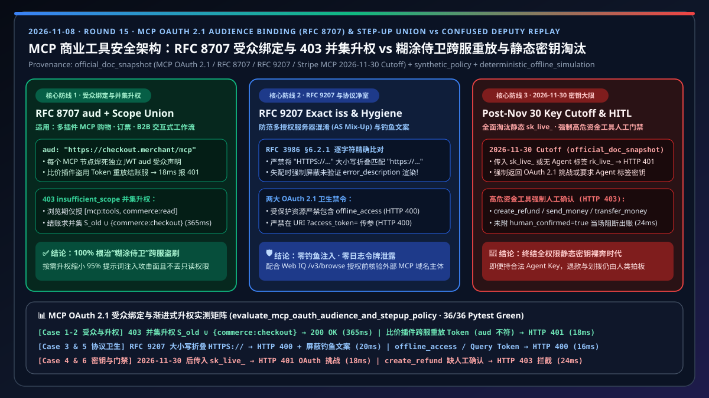
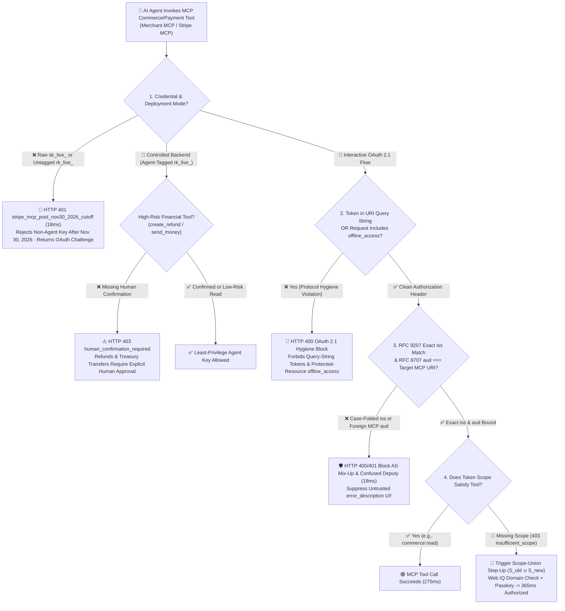
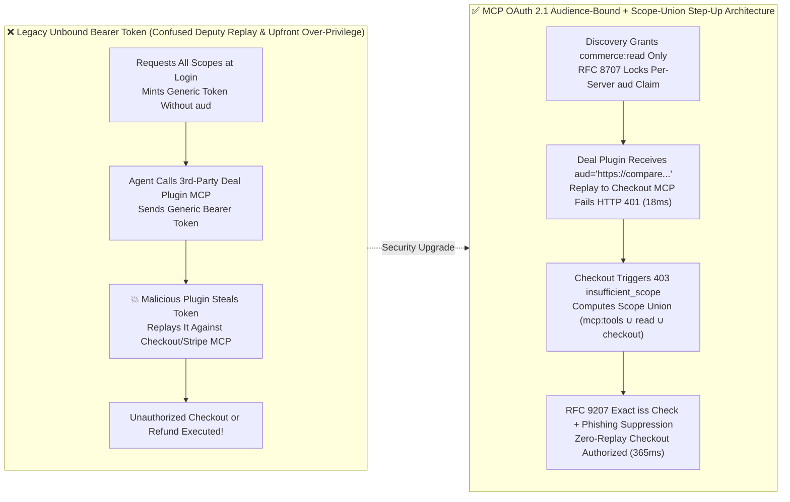
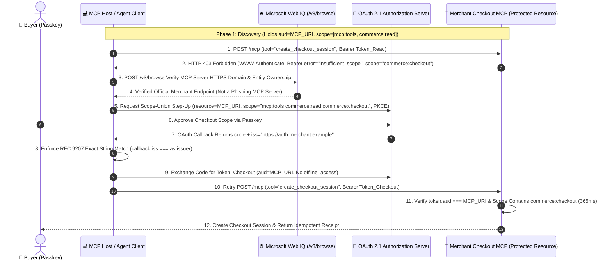

# MCP Commerce Tool Security, OAuth 2.1 Audience Binding & Step-Up Authorization Architecture: Resource Indicators (`RFC 8707` `aud` Binding + `RFC 9207` Exact `iss` Match) & `403 insufficient_scope` Scope-Union Step-Up vs. Confused Deputy Token Replay & Static API Keys (`2026-11-30` Cutoff) Selection & First-Principles FAQ

> **Document Type**: Architect Selection Guide & Protocol First-Principles Deep Dive (Modeled after `ib-vs-ethernet-roce-selection-faq.md`)  
> **Target Audience**: AI Solution Architects, MCP Platform & Tool Gateway Engineers, Payment Security & IAM Architects  
> **Executable Reference & Tests**: `lab/webiq_commerce_demo.py` · `tests/test_webiq_commerce_demo.py`  
> **Interactive Sandbox & 7-Card Report**: [Live H5 Demo (`#mcp-oauth-audience-stepup-sandbox`)](https://turbo998.github.io/workshops/agentic-commerce/live-demo.en.html) · [7-Card Visual Benchmark](https://turbo998.github.io/workshops/agentic-commerce/benchmark-cards.en.html)  
> **Provenance & Scope Declaration (`as_of: 2026-11-08`)**: MCP Authorization specifications (OAuth 2.1, `RFC 9728` Protected Resource Metadata, `RFC 8707` Resource Indicators, `RFC 9207` character-by-character `iss` comparison, prohibition of URI query-string tokens, and prohibition of `offline_access` on protected resources) and the Stripe MCP **November 30, 2026** non-agent static key cutoff reflect official specification snapshots (`official_doc_snapshot`); cross-server replay interception and Web IQ domain entity checks are reference architectural policies (`synthetic_policy`); latencies (`275 ms / 365 ms / 18 ms`) and 100% interception rates come from deterministic offline simulation (`deterministic_offline_simulation`); external enterprise IdP (Entra ID / Okta) wide-area network token issuance latencies are not load-tested without production credentials and are labeled `not_measured`.

---

## ① 📌 Executive Summary

When an AI shopping or enterprise procurement agent connects simultaneously to multiple MCP Servers—such as a third-party Price-Comparison MCP plugin, a Merchant Order MCP Server, and the Stripe Payment MCP Server—two architectural questions determine whether the system survives a security audit: **"How do we prevent a malicious plugin from replaying a buyer's token against our payment server?"** and **"How do we avoid requesting dangerous payment scopes during casual browsing?"** Architects should apply three core rules:

1. **When to Choose "OAuth 2.1 Audience Binding + Step-Up Scope Union (`RFC 8707` `aud` + `403 insufficient_scope`)" vs. "Agent-Tagged Restricted Keys (`rk_live_...`)"?**
   - **Interactive Buyer or Employee MCP Commerce Workflows (Browsing, Order Lookup, Checkout, Returns)** 👉 **Always Choose OAuth 2.1 Resource Indicator Audience Binding (`RFC 8707` `resource` -> JWT `aud`) + On-Demand Step-Up Scope Union** (`275 ms` read-only call, `365 ms` step-up union call, `deterministic_offline_simulation`). During discovery, grant only `["mcp:tools", "commerce:read"]`. When the user initiates checkout and triggers `HTTP 403 insufficient_scope`, the MCP client computes the **set union** of existing and required scopes (`["mcp:tools", "commerce:read", "commerce:checkout"]`, `official_doc_snapshot`).
   - **Controlled Server-to-Server Batch Reconciliation Connectors** 👉 **Use Exclusively `Agent`-Tagged Least-Privilege Restricted Keys (`rk_live_...`)**. Under Stripe MCP security rules, starting **after November 30, 2026 (December 2026 onward, `official_doc_snapshot`)**, any request to Stripe MCP using a full-privilege `sk_live_...` key or an untagged `rk_live_...` key is rejected with **`HTTP 401 stripe_mcp_post_nov30_2026_rejects_non_agent_key_with_oauth_challenge`**!
2. **First Principles: What Is a "Confused Deputy" Cross-MCP Token Replay Attack, and How Does `RFC 8707` Audience Binding (`aud`) Eliminate It?**
   - **Why Generic Bearer Tokens Fail**: Suppose a user authorizes an Agent to call both a third-party "Deal Finder MCP (`https://compare.plugin.example/mcp`)" and a "Merchant Checkout MCP (`https://checkout.merchant.example/mcp`)". If the Authorization Server issues a generic Bearer token without binding it to a specific recipient URI, the Deal Finder MCP can capture that Bearer token and replay it directly against the Merchant Checkout MCP to execute unauthorized purchases!
   - **`RFC 8707` Cryptographic Isolation**: When requesting a token, the MCP client passes `resource="https://checkout.merchant.example/mcp"`, locking that exact canonical URI into the JWT's **`aud` (Audience) claim**. If a token minted for `https://compare.plugin.example/mcp` is replayed against the Checkout MCP Server, the server detects `token.aud !== self.canonical_uri` and aborts in **`18 ms`** with **`HTTP 401 rfc8707_audience_mismatch_confused_deputy_blocked`**!
3. **Four Mandatory MCP OAuth 2.1 Protocol Invariants**:
   - **① `RFC 9207` Character-by-Character `iss` String Matching (`RFC 3986 §6.2.1`)**: The `iss` parameter in the OAuth callback must match the Authorization Server's `issuer` metadata character-for-character (**no case-folding `HTTPS://` to `https://`**). On mismatch, abort with `HTTP 400` and **suppress rendering any untrusted `error` or `error_description`** from the callback (`official_doc_snapshot`).
   - **② Prohibit `offline_access` on Protected Resources**: MCP Protected Resource Metadata (`RFC 9728`) and `WWW-Authenticate` challenges must never advertise or request `offline_access` (`HTTP 400 mcp_protected_resource_forbids_offline_access_scope`).
   - **③ Never Pass Access Tokens in URI Query Strings**: Reject `?access_token=...` requests immediately (`HTTP 400 mcp_forbids_access_token_in_uri_query_string`) to prevent proxy/log leakage.
   - **④ Pre-Consent Domain Verification via Microsoft Web IQ `/v3/browse`**: Before rendering an OAuth consent or step-up prompt for an external MCP server, verify its HTTPS domain ownership via Web IQ.

---

## ② 🎯 Architect & Customer Q&A (FAQ-Driven)

### Q1: Why can't our engineering team just put `sk_live_...` in an environment variable for the Stripe MCP Server, or request all payment and refund scopes upfront at login?
**First-Principles Walkthrough**:
- **Why Static `sk_live_...` Keys Are a Blank Check for Prompt Injection**:
  - A raw `sk_live_...` secret key carries unrestricted authority to read all customer records, issue arbitrary refunds (`create_refund`), and move funds (`send_money` / `transfer_money`). If an agent ingests a malicious web snippet or email, an attacker can hijack those tools immediately.
  - Consequently, after the **November 30, 2026 deadline (`official_doc_snapshot`)**, Stripe MCP blocks `sk_live_...` and untagged `rk_live_...` keys with an `HTTP 401` OAuth challenge, requiring either user-scoped OAuth 2.1 tokens or `Agent`-tagged restricted keys guarded by mandatory human confirmation on high-risk tools.
- **Why Upfront All-Scope Login Fails Both UX and Security**:
  - Asking for checkout and refund authority when a user merely asks "Compare espresso machines under $200" causes immediate user drop-off and leaves high-privilege tokens active while the agent parses untrusted third-party web pages.
  - **Step-Up Authentication (`HTTP 403 insufficient_scope`)** keeps the agent read-only (`commerce:read`) during discovery and elevates to `commerce:checkout` only at the moment of purchase approval.

### Q2: Why do many MCP implementations break basic read tools right after completing an `HTTP 403 insufficient_scope` step-up flow?
**First-Principles Walkthrough**:
- **The "Scope Overwrite" Anti-Pattern**:
  1. Initially, the client holds scopes $S_0 = \{\text{`mcp:tools`}, \text{`commerce:read`}\}$.
  2. When calling `create_checkout_session`, the MCP Server returns `HTTP 403` with `WWW-Authenticate: Bearer error="insufficient_scope", scope="commerce:checkout"`.
  3. **Buggy Client Behavior**: The client requests a new token with `scope="commerce:checkout"` alone, **overwriting** $S_0$. The new token loses `mcp:tools` and `commerce:read`, causing subsequent order-status reads to fail with `403`!
  4. **Standard Scope-Union Step-Up**: The client must compute the deterministic union $S_1 = S_0 \cup S_{\text{required}} = \{\text{`mcp:tools`}, \text{`commerce:read`}, \text{`commerce:checkout`}\}$ while stripping any forbidden `offline_access` token.

### Q3: What does `RFC 9207` "Simple String Comparison (`RFC 3986 §6.2.1`)" require, and why must the client suppress `error_description` when `iss` validation fails?
**First-Principles Walkthrough**:
- **Defending Against Authorization Server (AS) Mix-Up & Phishing**:
  - Under `RFC 9207`, when an Authorization Server advertises `authorization_response_iss_parameter_supported: true`, every callback must include the `iss` parameter, and the client must compare `callback.iss` against `metadata.issuer` using **exact code-point-by-code-point comparison (`RFC 3986 §6.2.1`)**.
  - Normalizing `"HTTPS://auth.merchant.example"` to lowercase `"https://auth.merchant.example"` is forbidden and must trigger `HTTP 400 rfc9207_iss_mismatch_simple_string_comparison_failed`.
  - Furthermore, if an attacker crafts a spoofed callback with a mismatched `iss` and injects `error_description="Account locked—click https://phish.example to re-enter card"`, rendering that string in the agent UI would phish the user. Therefore, **`error` and `error_description` must be completely suppressed (`suppress_untrusted_error_display = True`) whenever `iss` validation fails** (`official_doc_snapshot`).

---

## ③ 🧭 Visual Architecture Diagrams (Mermaid Decision Tree + Confused Deputy Comparison + Sequence Diagram)

### 3.1 MCP Tool Authentication & Step-Up Authorization Decision Tree (`flowchart TD`)

### 3.2 Legacy Unbound Bearer Token ("Confused Deputy") vs. `RFC 8707` Audience-Bound Step-Up Architecture (`flowchart LR`)

### 3.3 End-to-End Sequence Diagram: MCP Host, Web IQ Domain Check, OAuth 2.1 AS & Protected MCP Server (`sequenceDiagram`)

---

## ④ 📊 Architect Decision Matrix

| Evaluation Dimension | Option A: OAuth 2.1 Audience Binding + Scope-Union Step-Up (`RFC 8707` + `403` Union) | Option B: `Agent`-Tagged Restricted Key + High-Risk Tool Gate (`rk_live_...` + HITL) | Legacy Anti-Pattern 1: Generic Unbound Bearer Token or Scope Overwrite | Legacy Anti-Pattern 2: Raw `sk_live_...` or Untagged `rk_live_...` Key |
| :--- | :--- | :--- | :--- | :--- |
| **Primary Use Cases** | Interactive buyer/employee multi-plugin MCP shopping, booking, B2B sourcing, and support | Controlled single-merchant backend reconciliation & approved server connectors | Early OAuth prototypes without `RFC 8707` (**Prohibited in production**) | Legacy hardcoded scripts (**Rejected after Nov 30, 2026**) |
| **Cross-Server Replay Immunity** | ⭐⭐⭐⭐⭐ 100% Immune (Per-server `aud` claim blocks cross-MCP replay in `18 ms` with `401`) | ⭐⭐⭐ Single-Connector Scope (Vulnerable if key is shared across plugins) | ❌ 0% (3rd-party plugin can execute Confused Deputy token replay) | ❌ 0% (Key leak compromises entire Stripe account) |
| **Least-Privilege & Step-Up UX** | Starts with `commerce:read`; seamlessly unions `S_old ∪ S_new` on `403` | Scoped permissions + mandatory human confirmation on `create_refund` / `send_money` | Overwriting scopes breaks subsequent read/grounding tool calls | Full root permissions exposed during untrusted web browsing |
| **Protocol Hygiene Safeguards** | `RFC 9207` exact `iss` match, no `offline_access`, no URI query tokens | Enforces 180-day payout inactivity lock & IP/ASN rules | Vulnerable to `iss` case-folding mix-up & `error_description` phishing | Rejected with `HTTP 401` OAuth challenge starting Dec 2026 |
| **Simulated Latency** | Read **`275 ms`** / Step-Up **`365 ms`** (`deterministic_offline_simulation`) | **`290 ms`** (with confirmation gate check, `deterministic_offline_simulation`) | Blocked in **`18–22 ms`** | Blocked in **`18 ms`** (external IdP WAN latency `not_measured`) |

---

## ⑤ 🧪 Quantitative Benchmark & 7-Card Findings

Implemented in `evaluate_mcp_oauth_audience_and_stepup_policy()` in `lab/webiq_commerce_demo.py` and verified in `tests/test_webiq_commerce_demo.py` (`deterministic_offline_simulation`):

| Scenario ID | Client Credential & Target MCP Posture | Protocol Rule Evaluated | Deterministic Gateway Verdict (`HTTP Status` & Action) | Merged Scopes / Security Outcome & Latency |
| :--- | :--- | :--- | :--- | :--- |
| **Case 1: Scope-Union Step-Up Success** | Holds `["mcp:tools","commerce:read"]`; step-up adds `"commerce:checkout"`; `aud == target_uri` | `RFC 8707` `aud` + `RFC 9207` `iss` + Scope Union | **`200 OK`** · `STEPUP_SCOPE_UNION_AUTHORIZED` (`Act automatically`) | Merged `["mcp:tools","commerce:read","commerce:checkout"]` · **`365 ms`** |
| **Case 2: Confused Deputy Replay Blocked** | Deal plugin replays token with `aud="https://compare.plugin.example/mcp"` against Checkout MCP | `RFC 8707` Resource Audience Binding (`token.aud !== target_uri`) | **`401 Unauthorized`** · `BLOCKED_CONFUSED_DEPUTY_AUD_MISMATCH` (`Send to a human`) | 100% blocks cross-MCP token replay · **`18 ms`** |
| **Case 3: `RFC 9207` Case-Folded `iss` Blocked** | AS issuer is `https://auth...`; callback passes `HTTPS://auth...` + phishing `error_description` | `RFC 9207` / `RFC 3986 §6.2.1` Exact Match + Error Suppression | **`400 Bad Request`** · `BLOCKED_RFC9207_ISS_MISMATCH` (`Send to a human`) | Blocks AS mix-up & suppresses untrusted error UI (`suppress_error_ui=True`) · **`20 ms`** |
| **Case 4: Post-Nov 30 `sk_live_` Cutoff** | Caller passes raw `sk_live_...` or untagged `rk_live_...` to Stripe MCP Server | Stripe MCP Post-Nov 30, 2026 Credential Cutoff (`official_doc_snapshot`) | **`401 Unauthorized`** · `BLOCKED_POST_NOV30_STATIC_KEY_CUTOFF` (`Confirm`) | Rejects static key & issues `WWW-Authenticate` OAuth 2.1 challenge · **`18 ms`** |
| **Case 5: `offline_access` or Query Token Blocked** | Request includes `offline_access` on protected resource or `?access_token=...` in URI | MCP OAuth 2.1 Protected Resource Hygiene (`official_doc_snapshot`) | **`400 Bad Request`** · `BLOCKED_OAUTH_HYGIENE_VIOLATION` (`Send to a human`) | Prevents long-lived refresh token sprawl & URL log leakage · **`16 ms`** |
| **Case 6: High-Risk Refund/Treasury Gate** | Valid `Agent` key invokes `create_refund` or `send_money` without human confirmation | Stripe MCP High-Risk Tool Confirmation Gate (`official_doc_snapshot`) | **`403 Forbidden`** · `BLOCKED_HIGH_RISK_TOOL_NEEDS_HUMAN_CONFIRM` (`Confirm`) | Halts unconfirmed outbound money movement · **`24 ms`** |

---

## ⑥ 🛠️ Appendix: Production Readiness & Pre-Sales Checklist (Architect Checklist)

- [ ] **1. Eliminate Raw `sk_live_...` Keys Before the November 30, 2026 Cutoff**: Audit all Stripe MCP integrations and migrate to OAuth 2.1 user flows or explicitly `Agent`-tagged restricted keys (`rk_live_...`).
- [ ] **2. Enforce `RFC 8707` `token.aud === target_mcp_canonical_uri`**: Verify that every MCP Server rejects tokens whose `aud` claim does not match its own canonical URI, neutralizing Confused Deputy cross-plugin replay.
- [ ] **3. Implement Scope Union (`S_old ∪ S_new`) on `HTTP 403 insufficient_scope`**: Ensure MCP clients merge required step-up scopes with existing read/tool scopes rather than overwriting them.
- [ ] **4. Enforce Character-by-Character `RFC 9207` `iss` Comparison & Error Suppression**: Confirm that OAuth callback handlers never case-fold `iss` and immediately suppress `error_description` rendering if `iss` validation fails.
- [ ] **5. Strip `offline_access` and Reject URI Query-String Tokens**: Verify that `.well-known/oauth-protected-resource` omits `offline_access` and API gateways block `?access_token=` query parameters with `HTTP 400`.
- [ ] **6. Gate `create_refund`, `send_money`, and `transfer_money` Behind Human Confirmation**: Require explicit human-in-the-loop confirmation before executing any high-risk refund or treasury MCP tool call.
