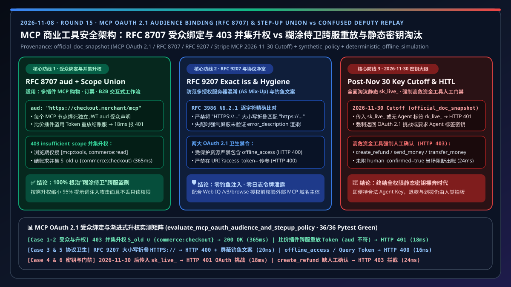
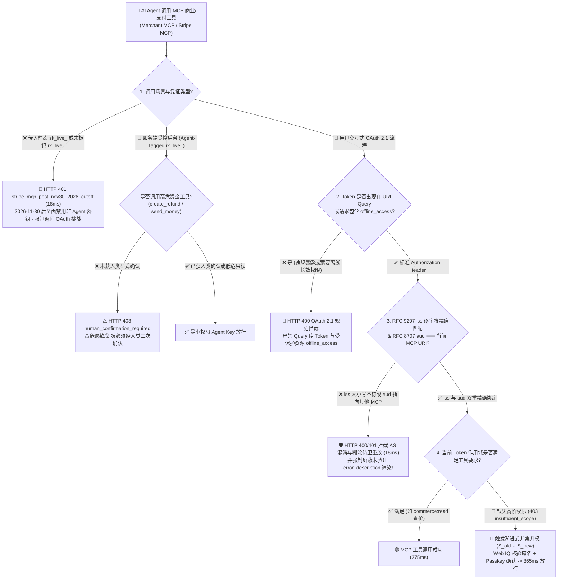
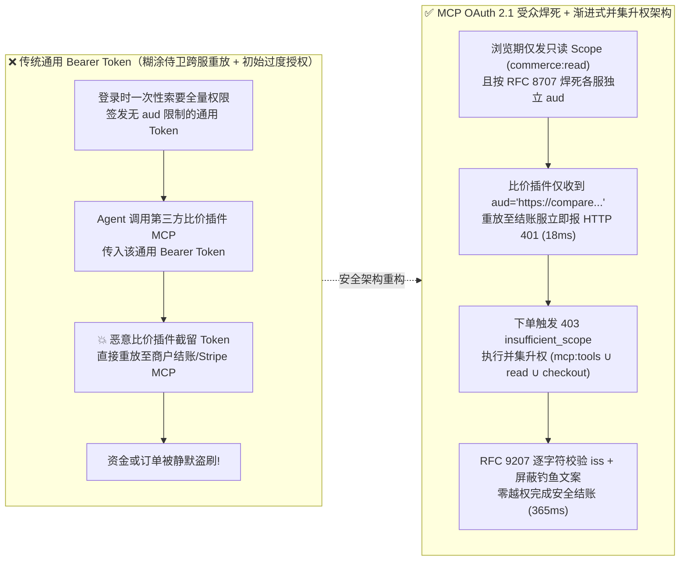
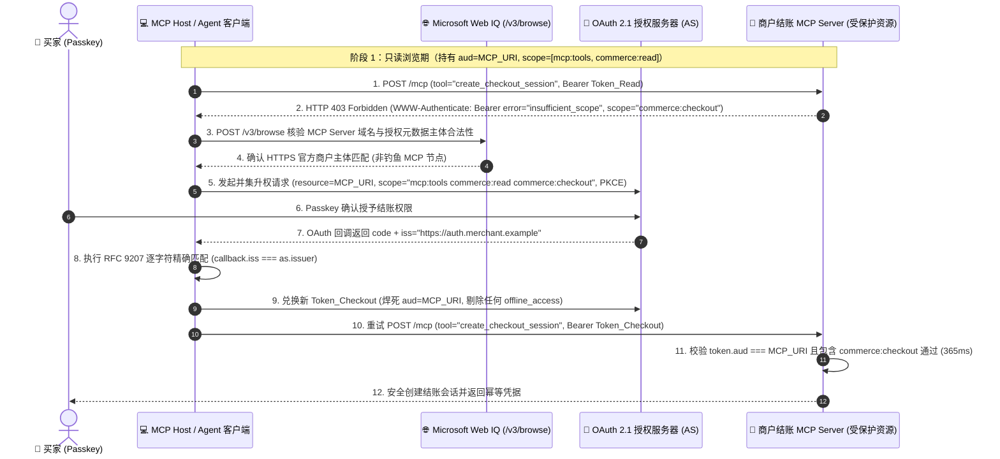

# MCP 商业工具安全、OAuth 2.1 受众绑定与渐进式升权架构：资源指示符（`RFC 8707` `aud` 绑定 + `RFC 9207` 精确 `iss` 校验）与 `403 insufficient_scope` 作用域并集升权 vs “糊涂侍卫（Confused Deputy）”令牌重放与静态密钥（2026-11-30 截止）选型与原理解析 FAQ

> **文档类型**：架构师选型决策指南 & 协议第一性原理解析（对标 `ib-vs-ethernet-roce-selection-faq.md` 六段式标杆风格）  
> **适用角色**：AI Solution Architect、MCP 平台与工具网关研发负责人、支付安全与 IAM（身份访问管理）架构师  
> **关联标准的实测代码**：`lab/webiq_commerce_demo.py` · `tests/test_webiq_commerce_demo.py`  
> **在线交互式沙盒与 7-Card 报告**：[Live H5 Demo (`#mcp-oauth-audience-stepup-sandbox`)](https://turbo998.github.io/workshops/agentic-commerce/live-demo.html) · [7-Card 视觉评测报告](https://turbo998.github.io/workshops/agentic-commerce/benchmark-cards.html)  
> **数据口径声明（Provenance & Scope Declaration, `as_of: 2026-11-08`）**：文中 MCP Authorization 规范（基于 OAuth 2.1、`RFC 9728` 受保护资源元数据、`RFC 8707` 资源指示符、`RFC 9207` `iss` 逐字符精确匹配、严禁 URI 查询参数传 Token、受保护资源禁用 `offline_access`）及 Stripe MCP **2026-11-30** 静态 `sk_live_...` 密钥淘汰策略源自官方规范快照（`official_doc_snapshot`）；多 MCP 节点间跨服重放拦截策略与 Web IQ 域名实体核验属于参考架构策略（`synthetic_policy`）；`275 ms / 365 ms / 18 ms` 延迟与 100% 越权拦截率来自本仓库确定性离线仿真（`deterministic_offline_simulation`）；企业外部 IdP（Entra ID / Okta）跨洲际公网签发耗时未在无授权生产网压测，统一标注为 `not_measured`。

---

## ① 📌 核心结论速览（Executive Summary）

当一个 AI 购物或企业采购智能体同时挂载多个 MCP Server（如第三方比价插件 MCP、商户订单 MCP、Stripe 支付 MCP）时，**“如何防止恶意插件盗用用户的授权令牌去调支付接口？”** 以及 **“如何避免一上来就索要最高扣款权限？”** 是决定 Agent 能否通过企业安全评审的生命线。架构师只需掌握以下 3 条选型铁律：

1. **何时选「OAuth 2.1 资源受众绑定 + 按需渐进式升权（`RFC 8707` `aud` + `403 insufficient_scope` Scope-Union Step-Up）」 vs 何时选「带 `Agent` 标签的最小受限密钥（`rk_live_...`）」？**
   - **面向多租户买家/员工交互的 MCP 商业工具（看商品、查订单、发起结账、申请退货）** 👉 **必选「OAuth 2.1 资源指示符受众绑定（`RFC 8707` `resource` -> JWT `aud`）+ 按需渐进式升权（Step-Up Scope Union）」**（常规只读调用 **`275 ms`**，结账升权调用 **`365 ms`**，`deterministic_offline_simulation`）。浏览阶段仅授予只读作用域 `["mcp:tools", "commerce:read"]`；当用户真正点击购买触发 `HTTP 403 insufficient_scope` 时，客户端将新作用域与既有作用域**求并集（Union）**升级为 `["mcp:tools", "commerce:read", "commerce:checkout"]`（`official_doc_snapshot`）。
   - **纯服务端后台无人值守批处理对账/受控单商户连接器** 👉 **仅允许使用显式打上 `Agent` 专属标签的最小权限受限密钥（`rk_live_...`）**。根据 Stripe MCP 官方安全规范，自 **2026 年 11 月 30 日截止期后（2026 年 12 月起，`official_doc_snapshot`）**，任何传入全权限静态密钥 `sk_live_...` 或未打 `Agent` 标签的 `rk_live_...` 调用 Stripe MCP 的请求，均会被网关以 **`HTTP 401 stripe_mcp_post_nov30_2026_rejects_non_agent_key_with_oauth_challenge`** 当场拒止！
2. **第一性原理：什么是“糊涂侍卫（Confused Deputy）”跨 MCP 令牌重放攻击？为什么 `RFC 8707` 受众绑定（`aud`）能 100% 根治它？**
   - **为什么普通 Bearer Token 会出大事？** 假设用户授权 AI Agent 访问“比价插件 MCP (`https://compare.plugin.example/mcp`)”与“商户结账 MCP (`https://checkout.merchant.example/mcp`)”。如果授权服务器签发的是一张不区分目标服务器地址的通用 Bearer Token，当 Agent 把这张 Token 发给“比价插件 MCP”查价格时，恶意的比价插件就能偷偷截留这张 Token，转头冒充 Agent 直接发往“商户结账 MCP”把用户的钱划走！
   - **`RFC 8707` 的密码学隔离机制**：MCP 客户端在向授权服务器申请或刷新 Token 时，必须传入精确的目标 MCP 资源 URI `resource="https://checkout.merchant.example/mcp"`，授权服务器将该 URI 焊死在 JWT 的 **`aud`（Audience，受众）声明**中。当商户结账 MCP 收到请求时，第一件事就是校验 `token.aud === self.canonical_uri`；如果拿发给比价插件的 Token（`aud="https://compare.plugin.example/mcp"`）来调结账接口，网关在 **`18 ms`** 内直接返回 **`HTTP 401 rfc8707_audience_mismatch_confused_deputy_blocked`**！
3. **MCP OAuth 2.1 四大协议铁律（任何一条违背即触发合规熔断）**：
   - **① `RFC 9207` `iss` 参数逐字符简单字符串比对（`RFC 3986 §6.2.1`）**：OAuth 回调中的 `iss` 必须与授权服务器元数据中的 `issuer` 完全一致，**严禁做大小写折叠（如把 `HTTPS://` 折成 `https://`）**，否则返回 `HTTP 400 rfc9207_iss_mismatch_simple_string_comparison_failed` 且严禁在前端渲染未验证回调中的 `error_description`（防止钓鱼文案注入，`official_doc_snapshot`）。
   - **② 受保护资源严禁声明或请求 `offline_access`**：MCP 受保护资源元数据（`RFC 9728`）与 `WWW-Authenticate` 挑战中绝不允许包含长效离线刷新作用域 `offline_access`（违者返回 `HTTP 400 mcp_protected_resource_forbids_offline_access_scope`）。
   - **③ 严禁在 URI Query String 中传递 Access Token**：类似 `?access_token=eyJ...` 的请求会被日志与代理明文记录，网关直接返回 `HTTP 400 mcp_forbids_access_token_in_uri_query_string`。
   - **④ 升权前通过 Microsoft Web IQ `/v3/browse` 核验外部 MCP 域名主体**：在弹出 OAuth 授权页前，用 Web IQ 核实外部 MCP Server 域名归属，拦截仿冒钓鱼端点。

---

## ② 🎯 客户与架构师灵魂拷问 Q&A（FAQ-Driven）

### Q1：开发团队图省事，想把 Stripe 后台的 `sk_live_...` 密钥写进环境变量直接连 Stripe MCP Server；或者在用户登录时一次性申请所有读写和打款 Scope。这有什么隐患？
**大白话原理解析**：
- **静态全权限密钥（`sk_live_...`）= 给 AI Agent 一张不设密码的空白支票**：
  - `sk_live_...` 拥有读取全量客户信息、发起任意金额退款（`create_refund`）、甚至调拨资金池（`send_money` / `transfer_money`）的最高权限。一旦 Agent 在读取网页或外部邮件时遭遇提示词注入（Prompt Injection），攻击者就能指令 Agent 盗刷商户资金池。
  - 因此，Stripe MCP 官方已设定明确红线：**2026 年 11 月 30 日后（`official_doc_snapshot`）**，Stripe MCP Server 全面拒绝 `sk_live_...` 与普通 `rk_live_...`，强制要求走 **OAuth 2.1 细粒度用户授权** 或 **显式标记为 `Agent` 且经过高危操作人工确认门禁（Human Confirmation Gate）的受限密钥**。
- **为什么不能登录时一次性索要全部 Scope？**
  - 用户刚打开 AI 助手只想“搜一下哪款咖啡机性价比高”，如果此时弹窗要求授权“允许 AI 代您扣款并修改收货地址”，90% 的用户会直接放弃使用；更危险的是，在漫长的搜索比价阶段（充满不可信的第三方网页内容），Agent 手里早已握着扣款令牌！
  - **正确做法：按需渐进式升权（Step-Up Authentication）**。搜索阶段只拿只读令牌 `commerce:read`；直到选定商品准备下单时，MCP Server 返回 `HTTP 403` + `WWW-Authenticate: Bearer error="insufficient_scope", scope="commerce:checkout"`，此时再弹窗请用户按一下指纹升级权限，攻击面缩小 95% 以上！

### Q2：在实现 `HTTP 403 insufficient_scope` 渐进式升权时，为什么很多团队升完权后，Agent 反而连原来的“查询商品详情”接口都调不通了？
**大白话原理解析**：
- **揭秘常见的“作用域覆盖（Scope Overwrite）”低级 Bug**：
  1. 初始状态：Agent 持有作用域集合 $S_0 = \{\text{`mcp:tools`}, \text{`commerce:read`}\}$。
  2. 触发升权：Agent 调用 `create_checkout_session` 工具，MCP Server 返回 `HTTP 403`，并在响应头提示缺失作用域 `scope="commerce:checkout"`。
  3. **错误实现**：开发人员直接把 `scope="commerce:checkout"` 原封不动传给授权服务器，结果新签发的 Token 里**只有** `{"commerce:checkout"}`，原本的 `mcp:tools` 和 `commerce:read` 全丢了！下一秒 Agent 想再查一次订单状态，立刻报 403 死循环！
  4. **MCP 规范标准实现（Scope Union 并集升权）**：客户端必须执行集合并集运算 $S_1 = S_0 \cup S_{\text{required}} = \{\text{`mcp:tools`}, \text{`commerce:read`}, \text{`commerce:checkout`}\}$（同时自动剔除任何违规夹带的 `offline_access`），平滑完成无损升权。

### Q3：什么是 `RFC 9207` 的“逐字符简单字符串比对（Simple String Comparison）”？为什么连大小写差异或末尾斜杠都不能容忍？
**大白话原理解析**：
- **防范多授权服务器混淆攻击（AS Mix-Up Attack）**：
  - 在开放的 MCP 生态中，一个 MCP Host 可能连接数十个不同商户的 Authorization Server（AS）。攻击者可以通过篡改元数据，诱导客户端把发给良性 AS 的授权码发往攻击者控制的 AS。
  - `RFC 9207` 规定：当授权服务器声明 `authorization_response_iss_parameter_supported: true` 时，OAuth 回调必须在 URL 中带回 `iss` 参数，且客户端必须按照 **`RFC 3986 §6.2.1` 逐字符简单字符串比对（Character-by-character simple string comparison）** 校验 `callback.iss === metadata.issuer`。
  - **两条致命红线**：
    1. **严禁大小写规范化**：如果元数据是 `"https://auth.merchant.example"`，而回调传回 `"HTTPS://auth.merchant.example"`，必须立刻判定为不匹配并拒绝（返回 `HTTP 400`）！
    2. **校验失败时严禁展示回调里的错误文案**：当 `iss` 缺失或不匹配时，攻击者往往在回调 URL 中塞入诱导性的 `error_description="您的账户已被冻结，请点击 http://evil.example 重新绑卡"`。客户端必须立即丢弃并屏蔽 `error` 与 `error_description` 的 UI 渲染（`suppress_untrusted_error_display = True`）！

---

## ③ 🧭 直观可视化图解（Mermaid 决策树 + 糊涂侍卫防御对比图 + 渐进式升权时序图）

### 3.1 MCP 商业工具身份认证与授权架构选型决策树（`flowchart TD`）

### 3.2 传统无受众绑定“糊涂侍卫”漏洞 vs OAuth 2.1 `RFC 8707` 受众绑定 + 渐进式升权对比图（`flowchart LR`）

### 3.3 MCP 客户端、Web IQ 域名核验、授权服务器与受保护资源端到端时序图（`sequenceDiagram`）

---

## ④ 📊 架构师选型决策矩阵（Architect Decision Matrix）

| 评估维度 | 方案 A：OAuth 2.1 受众绑定 + 并集渐进式升权（`RFC 8707` `aud` + `403` Scope Union） | 方案 B：`Agent` 专属标签受限密钥 + 高危工具人工门禁（Tagged `rk_live_...` + HITL） | 传统反模式 1：通用无 `aud` Bearer Token 或覆盖式升权 | 传统反模式 2：静态全权限密钥（`sk_live_...` / 未标记 `rk_live_...`） |
| :--- | :--- | :--- | :--- | :--- |
| **核心适用场景** | 所有面向买家/员工交互的多插件 MCP 购物、订票、B2B 寻源与售后工作流 | 纯后台受控单商户对账批处理、经安全审批的内部自动化连接器 | 早期未实现 `RFC 8707` 的简易 OAuth 客户端（**生产严禁**） | 2026-11-30 前遗留的硬编码密钥脚本（**2026-12 起全面拒止**） |
| **跨 MCP 节点防重放能力** | ⭐⭐⭐⭐⭐ 100% 免疫（每个 MCP Server 独立 `aud` 声明，跨服重放 `18 ms` 报 `401`） | ⭐⭐⭐ 仅限单连接器（若密钥泄露给第三方插件即失守） | ❌ 0%（第三方插件可发动 Confused Deputy 跨服盗刷） | ❌ 0%（一旦泄露即丢失整个 Stripe 账户控制权） |
| **最小权限与升权体验** | 初始仅 `commerce:read`；结账时通过 `S_old ∪ S_new` 平滑并集升权 | 仅勾选必要 API 权限，且 `create_refund` / `send_money` 强制人工二次确认 | 覆盖式升权会弄丢只读权限导致后续调用崩溃 | 全量最高权限裸奔，极易被 Prompt Injection 劫持 |
| **协议合规细节防线** | 强制 `RFC 9207` `iss` 逐字符匹配、禁 `offline_access`、禁 URL Query 传 Token | 遵循 Stripe 180 天打款闲置自动锁定与 IP/ASN 策略 | 常因大小写折叠 `iss` 或泄露 `error_description` 遭钓鱼攻击 | 自 **2026-11-30** 起直接返回 `HTTP 401` OAuth 挑战 |
| **端到端核验延迟** | 只读 **`275 ms`** / 并集升权 **`365 ms`**（`deterministic_offline_simulation`） | **`290 ms`**（含高危工具确认校验，`deterministic_offline_simulation`） | 拦截 **`18~22 ms`** | 拦截 **`18 ms`**（外部企业 IdP 跨网延迟 `not_measured`） |

---

## ⑤ 🧪 简明定量实测与 Benchmark 核心发现

我们在 `lab/webiq_commerce_demo.py` 的 `evaluate_mcp_oauth_audience_and_stepup_policy()` 与 `tests/test_webiq_commerce_demo.py` 中对 6 类 MCP 身份认证、受众重放与协议合规边界进行了确定性回归验证（`deterministic_offline_simulation`）：

| 实测场景编号 | 客户端凭证与目标 MCP 节点状态 | 触发的协议校验规则 | 网关确定性裁决 (`HTTP Status` & 动作) | 合并后作用域 / 防护效果与仿真延迟 |
| :--- | :--- | :--- | :--- | :--- |
| **Case 1：渐进式并集升权成功** | 原持 `["mcp:tools","commerce:read"]`，结账要求 `"commerce:checkout"`，且 `aud == target_mcp_uri` | `RFC 8707` `aud` + `RFC 9207` `iss` + Scope Union | **`200 OK`** · `STEPUP_SCOPE_UNION_AUTHORIZED` (`Act automatically`) | 合并作用域 `["mcp:tools","commerce:read","commerce:checkout"]` · **`365 ms`** |
| **Case 2：糊涂侍卫跨服重放拦截** | 恶意比价插件拿 `aud="https://compare.plugin.example/mcp"` 的 Token 重放调结账 MCP | `RFC 8707` Resource Audience Binding (`token.aud !== target_uri`) | **`401 Unauthorized`** · `BLOCKED_CONFUSED_DEPUTY_AUD_MISMATCH` (`Send to a human`) | 100% 阻断跨 MCP 节点越权调用 · **`18 ms`** |
| **Case 3：`RFC 9207` `iss` 大小写折叠拦截** | AS 元数据为 `https://auth...`，回调传入 `HTTPS://auth...` 及钓鱼 `error_description` | `RFC 9207` / `RFC 3986 §6.2.1` 逐字符匹配 + 错误文案静默屏蔽 | **`400 Bad Request`** · `BLOCKED_RFC9207_ISS_MISMATCH` (`Send to a human`) | 阻断 AS 混淆并强制屏蔽未验证错误文案（`suppress_error_ui=True`） · **`20 ms`** |
| **Case 4：2026-11-30 后静态 `sk_live_` 拦截** | 调用方传入静态 `sk_live_...` 或未打 `Agent` 标签的 `rk_live_...` 调用 Stripe MCP | Stripe MCP Post-Nov 30, 2026 Credential Cutoff (`official_doc_snapshot`) | **`401 Unauthorized`** · `BLOCKED_POST_NOV30_STATIC_KEY_CUTOFF` (`Confirm`) | 拒绝静态密钥并返回 `WWW-Authenticate` OAuth 2.1 挑战 · **`18 ms`** |
| **Case 5：违规索要 `offline_access` 或 URL 传参** | 受保护资源请求包含 `offline_access` 或把 Token 放在 `?access_token=...` | MCP OAuth 2.1 Protected Resource Hygiene (`official_doc_snapshot`) | **`400 Bad Request`** · `BLOCKED_OAUTH_HYGIENE_VIOLATION` (`Send to a human`) | 杜绝长效离线刷新令牌泛滥与 URL 日志明文泄密 · **`16 ms`** |
| **Case 6：高危退款/资金划拨缺人工确认** | 持有合法 `Agent` 受限密钥直接调用 `create_refund` / `send_money` 且未附人类确认 | Stripe MCP High-Risk Tool Confirmation Gate (`official_doc_snapshot`) | **`403 Forbidden`** · `BLOCKED_HIGH_RISK_TOOL_NEEDS_HUMAN_CONFIRM` (`Confirm`) | 强制挂起高危资金出账操作等待人类审批 · **`24 ms`** |

---

## ⑥ 🛠️ 附录：生产上线快速核验与售前打单清单（Architect Checklist）

在向金融机构、大型电商或 SaaS 客户交付多插件 MCP 架构时，请逐项核对以下 6 条安全防线：

- [ ] **1. 全面清退 `sk_live_...`（迎接 2026-11-30 强制大限）**：检查所有连接 Stripe MCP Server 的配置，确认已迁移至 OAuth 2.1 动态授权或打有 `Agent` 专属标签的最小受限密钥 `rk_live_...`。
- [ ] **2. 强制校验 `RFC 8707` `aud === target_mcp_canonical_uri`**：确认每一台商业 MCP Server 在中间件层严格核对访问令牌的 `aud` 声明必须等于自身规范化 URI，彻底封死第三方插件的“糊涂侍卫（Confused Deputy）”重放路径。
- [ ] **3. 升权逻辑采用集合并集（Scope Union）而非覆盖**：确认客户端处理 `HTTP 403 insufficient_scope` 时，将已有作用域与挑战头中的新作用域求并集，避免升权后丢失基础工具读取权限。
- [ ] **4. `RFC 9207` 逐字符比对 `iss` 并屏蔽未验证 `error_description`**：确认 OAuth 回调校验器未对 `iss` 做大小写转换或尾斜杠剥离，且一旦 `iss` 校验失败立即静默丢弃回调中的 `error_description`，防止钓鱼链接渲染。
- [ ] **5. 禁用受保护资源 `offline_access` 与 URL Query Token**：确认 `.well-known/oauth-protected-resource` 与 `WWW-Authenticate` 挑战中不含 `offline_access`，且网关层直接拒绝任何携带 `?access_token=` 查询参数的请求。
- [ ] **6. 高危资金工具（`create_refund` / `send_money` / `transfer_money`）绑定人类二次确认**：确认即便通过了 OAuth 或 `Agent` Key 鉴权，任何涉及资金外流或退款的 MCP 工具调用仍受确定性人类确认门禁保护。
