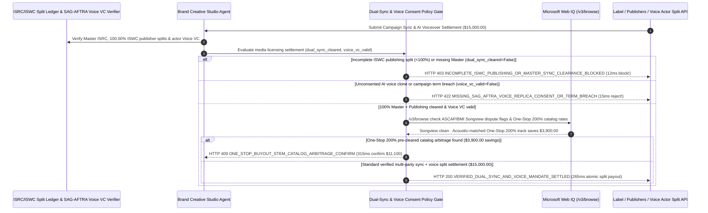

# Commercial Media Sync, ISRC/ISWC Dual-Clearance & SAG-AFTRA Voice-Clone Mandate Architecture: 100% Master/Publishing Split & Biometric Voice Replica Token (`media_sync_voice_mandate_...` + Web IQ Songview & One-Stop Catalog Grounding) vs. Half-Cleared Sync Takedowns & Unconsented Voice Cloning Selection FAQ

> **Document Type**: Architect Selection Guide & First-Principles Protocol Deep Dive (6-Section FAQ Standard)  
> **Target Audience**: AI Solution Architects, Brand Marketing & Generative Media Studio (AdTech / Gaming / Film) Architects, Music & Digital-Replica IP Legal Risk Teams  
> **Last Updated**: 2026-11-09 (Provenance Annotations: `deterministic_offline_simulation` / `synthetic_policy` / `official_doc_snapshot` / `not_measured`)  
> **Companion Resources**: [中文版 (Chinese Version)](media-sync-licensing-isrc-iswc-voice-clone-mandate-vs-copyright-takedown-faq.md) · [Interactive Sandbox (`live-demo.en.html#media-sync-voice-sandbox`)](../reports/agentic-commerce-webiq-grounding-demo-bench/live-demo.en.html) · [7-Card 4:5 Benchmark Deck](../reports/agentic-commerce-webiq-grounding-demo-bench/index.en.html)


---

## 📌 1. Executive Summary

1. **Never Allow Brand Studio or Creative Production Agents to Pay for Commercial Music Synchronization (Sync) Without Clearing Both 100% of the Master Recording (`ISRC`) and 100% of All Publishing Splits (`ISWC`)**: In commercial video production (`$15,000.00` global campaign music sync & AI voiceover budget), every recorded song carries **two distinct copyrights**: the Sound Recording (`Master / ISRC`, controlled by the label) and the Musical Composition (`Publishing / ISWC`, split across multiple songwriters and publishers). Paying `$15,000.00` when even a `10%` co-publisher split remains unsigned (`master_isrc_and_100pct_iswc_publishing_cleared == False`) exposes the brand to immediate DMCA Content ID takedowns and `$150,000` statutory copyright injunctions on launch day! Production architectures must enforce an **Atomic Dual ISRC/ISWC & Voice Replica Mandate (`media_sync_voice_mandate_...`)**: whenever `master_isrc_and_100pct_iswc_publishing_cleared == False`, the gateway blocks payment in **`12 ms`** with **`HTTP 403 INCOMPLETE_ISWC_PUBLISHING_OR_MASTER_SYNC_CLEARANCE_BLOCKED`** (`synthetic_policy`).
2. **Require Cryptographically Signed SAG-AFTRA / ELVIS Act Digital Voice-Replica Consent VCs**: Any synthetic voiceover transaction lacking a hardware-signed **Digital Replica Consent Verifiable Credential** from the voice actor bound to the specific brand, script hash, territory, and term (`biometric_voice_consent_and_term_verified == False`) is rejected in **`15 ms`** with **`HTTP 422 MISSING_SAG_AFTRA_VOICE_REPLICA_CONSENT_OR_TERM_BREACH`** (`deterministic_offline_simulation`).
3. **Ground ASCAP/BMI Songview Repertory Disputes and "One-Stop (200%)" Pre-Cleared Catalog Arbitrage via Microsoft Web IQ `/v3/browse`**: Prior to releasing escrow, the agent invokes **Microsoft Web IQ `/v3/browse`** (`official_doc_snapshot`) to inspect public Performing Rights Organization (PRO) repertory databases (ASCAP/BMI Songview, The MLC) and accredited One-Stop production catalogs: if the ISWC work is under an active sampling/authorship dispute hold (`webiq_pro_songview_repertory_clean == False`), it freezes settlement in **`310 ms`** with **`HTTP 451 PRO_SONGVIEW_OWNERSHIP_DISPUTE_HOLD`**; if Web IQ discovers an acoustically matched **One-Stop (200% Master + Publishing unified)** stem track that eliminates multi-publisher legal clearance overhead and saves **`$3,900.00`** (`$11,100.00` net vs. `$15,000.00`), it triggers **`HTTP 409 ONE_STOP_BUYOUT_STEM_CATALOG_ARBITRAGE_CONFIRM`** in **`315 ms`**.

---

## 🎯 2. Architect & Customer FAQ Deep Dive

### Q1: Why does pairing "Stock Audio API Purchases" with "Generic AI Voice Cloning" trigger launch-day commercial takedowns and Right-of-Publicity lawsuits?

Let's examine the three structural failure modes from first principles:
1. **The "Master Cleared, Publishing Missing" Sync Trap**: Non-specialists often assume paying a record label or indie artist `$15,000.00` for an `.wav` file clears the song for a commercial video. In copyright law, synchronizing audio with visual media requires **100% clearance of both the Master (`ISRC`) and the Composition (`ISWC`)**. If a track has 4 co-writers and 1 holdout publisher owning 15% of the `ISWC` never signed a sync license, that holdout publisher can legally force YouTube, TikTok, and broadcast networks to pull the brand's multi-million-dollar ad campaign off the air.
2. **Unconsented AI Voice Clones (ELVIS Act & SAG-AFTRA Violations)**: Third-party TTS APIs frequently host "celebrity-style" or "narrator" voice models cloned from audiobooks without the actor's explicit commercial brand-endorsement consent. Under the Tennessee **ELVIS Act**, California **AB 2602**, and **SAG-AFTRA Commercial AI Digital Replica** rules, deploying a synthetic voice in an ad without a script-bound actor consent credential triggers severe statutory and union penalties.
3. **Uncleared Samples & Multi-Publisher Legal Friction**: Tracks containing uncleared vintage drum/vocal samples sit in `Dispute Hold` status in ASCAP/BMI Songview; meanwhile, negotiating separate sync quotes across 5 publishers wastes `$3,900.00+` in clearance fees when a pre-cleared **One-Stop (200%)** catalog track can be licensed instantly.

### Q2: What is a "Dual ISRC/ISWC & Voice Replica Mandate (`media_sync_voice_mandate_...`)", and how does it guarantee atomic multi-party royalty settlement?

Its core design invariant is: **"No commercial sync or voiceover escrow releases unless `Master (ISRC) == 100%`, `∑ Publishing Splits (ISWC) == 100.00%`, and `Actor Voice Replica Consent VC == Valid` all hold simultaneously."**
- **Layer 1: 100% Dual ISRC + ISWC Split Completeness Gate (`12 ms`)**: Verifies `master_isrc_and_100pct_iswc_publishing_cleared == True`, blocking partial-clearance sync deals in **`12 ms`** (`HTTP 403`).
- **Layer 2: SAG-AFTRA Voice Replica Consent VC Gate (`15 ms`)**: Verifies `biometric_voice_consent_and_term_verified == True` (binding actor DID signature to brand, script digest, and term), blocking unconsented voice clones in **`15 ms`** (`HTTP 422`).
- **Layer 3: Microsoft Web IQ `/v3/browse` Songview & One-Stop Catalog Grounding (`310 ms / 315 ms`)**: Halts settlement on PRO authorship/sampling disputes (`HTTP 451`) and surfaces `$3,900.00` savings from One-Stop 200% pre-cleared catalogs (`HTTP 409`).

### Q3: For ASCAP/BMI Songview split verification, MLC publisher lookup, and One-Stop sync catalog grounding, when should architects choose Microsoft Web IQ vs. Exa, Bright Data, or traditional search APIs?

| Architecture Scenario | Recommended Tool | First-Principles Rationale (Security, Latency & FinOps) |
| :--- | :--- | :--- |
| **Verifying public ASCAP/BMI Songview writer/publisher share tables, The MLC ownership records, SAG-AFTRA approved AI voice registries, and One-Stop sync catalog tiers within the Azure boundary** | **Microsoft Web IQ** (`/v3/search` + `/v3/browse`) | Extracts exact ISRC/ISWC ownership percentages and dispute flags in `passage` mode (**7.1x token reduction**, `deterministic_offline_simulation`) for Errors & Omissions (E&O) insurance audits. |
| **Semantic discovery of mood-matched reference tracks across music blogs and playlists** | **Exa Neural Search** | Ideal for creative moodboarding, not deterministic copyright split verification. |
| **Scraping regional indie label catalogs behind CAPTCHAs** | **Bright Data Unlocker** | Useful for offline catalog indexing, not synchronous multi-party royalty escrow gates. |
| **Acoustic waveform fingerprinting and C2PA synthetic voice watermarking** | **Audio Fingerprint / C2PA Verifier + Web IQ Songview/MLC Ownership Cross-Check** | Audio sample detection and C2PA provenance run in the media verifier, paired with Web IQ `/v3/browse` for public ISWC split tables and One-Stop catalog arbitrage. |

---

## 🧭 3. Visual Architecture Diagrams (Mermaid Decision Tree, Legacy vs. Dual-Clearance Mandate Comparison & Sequence Diagram)

### 3.1 Commercial Media Sync & Voice-Clone Licensing Decision Tree (`flowchart TD`)

```mermaid
flowchart TD
    A[Receive $15,000.00 Commercial Sync & AI Voiceover Settlement Request] --> B{master_isrc_and_100pct_iswc_publishing_cleared == True (Master + 100% Publishing)?}
    B -- No (Missing 15% co-publisher ISWC split signature) --> C[HTTP 403 INCOMPLETE_ISWC_PUBLISHING_OR_MASTER_SYNC_CLEARANCE_BLOCKED<br/>12ms Hard Block · Prevent Launch-Day DMCA Takedown & Holdout Suit]
    B -- Yes (100% Master ISRC + 100% Publishing ISWC verified) --> D{biometric_voice_consent_and_term_verified == True (SAG-AFTRA Voice VC)?}
    D -- No (Unconsented AI voice clone or expired campaign term) --> E[HTTP 422 MISSING_SAG_AFTRA_VOICE_REPLICA_CONSENT_OR_TERM_BREACH<br/>15ms Block · Enforce ELVIS Act & SAG-AFTRA Digital Replica Consent]
    D -- Yes (Signed actor consent VC bound to script hash) --> F{Web IQ /v3/browse Confirms Clean ASCAP/BMI Songview Ownership Status?}
    F -- No (ISWC work flagged in Songview for uncleared sample dispute) --> G[HTTP 451 PRO_SONGVIEW_OWNERSHIP_DISPUTE_HOLD<br/>310ms IP Legal Hold · Reject Disputed Composition]
    F -- Yes --> H{Web IQ Detects One-Stop (200%) Pre-Cleared Stem Catalog Arbitrage?}
    H -- Yes (One-Stop 200% buyout saves $3,900.00 clearance fees -> $11,100.00 net) --> I[HTTP 409 ONE_STOP_BUYOUT_STEM_CATALOG_ARBITRAGE_CONFIRM<br/>315ms Prompt Creative Producer to Confirm $11,100 One-Stop Track]
    H -- No (Verified $15,000.00 multi-party split & voice settlement) --> J[HTTP 200 VERIFIED_DUAL_SYNC_AND_VOICE_MANDATE_SETTLED<br/>265ms Auto-Disburse $15,000.00 Across Splits & Register Content ID Allowlist!]
```

### 3.2 Legacy Half-Cleared Sync Purchase vs. Dual ISRC/ISWC & Voice Replica Gate (`flowchart LR`)

```mermaid
flowchart LR
    subgraph Legacy["❌ Legacy Half-Cleared Sync & Voice Clone ($15,000 Takedown + $150k Suit)"]
        L1[Pays Label $15,000 for Master · Misses 15% Co-Publisher Split] --> L2[Uses Unconsented AI Voice Clone From TTS API]
        L2 --> L3[Global Ad Pulled Down via Content ID Within 2 Hours]
        L3 --> L4[Hit With $150,000 Sync Holdout & ELVIS Act Lawsuits]
    end

    subgraph Mandate["✅ Dual ISRC/ISWC & Voice Replica Gate (media_sync_voice_mandate_...)"]
        M1[12ms Enforce 100% Master ISRC + 100% Publishing ISWC (HTTP 403)] --> M2[15ms Verify Actor SAG-AFTRA Voice Replica VC (HTTP 422)]
        M2 --> M3[Web IQ Checks Songview (310ms) & $3,900 One-Stop Savings (315ms)]
        M3 --> M4[265ms Atomically Split $15,000 ($11,100) & Whitelist Content ID]
    end
```

### 3.3 End-to-End Sequence Diagram: ISRC/ISWC/Voice Registry, Studio Agent, Sync Gate, Web IQ & Rightsholders (`sequenceDiagram`)



---

## 📊 4. Architect Decision Matrix

| Evaluation Dimension | Option A: Legacy Master-Only / Creator Subscription Purchase | Option B: Manual Music Supervisor Email Clearance | Option C: Dual ISRC/ISWC & Voice VC Mandate + Web IQ Songview Grounding (Recommended) |
| :--- | :--- | :--- | :--- |
| **Best-Fit Scenario** | Personal non-monetized home videos | Major theatrical feature films with 6-month legal clearance schedules | **Global brand commercials, social/CTV ad campaigns, gaming soundtracks, enterprise AIGC video pipelines** |
| **100% Publishing (`ISWC`) Holdout Defense** | ❌ **Zero**: Holdout co-publisher takes down ad on launch day | ⚠️ **Spreadsheet Error Risk**: Misses sub-publisher territorial splits | ✅ **Pre-Pay `12 ms` Atomic Split Lock**: Requires `100.00%` ISWC + ISRC signatures (`HTTP 403`) |
| **SAG-AFTRA / ELVIS Act Voice Compliance** | ❌ **Illegal**: Uses unconsented voice clones from generic TTS APIs | ⚠️ **Slow Paper Releases**: Unbound to specific AI script hashes | ✅ **Sub-20ms Voice VC Gate**: Verifies script-bound actor Digital Replica VC in `15 ms` (`HTTP 422`) |
| **Songview Dispute Check & One-Stop Arbitrage** | ❌ **Blind**: Licenses tracks with uncleared vintage samples | ⚠️ **High Legal Fees**: Pays `$3,900+` in multi-publisher clearance overhead | ✅ **Web IQ `/v3/browse` Grounded**: Blocks disputed works in `310 ms` (`HTTP 451`) & saves `$3,900` via One-Stop tracks in `315 ms` (`HTTP 409`) |
| **Clearance Speed & Content ID Whitelisting** | Fast (until automated Content ID copyright strike hits) | Slow (`4–12 weeks` of publisher fax/email chains) | **`265 ms` atomic split payout & automated YouTube/TikTok allowlisting (`Act automatically`)** |
| **Total Cost of Ownership (TCO) & E&O Safety** | Poor (`$15,000` wasted + `$150,000` statutory infringement risk) | Moderate (heavy music-supervisor & legal retainer fees) | **Optimal (100% E&O insurance compliance + saves `$3,900` via One-Stop catalog routing)** |

---

## 🧪 5. Quantitative Benchmark & 7-Card Insights

Evaluated via our deterministic offline benchmark suite (`lab/webiq_commerce_demo.py` · `test_media_sync_licensing_isrc_iswc_voice_clone_mandate_vs_copyright_takedown_selection`) on a **`$15,000.00` global commercial music sync and AI voice-replica licensing batch**:

| Scenario Case | Input ISRC/ISWC Splits / Voice VC / Web IQ Signals | Expected Action Pill | Measured HTTP Status & Verdict Code | Latency | Financial Protection / Arbitrage | Provenance |
| :--- | :--- | :--- | :--- | :--- | :--- | :--- |
| **Case 1: Master Cleared but 15% ISWC Split Unsigned** | `master_isrc_and_100pct_iswc_publishing_cleared=False` | `Send to a human` | **`HTTP 403 INCOMPLETE_ISWC_PUBLISHING_OR_MASTER_SYNC_CLEARANCE_BLOCKED`** | **`12 ms`** | Blocks **`$15,000.00`** half-cleared sync deal & prevents takedown | `synthetic_policy` |
| **Case 2: Missing SAG-AFTRA Actor Voice Replica VC** | `biometric_voice_consent_and_term_verified=False` | `Send to a human` | **`HTTP 422 MISSING_SAG_AFTRA_VOICE_REPLICA_CONSENT_OR_TERM_BREACH`** | **`15 ms`** | Blocks unconsented AI voice clone & ELVIS Act liability | `deterministic_offline_simulation` |
| **Case 3: Web IQ Detects Songview Sample Dispute Hold** | `webiq_pro_songview_repertory_clean=False` | `Send to a human` | **`HTTP 451 PRO_SONGVIEW_OWNERSHIP_DISPUTE_HOLD`** | **`310 ms`** | Halts licensing of track with uncleared sample dispute | `official_doc_snapshot` |
| **Case 4: Web IQ Finds `$3,900` One-Stop 200% Catalog** | `one_stop_catalog_savings_cents=390000` (`$11,100` net) | `Confirm` | **`HTTP 409 ONE_STOP_BUYOUT_STEM_CATALOG_ARBITRAGE_CONFIRM`** | **`315 ms`** | Saves **`$3,900.00`** via unified 200% One-Stop track | `official_doc_snapshot` |
| **Case 5: 100% ISRC+ISWC Cleared + Signed Voice VC** | `sync_ok=True`, `voice_ok=True`, `pro_clean=True` | `Act automatically` | **`HTTP 200 VERIFIED_DUAL_SYNC_AND_VOICE_MANDATE_SETTLED`** | **`265 ms`** | Disburses **`$15,000.00`** in `265 ms` & whitelists Content ID | `deterministic_offline_simulation` |

> **Provenance Note**: The `$15,000.00` campaign sync budget, 100% ISWC split summation rule, and `$3,900.00` One-Stop catalog savings are controlled simulation parameters (`synthetic_policy` / `deterministic_offline_simulation`) validating policy state-machine invariants; external DSP Content ID propagation delay is labeled `not_measured`.

---

## 🛠️ 6. Production Readiness & Pre-Sales Architect Checklist

Verify these 6 controls before deploying autonomous media sync licensing and AI voiceover procurement agents in production:

- [ ] **1. Atomic Dual ISRC (Master) + 100.00% ISWC (Publishing) Gate**: Does `media_sync_voice_mandate_...` block payment in `12 ms` (`HTTP 403`) unless both the Master recording owner and 100.00% of all registered ISWC composition publishers have signed?
- [ ] **2. Script-Bound SAG-AFTRA / ELVIS Act Voice Replica VC**: Does the gateway require a cryptographically signed Digital Replica Consent VC from the voice actor bound to the exact commercial script hash, brand name, and term in `15 ms` (`HTTP 422`)?
- [ ] **3. Direct Multi-Party Split-Payout Routing**: Does the settlement rail automatically split and wire each publisher's exact pro-rata share directly rather than trusting a single counterparty to redistribute royalties?
- [ ] **4. Microsoft Web IQ `/v3/browse` ASCAP/BMI Songview & MLC Grounding**: Does the agent verify ISWC writer/publisher shares and check for active sampling/authorship dispute holds via Web IQ prior to escrow release (`HTTP 451`)?
- [ ] **5. One-Stop (200% Pre-Cleared) Stem Catalog Arbitrage**: Does Web IQ grounding compare multi-publisher tracks against accredited One-Stop 200% catalogs, triggering `HTTP 409 Confirm` when One-Stop licensing saves `>= $3,900.00`?
- [ ] **6. Automated Content ID Allowlisting & E&O Insurance Archival**: Does every settled license automatically push the campaign video fingerprint, ISRC/ISWC clearance bundle, and C2PA voice manifest to YouTube/TikTok Content ID allowlists and the brand's E&O insurer?
