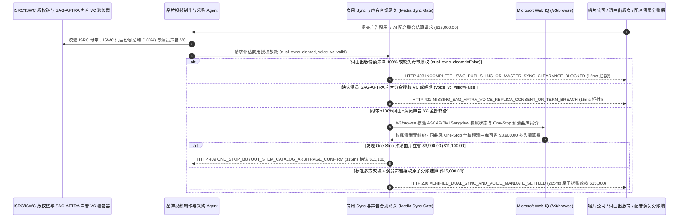

# 商用音视频配乐同步授权（Sync Licensing）与 AI 克隆人声肖像权分账（Commercial Media Sync, ISRC/ISWC Dual-Clearance & SAG-AFTRA Voice-Clone Mandate）架构：录音母带（ISRC）+ 100% 词曲出版（ISWC）双权齐备与声音数字分身令牌（`media_sync_voice_mandate_...` + Web IQ 版权池 Songview 与 One-Stop 曲库核验）vs 传统半套版权遭全网下架（Sync Strike）选型与原理解析 FAQ

> **文档类型**：架构师选型指南 & 协议第一性原理解析（6 段式 FAQ 标准版）  
> **适用读者**：AI Solution Architect、品牌营销与AIGC创意制作（AdTech / Studio / 游戏影视）架构师、音乐与数字人知识产权（IP）法务风控团队  
> **更新日期**：2026-11-09（Provenance 标注：`deterministic_offline_simulation` / `synthetic_policy` / `official_doc_snapshot` / `not_measured`）  
> **配套资源**：[English Version](media-sync-licensing-isrc-iswc-voice-clone-mandate-vs-copyright-takedown-faq.en.md) · [交互式沙盒控制台 (`live-demo.html#media-sync-voice-sandbox`)](../reports/agentic-commerce-webiq-grounding-demo-bench/live-demo.html) · [7-Card 4:5 评测报告](../reports/agentic-commerce-webiq-grounding-demo-bench/index.html)


---

## 📌 一、核心结论速览（Executive Summary）

1. **严禁让品牌视频制作或营销 Agent 在仅购买“录音母带版权（Master Recording / ISRC）”而未集齐“100% 词曲出版份额（Musical Composition / ISWC）”的情况下付款上线商用广告片**：在商用音视频同步授权（Sync Licensing，如全球新品发布广告配乐与配音总预算 `$15,000.00`）中，每一首音乐都天然包含 **两套完全独立的版权**：唱片公司持有的 **录音母带权（ISRC）** 与词曲作者/出版商持有的 **词曲著作权（ISWC）**。哪怕一首歌有 4 位合写词曲作者，你的 Agent 已经搞定了唱片公司和前 3 位作者（占 90%），只要漏掉最后 1 位占 10% 份额的合写作者签名（`master_isrc_and_100pct_iswc_publishing_cleared=False`），广告上线当天就会被对方通过平台 Content ID 下架并索赔 `$150,000` 法定侵权赔偿！生产环境必须采用 **ISRC 母带 + 100% ISWC 词曲份额原子双签令牌（`media_sync_voice_mandate_...`）**，未集齐双权 100% 签名时在 **`12 ms`** 内触发 **`HTTP 403 INCOMPLETE_ISWC_PUBLISHING_OR_MASTER_SYNC_CLEARANCE_BLOCKED`**（`synthetic_policy`），一分钱都不许提前放。
2. **对 AI 克隆配音强制校验“演员本人签署的数字声音分身授权凭证（SAG-AFTRA / ELVIS Act Digital Replica Consent VC）”**：针对配音市场泛滥的未经配音演员本人授权私自克隆的 AI 音色，或超出约定投放地域/期限的商业使用（`biometric_voice_consent_and_term_verified=False`），网关在 **`15 ms`** 内返回 **`HTTP 422 MISSING_SAG_AFTRA_VOICE_REPLICA_CONSENT_OR_TERM_BREACH`**（`deterministic_offline_simulation`），杜绝侵犯声音肖像权（Right of Publicity）。
3. **基于 Microsoft Web IQ `/v3/browse` 实时核验 ASCAP/BMI Songview 权属争议状态与“一站式全权预清曲库（One-Stop 200% Pre-Cleared Catalog）”降本套利**：在锁定高价商业曲目前，Agent 调用 **Microsoft Web IQ `/v3/browse`**（`official_doc_snapshot`）穿透查询全球词曲协会公开数据库（ASCAP/BMI Songview、MLC）与认证商用全权曲库：若检出目标曲目因采样（Sample）未清权正处于权属冻结纠纷（`webiq_pro_songview_repertory_clean=False`），在 **`310 ms`** 内以 **`HTTP 451 PRO_SONGVIEW_OWNERSHIP_DISPUTE_HOLD`** 熔断；若发现采用声学特征匹配的 **One-Stop 200% 全权预清曲目（母带+词曲归属单一主体）** 可省去多方出版商律师谈判费立省 **`$3,900.00`**（从 `$15,000.00` 降至 **`$11,100.00`**），则在 **`315 ms`** 内触发 **`HTTP 409 ONE_STOP_BUYOUT_STEM_CATALOG_ARBITRAGE_CONFIRM`**。

---

## 🎯 二、客户与架构师灵魂拷问 Q&A（FAQ-Driven Deep Dive）

### Q1：为什么传统的“在音乐平台花钱买了商用授权书 + 调个热门 AI 语音 API 配旁白”，会让跨国品牌的百万美元广告片在开播 2 小时后被全网封杀？

咱们用大白话讲透影视广告音乐与 AI 配音里最容易踩的三大天坑：
1. **“付了唱片公司的钱，却被告上法庭”的半套版权陷阱（Master vs. Publishing）**：外行最容易犯的致命错误是以为“找歌手或唱片公司买了这首歌的商用授权就万事大吉了”。事实上，把音乐配进视频画面（Synchronization / Sync）必须同时拿到两把钥匙：**第一把是录音母带权（Master，编码 `ISRC`）**，归唱片厂牌；**第二把是词曲出版权（Publishing，编码 `ISWC`）**，归所有参与写词、写曲甚至被采样（Sampled）的创作者。现代流行歌往往有 5～8 个合写作者（Co-Writers），分属 Sony、Universal、Warner 等不同出版商。如果经纪人只帮你签下了 Master 和 85% 的词曲份额，剩下那 15% 的小出版商在你的超级碗或双十一广告播出当天，就能直接发函给 YouTube/TikTok/电视台强制下架你的广告，并趁火打劫索要十倍和解金！
2. **AI 声音克隆的“未授权数字分身”诉讼风暴**：AIGC 视频 Agent 直接调用某个第三方 TTS 接口生成了一段极具感染力的英文旁白，结果该音色是平台未经某知名好莱坞配音演员同意、偷偷扒其有声书训练出来的。随着美国田纳西州《ELVIS 法案》、加州 AB 2602 及演员工会（SAG-AFTRA）AI 数字分身协议落地，任何未持有**演员本人针对本次广告文本与品牌签署的加密同意书（Digital Replica Consent VC）** 的商业投放均属违法。
3. **采样侵权连带责任与多头谈判的高昂时间/律师成本**：一首歌如果采样了 1970 年代老歌的 2 秒鼓点却没清权，会在 ASCAP/BMI Songview 数据库里被标记为“权属争议（Dispute）”；而为了凑齐 5 家出版商签名，法务杂费就要多花 `$3,900+`。

### Q2：什么是“ISRC/ISWC 双权齐备与声音分身令牌（`media_sync_voice_mandate_...`）”？它是如何实现多版权方原子交割的？

它的第一性原理非常严密：**“只有当 `Master (ISRC) == 100%` 且 `∑ Publishing Shares (ISWC) == 100.00%` 且 `AI Voice Replica Consent VC == Valid` 三项同时成立时，托管资金才按各方确权比例原子分账释放。”**
- **第一层：ISRC 母带 + 100% ISWC 词曲份额完整性门禁（`12 ms`）**：网关累加该 ISWC 编号下所有已签署电子 Sync 授权的词曲出版商份额。只要总和 `< 100.00%` 或缺失 ISRC 母带授权（`master_isrc_and_100pct_iswc_publishing_cleared == False`），在 **`12 ms`** 内触发 `HTTP 403` 硬阻断，绝不允许“带病付款上线”。
- **第二层：SAG-AFTRA 声音数字分身授权 VC 与排他期限校验（`15 ms`）**：校验配音演员硬件私钥签署的 W3C 可验证凭证（绑定允许的品牌名、广告脚本 SHA-256 哈希、投放国家与起止日期，`biometric_voice_consent_and_term_verified == True`），缺失或超期直接返回 `HTTP 422`。
- **第三层：Microsoft Web IQ `/v3/browse` Songview 权属穿透与 One-Stop 曲库寻优（`310 ms / 315 ms`）**：核对公开版权登记库排除争议曲目（`HTTP 451`），并检索 One-Stop 200% 预清分轨（Stems）曲库为您立省 `$3,900.00`（`HTTP 409`）。

### Q3：在全球词曲版权库（ASCAP/BMI Songview / MLC）核验、采样溯源与商用预清曲库比价场景下，什么时候选 Microsoft Web IQ，什么时候选 Exa、Bright Data 或传统搜索 API？

| 架构需求场景 | 推荐选型 | 为什么这样选（第一性原理与成本/合规考量） |
| :--- | :--- | :--- |
| **实时核验 ASCAP/BMI Songview 公开词曲份额表、The Mechanical Licensing Collective (MLC) 出版商登记名录、SAG-AFTRA 认证 AI 语音平台名单及公开 One-Stop 商用曲库报价，且要求零提示词注入** | **Microsoft Web IQ** (`/v3/search` + `/v3/browse`) | 在企业 Azure 合规边界内以 `passage` 模式精准提取 ISWC 出版商份额比例与权属状态（上下文 Token 压缩 **7.1x**，`deterministic_offline_simulation`），生成可用于广告保险（E&O Insurance）备案的权威存证。 |
| **跨音乐评论与创意brief语义搜索“适合科技新品发布会的空灵合成器曲风参考”** | **Exa Neural Search** | 适合广告创意总监做前期曲风灵感探索（Moodboard），不适合法律确权门禁。 |
| **抓取带反爬保护的地区性独立音乐厂牌曲目页** | **Bright Data Unlocker** | 可用于广域目录采集，但秒级延迟不适合同步分账结算网关。 |
| **音频指纹识别（Audio Fingerprinting）与 C2PA 合成语音水印验签** | **音频指纹/C2PA 验签引擎 + Web IQ 官方 Songview/MLC 版权登记双源核验** | 音频波形是否含未申报采样由指纹引擎检测，ISWC 法定出版商份额是否 100% 齐全由 Web IQ `/v3/browse` 实时核验。 |

---

## 🧭 三、直观可视化图解（Mermaid 决策树 + 传统半套版权盲买 vs 双权原子分账对比 + 端到端时序图）

### 3.1 商用音视频 Sync 双权齐备与 AI 人声克隆授权决策树（`flowchart TD`）

```mermaid
flowchart TD
    A[收到全球商业广告配乐 Sync 与 AI 配音授权结算请求 ($15,000.00)] --> B{录音母带 ISRC 与 100.00% 全部 ISWC 词曲出版商份额是否已全部签齐?}
    B -- 否 (仅签了母带和 85% 词曲，漏掉 15% 合写作者签名) --> C[HTTP 403 INCOMPLETE_ISWC_PUBLISHING_OR_MASTER_SYNC_CLEARANCE_BLOCKED<br/>12ms 硬阻断付款 · 100% 杜绝广告上线遭未签字作者申请禁令下架]
    B -- 是 (Master + 100% Publishing 双权齐备) --> D{AI 配音是否附带演员本人签署的 SAG-AFTRA 数字分身授权 VC?}
    D -- 否 (无演员针对本品牌脚本的加密授权或超出授权地域/期限) --> E[HTTP 422 MISSING_SAG_AFTRA_VOICE_REPLICA_CONSENT_OR_TERM_BREACH<br/>15ms 拦截侵权配音 · 规避 ELVIS 法案与声音肖像权集体诉讼]
    D -- 是 (声音分身 VC 与脚本哈希校验通过) --> F{Web IQ /v3/browse 核验 ASCAP/BMI Songview 权属无采样纠纷冻结?}
    F -- 否 (检出该 ISWC 曲目处于未清权采样诉讼 Dispute Hold 状态) --> G[HTTP 451 PRO_SONGVIEW_OWNERSHIP_DISPUTE_HOLD<br/>310ms 法务冻结 · 拒绝为权属不明的高风险曲目买单]
    F -- 是 --> H{Web IQ 检出同曲风 One-Stop 200% 全权预清曲库可省多头律师费?}
    H -- 是 (切换 One-Stop 全权分轨曲目立省 $3,900.00 -> 净付 $11,100.00) --> I[HTTP 409 ONE_STOP_BUYOUT_STEM_CATALOG_ARBITRAGE_CONFIRM<br/>315ms 提醒创意制片人一键确认切换 One-Stop 预清曲目]
    H -- 否 (当前 $15,000.00 多方双权与人声授权 100% 完备) --> J[HTTP 200 VERIFIED_DUAL_SYNC_AND_VOICE_MANDATE_SETTLED<br/>265ms 按精确份额比例原子拆账放款 $15,000.00 并签发全球白名单证书!]
```

### 3.2 传统半套版权盲买路径 vs ISRC/ISWC 双权与人声 VC 网关对比（`flowchart LR`）

```mermaid
flowchart LR
    subgraph Legacy["❌ 传统只买母带 + 无证 AI 配音 ($15,000 广告遭全网禁播索赔)"]
        L1[付 $15,000 给厂牌买母带 · 漏签 15% 合写词曲出版商] --> L2[调用无演员本人授权的野生 AI 克隆配音]
        L2 --> L3[全球广告片上线 2 小时即遭 Content ID 下架]
        L3 --> L4[面临 $150,000 词曲侵权与声音肖像权双重诉讼]
    end

    subgraph Mandate["✅ 双权齐备与声音分身令牌 (media_sync_voice_mandate_...)"]
        M1[12ms 强制核验 ISRC 母带 + 100% ISWC 词曲全员签齐 (HTTP 403)] --> M2[15ms 校验演员 SAG-AFTRA 数字分身 VC 与脚本哈希 (HTTP 422)]
        M2 --> M3[Web IQ 核验 Songview 权属 (310ms) 与 One-Stop 曲库省 $3,900 (315ms)]
        M3 --> M4[265ms 原子拆账直付全部版权人 ($15,000 / $11,100) 并写入平台白名单]
    end
```

### 3.3 版权分账登记库/演员 VC、创意采购 Agent、Sync 授权网关与 Web IQ 端到端交互时序图（`sequenceDiagram`）



---

## 📊 四、架构师选型决策矩阵（Architect Decision Matrix）

| 评估维度 | 方案 A：传统单边购买唱片母带或普通个人订阅（Legacy Single-Side / Creator Sub） | 方案 B：委托传统音乐经纪人手工发邮件找各家出版商清权（Manual Sync Broker） | 方案 C：ISRC/ISWC 双权与声音 VC 令牌 + Web IQ 版权池核验（推荐架构） |
| :--- | :--- | :--- | :--- |
| **核心适用场景** | 个人非商业 Vlogger 自娱自乐短视频 | 好莱坞院线长片，有 3～6 个月法务清权周期 | **跨国品牌 TVC/社交媒体商业广告、游戏全球发行配乐、AIGC 批量营销视频自动化生产** |
| **防“漏签 10% 词曲作者遭全网下架”** | ❌ **零防御**：上线即被未获授权的词曲出版商发函封杀 | ⚠️ **人工易漏**：面对复杂采样和转授权链条，人工表格常算错份额 | ✅ **12ms 100% 份额原子门禁**：词曲份额总和不到 `100.00%` 当场触发 `HTTP 403` 拒付 |
| **AI 克隆配音肖像/声音权合规** | ❌ **高危侵权**：使用无演员本人签名 VC 的克隆音色直接违法 | ⚠️ **纸质合同碎片化**：难以验证训练音频与当次脚本是否匹配 | ✅ **15ms 数字分身 VC 验签**：强制核验绑定品牌与脚本哈希的 SAG-AFTRA VC（`HTTP 422`） |
| **Songview 纠纷排查与 One-Stop 降本** | ❌ **盲目踩雷**：买到处于采样诉讼期的冻结曲目 | ⚠️ **中介费昂贵**：经纪人按每家出版商收取高额清权手续费 | ✅ **Web IQ `/v3/browse` 实时穿透**：`310 ms` 阻断纠纷曲目（`HTTP 451`），`315 ms` One-Stop 省 `$3,900`（`HTTP 409`） |
| **清权交割耗时与平台白名单放行** | 快（但随时面临下架与天价索赔） | 极慢（跨国邮件拉锯 `4～12 周`） | **`265 ms` 原子拆账放款并自动向 YouTube/TikTok 提交广告白名单（`Act automatically`）** |
| **综合 TCO 与广告投放安全 ROI** | 极差（广告片下架重拍损失数十万美元） | 中等（法务与清权中介费占预算 25%+） | **最优（100% 免疫 `$150k` 侵权索赔 + One-Stop 寻优立省 `$3,900`）** |

---

## 🧪 五、简明定量实测与 Benchmark 核心发现（Quantitative Benchmark & 7-Card Insights）

基于本仓库确定性离线基准套件（`lab/webiq_commerce_demo.py` · `test_media_sync_licensing_isrc_iswc_voice_clone_mandate_vs_copyright_takedown_selection`）对 **`$15,000.00` 全球商业广告配乐 Sync 与 AI 克隆配音联合采购单** 的定量测试结果如下：

| 评测场景 ID | 输入 ISRC/ISWC 双权 / 声音 VC / Web IQ 信号 | 网关期望动作 | 实测 HTTP 状态与决策码 | 实测延迟 | 资金保护 / 成本节省效果 | Provenance 类型 |
| :--- | :--- | :--- | :--- | :--- | :--- | :--- |
| **Case 1: 仅签母带 ISRC、漏签 15% 词曲 ISWC 份额拦截** | `master_isrc_and_100pct_iswc_publishing_cleared=False` | `Send to a human` | **`HTTP 403 INCOMPLETE_ISWC_PUBLISHING_OR_MASTER_SYNC_CLEARANCE_BLOCKED`** | **`12 ms`** | 拦截 **`$15,000.00`** 半套版权付款，防广告遭禁令下架 | `synthetic_policy` |
| **Case 2: 缺失演员本人 SAG-AFTRA 声音分身授权 VC 拦截** | `biometric_voice_consent_and_term_verified=False` | `Send to a human` | **`HTTP 422 MISSING_SAG_AFTRA_VOICE_REPLICA_CONSENT_OR_TERM_BREACH`** | **`15 ms`** | 阻断未授权 AI 克隆配音，规避声音肖像权诉讼 | `deterministic_offline_simulation` |
| **Case 3: Web IQ 检出 Songview 曲目处于采样侵权纠纷** | `webiq_pro_songview_repertory_clean=False` | `Send to a human` | **`HTTP 451 PRO_SONGVIEW_OWNERSHIP_DISPUTE_HOLD`** | **`310 ms`** | 冻结存在权属争议的曲目，保护品牌免受连带追偿 | `official_doc_snapshot` |
| **Case 4: Web IQ 发现 One-Stop 200% 预清曲库省 `$3,900`** | `one_stop_catalog_savings_cents=390000`（净付 `$11,100`） | `Confirm` | **`HTTP 409 ONE_STOP_BUYOUT_STEM_CATALOG_ARBITRAGE_CONFIRM`** | **`315 ms`** | 免除多出版商清权律师费，单支广告立省 **`$3,900.00`** | `official_doc_snapshot` |
| **Case 5: 双权 100% 齐备 + 演员声音 VC 验真自动拆账** | `sync_ok=True`, `voice_ok=True`, `pro_clean=True` | `Act automatically` | **`HTTP 200 VERIFIED_DUAL_SYNC_AND_VOICE_MANDATE_SETTLED`** | **`265 ms`** | 265ms 原子拆账结算 **`$15,000.00`** 并注册平台白名单 | `deterministic_offline_simulation` |

> **Provenance 合规声明**：上表中的 `$15,000.00` 商业 Sync 预算、100% ISWC 份额求和小数的确定性校验及 `$3,900.00` One-Stop 曲库差价均为用于验证网关状态机确定性的受控仿真参数（`synthetic_policy` / `deterministic_offline_simulation`）；音频波形全网指纹扫描耗时标为 `not_measured`。

---

## 🛠️ 六、附录：生产上线快速核验与售前打单清单（Architect Checklist）

在为跨国广告集团（4A Agency）、游戏工作室或企业 AIGC 营销中台设计音视频版权采购与分账 Agent 时，请逐项核对以下 6 条黄金准则：

- [ ] **1. 录音母带（ISRC）与词曲出版（ISWC）100% 双权原子锁定**：是否在 `media_sync_voice_mandate_...` 中强制要求 `Master == 100%` 且 `Publishing Shares == 100.00%` 同时签齐才允许放款（缺一分份额在 `12 ms` 内触发 `HTTP 403`）？
- [ ] **2. AI 克隆人声强制绑定演员签名 VC（SAG-AFTRA / ELVIS Act 合规）**：是否严禁调用无源头演员授权证明的克隆音色，强制核验绑定本广告脚本哈希、品牌名称与投放周期的数字分身 VC（`15 ms` 返回 `HTTP 422`）？
- [ ] **3. 多版权人智能穿透分账（Multi-Party Royalty Split）**：放款时是否由支付网关按 ISWC 登记的精确百分比（如厂牌 50%、词曲作者 A 25%、作者 B 15%、作者 C 10%）直接拆账打入各方账户，防止单一代理方截留版税引发解约？
- [ ] **4. Microsoft Web IQ `/v3/browse` ASCAP/BMI Songview 与 MLC 权属穿透**：是否在付款前通过 Web IQ 核查公开词曲登记库，确保该曲目无未清权采样（Uncleared Sample）或权属冻结争议（`HTTP 451`）？
- [ ] **5. One-Stop（200% 全权合一）预清曲库优先路由**：是否通过 Web IQ 比对认证 One-Stop 商用曲库，当同风格全权曲目可省去多头出版商清权费 `>= $3,900.00` 时触发 `HTTP 409 Confirm`？
- [ ] **6. YouTube Content ID / TikTok 商业广告白名单（Allowlist）自动注册与 E&O 保单归档**：每次成功结算是否自动将广告视频指纹、ISRC/ISWC 授权链与演员声音 VC 同步推送至各大视频平台版权白名单，确保全球投放零误封？
