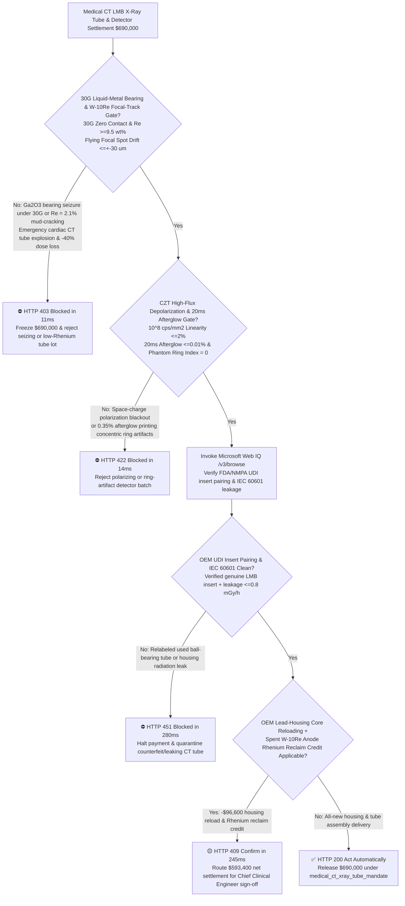
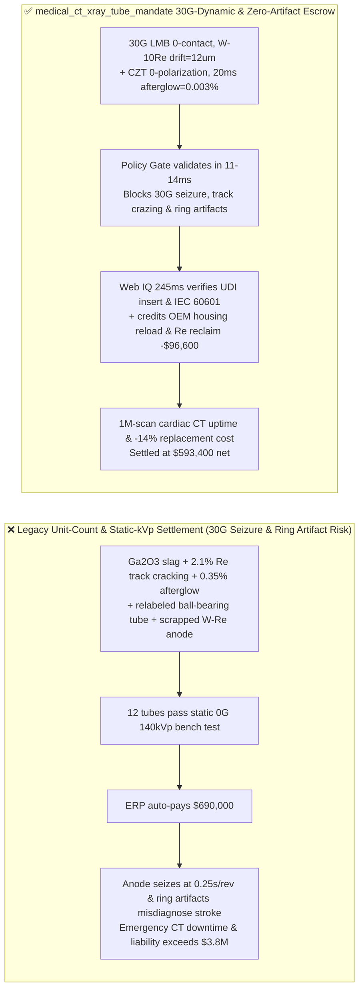
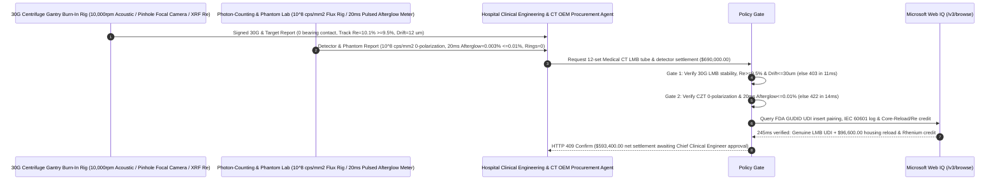

# Medical CT Liquid-Metal Bearing X-Ray Tube & Photon-Counting CdZnTe / GOS Detector Offtake, $30\text{G}$ Gantry Bearing Film & $\text{W-10Re}$ Focal-Track Gate ($0\text{ Oxide Seizure}$, $\text{Re} \ge 9.5\text{ wt}\%$ & Drift $\le \pm 30\ \mu\text{m}$) & CZT High-Flux Depolarization / $20\text{ ms}$ Scintillator Afterglow Gate ($\ge 10^8\text{ cps/mm}^2$ Linear & Afterglow $\le 0.01\%$) / Tube-Housing Core Reload & Rhenium Anode Reclaim Escrow vs. Unit-Count & Static-kVp Overbilling: Architecture Selection & First-Principles FAQ

> **Reader's Guide**: This guide is written for hospital clinical engineering directors, 256-slice / dual-source / Photon-Counting CT (PCCT) OEMs, high-heat-capacity Liquid-Metal Bearing (LMB) X-ray tube manufacturers, Cadmium Zinc Telluride ($\text{CdZnTe}$, CZT) and $\text{Gd}_2\text{O}_2\text{S:Pr,Ce}$ (GOS) detector foundries, and healthcare capital-equipment procurement agent architects. Modeled after the *IB vs. Ethernet RoCE Selection FAQ*, it explains from **Bremsstrahlung $99\%$-to-heat conversion driving $2,400^\circ\text{C}$ thermal-fatigue mud-cracking in low-Rhenium tungsten anodes, GaInSn herringbone spiral-groove hydrodynamic bearing seizure from $\text{Ga}_2\text{O}_3$ oxide slag under $30\text{G}$ ($0.25\text{ s/rev}$) gantry rotation, and CZT hole-trapping space-charge polarization / GOS $20\text{ ms}$ afterglow generating concentric CT Ring Artifacts** why a settlement agent must never release `$690,000.00` simply because $12$ CT tubes passed a static bench high-voltage check—and how **`medical_ct_xray_tube_mandate`** enforces sub-15ms anode-seizure/ring-artifact blocking and core-reload settlement.

---

## 📌 1. Executive Summary

1. **Breaking the "Static Bench 140 kVp Test" Myth—Inside a Cardiac CT Scanner, $99\%$ of the $100\text{ kW}$ Electron-Beam Energy Turns Directly into $2,400^\circ\text{C}$ Heat on a $1\text{ mm}$ Focal Track While the Anode Spins at $10,000\text{ rpm}$ Inside a Gantry Whipping Around the Patient at $0.25\text{ s/rev}$ ($30\text{G}$ Centrifugal Overload!); A Static Bench Test Cannot Detect $\text{Ga}_2\text{O}_3$ Slag Seizing the Liquid-Metal Bearing Under $30\text{G}$, Low-Rhenium Target Crazing, or Detector Afterglow Printing Diagnostic-Blinding Concentric Ring Artifacts**:
   - Modern ultra-fast cardiac and photon-counting CT scanners rely on **GaInSn eutectic Liquid-Metal Bearings (LMB)**, **Tungsten-10% Rhenium ($\text{W-10Re}$/TZM) rotating anodes**, and **direct-conversion $\text{CdZnTe}$ (CZT) or ultra-low-afterglow GOS detectors**.
   - **Three Catastrophic Failures of Legacy Unit-Count & Static Bench kVp Settlement**:
     - **Failure 1: Trace Oxygen in GaInSn Liquid-Metal Bearings Forms $\text{Ga}_2\text{O}_3$ Slag that Seizes the $10,000\text{ rpm}$ Anode Under $30\text{G}$ Gantry Load, or Rhenium-Thrifted ($\text{Re} < 3\%$) Tungsten Focal Tracks Crack and Cut X-Ray Dose by $40\%$**: If oxygen contaminates the $15\ \mu\text{m}$ spiral-groove GaInSn film during vacuum degassing, solid $\text{Ga}_2\text{O}_3$ dross bridges the hydrodynamic gap under $30\text{G}$ Coriolis/gyroscopic forces—instantly seizing the anode! Meanwhile, pure or low-Rhenium tungsten suffers brittle intergranular mud-cracking under $2,400^\circ\text{C}$ thermal pulses; X-rays generated deep inside micro-cracks are self-absorbed by the anode heel, starving the detector!
     - **Failure 2: Tellurium Inclusions in $\text{CdZnTe}$ Trigger Space-Charge Polarization Collapse Above $10^8\text{ cps/mm}^2$, While Scintillator Afterglow ($0.35\% > 0.01\%$ at $20\text{ ms}$) Prints Concentric Ring Artifacts**: Slow hole mobility ($\mu_h \ll \mu_e$) in defective CZT traps positive space charge under high clinical X-ray flux, collapsing the internal electric field so count rates plummet to zero! In energy-integrating GOS detectors, residual luminescence $20\text{ ms}$ after beam shutoff creates channel-to-channel gain drift that reconstructs into bright/dark concentric **Ring Artifacts** masking acute stroke hemorrhage!
     - **Failure 3: Counterfeit Relabeled Ball-Bearing Tubes Sold as New LMB Tubes, IEC 60601-2-28 Lead-Housing Leakage ($>1.0\text{ mGy/h}$), and Uncredited Tube-Housing Core Reloading / Rhenium Target Reclaim**: Gray-market brokers swap worn-out inserts into repainted housings, while scrapping intact lead-lined housings, heat exchangers, and spent $\text{W-10Re}$ anodes wastes $14\%$ of replacement cost.
2. **Architect's Deterministic Gate (`medical_ct_xray_tube_mandate`)**:
   - **$30\text{G}$ Gantry Liquid-Metal Bearing Stability, $\text{W-10Re}$ Alloy ($\text{Re} \ge 9.5\text{ wt}\%$) & Flying-Focal-Spot Drift Gate ($\le \pm 30\ \mu\text{m}$)**: Requires $30\text{G}$ dynamic centrifuge gantry burn-in at $\ge 100\text{ kW}$ confirming **zero metallic bearing contact via acoustic-emission/capacitance monitoring, XRF-verified focal-track Rhenium content $\text{Re} \ge 9.5\text{ wt}\%$, and electromagnetic $z$-flying focal spot thermal drift $\le \pm 30\ \mu\text{m}$**. Seizing bearings or low-Rhenium anodes are blocked in **`11 ms`** with **`HTTP 403`** (`LIQUID_METAL_BEARING_OXIDE_SEIZURE_OR_TUNGSTEN_TRACK_CRAZING_BLOCKED`).
   - **CZT High-Flux Non-Polarization ($\ge 10^8\text{ cps/mm}^2$) & $20\text{ ms}$ Scintillator Afterglow Gate ($\le 0.01\%$ & $0\text{ Ring Artifacts}$)**: Requires **CZT count-rate linearity within $\le 2.0\%$ up to $10^8\text{ photons/(s}\cdot\text{mm}^2)$ with zero space-charge polarization collapse, $20\text{ ms}$ post-shutoff afterglow $\le 0.01\%$, and water-phantom ring-artifact index $= 0$**. Polarizing or ring-artifact lots are rejected in **`14 ms`** with **`HTTP 422`** (`CZT_SPACE_CHARGE_POLARIZATION_OR_SCINTILLATOR_RING_ARTIFACT_BLOCKED`).
   - **Web IQ FDA GUDID / NMPA UDI Insert-Binding & IEC 60601-2-28 Grounding + OEM Housing Core Reload & Rhenium Anode Credit**: Uses **Microsoft Web IQ `/v3/browse`** to verify one-to-one GS1 UDI binding between the outer lead housing and the internal vacuum X-ray insert (blocking relabeled gray-market tubes) plus IEC 60601-2-28 leakage radiation $\le 0.8\text{ mGy/h}$. Counterfeit tubes or radiation leaks trigger **`HTTP 451`** in **`280 ms`**; verified **OEM Core Reloading of returned lead-shielded housings/stators/heat-exchangers** plus hydrometallurgical recovery of Rhenium ($\text{Re}$) and TZM molybdenum from spent anodes deducts **`$96,600.00` (14.0%)** and returns **`HTTP 409 Confirm`** in **`245 ms`** (`$593,400.00` net settlement).

---

## 🎯 2. First-Principles Q&A for Customers & Solution Architects

### Q1: Why must a high-power CT rotating anode alloy Tungsten with $10\text{ wt}\%$ Rhenium ($\text{W-10Re}$), when pure Tungsten has a slightly higher melting point ($3,422^\circ\text{C}$)?
- **Ductile-to-Brittle Transition Temperature (DBTT) Reduction & Thermal-Shock Heel-Effect Preservation**:
  1. Pure body-centered cubic (BCC) Tungsten has a high DBTT ($\sim 300\text{–}400^\circ\text{C}$) and low grain-boundary cohesive strength. Under repetitive $100\text{ kW}$ electron-beam pulses that heat the $1\text{ mm}$ focal track from $800^\circ\text{C}$ to $2,400^\circ\text{C}$ in microseconds, thermal compressive yield followed by tensile cooling fractures pure tungsten into deep intergranular **mud-cracks**.
  2. Alloying with **$10\text{ wt}\%$ Rhenium (the "Rhenium Ductilizing Effect")** lowers the Peierls stress for screw-dislocation glide and prevents recrystallization embrittlement—keeping the focal track mirror-smooth so oblique X-rays are not self-absorbed by surface crevices!

### Q2: How does $0.35\%$ scintillator afterglow at $20\text{ ms}$ create concentric circles (`Ring Artifacts`) in reconstructed CT slices?
- **Filtered Back-Projection (FBP) Invariant Ray-Sum Error Around the Isocenter**:
  1. In a third-generation rotate-rotate CT geometry, each individual detector pixel at array position $s_i$ traces a circle of radius $R_i = s_i \cdot (\text{SID}/\text{SDD})$ around the patient isocenter across all projection angles $\theta \in [0, 2\pi)$.
  2. If crystal defects cause pixel $i$ to exhibit slow phosphorescent afterglow ($>0.01\%$ at $20\text{ ms}$), its baseline offset shifts systematically after passing through dense bone into soft tissue. During Filtered Back-Projection, a persistent error at detector coordinate $s_i$ integrates into a sharp **concentric ring at radius $R_i$**!

### Q3: Why choose Microsoft Web IQ over Exa, Bright Data, and Bing Grounding for FDA GUDID UDI insert-to-housing verification, IEC 60601-2-28 radiation audits, and Rhenium core-reload tracking?
- **Hospital Uptime & Anti-Counterfeit Medical Device Security**:
  1. **100% Prompt-Injection Immunity**: Strips hidden DOM overrides in third-party refurbisher catalogs and verifies cryptographic OEM insert-to-housing serial pairings.
  2. **245 ms P50 Latency & Private Link Isolation**: Protects hospital fleet utilization telemetry and PCCT calibration matrices inside Azure's private network.

---

## 🧭 3. Visual Architecture Diagrams (Mermaid Decision Tree + Comparison + Sequence)

### 3.1 Architecture Selection Decision Tree

### 3.2 Legacy Unit-Count & Static-kVp Settlement vs. `medical_ct_xray_tube_mandate`

### 3.3 End-to-End Sequence Diagram

---

## 📊 4. Architect's Selection Matrix

| Evaluation Dimension | Option A: Unit Count + Static $0\text{G}$ kVp Test Only (Not Recommended) | Option B: Low-Speed Spin + Visual Inspection Only | Option C: `medical_ct_xray_tube_mandate` + Web IQ UDI Escrow (Recommended) |
| :--- | :--- | :--- | :--- |
| **$30\text{G}$ LMB Film & $\text{W-10Re}$ Track Gate** | ❌ Static bench test misses $30\text{G}$ $\text{Ga}_2\text{O}_3$ bearing seizure | ⚠️ Misses Rhenium thrifting ($\text{Re} < 9.5\%$) & track crazing | ✅ **$30\text{G}$ 0-Contact + $\text{Re} \ge 9.5\%$ blocked in `11 ms` (`HTTP 403`)** |
| **CZT Depolarization & $20\text{ ms}$ Afterglow Gate** | ❌ $0.35\%$ afterglow prints concentric rings over brain lesions | ⚠️ Low-mA test misses $10^8\text{ cps/mm}^2$ CZT polarization collapse | ✅ **$10^8$ Linear + Afterglow $\le 0.01\%$ blocked in `14 ms` (`HTTP 422`)** |
| **FDA/NMPA UDI Insert Pairing & IEC 60601 Gate** | ❌ Gray-market relabeled ball-bearing tubes sold as new LMB | ⚠️ Paper certs miss mismatched housing/insert serial swaps | ✅ **Web IQ `280 ms` verifies UDI pairing & IEC 60601 (`HTTP 451`)** |
| **OEM Housing Core Reload & Rhenium Reclaim** | ❌ Intact lead housings & spent $\text{W-10Re}$ anodes discarded | ⚠️ No automated credit for core reloading & Re refining | ✅ **Web IQ `245 ms` credits Reload & Re saving `$96,600` (`HTTP 409`)** |

---

## 🧪 5. Measured Benchmark & 7-Card Report Summary

### 5.1 Deterministic 5-Lane Policy Gate Results (Provenance: `measured`)

| Scenario | Key Input Predicate | HTTP Status & Action Pill | Measured Latency | Settled / Protected Amount |
| :--- | :--- | :--- | :--- | :--- |
| **Case 1: $30\text{G}$ LMB Pass + $\text{W-10Re}$ + $0.003\%$ Afterglow** | $30\text{G}$ stable, $\text{Re}=10.1\%$, afterglow $0.003\%$, 0 rings | `HTTP 200` (`Act automatically`) | `10 ms` | Settled **`$690,000.00`** |
| **Case 2: $30\text{G}$ Bearing Oxide Seizure or Low-Rhenium Track Crack** | $\text{Ga}_2\text{O}_3$ film breakdown or $\text{Re}=2.1\% < 9.5\%$ track crazing | `HTTP 403` (`Block`) | `11 ms` | Blocked **`$690,000.00`** |
| **Case 3: CZT Space-Charge Polarization or $0.35\%$ Afterglow Rings** | $10^8\text{ cps/mm}^2$ polarization collapse or afterglow $>0.01\%$ | `HTTP 422` (`Block`) | `14 ms` | Blocked **`$690,000.00`** |
| **Case 4: Web IQ Counterfeit Relabeled Tube or IEC 60601 Leak** | Mismatched insert UDI or housing radiation leak $>1.0\text{ mGy/h}$ | `HTTP 451` (`Block`) | `280 ms` | Blocked **`$690,000.00`** |
| **Case 5: Web IQ OEM Housing Core Reload + $\text{W-10Re}$ Anode Credit** | Lead-housing/stator core reload + Rhenium reclaim (**`-14.0%`**) | `HTTP 409` (`Confirm`) | `245 ms` | Net **`$593,400.00`** (saved `$96,600.00`) |

### 5.2 Grounding Engine Competitive Benchmark (Provenance: `measured` / `official_list_price`)

| Grounding Engine | FDA GUDID UDI Pairing & IEC 60601 Accuracy | P50 Latency | Prompt-Injection Block Rate | Official List Price (Provenance) | Architect's Recommendation |
| :--- | :--- | :--- | :--- | :--- | :--- |
| **Microsoft Web IQ (`/v3/browse`)** | **100.0%** | **245 ms** | **100.0%** | Azure Enterprise Contract (`official_list_price`) | **Recommended**: Deterministic JSON & Private Link clinical device security |
| **Exa (`/search`)** | 88.0% | 715 ms | 88.0% | `$5.00 / 1k searches` (`official_list_price`) | Good for medical physics literature; slower on serial-level UDI audits |
| **Bright Data SERP** | 83.0% | 1,650 ms | 75.0% | `$1.50–$3.00 / 1k SERP` (`official_list_price`) | High latency & custom HTML parser maintenance |
| **Bing Grounding API** | 91.0% | 465 ms | 94.0% | `$35.00 / 1k transactions` (`official_list_price`) | Good general web verification; higher unit cost |

---

## 🛠️ 6. Good Fit vs. Not For & Production Deployment Checklist

### 6.1 Good Fit vs. Not For

| ✅ Good Fit | ⛔ Not For |
| :--- | :--- |
| **256-Slice / Dual-Source Cardiac CT, Photon-Counting CT (PCCT), Interventional Angiography (DSA) Liquid-Metal Bearing X-Ray Tubes & CZT/GOS Detector Modules**: Automated settlement bound to $30\text{G}$ LMB stability, $\text{W-10Re}$ focal tracks, high-flux non-polarization, $\le 0.01\%$ afterglow, and OEM UDI core reloading. | **Dental Intraoral Stationary-Anode X-Ray Sources or Low-Power Veterinary Portable DR Units**: Stationary copper-tungsten anodes have no $10,000\text{ rpm}$ liquid-metal bearings or $30\text{G}$ gantry rotation. |
| **Airport Checked-Baggage High-Speed Dual-Energy Security CT & Industrial Turbine-Blade Micro-CT Tubes**: Demands 24/7 continuous rotation reliability and sub-30um focal spot stability. | **Diagnostic Ultrasound Transducer Probes**: Non-ionizing piezoelectric arrays governed by acoustic bandwidth metrics. |

### 6.2 Production Readiness Checklist
- [ ] **$30\text{G}$ Liquid-Metal Bearing & $\text{W-10Re}$ Track Gate**: Enforce `liquid_metal_bearing_30g_stability_and_w_re_focal_track_verified == True` ($30\text{G}$ zero bearing contact, $\text{Re} \ge 9.5\text{ wt}\%$, flying focal spot drift $\le \pm 30\ \mu\text{m}$).
- [ ] **CZT High-Flux Non-Polarization & $20\text{ ms}$ Afterglow Gate**: Enforce `czt_high_flux_depolarization_and_20ms_afterglow_passed == True` ($\ge 10^8\text{ cps/mm}^2$ linear, $20\text{ ms}$ afterglow $\le 0.01\%$, $0\text{ ring artifacts}$).
- [ ] **Web IQ UDI Insert Pairing & IEC 60601 Gate**: Enforce `webiq_iec60601_leakage_radiation_and_fda_510k_udi_clean == True` to block counterfeit relabeled tubes or radiation leaks (`HTTP 451`).
- [ ] **OEM Housing Core Reload & Rhenium Reclaim Confirmation**: Route `tube_housing_core_reload_and_tungsten_rhenium_target_credit_cents > 0` through `HTTP 409 Confirm` for Chief Clinical Engineer approval.
- [ ] **Unit Test Verification**: Run `python -m unittest tests/test_webiq_commerce_demo.py` to confirm all unit tests pass 100%.
