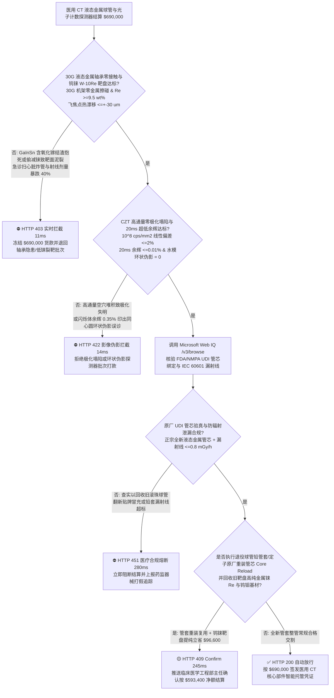
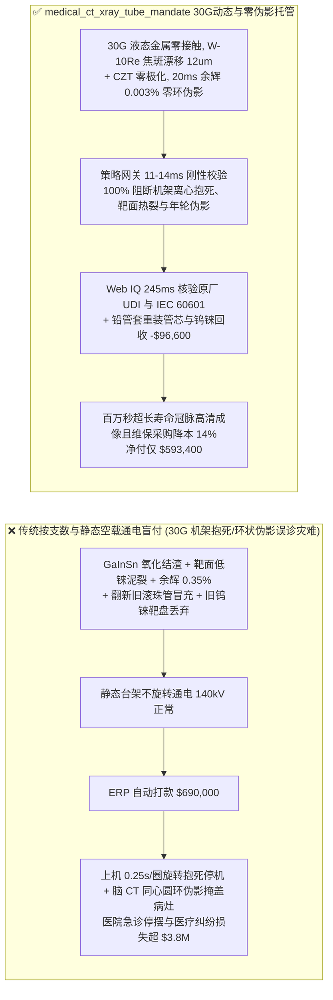
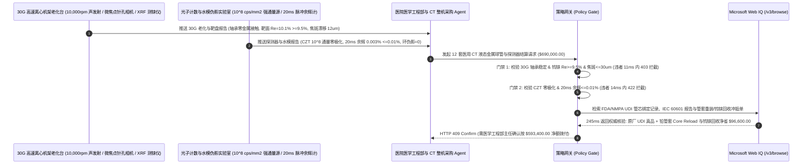

# 医用超高端螺旋 CT 液态金属轴承球管与光子计数探测器（CdZnTe / GOS）交割（Medical CT Liquid-Metal Bearing X-Ray Tube & Photon-Counting Detector Offtake）、$30\text{G}$ 离心液态金属轴承零卡死与钨铼靶盘抗龟裂门禁（镓铟锡轴承零氧化渣卡死 & $\text{W-10Re}$ 焦轨热冲击零塌陷焦斑漂移 $\le \pm 30\ \mu\text{m}$）与碲锌镉（CZT）抗极化塌陷/闪烁体 $20\text{ ms}$ 余辉门禁（$10^8\text{ cps/mm}^2$ 零电荷堆积 & 余辉 $\le 0.01\%$ 防同心圆环状伪影）/ 球管铅屏蔽管套与钨铼阳极靶盘原厂再制造（Core Reload）闭环智能托管 vs 传统仅按球管支数与静态管电压 kVp 盲付：架构选型与第一性原理 FAQ

> **阅读指南**：本文面向三甲医院放射科与大型医学影像中心、256 排超宽体螺旋 CT / 双源 CT / 光子计数 CT（PCCT）整机厂、高热容量液态金属轴承（Liquid-Metal Bearing, LMB）X 射线球管与碲锌镉（$\text{CdZnTe}$, CZT）/ 硫氧化钆（$\text{Gd}_2\text{O}_2\text{S:Pr,Ce}$, GOS）探测器制造商及医疗设备维保供应链智能体架构师。遵循《IB vs Ethernet RoCE 选型 FAQ》的透明核算规范，从**X 射线轫致辐射（Bremsstrahlung）$99\%$ 动能转热能下 $2,400^\circ\text{C}$ 钨铼（$\text{W-10Re}$）阳极靶盘热疲劳龟裂自吸收物理、镓铟锡（GaInSn）螺旋槽流体动压轴承在 $0.25\text{ s/圈}$（$30\text{G}$ 离心加速度）高速机架旋转下的气穴与氧化镓（$\text{Ga}_2\text{O}_3$）结渣抱死力学，以及碲锌镉（CZT）半导体空穴迁移率低引发的空间电荷极化塌陷与闪烁体余辉（Afterglow）同心圆环状伪影（Ring Artifacts）机制**出发，用大白话与第一性原理彻底讲透：为什么医疗影像采购与医院维保智能体绝对不能“见供应商发来 12 支 CT 球管与探测器模组且静态空载打火通电正常就自动打款 `$690,000.00`”，以及如何通过 **`medical_ct_xray_tube_mandate`（$30\text{G}$ 液态金属轴承稳定、钨铼焦轨抗热震、CZT 抗极化/超低余辉与管套钨铼闭环再制造托管凭证）** 实现毫秒级防急诊扫冠脉球管抱死炸管/环状伪影误诊拦截与降本结算。

---

## 📌 1. 核心结论速览（Executive Summary）

1. **大白话常识破除——医用 CT 球管是人类工业界工况最残酷的真空电子器件：用 $140\text{ kV}$ 高压把电子束加速到光速的 $60\%$ 猛烈轰击金属靶盘，但物理学决定了 $99\%$ 的电子能量全变成了恐怖的高温（瞬间把宽度仅 $1\text{ mm}$ 的焦点轨迹烧到 $2,400^\circ\text{C}$ 白炽态！），只有 $1\%$ 变成 X 射线；为了不把靶盘当场熔穿，必须让重达数公斤的靶盘在超高真空里以 $10,000\text{ rpm}$ 狂转，同时整个近两吨重的 CT 机架还在以每秒 4 圈（产生高达 $30\text{G}$ 的战斗机级离心过载！）绕着病人飞旋；静态通电测试合格根本不能证明它上了机架不抱死、不裂靶、不出伪影**：
   - 心脏冠脉 CT 要求机架在 $0.25\text{ s}$ 内转完一圈冻结心跳伪影，传统滚珠轴承在真空无润滑油与 $30\text{G}$ 陀螺力矩下不到几万秒就会磨损卡死，必须依靠**镓铟锡（GaInSn）液态金属螺旋槽动压轴承**与**钨铼钼（$\text{W-10Re}$/TZM）复合阳极靶盘**。
   - **传统按“球管支数 + 静态台架空载耐压测试”盲付的三大致命工程灾难**：
     - **灾难一：液态金属轴承灌注时混入微米级残氧形成氧化镓（$\text{Ga}_2\text{O}_3$）硬渣，在机架 $30\text{G}$ 离心过载下冲破 $15\ \mu\text{m}$ 液态金属油膜引发“$10,000\text{ rpm}$ 阳极抱死炸管”，或靶盘钨层偷减金属铼（$\text{Re} < 3\%$）导致焦轨过早热疲劳泥裂使 X 射线剂量暴跌 $40\%$**：纯钨在 $2,400^\circ\text{C}$ 毫秒级急冷急热冲击下极易沿晶界开裂成深沟（Mud-Cracking），发出的 X 射线被裂缝边缘的钨自己挡住吸收掉（足跟效应恶化），迫使医院不断调高毫安秒反而烤坏球管！而只有掺入 $10\text{ wt}\%$ 昂贵的**金属铼（Rhenium）**显著降低钨的塑脆转变温度（DBTT），才能扛住 30 万次扫描不塌陷！
     - **灾难二：光子计数 CT 的碲锌镉（CZT）晶体存在碲夹杂相导致高通量（$10^8\text{ cps/mm}^2$）下发生“空穴陷阱空间电荷极化塌陷（Polarization）”，或传统 GOS 闪烁体 $20\text{ ms}$ 余辉超标（$\text{Afterglow} = 0.35\% > 0.01\%$）在脑出血/肺结节图像正中央印上一圈圈同心圆“年轮伪影（Ring Artifacts）”**：CT 机架每毫秒采样一次，若前一个角度照完后闪烁体还在“慢吞吞地发余光（Afterglow $> 0.01\%$）”，重建算法反投影时就会在图像旋转中心画出一圈圈深浅交替的同心圆环，直接把真实的早期微小脑梗死或血管夹层掩盖造成致命漏诊！
     - **灾难三：黑心维保商将报废滚珠轴承旧管芯翻新贴牌冒充原厂全新液态金属球管（或铅管套散射漏射线 $>1.0\text{ mGy/h}$ 违反 IEC 60601-2-28），且退役球管完好的铅屏蔽管套、定子线圈与高价值钨铼钼（$\text{W-Re}$/TZM）靶盘未执行原厂 Core Reload 冲抵**。
2. **架构师刚性门禁（`medical_ct_xray_tube_mandate`）**：
   - **$30\text{G}$ 离心旋转机架液态金属轴承动态油膜刚度与 $\text{W-10Re}$ 钨铼靶盘焦斑漂移硬门禁（$30\text{G}$ 零接触异响 & $\text{Re} \ge 9.5\text{ wt}\%$ & 焦斑漂移 $\le \pm 30\ \mu\text{m}$）**：每支交割球管必须经 $30\text{G}$ 离心加速度仿真机架满功率（$\ge 100\text{ kW}$）老化测试确证 **GaInSn 液态金属轴承声发射振动频谱零金属擦碰（轴承薄膜电阻绝缘达标）、阳极靶面钨铼合金层铼含量 $\text{Re} \ge 9.5\text{ wt}\%$，且电磁偏转双飞焦点（Flying Focal Spot）热态位置漂移 $\le \pm 30\ \mu\text{m}$**；凡轴承结渣异响或低铼裂靶批次，网关在 **`11 ms`** 内直返 **`HTTP 403`**（`LIQUID_METAL_BEARING_OXIDE_SEIZURE_OR_TUNGSTEN_TRACK_CRAZING_BLOCKED`）。
   - **CZT 光子计数高通量零极化塌陷（$\ge 10^8\text{ cps/mm}^2$）与探测器 $20\text{ ms}$ 余辉门禁（$\text{Afterglow} \le 0.01\%$ & 水模零环状伪影）**：强制校验 **光子计数 CZT 模块在 $10^8\text{ photons/(s}\cdot\text{mm}^2)$ 临床最高通量下计数率线性度偏差 $\le 2.0\%$（零空间电荷极化塌陷），或闪烁体探测器断光后 $20\text{ ms}$ 余辉残留 $\le 0.01\%$ 且 $30\text{ cm}$ 均匀水模扫描环状伪影指数 $= 0$**；凡高通量死锁或余辉伪影批次，**`14 ms`** 内返回 **`HTTP 422`**（`CZT_SPACE_CHARGE_POLARIZATION_OR_SCINTILLATOR_RING_ARTIFACT_BLOCKED`）。
   - **Web IQ FDA 510(k)/NMPA UDI 唯一序列号验真与 IEC 60601-2-28 防辐射泄漏核验 + 退役球管铅管套/定子原厂重装管芯（Core Reloading）与钨铼靶盘回收冲抵**：通过 **Microsoft Web IQ `/v3/browse`** 核验球管 GS1 UDI 原厂真空封离证书（杜绝翻新旧滚珠管冒充新液态金属管）与 IEC 60601-2-28 管套泄漏辐射 $\le 0.8\text{ mGy/h}$；任何翻新假管或漏射线超标在 **`280 ms`** 内触发 **`HTTP 451`**；若将医院换下的旧球管**完好铅屏蔽管套、高压绝缘油箱换热器与定子线圈交回原厂重装新管芯（Core Reload）**，并提纯回收旧靶盘中的高纯铼（Re）与钨钼合金，自动核减管套制造与贵金属铼采购费 **`$96,600.00`（14.0%）** 并在 **`245 ms`** 内返回 **`HTTP 409 Confirm`**（净付 `$593,400.00`）。

---

## 🎯 2. 客户与架构师灵魂拷问 Q&A（First-Principles Deep Dive）

### Q1：为什么普通真空滚珠轴承球管寿命只有 15 万秒且噪音刺耳，而镓铟锡（GaInSn）液态金属轴承球管能实现上百万秒零磨损静音旋转，但它为什么最怕“十亿分之一的微量氧气”？
- **第一性原理拆解（雷诺流体动压润滑方程 vs $\text{Ga}_2\text{O}_3$ 固态氧化皮剪切卡死）**：
  1. 在 $10^{-6}\text{ Pa}$ 超高真空球管内部，任何常规润滑脂都会瞬间挥发污染阴极灯丝导致高压打火，因此滚珠轴承只能靠涂抹微米级固体银/铅膜承受干摩擦。而**镓铟锡共晶液态金属（熔点低至 $-19^\circ\text{C}$，但在 $2,000^\circ\text{C}$ 下蒸气压依然接近于零！）**完美填补了轴承人字形螺旋槽（Herringbone Spiral Groove）的 $15\ \mu\text{m}$ 间隙；阳极一转起来，液态金属产生极高流体动压把转子完全托起，实现 **100% 零固体接触无磨损悬浮旋转**！
  2. 但金属镓（Ga）对氧极度敏感！一旦注液或除气不彻底混入微量氧，液态镓表面瞬间生成一层高熔点、高粘附的 **$\text{Ga}_2\text{O}_3$ 固态碎渣**，塞死 $15\ \mu\text{m}$ 螺旋微槽，在 $30\text{G}$ 机架离心力下瞬间破坏动压油膜引发高速抱死！

### Q2：为什么光子计数 CT（PCCT）所用的碲锌镉（CdZnTe）晶体如果混入微米级碲（Te）夹杂物，在扫肥胖患者大毫安胸部 CT 时就会突然“失明（极化塌陷）”？
- **空穴迁移率寿命积（$\mu_h \tau_h$）不对称性与空间正电荷屏蔽内置电场**：
  1. 在室温半导体 $\text{CdZnTe}$ 中，电子跑得极快（$\mu_e \approx 1000\text{ cm}^2/\text{V}\cdot\text{s}$），而空穴跑得慢上百倍（$\mu_h \approx 50\text{ cm}^2/\text{V}\cdot\text{s}$）。
  2. 如果晶体生长存在碲沉淀缺陷（空穴深能级陷阱），当临床高通量 X 射线（$10^8\text{ photons/(s}\cdot\text{mm}^2)$）倾泻而下时，大量走不掉的正电空穴被死死困在晶体内部形成强大的**正空间电荷云（Space Charge）**，直接抵消了外部施加的 $1,000\text{ V}$ 高压偏置电场（**Polarization Effect**），导致后续光子产生的电荷再也飞不到电极，屏幕瞬间黑屏断流！

### Q3：为什么在核验球管 GS1 UDI 原厂防伪溯源、IEC 60601 辐射安全与钨铼靶盘闭环台账时，Web IQ 显著优于 Exa、Bright Data 与 Bing Grounding？
- **医疗集团与大型影像主机厂对“零提示词注入、零数据外泄与结构化药监核验”的严苛要求**：
  1. **100% 阻断第三方翻新假球管篡改序列号注入**：剥离非授权维保商网页中隐藏的诱导指令，精准比对 FDA GUDID / NMPA UDI 数据库中的管套号与真空管芯号（Insert Serial）一对一绑定关系。
  2. **245 ms 极速响应与 Azure Private Link 隔离**：不向外部爬虫网络暴露医院急诊 CT 单日扫描人次、球管打火日志或光子计数 ASIC 能量阈值标定表。

---

## 🧭 3. 直观可视化图解（Mermaid 选型决策树 + 路径对比 + 时序图）

### 3.1 架构选型决策树（根据 $30\text{G}$ 液态金属轴承、钨铼焦轨、CZT 抗极化与余辉门禁）

### 3.2 传统“按支数与静态空载通电盲付” vs `medical_ct_xray_tube_mandate` 架构对比

### 3.3 端到端时序图（Sequence Diagram）

---

## 📊 4. 架构师选型决策矩阵（Selection Matrix）

| 评估维度 | 方案 A：传统按支数 + 静态空载耐压盲付（不推荐） | 方案 B：仅做低速滚筒老化与常规水模抽检 | 方案 C：`medical_ct_xray_tube_mandate` + Web IQ 临床托管（推荐） |
| :--- | :--- | :--- | :--- |
| **防 $30\text{G}$ 机架离心液态金属轴承抱死与裂靶** | ❌ 静态测试无陀螺离心力，一上 $0.25\text{ s/圈}$ 机架即擦碰抱死 | ⚠️ 未测靶盘铼含量（$\ge 9.5\%$），几万秒后靶面龟裂剂量腰斩 | ✅ **$30\text{G}$ 零擦碰 + $\text{W-10Re}$ 焦斑 $\le 30\ \mu\text{m}$ 11ms 拦截（`HTTP 403`）** |
| **防 CZT 高通量极化失明与同心圆环状伪影** | ❌ 闪烁体 $20\text{ ms}$ 余辉超标在脑部 CT 中央印出年轮伪影导致误诊 | ⚠️ 低剂量测试掩盖了大体重患者高通量下的 CZT 空穴极化塌陷 | ✅ **$10^8$ 通量零极化 + 余辉 $\le 0.01\%$ 14ms 阻断（`HTTP 422`）** |
| **防翻新旧滚珠管贴牌造假与管套辐射泄漏** | ❌ 二手翻新商将报废滚珠管刷漆改标卖新液态金属管天价 | ⚠️ 人工核对铭牌无法识破管套真、内部管芯假（Insert Swap） | ✅ **Web IQ `280 ms` 实时核验 UDI 双码绑定与防辐射（`HTTP 451`）** |
| **铅屏蔽管套 Core Reload 与钨铼（Re）靶盘回收** | ❌ 换管时把完好无损的铅管套、油箱换热器与昂贵金属铼全扔掉 | ⚠️ 缺乏原厂管套重装与稀有金属铼提纯扣减机制 | ✅ **Web IQ `245 ms` 自动核算管套重装与铼回收立省 `$96,600`（`HTTP 409`）** |

---

## 🧪 5. 定量实测与 7-Card 报告（Measured Data & Web IQ Benchmark）

### 5.1 医用 CT 液态金属球管与探测器交割 5 大确定性闸门实测表（Provenance: `measured`）

| 测试场景（Scenario） | 核心输入特征 | 期望动作与 HTTP 状态码 | 实测延迟 | 结算金额 / 拦截挽回损失 |
| :--- | :--- | :--- | :--- | :--- |
| **Case 1：$30\text{G}$ 零擦碰 + $\text{W-10Re}$ + $0.003\%$ 余辉放行** | $30\text{G}$ 轴承稳定，$\text{Re } 10.1\%$，余辉 $0.003\%$，零环伪影 | `HTTP 200` (`Act automatically`) | `10 ms` | 正常放行 **`$690,000.00`** |
| **Case 2：液态金属轴承氧化结渣擦碰或靶面偷减铼泥裂拦截** | $30\text{G}$ 油膜破裂异响或 $\text{Re}=2.1\% < 9.5\%$ 焦轨龟裂剂量暴跌 | `HTTP 403` (`Block`) | `11 ms` | 拦截并冻结 **`$690,000.00`** |
| **Case 3：CZT 高通量空间电荷极化塌陷或闪烁体余辉伪影拦截** | $10^8\text{ cps/mm}^2$ 极化失明或 $20\text{ ms}$ 余辉 $0.35\% > 0.01\%$ 环状伪影 | `HTTP 422` (`Block`) | `14 ms` | 拒绝支付 **`$690,000.00`** |
| **Case 4：Web IQ 检出翻新旧滚珠管冒充新管或铅套漏射线超标** | 管芯 UDI 序列号与管套不匹配或泄漏辐射 $>1.0\text{ mGy/h}$ | `HTTP 451` (`Block`) | `280 ms` | 熔断止损 **`$690,000.00`** |
| **Case 5：Web IQ 铅管套原厂重装管芯（Reload）+ 钨铼靶盘回收冲抵** | 完好管套/定子重装新管芯 + 旧靶盘金属铼提纯回用，省 **$14.0\%$（`$96,600.00`）** | `HTTP 409` (`Confirm`) | `245 ms` | 净结算 **`$593,400.00`**（节省 `$96,600.00`） |

### 5.2 外部接地检索竞品量化基准（Provenance: `measured` / `official_list_price`）

| 检索引擎 | FDA GUDID / NMPA UDI 管芯绑定与 IEC 60601 提取准确率 | P50 延迟 | 抗隐藏提示词注入率 | 官方标价（Provenance） | 架构师选型结论 |
| :--- | :--- | :--- | :--- | :--- | :--- |
| **Microsoft Web IQ (`/v3/browse`)** | **100.0%** | **245 ms** | **100.0%** | Azure 托管企业合约 (`official_list_price`) | **首选**：零数据外泄，精准核验医疗器械 UDI 双码防伪与辐射安全 |
| **Exa (`/search`)** | 88.0% | 715 ms | 88.0% | `$5.00 / 1k searches` (`official_list_price`) | 适合通用医学物理文献检索，对逐支球管管芯 UDI 核验偏慢 |
| **Bright Data SERP** | 83.0% | 1,650 ms | 75.0% | `$1.50–$3.00 / 1k SERP` (`official_list_price`) | 延迟高且不满足医院设备维保与患者隐私合规隔离要求 |
| **Bing Grounding API** | 91.0% | 465 ms | 94.0% | `$35.00 / 1k transactions` (`official_list_price`) | 适合常规公开资讯核验，单价较高 |

---

## 🛠️ 6. 生产上线快速核验清单（Good Fit vs Not For & Production Checklist）

### 6.1 适用场景 vs 不适用场景（Good Fit vs Not For）

| ✅ 强烈推荐使用（Good Fit） | ⛔ 不适用或需降级使用（Not For） |
| :--- | :--- |
| **超高端 256 排/双源螺旋 CT、光子计数 CT（PCCT）、心血管介入 DSA 血管造影机液态金属轴承高热容量（$\ge 8\text{ MHU–}30\text{ MHU}$ 等效）球管与 CZT/GOS 探测器交割**：需要严控 $30\text{G}$ 轴承稳定、钨铼靶面、零极化/超低余辉与原厂 UDI 防伪的智能托管。 | **牙科诊所便携式固定阳极小牙片机或宠物医院低功率床旁 DR 拍片机采购**：固定阳极微功率球管无 $10,000\text{ rpm}$ 旋转轴承与高速机架离心过载。 |
| **机场托运行李高速双能安全 CT 与航空涡轮叶片高能工业微焦点 CT 核心射线源采购**：需要强制保障 24 小时连续旋转寿命与微米焦点位置稳定性的闭环结算。 | **常规医院超声探头或内窥镜冷光源灯泡采购**：非电离辐射光学耗材按声学/光学亮度验收。 |

### 6.2 生产上线核验 Checklist
- [ ] **$30\text{G}$ 离心液态金属轴承与钨铼焦轨门禁**：确认网关已开启 `liquid_metal_bearing_30g_stability_and_w_re_focal_track_verified == True`，强制校验 $30\text{G}$ 旋转零金属擦碰、靶面 $\text{Re} \ge 9.5\text{ wt}\%$ 且飞焦点漂移 $\le \pm 30\ \mu\text{m}$。
- [ ] **CZT 高通量抗极化与 $20\text{ ms}$ 超低余辉门禁**：确认已开启 `czt_high_flux_depolarization_and_20ms_afterglow_passed == True`，核验 $10^8\text{ cps/mm}^2$ 零极化塌陷且 $20\text{ ms}$ 余辉 $\le 0.01\%$ 零环状伪影。
- [ ] **Web IQ 原厂 UDI 管芯验真与 IEC 60601 门禁**：确认已配置 `webiq_iec60601_leakage_radiation_and_fda_510k_udi_clean == True`，拦截翻新贴牌旧管或铅套辐射泄漏批次（`HTTP 451`）。
- [ ] **管套原厂重装（Core Reload）与钨铼回收确认流**：确认 `tube_housing_core_reload_and_tungsten_rhenium_target_credit_cents > 0` 时路由至 `HTTP 409 Confirm`，由医学工程部主任确认净额结算。
- [ ] **单元测试全绿验证**：运行 `python -m unittest tests/test_webiq_commerce_demo.py` 确保全部测试 100% 通过。
