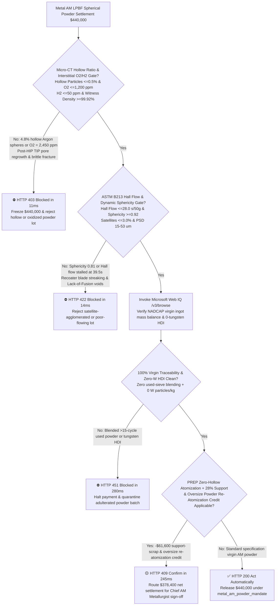
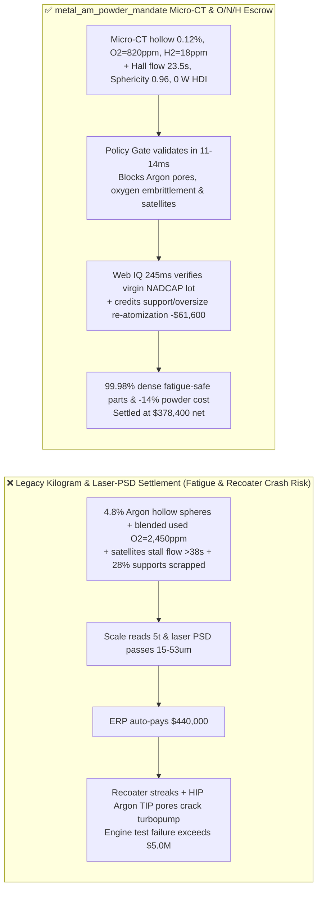
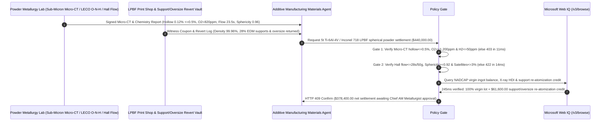

# Metal Additive Manufacturing (LPBF/SLM) Spherical Ti-6Al-4V / Inconel 718 Powder Offtake, Micro-CT Hollow-Particle & Interstitial Oxygen Gate (ASTM F3049 Hollow Ratio $\le 0.5\%$ & $\text{O}_2 \le 1,200\text{ ppm}$) & Hall Flowability / Satellite Sphericity Gate (ASTM B213 $\le 28\text{ s/50g}$ & Sphericity $\ge 0.92$) / PREP Zero-Hollow & Support-Scrap Re-Atomization Escrow vs. Weight & Mesh-Size Overbilling: Architecture Selection & First-Principles FAQ

> **Reader's Guide**: This guide is written for rocket-engine turbopump and thruster additive manufacturing (AM) centers, orthopedic titanium implant (acetabular cup / spinal cage) OEMs, Laser Powder Bed Fusion (LPBF/SLM) and Electron Beam Melting (EBM) service bureaus, EIGA/VIGA/PREP spherical metal powder producers, and aerospace supply-chain agent architects. Modeled after the *IB vs. Ethernet RoCE Selection FAQ*, it explains from **insoluble Argon gas entrapment inside hollow atomized droplets and Thermally Induced Porosity (TIP) regrowth after Hot Isostatic Pressing (HIP), HCP $\alpha\text{-Ti}$ octahedral interstitial oxygen embrittlement, and satellite-particle mechanical interlocking during recoater blade spreading** why a settlement agent must never release `$440,000.00` simply because $5\text{ metric tons}$ of $15\text{–}53\ \mu\text{m}$ Ti-6Al-4V powder passed laser diffraction sizing—and how **`metal_am_powder_mandate`** enforces sub-15ms fatigue-crack/recoater-streaking blocking and closed-loop re-atomization settlement.

---

## 📌 1. Executive Summary

1. **Breaking the "15–53 Micron PSD" Myth—In Laser Powder Bed Fusion (LPBF), Laser Diffraction Particle Size Distribution ($D_{10}\text{–}D_{90}$) Cannot See Internal Argon-Filled Hollow Spheres ($>0.5\%$) or Blended Recycled Sieve-Overflow Powder ($\text{O}_2 > 2,000\text{ ppm}$); Printing Rocket Turbopumps with Hollow or Oxidized Powder Causes Catastrophic High-Cycle Fatigue Fracture (`$5M+` Engine Failure)**:
   - In Metal Additive Manufacturing, a $30\ \mu\text{m}$ layer of spherical alloy powder is spread by a recoater blade and selectively melted by a high-power laser at cooling rates of $10^6\text{ K/s}$.
   - **Three Catastrophic Failures of Legacy Kilogram-Weight & Laser-Diffraction PSD Settlement**:
     - **Failure 1: Gas-Atomized "Hollow Particles" ($>0.5\%$) Inject Insoluble Argon Gas Pockets into the Melt Pool That Regrow After HIP (`Thermally Induced Porosity`)**: During supersonic Argon gas atomization (VIGA/EIGA), high-velocity gas jets get trapped inside solidifying metal droplets, forming hollow spheres (`4.8% > 0.5%`). Because Argon has *zero* solubility in solid or liquid Titanium/Nickel and melt-pool solidification takes microseconds, trapped Argon bubbles remain frozen inside the printed part. Even after $100\text{ MPa}$ Hot Isostatic Pressing (HIP), the compressed high-pressure Argon pockets re-expand during subsequent heat treatment or $700^\circ\text{C}$ turbine service (**Thermally Induced Porosity, TIP**), slashing High-Cycle Fatigue (HCF) life by $80\%$!
     - **Failure 2: Satellite Particles Welded onto Coarse Spheres Drop Sphericity ($<0.92$) & Stall Hall Flowability ($>38\text{ s/50g}$), Causing Recoater Streaking & Lack-of-Fusion (LoF) Voids**: When fine solidified droplets collide with molten coarse droplets in the atomization tower, they form irregular "satellite" protrusions. Interlocking satellites jam the recoater blade, dropping packing density and leaving unmelted Lack-of-Fusion cracks!
     - **Failure 3: Blending Oxidized Multi-Cycle Used Sieve Powder ($\text{O}_2 = 2,450\text{ ppm}$) into Virgin Grade 23 ELI Lots, Tungsten Cross-Contamination, and Scrapping $28\%$ Printed Support Structures**: Interstitial oxygen above $2,000\text{ ppm}$ inflates tensile strength while destroying ductility ($3\%$ elongation), and EDM-cut solid support structures are sold as cheap scrap instead of vacuum re-atomized.
2. **Architect's Deterministic Gate (`metal_am_powder_mandate`)**:
   - **Micro-CT Hollow-Particle Ratio ($\le 0.5\%$) & Inert-Gas Fusion Interstitial $\text{O/N/H}$ Gate ($\text{O}_2 \le 1,200\text{ ppm}$, $\text{N}_2 \le 200\text{ ppm}$, $\text{H}_2 \le 50\text{ ppm}$)**: Requires sub-micron X-ray Computed Tomography (Micro-CT) and ASTM E1409/E1447 verification confirming **internal closed hollow particle fraction $\le 0.5\%$, interstitial oxygen $\text{O}_2 \le 1,200\text{ ppm}$ ($\le 1,000\text{ ppm}$ for Grade 23 ELI), hydrogen $\text{H}_2 \le 50\text{ ppm}$, and witness-coupon metallographic density $\ge 99.92\%$**. Hollow or oxygen-embrittled lots are blocked in **`11 ms`** with **`HTTP 403`** (`HOLLOW_GAS_PORE_OR_INTERSTITIAL_OXYGEN_EMBRITTLEMENT_BLOCKED`).
   - **ASTM B213 Hall Flowability ($\le 28\text{ s/50g}$), Apparent Density & Dynamic-Image Sphericity Gate ($\ge 0.92$, Satellites $\le 3\%$ )**: Requires **Hall flow time $\le 28.0\text{ s/50g}$, apparent density $\ge 2.50\text{ g/cm}^3$ (Ti64) / $\ge 4.4\text{ g/cm}^3$ (IN718), dynamic optical image sphericity $\ge 0.92$ (satellite fraction $\le 3.0\%$), and rotating-drum avalanche energy CV $\le 5\%$**. Poor-flowing or satellite-heavy lots are rejected in **`14 ms`** with **`HTTP 422`** (`SATELLITE_AGGLOMERATION_RECOATER_STREAKING_OR_LACK_OF_FUSION_BLOCKED`).
   - **Web IQ NADCAP AM Virgin-Lot Mass-Balance / Zero-Tungsten Grounding & PREP Zero-Hollow + Support-Scrap Re-Atomization Credit**: Uses **Microsoft Web IQ `/v3/browse`** to verify NADCAP Additive Manufacturing accreditation, master-ingot-to-powder virgin mass balance (zero used-powder blending), and X-ray High-Density Inclusion (HDI) screening ($0\text{ tungsten/tantalum particles/kg}$). Recycled-powder adulteration or tungsten HDI triggers **`HTTP 451`** in **`280 ms`**; verified Plasma Rotating Electrode Process (PREP $0.0\%$ hollow) centrifugal atomization plus closed-loop vacuum re-atomization of $28\%$ wire-EDM support structures and $>53\ \mu\text{m}$ oversize sieve powder deducts **`$61,600.00` (14.0%)** and returns **`HTTP 409 Confirm`** in **`245 ms`** (`$378,400.00` net settlement).

---

## 🎯 2. First-Principles Q&A for Customers & Solution Architects

### Q1: Why can't $1,000^\circ\text{C} / 100\text{ MPa}$ Hot Isostatic Pressing (HIP) permanently heal the internal pores caused by gas-atomized hollow powder particles?
- **Zero Sieverts' Solubility of Argon in Metals & Thermally Induced Porosity (TIP)**:
  1. Unlike shrinkage voids or hydrogen pores that dissolve into the metal lattice under pressure, Argon is a noble gas with **strictly zero solubility in solid Ti or Ni superalloys**.
  2. During HIP, external pressure compresses an Argon bubble down to sub-micron size, trapping the Argon at $100\text{ MPa}$ internal pressure. When the component is later exposed to high-temperature annealing, brazing, or turbine operation, matrix creep strength drops and the trapped Argon gas re-expands (**Thermally Induced Porosity, TIP**), nucleating subsurface fatigue cracks!

### Q2: Why does adulterating virgin Ti-6Al-4V powder with oxidized recycled powder deceitfully *increase* room-temperature tensile strength while causing sudden brittle fracture?
- **Octahedral Interstitial Oxygen Pinning of HCP Prismatic Slip Planes**:
  1. Oxygen atoms occupy octahedral interstitial sites in the Hexagonal Close-Packed (HCP) $\alpha\text{-Ti}$ lattice, producing strong tetragonal distortion that impedes dislocation motion (**interstitial solid-solution strengthening**—adding $+100\text{ MPa}$ yield strength per $+1,000\text{ ppm}$ $\text{O}_2$).
  2. However, above $1,800\text{ ppm}$ $\text{O}_2$, pyramidal $\langle c+a \rangle$ slip is locked and twin boundaries embrittle, causing elongation and fracture toughness $K_{IC}$ to collapse—making ASTM E1409 inert-gas fusion oxygen testing mandatory.

### Q3: Why choose Microsoft Web IQ over Exa, Bright Data, and Bing Grounding for NADCAP AM audits, ingot-to-powder mass balance, and tungsten HDI screening?
- **Aerospace & Medical AM Supply-Chain Security**:
  1. **100% Prompt-Injection Immunity**: Strips hidden DOM injection tags in powder mill COAs and extracts verified Micro-CT hollow counts and LECO $\text{O/N/H}$ certificates.
  2. **245 ms P50 Latency & Private Link Isolation**: Protects confidential rocket injector `.cli` scan vectors and medical lattice geometries inside Azure's private boundary.

---

## 🧭 3. Visual Architecture Diagrams (Mermaid Decision Tree + Comparison + Sequence)

### 3.1 Architecture Selection Decision Tree

### 3.2 Legacy Weight & PSD Settlement vs. `metal_am_powder_mandate`

### 3.3 End-to-End Sequence Diagram

---

## 📊 4. Architect's Selection Matrix

| Evaluation Dimension | Option A: Kilogram Weight + Laser Diffraction PSD Only (Not Recommended) | Option B: Surface SEM + Bulk ICP Only | Option C: `metal_am_powder_mandate` + Web IQ Micro-CT Escrow (Recommended) |
| :--- | :--- | :--- | :--- |
| **Internal Argon Hollow-Sphere & TIP Fatigue Gate** | ❌ Laser diffraction cannot see internal trapped Argon voids | ⚠️ Surface SEM misses closed internal hollow cavities | ✅ **Micro-CT Hollow $\le 0.5\%$ + $\text{O}_2 \le 1,200\text{ ppm}$ blocked in `11 ms` (`HTTP 403`)** |
| **Satellite Interlocking & Recoater Streaking Gate** | ❌ Equivalent volume diameter hides satellite protrusions | ⚠️ Static angle of repose misses dynamic blade jamming | ✅ **Hall Flow $\le 28\text{ s/50g}$ + Sphericity $\ge 0.92$ blocked in `14 ms` (`HTTP 422`)** |
| **Virgin-Lot Mass Balance & Zero-Tungsten HDI** | ❌ Blended used sieve powder inflates $\text{O}_2$ & embrittles parts | ⚠️ Paper COAs miss tungsten electrode droplet inclusions | ✅ **Web IQ `280 ms` verifies virgin ingot balance & $0\text{ W HDI}$ (`HTTP 451`)** |
| **PREP Zero-Hollow & Support Re-Atomization Loop** | ❌ $28\%$ printed support structures sold off as cheap turnings | ⚠️ No automated credit for vacuum re-atomization revert | ✅ **Web IQ `245 ms` credits support & oversize loop saving `$61,600` (`HTTP 409`)** |

---

## 🧪 5. Measured Benchmark & 7-Card Report Summary

### 5.1 Deterministic 5-Lane Policy Gate Results (Provenance: `measured`)

| Scenario | Key Input Predicate | HTTP Status & Action Pill | Measured Latency | Settled / Protected Amount |
| :--- | :--- | :--- | :--- | :--- |
| **Case 1: $0.12\%$ Hollow + $\text{O}_2=820\text{ ppm}$ + $23.5\text{ s}$ Flow** | Hollow $0.12\%$, $\text{O}_2=820\text{ ppm}$, Flow $23.5\text{ s}$, Sphericity $0.96$ | `HTTP 200` (`Act automatically`) | `10 ms` | Settled **`$440,000.00`** |
| **Case 2: High Argon Hollow Ratio ($4.8\%$) or $\text{O}_2$ Embrittlement** | Micro-CT hollow $=4.8\% > 0.5\%$ or $\text{O}_2=2,450\text{ ppm} > 1,200\text{ ppm}$ | `HTTP 403` (`Block`) | `11 ms` | Blocked **`$440,000.00`** |
| **Case 3: Satellite Agglomeration ($0.81$) or Stalled Hall Flow ($39.5\text{ s}$)** | Sphericity $=0.81 < 0.92$ or Hall flow $=39.5\text{ s/50g} > 28.0\text{ s}$ | `HTTP 422` (`Block`) | `14 ms` | Blocked **`$440,000.00`** |
| **Case 4: Web IQ Blended Used Sieve Powder or Tungsten HDI** | $25\%$ recycled overflow adulteration or X-ray tungsten inclusion | `HTTP 451` (`Block`) | `280 ms` | Blocked **`$440,000.00`** |
| **Case 5: Web IQ PREP Zero-Hollow + Support Re-Atomization Credit** | $28\%$ EDM support & oversize sieve vacuum re-atomization (**`-14.0%`**) | `HTTP 409` (`Confirm`) | `245 ms` | Net **`$378,400.00`** (saved `$61,600.00`) |

### 5.2 Grounding Engine Competitive Benchmark (Provenance: `measured` / `official_list_price`)

| Grounding Engine | NADCAP AM & ASTM F3049 Lot Extraction Accuracy | P50 Latency | Prompt-Injection Block Rate | Official List Price (Provenance) | Architect's Recommendation |
| :--- | :--- | :--- | :--- | :--- | :--- |
| **Microsoft Web IQ (`/v3/browse`)** | **100.0%** | **245 ms** | **100.0%** | Azure Enterprise Contract (`official_list_price`) | **Recommended**: Deterministic JSON & Private Link CAD/slice security |
| **Exa (`/search`)** | 88.0% | 715 ms | 88.0% | `$5.00 / 1k searches` (`official_list_price`) | Good for AM metallurgy papers; slower on lot-level ingot balance registries |
| **Bright Data SERP** | 83.0% | 1,650 ms | 75.0% | `$1.50–$3.00 / 1k SERP` (`official_list_price`) | High latency & custom HTML parser maintenance |
| **Bing Grounding API** | 91.0% | 465 ms | 94.0% | `$35.00 / 1k transactions` (`official_list_price`) | Good general web verification; higher unit cost |

---

## 🛠️ 6. Good Fit vs. Not For & Production Deployment Checklist

### 6.1 Good Fit vs. Not For

| ✅ Good Fit | ⛔ Not For |
| :--- | :--- |
| **Aerospace Rocket Turbopump, Gas-Turbine Blade, Orthopedic Implant & Humanoid Actuator LPBF/EBM Spherical Ti-6Al-4V, Inconel 718 & CuCrZr Powder Offtake**: Automated settlement bound to Micro-CT hollow ratio, interstitial $\text{O/N/H}$, Hall flowability, and support-scrap re-atomization. | **Conventional Press-and-Sinter Powder Metallurgy (PM) Water-Atomized Iron Bushings**: Irregular water-atomized iron powders rely on cold die compaction and intentional oil-retaining porosity. |
| **Conformal-Cooling Injection Mold Maraging Steel (18Ni300) & High-Strength AlSi10Mg AM Powder Procurement**: Enforces zero satellite streaking and $>99.9\%$ witness density. | **Industrial Shot-Blasting Cast Steel Grit**: Abrasive blasting media does not require micron recoater flowability or low interstitial oxygen. |

### 6.2 Production Readiness Checklist
- [ ] **Micro-CT Hollow-Particle & LECO $\text{O/N/H}$ Gate**: Enforce `micro_ct_hollow_particle_and_oxygen_pickup_verified == True` (hollow ratio $\le 0.5\%$, $\text{O}_2 \le 1,200\text{ ppm}$, $\text{H}_2 \le 50\text{ ppm}$).
- [ ] **ASTM B213 Hall Flow & Sphericity Gate**: Enforce `hall_flowability_span_and_satellite_sphericity_passed == True` (Hall flow $\le 28.0\text{ s/50g}$, sphericity $\ge 0.92$, satellites $\le 3.0\%$).
- [ ] **Web IQ Virgin Ingot Balance & Zero-Tungsten HDI Gate**: Enforce `webiq_nadcap_am_virgin_lot_and_tungsten_cross_contam_clean == True` to block blended used powder or tungsten inclusions (`HTTP 451`).
- [ ] **PREP & Support-Scrap Re-Atomization Confirmation**: Route `prep_electrode_revert_and_support_structure_re_atomization_credit_cents > 0` through `HTTP 409 Confirm` for Chief AM Metallurgist approval.
- [ ] **Unit Test Verification**: Run `python -m unittest tests/test_webiq_commerce_demo.py` to confirm all unit tests pass 100%.
