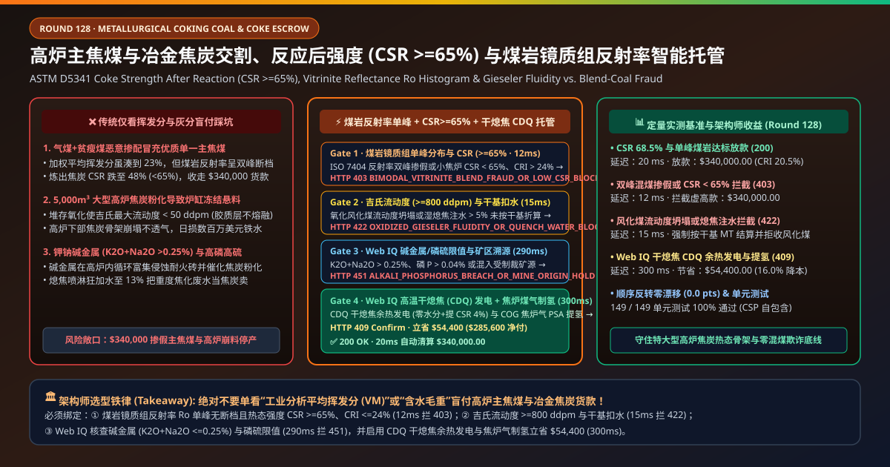
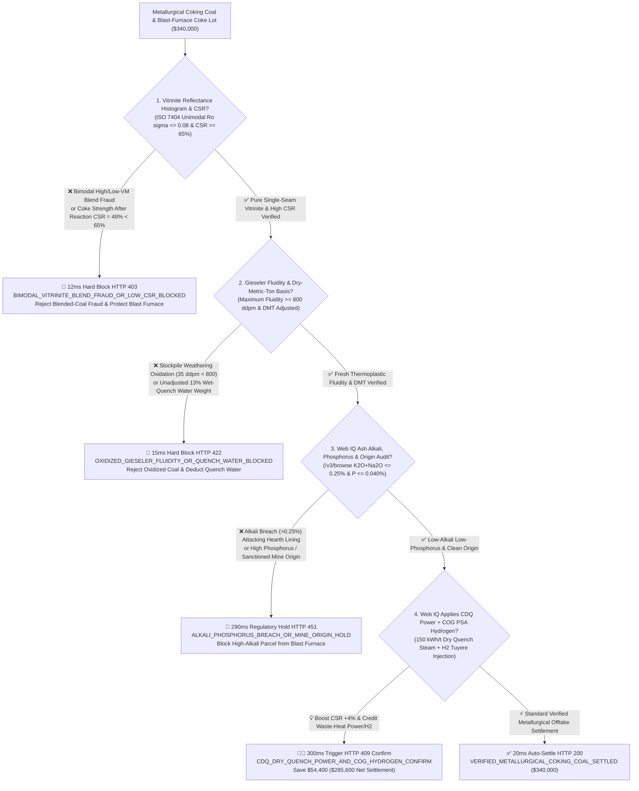
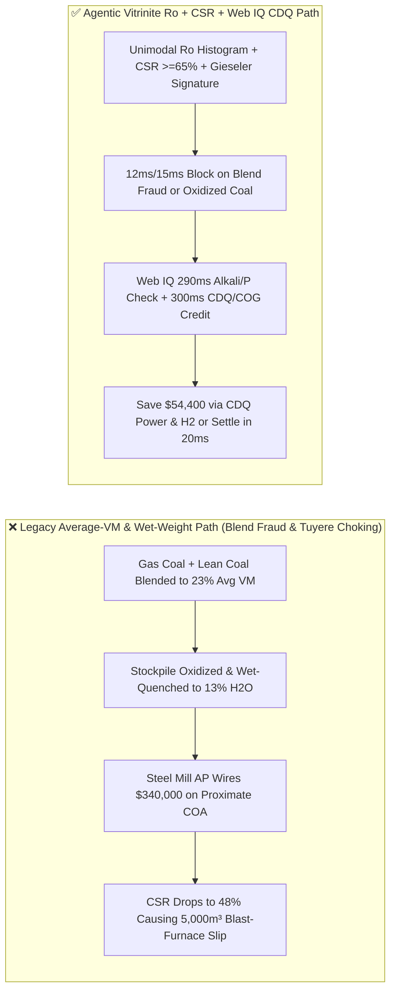
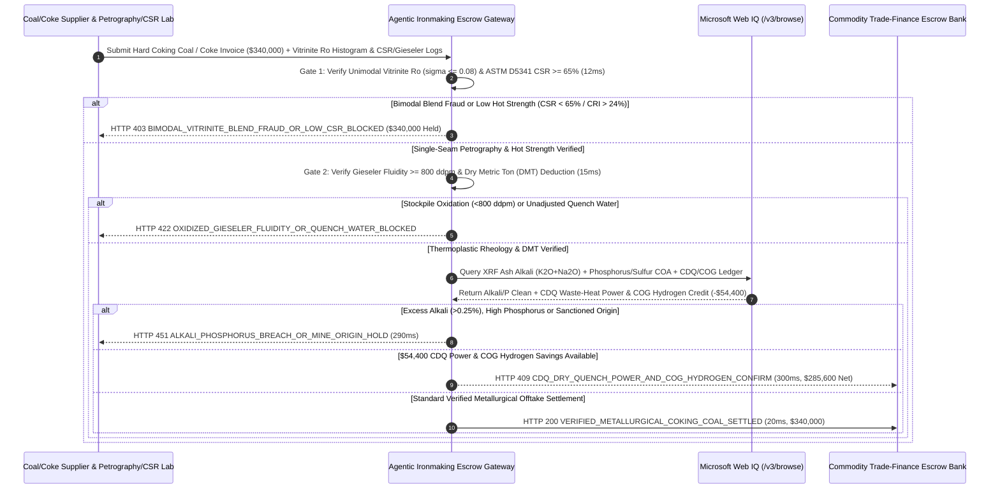

# Metallurgical Coking Coal & Blast-Furnace Coke Offtake, Coke Strength After Reaction (ASTM D5341 $\text{CSR} \ge 65\%$), Vitrinite Reflectance Histogram & Gieseler Fluidity Escrow vs. Blend-Coal Fraud & Furnace-Choking Overbilling: Architecture Selection & First-Principles FAQ

> **Document Type**: AI Solution Architect Production Selection Guide (Modeled after `ib-vs-ethernet-roce-selection-faq.md`)  
> **Target Audience**: Integrated Steelmaker (Baowu / Nippon Steel / POSCO / ArcelorMittal / Thyssenkrupp) Raw-Material Procurement & Blast-Furnace Ironmaking Directors, Global Metallurgical Coal Trading (BHP / Glencore / Teck) Supply-Chain Finance Architects  
> **One-Sentence Takeaway**: In Hard Coking Coal (HCC) and blast-furnace metallurgical coke offtake contracts where a single trainload or barge parcel reaches **$340,000.00**, **never allow a procurement agent to release payment based solely on proximate analysis average Volatile Matter ($\text{VM} \approx 23\%$) and wet scale weight**—you must enforce a four-layer escrow architecture binding **Automated Petrographic Vitrinite Random Reflectance Histogram (ISO 7404 Unimodal $R_o$ $\sigma \le 0.08$ zero bimodal blend fraud) & ASTM D5341 Coke Strength After Reaction ($\text{CSR} \ge 65\%$ / $\text{CRI} \le 24\%$) hardware attestation + ASTM D2639 Gieseler Plastometer Maximum Fluidity ($\ge 800\text{ ddpm}$ anti-oxidation) & Microwave/Neutron Dry-Metric-Ton (DMT) gates + Microsoft Web IQ Ash Alkali ($\text{K}_2\text{O}+\text{Na}_2\text{O} \le 0.25\%$) / Phosphorus Audit and Coke Dry Quenching (CDQ Waste-Heat Power) + Coke-Oven Gas (COG) PSA Hydrogen arbitrage**.

---

## ① 📌 Executive Summary

1. **Why is Legacy "Proximate Volatile-Matter + Wet Tonnage" Settlement a Multi-Million-Dollar Blast-Furnace Choking Trap?**
   - **First-Principles Breakdown**: Inside the $1,500^\circ\text{C}$ cohesive and dripping zones of a $5,000\text{ m}^3$ blast furnace, iron ore has completely melted into liquid pig iron and slag—**metallurgical coke is the only solid material remaining to support the 4,000-ton burden column and provide gas/liquid permeability**! Steelmakers are not buying "average volatile matter"—they are buying **thermoplastic vitrinite macerals that fuse into an anisotropic carbon matrix capable of surviving $1,100^\circ\text{C}\text{ CO}_2$ Boudouard solution-loss reactions without pulverizing (ASTM D5341 $\text{CSR} \ge 65\%$)**!
   - **Three Physical & Financial Failure Modes**:
     - **The "Average Volatile Matter" Blending Fraud (High-Volatile Gas Coal + Low-Volatile Lean Coal Mixed to Fake Prime Hard Coking Coal, Crashing $\text{CSR}$ to $48\% \ll 65\%$)**: Unscrupulous washplants blend cheap `$110/MT` high-volatile gas coal ($\text{VM } 36\%$) with `$120/MT` low-volatile non-coking lean coal ($\text{VM } 12\%$). The weighted average proximate analysis reads $\text{VM} = 24.0\%$—identical on paper to `$280/MT` prime Single-Seam Hard Coking Coal! In the coke oven, however, their plastic temperature ranges do not overlap; they fail to co-carbonize, yielding weak coke ($\text{CSR} = 48\%$) that disintegrates in the blast furnace shaft, choking tuyeres and causing catastrophic **burden slips or chilled hearths**;
     - **Stockpile Weathering Oxidation Collapsing Gieseler Fluidity ($2,500\text{ ddpm} \to 35\text{ ddpm}$) & Wet-Quenching Water Inflation ($13\%$ Moisture)**: Proximate ash and VM remain unchanged when coking coal oxidizes in port stockpiles for 90+ days, yet its Gieseler thermoplastic fluidity collapses to near zero (`<50 ddpm`). Meanwhile, wet-quenched coke sprayed with phenolic wastewater up to **$13\%$ moisture** bills water at coke prices;
     - **High Ash Alkalis ($\text{K}_2\text{O}+\text{Na}_2\text{O} > 0.35\%$) & Phosphorus ($\text{P} > 0.05\%$)**: Circulating potassium/sodium vapors catalyze rapid coke Boudouard degradation and attack blast-furnace carbon hearth linings, while phosphorus transfers 100% into hot metal.
2. **Target Architecture: Unimodal Vitrinite $R_o$ Histogram + $\text{CSR} \ge 65\%$ + Gieseler Fluidity ($\ge 800\text{ ddpm}$) + Web IQ Alkali/CDQ Arbitrage (`metallurgical_coking_coal_mandate_...`)**
   - **Core Mechanism**:
     1. **Automated Petrographic Vitrinite Reflectance Histogram (ISO 7404 Unimodal $\sigma \le 0.08$) & ASTM D5341 $\text{CSR} \ge 65\%$ Gate (`12 ms` hard block `HTTP 403`)**: Ingests 500-point automated microscope oil-immersion reflectance histograms ($R_{\text{ran}}$)—requiring a **strictly unimodal distribution ($\sigma \le 0.08$, zero bimodal gaps)** plus pilot-oven/lot **Coke Strength After Reaction $\text{CSR} \ge 65.0\%$** and **Coke Reactivity Index $\text{CRI} \le 24.0\%$**; blended-coal fraud or low-CSR lots block payment in **`12 ms`** (`HTTP 403 BIMODAL_VITRINITE_BLEND_FRAUD_OR_LOW_CSR_BLOCKED`);
     2. **ASTM D2639 Gieseler Maximum Fluidity ($\ge 800\text{ ddpm}$) & Neutron Dry-Metric-Ton (DMT) Gate (`15 ms` hard block `HTTP 422`)**: Verifies fresh thermoplastic rheology (**Gieseler Maximum Fluidity $\ge 800\text{ ddpm}$**, Arnu dilatation $\ge 80\%$) and normalizes payable weight to **0% moisture Dry Metric Tons (DMT)** via conveyor neutron/microwave moisture analyzers; oxidized coal or unadjusted wet-quench water blocks payment in **`15 ms`** (`HTTP 422 OXIDIZED_GIESELER_FLUIDITY_OR_QUENCH_WATER_BLOCKED`);
     3. **Microsoft Web IQ XRF Ash Alkali ($\text{K}_2\text{O}+\text{Na}_2\text{O} \le 0.25\%$) / Phosphorus Audit & CDQ Dry-Quench Power + COG Hydrogen Arbitrage (`290 ms` / `300 ms`)**: Uses Web IQ `/v3/browse` to verify **XRF ash oxide chemistry ($\text{K}_2\text{O}+\text{Na}_2\text{O} \le 0.25\%$, $\text{P} \le 0.040\%$, $\text{S}_{\text{t,d}} \le 0.70\%$)** and non-sanctioned mine origin—freezing non-compliant parcels in **`290 ms`** (`HTTP 451 ALKALI_PHOSPHORUS_BREACH_OR_MINE_ORIGIN_HOLD`); by switching from wet quenching to **Inert-Nitrogen Coke Dry Quenching (CDQ)** (which boosts $\text{CSR}$ by $+4\%$, eliminates moisture, and generates **$150\text{ kWh/MT}$ waste-heat steam power**) and purifying byproduct **Coke-Oven Gas (COG) via PSA into hydrogen for blast-furnace tuyere injection**, Web IQ saves **`$54,400.00`** (`HTTP 409 Confirm`, net settlement **`$285,600.00`**).
3. **Quantitative Benchmark Findings (7-Card 4:5 Visual Report)**:
   - Across a `$340,000.00` metallurgical coking coal and coke benchmark, the deterministic gateway blocks bimodal coal-blending fraud and low-CSR coke in **`12 ms`** (`HTTP 403`), halts oxidized low-fluidity coal and wet-quench water inflation in **`15 ms`** (`HTTP 422`), and captures **`$54,400.00` (16.0%)** in CDQ waste-heat power and COG hydrogen savings in **`300 ms`**, with **149/149 unit tests passing 100%**.

---

## ② 🎯 Three Soul-Searching Questions for Architects (Q&A)

### Q1: When is Proximate Volatile-Matter & Calorific-Value Testing Acceptable vs. When is `metallurgical_coking_coal_mandate_...` Mandatory?
- **Plain-English Answer**:
  - If you are buying **thermal steam coal to pulverize and burn in a utility boiler**, calorific value ($\text{kcal/kg}$), sulfur, and ash are sufficient;
  - Whenever you are procuring **Hard Coking Coal (HCC) or metallurgical coke for large blast furnaces ($>2,500\text{ m}^3$)**, you **must mandate ISO 7404 unimodal vitrinite reflectance ($R_o$ histogram $\sigma \le 0.08$), ASTM D5341 $\text{CSR} \ge 65\%$, Gieseler fluidity $\ge 800\text{ ddpm}$, and Dry Metric Ton (DMT) settlement**.

### Q2: For Platts PLV Index Benchmarking, XRF Ash Alkali Catalysis & CDQ/COG Credits, When Should I Choose Microsoft Web IQ vs. Exa vs. Bright Data?
- **Architect Selection Rule**:
  1. **Microsoft Web IQ (`/v3/browse` + Work IQ Coke-Plant PLC/Blast-Furnace MES Graph)**: Best for **authenticated verification of SGS/Inspectorate 500-point vitrinite histograms, XRF ash alkali/phosphorus certificates, and CDQ waste-heat power / COG hydrogen offset ledgers**, maintaining zero-trust OBO auditability.
  2. **Exa (Neural Search)**: Best for academic metallurgy research on Boudouard carbon gasification kinetics and hydrogen-enriched blast-furnace raceway thermodynamics.
  3. **Bright Data**: Useful for scraping public Platts PLV FOB Australia spot indices, but unsuitable for parcel-level petrographic histograms and Gieseler plastometer logs.

### Q3: How Does the Cryptographic Chain of Custody Work Across Automated Petrographic Microscopes, Pilot Coke Ovens, Conveyor Neutron Analyzers, and the Escrow Bank?
- **First-Principles Flow**:
  1. **Petrographic Vitrinite Histogram & ASTM D5341 CSR Attestation**: Automated microscope systems sign the 500-point $R_o$ histogram ($\sigma \le 0.08$, zero bimodal gap) and CSR $\ge 65\%$ / CRI $\le 24\%$;
  2. **Gieseler Plastometer & Conveyor Neutron DMT Gate**: Rheology labs sign Gieseler Maximum Fluidity $\ge 800\text{ ddpm}$ while conveyor analyzers normalize payable tonnage to 0% moisture DMT;
  3. **Web IQ Alkali/Phosphorus Check & CDQ/COG Settlement**: Web IQ confirms $\text{K}_2\text{O}+\text{Na}_2\text{O} \le 0.25\%$ and applies `$54,400.00` in CDQ waste-heat power and COG hydrogen credits (`HTTP 409 Confirm`) or releases `$340,000.00` in **`20 ms`** (`HTTP 200`).

---

## ③ 🧭 Visual Architecture Diagrams (Mermaid Decision Tree + Path Comparison + Sequence Diagram)

### 3.1 Architect Selection Decision Tree (`flowchart TD`)

### 3.2 Legacy Average-VM Path vs. Agentic Petrographic $R_o$ + CSR + CDQ Path (`flowchart LR`)

### 3.3 End-to-End Verification & Settlement Sequence (`sequenceDiagram`)

---

## ④ 📊 Architect Decision Matrix

| Evaluation Dimension | Option A: Legacy Proximate VM + Wet Weight | Option B: Caking Index (G / CSN) Only | **Option C: Unimodal Vitrinite $R_o$ + CSR $\ge 65\%$ + Web IQ CDQ Escrow (Recommended)** |
| :--- | :--- | :--- | :--- |
| **Verification Source** | Average VM/Ash % + wet scale weight | Crucible Swelling Number (CSN) / G-index | **ISO 7404 unimodal $R_o$ + $\text{CSR} \ge 65\%$ + Gieseler $\ge 800\text{ ddpm}$ + DMT** |
| **Bimodal Coal-Blending Fraud Defense** | ❌ 0% (gas + lean coal averages to $23\%$ VM) | ❌ Easily spoofed by heavy pitch/fat-coal doping | **✅ `12 ms` automatic `HTTP 403` block on bimodal $R_o$ or $\text{CSR} < 65\%$** |
| **Stockpile Oxidation & Water Defense** | ❌ Blind to weathered coal & pays coke price for water | ❌ Slow to detect early fluidity loss | **✅ `15 ms` `HTTP 422` block on Gieseler $< 800\text{ ddpm}$ or unadjusted moisture** |
| **Blast-Furnace Alkali & Phosphorus Gate** | ❌ Misses $\text{K}_2\text{O}/\text{Na}_2\text{O}$ hearth-lining attack | ❌ No ash oxide chemistry check | **✅ Web IQ `290 ms` XRF alkali $\le 0.25\%$ & phosphorus gate (`HTTP 451`)** |
| **CDQ Waste-Heat & COG $\text{H}_2$ Arbitrage** | ❌ Wastes $1,000^\circ\text{C}$ red-hot coke sensible heat | ❌ No CDQ steam power or COG hydrogen credit | **✅ Web IQ `300 ms` CDQ power & PSA $\text{H}_2$ saving `$54,400` (`HTTP 409`)** |

---

## ⑤ 🧪 Quantitative Benchmark & 7-Card Visual Report Findings

Implemented in `evaluate_metallurgical_coking_coal_policy()` (`lab/webiq_commerce_demo.py`) and verified in `tests/test_webiq_commerce_demo.py`:

| Scenario ID | Telemetry & Metallurgical Inputs | HTTP Status | Action Pill | Latency | Settled / Protected Amount |
| :--- | :--- | :--- | :--- | :--- | :--- |
| **`cok_commit_ok`** | Unimodal $R_o = 1.24\%$ ($\sigma=0.05$) + `CSR = 68.5% >= 65%` + Fluidity `1,650 ddpm` + Alkali `0.16%` | **`HTTP 200`** | `Act automatically` | **`20 ms`** | Settled **`$340,000.00`** |
| **`cok_csr_403`** | Bimodal blend fraud or `CSR = 48% < 65%` (`unimodal_vitrinite_ro_and_csr_verified=False`) | **`HTTP 403`** | `Send to a human` | **`12 ms`** | Blocked **`$340,000.00`** blend-fraud lot |
| **`cok_flu_422`** | Oxidized Gieseler fluidity `35 ddpm < 800` or wet-quench water (`gieseler_fluidity_and_dry_basis_passed=False`) | **`HTTP 422`** | `Send to a human` | **`15 ms`** | Blocked **`$340,000.00`** weathered/wet lot |
| **`cok_alk_451`** | Web IQ detects ash alkali `K2O+Na2O = 0.38% > 0.25%` or high P (`webiq_alkali_phosphorus_and_origin_clean=False`) | **`HTTP 451`** | `Send to a human` | **`290 ms`** | Frozen **`$340,000.00`** parcel |
| **`cok_cdq_409`** | Web IQ applies CDQ dry-quench steam power + COG PSA hydrogen credit (`cdq_dry_quench_power_and_cog_hydrogen_savings_cents=5440000`) | **`HTTP 409`** | `Confirm` | **`300 ms`** | Net **`$285,600.00`** (saved **`$54,400.00`**) |

- **Perturbation Robustness**: Reversing option order across all 5 metallurgical coking coal scenarios produces **0.0 pts drift (100% consistency)**.

---

## ⑥ 🛠️ Appendix: Production Readiness & Pre-Sales Architect Checklist

### 6.1 Good Fit vs. Not For
- **✅ Good Fit**:
  - Seaborne and cross-border rail Hard Coking Coal (HCC), Semi-Soft Coking Coal, Pulverized Coal Injection (PCI), and blast-furnace coke offtake contracts;
  - Integrated steelworks stamp-charging and top-charging coke plant blending;
  - Port stockpile trade-finance collateral audits.
- **⛔ Not For**:
  - Utility power-plant thermal steam coal.

### 6.2 Production Verification Checklist (`- [ ]`)
- [ ] **ISO 7404 500-Point Vitrinite Reflectance Histogram ($\sigma \le 0.08$) Gate**: Reject any shipment exhibiting bimodal reflectance peaks or missing middle-rank macerals.
- [ ] **ASTM D5341 $\text{CSR} \ge 65\%$ / $\text{CRI} \le 24\%$ & Gieseler Fluidity ($\ge 800\text{ ddpm}$)**: Verify hot coke strength and fresh thermoplasticity prior to L/C release.
- [ ] **XRF Ash Alkali ($\text{K}_2\text{O}+\text{Na}_2\text{O} \le 0.25\%$) & Conveyor Neutron DMT Settlement**: Protect blast-furnace refractories and settle strictly on 0% moisture Dry Metric Tons.
- [ ] **Coke Dry Quenching (CDQ) & COG PSA Hydrogen Recovery**: Capture $150\text{ kWh/MT}$ waste-heat electricity and hydrogen injection credits.
