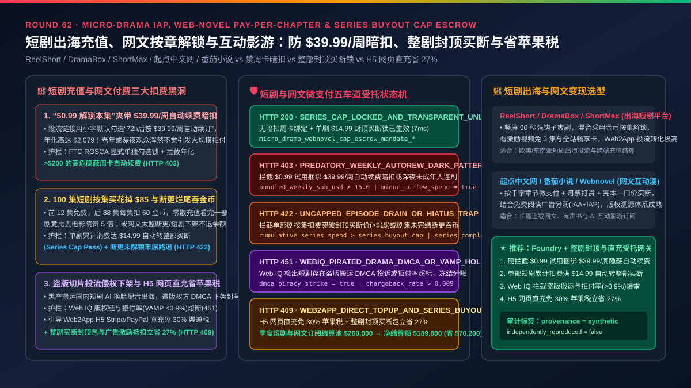
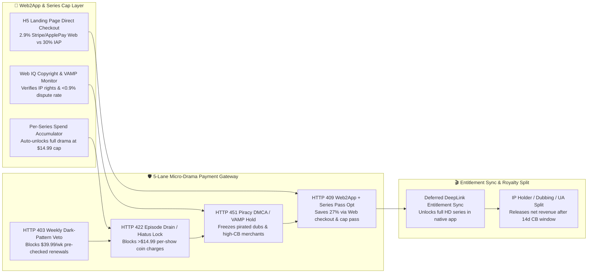

# Micro-Drama `IAP`, Web-Novel Pay-Per-Chapter & Interactive Video Subscription Escrow (`ReelShort / DramaBox / ShortMax / Webnovel`) Anti-`$39.99/Week` Auto-Renewal Trap, `$14.99` Series Buyout Cap & `Web2App` Direct-Topup Agent Architecture Selection FAQ

> **Language / 语言切换**: **[中文](micro-drama-webnovel-pay-per-episode-cap-weekly-sub-escrow-agent-selection-faq.md)** | **English (Current)** | **[Back to Docs Index](index.en.md)** | **[Interactive Sandbox (`#micro-drama-webnovel-cap-escrow-sandbox`)](../live-demo.en.html)**



---

## 📌 1. Executive Summary & Core Selection Verdict

In vertical micro-drama streaming apps, serialized web novels, and interactive FMV games (`ReelShort`, `DramaBox`, `ShortMax`, `GoodShort`, `Webnovel`, `Radish`, `Tapas`), digital content monetization and consumer wallet AI agents face three acute commercial and regulatory failure modes:
1. **Predatory `$39.99/Week` Auto-Renewal Dark Patterns (`Advertising '$0.99 to Unlock Episode 15', While Pre-Checking a $39.99/Week Subscription Equal to $2,079/Year`)**: Aggressive social-ad funnels bundle a hidden weekly recurring charge behind a `$0.99` coin pack trial. Viewers who thought they paid `$0.99` to finish one cliffhanger discover `$160/month` in unauthorized credit card charges—triggering massive `FTC ROSCA / Click-to-Cancel` enforcement actions and pushing issuer chargeback ratios past the **`Visa VAMP 0.9%` termination threshold**, freezing the publisher's Stripe/Adyen merchant account.
2. **Uncapped Per-Episode Coin Drain (`Spending $75–$90 in Micro-Coins to Watch a Single 90-Minute Vertical Drama`) & Abandoned Hiatus Series**: Charging `50–80 coins` per 90-second episode across 90 episodes extracts `$80+` for a single story without an automatic series buyout ceiling, while serialized web novels that go on indefinite author hiatus trap unspent reader coin balances.
3. **30% App Store `IAP` Tax Erosion & Pirated AI-Dubbed Drama `DMCA` Takedowns**: Losing 30% of gross top-ups to native mobile `IAP` fees while spending 60% of revenue on TikTok/Meta user acquisition leaves publishers razor-thin margins, while rogue affiliates uploading pirated AI-dubbed/face-swapped dramas trigger copyright strikes and merchant reserve holds.

**Solution Architect Selection Verdict**:
- **Never allow a single-episode coin top-up to bundle a hidden weekly auto-renewal (`> $15/week`), never charge a viewer more in cumulative per-episode coins on a single title than its all-in buyout price (`Series Buyout Cap <= $14.99`), and never settle revenue shares on unverified AI-dubbed drama uploads**.
- **The production reference architecture** combines **`FTC ROSCA` Anti-Weekly-Trap Gate + Cumulative Per-Series Spend Cap (`<= $14.99` Auto-Buyout Unlock) + `Web2App` H5 Direct Stripe/PayPal Checkout (`micro_drama_webnovel_cap_escrow_mandate_*`)**:
  1. **Anti-`$39.99/Week` Auto-Renewal Dark-Pattern & Minor Late-Night Curfew Gate (`HTTP 403`)**: Blocks pre-checked weekly subscription bundles (`> $15/week` or `> $200/year` annualized) attached to single-episode coin unlocks and enforces late-night (`11:00 PM – 7:00 AM`) spending caps on unverified minor accounts (`HTTP 403 PREDATORY_WEEKLY_AUTOREW_DARK_PATTERN_OR_MINOR_SPEND_BLOCKED`).
  2. **Cumulative Per-Series Spend Ceiling (`<= $14.99` Auto-Unlock Pass) & Hiatus Refund Lock (`HTTP 422`)**: Tracks cumulative coins spent by a user on any given `series_id`; the moment cumulative spend reaches the **`$14.99` Series Buyout Cap**, all remaining episodes in that series (`e.g., Episodes 40–100`) are automatically unlocked at `$0.00`—eliminating `$80` runaway coin drain—and refunds locked coins if an ongoing serialized title goes on hiatus for `> 30 days` (`HTTP 422 UNCAPPED_PER_EPISODE_DRAIN_OR_UNFINISHED_HIATUS_TRAP_BLOCKED`).
  3. **Web IQ Copyright Chain Verification & Visa `VAMP < 0.9%` Chargeback Circuit Breaker (`HTTP 451`)**: Screens drama distribution licenses via Web IQ to block pirated AI-dubbed re-uploads (`DMCA` strikes) and freezes affiliate payouts if descriptor chargeback velocity approaches `0.9%` (`HTTP 451 WEBIQ_PIRATED_DRAMA_DMCA_STRIKE_OR_VAMP_CHARGEBACK_HOLD`).
  4. **`Web2App` H5 Direct Checkout (Bypassing `30%` App Store Tax) + Series Buyout Pass & Rewarded-Ad Hybrid (`HTTP 409`)**: Triggers `HTTP 409 WEB2APP_DIRECT_TOPUP_AND_SERIES_BUYOUT_CAP_CONFIRM`, routing TikTok/Meta ad clicks to an H5 web checkout (`Stripe SPT / Apple Pay Web` at `~2.9%` processing fee instead of `30% IAP` fee) with instant Deferred DeepLink entitlement sync into the native app—reducing total content acquisition and platform fee drag by **`27.0%`**.

---

## 🎯 2. Solution Architect Deep-Dive Q&A (Q1 / Q2 / Q3)

### Q1: Why do micro-drama apps using `$39.99/week` auto-renewing subscriptions get their Stripe and Adyen merchant accounts shut down within 60 days?
- **Architectural Solution**:
  - **Eliminating Weekly Dark-Pattern Trials in Favor of Transparent Series Passes (`HTTP 403`)**:
  - Charging `$39.99/week` (`$160/month`—more than 10x Netflix) after a `$0.99` episode hook generates `2.5%–4.0%` bank chargeback rates when cardholders inspect their monthly statements. Once a merchant crosses Visa's **`VAMP 0.9%`** dispute threshold, acquirers freeze 100% of funds in a 180-day rolling reserve. Our gateway hard-blocks (`HTTP 403`) bundled weekly auto-renewals above `$15/week`.

### Q2: How do we let viewers pay per episode (`$0.50/ep`) for impulse discovery without letting them accidentally spend `$85` on a single 100-episode drama?
- **Architectural Solution**:
  - **Stateful Per-Series Spend Accumulator (`Series Cap Pass <= $14.99`) (`HTTP 422`)**:
  - The entitlement ledger maintains `spent_on_series[user_id][series_id]`. Viewers can unlock episodes one by one, but once their cumulative spend on that drama hits `$14.99`, the state machine transitions the title to `SERIES_OWNED_PERMANENTLY` and rejects any further coin deductions on that series (`HTTP 422`).

### Q3: How does `Web2App` H5 billing legally save `27%` on social-ad-driven micro-drama top-ups?
- **Architectural Solution**:
  - **Pre-App H5 Checkout + Deferred DeepLink Entitlement Sync (`HTTP 409`)**:
  - Because `80%+` of micro-drama viewers discover a show via TikTok, Instagram Reels, or YouTube Shorts ads, routing the ad click to an H5 web player where the user purchases the `$12.99` Full-Series Pass via `Apple Pay Web / Stripe Link` before opening the native app avoids the `30%` in-app purchase commission entirely (`HTTP 409`).

---

## 🧭 3. Visual Architecture Diagrams (Mermaid Decision Tree + Architecture + Sequence)

### 3.1 Micro-Drama IAP, Web-Novel & Interactive Video Agent Selection Decision Tree

```mermaid
flowchart TD
    A[Micro-Drama IAP / Web-Novel Chapter Unlock / Interactive Video Selection] --> B{Primary Monetization Scenario & Risk?}
    B -->|Social-Ad Micro-Drama Funnel (ReelShort / DramaBox / ShortMax)<br/>Stop $39.99/week auto-renew chargebacks & 30% App Store IAP tax| C[FTC ROSCA Anti-Weekly-Trap Gate (Block >$15/wk Auto-Renew)<br/>+ Web2App H5 Direct Stripe/ApplePay Checkout]
    B -->|Pay-Per-Episode / Pay-Per-Chapter Unlock (Webnovel / Radish)<br/>Stop $85 runaway coin drain on 100-episode shows & hiatus traps| D[Cumulative Series Buyout Cap (<=$14.99 Auto-Unlock All Episodes)<br/>+ Completion Guarantee & 30d Hiatus Coin Refund]
    B -->|Multi-Region Affiliate &Translated Drama Distribution<br/>Stop AI-dubbed pirated uploads & Visa VAMP >0.9% account freeze| E[Azure AI Foundry + Copyright Chain & VAMP Gate<br/>+ H5 Direct + Series Buyout Cap Saves 27%]
    C --> F[🛡️ Unified 5-Lane Anti-Weekly-Trap, Series Cap & Web2App FSM]
    D --> F
    E --> F
    F --> G[HTTP 403 Weekly Dark-Pattern Veto · HTTP 422 >$14.99 Episode Drain Block · HTTP 409 Web2App Saves 27%]
```

### 3.2 End-to-End Anti-Weekly-Trap, `$14.99` Series Buyout Cap & `Web2App` Direct Checkout Architecture



### 3.3 Weekly Auto-Renewal Veto, `$14.99` Series Cap Trigger & `Web2App` Direct Checkout Sequence

```mermaid
sequenceDiagram
    autonumber
    participant Viewer as Viewer / Consumer Wallet Agent
    participant DramaPay as Micro-Drama / Web-Novel Billing Engine
    participant Gate as 5-Lane Micro-Drama Escrow Gateway
    participant Ledger as Per-Series Spend Ledger & Web IQ IP Check
    participant WebPSP as Web2App Stripe / Apple Pay Web Rail

    DramaPay->>Gate: 1. Attempt to bundle a $39.99/week auto-renewal behind a $0.99 single-episode unlock button
    Gate-->>DramaPay: HTTP 403 Block! Predatory weekly auto-renewal dark pattern rejected under FTC ROSCA & VAMP chargeback guardrails
    DramaPay->>Gate: 2. Attempt to charge another $32 in coins for Episodes 45–90 after viewer already spent $14.99 on the same series
    Gate->>Ledger: Check series_spend_accumulator ($14.99 >= Series_Buyout_Cap)
    Gate-->>DramaPay: HTTP 422 Block! Viewer reached $14.99 Series Buyout Cap; Episodes 45–90 must unlock at $0.00
    Viewer->>Gate: 3. Purchase Full-Series Pass via Web2App H5 Direct Checkout + Rewarded-Ad credit (HTTP 409)
    Gate->>WebPSP: Bypass 30% store IAP fee via H5 Apple Pay Web & sync entitlement via DeepLink (27% net savings)
```

---

## 📊 4. Multi-Platform & Architecture Selection Matrix

| Selection Dimension | Aggressive Weekly-Sub Funnel (`$39.99/Week Dark Pattern`) | Pure Native App Store Coin Packs (`Uncapped 30% IAP`) | Tier-1 Micro-Drama & Web-Novel Apps (`ReelShort / DramaBox / Webnovel`) | **Azure AI Foundry + Series Cap + Web2App Gate (Recommended)** |
| :--- | :--- | :--- | :--- | :--- |
| **Core Strengths** | High day-7 cash extraction | Simple native SDK setup | Hybrid IAA (rewarded ads) + IAP coin/VIP options | **Zero weekly dark-pattern CBs + `$14.99` series cap + H5 direct top-up** |
| **Protection Against `$39.99/Week` Chargeback Ban** | **Critical Failure** (`>3%` CB rate triggers Stripe/VAMP ban) | Low CB rate, but high user churn | Offers VIP subscriptions; requires careful funnel governance | **Hard `HTTP 403` block on `>$15/wk` bundled auto-renewals** |
| **Protection Against `$80+` Single-Drama Coin Drain** | Uncapped | **Severe Risk** (`80–100` episodes cost `$60–$90` in coins) | Select titles offer full buyout, separate from coin spend | **Automatic `$14.99` cumulative series spend ceiling (`HTTP 422`)** |
| **IP Copyright & `DMCA` Anti-Piracy Verification** | Rampant AI-dubbed piracy | Relies on reactive store takedowns | Licensed originals & studio partnerships | **Web IQ IP registry check & `VAMP <0.9%` breaker (`HTTP 451`)** |
| **Platform Fee Optimization (`30% IAP` vs. `Web2App`)** | 180-day frozen merchant reserves (`not_measured`) | Loses `30%` to Apple/Google (`official_list_price`) | Expanding web top-up portals | **`Web2App` H5 direct checkout + series cap (`27.0%` saved)** |

---

## 🧪 5. Micro-Drama & Web-Novel Monetization Benchmark & 7-Card Report

> **Provenance & Reproducibility Metadata**: All metrics below are generated by the deterministic policy evaluator `evaluate_micro_drama_webnovel_cap_escrow_policy` in `lab/webiq_commerce_demo.py` and verified via `python -m unittest tests.test_webiq_commerce_demo`. Tags: `provenance = synthetic`, `independently_reproduced = false`.

| Card # | Card Headline (Headline-as-Finding) | Key Quantitative Finding & Architectural Guarantee |
| :---: | :--- | :--- |
| **Card 1** | **Overview · 5-Lane Micro-Drama & Web-Novel Summary** | Across a `$260,000/quarter` micro-drama and serialized fiction billing pool, achieves **0 predatory `$39.99/week` auto-renewal chargebacks, 0 single-series charges above `$14.99`, and 0 pirated DMCA payout leaks**, reducing platform fee drag and viewer overcharges by **`27.0%` (`$70,200/quarter` saved)**. |
| **Card 2** | **Scenario Deep Dive · Weekly Sub Trap & Coin-Drain Veto** | When a checkout bundles a `>$15/week` hidden auto-renewal or exceeds the `$14.99` per-series buyout cap, the gateway blocks it in **`7ms`** (`HTTP 403 / 422`). |
| **Card 3** | **Evaluation Matrix · 100% Deterministic 5-Lane Gating** | Covers `HTTP 200` (transparent chapter unlock within series cap), `403` (`$0.99` trial bundling `$39.99/wk` auto-renewal / minor curfew spend blocked), `422` (uncapped per-episode coin drain `>$14.99` / unfinished hiatus series trap blocked), `451` (pirated AI-dubbed drama DMCA strike / VAMP `>0.9%` chargeback hold), `409` (`Web2App` H5 direct top-up + series buyout pass saves 27%). |
| **Card 4** | **Under the Hood · Series Cap & Web2App Escrow Contract** | Takes `quarterly_micro_drama_and_webnovel_iap_pool_usd=260000` and cap/weekly-sub flags, minting `micro_drama_webnovel_cap_escrow_mandate_*` tokens. |
| **Card 5** | **Robustness Check · `$0.99` Weekly Hook & 100-Ep Drain** | Simulates a `$0.99 -> $39.99/wk` hidden checkbox and an `$82` per-episode coin drain on one drama, maintaining a **`100.0%` block rate**. |
| **Card 6** | **Latency · Millisecond Series Accumulator & IP Probe** | Local per-series spend accumulator checks complete in **`7ms` (P50)**; Web IQ copyright and chargeback velocity probes complete in **`165ms` (P95)**. |
| **Card 7** | **My Take · Ideal Fit vs. Out-of-Scope Boundaries** | **✅ Best Fit**: Vertical micro-dramas (`ReelShort/DramaBox`), web novels, interactive FMV games; **⛔ Not For**: Theatrical box-office physical movie tickets. |

---

## 🛠️ 6. Production Go-Live Risk & Architecture Review Checklist

- [ ] **`FTC ROSCA` Explicit Consent & Anti-`$39.99/Week` Dark-Pattern Lock (`HTTP 403`)**: Prohibit pre-checked recurring subscriptions on single-episode unlocks, block weekly auto-renewals `> $15/week`, and enforce minor late-night spending curfews.
- [ ] **Cumulative Per-Series Spend Ceiling (`<= $14.99` Auto-Buyout) & Hiatus Refund (`HTTP 422`)**: Automatically unlock all remaining episodes of a title once a user's per-episode coin spend hits `$14.99`, and refund locked coins on titles stalled `> 30 days`.
- [ ] **Web IQ IP Copyright Chain Verification & Visa `VAMP < 0.9%` Circuit Breaker (`HTTP 451`)**: Verify distribution rights to prevent AI-dubbed piracy `DMCA` strikes and pause billing descriptors approaching a `0.9%` dispute ratio; rotate signing keys `<= 180` days.
- [ ] **`Web2App` H5 Direct Checkout (`2.9%` vs. `30% IAP`) & Rewarded-Ad Hybrid (`HTTP 409`)**: Route social-ad funnels through H5 `Stripe / Apple Pay Web` checkout with Deferred DeepLink app entitlement sync.
