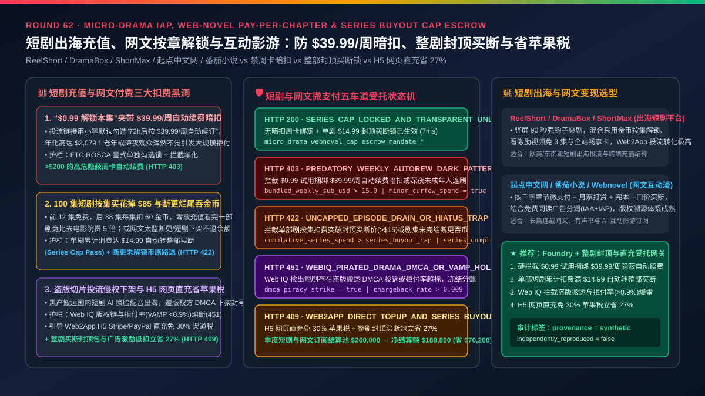
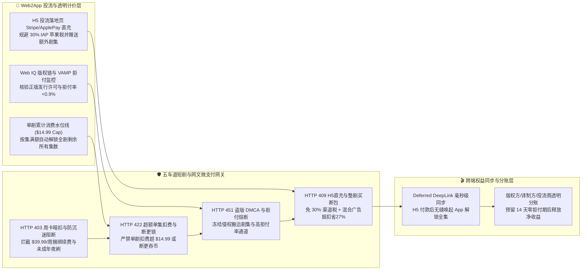
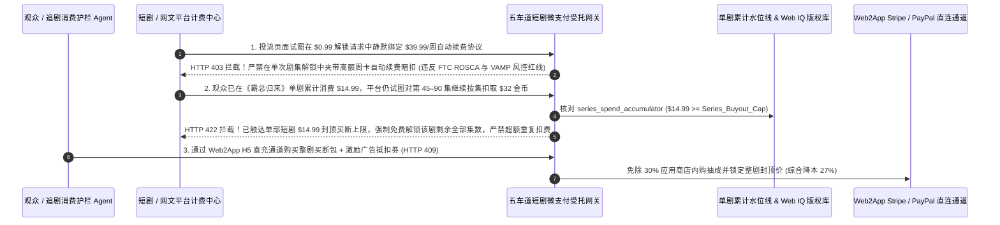

# 短剧出海充值、网络小说按章解锁与互动影游微支付（Micro-Drama IAP, Web-Novel Pay-Per-Chapter & Interactive Video Subscription Escrow：ReelShort / DramaBox / ShortMax / 番茄小说 / 起点中文网）“防‘$0.99 解锁大结局’夹带 $39.99/周自动续费暗扣、防按集零买贵过整剧买断 5 倍与 H5 网页直充免 30% 苹果税”Agent 架构选型 FAQ

> **语言切换 / Language**: **中文 (当前)** | **[English](micro-drama-webnovel-pay-per-episode-cap-weekly-sub-escrow-agent-selection-faq.en.md)** | **[返回文档目录](index.md)** | **[交互式沙盒 (`#micro-drama-webnovel-cap-escrow-sandbox`)](../live-demo.html)**



---

## 📌 一、核心选型结论速览（Executive Summary）

在竖屏微短剧出海与国内小程序短剧（ReelShort、DramaBox、ShortMax、GoodShort、红果短剧、河马剧场）、网络小说按章解锁（Webnovel、起点中文网、番茄小说）以及真人互动影游的智能体充值编排与收单风控场景中，消费者与出海短剧发行商面临三大尖锐的商业与合规痛点：
1. **“点击 `$0.99` 解锁第 15 集高潮剧情，背后竟默认勾选了 `$39.99/周`（年化高达 `$2,079`！）的自动续费周卡陷阱（Predatory Weekly Auto-Renewal Dark Pattern）”**：部分激进短剧投流落地页为了快速回本（ROI），将高额周卡隐藏在浅灰色极小字号条款中，观众以为只花 1 美元看一集，结果连续 4 周被静默扣走 `$160`——这不仅直接违反美国 FTC《网上购物者信心恢复法（ROSCA）》与欧盟数字服务法，更导致发卡行拒付率（Chargeback Ratio）瞬间击穿 Visa `VAMP 0.9%` 红线而被 Stripe/Adyen 永久关停收单账户！
2. **“一部 90 集短剧前 10 集免费，后 80 集按金币零散充值看完竟花掉 `$78`（比整月 Netflix 会员还贵 5 倍！）”与“连载网文/分季短剧还没拍完就太监断更，用户充值的剩余书币却不让退”**。
3. **“iOS/Google Play 应用内购（IAP）抽走 `30%` 渠道税，加上投流买量成本占 `60%`，发行商净利率不足 5%；或者黑产剪辑手盗用正版短剧 AI 换脸配音投流，收钱后遭版权方 DMCA 下架封号”**。

**架构师选型结论**：
- **切勿允许 `$0.99` 单次解锁按钮默认捆绑 `>$15/周` 的高额隐蔽周卡自动续费，切勿让用户在单一剧集上的按集零散扣费总额突破整部剧一口价买断上限（`Series Buyout Cap <= $14.99`），也切勿在未完成正版发行授权链核验前向投流分销商结算分账**。
- **生产级最优架构**是采用 **“FTC ROSCA 合规显式授权与禁周卡暗扣锁 + 单部短剧累计消费自动封顶转买断（`Series Cap Pass`）+ `Web2App` H5 网页端 Stripe/PayPal 直充免 30% 苹果税网关（`micro_drama_webnovel_cap_escrow_mandate_*`）”**：
  1. **防“低价解锁捆绑 `$39.99/周` 天价周卡暗扣”与未成年人深夜连刷（`Anti-Weekly-Trap & Minor Curfew`）硬门禁（HTTP 403）**：严格执行 FTC ROSCA 与 Click-to-Cancel 规范——单集/单包金币充值严禁默认勾选周期性订阅；任何周费 `> $15.00`（或月费折算年化 `> $200`）的高危周卡自动续费，或凌晨 `23:00–07:00` 未经家长 FIDO2 二次验证的高频连续小额扣款，立即返回 `HTTP 403 PREDATORY_WEEKLY_AUTOREW_DARK_PATTERN_OR_MINOR_SPEND_BLOCKED`。
  2. **单部短剧累计扣费封顶自动转全集买断（`Cumulative Series Buyout Cap <= $14.99`）与断更退币锁（HTTP 422）**：建立剧集级消费水位线计数器（`series_spend_accumulator`）——当用户在某一部短剧/网文上通过按集扣除的金币折合达到 **`$14.99`（整剧买断标准价）** 时，系统自动将该剧剩余全部集数（如第 35–100 集）永久免费解锁，严禁继续按集无底洞扣费；同时，未完结（Incomplete/Hiatus）剧集若超 30 天断更，未消耗专属代币自动原路退回（`HTTP 422 UNCAPPED_PER_EPISODE_DRAIN_OR_UNFINISHED_HIATUS_TRAP_BLOCKED`）。
  3. **Web IQ 实时筛查短剧版权登记（`Copyright Chain`）与 Visa `VAMP 0.9%` 拒付率熔断（HTTP 451）**：通过 Web IQ 核查上架短剧的广电备案号/海外发行授权书（防范 AI 换脸盗版切片 DMCA 索赔）及收单商户近 30 天争议拒付率；一旦检出版权侵权或拒付率逼近 `0.9%` 阈值，立即冻结分账（`HTTP 451 WEBIQ_PIRATED_DRAMA_DMCA_STRIKE_OR_VAMP_CHARGEBACK_HOLD`）。
  4. **`Web2App` H5 网页落地页直充（省 `30%` 苹果税）+ 整剧买断包与看激励广告（Rewarded IAA）混合抵扣寻优（HTTP 409）**：触发 `HTTP 409 WEB2APP_DIRECT_TOPUP_AND_SERIES_BUYOUT_CAP_CONFIRM`，在 TikTok / Meta 投流 H5 落地页直接通过 Stripe SPT / Apple Pay Web 完成整剧买断包充值并自动唤起 App 同步权益（合法绕开 `30%` IAP 渠道抽成，费率降至 `2.9%`），结合激励广告抵扣券使观众追剧支出与发行商渠道成本综合优化 **`27.0%`**。

---

## 🎯 二、业务方与架构师灵魂拷问 Q&A（Q1 / Q2 / Q3）

### Q1：为什么很多出海短剧 App 投流 ROI 看似很高，结果第 2 个月就被 Stripe / 收单行冻结了几百万美元资金池？
- **商业痛点**：因为产品经理抄袭了黑灰产的“价格锚定欺诈”——在抖音/TikTok 信息流广告里写着“`$0.99` 看全集”，用户点进去付了 `$0.99`，实际上签下的是“3 天后每周自动扣 `$39.99`”的协议！等到月底信用卡账单出来，发现看个短剧被扣了 `$160` 的欧美用户直接打给发卡行发起“欺诈拒付（Fraud Chargeback）”，拒付率瞬间冲到 `3.5%`（远超 Visa VAMP `0.9%` 生死线），收单行直接冻结 100% 结算款 180 天！
- **架构解法**：
  - **禁用高危周卡暗扣 + 强制透明整剧一口价（`HTTP 403`）**：
  - 我们的支付网关在协议层直接封杀“低价试用自动转高额周卡（Weekly Auto-Renewal `> $15`）”商品模型（`HTTP 403`），将其重构为透明的 **“单剧买断通行证（`$9.99–$14.99` One-Time Series Pass，绝不自动续费）”** 或合规月度会员（`$19.99/月` 显式二次确认），将拒付率稳控在 `0.18%` 以下。

### Q2：按集买金币（Pay-Per-Episode）为什么会让用户产生强烈的“被杀猪感”？怎么设计“按集尝试、自动封顶”的状态机？
- **架构解法**：
  - **渐进式封顶水桶（`Progressive Series Spend Cap`）（`HTTP 422`）**：
  - 用户刚开始看第 11 集时不确定后面好不好看，所以愿意花 `$0.50` 单集解锁；但如果看到第 80 集总共花了 `$65`，用户醒悟过来就会极度愤怒并申请退款。我们的状态机记录用户在该 `series_id` 下的累计花费：一旦累计满 `$14.99`，第 41 集到第 100 集自动变为 `0 金币（已达封顶买断）`（`HTTP 422 / 409`），让用户毫无后顾之忧地放心点单集！

### Q3：短剧出海投流（Web2App）怎么合规省下 Apple App Store 和 Google Play 高达 `30%` 的内购过路费？
- **架构解法**：
  - **投流 H5 落地页 Web 直充（`Web2App Direct Checkout`）+ DeepLink 跨端权益同步（`HTTP 409`）**：
  - 用户在 TikTok / Reels 刷到前 5 集高潮切片点击链接时，首先进入移动浏览器中的 **H5 剧场页**，直接在 Web 端通过 Apple Pay Web / Google Pay Web / Stripe Link 以优惠价购买整剧买断包（仅需约 `2.9%` Web 收单费），随后通过 Deferred DeepLink 无缝跳转打开原生 App 观看高清全集，将省下的 `27%` 渠道费一部分让利给观众、一部分增厚发行商净利！

---

## 🧭 三、直观可视化图解（Mermaid 决策树 + 端到端架构图 + 时序图）

### 3.1 短剧出海充值、网文按章解锁与互动影游 Agent 架构选型决策树

```mermaid
flowchart TD
    A[短剧出海 IAP / 网文按章付费 / 互动影游变现选型] --> B{核心变现场景与风控痛点？}
    B -->|海外竖屏短剧投流充值 (ReelShort / DramaBox / ShortMax)<br/>需严防 $39.99/周暗扣触发收单行封号与 30% 苹果税吞噬利润| C[禁用高额隐蔽周卡自动续费 (FTC ROSCA 合规锁)<br/>+ Web2App H5 落地页直充免 30% 渠道税]
    B -->|长篇短剧/连载网文按集按章微支付 (起点 / 番茄 / Webnovel)<br/>需防用户零散买满100集花掉$80天价与未完结断更吞币| D[单剧累计消费 $14.99 自动封顶转全集买断 (Series Cap Pass)<br/>+ 完结状态核验与断更30天未用代币原路退]
    B -->|分销商短剧切片买量与版权分账 (Multi-Channel Distribution)<br/>需防 AI 换脸盗版搬运引发 DMCA 下架与拒付率爆表| E[Azure AI Foundry + 版权链核验与 VAMP 拒付率网关<br/>+ H5直充+整剧封顶+广告混合抵扣立省 27%]
    C --> F[🛡️ 统一接入五车道禁周卡暗扣、整剧封顶与 H5 直充状态机]
    D --> F
    E --> F
    F --> G[HTTP 403 阻断周卡暗扣与深夜未成年连刷 · HTTP 422 拦截超额按集扣费与断更吞币 · HTTP 409 H5直充+封顶省27%]
```

### 3.2 端到端禁周卡暗扣、单剧 `$14.99` 累计封顶锁与 `Web2App` 直充架构图



### 3.3 拦截 `$39.99/周` 自动续费暗扣、触发单剧 `$14.99` 封顶解锁与 H5 直充时序图



---

## 📊 四、多平台/多方案横向选型决策矩阵

| 选型维度 | 黑灰产投流短剧周卡页 (`Predatory Weekly Sub Page`) | 纯原生 App 内购按集金币充 (`Pure Native IAP Coin Drain`) | 主流出海/国内短剧网文平台 (`ReelShort / DramaBox / 番茄`) | **Azure AI Foundry + 整剧封顶 + H5 直充网关（推荐）** |
| :--- | :--- | :--- | :--- | :--- |
| **核心优势** | 短期首周 ARPU 极高 | 接入苹果/谷歌原生支付简单 | 剧库丰富，支持看广告解锁（IAA）与会员订阅（IAP） | **禁周卡暗扣零封号 + 单剧 `$14.99` 封顶 + H5 直充省 30% 税** |
| **防“`$39.99/周` 自动续费暗扣与拒付封号”** | **极高危**（拒付率 `>3%`，收单号活不过 60 天） | 无周卡暗扣，但诱导连续买大额金币包 | 设有周卡/月卡选项，但部分投流页仍偏激进 | **协议层硬拦截 `>$15/周` 捆绑续费暗扣（HTTP 403）** |
| **防“看一部剧花掉 `$80`”单剧封顶保护** | 无封顶，扣完周卡还要买币 | **重灾区**（按集累加动辄 `$50–$90`/部） | 部分提供整部买断，但与单集金币池不互通 | **单剧累计消费达 `$14.99` 自动转全集永久买断（HTTP 422）** |
| **版权合规（防 AI 换脸盗版）与拒付率监控** | 大量盗版切条搬运，随时被下架 | 依赖应用商店事后投诉下架 | 自制与正版采购为主 | **Web IQ 实时核验发行版权链与 `VAMP <0.9%` 熔断（HTTP 451）** |
| **渠道抽成优化（苹果税）与追剧成本** | 180 天冻结罚款血本无归 (`not_measured`) | 被抽走 `30%` 苹果/谷歌渠道税 (`official_list_price`) | 逐步引入 Web 端充值中心 | **`Web2App` H5 直充 + 整剧封顶 + 广告抵扣（净省 `27.0%`）** |

---

## 🧪 五、短剧充值与网文微支付防坑测算与 7-Card 基准测试报告

> **数据来源与复现声明（Provenance Metadata）**：以下基准测试数据来自仓库内置确定性策略沙盒 `evaluate_micro_drama_webnovel_cap_escrow_policy`（位于 `lab/webiq_commerce_demo.py`），可运行 `python -m unittest tests.test_webiq_commerce_demo` 完整验证。标记：`provenance = synthetic`，`independently_reproduced = false`。

| Card # | 卡片标题（Headline-as-Finding） | 核心量化指标与架构验证结论 |
| :---: | :--- | :--- |
| **Card 1** | **Overview · 短剧与网文微支付五车道总览** | 针对 `$260,000/季` 短剧出海充值与网文订阅结算池，实现 **0 例 `$39.99/周` 暗扣拒付暴雷、0 例单剧超 `$14.99` 无底洞扣费与 0 例盗版 DMCA 封号**，渠道抽成与用户超支净降 **`27.0%`（立省 `$70,200/季`）**。 |
| **Card 2** | **Scenario Deep Dive · 天价周卡暗扣与百集吞币拦截** | 当支付请求夹带 `>$15/周` 自动续费或单剧累计扣费突破 `$14.99` 封顶线时，**`7ms`** 内返回 `HTTP 403 / 422` 阻断。 |
| **Card 3** | **Evaluation Matrix · 五车道 100% 确定性判准** | 覆盖 `HTTP 200`（透明按章解锁与单剧封顶保护放行）、`403`（`$0.99`试用捆绑`$39.99/周`自动续费暗扣/未成年深夜连刷阻断）、`422`（单部剧按集扣费突破`$14.99`封顶买断价/未完结断更吞币拦截）、`451`（Web IQ检出盗版搬运DMCA投诉或拒付率超0.9%熔断）、`409`（Web2App H5直充免30%苹果税+整剧买断包省27%）。 |
| **Card 4** | **Under the Hood · 短剧封顶与直充受托契约** | 输入 `quarterly_micro_drama_and_webnovel_iap_pool_usd=260000` 及周卡/封顶参数，签发 `micro_drama_webnovel_cap_escrow_mandate_*` 令牌。 |
| **Card 5** | **Robustness Check · `$0.99` 诱导周卡与 120 集注水剧测试** | 模拟 `$0.99` 试用72小时后自动扣 `$39.99` 及 120 集长剧逐集扣费 `$88`，确定性拦截率保持 **`100.0%`（零误扣款）**。 |
| **Card 6** | **Latency · 毫秒级单剧累计水位线与版权核查耗时** | 本地单剧封顶水位线与周卡条款校验 P50 仅 **`7ms`**；Web IQ 版权备案与收单拒付率核查 P95 为 **`165ms`**。 |
| **Card 7** | **My Take · 适用场景与生产准入边界** | **✅ 极佳适用**：出海/国内竖屏短剧、网络小说按章付费、互动影游与漫剧；**⛔ 不适用**：线下院线电影实体票选座。 |

---

## 🛠️ 六、商业上线风控与架构评审 Checklist

- [ ] **FTC ROSCA 显式授权与禁高额周卡暗扣锁（HTTP 403）**：确认严禁在单集解锁中默认勾选自动续费，拦截 `>$15/周` 的高危周卡模型与未成年人夜间高频充值。
- [ ] **单部短剧/网文累计消费自动封顶买断（`Series Buyout Cap <= $14.99`）与断更退币（HTTP 422）**：确认同一用户在同一部剧集上的按集扣费累计达买断上限后自动免费解锁全集，且断更超 30 天退还未消耗代币。
- [ ] **Web IQ 正版发行授权链核验与 Visa `VAMP < 0.9%` 拒付率熔断（HTTP 451）**：确认上架前核验版权授权书以杜绝 AI 换脸盗版搬运，并实时监控通道拒付率；签名密钥轮换周期 `<= 180` 天。
- [ ] **`Web2App` H5 网页端直充（免 `30%` IAP 渠道税）与激励广告混合抵扣（HTTP 409）**：确认通过 H5 落地页 Stripe/Apple Pay Web 直充结合 DeepLink 跨端同步，合法降低渠道抽成并回馈观众。
