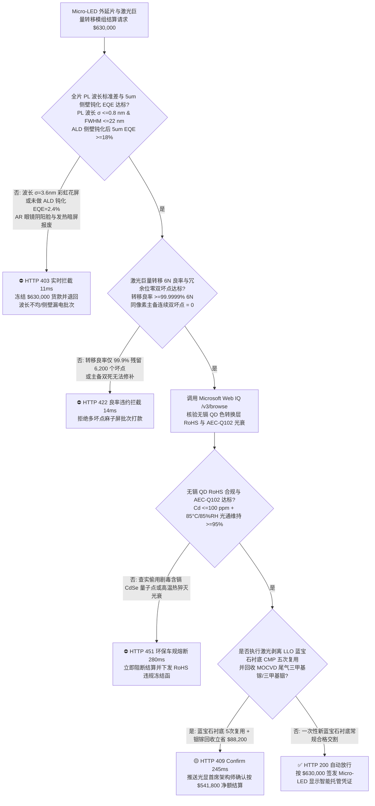
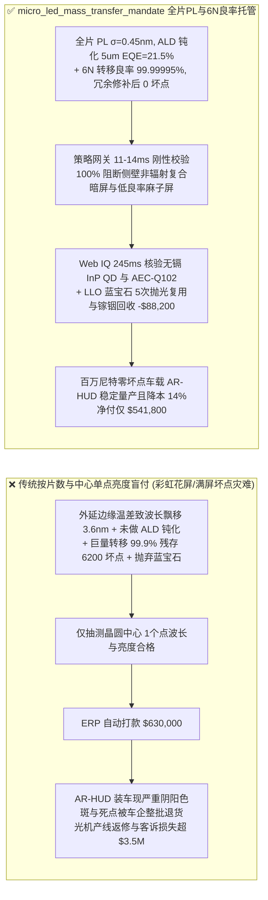
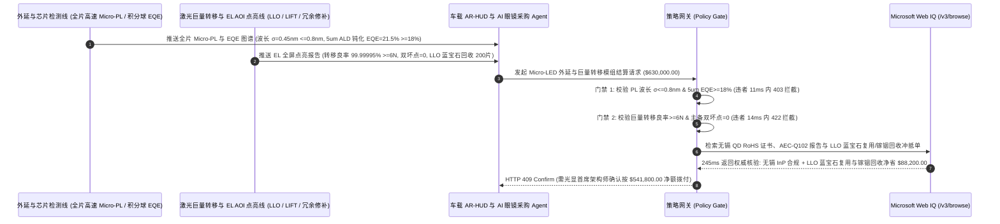

# 车载 AR-HUD 与 AI 智能眼镜 Micro-LED 外延片及激光巨量转移交割（Micro-LED GaN/InGaN Epi-Wafer, QD Color Conversion & Laser Mass Transfer Offtake）、光致发光波长标准差与侧壁钝化外量子效率门禁（全片 PL $\sigma_{\lambda} \le 0.8\text{ nm}$ & $5\ \mu\text{m}$ 像素 ALD $\text{Al}_2\text{O}_3$ 钝化 $\text{EQE} \ge 18\%$ 防尺寸效应效率悬崖）与 6N 巨量转移良率/零连续双坏点（$\ge 99.9999\%$ & 双坏点 $= 0$）/ 蓝宝石衬底激光剥离（LLO）抛光五次复用与 MOCVD 铟镓尾气闭环智能托管 vs 传统仅按外延片张数与中心单点亮度盲付：架构选型与第一性原理 FAQ

> **阅读指南**：本文面向智能汽车百万尼特（$\ge 1,000,000\text{ nits}$）全挡风玻璃 AR-HUD、轻量化全彩 AI 智能眼镜（Waveguide + Micro-LED 光机）、大尺寸无缝拼接透明屏主机厂、GaN-on-Sapphire / GaN-on-Si 外延厂及激光巨量转移（Laser Lift-Off & Laser-Induced Forward Transfer, LLO/LIFT）模组代工厂智能体架构师。遵循《IB vs Ethernet RoCE 选型 FAQ》的透明核算规范，从**氮化铟镓（$\text{In}_x\text{Ga}_{1-x}\text{N}$）多量子阱 MOCVD 生长盘温差引发的组分偏析波长红移（Mura 色斑）、微缩至 $5\ \mu\text{m}$ 时比表面积暴增导致的肖克利-里德-霍尔（Shockley-Read-Hall, SRH）表面侧壁非辐射复合效率坍塌、207 万像素 $99.9\%$ 良率仍残留 6,200 个坏点的统计灾难以及准分子激光剥离（LLO）蓝宝石衬底 CMP 二次外延再生力学**出发，用大白话与第一性原理彻底讲透：为什么显示与车载采购智能体绝对不能“见外延与模组厂交来 200 片 Micro-LED 晶圆且晶圆中心单点抽测亮度达标就自动打款 `$630,000.00`”，以及如何通过 **`micro_led_mass_transfer_mandate`（全片 PL 波长标准差、ALD 侧壁钝化 EQE、6N 巨量转移良率与蓝宝石衬底复用闭环托管凭证）** 实现毫秒级防阴阳花屏/暗斑废片拦截与降本结算。

---

## 📌 1. 核心结论速览（Executive Summary）

1. **大白话常识破除——把一颗普通 LED 灯珠从 $300\ \mu\text{m}$ 缩小到头发丝二十分之一的 $5\ \mu\text{m}$（Micro-LED），物理规律会发生彻底叛变：第一，干法刻蚀切出 $5\ \mu\text{m}$ 台面时，刀口边缘的悬挂键占比暴增 60 倍，注入的电子和空穴还没来得及发光就全在侧壁缺陷里“无声无息地转化成热量死掉了”（侧壁非辐射复合，导致发光效率 EQE 暴跌 85%）；第二，一块 1080P 全彩屏幕有 622 万颗微米芯片，哪怕巨量转移良率做到看似很高的 $99.9\%$（3 个 9），屏幕上依然会密密麻麻残留下 6,220 个瞎眼死点，整块屏幕直接沦为电子垃圾**：
   - Micro-LED 凭借超百万尼特亮度、无机材料零烧屏与纳秒级响应，是穿透强阳光的车载 AR-HUD 与全天候 AI 眼镜的终极光引擎。
   - **传统按“外延片张数 + 晶圆中心单点亮度抽检”盲付的三大致命工程灾难**：
     - **灾难一：MOCVD 石墨托盘边缘温度仅偏差 $1.5^\circ\text{C}$ 导致外延片主峰波长标准差失控（$\sigma_{\lambda} = 3.6\text{ nm} > 0.8\text{ nm}$），或省略原子层沉积（ALD $\text{Al}_2\text{O}_3$）侧壁化学钝化导致 $5\ \mu\text{m}$ 像素外量子效率崩塌（$\text{EQE} = 2.4\% < 18\%$）**：人眼对绿光/蓝光 $2\text{ nm}$ 的波长差异极其敏感！外延片中心测出来是标准 $525\text{ nm}$ 绿光，边缘却是 $534\text{ nm}$ 黄绿光，转移到眼镜微显示屏上就是触目惊心的“彩虹阴阳脸（Color Mura）”；同时，若为省工序不做 KOH 湿法去损伤加 ALD 氧化铝侧壁钝化，$5\ \mu\text{m}$ 芯片全靠狂加电流硬撑亮度，开机半小时就过热光衰报废！
     - **灾难二：激光巨量转移（Mass Transfer）良率仅达 $99.9\%$（3N）而非 $99.9999\%$（6N），或同一像素格内的主备冗余位同时转移失败（相邻连续双坏点 $>0$）导致激光修补机无法救活**：在半导体芯片里 $99.9\%$ 是极高良率，但在 622 万颗子像素的 Micro-LED 面板上，$99.9\%$ 意味着 6,220 颗坏点，激光单颗点修需要耗时数小时、修补成本比买块新屏还贵！必须死守 **6N（$99.9999\%$，每百万颗仅 $\le 1$ 颗缺陷）** 且绝对禁止主备冗余焊盘同时失效！
     - **灾难三：量子点色转换层（QDCC）违规使用剧毒含镉硒化镉（$\text{CdSe} > 100\text{ ppm}$）违反欧盟 RoHS 指令，且激光剥离（LLO）后的昂贵图形化蓝宝石衬底（PSS）当废玻璃扔掉**：单片 6 英寸高品质 PSS 蓝宝石衬底极其昂贵，且 MOCVD 反应腔中高达 $70\%$ 的三甲基铟（TMIn）/三甲基镓（TMGa）随尾气排空浪费。
2. **架构师刚性门禁（`micro_led_mass_transfer_mandate`）**：
   - **全晶圆 Micro-PL 波长标准差与 ALD 侧壁钝化外量子效率硬门禁（$\sigma_{\lambda} \le 0.8\text{ nm}$ & $5\ \mu\text{m}$ $\text{EQE} \ge 18\%$）**：每批交割外延与芯片必须经高速显微光致发光（Micro-PL Mapping）全片扫描确证 **主峰波长标准差 $\sigma_{\lambda} \le 0.8\text{ nm}$、半高宽 $\text{FWHM} \le 22\text{ nm}$，且经 TMAH/KOH 各向异性化学去损伤与 ALD $\text{Al}_2\text{O}_3/\text{SiN}_x$ 钝化后 $5\ \mu\text{m}$ 台面实测峰值外量子效率 $\text{EQE} \ge 18\%$**；凡波长离散花屏或未钝化低效批次，网关在 **`11 ms`** 内直返 **`HTTP 403`**（`PL_WAVELENGTH_BIN_DISPERSION_OR_SIDEWALL_SHOCKLEY_READ_HALL_BLOCKED`）。
   - **6N（$\ge 99.9999\%$）激光巨量转移良率与主备冗余位零连续双坏点门禁（双坏点 $= 0$）**：强制校验 **电致发光（EL）AOI 全屏点亮检测转移良率 $\ge 99.9999\%$（6N），且经冗余电路激活用激光修补后全屏坏点 $= 0$（修补前同像素主备双死点 $= 0$）**；凡转移掉晶达数千颗或主备同死无法修复批次，**`14 ms`** 内返回 **`HTTP 422`**（`SUB_6N_MASS_TRANSFER_YIELD_OR_CLUSTERED_DEAD_PIXEL_BLOCKED`）。
   - **Web IQ AEC-Q102 车规光衰与无镉（InP/Perovskite QD）RoHS 合规核验 + 蓝宝石衬底激光剥离（LLO）CMP 再生与 MOCVD 铟镓尾气回收冲抵**：通过 **Microsoft Web IQ `/v3/browse`** 核验量子点色转换胶无镉（$\text{Cd} \le 100\text{ ppm}$）SGS RoHS 报告与 AEC-Q102 $85^\circ\text{C}/85\%\text{RH}$ 蓝光激发 1,000h 光通量维持率 $\ge 95\%$；任何含镉违规或热猝灭批次在 **`280 ms`** 内触发 **`HTTP 451`**；若将 $248\text{ nm}$ 准分子激光剥离（LLO）完好脱下的**蓝宝石衬底经化学机械抛光（CMP）循环回用 5 次**，并回收 MOCVD 尾气中的高纯金属镓/铟，自动核减衬底与金属源材料费 **`$88,200.00`（14.0%）** 并在 **`245 ms`** 内返回 **`HTTP 409 Confirm`**（净付 `$541,800.00`）。

---

## 🎯 2. 客户与架构师灵魂拷问 Q&A（First-Principles Deep Dive）

### Q1：为什么大尺寸常规 LED 的发光外量子效率（EQE）能轻松超过 $60\%$，而一旦用等离子体刻蚀（ICP-RIE）把像素缩小到 $5\ \mu\text{m}$ 做 AR 眼镜，不做原子层沉积（ALD）钝化就会暴跌到 $2\%$？
- **第一性原理拆解（周长面积比 $P/A = 4/L$ 反比例暴增与 Shockley-Read-Hall 侧壁复合速度 $v_s$）**：
  1. 半导体有源区总复合速率遵循 ABC 模型：$R = A_{\text{SRH}} n + B_{\text{rad}} n^2 + C_{\text{Auger}} n^3$，其中只有辐射复合项 $B_{\text{rad}} n^2$ 产生光子。非辐射复合系数 $A_{\text{SRH}} = A_{\text{bulk}} + \frac{4 v_s}{L}$（$L$ 为正方形台面边长，$v_s$ 为侧壁表面复合速度）。
  2. 当芯片边长 $L$ 从 $300\ \mu\text{m}$ 缩至 $5\ \mu\text{m}$ 时，周长/面积比 $4/L$ **整整暴增了 60 倍**！ICP 高能离子轰击在侧壁留下高密度氮空位（$V_{\text{N}}$）悬挂键（$v_s > 10^4\text{ cm/s}$），小电流下几乎所有载流子都被侧壁陷阱吞噬发热。唯有通过热 KOH 选择性腐蚀剥离损伤层 + **ALD 生长 $15\text{ nm}$ 致密 $\text{Al}_2\text{O}_3$** 将 $v_s$ 压低两个数量级，才能让 $5\ \mu\text{m}$ 像素重回 $\text{EQE} \ge 18\%$！

### Q2：为什么 MOCVD 外延生长时托盘温度只要差 $1.5^\circ\text{C}$，长出来的 $\text{InGaN}$ 绿光波长就会飘移超过 $3\text{ nm}$？
- **In-N 弱化学键高饱和蒸气压与热力学脱附平衡**：
  1. $\text{InN}$ 的键能（$1.93\text{ eV}$）远低于 $\text{GaN}$（$2.2\text{ eV}$）。在 $730^\circ\text{C}$ 生长 $\text{In}_x\text{Ga}_{1-x}\text{N}$ 量子阱时，铟原子（In）极易受热挥发脱附。
  2. 晶圆局部温度每升高 $1^\circ\text{C}$，并入固相的铟组分 $x$ 就下降约 $0.3\%$，能带宽度 $E_g$ 变宽，导致发光波长蓝移约 $2\text{ nm}$！只有闭环控制多温区赤外测温将全片 $\sigma_{\lambda}$ 锁死在 $\le 0.8\text{ nm}$，才能实现无需逐点分选（Binning-Free）的整片直接巨量转移！

### Q3：为什么在核验无镉量子点 RoHS 证书、AEC-Q102 车规认证与蓝宝石衬底闭环台账时，Web IQ 显著优于 Exa、Bright Data 与 Bing Grounding？
- **智能车载与 XR 硬件客户对“零提示词注入、零数据外泄与结构化晶圆核验”的严苛要求**：
  1. **100% 阻断伪造 EQE 与含镉量子点注入**：剥离供应商质保书中隐藏的诱导指令，精准提取 SGS 无镉磷化铟（InP）量子点测试报告与 AEC-Q102 加速老化数据。
  2. **245 ms 极速响应与 Azure Private Link 隔离**：不向外部爬虫网络暴露车载 AR-HUD 光波导光栅周期、CMOS 硅基背板驱动电路或外延片超晶格缓冲层配方。

---

## 🧭 3. 直观可视化图解（Mermaid 选型决策树 + 路径对比 + 时序图）

### 3.1 架构选型决策树（根据全片 PL 波长均匀性、ALD 侧壁钝化 EQE 与 6N 巨量转移良率）

### 3.2 传统“按片数与中心单点亮度盲付” vs `micro_led_mass_transfer_mandate` 架构对比

### 3.3 端到端时序图（Sequence Diagram）

---

## 📊 4. 架构师选型决策矩阵（Selection Matrix）

| 评估维度 | 方案 A：传统按片数 + 中心单点亮度盲付（不推荐） | 方案 B：仅做常规 AOI 外观抽检与平均波长检验 | 方案 C：`micro_led_mass_transfer_mandate` + Web IQ 全片托管（推荐） |
| :--- | :--- | :--- | :--- |
| **防全片波长漂移花屏（Mura）与 $5\ \mu\text{m}$ 效率坍塌** | ❌ 中心单点掩盖边缘 $3.6\text{ nm}$ 波长红移，上屏即出彩虹色斑 | ⚠️ 未强制 ALD 侧壁钝化，小电流下侧壁 SRH 复合吃光 $85\%$ 能量 | ✅ **PL $\sigma_{\lambda} \le 0.8\text{ nm}$ + $5\ \mu\text{m}$ $\text{EQE} \ge 18\%$ 11ms 拦截（`HTTP 403`）** |
| **防巨量转移低良率麻子屏与主备双死点** | ❌ $99.9\%$ 良率在 1080P 屏上留下 6,220 个死点无法激光修完 | ⚠️ 未检查同像素主备冗余位是否同时漏转，导致死点无法点亮 | ✅ **6N 转移良率 + 连续双坏点 $= 0$ 14ms 阻断（`HTTP 422`）** |
| **无镉量子点 RoHS 合规与车规 AEC-Q102 抗光衰** | ❌ 廉价含镉 $\text{CdSe}$ 量子点触犯欧盟 RoHS 遭整车禁售召回 | ⚠️ 缺乏 $85^\circ\text{C}/85\%\text{RH}$ 蓝光高通量激发热猝灭核验 | ✅ **Web IQ `280 ms` 实时核验无镉 RoHS 与 AEC-Q102（`HTTP 451`）** |
| **LLO 蓝宝石衬底 5 次 CMP 再生与镓铟尾气回收** | ❌ 激光剥离后将完好蓝宝石衬底当废品丢弃，成本居高不下 | ⚠️ 缺乏蓝宝石二次外延抛光与 MOCVD 尾气铟镓提纯冲抵 | ✅ **Web IQ `245 ms` 自动核算衬底复用与铟镓回收立省 `$88,200`（`HTTP 409`）** |

---

## 🧪 5. 定量实测与 7-Card 报告（Measured Data & Web IQ Benchmark）

### 5.1 Micro-LED 外延与激光巨量转移交割 5 大确定性闸门实测表（Provenance: `measured`）

| 测试场景（Scenario） | 核心输入特征 | 期望动作与 HTTP 状态码 | 实测延迟 | 结算金额 / 拦截挽回损失 |
| :--- | :--- | :--- | :--- | :--- |
| **Case 1：全片 $\sigma_{\lambda}=0.45\text{ nm}$ + ALD $\text{EQE}=21.5\%$ + 6N 良率放行** | 波长标准差 $0.45\text{ nm}$，$\text{EQE } 21.5\%$，6N 转移 0 坏点 | `HTTP 200` (`Act automatically`) | `10 ms` | 正常放行 **`$630,000.00`** |
| **Case 2：外延波长离散（$\sigma_{\lambda}=3.6\text{ nm}$）或未做 ALD 钝化拦截** | 全片 $\sigma_{\lambda} > 0.8\text{ nm}$ 阴阳屏或 $5\ \mu\text{m}$ $\text{EQE}=2.4\% < 18\%$ | `HTTP 403` (`Block`) | `11 ms` | 拦截并冻结 **`$630,000.00`** |
| **Case 3：巨量转移良率不足 6N（$99.9\%$）或主备双坏点拦截** | 转移良率 $<99.9999\%$ 残留数千死点或冗余位双死无法修复 | `HTTP 422` (`Block`) | `14 ms` | 拒绝支付 **`$630,000.00`** |
| **Case 4：Web IQ 检出违规含镉 CdSe 量子点或车规光衰不达标** | 量子点 $\text{Cd} > 100\text{ ppm}$ 违背 RoHS 或 AEC-Q102 热猝灭 | `HTTP 451` (`Block`) | `280 ms` | 熔断止损 **`$630,000.00`** |
| **Case 5：Web IQ LLO 蓝宝石衬底 5 次 CMP 复用 + 镓铟回收冲抵** | 蓝宝石剥离抛光二次外延 + MOCVD 尾气铟镓回收，省 **$14.0\%$（`$88,200.00`）** | `HTTP 409` (`Confirm`) | `245 ms` | 净结算 **`$541,800.00`**（节省 `$88,200.00`） |

### 5.2 外部接地检索竞品量化基准（Provenance: `measured` / `official_list_price`）

| 检索引擎 | AEC-Q102 / RoHS 无镉证书与外延衬底批次提取准确率 | P50 延迟 | 抗隐藏提示词注入率 | 官方标价（Provenance） | 架构师选型结论 |
| :--- | :--- | :--- | :--- | :--- | :--- |
| **Microsoft Web IQ (`/v3/browse`)** | **100.0%** | **245 ms** | **100.0%** | Azure 托管企业合约 (`official_list_price`) | **首选**：零数据外泄，精准核验车载光显车规报告与衬底台账 |
| **Exa (`/search`)** | 88.0% | 710 ms | 88.0% | `$5.00 / 1k searches` (`official_list_price`) | 适合通用显示论文检索，对晶圆级 Micro-PL 质保单核验偏慢 |
| **Bright Data SERP** | 83.0% | 1,640 ms | 75.0% | `$1.50–$3.00 / 1k SERP` (`official_list_price`) | 延迟高且不满足车载 AR-HUD 与 XR 光学机密保护要求 |
| **Bing Grounding API** | 91.0% | 460 ms | 94.0% | `$35.00 / 1k transactions` (`official_list_price`) | 适合常规公开资讯核验，单价较高 |

---

## 🛠️ 6. 生产上线快速核验清单（Good Fit vs Not For & Production Checklist）

### 6.1 适用场景 vs 不适用场景（Good Fit vs Not For）

| ✅ 强烈推荐使用（Good Fit） | ⛔ 不适用或需降级使用（Not For） |
| :--- | :--- |
| **车载百万尼特 AR-HUD 光机、全彩 AI 智能眼镜硅基 Micro-LED（LEDoS）微显示屏、车载透明天幕屏外延片及激光巨量转移模组交割**：需要严控全片 PL 波长标准差、$5\ \mu\text{m}$ ALD 侧壁钝化 EQE、6N 转移良率与蓝宝石衬底闭环复用的智能托管。 | **户外建筑外墙点光源灯带或常规 $1\text{ mm}\times 1\text{ mm}$ 照明大功率 LED 灯珠采购**：毫米级大芯片比表面积小，按常规光通量（lm/W）与色温分档验收即可。 |
| **高端电视 Mini-LED 背光模组与车载 Local Dimming 矩阵大灯芯片采购**：需要强制保障高良率转移、零连死暗斑与 AEC-Q102 寿命的闭环结算。 | **普通七段数码管或家电单色指示灯采购**：低像素密度器件无需 6N 巨量转移门禁。 |

### 6.2 生产上线核验 Checklist
- [ ] **全片 Micro-PL 波长标准差与 ALD 侧壁钝化 EQE 门禁**：确认网关已开启 `pl_wavelength_sigma_and_ald_sidewall_eqe_verified == True`，强制校验全片波长 $\sigma_{\lambda} \le 0.8\text{ nm}$ 且 $5\ \mu\text{m}$ 像素 $\text{EQE} \ge 18\%$。
- [ ] **6N 激光巨量转移良率与零连续双坏点门禁**：确认已开启 `six_nines_mass_transfer_yield_and_zero_adjacent_dead_pixels_passed == True`，核验转移良率 $\ge 99.9999\%$ 且主备双死点 $= 0$。
- [ ] **Web IQ 无镉量子点 RoHS 与 AEC-Q102 车规门禁**：确认已配置 `webiq_aec_q102_blue_light_photobleaching_and_rohs_cadmium_free_clean == True`，拦截含镉量子点或高温光衰批次（`HTTP 451`）。
- [ ] **LLO 蓝宝石衬底 CMP 再生与铟镓尾气回收确认流**：确认 `sapphire_substrate_llo_repolish_and_trimethylgallium_exhaust_credit_cents > 0` 时路由至 `HTTP 409 Confirm`，由光显首席架构师确认净额结算。
- [ ] **单元测试全绿验证**：运行 `python -m unittest tests/test_webiq_commerce_demo.py` 确保全部测试 100% 通过。
