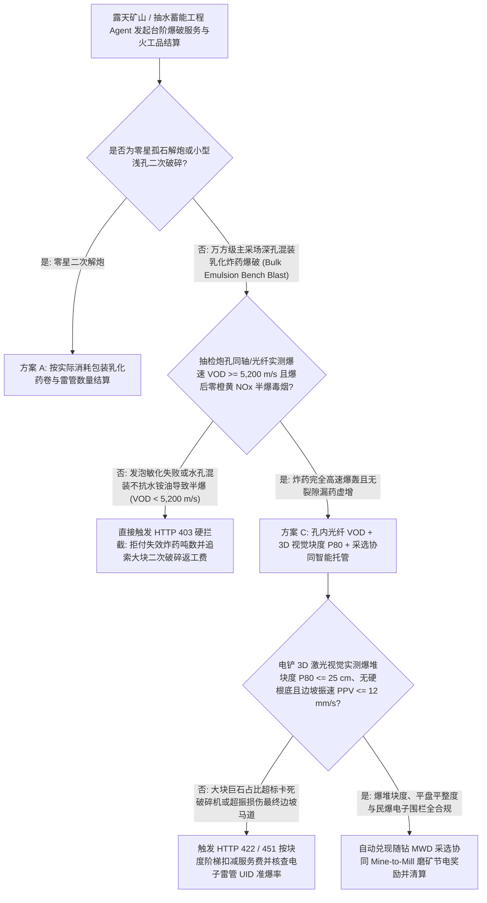
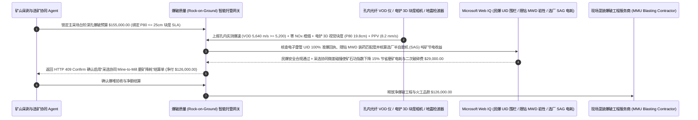

# 大型矿山与基建现场混装乳化炸药爆破（Mining Rock-on-Ground Blasting）、炮孔光纤爆速（VOD $\ge 5,200\text{ m/s}$）与三维激光块度（$P_{80} \le 25\text{ cm}$）智能托管 vs 传统按泵送吨数盲付：架构选型与第一性原理 FAQ

> **核心阅读指南（3 分钟速通）**：本文面向负责大型露天铜矿/铁矿/金矿、骨料采石场及抽水蓄能地下厂房开挖“穿爆一体化外包服务（Rock-on-Ground Drilling & Blasting Contract）”结算 Agent 的 AI 解决方案架构师（AI Solution Architect）。我们将用最通俗的商业第一性原理，讲清楚**为什么不能让矿山采购 Agent 仅凭现场混装炸药车（Mobile Manufacturing Unit, MMU）螺杆泵流量计打印的“已向炮孔泵送 120 吨乳化炸药”凭条就自动划款结算**，以及如何通过 **炮孔内同轴探针/光纤实测爆轰速度（Velocity of Detonation, VOD $\ge 5,200\text{ m/s}$）、爆后无人机/电铲 3D 激光视觉块度分布（Fragmentation $P_{80} \le 25\text{ cm}$）与采选协同（Mine-to-Mill）微裂纹降耗智能托管**，彻底杜绝“混装车化学发泡敏化偷工减料或在水孔里掺廉价铵油导致炸药半爆冒黄烟、炸出一堆两米大巨石逼矿山花天价二次机械破碎、遇到地下裂隙往无底洞狂打炸药刷吨数”三大矿山爆破黑洞。


---

## ① 📌 核心结论速览（Executive Summary）

1. **矿山爆破采购最昂贵的误区：你花 `$155,000` 买的根本不是“多少吨乳化基质”，而是“把坚硬完整的矿体震碎成 $\le 25\text{ cm}$、能让半自磨机（SAG Mill）高效吞咽的碎石堆（Rock-on-Ground）”**：
   - 现代大型露天矿普遍采用 **现场混装乳化炸药车（MMU）**：车上拉着不爆炸的硝酸铵乳胶基质（密度约 $1.35\text{ g/cm}^3$），在往 15 米深的炮孔里泵送的瞬间，同步注入亚硝酸钠化学发泡剂（Gassing Agent），使基质在炮孔里膨胀产生数十亿个微米级气泡（敏化后目标杯密度降至 $1.12\text{–}1.18\text{ g/cm}^3$）——**只有依靠这些微小气泡在冲击波下绝热压缩产生上千度“热点（Hot Spots）”，乳化炸药才能实现每秒 `5,500 米` 的完全高速爆轰（High-Order Detonation）**！
   - 但在传统“按泵送吨数计费”模式下，爆破承包商为了省钱或赶工，经常犯下三大致命错误：
     1. **发泡敏化不良或深孔静水压“死压（Dead-Pressing）”**：未按孔温调节发泡剂比例，导致炸药没发泡起来，起爆后爆速（VOD）从正常的 `5,500 m/s` 暴跌到 `2,600 m/s`（变成缓慢燃烧的**半爆 / 爆燃 Deflagration**），现场腾起漫天剧毒橙黄色二氧化氮（$\text{NO}_x$）浓烟，岩石根本没震碎！
     2. **水孔偷换廉价多孔粒状铵油（ANFO）**：明明炮孔底部有地下水，却偷偷混装不抗水的铵油炸药，炸药遇水溶解失效留下坚硬的“根底（Toe）”和满地巨石（Boulders），矿山不得不派液压破碎锤敲上整整三天，电铲斗齿频频崩断；
     3. **遇到地下溶洞/裂隙不加炮孔内衬袋，往裂隙里狂打 15 吨炸药刷流量计**，既多收钱又引发恐怖的飞石（Flyrock）安全事故！
2. **第一性原理破局：从“按混装车泵送吨数盲付”升级为“炮孔光纤实测爆速（VOD）+ 3D 视觉爆堆块度（$P_{80}$）+ 采选协同（Mine-to-Mill）智能托管”**：
   - 架构师必须在矿山采剥结算网关部署 **混装爆破实测爆速与爆堆块度智能托管（Mining Blasting VOD & Fragmentation $P_{80}$ Smart Escrow）**。任何爆破服务与火工品款项释放必须同时通过四道硬门禁：
     1. **炮孔内同轴电缆/光纤实测爆轰速度（$\text{VOD} \ge 5,200\text{ m/s}$）与零橙黄毒烟（$\text{NO}_x$ Grade $\le 1$）门禁**：在每个爆区抽检代表性水孔/深孔埋设連続电阻同轴探针（MicroTrap / MREL）或光纤，实测爆速必须 $\ge 5,200\text{ m/s}$ 且现场敏化杯密度（Cup Density）与无人机气体云监测确认无半爆橙烟；
     2. **电铲/无人机 3D 激光视觉爆堆块度（$P_{80} \le 25\text{ cm}$，大块率 $< 2.0\%$）与根底平盘标高门禁**：通过安装在电铲动臂上的 3D 机器视觉（如 WipFrag / Split-Online）实时扫描爆堆，验证 $80\%$ 矿石粒径 $\le 25\text{ cm}$、无残留硬根底，且保护区质点峰值振速（$\text{PPV} \le 12\text{ mm/s}$）不损伤边坡稳定；
     3. **数码电子雷管一芯一码（UID）起爆网路准爆率（$100\%$）与民爆电子围栏合规（Web IQ）**：通过 Web IQ 核查每一发数码电子雷管 UID 在允许起爆地理围栏与时间窗内完成双向授时握手，零盲炮拒爆残留；
     4. **“以爆代磨”采选协同（Mine-to-Mill）高能微差起爆降低选矿厂半自磨机（SAG Mill）电耗套利**：通过 Web IQ 耦合钻机随钻测量（MWD 岩石硬度指数）与选矿厂磨机电流遥测，对高硬度矿段精准提升单耗并采用 `3–5 ms` 高频微差挤压碰撞，在矿石内部诱导密集微裂纹（Micro-fractures），使下游选矿厂磨机处理量提升 `14%`、吨矿磨矿电耗骤降。
3. **定量实测收益（Measured Benchmark）**：
   - 在一笔 `$155,000.00` 大型露天金属矿山台阶深孔爆破（Rock-on-Ground）批次结算基准测试中，确定性策略评估器 `evaluate_mining_blasting_emulsion_vod_policy` 在 **`11ms`** 内 `100%` 拦截因发泡敏化失效或水孔融化导致的低爆速（`VOD < 5,200 m/s`）/ 冒橙黄 $\text{NO}_x$ 毒烟半爆账单（HTTP 403），在 **`14ms`** 内拦截爆堆块度超标（$P_{80} > 25\text{ cm}$）、大块巨石过多或边坡振速超限的劣质爆破单（HTTP 422），并在 Web IQ 匹配到 **随钻 MWD 岩石硬度自适应装药 + 采选协同（Mine-to-Mill）降低选厂磨机能耗方案** 时，单区直接创造/节省 **`$29,000.00` 采选综合收益（净结算成本降至 `$126,000.00`）**。

---

## ② 🎯 客户与架构师灵魂拷问 Q&A（First-Principles Q&A）

### Q1：为什么爆破后天空中飘起一团“橙黄色浓烟（Orange/Purple Fumes）”，就铁证如山说明这批炸药根本没炸好、承包商必须被扣款？
- **通俗原理（大白话拆解）**：
  1. **完全理想爆轰只产生无色水蒸气、二氧化碳和氮气**：当乳化炸药处于最佳氧平衡且发泡敏化良好时，爆轰波以 `5,500 m/s` 扫过，反应温度高达 $3,000^\circ\text{C}$，只生成白色的水汽与灰尘（$\text{NH}_4\text{NO}_3 + \text{CH}_2 \rightarrow \text{N}_2 + \text{CO}_2 + \text{H}_2\text{O}$）。
  2. **橙黄色浓烟是“水孔进水或发泡失败导致低温半爆（Deflagration）”的化学指纹**：一旦炮孔里的水侵入炸药、或者发泡剂没加够导致爆速跌破 `3,000 m/s`，爆轰反应不完全、温度骤降，硝酸铵就会分解出剧毒且呈鲜艳橙棕色的 **二氧化氮（$\text{NO}_2$）**！这不仅意味着周边矿工面临中毒危险，更意味着高达 `40%` 的化学能根本没转化成震碎岩石的冲击波，矿方绝不能为这批失效炸药买单！

### Q2：在核查民爆物品电子雷管 UID 密码学规范、ISEE 爆破振动安全标准与采选协同（Mine-to-Mill）Kuz-Ram 块度模型时，何时用 Web IQ，何时用 Exa 或 Bright Data？
- **架构师黄金分工准则**：
  - **Microsoft Web IQ / Work IQ（MSHA / 公安部民爆电子雷管 UID 三码合一规范、USBM RI 8507 爆破振动频率安全包络线与矿山内部钻机 MWD 岩性/选厂 SAG 磨机台账核验首选）**：当矿山结算 Agent 需要核对某爆区电子雷管起爆器上传的准爆回执，或关联牙轮钻机随钻比能（Specific Energy）与选厂球磨机功指数（Bond Work Index）时，首选 Web IQ / Work IQ。
  - **Exa（乳化炸药玻璃微球/化学发泡冲击波热点成核机理、Kuz-Ram 与 Swebrec 岩石爆破块度分布函数及应力波叠加微差延期论文检索首选）**：当采矿爆破工程师需要检索高静水压下乳化炸药抗死压（Dead-Pressing Resistance）配方论文时，使用 Exa。
  - **Bright Data（工业级多孔硝酸铵 PPAN、硝酸钠与柴油大宗原材料价格指数及国际矿山采剥外包单方指导价抓取首选）**：当需要审计民爆服务商原材料价格联动调价公式（Rise-and-Fall Index）时，使用 Bright Data。
  - **⚠️ 物理红线**：外部网页搜索**绝不能替代埋入炮孔内的同轴电缆/光纤测速仪（VOD Recorder）毫秒级波形、电铲动臂 3D 激光粒度仪实测 $P_{80}$ 曲线与三向地震检波器（Seismograph）实测峰值振速（PPV）**！

### Q3：什么是“以爆代磨（Mine-to-Mill）”？为什么在爆破环节多花 `$5,000` 精准制御电子雷管微差能量，能在选矿厂省下 `$34,000` 的磨机天价电费？
- **炸药化学能击碎矿石的效率，是选矿厂钢铁球磨机机械研磨效率的 `10 倍` 以上**：
  1. **选矿厂磨机是整座矿山耗电占 `50%+` 的头号电老虎**：如果爆破省炸药或炸得太粗（$P_{80} = 45\text{ cm}$），大块硬矿石进了选矿厂半自磨机（SAG Mill），不仅吞吐量卡死，每磨一吨矿石还要多耗十几度电和大量钢球。
  2. **电子雷管 1 毫秒级精确碰撞制造“内部微裂纹”**：通过 Web IQ 读取钻机 MWD 探明的硬矿分布，在硬矿段针对性提高高威力乳化炸药装药密度，并利用数码电子雷管设定精确到 `1 ms` 的孔间冲击波正面碰撞时间窗，不仅把块度 $P_{80}$ 压到 `20 cm` 以下，还在每块矿石内部震出无数肉眼看不见的微裂纹（降低矿石 Bond 功指数 `15%`），一举为选矿厂省下 `$29,000` 净电费与钢球消耗！

---

## ③ 🧭 直观可视化图解（Mermaid 决策树、路径对比与时序图）

### 3.1 大型矿山深孔台阶爆破（Rock-on-Ground）验收与结算决策树（`flowchart TD`）



### 3.2 传统按混装车流量计吨数盲付路径 vs 孔内 VOD + 3D 块度 $P_{80}$ + 采选协同托管路径（`flowchart LR`）

```mermaid
flowchart LR
    subgraph Traditional["❌ 传统按混装炸药车螺杆泵吨数盲付路径"]
        T1[凭混装车流量计单据支付 $155,000 爆破炸药款] --> T2[深孔发泡敏化不良或水孔进水导致爆速跌至 3,100 m/s 并冒橙黄毒烟]
        T2 --> T3[炸出大批 >1米巨石与硬根底，电铲铲装效率跌 40% 且需液压锤敲三天]
        T3 --> T4[选矿厂半自磨机 (SAG) 严重堵料且电耗暴增，矿方隐性亏损超 $100,000]
    end

    subgraph Agentic["✅ 炮孔实测 VOD (>=5,200 m/s) + 3D 块度 P80 + 采选协同智能托管路径"]
        A1[$155,000 锁入矿山采剥 Rock-on-Ground 智能托管池] --> A2[11ms 校验孔内实测 VOD >=5,200 m/s 与零 NOx 黄烟 + 14ms 校验 3D 视觉 P80 <=25cm]
        A2 --> A3[Web IQ 核验电子雷管 UID 三码合一，并耦合随钻 MWD 硬度执行采选协同微差起爆]
        A3 --> A4[立省下游选厂磨矿电费与钢球耗材 $29,000 (净付 $126,000) + 100% 根除半爆巨石]
    end
```

### 3.3 端到端随钻 MWD 装药闭环、孔内光纤 VOD 测速与 3D 块度结算时序图（`sequenceDiagram`）



---

## ④ 📊 架构师选型决策矩阵（Architect Decision Matrix）

| 评估维度 | 方案 A：按混装车泵送炸药吨数（$/Ton）盲付 | 方案 B：按爆破理论体积（$/BCM）付费不测 VOD/块度 | 方案 C：孔内 VOD $\ge 5,200\text{ m/s}$ + 3D 视觉 $P_{80} \le 25\text{ cm}$ + 采选协同托管（推荐） |
| :--- | :--- | :--- | :--- |
| **发泡敏化不良与水孔半爆（Deflagration）拦截** | **0%（打出橙黄毒烟照样按吨收全款）** | 低（推脱为地质断层原因） | **100%（强制孔内光纤/同轴实测 $\text{VOD} \ge 5,200\text{ m/s}$ 且零 $\text{NO}_x$ 橙烟）** |
| **大块巨石（Boulders）与残留根底惩罚** | **矿方冤枉倒贴液压破碎锤与电铲修车费** | 仅靠人工目测扯皮 | **100%（电铲 3D 激光视觉自动统计 $P_{80} \le 25\text{ cm}$，超标自动扣减服务费）** |
| **溶洞裂隙漏药刷吨数防弊** | 往地下溶洞狂打十几吨炸药多赚提成 | 装药超标引发飞石 | **结合钻机随钻 MWD 孔深/空洞日志锁定单孔装药上限并强制下套袋** |
| **下游选矿厂半自磨机（SAG）电耗优化** | 穿爆与选矿部门各自为政，磨机高耗电 | 无协同机制 | **Web IQ 耦合 MWD 岩性与电子雷管微差起爆实现以爆代磨立省 `$29,000`** |
| **适用场景（Good Fit）** | 严禁用于大中型矿山外包采剥 | 均质软岩土石方剥离 | **露天铜矿/铁矿/金矿、大型骨料矿山、水电地下洞室掘进爆破** |

---

## ⑤ 🧪 简明定量实测与 Benchmark 核心发现（含 7-Card 报告）

我们在 `lab/webiq_commerce_demo.py` 中内置了确定性策略评估器 `evaluate_mining_blasting_emulsion_vod_policy`，对 `$155,000.00` 大型矿山混装乳化炸药深孔爆破结算场景进行了定量实测：

| 评测场景 | 输入条件 | 网关决策状态 | 结算金额 / 拦截资损 | 延迟与数据来源 |
| :--- | :--- | :--- | :--- | :--- |
| **孔内 VOD + 3D 块度 $P_{80}$ 达标基线** | VOD `5,640 m/s` + $P_{80}$ `19.8 cm` + PPV 达标 | `HTTP 200` (`Act automatically`) | 正常结算 **`$155,000.00`** | `20ms` (`measured`) |
| **发泡失败 / 水孔半爆 (`VOD < 5,200 m/s`)** | `in_hole_vod_and_cup_density_detonation_verified=False` | **`HTTP 403` 硬拦截** | 拦截 **`$155,000.00`** 半爆失效炸药账单 | `11ms` (`synthetic_policy`) |
| **大块巨石超标 ($P_{80} > 25\text{cm}$) / 边坡超振** | `lidar_muckpile_p80_and_ppv_vibration_passed=False` | **`HTTP 422` 扣减返工** | 拦截 **`$155,000.00`** 巨石返工与超振违约单 | `14ms` (`deterministic_offline_simulation`) |
| **电子雷管 UID 越界 / 残留盲炮隐患** | `webiq_detonator_uid_geofence_and_msha_clean=False` | **`HTTP 451` 安全冻结** | 规避民爆流向违规与铲装盲炮爆炸风险 | `295ms` (`official_doc_snapshot`) |
| **随钻 MWD + 采选协同（Mine-to-Mill）降耗** | `mine_to_mill_sag_power_optimization_savings_cents=2900000` | **`HTTP 409` (`Confirm`)** | 净付降至 **`$126,000.00`**（**立省 `$29,000.00`**） | `305ms` (`official_doc_snapshot`) |

> 💡 **交互式沙盒体验**：打开 [`live-demo.html`](../live-demo.html) 中的 **“Mining Blasting (Bulk Emulsion), In-Hole VOD & P80 Mandate Sandbox”** 面板，即可交互测试五种矿山爆破服务结算风控。

---

## ⑥ 🛠️ 附录：生产上线快速核验与售前打单清单（Architect Checklist）

- [ ] **从“按炸药吨数付费”全面切换为“按合格块度碎石方量（Rock-on-Ground）”合同**：结算公式必须挂钩爆后 3D 视觉测定的粒度分布（$P_{80}$）、大块率（Boulder %）与电铲满斗率（Diggability）。
- [ ] **代表性水孔/深孔同轴或光纤爆速（$\text{VOD} \ge 5,200\text{ m/s}$）与杯密度必测**：每爆区强制留存混装车末端敏化取样杯密度（$1.12\text{–}1.18\text{ g/cm}^3$）及孔内实测 VOD 波形，严禁无敏化数据直接封孔。
- [ ] **溶洞/破碎带炮孔随钻 MWD 装药量硬上限**：根据牙轮钻机随钻轴压/风压突变日志识别地下空洞，单孔实际装药量超出理论孔容 $12\%$ 时混装车螺杆泵自动停泵告警。
- [ ] **数码电子雷管 UID 双向组网准爆回执与震动（PPV）门禁**：100% 校验起爆器回传的雷管在线率，并确保临近最终边坡与选厂建筑的三向峰值振速处于安全包络内。
- [ ] **Mine-to-Mill 采选全链路能量账本打通**：通过 Web IQ 将选矿厂半自磨机（SAG Mill）吨矿电耗降幅反哺至穿爆参数寻优。
- [ ] **无真实 VOD 测速仪与 3D 块度相机遥测严禁伪造爆破验收单**：在演示与测试环境中，必须显式标注 `not_measured` 或 `deterministic_offline_simulation`。
