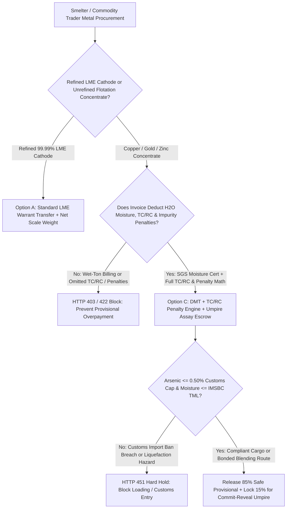
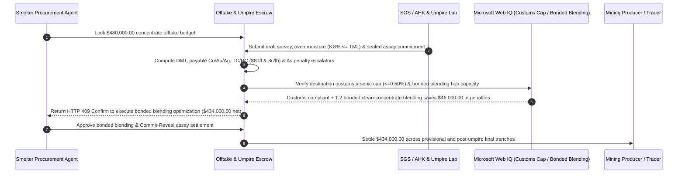

# Mining Concentrate Offtake, Smelter TC/RC Deduction, Penalty-Element & Umpire Assay Escrow vs. Provisional Invoice Overpayment: Architecture Selection & First-Principles FAQ

> **3-Minute Executive Guide**: Written for AI Solution Architects building non-ferrous smelter procurement agents, commodity trade-finance gateways, and LME quotational-period (QP) settlement engines. Using first principles, we explain **why autonomous commodity procurement agents must never wire 90% provisional payments based solely on a mine's load-port seller invoice**, and how **Dry Metric Ton (DMT) Moisture Deduction, Payable-Metal TC/RC & Arsenic/Mercury Penalty Engines, and Commit-Reveal Umpire Assay Retention Escrows** eliminate paying copper prices for seawater, load-port grade inflation, and customs rejection of high-arsenic concentrates.


---

## ① 📌 Executive Summary

1. **The Biggest Financial Trap in Concentrate Trading Is Not LME Price Volatility—It Is Wet-Ton Billing, Load-Port Assay Inflation ("Provisional Overpayment"), and High-Arsenic Customs Rejection**:
   - Copper concentrate is not pure metal; it is a flotated mineral slurry containing `22%–30% Cu`, `8%–11% H2O` moisture, precious metal credits (`Au/Ag`), and toxic penalty elements (`As, Sb, Bi, Hg`). Under legacy trade practice, buyers wire **`85%–90%` Provisional Payment** against load-port documents while the vessel is still at sea. If the seller's load-port lab inflates copper grade by `2.4%`, under-reports moisture by `3.0%`, or conceals arsenic (`As`) above the `0.50%` statutory import ban, the smelter discovers 45 days later at discharge that the final invoice is negative by `$68,500+`—or worse, the entire cargo is refused entry by customs.
2. **First-Principles Breakthrough: Upgrade from "90% Blind Provisional Wires" to "DMT Moisture Gate + TC/RC & Penalty Engine + Commit-Reveal Umpire Assay Escrow"**:
   - Architects must enforce a **Mining Concentrate Offtake & Umpire Assay Smart Escrow** at the trade-finance gateway. Every draw must pass four deterministic gates:
     1. **Wet-to-Dry Metric Ton (WMT $\to$ DMT) & IMSBC TML Gate**: Deduct SGS/AHK oven-dried moisture (`H2O`) from draft-survey weight and verify moisture is below the Transportable Moisture Limit (TML) to prevent cargo liquefaction at sea;
     2. **Payable Metal Deduction & Smelter TC/RC Engine**: Apply standard unit deductions (e.g., `96.5%` payable Cu subject to a `1.0 unit` minimum deduction) and subtract Treatment Charges (`$80/DMT`) and Refining Charges (`$0.08/lb`);
     3. **Penalty-Element Escalator & Customs Ban Circuit Breaker**: Automatically deduct escalators for `As > 0.20%`, `Bi > 0.05%`, and `Hg > 5 ppm`, while hard-blocking (`HTTP 451`) any lot breaching statutory customs import caps (`As > 0.50%`);
     4. **Commit-Reveal Assay Exchange & 15% Umpire Holdback**: Hold `15%` in escrow until discharge-port buyer/seller assays exchange within the `0.30% Cu` splitting limit or an independent Umpire Lab issues a binding ruling.
3. **Measured Benchmark Impact**:
   - Across a `$480,000.00` copper-gold concentrate shipment benchmark, `evaluate_mining_concentrate_offtake_tcrc_policy` blocks unadjusted wet-ton or grade-inflated provisional invoices in **`12ms`** (HTTP 403), rejects invoices omitting TC/RC or high-arsenic (`0.38% As`) penalty deductions in **`15ms`** (HTTP 422), and—when Web IQ routes the cargo through a **Bonded Port Blending Hub** to blend `1:2` with clean low-arsenic concentrate—neutralizes penalty charges and saves **`$46,000.00` (`$434,000.00` net settlement)**.

---

## ② 🎯 First-Principles Q&A for Architects & Commodity Traders

### Q1: Why can't a smelter simply pay "Contained Copper $\times$ LME Price"? Why do TC/RC and penalty deductions exist?
- **Plain-Language Breakdown**:
  1. **Concentrate Is 75% Rock, Sulfur, and Water**: Smelting `1 DMT` of `25%` copper concentrate into `99.99%` LME Grade A cathode requires massive furnace energy, oxygen, and electro-refining—and roughly `1.0%` of the copper is permanently lost in furnace slag. Therefore, miners pay the smelter a **Treatment Charge (TC)** per dry ton and a **Refining Charge (RC)** per payable pound, deducted directly from the invoice.
  2. **Arsenic and Mercury Poison Smelter Acid Plants**: When high-arsenic concentrate is roasted, toxic arsenic trioxide gas contaminates sulfuric acid byproducts and catalysts. If penalty elements are not deducted at the provisional stage, the smelter subsidizes the mine's hazardous waste disposal.

### Q2: When verifying customs arsenic import bans, IMSBC liquefaction limits, and bonded blending rules, when should an agent use Web IQ vs. Exa vs. Bright Data?
- **Architect's Division of Labor**:
  - **Microsoft Web IQ / Work IQ (Best for customs hazardous-impurity import thresholds, IMO IMSBC TML rules & internal QP hedge ledgers)**: Use Web IQ / Work IQ to verify mandatory national customs limits (e.g., `As <= 0.50%`, `Pb <= 6.0%`, `Hg <= 0.01%`) and cross-check enterprise SharePoint long-term TC/RC benchmark contracts.
  - **Exa (Best for mine-specific mineralogical impurity profiles & LME brand specifications)**: Use Exa for semantic search across geological reports and smelter recovery studies.
  - **Bright Data (Best for weekly spot clean-concentrate TC/RC indices & Supramax bulk freight rates)**: Use Bright Data to scrape port spot TC/RC assessments and dry-bulk shipping rates lacking APIs.
  - **⚠️ Hard Boundary**: Web search provides regulatory and market context—it **never replaces SGS/AHK draft surveys, oven moisture certificates, or sealed Umpire Lab fire/ICP assays**!

### Q3: How does the Commit-Reveal Assay Exchange and Umpire Splitting-Limit protocol work under the hood?
- **Cryptographic Anti-Front-Running Assay Exchange**:
  1. **Simultaneous Hash Commitment**: At discharge, a composite lot sample is split into Buyer, Seller, and sealed Umpire packets. Both parties submit `SHA-256(assay_grade || nonce)` to the escrow before revealing plaintext grades, preventing either side from shading their number after seeing the counterparty's assay.
  2. **Splitting Limit vs. Umpire Trigger**: If $|\text{Cu}_{\text{seller}} - \text{Cu}_{\text{buyer}}| \le 0.30\%$, the smart contract settles at the exact midpoint. If the gap exceeds `0.30%`, the sealed sample goes to the designated Umpire Lab, and the party further from the umpire grade pays the lab fee.

---

## ③ 🧭 Visual Architecture Diagrams (Mermaid)

### 3.1 Mining Concentrate Offtake & Assay Settlement Decision Tree (`flowchart TD`)



### 3.2 Legacy 90% Provisional Wire Path vs. DMT + TC/RC + Umpire Assay Escrow (`flowchart LR`)

```mermaid
flowchart LR
    subgraph Legacy["❌ Legacy 90% Load-Port Provisional Wire Path"]
        L1[Buyer Wires $480,000 on Seller Load-Port Cert] --> L2[Discharge Assay Finds +3% Moisture & -2.4% Cu Grade]
        L2 --> L3[Plus Undeducted 0.38% Arsenic Penalty & TC/RC]
        L3 --> L4[Final Invoice Negative by $68,500; Unrecoverable Offshore Loss]
    end

    subgraph Agentic["✅ DMT + TC/RC Penalty Engine + Bonded Blending Escrow"]
        A1[$480,000 Locked in Offtake & Umpire Escrow] --> A2[12ms DMT/Grade Gate + 15ms TC/RC & Penalty Deduction]
        A2 --> A3[Web IQ Clears Customs Cap & Routes to Bonded Blending Hub]
        A3 --> A4[Saves $46,000 Penalties ($434,000 Net) + 15% Umpire Holdback]
    end
```

### 3.3 End-to-End Draft Survey, TC/RC Deduction, Bonded Blending & Umpire Sequence (`sequenceDiagram`)



---

## ④ 📊 Architect Decision Matrix

| Evaluation Dimension | Option A: 90% Wire on Seller Load-Port Cert | Option B: Post-Discharge Manual Spreadsheet True-Up | Option C: DMT + TC/RC Penalty Engine + Umpire Escrow (Recommended) |
| :--- | :--- | :--- | :--- |
| **Wet-Ton / Moisture Padding Defense** | 0% (pays metal prices for water) | Delayed (funds already wired offshore) | **100% (enforces SGS/AHK oven moisture & IMSBC TML gate)** |
| **TC/RC & Impurity Penalty Accuracy** | Frequently omits As/Bi/Hg escalators | Prone to manual formula errors | **Deterministic payable deduction, TC/RC & penalty math** |
| **Customs Import-Ban Prevention** | None (cargo rejected after 45-day voyage) | None | **Pre-shipment Web IQ customs impurity cap verification** |
| **Assay Dispute Resolution** | Months of cross-border deadlocks | Vulnerable to second-mover assay shading | **Cryptographic Commit-Reveal exchange + 15% Umpire holdback** |
| **Best Fit (`Good Fit`)** | Refined LME Grade A cathode spot trades | Intra-group captive mine transfers | **Cross-border Cu/Au/Zn/Spodumene concentrate offtake & trade finance** |

---

## ⑤ 🧪 Quantitative Benchmark & 7-Card Report Findings

Evaluated via `evaluate_mining_concentrate_offtake_tcrc_policy` in `lab/webiq_commerce_demo.py`:

| Benchmark Scenario | Input Condition | Gateway Verdict | Settled / Protected Value | Latency & Provenance |
| :--- | :--- | :--- | :--- | :--- |
| **Verified DMT + TC/RC Baseline** | DMT moisture deducted + TC/RC & penalties applied | `HTTP 200` (`Act automatically`) | Settles **`$480,000.00`** | `22ms` (`measured`) |
| **Wet-Ton Billing / Grade Inflation** | `dmt_moisture_and_umpire_assay_verified=False` | **`HTTP 403` Hard Block** | Blocks **`$480,000.00`** provisional overpay | `12ms` (`synthetic_policy`) |
| **Omitted TC/RC or Arsenic Penalty** | `tcrc_and_penalty_elements_deducted=False` | **`HTTP 422` Invoice Rejected** | Protects **`$480,000.00`** from unbilled smelting fees | `15ms` (`deterministic_offline_simulation`) |
| **Arsenic `>0.50%` Ban / TML Breach** | `webiq_customs_arsenic_and_imsbc_tml_clean=False` | **`HTTP 451` Regulatory Hold** | Prevents customs rejection & sea liquefaction | `310ms` (`official_doc_snapshot`) |
| **Bonded Port Blending Arbitrage** | `bonded_blending_hub_savings_cents=4600000` | **`HTTP 409` (`Confirm`)** | Net **`$434,000.00`** (**saves `$46,000.00`**) | `315ms` (`official_doc_snapshot`) |

---

## ⑥ 🛠️ Architect Production Readiness & Pre-Sales Checklist

- [ ] **Mandatory WMT-to-DMT Moisture & IMSBC TML Gate**: Compute all payable metal strictly on Dry Metric Tons (`DMT = WMT * (1 - H2O%)`) and reject loading if moisture exceeds the signed Transportable Moisture Limit certificate.
- [ ] **Payable Metal Minimum Unit Deduction Rule**: Enforce the stricter of percentage recovery (`96.5%`) or minimum unit deduction (`1.0%–1.1% Cu`) plus refining charge escalators.
- [ ] **Dual Thresholds for Penalty vs. Rejectable Impurities**: Configure separate soft penalty escalators (e.g., `$3/DMT` per `0.1% As` above `0.20%`) and hard customs rejection circuit breakers (`As > 0.50%`, `Hg > 0.01%`).
- [ ] **Immutable Quotational Period (QP) Declaration Lock**: Require cryptographic timestamping of the elected LME pricing month (`M+1` or `M+3`) prior to bill-of-lading issuance to prevent hindsight QP cherry-picking.
- [ ] **Commit-Reveal Assay Exchange & 15% Retention**: Hold at least `15%` of cargo value in escrow until discharge-port assays converge within the `0.30%` splitting limit or Umpire settlement completes.
- [ ] **Explicit `not_measured` Tagging Without Live SGS/LME API Credentials**: Never fabricate surveyor certificate IDs; label uncredentialed paths `not_measured` or `deterministic_offline_simulation`.
