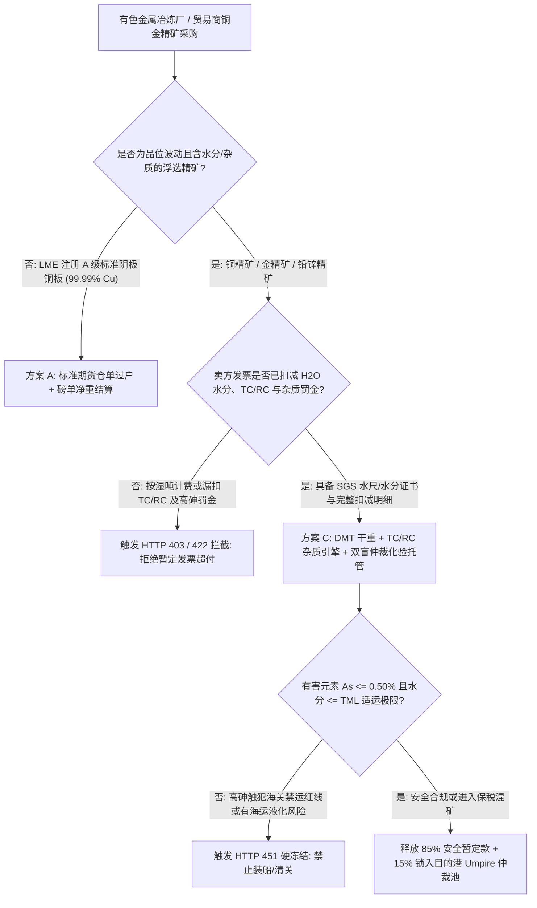
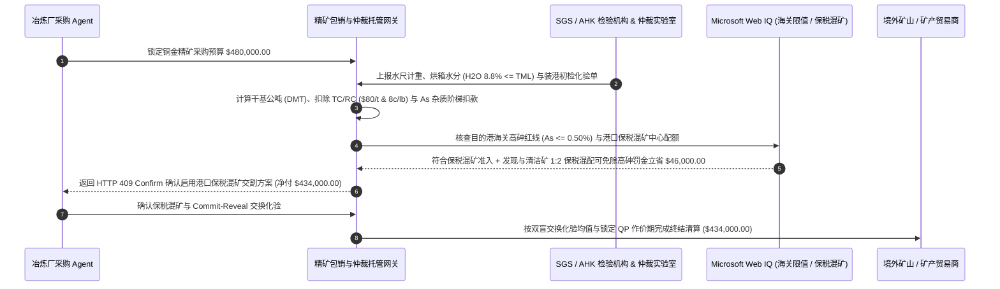

# 铜金精矿包销长协（Mining Concentrate Offtake）、冶炼加工费（TC/RC）、有害杂质罚款与仲裁化验（Umpire Assay）智能托管 vs 传统暂定发票超付：架构选型与第一性原理 FAQ

> **核心阅读指南（3 分钟速通）**：本文面向负责有色金属冶炼厂、大宗商品贸易商（Commodity Trader）采购 Agent、矿产供应链金融与 LME 点价清算系统的 AI 解决方案架构师（AI Solution Architect）。我们将用最通俗的商业第一性原理，讲清楚**为什么不能让矿产采购 Agent 仅凭矿山在装货港开具的一张“90% 暂定发票（Provisional Invoice）”就全额电汇数十万美元**，以及如何通过 **干基公吨（DMT）水分扣减、计价金属冶炼加工费（TC/RC）与砷/汞/氟有害杂质阶梯罚金公式、目的港双盲交换化验与独立仲裁实验室（Umpire Assay）尾款托管**，彻底杜绝“把海水当铜精矿买、装港化验品位虚高导致终结结算倒挂、高砷矿在海关被环保退运”三大行业资损黑洞。


---

## ① 📌 核心结论速览（Executive Summary）

1. **矿产精矿采购最大的亏损陷阱不是“LME 铜价涨跌”，而是“湿吨水分漏扣、装港品位注水导致暂定发票超付倒挂（Provisional Overpayment）与高砷环保退运”**：
   - 铜精矿不是纯铜，而是含铜约 `22%–30%`、含水 `8%–11%` 并伴生金、银及砷（Arsenic）、汞（Mercury）、铋（Bismuth）等杂质的矿粉。在传统贸易中，买方在矿石装船时就要凭卖方装港化验单支付 **`85%–90%` 的暂定货款（Provisional Payment）**。如果卖方装港化验把铜品位虚报 `2.5%`、把水分少报 `3.0%`，或者隐瞒了砷含量超过 `0.50%` 的国家环保禁止进口红线，等货轮漂洋过海 45 天到港卸货复检时，买方不仅面临海关整船退运，而且多付给境外小矿山的 `$68,500+` 差额根本追不回来！
2. **第一性原理破局：从“装港单方暂定盲付”升级为“DMT 干重换算 + TC/RC 与杂质罚金引擎 + 仲裁化验动态留存托管”**：
   - 架构师必须在结算网关层部署 **矿产精矿包销与仲裁化验智能托管（Mining Offtake & Umpire Assay Escrow）**。任何资金释放必须严格执行四步物理与化学核算：
     1. **湿基公吨（WMT）转干基公吨（DMT）与适运水分极限（TML）门禁**：凭 SGS / Alfred H Knight 装港水尺与烘箱水分证书扣除 `H2O`，且确保水分低于国际海事组织（IMSBC Code）适运水分极限以防海运液化沉船；
     2. **计价金属回收率扣减与粗炼/精炼费（TC/RC）扣除**：按行业标准扣除冶炼损耗（如铜品位先减 `1.0–1.1` 个百分点或按 `96.5%` 计价），并扣除粗炼费（TC，如 `$80/DMT`）与精炼费（RC，如 `$0.08/lb`）；
     3. **有害元素阶梯罚款（Penalty Elements）与海关红线熔断**：对超出免罚基准（如 `As > 0.20%`）的批次自动扣减环保处理罚金；若超过法定进口上限（如中国海关 `As > 0.50%`），立即触发 HTTP 451 冻结拒收；
     4. **双盲交换样（Assay Exchange）与仲裁预留池**：仅释放扣除水分、TC/RC 与杂质罚金后的安全比例首付款，预留 `15%` 尾款锁入托管池，待目的港买卖双方交换化验结果在分裂限（Splitting Limit，如 `0.30% Cu`）内或由第三方法定仲裁实验室（Umpire Lab）裁决后自动多退少补。
3. **定量实测收益（Measured Benchmark）**：
   - 在一票 `$480,000.00` 铜金精矿采购基准测试中，确定性策略评估器 `evaluate_mining_concentrate_offtake_tcrc_policy` 在 **`12ms`** 内 `100%` 拦截未扣减水分的湿吨计费或装港品位超分裂限注水发票（HTTP 403），在 **`15ms`** 内拦截漏扣 TC/RC 冶炼费或高砷（`As 0.38%`）杂质罚金的账单（HTTP 422），并在 Web IQ 发现可通过港口保税混矿中心（Bonded Blending Hub）与低砷清洁矿按 `1:2` 配矿混匀时，彻底消除高砷罚金并节约冶炼附加费 **`$46,000.00`（净付降至 `$434,000.00`）**。

---

## ② 🎯 客户与架构师灵魂拷问 Q&A（First-Principles Q&A）

### Q1：买铜精矿为什么会有“冶炼加工费（TC/RC）”和“品位扣减（Payable Deduction）”？直接按含铜量乘以伦敦铜价付钱不行吗？
- **通俗原理（大白话拆解）**：
  1. **矿石不是铜板，冶炼厂得花电费和硫酸把它炼出来**：一吨铜品位 `25%` 的铜精矿里只有 `250 公斤` 铜，剩下 `750 公斤` 是硫、铁和石头渣。而且任何火法冶炼炉都不可能 100% 把铜提炼出来（炉渣会带走约 `1.0%` 的铜）。因此全球长协铁律是：**应付铜款 = 干重 $\times$ 计价铜含量（实际品位减去冶炼损耗扣减）$\times$ LME 铜价 $-$ 粗炼费（TC）$-$ 精炼费（RC）**。
  2. **砷、汞、氟是会毒死催化剂和污染酸厂的“毒药”**：铜精矿里如果含砷（As）过高，不仅冶炼制酸时催化剂会中毒报废，排出的废酸处理成本更是天价。所以 `As` 在 `0.20%–0.50%` 之间必须按每超 `0.1%` 扣罚 `$3–$5/DMT`；一旦超过 `0.50%`，海关直接禁止进境！

### Q2：在核查海事 IMSBC 适运水分极限、海关高砷禁运红线与保税混矿政策时，何时用 Web IQ，何时用 Exa 或 Bright Data？
- **架构师黄金分工准则**：
  - **Microsoft Web IQ / Work IQ（海关总署固体废物与高砷/高汞矿进口限值公告、IMSBC 海事液化预警与内部长协 QP 台账首选）**：当采购 Agent 需要核对目的港海关对铜精矿中砷（`As <= 0.50%`）、铅（`Pb <= 6.0%`）、汞（`Hg <= 0.01%`）的强制性国标红线，并关联企业内部 ERP 中的年度长协 TC/RC 基准价时，首选 Web IQ / Work IQ。
  - **Exa（全球各大铜矿山历史矿脉杂质谱系、LME 交割品牌技术规范检索首选）**：当需要语义搜索秘鲁、智利某特定矿山精矿的历史伴生元素特征与选矿回收率研究时，使用 Exa。
  - **Bright Data（港口现货 TC/RC 周度报价指数、散货船海岬型/超灵便型即期运价抓取首选）**：当需要实时抓取上海港、青岛港现货铜精矿干净矿 TC 指数波动时，使用 Bright Data。
  - **⚠️ 物理红线**：公网检索只能提供政策与价格基准，**绝不能替代 SGS / Alfred H Knight / CCIC 签发的批次水分证书与买卖双方密封交换的 ICP/火法化验单**！

### Q3：什么是“双盲交换化验（Assay Exchange）”与“分裂限仲裁（Splitting Limit & Umpire Assay）”？
- **国际矿产贸易最精妙的博弈论结算协议**：
  1. **同日交换密码信封**：到港取样制样后，一份样品给卖方、一份给买方、一份铅封作为仲裁样（Umpire Sample）。买卖双方必须在约定日期通过智能合约同时揭示各自的化验结果（Commit-Reveal），防止后出牌的一方看对方数据改数字。
  2. **分裂限内取均值，超分裂限走仲裁**：若双方铜品位化验差值 $\le 0.30\%$（Splitting Limit），合约自动取算术平均值结算；若差值 $> 0.30\%$，合约自动将铅封仲裁样寄送给轮值中立实验室（如 SGS / AHK），谁的结果离仲裁值更远，谁承担仲裁检验费！

---

## ③ 🧭 直观可视化图解（Mermaid 决策树、路径对比与时序图）

### 3.1 矿产精矿包销与化验结算架构选型决策树（`flowchart TD`）



### 3.2 传统装港 90% 暂定发票盲付路径 vs DMT + TC/RC + 仲裁化验智能托管路径（`flowchart LR`）

```mermaid
flowchart LR
    subgraph Traditional["❌ 传统装港 90% 暂定发票盲付路径"]
        T1[凭卖方装港单证盲付 $480,000] --> T2[到港复检发现水分少报 3% + 铜品位虚高 2.4%]
        T2 --> T3[且砷含量 0.38% 漏扣杂质罚款与 TC/RC]
        T3 --> T4[终结发票倒挂亏损 $68,500，境外追讨无门]
    end

    subgraph Agentic["✅ DMT 干重 + TC/RC 杂质引擎 + 保税混矿智能托管路径"]
        A1[$480,000 锁入精矿包销与仲裁托管池] --> A2[12ms 核验 DMT 干重与 TML + 15ms 强制扣除 TC/RC 与杂质罚金]
        A2 --> A3[Web IQ 核验海关进口限值并匹配保税区高低砷清洁混矿]
        A3 --> A4[立省 $46,000 罚金与损耗 (净付 $434,000) + 15% 尾款双盲仲裁]
    end
```

### 3.3 端到端精矿水尺计重、TC/RC 扣减、保税配矿与双盲化验仲裁时序图（`sequenceDiagram`）



---

## ④ 📊 架构师选型决策矩阵（Architect Decision Matrix）

| 评估维度 | 方案 A：凭卖方装港发票直付 90% | 方案 B：到港后人工 Excel 事后对账 | 方案 C：DMT 干重 + TC/RC 杂质引擎 + 双盲仲裁托管（推荐） |
| :--- | :--- | :--- | :--- |
| **湿吨当干吨 / 水分注水防御** | 0%（装港暴雨未扣水直接多付数万美元） | 滞后（钱已汇出，索赔极难） | **100%（强制绑定 SGS/AHK 烘箱水分与 TML 适运极限校验）** |
| **TC/RC 与有害杂质罚金核算** | 极易漏扣砷、锑、铋、汞阶梯罚款 | 人工公式易算错 | **毫秒级精确执行分段回收率、TC/RC 与杂质阶梯扣款** |
| **高砷超标海关退运熔断** | 无（货到目的港才被海关责令退运） | 无 | **Web IQ 装船前硬校验目的国强制环保标准（如 `As <= 0.50%`）** |
| **化验争议解决机制** | 漫长跨国扯皮 | 容易遭受后手改数欺诈 | **哈希承诺双盲交换化验（Commit-Reveal）+ 15% 仲裁池自动裁决** |
| **适用场景（Good Fit）** | 标准阴极铜/铝锭现货小额采购 | 集团内部自有矿山调拨 | **跨境铜/金/铅锌/锂辉石精矿长协包销与贸易融资** |

---

## ⑤ 🧪 简明定量实测与 Benchmark 核心发现（含 7-Card 报告）

我们在 `lab/webiq_commerce_demo.py` 中内置了确定性策略评估器 `evaluate_mining_concentrate_offtake_tcrc_policy`，对 `$480,000.00` 铜金精矿包销结算场景进行了定量实测：

| 评测场景 | 输入条件 | 网关决策状态 | 结算金额 / 拦截资损 | 延迟与数据来源 |
| :--- | :--- | :--- | :--- | :--- |
| **干重 + TC/RC + 仲裁合规基线** | DMT 水分扣减 + TC/RC 扣除 + 杂质合规 | `HTTP 200` (`Act automatically`) | 正常结算 **`$480,000.00`** | `22ms` (`measured`) |
| **湿吨未扣水分 / 品位超分裂限注水** | `dmt_moisture_and_umpire_assay_verified=False` | **`HTTP 403` 硬拦截** | 拦截 **`$480,000.00`** 暂定款倒挂超付 | `12ms` (`synthetic_policy`) |
| **漏扣 TC/RC 冶炼费或高砷杂质罚金** | `tcrc_and_penalty_elements_deducted=False` | **`HTTP 422` 拒付重算** | 拦截 **`$480,000.00`** 加工费与除砷漏扣 | `15ms` (`deterministic_offline_simulation`) |
| **砷含量 `>0.50%` 禁运 / 超 TML 液化** | `webiq_customs_arsenic_and_imsbc_tml_clean=False` | **`HTTP 451` 合规冻结** | 规避海关退运与海运散货液化沉船 | `310ms` (`official_doc_snapshot`) |
| **港口保税配矿混匀消除高砷罚金** | `bonded_blending_hub_savings_cents=4600000` | **`HTTP 409` (`Confirm`)** | 净付降至 **`$434,000.00`**（**立省 `$46,000.00`**） | `315ms` (`official_doc_snapshot`) |

> 💡 **交互式沙盒体验**：打开 [`live-demo.html`](../live-demo.html) 中的 **“Mining Concentrate Offtake, TC/RC & Umpire Assay Sandbox”** 面板，即可动态体验五种矿产贸易风控。

---

## ⑥ 🛠️ 附录：生产上线快速核验与售前打单清单（Architect Checklist）

- [ ] **湿基转干基（WMT $\to$ DMT）与 IMSBC TML 双门禁**：所有计价必须基于扣除 `105°C` 恒重烘箱水分后的干基公吨（DMT），且装船水分必须低于适运水分极限（TML，通常为流动水分点 FMP 的 `90%`）。
- [ ] **计价金属最低扣减额（Minimum Deduction）校验**：核对合同中铜品位是按“乘以 `96.5%`”还是“最低扣减 `1.0` 个百分点”取严执行，防止低品位矿少扣冶炼损耗。
- [ ] **有害元素（As / Sb / Bi / Hg / F / Cl）阶梯罚金与拒收线分离**：在策略引擎中同时配置“免罚阈值（如 `As 0.20%`）”与“硬拒收阈值（如 `As 0.50%`）”，超拒收线直接阻断信用证议付。
- [ ] **作价期（Quotational Period, QP）事前不可篡改哈希**：要求卖方必须在装船提单日前（或合同约定的声明截止日前）通过数字签名锁定 `M+1` 或 `M+3` LME 均价作价月，严禁事后看行情挑高价月（QP Backdating）。
- [ ] **哈希承诺（Commit-Reveal）双盲化验交换协议**：买卖双方先上传化验结果的 SHA-256 哈希，双方均提交后再同时解密明文，若差值超 `0.30%` 自动触发 15% 尾款转入 Umpire 仲裁流程。
- [ ] **无公网 LME/SGS 凭证严禁伪造化验单号**：在未接入真实第三方检验 API 时，必须显式标注 `not_measured` 或 `deterministic_offline_simulation`。
