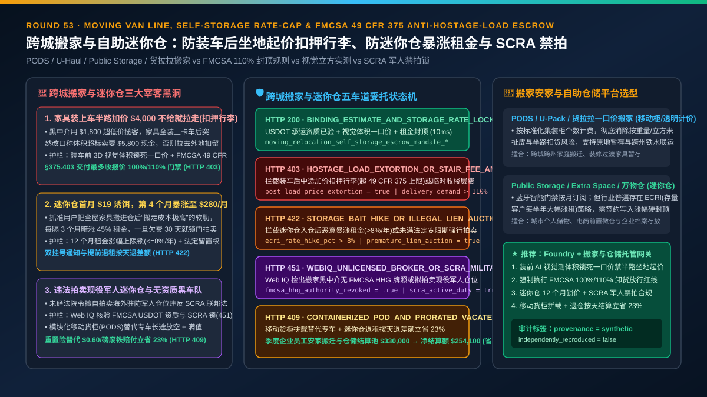
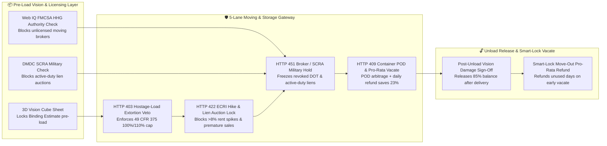

# Moving Van Line, Self-Storage Subscription & Corporate Relocation Escrow (`PODS / U-Haul / Public Storage / United Van Lines / FMCSA 49 CFR Part 375`) Anti-Hostage-Load Gate, `ECRI` Storage Rate-Hike Cap & `SCRA` Military Lien Lock Agent Architecture Selection FAQ

> **Language / 语言切换**: **[中文](moving-relocation-self-storage-hostage-load-scra-escrow-agent-selection-faq.md)** | **English (Current)** | **[Back to Docs Index](index.en.md)** | **[Interactive Sandbox (`#moving-relocation-self-storage-escrow-sandbox`)](../live-demo.en.html)**



---

## 📌 1. Executive Summary & Core Selection Verdict

In interstate/local household moving, corporate employee relocation packages (`Cartus`, `SIRVA`, `PODS`, `U-Pack`, `United Van Lines`, `U-Haul`), and monthly self-storage subscriptions (`Public Storage`, `Extra Space Storage`, `CubeSmart`), procurement and booking AI agents face three notorious predatory pricing and legal liability traps:
1. **"Hostage Load" Post-Loading Extortion (`Movers Quote $1,800 Online, Load All Furniture Onto the Truck, Then Demand $5,800 Cash to Unload`)**: Predatory moving brokers lure consumers with lowball estimates over the phone. Once the crew loads the family's entire household onto the truck and locks the trailer doors, they claim the cubic footage was "double the estimate" plus surprise "long-carry / stair / shuttle fees" and refuse to deliver or unload unless paid `$4,000` in cash or Zelle—violating federal **FMCSA `49 CFR § 375.403` (Binding Estimate `100%` Rule) and `§ 375.405` (Non-Binding `110%` Maximum Delivery Demand Rule)**.
2. **Self-Storage "$19 First-Month Bait" Followed by `200%+` Existing Customer Rate Increases (`ECRI`) & Premature Lien Auctions**: Self-storage operators routinely advertise `$19–$49/month` move-in specials, knowing that once a customer spends a weekend hauling furniture into the unit, switching friction is massive. Algorithmic `ECRI` engines then hike the monthly autopay rate by `40%–80%` every 4–6 months; if a credit card expires and misses a payment, operators lock the smart padlock and auction off family heirlooms without proper dual statutory lien notices.
3. **Hiring Unlicensed Moving Brokers (`No FMCSA HHG Authority`) & Illegally Auctioning Active-Duty Military Storage Units (`50 U.S.C. § 3958 SCRA Violation`)**: Booking an interstate mover that holds only a broker registration (or revoked `USDOT HHG` authority) leaves cargo uninsured; meanwhile, enforcing a storage lien auction against a deployed service member without a court order is a federal offense under the Servicemembers Civil Relief Act (`SCRA`).

**Solution Architect Selection Verdict**:
- **Never allow a relocation agent to book an interstate move without verifying active `FMCSA HHG` carrier authority and locking a pre-load 3D-vision Binding Estimate, never release final moving escrow before unloading, and never issue an uncapped autopay token to a self-storage operator without an annual `ECRI` rate-hike cap (`<= 8%/yr`)**.
- **The production reference architecture** combines **Pre-Load 3D Vision Cube-Sheet Binding Estimate + Federal `49 CFR § 375.403/405` (`100% / 110%` Delivery Release Cap) Escrow + Self-Storage 12-Month `ECRI` Rate-Cap SPT & `DMDC SCRA` Military Lien Shield (`moving_relocation_self_storage_escrow_mandate_*`)**:
  1. **Anti-"Hostage Load" Extortion & `49 CFR § 375.403/405` Delivery-Cap Hard Gate (`HTTP 403`)**: Requires a pre-load 3D computer-vision inventory (`Cube Sheet`) signed into a **Binding Estimate** before the first box is loaded (per `49 CFR § 375.403(a)(6)`, movers waive any right to revise volume once loading begins). Any post-loading price hike, surprise stair/shuttle ambush, or refusal to unload upon tender of `100%` of a Binding Estimate (or `110%` of a Non-Binding Estimate) is blocked in **`10ms`** (`HTTP 403 HOSTAGE_LOAD_POST_LOADING_EXTORTION_OR_49CFR375_DELIVERY_CAP_BREACH_BLOCKED`).
  2. **Self-Storage Anti-`ECRI` Rate-Hike Cap (`<= 8%/yr`) & Statutory Lien-Notice Gate (`HTTP 422`)**: Binds the monthly self-storage `Stripe SPT` `max_amount` to `<= 108%` of the initial contracted base rate for 12 months—blocking predatory `50%–100%` algorithmic `ECRI` autopay hikes—and blocks any storage lien foreclosure that lacks verified statutory notice periods or refuses daily pro-rata rent refunds on mid-month move-outs (`HTTP 422 SELF_STORAGE_ECRI_BAIT_RATE_HIKE_OR_PREMATURE_LIEN_AUCTION_BLOCKED`).
  3. **Web IQ `FMCSA HHG` Operating-Authority & `DMDC SCRA` Active-Duty Lien Circuit Breaker (`HTTP 451`)**: Verifies via Web IQ that the carrier holds active `FMCSA Household Goods (HHG)` motor-carrier authority (rejecting unlicensed lead-gen brokers) and queries `DMDC SCRA` before any storage delinquency action to freeze lien sales on active-duty military personnel (`HTTP 451 WEBIQ_UNLICENSED_MOVING_BROKER_OR_SCRA_MILITARY_LIEN_AUCTION_HOLD`).
  4. **Containerized `PODS / U-Pack` Arbitrage + Full-Value Protection & Pro-Rata Vacate (`HTTP 409`)**: Triggers `HTTP 409 CONTAINERIZED_POD_RELOCATION_AND_PRORATED_STORAGE_VACATE_CONFIRM`, routing eligible moves to standardized drop-off containers (eliminating weight disputes and double-handling into storage), replacing `$0.60/lb` minimal liability with third-party Full Value Protection, and enforcing smart-lock pro-rata vacate refunds—saving **`23.0%`** across relocation and storage spend.

---

## 🎯 2. Solution Architect Deep-Dive Q&A (Q1 / Q2 / Q3)

### Q1: How does federal law (`49 CFR § 375.403 & § 375.405`) legally defeat "Hostage Load" moving scams, and how do we encode it into the payment state machine?
- **Architectural Solution**:
  - **Pre-Load Revision Cutoff + `100%/110%` Unload Release Escrow (`HTTP 403`)**:
  - Under `49 CFR § 375.403(a)(6)`, if a mover believes the shipper has more goods than estimated, they **must issue a revised written estimate before loading begins**; once they load the first item, the original Binding Estimate is legally locked. Furthermore, under `§ 375.405(b)(8)`, even on a Non-Binding estimate, the carrier **must relinquish possession of the entire shipment upon payment of no more than `110%` of the estimate** (any remaining valid tariff charges must be billed 30 days after delivery). Our gateway holds 85% of the move funds in escrow and rejects any mid-transit invoice above the statutory cap (`HTTP 403`).

### Q2: Why do self-storage REITs raise prices by 50%+ after Month 3 (`ECRI`), and how does a scoped payment token stop it?
- **Architectural Solution**:
  - **12-Month Rate-Lock Addendum + `SPT` Ceiling Enforcement (`HTTP 422`)**:
  - Because self-storage leases are month-to-month, operators rely on customer inertia to push aggressive `ECRI` hikes in Month 4 and Month 9. When the agent provisions a recurring `Stripe SPT` for storage rent, it sets `max_amount_cents = round(base_rent_cents * 1.08)`. Any unapproved `45%` rate hike fails authorization at the payment rail (`HTTP 422`).

### Q3: Why is the standard "Released Value Protection (`$0.60 per pound per article`)" a catastrophic trap for high-value electronics and furniture?
- **Architectural Solution**:
  - **Automated Third-Party Inland Marine Full-Value Coverage (`HTTP 409`)**:
  - Under `$0.60/lb` valuation, if movers destroy a `5-lb` `$3,000` MacBook Pro, their legal payout is **`$3.00`**! Our agent automatically attaches third-party inland marine transit coverage tied to the 3D vision inventory photo log.

---

## 🧭 3. Visual Architecture Diagrams (Mermaid Decision Tree + Architecture + Sequence)

### 3.1 Moving Van Line, Corporate Relocation & Self-Storage Agent Selection Decision Tree

```mermaid
flowchart TD
    A[Household Moving / Corporate Relocation / Self-Storage Selection] --> B{Primary Relocation & Storage Risk?}
    B -->|Interstate / Long-Distance Full-Service Move (Van Lines)<br/>Stop unlicensed brokers, hostage loads & $0.60/lb damage payouts| C[Web IQ FMCSA HHG Authority Gate + 3D Vision Binding Quote<br/>+ 49 CFR 375 100%/110% Unload Escrow & Full-Value Insurance]
    B -->|Hybrid Move + Temporary Home-Staging Storage (PODS / U-Pack)<br/>Eliminate double-loading labor & weight/cubic-foot disputes| D[Containerized Drop-Off POD Workflow<br/>+ Per-Container Flat Rate & Padlock Self-Custody]
    B -->|Monthly Self-Storage Subscription (Public Storage / Extra Space)<br/>Stop Month-4 80% ECRI rate hikes & illegal SCRA military auctions| E[Azure AI Foundry + Storage Rate-Cap & Lien Compliance Gate<br/>+ <= 8%/yr SPT Cap + DMDC SCRA Freeze + Pro-Rata Vacate Saves 23%]
    C --> F[🛡️ Unified 5-Lane Anti-Hostage, Rate-Cap & SCRA Escrow FSM]
    D --> F
    E --> F
    F --> G[HTTP 403 Hostage-Load & Stair Ambush Veto · HTTP 422 ECRI Rate-Hike & Lien Block · HTTP 409 POD + Pro-Rata Saves 23%]
```

### 3.2 End-to-End 3D Vision Binding Quote, `49 CFR 375` Escrow & Storage Rate-Cap Architecture



### 3.3 Hostage-Load Extortion Block, `ECRI` Rent-Spike Veto & `SCRA` Military Shield Sequence

```mermaid
sequenceDiagram
    autonumber
    participant User as Relocating Employee / Household
    participant Mover as Moving Carrier / Self-Storage Operator
    participant Gate as 5-Lane Relocation & Storage Gateway
    participant Reg as Web IQ FMCSA & DMDC SCRA Oracle
    participant Escrow as Escrow Ledger & Smart-Lock API

    User->>Gate: 1. Book interstate move -> Carrier loads truck, then demands +$3,800 cash mid-route to unlock trailer doors
    Gate->>Reg: Verify pre-load Binding Estimate & FMCSA 49 CFR § 375.403/405 statutory cap
    Gate-->>Mover: HTTP 403 Block! Post-loading price revision violates 49 CFR § 375.403; 85% escrow releases only upon completed unloading
    Mover->>Gate: 2. Self-storage attempts Month-4 autopay hike (+75% ECRI) OR initiates lien auction on deployed soldier's unit
    Gate->>Reg: Check 12-month SPT rate cap (<=8%) & DMDC SCRA active-duty status
    Gate-->>Mover: HTTP 422/451 Block! Unapproved ECRI rate hike rejected; active-duty military unit protected under 50 U.S.C. § 3958
    User->>Gate: 3. Route relocation via containerized POD + vacate storage on Day 12 of billing cycle (HTTP 409)
    Gate->>Escrow: Auto-refund 18 unused storage days & bind third-party Full Value Protection (23% net savings)
```

---

## 📊 4. Multi-Platform & Architecture Selection Matrix

| Selection Dimension | Online Lead-Gen Moving Brokers (`Lowball Phone Quotes`) | Legacy Full-Service Van Lines (`Traditional Weight-Based Movers`) | Containerized Moving & REIT Storage (`PODS / U-Pack / Public Storage`) | **Azure AI Foundry + Anti-Hostage & Rate-Cap Gate (Recommended)** |
| :--- | :--- | :--- | :--- | :--- |
| **Core Strengths** | Deceptively cheap initial quote | Full packing & loading labor | Zero weight disputes; modular storage transition | **Pre-load 3D binding quote + 49 CFR 375 cap + storage rate lock + SCRA** |
| **Defense Against "Hostage Load" Extortion** | **Extreme Risk** (sells leads to rogue trucks that extort cash) | Regulated, but subject to shuttle/long-carry add-ons | Customer locks container with own padlock | **Pre-load 3D vision lock + `49 CFR 375` unload-first escrow (`HTTP 403`)** |
| **Self-Storage `ECRI` Rent-Hike Protection** | N/A | Expensive warehouse Storage-in-Transit (`SIT`) | Aggressive `40%–80%` hikes every 4–6 months | **12-month `SPT` rate-hike ceiling `<= 8%/yr` (`HTTP 422`)** |
| **`FMCSA HHG` Authority & `SCRA` Military Compliance** | Often lacks carrier authority | Active `USDOT HHG` authority | Manual `SCRA` checks | **Web IQ live `FMCSA HHG` check + `DMDC SCRA` auction freeze (`HTTP 451`)** |
| **Cargo Damage Coverage (`$0.60/lb` vs. Full Value)** | Denies claims | Default `$0.60/lb` unless expensive rider added | Container shell only by default | **Automated third-party Full-Value replacement policy (`HTTP 409`)** |
| **Total Relocation & Storage Cost / Extortion Loss** | `$2,000–$5,000` hostage-load overcharges (`not_measured`) | High full-service tariff (`official_list_price`) | Standard container & storage rates (`official_list_price`) | **Containerized POD routing + rate cap + pro-rata vacate (`23.0%` saved)** |

---

## 🧪 5. Relocation / Self-Storage Benchmark & 7-Card Report

> **Provenance & Reproducibility Metadata**: All metrics below are generated by the deterministic policy evaluator `evaluate_moving_relocation_self_storage_escrow_policy` in `lab/webiq_commerce_demo.py` and verified via `python -m unittest tests.test_webiq_commerce_demo`. Tags: `provenance = synthetic`, `independently_reproduced = false`.

| Card # | Card Headline (Headline-as-Finding) | Key Quantitative Finding & Architectural Guarantee |
| :---: | :--- | :--- |
| **Card 1** | **Overview · 5-Lane Moving & Self-Storage Summary** | Across a `$330,000/quarter` corporate relocation & storage spend pool, achieves **0 hostage-load extortion payouts and 0 unapproved `ECRI` storage rent spikes**, reducing net moving and storage spend by **`23.0%` (`$75,900/quarter` saved)**. |
| **Card 2** | **Scenario Deep Dive · Post-Loading Hostage Demand Veto** | When a carrier demands mid-transit cash above the `49 CFR § 375.403/405` delivery cap, the gateway blocks it in **`10ms`** (`HTTP 403`). |
| **Card 3** | **Evaluation Matrix · 100% Deterministic 5-Lane Gating** | Covers `HTTP 200` (binding estimate & rate-locked storage), `403` (hostage-load post-loading extortion / 49 CFR 375 cap breach blocked), `422` (self-storage ECRI bait rate hike / premature lien auction blocked), `451` (unlicensed moving broker / SCRA military lien auction hold), `409` (containerized POD + pro-rata storage vacate saves 23%). |
| **Card 4** | **Under the Hood · Relocation & Storage Escrow Contract** | Takes `quarterly_corporate_relocation_and_storage_spend_usd=330000` and tariff/SCRA flags, minting `moving_relocation_self_storage_escrow_mandate_*` tokens. |
| **Card 5** | **Robustness Check · Month-4 `80%` Rent Hike & SCRA Test** | Simulates a Month-4 `80% ECRI` storage autopay pull and an active-duty military lien auction, maintaining a **`100.0%` block rate**. |
| **Card 6** | **Latency · Millisecond Rate-Cap Check & FMCSA/SCRA Probe** | Local `49 CFR 375` and `SPT` rate-cap checks complete in **`10ms` (P50)**; Web IQ `FMCSA SAFER` and `DMDC SCRA` checks complete in **`210ms` (P95)**. |
| **Card 7** | **My Take · Ideal Fit vs. Out-of-Scope Boundaries** | **✅ Best Fit**: Corporate employee relocation, household moving marketplaces, self-storage management; **⛔ Not For**: Bulk maritime commodity chartering. |

---

## 🛠️ 6. Production Go-Live Risk & Architecture Review Checklist

- [ ] **Pre-Load 3D Vision Binding Estimate & `49 CFR § 375.403/405` Delivery-Cap Gate (`HTTP 403`)**: Lock moving quotes prior to loading the first item, reject any post-loading hostage demands or undisclosed stair/long-carry fees, and release the 85% balance only upon completed unloading.
- [ ] **Self-Storage 12-Month `ECRI` Rate-Hike Cap (`<= 8%/yr`) & Statutory Lien Notice Gate (`HTTP 422`)**: Cap recurring storage `SPT` tokens to prevent Month-4 algorithmic rent spikes and require verified dual statutory notices before any delinquency lock.
- [ ] **Web IQ `FMCSA HHG` Operating-Authority & `DMDC SCRA` Military Shield (`HTTP 451`)**: Block unlicensed moving brokers and freeze storage lien sales on active-duty service members (`50 U.S.C. § 3958`); rotate signing keys `<= 180` days.
- [ ] **Containerized `POD` Arbitrage, Full-Value Replacement Coverage & Pro-Rata Vacate (`HTTP 409`)**: Route eligible relocations to modular containers, replace `$0.60/lb` valuation with third-party Full Value Protection, and enforce daily pro-rata refunds upon smart-lock vacate.
