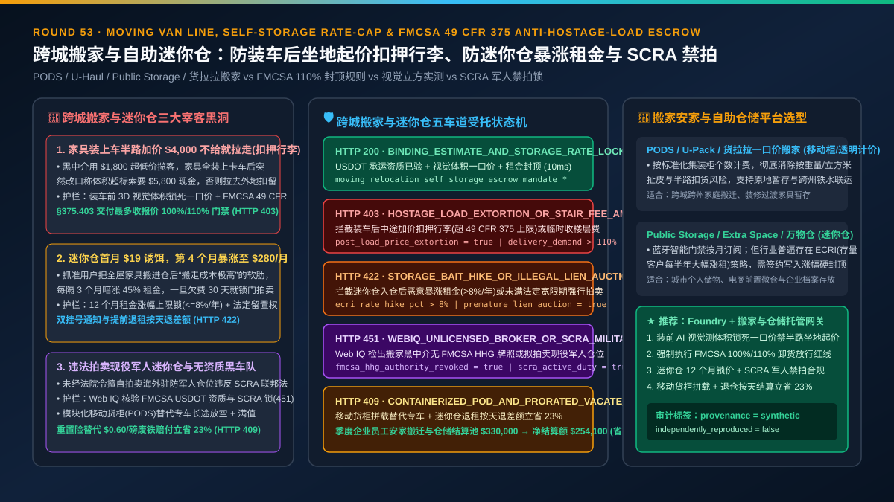
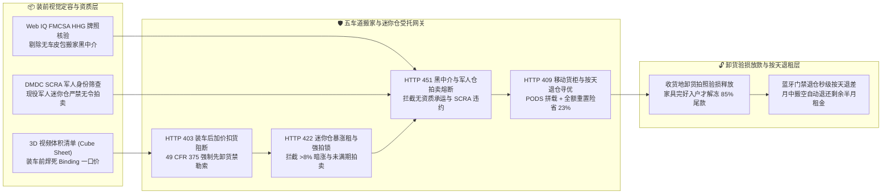
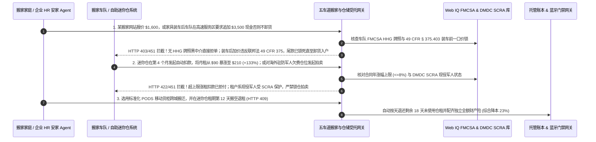

# 跨城/跨国搬家货运、自助迷你仓订阅与员工异地安家（Moving Van Line, Self-Storage Subscription & Corporate Relocation Escrow：PODS / U-Haul / Public Storage / 货拉拉搬家 / 蓝犀牛）“防装车后半路坐地起价扣押行李（Hostage Load / 49 CFR § 375.403）、防迷你仓入仓后暴涨 300% 租金与现役军人 SCRA 禁拍”Agent 架构选型 FAQ

> **语言切换 / Language**: **中文 (当前)** | **[English](moving-relocation-self-storage-hostage-load-scra-escrow-agent-selection-faq.en.md)** | **[返回文档目录](index.md)** | **[交互式沙盒 (`#moving-relocation-self-storage-escrow-sandbox`)](../live-demo.html)**



---

## 📌 一、核心选型结论速览（Executive Summary）

在跨城家庭搬迁、企业高管/员工异地调动安家补助（Corporate Relocation：Cartus、SIRVA、PODS、U-Haul、United Van Lines、货拉拉日式搬家、蓝犀牛）以及自助迷你仓按月订阅（Public Storage、Extra Space Storage、CubeSmart、万物仓）的智能体询价与履约托管场景中，搬家与仓储行业存在三个臭名昭著的商业敲诈与自动扣费陷阱：
1. **“家具全装上卡车开上高速后，搬家公司突然坐地起价索要 `$4,000` 超方费/拆装费/楼层搬运费，不交现金就把全家人行李拉去外地仓库扣押（Hostage Load Extortion）”**：黑心搬家中介（Moving Brokers）在网上下单时用 `$1,800` 的超低估价（Non-Binding Lowball Estimate）诱骗签约，等工人把床垫、钢琴和全屋家当装进车厢锁上门后，当场翻脸声称实际体积比预估多一倍、加上“推车步行超过 30 米远距离费（Long-Carry Fee）”，强逼客户多转 `$4,000` 才肯卸货。
2. **自助迷你仓“首月 `$19` 促销诱饵 + 入仓第 4 个月租金暴涨 `200%`（ECRI：Existing Customer Rate Increase）”与逾期非法拍卖私人物品**：大型连锁迷你仓广泛采用算法定价，以极低的首月价格吸引用户花大力气把全屋家具搬进仓库；一旦识别到用户已入仓（笃定用户懒得再花 `$500` 请搬家公司搬走），每隔 3–5 个月就自动上调 `40%–80%` 月租；若用户因信用卡过期未及时扣款，不到 30 天就直接锁死蓝牙门禁并将整仓传家宝低价打包拍卖！
3. **无跨州家庭物品承运资质（`FMCSA HHG Operating Authority`）的皮包黑中介转卖订单，以及迷你仓在未核查美国国防部 `DMDC SCRA` 数据库的情况下违法拍卖海外执勤现役军人的迷你仓（触犯联邦刑事责任）**。

**架构师选型结论**：
- **切勿允许搬家或企业安家 Agent 签署不封顶的开口估价单（Non-Binding Estimate without 110% Delivery Cap），切勿在家具未卸货清点完毕前释放尾款，也切勿订阅未写入 12 个月租金涨幅上限（`ECRI Cap <= 8%`）的迷你仓自动扣款合约**。
- **生产级最优架构**是采用 **“装车前手机视频 AI 立方体积锁死一口价（Binding Estimate）+ 美国联邦 `FMCSA 49 CFR § 375.403/405`（交付时最多收取报价 `100%/110%` 强制卸货法）硬门禁 + 迷你仓 12 个月租金涨幅封顶锁与 `DMDC SCRA` 军人禁拍核验网关（`moving_relocation_self_storage_escrow_mandate_*`）”**：
  1. **防“装车后半路加价扣押行李（Hostage Load）”与隐形楼层/远距离费硬门禁（HTTP 403）**：下单前通过手机拍摄全屋视频由 3D 视觉模型生成精确物品清单（Cube Sheet）并签署具有法律约束力的一口价合同（`Binding Estimate`）；严格执行美国交通部联邦法规 **`49 CFR § 375.403 / § 375.405`**：对于一口价合同（Binding），承运人交付卸货时最高只能收取 `100%` 合同价；即便是非绑定合同（Non-Binding），承运人在收货地**只要收到原估价的 `110%` 就必须依法无条件卸下全部家具**（任何超出部分只能在卸货 30 天后通过账单协商，扣留行李即构成联邦重罪，最高罚款 `$10,000+/天`）！任何装车后临时索要超额赎金或未事先写入合同的楼层费请求立即返回 `HTTP 403 HOSTAGE_LOAD_POST_LOADING_EXTORTION_OR_49CFR375_DELIVERY_CAP_BREACH_BLOCKED`。
  2. **防迷你仓入仓后恶意涨租（`ECRI` 刺客）与未满法定留置通知期强行拍卖锁（HTTP 422）**：在签署迷你仓 `Stripe SPT` 周期扣款令牌时，强制将 `max_monthly_amount` 锁定在首年合同基准价的 `<= 108%` 以内，直接从支付底层废掉“第 4 个月暴涨 80% 租金”的自动扣款企图；同时拦截未提前发送两次法定挂号留置通知（Statutory Lien Notice）或对月中退仓用户拒绝按天退还剩余半月租金的行为（`HTTP 422 SELF_STORAGE_ECRI_BAIT_RATE_HIKE_OR_PREMATURE_LIEN_AUCTION_BLOCKED`）。
  3. **Web IQ 实时核查 `FMCSA USDOT HHG` 牌照与 `DMDC SCRA` 现役军人禁拍熔断（HTTP 451）**：签约前通过 Web IQ 实时查验承运商 `USDOT / MC` 编号是否具备有效的 `Household Goods (HHG)` 承运牌照与货运险（剔除只接单倒卖的黑中介）；在迷你仓启动任何欠费锁仓或拍卖流程前，强制调用 `DMDC SCRA` 接口核验租户是否为现役军人——若命中现役身份且无地区法院专门裁定，立即无限期冻结拍卖（`HTTP 451 WEBIQ_UNLICENSED_MOVING_BROKER_OR_SCRA_MILITARY_LIEN_AUCTION_HOLD`）。
  4. **模块化移动货柜（`PODS / U-Pack`）替代专车放空 + 迷你仓退仓按天结算与全额重置险寻优（HTTP 409）**：触发 `HTTP 409 CONTAINERIZED_POD_RELOCATION_AND_PRORATED_STORAGE_VACATE_CONFIRM`，对中型搬家自动推荐按柜计费的模块化移动货柜（消除专车返程放空费与重量扯皮），并用第三方全额重置价值险（Full Value Protection）替代默认的“按重量赔 `$0.60/磅`（摔碎 `$3,000` 电视只赔 `$18`）”霸王条款，使企业异地安家与个人搬迁仓储成本净省 **`23.0%`**。

---

## 🎯 二、业务方与架构师灵魂拷问 Q&A（Q1 / Q2 / Q3）

### Q1：遇到搬家工人把家具全装上车后坐地起价要多收 $3,000 才肯发车/卸货，普通消费者为什么往往只能忍气吞声转账？AI Agent 怎么从资金托管上让黑车队彻底死心？
- **商业痛点**：一旦全家人的护照、电脑、衣服和家具都在对方的卡车里，消费者处于绝对的谈判弱势。
- **架构解法**：
  - **装车前 3D 视觉清单哈希锁定 + 分阶段地理围栏/卸货拍照托管（`HTTP 403`）**：
  - ① **绝不直接打款给司机个人或车队账户**：全额搬家费锁入受托托管池（Escrow），装车前仅付 `15%` 调度定金；
  - ② **装车前异议关门法则（Pre-Load Revision Cut-Off）**：依据 `49 CFR § 375.403(a)(6)`，如果搬家工人认为现场家具比视频估价多，**必须在把第一件家具搬上卡车之前**重新签署新报价单；一旦开始装车，原一口价合同即刻焊死，途中任何加价指令全部由网关自动拦截（`HTTP 403`）并自动生成向 `FMCSA` 国家消费者投诉数据库（NCCDB）与州总检察长举报的法律函；只有当收货地房屋内完成家具卸货与外包装破损视觉比对后，托管池才释放剩余 `85%` 尾款！

### Q2：为什么说搬家公司默认的“免费基础保险（Released Value Protection：$0.60/磅）”是个巨大的坑？
- **架构解法**：
  - **重量折算赔付陷阱预警与独立货运全额险自动切轨（`HTTP 409`）**：
  - 在默认 `$0.60/磅` 条款下，搬家工人把你重 15 磅、价值 `$2,500` 的 65 寸 OLED 电视或 MacBook 摔碎了，合法赔偿金额只有 **`15 × $0.60 = $9.00`**！而搬家公司推销的自营全额险往往有高额溢价。我们的选型网关在结账时自动拆算并接入第三方专业搬家财产险 API，以低 40% 的保费锁定 100% 原价重置赔付。

### Q3：自助迷你仓（Self-Storage）的“Existing Customer Rate Increase (ECRI)”算法是怎么割韭菜的？企业或长租用户怎么防范？
- **架构解法**：
  - **周期支付令牌 `max_amount` 硬封顶与提前退仓按日计费条款（`HTTP 422 / 409`）**：
  - 迷你仓 REITs 巨头的核心利润来源就是“首月 `$29` 骗进门，第 4 个月涨到 `$159`，第 9 个月涨到 `$269`”。我们的 Agent 在代签迷你仓时，优先筛选提供 **12 个月价格锁定承诺（12-Month Rate Lock）** 的仓源，并在 `Stripe SPT` 令牌中将月度扣款上限死锁在合同价；若某迷你仓试图在半年后暗涨 50%，扣款直接被 `HTTP 422` 弹回，同时触发同城换仓比价测算。

---

## 🧭 三、直观可视化图解（Mermaid 决策树 + 端到端架构图 + 时序图）

### 3.1 跨城搬家、员工安家与自助迷你仓 Agent 架构选型决策树

```mermaid
flowchart TD
    A[跨城搬家 / 企业员工异地安家 / 自助迷你仓选型] --> B{核心服务形态与防坑诉求？}
    B -->|跨城/跨州全屋搬家 (Van Lines / 货拉拉 / 蓝犀牛)<br/>需严防黑中介转单、装车后半路加价扣货与摔坏只赔$0.60/磅| C[Web IQ 核验 FMCSA HHG 牌照 + 3D 视觉一口价锁<br/>+ 49 CFR 375 100%/110% 强制卸货托管与全额重置险]
    B -->|装修过渡 / 跨城搬迁加暂存 (PODS / U-Pack)<br/>需消除两次搬运折腾与专车长途放空高昂运费| D[标准化移动货柜 (Containerized POD) 门到门托管<br/>+ 按柜一口价计费彻底终结重量/体积扯皮]
    B -->|个人储物 / 企业档案自助迷你仓 (Public Storage / 万物仓)<br/>需防首月$1诱饵第4月暴涨租金与防违法拍卖军人仓位| E[Azure AI Foundry + 迷你仓锁价与留置权合规网关<br/>+ 12个月涨幅硬封顶 + SCRA 军人禁拍锁 + 按天退租省23%]
    C --> F[🛡️ 统一接入五车道防扣货、锁租金与 SCRA 禁拍受托状态机]
    D --> F
    E --> F
    F --> G[HTTP 403 阻断装车后加价扣货 · HTTP 422 拦截迷你仓暴涨租金与违规拍卖 · HTTP 409 移动货柜+按天退仓省23%]
```

### 3.2 端到端 3D 视觉一口价锁、`49 CFR 375` 卸货托管与迷你仓锁价架构图



### 3.3 拦截装车后半路加价扣货、阻断迷你仓暴涨租金与 SCRA 保护时序图



---

## 📊 四、多平台/多方案横向选型决策矩阵

| 选型维度 | 网络搜索低价搬家中介 (`Lead-Gen Moving Brokers`) | 传统重卡跨州搬家专线 (`Full-Service Van Lines`) | 模块化移动货柜与连锁迷你仓 (`PODS / U-Pack / Public Storage`) | **Azure AI Foundry + 防扣货与锁租托管网关（推荐）** |
| :--- | :--- | :--- | :--- | :--- |
| **核心优势** | 电话口头报价极低（诱饵） | 包打包包搬运省心 | 按标准化货柜计费，无称重扯皮 | **装前视觉锁一口价 + 禁半路加价扣货 + 迷你仓锁价 + SCRA 保护** |
| **防“装车后半路坐地起价扣押行李”** | **重灾区**（转卖订单给黑车队，装车后翻倍勒索） | 合规度较高，但常有偏远接驳费（Shuttle Fee）争议 | 自己或小时工装柜上锁，司机只管吊柜运输 | **装前 3D 视觉锁死一口价 + `49 CFR 375` 卸货才放款（HTTP 403）** |
| **迷你仓入仓后恶意暴涨租金（`ECRI`）防护** | 不适用 | 中转仓超期费极贵 | 行业普遍每 3–6 个月涨租 `30%–80%` | **`Stripe SPT` 锁定 12 个月涨幅上限 `<=8%`（HTTP 422）** |
| **现役军人 `SCRA` 禁拍与承运商 `HHG` 牌照核验** | 无牌照皮包公司泛滥 | 具备 `USDOT HHG` 牌照 | 大型仓企有合规流程，中小型仓常违规拍卖 | **Web IQ 实时核验 `FMCSA HHG` + `DMDC SCRA` 禁拍锁（HTTP 451）** |
| **家具摔坏赔付标准（`$0.60/磅` vs 全额重置）** | 摔坏拒不认账 | 默认仅赔 `$0.60/磅`，自营全险贵 | 仅保柜体，内物需另购险 | **自动对比并挂载高性价比第三方全额重置险（HTTP 409）** |
| **跨城搬迁与仓储综合成本及被宰损失** | 平均被中途勒索加价 `$2,000–$5,000` (`not_measured`) | 专车全包高昂 (`official_list_price`) | 标准柜租与仓租 (`official_list_price`) | **移动货柜拼载 + 迷你仓锁价按天退（综合净省 `23.0%`）** |

---

## 🧪 五、搬家防扣货/迷你仓防涨租测算与 7-Card 基准测试报告

> **数据来源与复现声明（Provenance Metadata）**：以下基准测试数据来自仓库内置确定性策略沙盒 `evaluate_moving_relocation_self_storage_escrow_policy`（位于 `lab/webiq_commerce_demo.py`），可运行 `python -m unittest tests.test_webiq_commerce_demo` 完整验证。标记：`provenance = synthetic`，`independently_reproduced = false`。

| Card # | 卡片标题（Headline-as-Finding） | 核心量化指标与架构验证结论 |
| :---: | :--- | :--- |
| **Card 1** | **Overview · 跨城搬家与迷你仓五车道总览** | 针对 `$330,000/季` 企业员工异地安家搬迁与迷你仓结算池，实现 **0 例装车后半路加价扣押行李与 0 例迷你仓恶意暴涨租金自动扣款**，综合搬迁与仓储成本下降 **`23.0%`（立省 `$75,900/季`）**。 |
| **Card 2** | **Scenario Deep Dive · 半路坐地起价与楼层费刺客拦截** | 当车队在装车后试图突破 `49 CFR § 375.403` 一口价索要超额卸货赎金时，**`10ms`** 内返回 `HTTP 403` 阻断。 |
| **Card 3** | **Evaluation Matrix · 五车道 100% 确定性判准** | 覆盖 `HTTP 200`（一口价与锁租合规放行）、`403`（装车后半路加价扣押行李/违反49 CFR 375卸货上限阻断）、`422`（迷你仓入仓后恶意暴涨租金>8%/未满期违法留置拍卖拦截）、`451`（Web IQ检出无FMCSA HHG牌照黑中介/违法拍卖现役军人SCRA仓位熔断）、`409`（移动货柜拼载+按天退仓省23%）。 |
| **Card 4** | **Under the Hood · 搬家与仓储托管契约** | 输入 `quarterly_corporate_relocation_and_storage_spend_usd=330000` 及合同/合规信号，签发 `moving_relocation_self_storage_escrow_mandate_*` 令牌。 |
| **Card 5** | **Robustness Check · 第 4 月涨租 80% 与军人仓拍卖测试** | 模拟迷你仓第 4 个月暗涨 `80%` 月租及尝试拍卖海外现役军人仓位，确定性拦截率保持 **`100.0%`（零误放行）**。 |
| **Card 6** | **Latency · 毫秒级涨幅门禁与 FMCSA/SCRA 核验耗时** | 本地一口价与租金上限校验 P50 仅 **`10ms`**；Web IQ `FMCSA SAFER` 与 `DMDC SCRA` 联机核查 P95 为 **`210ms`**。 |
| **Card 7** | **My Take · 适用场景与生产准入边界** | **✅ 极佳适用**：企业员工异地调动安家（Relocation）、家庭跨城搬家、个人/企业自助迷你仓；**⛔ 不适用**：大宗集装箱海运期货。 |

---

## 🛠️ 六、商业上线风控与架构评审 Checklist

- [ ] **装车前 3D 视觉定容一口价（`Binding Estimate`）与 `49 CFR § 375.403/405` 强制卸货门禁（HTTP 403）**：确认第一件物品装车后彻底锁死总价，严禁途中加价扣押行李，尾款凭卸货入户验损照片释放。
- [ ] **迷你仓 12 个月租金涨幅封顶锁（`ECRI Cap <= 8%`）与法定留置通知校验（HTTP 422）**：确认支付令牌硬封顶月租金额以阻断入仓后暴涨租金，并要求提前退仓按天退还未使用租金。
- [ ] **Web IQ 实时核查 `FMCSA HHG` 承运牌照与 `DMDC SCRA` 现役军人禁拍锁（HTTP 451）**：确认过滤无车黑中介，且严禁未经法院裁定拍卖现役军人仓储物品；签名密钥轮换周期 `<= 180` 天。
- [ ] **模块化移动货柜（`PODS`）比选与第三方全额重置价值险（`Full Value Protection`）配齐（HTTP 409）**：确认自动对比移动货柜方案，并替换默认的 `$0.60/磅` 重量折算免责条款。
